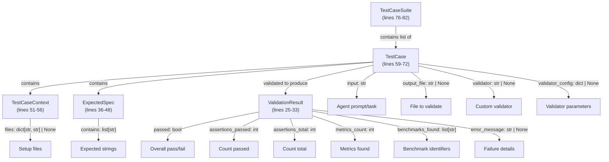
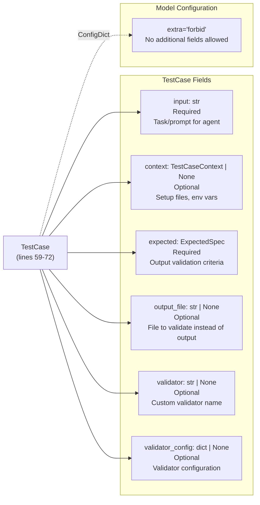
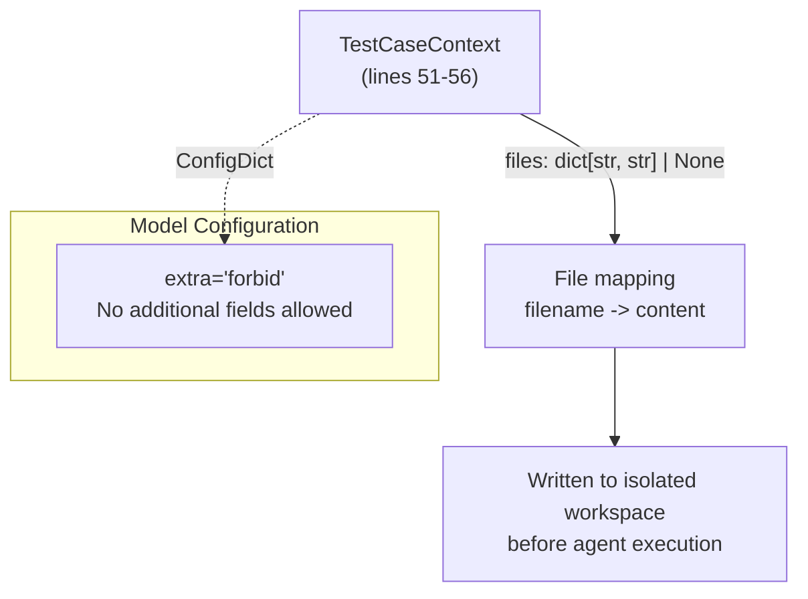
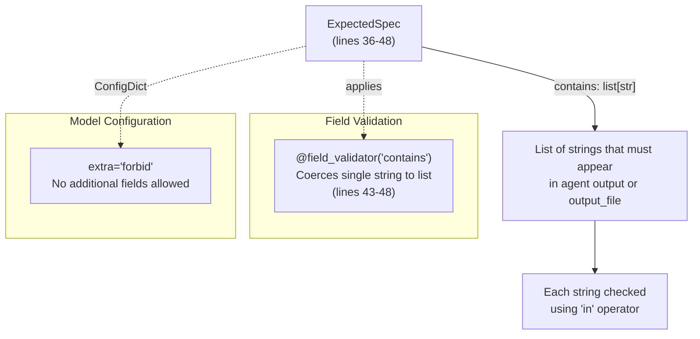
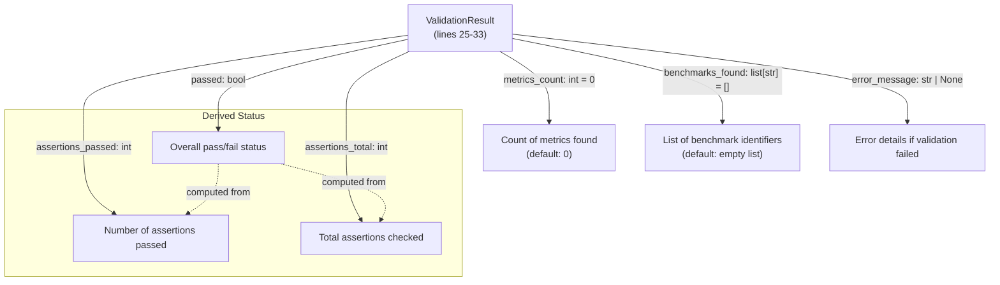
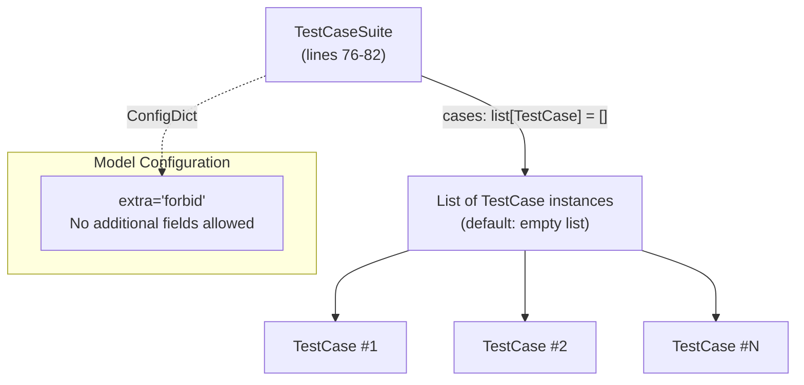
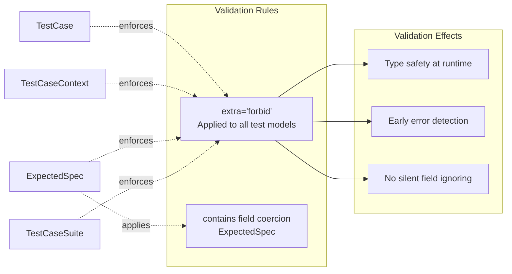
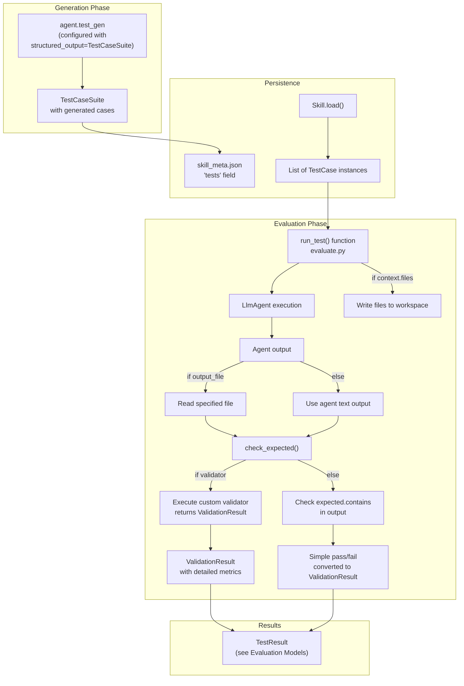
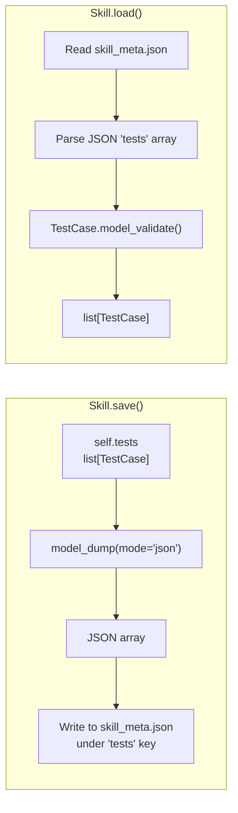

<!-- source: DeepWiki mcp.deepwiki.com · repo huggingface/upskill · page 7.2 Test Models · fetched 2026-10-26 -->

# Test Models

<details>
<summary>Relevant source files</summary>

The following files were used as context for generating this wiki page:

- [src/upskill/models.py](src/upskill/models.py)

</details>


This page documents the Pydantic data models that define test cases, validation specifications, and test results used in the skill evaluation system. These models enable structured test case generation, validation of agent outputs, and custom validation workflows.

For information about how test cases are generated, see [Test Case Generation](#5.2). For information about how test cases are evaluated and results are produced, see [Skill Evaluation](#5.3) and [Evaluation Models](#7.3).

## Overview

The test models provide a structured way to define test inputs, expected outputs, validation logic, and test results. The system supports both simple string-based validation and complex custom validators that can check file outputs, parse structured data, or perform specialized validation logic.

**Test Models Architecture**



**Sources:**
- [src/upskill/models.py:25-82]()

## TestCase Model

The `TestCase` class represents a single test case for skill evaluation. Each test case specifies an input prompt, optional context files, expected output criteria, and optional custom validation logic.

### Structure



### Field Definitions

| Field | Type | Required | Description |
|-------|------|----------|-------------|
| `input` | `str` | Yes | The task or prompt to give to the agent being evaluated |
| `context` | `TestCaseContext \| None` | No | Context payloads including setup files |
| `expected` | `ExpectedSpec` | Yes | Expected output checks (string containment) |
| `output_file` | `str \| None` | No | File path to validate instead of agent's text output |
| `validator` | `str \| None` | No | Name of custom validator function (e.g., "hf_eval_yaml") |
| `validator_config` | `dict[str, str \| int \| float \| bool] \| None` | No | Configuration parameters passed to the custom validator |

### Usage Patterns

**Simple String Validation:**
```python
TestCase(
    input="Create a Python function that adds two numbers",
    expected=ExpectedSpec(contains=["def", "return"])
)
```

**File-Based Validation:**
```python
TestCase(
    input="Generate a valid JSON configuration file",
    output_file="config.json",
    expected=ExpectedSpec(contains=['"model"']),
    validator="json_validator"
)
```

**Custom Validator with Configuration:**
```python
TestCase(
    input="Evaluate model performance",
    output_file="metrics.yaml",
    validator="hf_eval_yaml",
    validator_config={"min_accuracy": 0.85}
)
```

**Sources:**
- [src/upskill/models.py:59-72]()

## TestCaseContext Model

The `TestCaseContext` class provides context payloads that are made available to the agent during test execution. This enables tests to operate on pre-existing files or configurations.

### Structure



### Field Definitions

| Field | Type | Required | Description |
|-------|------|----------|-------------|
| `files` | `dict[str, str] \| None` | No | Dictionary mapping filenames to their text content |

### Usage

The `files` dictionary is used to create temporary files in an isolated workspace before the agent is executed. This allows test cases to validate file manipulation, code editing, or configuration updates.

**Example:**
```python
TestCaseContext(
    files={
        "data.csv": "name,age\nAlice,30\nBob,25",
        "config.yaml": "model: gpt-4\ntemperature: 0.7"
    }
)
```

During evaluation, these files are written to a temporary workspace directory, and the agent is executed in that context. See [Workspace Isolation](#10.2) for details.

**Sources:**
- [src/upskill/models.py:51-56]()

## ExpectedSpec Model

The `ExpectedSpec` class defines expected output criteria for a test case. It supports simple string containment checks, which are the primary validation mechanism for basic test cases.

### Structure



### Field Definitions

| Field | Type | Required | Description |
|-------|------|----------|-------------|
| `contains` | `list[str]` | Yes | List of strings that must appear in the output |

### Validation Logic

The `contains` field includes a validator that accepts either a single string or a list of strings, automatically coercing single strings to a list:

```python
@field_validator("contains", mode="before")
@classmethod
def coerce_contains(cls, value: str | list[str]) -> list[str]:
    if isinstance(value, str):
        return [value]
    return value
```

This allows flexible API usage:
```python
# Both of these are valid:
ExpectedSpec(contains="success")
ExpectedSpec(contains=["success", "completed"])
```

### Validation Behavior

During test execution, the evaluation system checks if each string in `contains` appears in the agent's output (or the specified `output_file`). All strings must be present for the test to pass. This is a substring match, not an exact match.

**Sources:**
- [src/upskill/models.py:36-48]()

## ValidationResult Model

The `ValidationResult` class represents the structured outcome of test validation, particularly for custom validators that perform complex checks beyond simple string containment.

### Structure



### Field Definitions

| Field | Type | Required | Default | Description |
|-------|------|----------|---------|-------------|
| `passed` | `bool` | Yes | - | Whether validation passed overall |
| `assertions_passed` | `int` | Yes | - | Number of individual assertions that passed |
| `assertions_total` | `int` | Yes | - | Total number of assertions checked |
| `metrics_count` | `int` | No | 0 | Count of metrics found in output |
| `benchmarks_found` | `list[str]` | No | `[]` | List of benchmark identifiers discovered |
| `error_message` | `str \| None` | No | `None` | Detailed error message if validation failed |

### Usage in Custom Validators

Custom validators return `ValidationResult` instances to provide detailed feedback on validation outcomes. This enables rich reporting of test failures and partial successes.

**Example from a custom validator:**
```python
def validate_yaml_metrics(output_file: Path, config: dict) -> ValidationResult:
    data = yaml.safe_load(output_file.read_text())
    
    assertions_total = len(config.get("required_metrics", []))
    assertions_passed = 0
    
    for metric in config.get("required_metrics", []):
        if metric in data:
            assertions_passed += 1
    
    return ValidationResult(
        passed=assertions_passed == assertions_total,
        assertions_passed=assertions_passed,
        assertions_total=assertions_total,
        metrics_count=len(data),
        error_message=None if assertions_passed == assertions_total else "Missing required metrics"
    )
```

**Sources:**
- [src/upskill/models.py:25-33]()

## TestCaseSuite Model

The `TestCaseSuite` class provides a structured container for a list of test cases. It is used primarily as the output format for the test generation agent.

### Structure



### Field Definitions

| Field | Type | Required | Default | Description |
|-------|------|----------|---------|-------------|
| `cases` | `list[TestCase]` | No | `[]` | List of test cases in the suite |

### Usage in Test Generation

The test generation agent (`test_gen`) is configured with structured output to produce `TestCaseSuite` instances. This ensures consistent formatting and enables automatic parsing of generated tests.

**Example:**
```python
suite = TestCaseSuite(
    cases=[
        TestCase(input="Task 1", expected=ExpectedSpec(contains=["result"])),
        TestCase(input="Task 2", expected=ExpectedSpec(contains=["success"])),
        TestCase(input="Task 3", expected=ExpectedSpec(contains=["complete"]))
    ]
)
```

The suite can be serialized to JSON for persistence alongside skills in `skill_meta.json`.

**Sources:**
- [src/upskill/models.py:76-82]()

## Field Validation and Constraints

All test models use Pydantic's `ConfigDict(extra="forbid")` configuration, which prevents additional fields from being added. This ensures that test case definitions remain standardized and prevents typos or undefined fields from being silently ignored.

### Constraint Enforcement



**Sources:**
- [src/upskill/models.py:39]() (ExpectedSpec)
- [src/upskill/models.py:54]() (TestCaseContext)
- [src/upskill/models.py:62]() (TestCase)
- [src/upskill/models.py:79]() (TestCaseSuite)

## Integration with Evaluation Pipeline

Test models flow through the evaluation pipeline from generation to execution to validation. The following diagram shows how these models are used in the complete evaluation workflow.



**Sources:**
- [src/upskill/models.py:59-82]() (Test models)
- Test generation: [Test Case Generation](#5.2)
- Evaluation logic: [Skill Evaluation](#5.3)

## Serialization and Persistence

Test cases are serialized to JSON format and persisted in the `skill_meta.json` file alongside each skill. The `Skill.save()` method handles serialization, while `Skill.load()` handles deserialization.

### Serialization Process



### Example skill_meta.json Structure

```json
{
  "metadata": {
    "version": "1.0",
    "generated_by": "claude-opus-4-20250514",
    "generated_at": "2024-01-15T10:30:00",
    "source_task": "Generate CSV parsing utilities"
  },
  "tests": [
    {
      "input": "Parse the data.csv file and count rows",
      "context": {
        "files": {
          "data.csv": "name,age\nAlice,30\nBob,25"
        }
      },
      "expected": {
        "contains": ["2 rows"]
      }
    },
    {
      "input": "Extract names from data.csv",
      "context": {
        "files": {
          "data.csv": "name,age\nAlice,30\nBob,25"
        }
      },
      "expected": {
        "contains": ["Alice", "Bob"]
      },
      "output_file": "names.txt"
    }
  ]
}
```

**Sources:**
- [src/upskill/models.py:148-168]() (Skill.save method)
- [src/upskill/models.py:184-273]() (Skill.load method)
- [src/upskill/models.py:238-243]() (Test case loading)

## Summary

The test models provide a flexible framework for defining, executing, and validating test cases in the upskill system. Key capabilities include:

- **Structured test definitions** with `TestCase` supporting inputs, context, and expected outputs
- **Context provisioning** via `TestCaseContext` for file-based tests
- **Flexible validation** supporting both simple string containment (`ExpectedSpec`) and custom validators (`ValidationResult`)
- **Test suite organization** with `TestCaseSuite` for batch test generation
- **Type safety** enforced through Pydantic's `extra="forbid"` configuration
- **JSON serialization** for persistence alongside skills in `skill_meta.json`

These models enable the automated generation, evaluation, and refinement workflows described in [Skill Lifecycle](#5).

**Sources:**
- [src/upskill/models.py:25-82]() (All test models)

---

