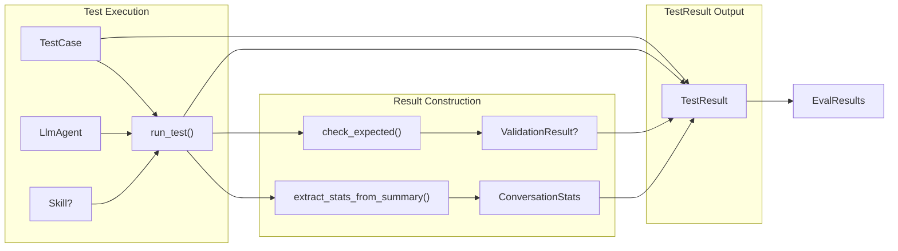
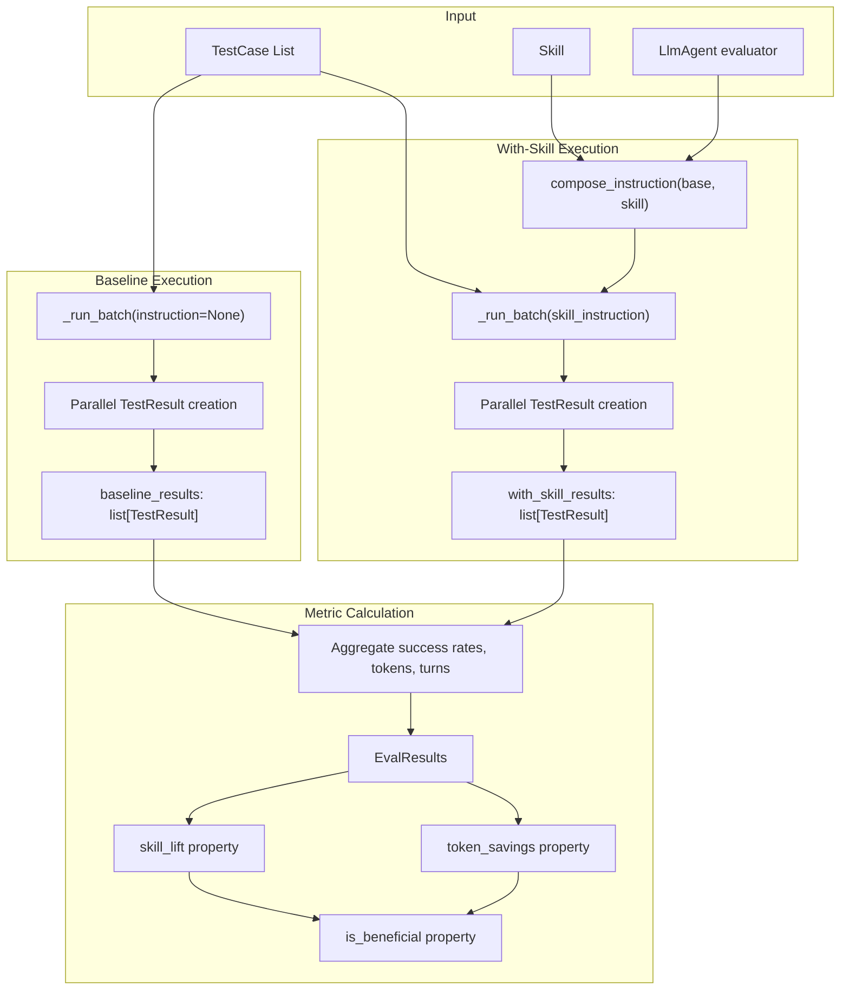
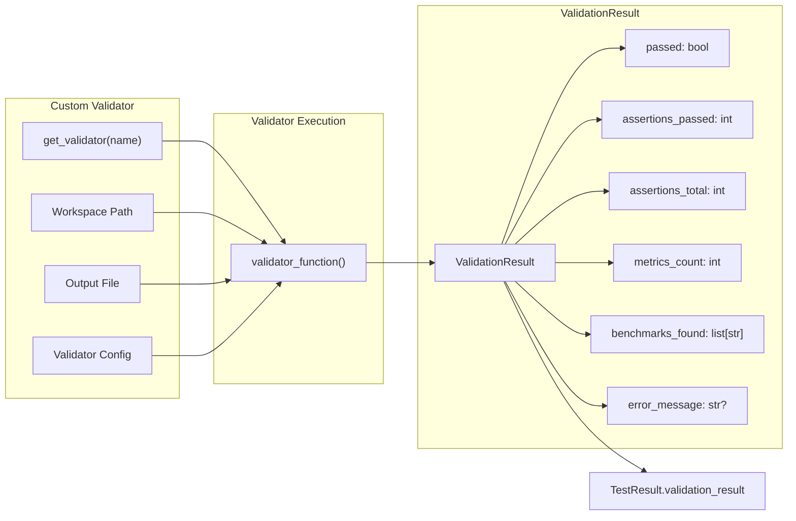
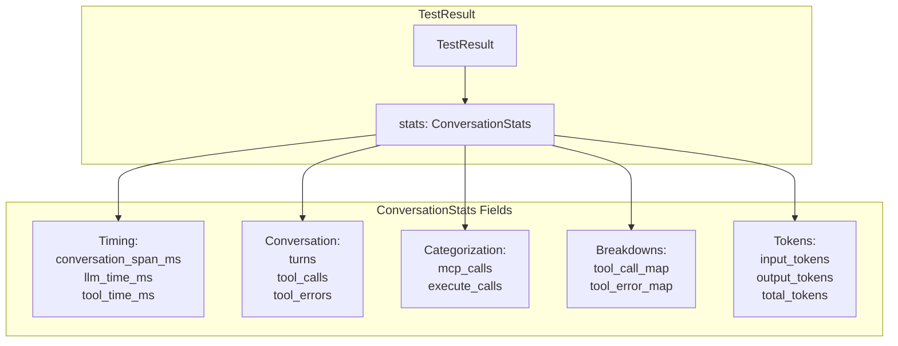
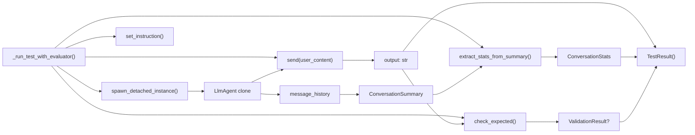
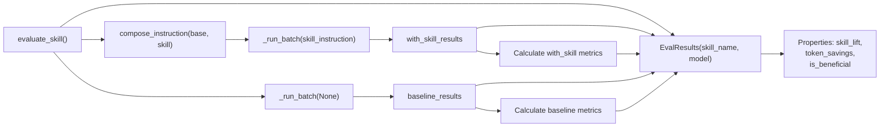

<!-- source: DeepWiki mcp.deepwiki.com · repo huggingface/upskill · page 7.3 Evaluation Models · fetched 2026-10-26 -->

# Evaluation Models

<details>
<summary>Relevant source files</summary>

The following files were used as context for generating this wiki page:

- [src/upskill/evaluate.py](src/upskill/evaluate.py)
- [src/upskill/models.py](src/upskill/models.py)

</details>


This document describes the Pydantic data models that represent evaluation outcomes and performance comparisons. These models capture the results of running test cases and comparing baseline performance against with-skill performance.

For test case definitions, see [Test Models](#7.2). For run logging and batch analysis models, see [Logging Models](#7.4). For the evaluation workflow that produces these models, see [Skill Evaluation](#5.3).

---

## Overview

The evaluation system uses two primary models:

- **`TestResult`**: Represents the outcome of executing a single test case with an agent
- **`EvalResults`**: Aggregates and compares test results between baseline (no skill) and with-skill runs

These models provide comprehensive metrics for determining whether a skill provides measurable benefit, including success rates, token usage, conversation turns, and detailed validation results.

**Sources:** [src/upskill/models.py:314-364]()

---

## TestResult Model

The `TestResult` class captures the complete outcome of running a single test case through the evaluator agent.

### Structure

```python
class TestResult(BaseModel):
    test_case: TestCase
    success: bool
    output: str | None = None
    tokens_used: int = 0  # Legacy field
    turns: int = 0  # Legacy field
    error: str | None = None
    stats: ConversationStats = Field(default_factory=ConversationStats)
    validation_result: ValidationResult | None = None
```

### Fields Reference

| Field | Type | Description |
|-------|------|-------------|
| `test_case` | `TestCase` | The original test case that was executed |
| `success` | `bool` | Whether the test passed validation |
| `output` | `str \| None` | The agent's response to the test input |
| `tokens_used` | `int` | **Deprecated:** Total tokens (use `stats.total_tokens` instead) |
| `turns` | `int` | **Deprecated:** Conversation turns (use `stats.turns` instead) |
| `error` | `str \| None` | Error message if the test failed with an exception |
| `stats` | `ConversationStats` | Comprehensive conversation metrics (timing, tokens, tool calls) |
| `validation_result` | `ValidationResult \| None` | Detailed validation results for custom validators |

### Usage in Evaluation Workflow



**Diagram: TestResult Construction Flow**

The `TestResult` is constructed in the `_run_test_with_evaluator` function, which:
1. Spawns a detached agent instance
2. Optionally enables workspace isolation for file-based validators
3. Executes the test by sending input to the agent
4. Extracts conversation statistics from the message history
5. Validates output against expected conditions
6. Returns a complete `TestResult` with all metrics

**Sources:** [src/upskill/evaluate.py:99-179](), [src/upskill/models.py:314-327]()

---

## EvalResults Model

The `EvalResults` class aggregates test results and computes comparative metrics between baseline and with-skill performance.

### Structure

```python
class EvalResults(BaseModel):
    skill_name: str
    model: str
    
    # With skill
    with_skill_results: list[TestResult] = Field(default_factory=list)
    with_skill_success_rate: float = 0.0
    with_skill_total_tokens: int = 0
    with_skill_avg_turns: float = 0.0
    
    # Without skill (baseline)
    baseline_results: list[TestResult] = Field(default_factory=list)
    baseline_success_rate: float = 0.0
    baseline_total_tokens: int = 0
    baseline_avg_turns: float = 0.0
```

### Fields Reference

| Field | Type | Description |
|-------|------|-------------|
| `skill_name` | `str` | Name of the skill being evaluated |
| `model` | `str` | Model identifier used for evaluation |
| `with_skill_results` | `list[TestResult]` | Individual test results when skill is enabled |
| `with_skill_success_rate` | `float` | Ratio of successful tests with skill (0.0 to 1.0) |
| `with_skill_total_tokens` | `int` | Total tokens consumed across all with-skill tests |
| `with_skill_avg_turns` | `float` | Average conversation turns with skill enabled |
| `baseline_results` | `list[TestResult]` | Individual test results without skill |
| `baseline_success_rate` | `float` | Ratio of successful tests in baseline (0.0 to 1.0) |
| `baseline_total_tokens` | `int` | Total tokens consumed in baseline runs |
| `baseline_avg_turns` | `float` | Average conversation turns in baseline |

**Sources:** [src/upskill/models.py:329-346]()

---

## Derived Metrics

The `EvalResults` class provides computed properties that determine skill effectiveness:

### skill_lift

```python
@property
def skill_lift(self) -> float:
    """Improvement in success rate from using skill."""
    return self.with_skill_success_rate - self.baseline_success_rate
```

**Interpretation:**
- Positive values indicate the skill improves success rate
- Negative values indicate the skill degrades performance
- Value of 0.10 means 10% improvement in success rate

### token_savings

```python
@property
def token_savings(self) -> float:
    """Percentage of tokens saved (negative means more tokens used)."""
    if self.baseline_total_tokens == 0:
        return 0.0
    return 1 - (self.with_skill_total_tokens / self.baseline_total_tokens)
```

**Interpretation:**
- Positive values indicate token reduction
- Negative values indicate increased token usage
- Value of 0.25 means 25% token savings

### is_beneficial

```python
@property
def is_beneficial(self) -> bool:
    """Skill provides net benefit."""
    return self.skill_lift > 0.05 or (self.skill_lift >= 0 and self.token_savings > 0.2)
```

**Decision Logic:**

A skill is considered beneficial if either:
1. **Success improvement > 5%**: `skill_lift > 0.05`
2. **Efficiency gain**: `skill_lift >= 0` (no degradation) AND `token_savings > 0.2` (20%+ token savings)

This dual criterion allows skills to be accepted if they either improve accuracy or improve efficiency without harming accuracy.

**Sources:** [src/upskill/models.py:347-364]()

---

## Evaluation Comparison Flow



**Diagram: EvalResults Construction and Metric Derivation**

The `evaluate_skill` function in [src/upskill/evaluate.py:211-286]() orchestrates the comparison:

1. **Parallel Execution**: Both baseline and with-skill batches run test cases concurrently using `asyncio.gather`
2. **Metric Aggregation**: Success rates and token totals are computed from individual `TestResult` objects
3. **Derived Properties**: `skill_lift`, `token_savings`, and `is_beneficial` are computed on-demand via properties

**Sources:** [src/upskill/evaluate.py:211-286](), [src/upskill/models.py:329-364]()

---

## Validation Results Integration

When custom validators are used (see [Custom Validators](#10.1)), the `TestResult` includes a `ValidationResult` object with detailed metrics:



**Diagram: ValidationResult Integration in TestResult**

The `check_expected` function in [src/upskill/evaluate.py:62-97]() handles both simple string containment checks and custom validator invocation. When a custom validator is specified:

1. The validator function is retrieved by name
2. Workspace path and output file are provided
3. The validator returns a structured `ValidationResult`
4. This result is stored in `TestResult.validation_result`

**Sources:** [src/upskill/evaluate.py:62-97](), [src/upskill/models.py:25-33]()

---

## Relationship to ConversationStats

The `TestResult.stats` field contains a `ConversationStats` object that provides detailed performance metrics:



**Diagram: ConversationStats Embedded in TestResult**

The `ConversationStats` object is populated by extracting data from FastAgent's message history channels (`FAST_AGENT_USAGE` and `FAST_AGENT_TIMING`). See [Logging Models](#7.4) for complete `ConversationStats` documentation.

**Sources:** [src/upskill/models.py:277-312](), [src/upskill/evaluate.py:131-139]()

---

## Code Entity Mapping

### TestResult Creation



**Diagram: TestResult Construction Code Flow**

Key functions:
- `_run_test_with_evaluator()` in [src/upskill/evaluate.py:99-179]()
- `extract_stats_from_summary()` in [src/upskill/logging.py:96-216]()
- `check_expected()` in [src/upskill/evaluate.py:62-97]()

**Sources:** [src/upskill/evaluate.py:99-179]()

### EvalResults Construction



**Diagram: EvalResults Construction Code Flow**

Key functions:
- `evaluate_skill()` in [src/upskill/evaluate.py:211-286]()
- `_run_batch()` local function in [src/upskill/evaluate.py:235-250]()
- `compose_instruction()` in [src/upskill/fastagent_integration.py]()

**Sources:** [src/upskill/evaluate.py:211-286]()

---

## Usage Examples

### Accessing Individual Test Results

```python
eval_results: EvalResults = await evaluate_skill(skill, test_cases, evaluator)

# Examine specific test failures
for result in eval_results.with_skill_results:
    if not result.success:
        print(f"Failed test: {result.test_case.input}")
        print(f"Error: {result.error}")
        print(f"Tokens used: {result.stats.total_tokens}")
        print(f"Turns: {result.stats.turns}")
```

### Comparing Performance Metrics

```python
# Check derived metrics
print(f"Success rate lift: {eval_results.skill_lift:.2%}")
print(f"Token savings: {eval_results.token_savings:.2%}")
print(f"Is beneficial: {eval_results.is_beneficial}")

# Compare averages
print(f"Avg turns (baseline): {eval_results.baseline_avg_turns:.1f}")
print(f"Avg turns (with skill): {eval_results.with_skill_avg_turns:.1f}")
```

### Extracting Failure Descriptions

The `get_failure_descriptions()` helper function formats failed tests for refinement:

```python
failures = get_failure_descriptions(eval_results)
for failure in failures:
    print(failure)
    # Output: "Input: <task> | Output: <response> | Expected: <conditions>"
```

**Sources:** [src/upskill/evaluate.py:289-302]()

---

## Summary

The evaluation models provide a comprehensive representation of test execution outcomes and performance comparisons:

- **`TestResult`**: Captures single test execution with success status, output, errors, and detailed conversation statistics
- **`EvalResults`**: Aggregates baseline vs with-skill results and computes derived metrics for benefit assessment

These models integrate with `ConversationStats` for detailed performance tracking and support custom validators through `ValidationResult`. The `is_beneficial` property implements the dual-criterion decision logic that determines whether skills should be accepted during the refinement loop.

**Sources:** [src/upskill/models.py:314-364](), [src/upskill/evaluate.py:1-303]()

---

