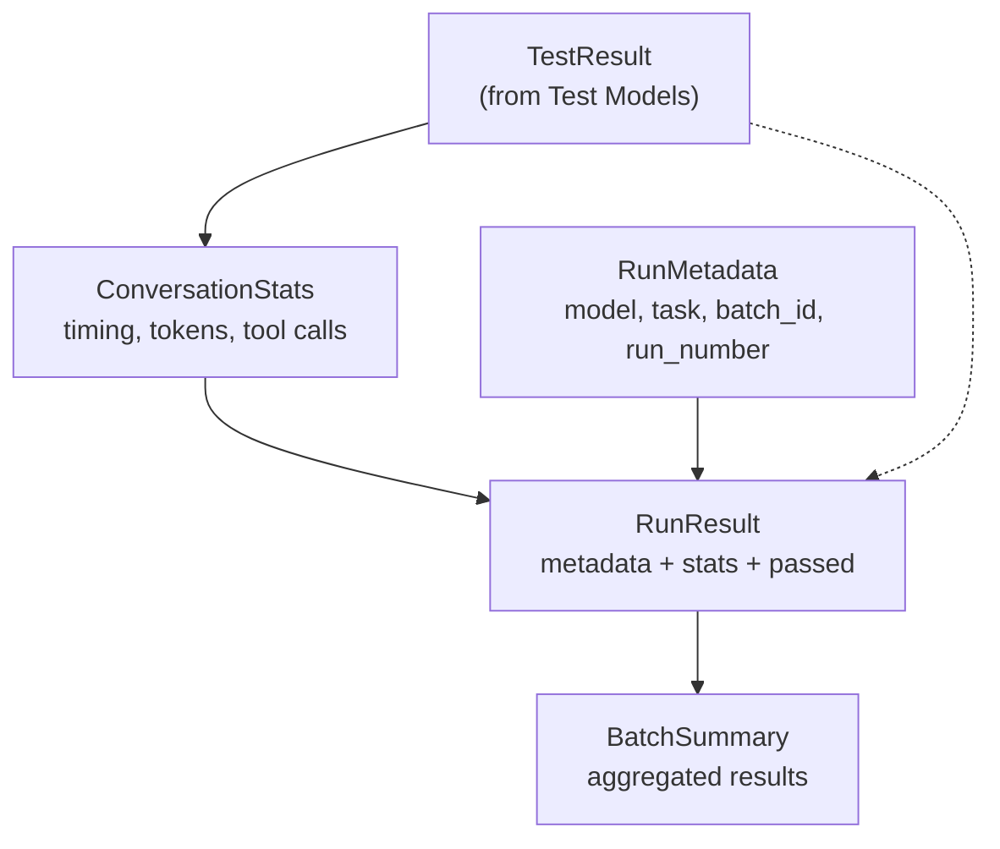
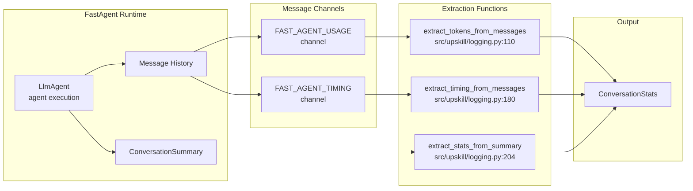
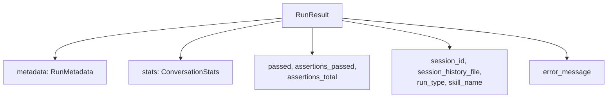

<!-- source: DeepWiki mcp.deepwiki.com · repo huggingface/upskill · page 7.4 Logging Models · fetched 2026-10-26 -->

# Logging Models

<details>
<summary>Relevant source files</summary>

The following files were used as context for generating this wiki page:

- [src/upskill/logging.py](src/upskill/logging.py)
- [src/upskill/models.py](src/upskill/models.py)

</details>


## Purpose and Scope

This page documents the Pydantic data models used for logging evaluation runs and tracking performance metrics. These models capture comprehensive statistics about agent conversations, including timing, token usage, tool calls, and validation results. 

For information about skill-related models (Skill, SkillDraft, SkillMetadata), see [Skill Models](#7.1). For test case models (TestCase, TestCaseSuite), see [Test Models](#7.2). For evaluation comparison models (EvalResults), see [Evaluation Models](#7.3).

## Overview

The logging models form a hierarchical structure for tracking individual test runs and aggregating results across batches:



**Sources:** [src/upskill/models.py:277-426]()

## ConversationStats

The `ConversationStats` model captures detailed metrics from a single agent conversation. It aggregates data from FastAgent's message channels and conversation summaries.

### Class Definition

Defined in [src/upskill/models.py:277-312]().

```python
class ConversationStats(BaseModel):
    """Statistics from a conversation/run."""
```

### Fields

| Field | Type | Description |
|-------|------|-------------|
| `conversation_span_ms` | `float` | Total elapsed time for the conversation in milliseconds |
| `llm_time_ms` | `float` | Time spent in LLM calls (milliseconds) |
| `tool_time_ms` | `float` | Time spent in tool execution (milliseconds) |
| `turns` | `int` | Number of conversation turns |
| `tool_calls` | `int` | Total number of tool invocations |
| `tool_errors` | `int` | Number of tool calls that resulted in errors |
| `mcp_calls` | `int` | Tool calls to MCP server tools (identified by "__" in name) |
| `execute_calls` | `int` | Tool calls to built-in execute functions |
| `tool_call_map` | `dict[str, int]` | Per-tool breakdown: tool_name → call count |
| `tool_error_map` | `dict[str, int]` | Per-tool error breakdown: tool_name → error count |
| `input_tokens` | `int` | Total input tokens consumed |
| `output_tokens` | `int` | Total output tokens generated |
| `total_tokens` | `int` | Total billing tokens (typically input + output) |
| `usage_summaries` | `list[dict[str, object]]` | Raw usage data from FastAgent |
| `timing_summaries` | `list[dict[str, object]]` | Raw timing data from FastAgent |

### Tool Categorization

The model distinguishes between two types of tool calls:

- **MCP calls**: Tools with "__" in their name (e.g., `filesystem__read_file`), which are proxied to MCP servers
- **Execute calls**: Tools without "__" (e.g., `execute_bash`), which are built-in agent capabilities

This categorization is computed in [src/upskill/logging.py:220-226]():

```python
mcp_calls = sum(count for name, count in tool_call_map.items() if "__" in name)
execute_calls = sum(count for name, count in tool_call_map.items() if "__" not in name)
```

### Legacy Property

For backwards compatibility, a `tokens` property provides access to `total_tokens`:

```python
@property
def tokens(self) -> int:
    """Legacy accessor for total tokens."""
    return self.total_tokens
```

**Sources:** [src/upskill/models.py:277-312](), [src/upskill/logging.py:220-226]()

## Metrics Extraction Flow

The following diagram shows how `ConversationStats` is populated from FastAgent execution:



### extract_stats_from_summary

The primary function for extracting statistics is `extract_stats_from_summary` [src/upskill/logging.py:204-250](). It processes a FastAgent `ConversationSummary` object:

```python
def extract_stats_from_summary(summary: ConversationSummary) -> ConversationStats
```

This function:
1. Extracts timing metrics from the summary (conversation span, LLM time)
2. Calculates tool time as the difference between total and LLM time
3. Gets tool call counts and per-tool breakdowns from `summary.tool_call_map` and `summary.tool_error_map`
4. Categorizes tools into MCP vs Execute calls based on "__" presence
5. Calls `extract_tokens_from_messages` to get token counts from message channels
6. Calls `extract_timing_from_messages` to get detailed timing payloads

### extract_tokens_from_messages

Defined in [src/upskill/logging.py:110-174](), this function parses the `FAST_AGENT_USAGE` message channel:

```python
def extract_tokens_from_messages(
    messages: list,
) -> tuple[int, int, int, list[dict[str, object]]]
```

Returns: `(input_tokens, output_tokens, total_tokens, usage_summaries)`

The function looks for JSON payloads in the usage channel, which contain either:
- Per-turn data: `{"turn": {"input_tokens": ..., "output_tokens": ..., "total_tokens": ...}}`
- Cumulative summaries: `{"summary": {"cumulative_input_tokens": ..., "cumulative_output_tokens": ..., "cumulative_billing_tokens": ...}}`

### extract_timing_from_messages

Defined in [src/upskill/logging.py:180-201](), this function extracts timing data from the `FAST_AGENT_TIMING` channel:

```python
def extract_timing_from_messages(messages: list) -> list[dict[str, object]]
```

Returns a list of timing payloads for detailed performance analysis.

**Sources:** [src/upskill/logging.py:110-250]()

## RunMetadata

The `RunMetadata` model captures context about a single evaluation run.

### Class Definition

Defined in [src/upskill/models.py:369-376]().

```python
class RunMetadata(BaseModel):
    """Metadata for a single run."""
```

### Fields

| Field | Type | Description |
|-------|------|-------------|
| `model` | `str` | Model identifier (e.g., "claude-3-5-sonnet-20241022") |
| `task` | `str` | Task description being evaluated |
| `batch_id` | `str` | Batch identifier (timestamp: YYYY_MM_DD_HH_MM) |
| `run_number` | `int` | Sequential run number within the batch |
| `timestamp` | `datetime` | When the run was executed |

### Persistence

`RunMetadata` is written to `run_metadata.json` in each run folder by `write_run_metadata` [src/upskill/logging.py:67-77]():

```python
def write_run_metadata(run_folder: Path, metadata: RunMetadata) -> None
```

Example JSON output:
```json
{
  "model": "claude-3-5-sonnet-20241022",
  "task": "Create a skill for code review",
  "batch_id": "2024_01_15_14_30",
  "run_number": 1,
  "timestamp": "2024-01-15T14:30:25.123456"
}
```

**Sources:** [src/upskill/models.py:369-376](), [src/upskill/logging.py:67-77]()

## RunResult

The `RunResult` model combines metadata, statistics, and validation results for a complete picture of a single run.

### Class Definition

Defined in [src/upskill/models.py:379-394]().

```python
class RunResult(BaseModel):
    """Complete result from a single run."""
```

### Fields

| Field | Type | Description |
|-------|------|-------------|
| `metadata` | `RunMetadata` | Context about the run (model, task, batch, etc.) |
| `stats` | `ConversationStats` | Detailed conversation metrics |
| `passed` | `bool` | Whether the run passed validation |
| `assertions_passed` | `int` | Number of passing assertions |
| `assertions_total` | `int` | Total number of assertions checked |
| `error_message` | `str \| None` | Error message if run failed |
| `session_id` | `str \| None` | FastAgent session identifier |
| `session_history_file` | `str \| None` | Path to session history JSON |
| `run_type` | `str` | "with_skill" or "baseline" |
| `skill_name` | `str \| None` | Name of skill being evaluated |

### Structure



### Persistence

`RunResult` is written to `run_result.json` by `write_run_result` [src/upskill/logging.py:91-95]():

```python
def write_run_result(run_folder: Path, result: RunResult) -> None
```

And loaded by `load_run_result` [src/upskill/logging.py:98-107]():

```python
def load_run_result(run_folder: Path) -> RunResult | None
```

**Sources:** [src/upskill/models.py:379-394](), [src/upskill/logging.py:91-107]()

## BatchSummary

The `BatchSummary` model aggregates results across multiple runs in a batch.

### Class Definition

Defined in [src/upskill/models.py:396-426]().

```python
class BatchSummary(BaseModel):
    """Summary of a batch of runs."""
```

### Fields

| Field | Type | Description |
|-------|------|-------------|
| `batch_id` | `str` | Batch identifier |
| `model` | `str` | Model used for the batch |
| `task` | `str` | Task being evaluated |
| `total_runs` | `int` | Total number of runs |
| `passed_runs` | `int` | Number of successful runs |
| `results` | `list[RunResult]` | Complete list of all run results |

### Computed Properties

The model provides three computed properties for analysis:

```python
@property
def pass_rate(self) -> float:
    """Calculate pass rate for the batch."""
    if self.total_runs == 0:
        return 0.0
    return self.passed_runs / self.total_runs

@property
def avg_tokens(self) -> float:
    """Calculate average tokens used across runs."""
    if not self.results:
        return 0.0
    return sum(r.stats.total_tokens for r in self.results) / len(self.results)

@property
def avg_llm_time_ms(self) -> float:
    """Calculate average LLM time across runs."""
    if not self.results:
        return 0.0
    return sum(r.stats.llm_time_ms for r in self.results) / len(self.results)
```

### Persistence

`BatchSummary` is written to `batch_summary.json` by `write_batch_summary` [src/upskill/logging.py:411-415]():

```python
def write_batch_summary(batch_folder: Path, summary: BatchSummary) -> None
```

**Sources:** [src/upskill/models.py:396-426](), [src/upskill/logging.py:411-415]()

## Data Flow Architecture

The following diagram shows how logging models are created, populated, and persisted:

```mermaid
graph TB
    subgraph "Test Execution"
        RunTest["run_test<br/>src/upskill/evaluate.py"]
        Agent["LlmAgent<br/>detached execution"]
        Summary["ConversationSummary<br/>from agent"]
    end
    
    subgraph "Metrics Extraction"
        ExtractStats["extract_stats_from_summary<br/>src/upskill/logging.py:204"]
        ConvStats["ConversationStats<br/>timing, tokens, tools"]
    end
    
    subgraph "Result Construction"
        CreateMeta["Create RunMetadata<br/>model, task, batch_id"]
        CreateResult["Create RunResult<br/>metadata + stats + validation"]
        AggregateStats["aggregate_conversation_stats<br/>src/upskill/logging.py:255"]
    end
    
    subgraph "Persistence Layer"
        CreateBatch["create_batch_folder<br/>src/upskill/logging.py:48"]
        CreateRun["create_run_folder<br/>src/upskill/logging.py:60"]
        WriteMeta["write_run_metadata<br/>run_metadata.json"]
        WriteResult["write_run_result<br/>run_result.json"]
        WriteBatch["write_batch_summary<br/>batch_summary.json"]
    end
    
    subgraph "File System"
        BatchDir["batch_YYYYMMDD_HHMM/"]
        RunDir["run_N/"]
        MetaFile["run_metadata.json"]
        ResultFile["run_result.json"]
        SummaryFile["batch_summary.json"]
    end
    
    RunTest --> Agent
    Agent --> Summary
    Summary --> ExtractStats
    ExtractStats --> ConvStats
    
    ConvStats --> CreateResult
    CreateMeta --> CreateResult
    
    CreateResult --> WriteResult
    CreateMeta --> WriteMeta
    
    CreateBatch --> BatchDir
    CreateRun --> RunDir
    
    WriteMeta --> MetaFile
    WriteResult --> ResultFile
    WriteBatch --> SummaryFile
    
    MetaFile --> RunDir
    ResultFile --> RunDir
    RunDir --> BatchDir
    SummaryFile --> BatchDir
    
    AggregateStats -.-> "Multiple ConversationStats"
```

**Sources:** [src/upskill/logging.py:48-65](), [src/upskill/logging.py:204-250](), [src/upskill/logging.py:255-279]()

## CSV Export

The logging system can export all run results to CSV format for external analysis.

### Field Names

The CSV export includes 24+ metrics columns, defined in [src/upskill/logging.py:16-45]():

```python
FIELDNAMES = [
    "batch_id",
    "run_number",
    "model",
    "task",
    "timestamp",
    "passed",
    "assertions_passed",
    "assertions_total",
    # Token metrics
    "input_tokens",
    "output_tokens",
    "total_tokens",
    # Timing metrics
    "conversation_span_ms",
    "llm_time_ms",
    "tool_time_ms",
    # Conversation metrics
    "turns",
    "tool_calls",
    "tool_errors",
    # Tool categorization
    "mcp_calls",
    "execute_calls",
    # Error and session info
    "error_message",
    "session_id",
    "session_history_file",
]
```

### Export Function

The `summarize_runs_to_csv` function [src/upskill/logging.py:336-408]() scans all run folders and exports results:

```python
def summarize_runs_to_csv(runs_folder: Path, output_path: Path | None = None) -> Path
```

This function:
1. Uses `iter_run_folders` [src/upskill/logging.py:319-333]() to find all run directories
2. Loads each `RunResult` using `load_run_result`
3. Extracts metrics from `RunResult.metadata` and `RunResult.stats`
4. Writes rows to CSV with all FIELDNAMES columns

### CSV Row Construction

Each CSV row maps `RunResult` fields to columns [src/upskill/logging.py:377-406]():

```python
row = {
    "batch_id": result.metadata.batch_id,
    "run_number": result.metadata.run_number,
    "model": result.metadata.model,
    "task": result.metadata.task,
    "timestamp": result.metadata.timestamp.isoformat(),
    "passed": result.passed,
    "assertions_passed": result.assertions_passed,
    "assertions_total": result.assertions_total,
    # Token metrics from stats
    "input_tokens": result.stats.input_tokens,
    "output_tokens": result.stats.output_tokens,
    "total_tokens": result.stats.total_tokens,
    # ... (timing, conversation, tool metrics)
}
```

**Sources:** [src/upskill/logging.py:16-45](), [src/upskill/logging.py:336-408]()

## Aggregation Functions

The logging module provides utility functions for aggregating statistics across multiple test results.

### aggregate_conversation_stats

Defined in [src/upskill/logging.py:255-279](), this function combines multiple `ConversationStats` objects:

```python
def aggregate_conversation_stats(results: list[TestResult]) -> ConversationStats
```

The function:
- Sums timing metrics (conversation_span_ms, llm_time_ms, tool_time_ms)
- Sums conversation metrics (turns, tool_calls, tool_errors, mcp_calls, execute_calls)
- Sums token metrics (input_tokens, output_tokens, total_tokens)
- Merges tool_call_map and tool_error_map dictionaries by summing counts
- Concatenates usage_summaries and timing_summaries lists

This is used in evaluation to aggregate baseline and with-skill results for comparison.

### summarize_conversation_stats

Defined in [src/upskill/logging.py:282-316](), this is a fallback function for extracting stats from session history files:

```python
def summarize_conversation_stats(history_path: Path | None) -> ConversationStats
```

This function is used when `ConversationSummary` is not available. It:
1. Loads the session history JSON file
2. Counts turns (user messages)
3. Attempts to extract token usage from the last assistant message
4. Returns a minimal `ConversationStats` with available data

**Sources:** [src/upskill/logging.py:255-316]()

## Usage Example

The following table shows how logging models are used during skill evaluation:

| Phase | Action | Models Used |
|-------|--------|-------------|
| **Setup** | Create batch folder | `batch_id` (string) |
| **Per Test** | Run test case | `TestResult` → `ConversationStats` |
| **Per Test** | Extract metrics | `ConversationSummary` → `ConversationStats` |
| **Per Run** | Create metadata | `RunMetadata(model, task, batch_id, run_number)` |
| **Per Run** | Aggregate test stats | `aggregate_conversation_stats(results)` |
| **Per Run** | Create result | `RunResult(metadata, stats, passed, ...)` |
| **Per Run** | Persist result | `write_run_result(run_folder, result)` |
| **Batch End** | Create summary | `BatchSummary(batch_id, model, task, results)` |
| **Batch End** | Persist summary | `write_batch_summary(batch_folder, summary)` |
| **Analysis** | Export to CSV | `summarize_runs_to_csv(runs_folder)` |

**Sources:** [src/upskill/logging.py:48-416](), [src/upskill/models.py:277-426]()

---

