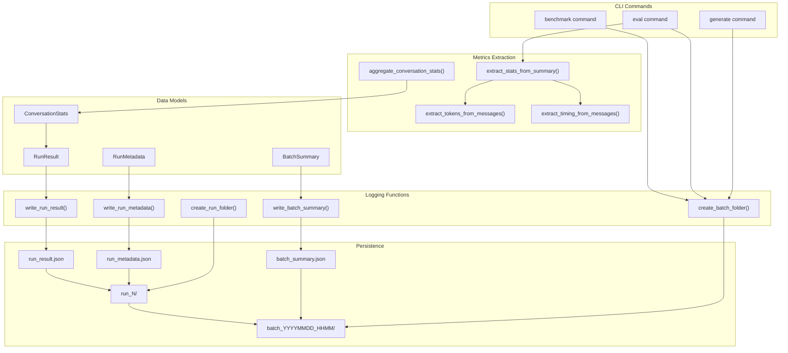
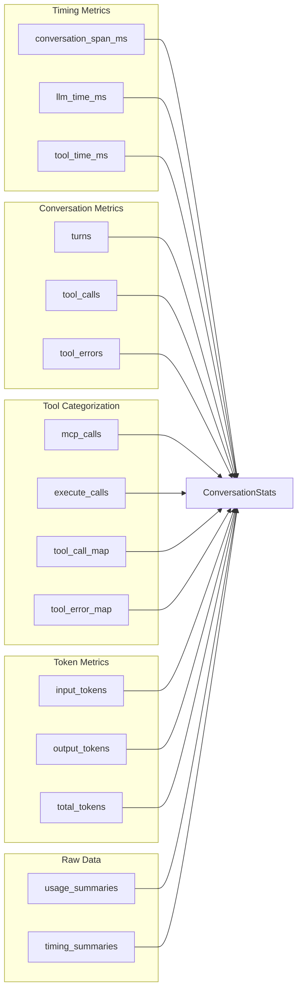
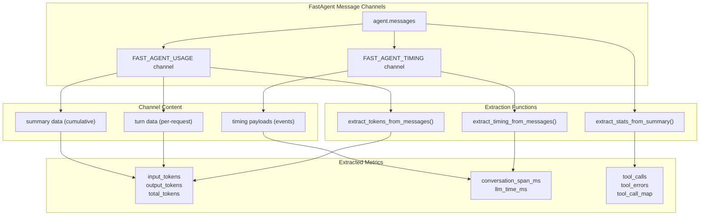
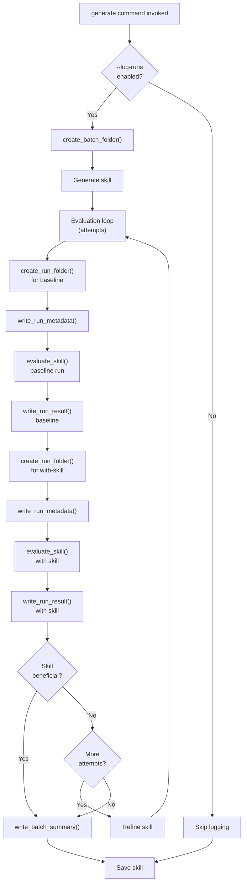
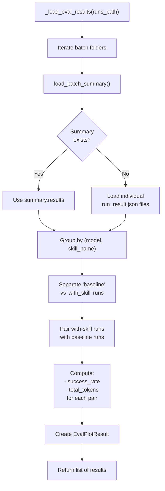
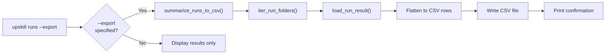

<!-- source: DeepWiki mcp.deepwiki.com · repo huggingface/upskill · page 8 Run Logging and Metrics · fetched 2026-10-26 -->

# Run Logging and Metrics

<details>
<summary>Relevant source files</summary>

The following files were used as context for generating this wiki page:

- [src/upskill/cli.py](src/upskill/cli.py)
- [src/upskill/logging.py](src/upskill/logging.py)
- [src/upskill/models.py](src/upskill/models.py)
- [tests/test_smoke.py](tests/test_smoke.py)

</details>


## Purpose and Scope

This document explains how upskill tracks evaluation runs, collects performance metrics, and persists results for analysis. The logging system captures comprehensive execution data including token usage, timing information, tool call patterns, and success rates. This enables comparing skill performance across models and runs, identifying performance regressions, and exporting data for external analysis.

For information about the evaluation logic that generates these metrics, see [Skill Evaluation](#5.3). For the data models used in logging, see [Logging Models](#7.4).

## System Overview

The run logging system operates in three phases:

1. **Batch Creation**: Each evaluation session creates a timestamped batch folder to group related runs
2. **Run Recording**: Individual test executions are logged to numbered run folders with metadata and results
3. **Aggregation**: Batch summaries aggregate statistics across all runs for quick analysis

The system extracts rich metrics from FastAgent's message channels, including token counts from `FAST_AGENT_USAGE` and timing data from `FAST_AGENT_TIMING`. This provides detailed observability into agent behavior beyond simple pass/fail status.



**Sources:** [src/upskill/logging.py:1-428](), [src/upskill/cli.py:24-34](), [src/upskill/models.py:277-426]()

## Run Directory Structure

### Batch and Run Hierarchy

The logging system organizes runs into a two-level directory structure:

```
./runs/
├── 2024_01_15_14_30/              # Batch folder (timestamped)
│   ├── run_1/                      # First run (baseline)
│   │   ├── run_metadata.json
│   │   └── run_result.json
│   ├── run_2/                      # Second run (with skill)
│   │   ├── run_metadata.json
│   │   └── run_result.json
│   ├── run_3/                      # Third run (refinement baseline)
│   │   ├── run_metadata.json
│   │   └── run_result.json
│   ├── run_4/                      # Fourth run (refined skill)
│   │   ├── run_metadata.json
│   │   └── run_result.json
│   └── batch_summary.json          # Aggregated statistics
└── 2024_01_15_16_45/              # Another batch
    └── ...
```

### Batch Folder Creation

Batch folders are created using `create_batch_folder()` which generates a timestamp-based identifier:

| Function | Location | Returns |
|----------|----------|---------|
| `create_batch_folder()` | [src/upskill/logging.py:48-57]() | `(batch_id: str, batch_folder: Path)` |
| `create_run_folder()` | [src/upskill/logging.py:60-64]() | `run_folder: Path` |

The batch ID format is `YYYY_MM_DD_HH_MM`, ensuring chronological sorting and preventing collisions within the same minute.

### File Contents

#### run_metadata.json

Contains execution context for the run:

```json
{
  "model": "claude-sonnet-4-20250514",
  "task": "parse JSON Schema files",
  "batch_id": "2024_01_15_14_30",
  "run_number": 1,
  "timestamp": "2024-01-15T14:30:45.123456"
}
```

#### run_result.json

Contains complete execution results including metrics:

```json
{
  "metadata": { ... },
  "stats": {
    "conversation_span_ms": 4523.5,
    "llm_time_ms": 3821.2,
    "tool_time_ms": 702.3,
    "turns": 3,
    "tool_calls": 5,
    "tool_errors": 0,
    "mcp_calls": 4,
    "execute_calls": 1,
    "tool_call_map": {
      "filesystem__read": 2,
      "filesystem__write": 2,
      "execute": 1
    },
    "input_tokens": 2450,
    "output_tokens": 850,
    "total_tokens": 3300
  },
  "passed": true,
  "assertions_passed": 8,
  "assertions_total": 10,
  "run_type": "with_skill",
  "skill_name": "json-schema-parser"
}
```

#### batch_summary.json

Aggregates all runs in the batch:

```json
{
  "batch_id": "2024_01_15_14_30",
  "model": "claude-sonnet-4-20250514",
  "task": "parse JSON Schema files",
  "total_runs": 4,
  "passed_runs": 3,
  "results": [ ... ]
}
```

**Sources:** [src/upskill/logging.py:48-108](), [src/upskill/models.py:369-426]()

## Data Models

### RunMetadata

Captures the execution context for a run:

| Field | Type | Description |
|-------|------|-------------|
| `model` | `str` | Model identifier (e.g., "sonnet", "claude-sonnet-4") |
| `task` | `str` | Task description or skill name being evaluated |
| `batch_id` | `str` | Parent batch identifier |
| `run_number` | `int` | Sequential run number within batch |
| `timestamp` | `datetime` | Run execution time |

**Source:** [src/upskill/models.py:369-376]()

### ConversationStats

Comprehensive metrics from agent execution:



| Category | Fields | Source |
|----------|--------|--------|
| **Timing** | `conversation_span_ms`, `llm_time_ms`, `tool_time_ms` | FastAgent ConversationSummary |
| **Conversation** | `turns`, `tool_calls`, `tool_errors` | Message history analysis |
| **Tool Breakdown** | `mcp_calls`, `execute_calls`, `tool_call_map`, `tool_error_map` | Tool name pattern matching |
| **Tokens** | `input_tokens`, `output_tokens`, `total_tokens` | `FAST_AGENT_USAGE` channel |
| **Raw Data** | `usage_summaries`, `timing_summaries` | Message channel payloads |

**Tool Categorization Logic:** MCP server tools are identified by the presence of `"__"` in their name (e.g., `"filesystem__read"`), while built-in tools like `"execute"` do not contain this separator.

**Source:** [src/upskill/models.py:277-312]()

### RunResult

Complete result from a single run execution:

| Field | Type | Description |
|-------|------|-------------|
| `metadata` | `RunMetadata` | Execution context |
| `stats` | `ConversationStats` | Performance metrics |
| `passed` | `bool` | Overall success status |
| `assertions_passed` | `int` | Number of successful assertions |
| `assertions_total` | `int` | Total assertions evaluated |
| `run_type` | `str` | `"baseline"` or `"with_skill"` |
| `skill_name` | `str | None` | Name of evaluated skill |
| `error_message` | `str | None` | Error details if run failed |

**Source:** [src/upskill/models.py:379-394]()

### BatchSummary

Aggregated results across all runs in a batch:

| Field | Type | Description |
|-------|------|-------------|
| `batch_id` | `str` | Unique batch identifier |
| `model` | `str` | Model(s) used in batch |
| `task` | `str` | Task description |
| `total_runs` | `int` | Number of runs executed |
| `passed_runs` | `int` | Number of successful runs |
| `results` | `list[RunResult]` | Complete run results |

**Computed Properties:**
- `pass_rate`: `passed_runs / total_runs`
- `avg_tokens`: Average total tokens across runs
- `avg_llm_time_ms`: Average LLM execution time

**Source:** [src/upskill/models.py:396-426]()

## Metrics Extraction from FastAgent

### Message Channel Architecture

FastAgent publishes metrics to specialized message channels during agent execution. The logging system extracts these metrics by parsing channel content:



**Sources:** [src/upskill/logging.py:110-251](), [fast_agent/constants.py]() (for channel names)

### Token Extraction

The `extract_tokens_from_messages()` function parses usage data from the `FAST_AGENT_USAGE` channel:

**Algorithm:**
1. Iterate through all messages in the conversation
2. Extract content from the `FAST_AGENT_USAGE` channel
3. Parse JSON payloads containing token counts
4. Accumulate turn-level token counts
5. Use cumulative values from summary data if available
6. Return `(input_tokens, output_tokens, total_tokens, usage_summaries)`

**Channel Content Structure:**
```json
{
  "turn": {
    "input_tokens": 450,
    "output_tokens": 120,
    "total_tokens": 570
  },
  "summary": {
    "cumulative_input_tokens": 2450,
    "cumulative_output_tokens": 850,
    "cumulative_billing_tokens": 3300
  }
}
```

**Source:** [src/upskill/logging.py:110-174]()

### Timing Extraction

The `extract_timing_from_messages()` function extracts timing events from the `FAST_AGENT_TIMING` channel:

**Process:**
1. Iterate through message channels
2. Look for `FAST_AGENT_TIMING` content
3. Parse JSON timing payloads
4. Collect all timing events for the conversation
5. Return list of timing dictionaries

Timing payloads include events like LLM API calls, tool executions, and conversation milestones.

**Source:** [src/upskill/logging.py:180-201]()

### Summary-Based Extraction

The `extract_stats_from_summary()` function is the primary extraction method, using FastAgent's built-in `ConversationSummary` object:

**Metrics Extracted:**

| Metric | Source | Calculation |
|--------|--------|-------------|
| `conversation_span_ms` | `summary.conversation_span_ms` | Direct value |
| `llm_time_ms` | `summary.total_elapsed_time_ms` | Direct value |
| `tool_time_ms` | Derived | `conversation_span_ms - llm_time_ms` |
| `turns` | `summary.turn_count` | Direct value |
| `tool_calls` | `summary.tool_calls` | Direct value |
| `tool_errors` | `summary.tool_errors` | Direct value |
| `mcp_calls` | `summary.tool_call_map` | Count tools with `"__"` |
| `execute_calls` | `summary.tool_call_map` | Count tools without `"__"` |
| `tool_call_map` | `summary.tool_call_map` | Direct value |
| `tool_error_map` | `summary.tool_error_map` | Direct value |

**Token extraction** is performed by calling `extract_tokens_from_messages()` on the summary's message list.

**Source:** [src/upskill/logging.py:204-250]()

### Aggregation Across Test Cases

The `aggregate_conversation_stats()` function combines metrics from multiple `TestResult` objects:

**Aggregation Rules:**
- **Additive metrics** (summed): All timing, token, tool call, and turn counts
- **Map merging**: `tool_call_map` and `tool_error_map` are merged by summing counts per tool name
- **List concatenation**: `usage_summaries` and `timing_summaries` are concatenated
- **Fallback calculation**: If `total_tokens` is zero after aggregation, it's computed as `input_tokens + output_tokens`

**Source:** [src/upskill/logging.py:255-279]()

## Logging Integration in CLI

### Generate Command

The `generate` command creates a batch folder when `--log-runs` is enabled (default):



**Key Patterns:**
- Each evaluation attempt creates **two run folders**: one for baseline, one for with-skill
- Run numbers are sequential: `attempt * 2 + 1` (baseline), `attempt * 2 + 2` (with skill)
- If `--eval-model` is specified, additional runs are created for cross-model evaluation
- Batch summary is written at the end with all `RunResult` objects

**Sources:** [src/upskill/cli.py:272-535]()

### Eval Command

The `eval` command supports two modes:

**Simple Mode** (single model, single run):
- Creates run folders for baseline and with-skill
- Logs both runs with appropriate `run_type` values
- Writes batch summary with 2 results (or 1 if `--no-baseline`)

**Benchmark Mode** (multiple models or runs):
- Creates run folders for each test execution
- Tracks results per model in `model_results` dictionary
- Aggregates all results in `all_run_results` list
- Writes batch summary with complete result set

**Sources:** [src/upskill/cli.py:760-986]()

### Benchmark Command

The `benchmark` command is similar to eval in benchmark mode but specifically designed for statistical analysis across models:

**Process:**
1. Create batch folder for the benchmark session
2. For each model:
   - Run test cases `num_runs` times
   - Create sequential run folders
   - Log each execution with full metrics
3. Aggregate results per model
4. Display summary statistics (pass rate, avg tokens, avg turns)
5. Write batch summary with all results

**Sources:** [src/upskill/cli.py:1194-1291]()

## Results Visualization

### Loading Evaluation Results

The CLI provides the `_load_eval_results()` function to load and structure evaluation data for visualization:



**EvalPlotResult Structure:**
```python
{
    "model": "claude-sonnet-4-20250514",
    "skill_name": "json-schema-parser",
    "with_skill_rate": 0.8,
    "with_skill_tokens": 3200,
    "baseline_rate": 0.6,
    "baseline_tokens": 4100,
    "has_baseline": true
}
```

**Baseline Selection Logic:**
- Each with-skill run is paired with the most recent baseline run where `run_number <= with_skill_run.run_number`
- This ensures refinement iterations use the correct baseline for comparison

**Sources:** [src/upskill/cli.py:111-159]()

### Success Rate Visualization

The CLI renders horizontal bars for success rates using `_render_bar()`:

| Function | Input | Output |
|----------|-------|--------|
| `_render_bar(value, width=20)` | Float in [0.0, 1.0] | String of `█` (filled) and `░` (empty) chars |

**Example Output:**
```
baseline   ████████████░░░░░░░░  60%
with skill ████████████████░░░░  80%  (+20%)
```

**Sources:** [src/upskill/cli.py:68-75](), [src/upskill/cli.py:574-615]()

### Runs Command

The `upskill runs` command provides interactive visualization of evaluation history:

**Features:**
- Loads all batches from the runs directory
- Groups runs by (model, skill_name)
- Displays comparison bars for each evaluation
- Shows token usage changes
- Filters by skill name with `--skill` option
- Exports to CSV with `--export` option

**Display Format:**
```
Evaluation Results (3 skills, 12 runs)

json-schema-parser (claude-sonnet-4)
  baseline   ████████████░░░░░░░░  60%
  with skill ████████████████░░░░  80%  (+20%)
  tokens: 4100 → 3200  (-22%)

api-error-handler (claude-sonnet-4)
  baseline   ████████░░░░░░░░░░░░  40%
  with skill ████████████████████  100%  (+60%)
  tokens: 5200 → 3800  (-27%)
```

**Sources:** [src/upskill/cli.py:1350-1490]()

## CSV Export and Analysis

### Export Functionality

The `summarize_runs_to_csv()` function exports all run data to a CSV file for external analysis:

**Process:**
1. Call `iter_run_folders()` to find all run folders recursively
2. Load `run_result.json` from each folder
3. Flatten `RunResult` objects to CSV rows
4. Write to CSV with standardized field names

**CSV Schema:**

| Field Name | Type | Description |
|------------|------|-------------|
| `batch_id` | string | Batch identifier |
| `run_number` | integer | Sequential run number |
| `model` | string | Model identifier |
| `task` | string | Task description |
| `timestamp` | ISO datetime | Execution timestamp |
| `passed` | boolean | Overall success |
| `assertions_passed` | integer | Successful assertion count |
| `assertions_total` | integer | Total assertion count |
| `input_tokens` | integer | Input token count |
| `output_tokens` | integer | Output token count |
| `total_tokens` | integer | Total token count |
| `conversation_span_ms` | float | Total conversation time |
| `llm_time_ms` | float | LLM execution time |
| `tool_time_ms` | float | Tool execution time |
| `turns` | integer | Conversation turn count |
| `tool_calls` | integer | Total tool calls |
| `tool_errors` | integer | Tool error count |
| `mcp_calls` | integer | MCP server tool calls |
| `execute_calls` | integer | Built-in tool calls |
| `error_message` | string | Error details (if any) |
| `session_id` | string | Session identifier |
| `session_history_file` | string | History file path |

**Field Constants:**
```python
FIELDNAMES = [
    "batch_id", "run_number", "model", "task", "timestamp",
    "passed", "assertions_passed", "assertions_total",
    "input_tokens", "output_tokens", "total_tokens",
    "conversation_span_ms", "llm_time_ms", "tool_time_ms",
    "turns", "tool_calls", "tool_errors",
    "mcp_calls", "execute_calls",
    "error_message", "session_id", "session_history_file",
]
```

**Sources:** [src/upskill/logging.py:16-45](), [src/upskill/logging.py:336-408]()

### CSV Usage in CLI

The `runs` command supports CSV export via the `--export` option:

```bash
# Export all runs
upskill runs --export results.csv

# Export runs for specific skill
upskill runs --skill json-schema-parser --export parser_results.csv
```

**Export Process:**


**Sources:** [src/upskill/cli.py:1450-1455]()

### Analysis Examples

The CSV format enables statistical analysis with tools like pandas, R, or Excel:

**Example Use Cases:**

1. **Performance Trends**: Plot token usage over time to identify model improvements
2. **Model Comparison**: Compare success rates and token efficiency across models
3. **Tool Usage Analysis**: Analyze `tool_call_map` to understand which tools are most utilized
4. **Timing Breakdown**: Calculate LLM vs tool time ratios to identify bottlenecks
5. **Error Analysis**: Filter by `tool_errors > 0` to investigate failure patterns

**Pandas Example:**
```python
import pandas as pd

df = pd.read_csv('results.csv')

# Calculate pass rate by model
pass_rates = df.groupby('model')['passed'].mean()

# Average token usage with vs without errors
token_stats = df.groupby('tool_errors > 0')['total_tokens'].describe()

# LLM time efficiency
df['llm_efficiency'] = df['llm_time_ms'] / df['total_tokens']
```

**Sources:** [src/upskill/logging.py:336-408]()

## Legacy Compatibility

### Session History Fallback

For backwards compatibility, the system provides `summarize_conversation_stats()` to extract metrics from raw session history files when `ConversationSummary` is unavailable:

**Limitations:**
- Only extracts basic metrics (turns, token counts)
- Does not provide timing or tool breakdown
- Used as fallback when FastAgent integration is not available

**Source:** [src/upskill/logging.py:282-316]()

### TestResult Token Fields

`TestResult` includes legacy fields for backwards compatibility:
- `tokens_used`: Deprecated, use `stats.total_tokens`
- `turns`: Deprecated, use `stats.turns`

These fields are retained to support existing code but should not be used in new implementations.

**Source:** [src/upskill/models.py:314-327]()

---

