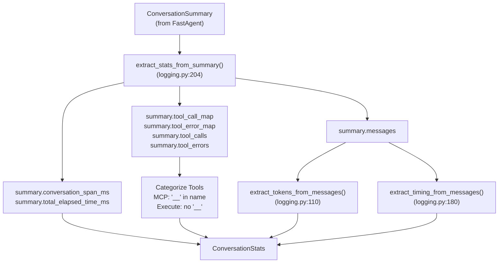
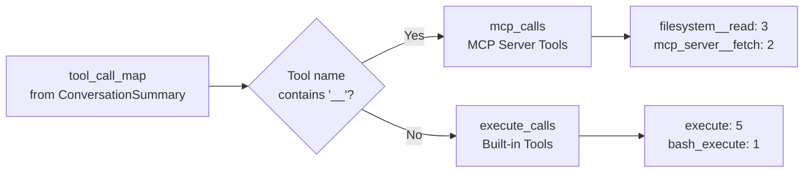
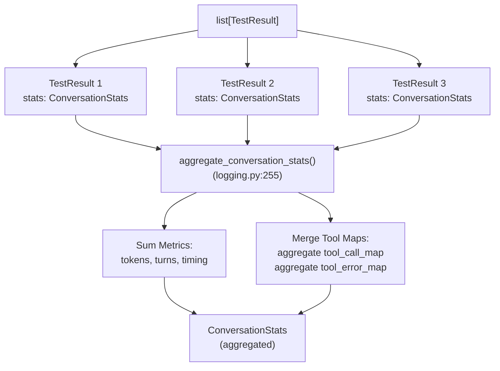
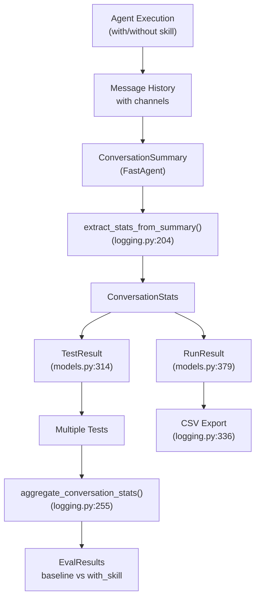

<!-- source: DeepWiki mcp.deepwiki.com · repo huggingface/upskill · page 8.2 Conversation Statistics · fetched 2026-10-26 -->

# Conversation Statistics

<details>
<summary>Relevant source files</summary>

The following files were used as context for generating this wiki page:

- [src/upskill/logging.py](src/upskill/logging.py)
- [src/upskill/models.py](src/upskill/models.py)

</details>


## Purpose and Scope

This document describes the `ConversationStats` data model and its associated extraction logic, which provides comprehensive observability into agent execution. `ConversationStats` captures timing metrics, token usage, tool call patterns, and categorizes tool invocations into MCP server tools versus built-in execute calls.

For information about the broader run logging infrastructure, see [Run Directory Structure](#8.1). For how these statistics are used in evaluation results, see [Evaluation Models](#7.3).

---

## Overview

The `ConversationStats` model aggregates detailed metrics from agent executions, enabling performance analysis and comparison between baseline and with-skill runs. Statistics are extracted from FastAgent's message channels (`FAST_AGENT_USAGE` and `FAST_AGENT_TIMING`) and summarized using the `ConversationSummary` object.

**Sources:** [src/upskill/models.py:277-312](), [src/upskill/logging.py:204-251]()

---

## ConversationStats Data Model

### Field Structure

The `ConversationStats` model defined in [src/upskill/models.py:277-312]() contains the following metric categories:

| Category | Field | Type | Description |
|----------|-------|------|-------------|
| **Timing** | `conversation_span_ms` | `float` | Total elapsed time for conversation |
| | `llm_time_ms` | `float` | Time spent in LLM API calls |
| | `tool_time_ms` | `float` | Time spent in tool execution |
| **Conversation** | `turns` | `int` | Number of conversation turns |
| | `tool_calls` | `int` | Total tool invocations |
| | `tool_errors` | `int` | Failed tool invocations |
| **Tool Categorization** | `mcp_calls` | `int` | MCP server tool calls (names contain "__") |
| | `execute_calls` | `int` | Built-in execute calls (no "__" in name) |
| **Per-Tool Breakdown** | `tool_call_map` | `dict[str, int]` | Tool name → invocation count |
| | `tool_error_map` | `dict[str, int]` | Tool name → error count |
| **Token Usage** | `input_tokens` | `int` | Tokens sent to model |
| | `output_tokens` | `int` | Tokens generated by model |
| | `total_tokens` | `int` | Total billable tokens |
| **Raw Data** | `usage_summaries` | `list[dict]` | Raw usage payloads from FastAgent |
| | `timing_summaries` | `list[dict]` | Raw timing payloads from FastAgent |

### ConversationStats Structure Diagram

```mermaid
graph TB
    ConversationStats["ConversationStats<br/>(models.py:277)"]
    
    TimingGroup["Timing Metrics"]
    ConvGroup["Conversation Metrics"]
    ToolCatGroup["Tool Categorization"]
    BreakdownGroup["Per-Tool Breakdown"]
    TokenGroup["Token Metrics"]
    RawGroup["Raw Summaries"]
    
    ConversationStats --> TimingGroup
    ConversationStats --> ConvGroup
    ConversationStats --> ToolCatGroup
    ConversationStats --> BreakdownGroup
    ConversationStats --> TokenGroup
    ConversationStats --> RawGroup
    
    TimingGroup --> conversation_span_ms["conversation_span_ms: float"]
    TimingGroup --> llm_time_ms["llm_time_ms: float"]
    TimingGroup --> tool_time_ms["tool_time_ms: float"]
    
    ConvGroup --> turns["turns: int"]
    ConvGroup --> tool_calls["tool_calls: int"]
    ConvGroup --> tool_errors["tool_errors: int"]
    
    ToolCatGroup --> mcp_calls["mcp_calls: int<br/>(tools with '__')"]
    ToolCatGroup --> execute_calls["execute_calls: int<br/>(tools without '__')"]
    
    BreakdownGroup --> tool_call_map["tool_call_map: dict[str, int]"]
    BreakdownGroup --> tool_error_map["tool_error_map: dict[str, int]"]
    
    TokenGroup --> input_tokens["input_tokens: int"]
    TokenGroup --> output_tokens["output_tokens: int"]
    TokenGroup --> total_tokens["total_tokens: int"]
    
    RawGroup --> usage_summaries["usage_summaries: list[dict]"]
    RawGroup --> timing_summaries["list[dict]"]
```



**Sources:** [src/upskill/models.py:277-312]()

---

## Metrics Extraction Process

### Extraction from ConversationSummary

The primary extraction method is `extract_stats_from_summary` in [src/upskill/logging.py:204-251](), which processes a `ConversationSummary` object from FastAgent:



**Sources:** [src/upskill/logging.py:204-251]()

### Token Extraction from Message Channels

The `extract_tokens_from_messages` function in [src/upskill/logging.py:110-174]() parses FastAgent's `FAST_AGENT_USAGE` channel:

**Extraction Logic:**
1. Iterates through message list
2. Checks each message's `channels` attribute
3. Looks for content in `FAST_AGENT_USAGE` channel
4. Parses JSON payloads containing usage data
5. Extracts `turn` data (per-turn tokens) or `summary` data (cumulative tokens)
6. Aggregates token counts: `input_tokens`, `output_tokens`, `total_tokens`

**Example Usage Channel Payload:**
```json
{
  "turn": {
    "input_tokens": 1245,
    "output_tokens": 387,
    "total_tokens": 1632
  },
  "summary": {
    "cumulative_input_tokens": 1245,
    "cumulative_output_tokens": 387,
    "cumulative_billing_tokens": 1632
  }
}
```

**Sources:** [src/upskill/logging.py:110-174]()

### Timing Extraction from Message Channels

The `extract_timing_from_messages` function in [src/upskill/logging.py:180-201]() parses FastAgent's `FAST_AGENT_TIMING` channel:

**Extraction Logic:**
1. Iterates through message list
2. Checks each message's `channels` attribute
3. Looks for content in `FAST_AGENT_TIMING` channel
4. Parses JSON payloads containing timing data
5. Returns list of timing dictionaries for detailed analysis

**Sources:** [src/upskill/logging.py:180-201]()

---

## Tool Call Categorization

### MCP vs Execute Classification

Tools are categorized based on naming conventions in [src/upskill/logging.py:220-226]():

| Category | Identifier | Example Tools | Description |
|----------|-----------|---------------|-------------|
| **MCP Calls** | Contains `"__"` | `filesystem__read`, `mcp_server__fetch` | Tools from MCP servers |
| **Execute Calls** | No `"__"` | `execute`, `bash_execute` | Built-in execution tools |

**Categorization Algorithm:**
```python
mcp_calls = sum(count for name, count in tool_call_map.items() if "__" in name)
execute_calls = sum(count for name, count in tool_call_map.items() if "__" not in name)
```

### Tool Categorization Flow



**Sources:** [src/upskill/logging.py:220-226]()

---

## Aggregation and Analysis

### Aggregating Multiple Test Results

The `aggregate_conversation_stats` function in [src/upskill/logging.py:255-279]() combines statistics from multiple test runs:

**Aggregation Rules:**

| Metric Type | Aggregation Method |
|-------------|-------------------|
| Timing | Sum all durations |
| Counts | Sum all counts |
| Token Usage | Sum all tokens |
| Tool Maps | Merge dictionaries, summing counts per tool |
| Raw Summaries | Concatenate lists |

**Implementation:**
```python
def aggregate_conversation_stats(results: list[TestResult]) -> ConversationStats:
    aggregate = ConversationStats()
    for result in results:
        stats = result.stats
        # Sum timing metrics
        aggregate.conversation_span_ms += stats.conversation_span_ms
        aggregate.llm_time_ms += stats.llm_time_ms
        # ... sum all counters
        # Merge tool maps
        for name, count in stats.tool_call_map.items():
            aggregate.tool_call_map[name] = aggregate.tool_call_map.get(name, 0) + count
```

**Sources:** [src/upskill/logging.py:255-279]()

### Aggregation Diagram



**Sources:** [src/upskill/logging.py:255-279]()

---

## Integration with Test Results

### TestResult Model Integration

The `TestResult` model in [src/upskill/models.py:314-327]() embeds `ConversationStats`:

```python
class TestResult(BaseModel):
    test_case: TestCase
    success: bool
    output: str | None = None
    tokens_used: int = 0  # Legacy field
    turns: int = 0  # Legacy field
    error: str | None = None
    stats: ConversationStats = Field(default_factory=ConversationStats)
    validation_result: ValidationResult | None = None
```

**Note:** The `tokens_used` and `turns` fields are legacy fields maintained for backward compatibility. Current code should access these values via `stats.total_tokens` and `stats.turns`.

**Sources:** [src/upskill/models.py:314-327]()

### RunResult Model Integration

The `RunResult` model in [src/upskill/models.py:379-394]() also embeds `ConversationStats`:

```python
class RunResult(BaseModel):
    metadata: RunMetadata
    stats: ConversationStats = Field(default_factory=ConversationStats)
    passed: bool = False
    assertions_passed: int = 0
    assertions_total: int = 0
    # ... other fields
```

**Sources:** [src/upskill/models.py:379-394]()

---

## Statistics Flow in Evaluation

### End-to-End Statistics Collection



**Sources:** [src/upskill/logging.py:204-251](), [src/upskill/logging.py:255-279](), [src/upskill/logging.py:336-408]()

---

## CSV Export Schema

When exporting to CSV via `summarize_runs_to_csv` in [src/upskill/logging.py:336-408](), the following `ConversationStats` fields are included:

| CSV Column | Source Field | Type |
|------------|--------------|------|
| `input_tokens` | `stats.input_tokens` | int |
| `output_tokens` | `stats.output_tokens` | int |
| `total_tokens` | `stats.total_tokens` | int |
| `conversation_span_ms` | `stats.conversation_span_ms` | float |
| `llm_time_ms` | `stats.llm_time_ms` | float |
| `tool_time_ms` | `stats.tool_time_ms` | float |
| `turns` | `stats.turns` | int |
| `tool_calls` | `stats.tool_calls` | int |
| `tool_errors` | `stats.tool_errors` | int |
| `mcp_calls` | `stats.mcp_calls` | int |
| `execute_calls` | `stats.execute_calls` | int |

The CSV export flattens the `ConversationStats` structure for analysis in external tools like Excel or pandas.

**Sources:** [src/upskill/logging.py:336-408](), [src/upskill/logging.py:17-45]()

---

## Fallback Extraction

### History File Parsing

When `ConversationSummary` is unavailable, `summarize_conversation_stats` in [src/upskill/logging.py:282-316]() provides fallback extraction from session history JSON files:

**Fallback Capabilities (Limited):**
- Counts conversation turns (user messages)
- Extracts token usage from assistant message metadata
- Returns minimal `ConversationStats` object

**Limitation:** The fallback method cannot extract timing data or tool call breakdowns, as these are only available through FastAgent's message channels.

**Sources:** [src/upskill/logging.py:282-316]()

---

## Usage Example

### Extracting Statistics from Agent Execution

```python
from fast_agent import ConversationSummary
from upskill.logging import extract_stats_from_summary

# After agent execution
summary: ConversationSummary = agent.conversation_summary()
stats = extract_stats_from_summary(summary)

# Access metrics
print(f"Total tokens: {stats.total_tokens}")
print(f"LLM time: {stats.llm_time_ms}ms")
print(f"MCP calls: {stats.mcp_calls}, Execute calls: {stats.execute_calls}")
print(f"Tool breakdown: {stats.tool_call_map}")
```

### Aggregating Test Results

```python
from upskill.logging import aggregate_conversation_stats

# Aggregate across multiple test results
aggregate_stats = aggregate_conversation_stats(baseline_results)

# Use in EvalResults
eval_results.baseline_total_tokens = aggregate_stats.total_tokens
eval_results.baseline_avg_turns = aggregate_stats.turns / len(baseline_results)
```

**Sources:** [src/upskill/logging.py:204-251](), [src/upskill/logging.py:255-279]()

---

