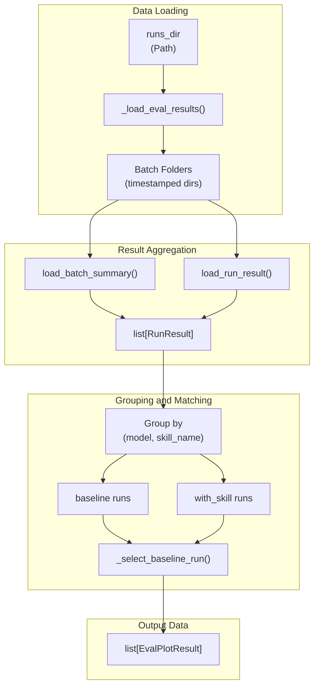
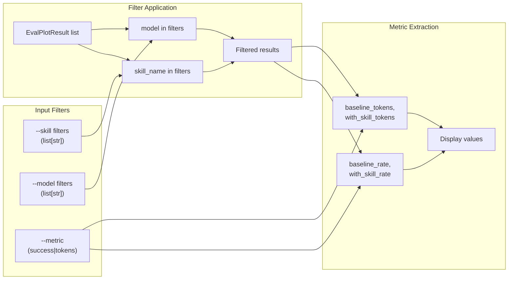
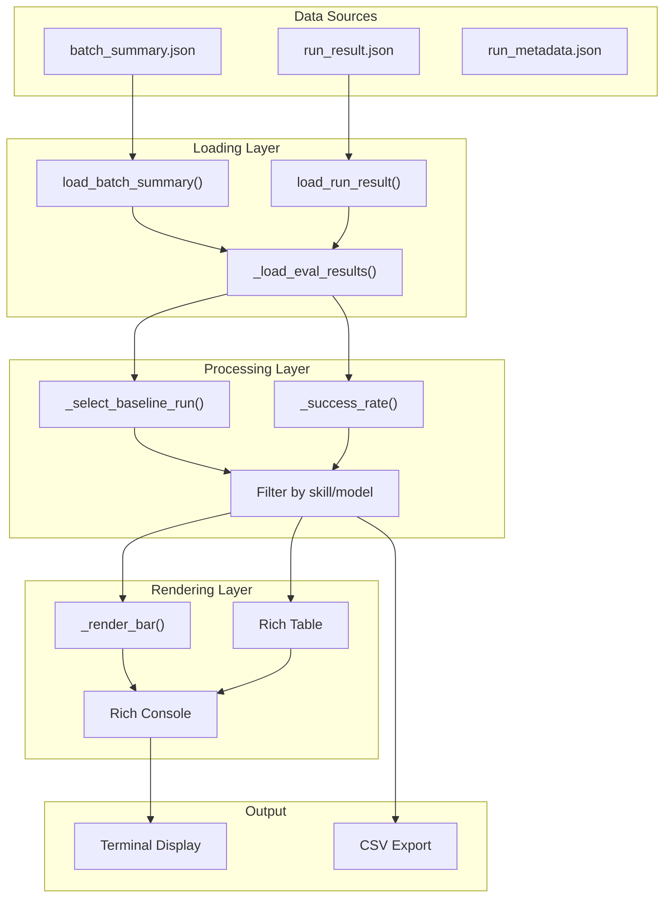

<!-- source: DeepWiki mcp.deepwiki.com · repo huggingface/upskill · page 8.3 Results Visualization · fetched 2026-10-26 -->

# Results Visualization

<details>
<summary>Relevant source files</summary>

The following files were used as context for generating this wiki page:

- [README.md](README.md)
- [src/upskill/cli.py](src/upskill/cli.py)
- [src/upskill/logging.py](src/upskill/logging.py)
- [tests/test_smoke.py](tests/test_smoke.py)

</details>


## Purpose and Scope

This document covers the results visualization system in upskill, which provides visual feedback for skill evaluation performance through the `upskill runs` command. The visualization system loads run history from the runs directory, compares baseline and with-skill performance, and presents results through ASCII bar charts and tabular formats. For details on the underlying run data structures, see [Run Directory Structure](#8.1) and [Conversation Statistics](#8.2). For exporting results to CSV format, see [CSV Export and Analysis](#8.4).

The visualization system supports:
- Side-by-side comparison of baseline vs with-skill performance
- Multi-model and multi-skill matrix views
- Filtering by skill name or model
- Metric selection (success rate or token usage)
- Color-coded lift indicators

---

## Command-Line Interface

The `upskill runs` command provides the primary interface for visualizing evaluation results. It accepts several options for filtering and formatting output.

[src/upskill/cli.py:1317-1347]()

### Command Syntax

```bash
upskill runs [OPTIONS]
```

### Options

| Option | Description | Default |
|--------|-------------|---------|
| `-d, --dir PATH` | Runs directory to load | `./runs` from config |
| `-s, --skill TEXT` | Filter by skill name (repeatable) | All skills |
| `-m, --model TEXT` | Filter by model name (repeatable) | All models |
| `--metric [success\|tokens]` | Metric to display | `success` |
| `--csv PATH` | Export to CSV instead of plot | Display in terminal |

### Example Usage

```bash
# View all results
upskill runs

# Filter by specific skill
upskill runs -s git-commit-messages

# Compare multiple models for a skill
upskill runs -s my-skill -m haiku -m sonnet

# Show token usage instead of success rate
upskill runs --metric tokens

# Export to CSV
upskill runs --csv ./results.csv
```

**Sources:** [src/upskill/cli.py:1317-1347](), [README.md:242-300]()

---

## Data Loading Pipeline

The visualization system follows a multi-stage pipeline to load and prepare evaluation results for display.



### Loading Function

The `_load_eval_results()` function orchestrates the data loading process:

[src/upskill/cli.py:111-159]()

**Key steps:**

1. **Iterate batch folders:** Scans the runs directory for timestamped batch folders
2. **Load results:** Attempts to load `batch_summary.json`, falls back to individual `run_result.json` files
3. **Group by (model, skill):** Creates a dictionary keyed by `(model, skill_name)` tuples
4. **Separate baseline/with-skill:** Categorizes runs by `run_type` field
5. **Match pairs:** Associates each with-skill run with the most recent baseline run

### Baseline Selection Strategy

When multiple baseline runs exist, the system selects the most appropriate baseline for each with-skill run:

[src/upskill/cli.py:97-108]()

**Selection logic:**
- Prefers baseline runs with `run_number <= with_skill_run_number`
- If multiple eligible baselines exist, selects the most recent (highest run_number)
- Falls back to the last baseline if no eligible baselines exist

This ensures that each with-skill run is compared against a baseline from the same evaluation session or an earlier one, avoiding anachronistic comparisons.

### EvalPlotResult Structure

The `EvalPlotResult` TypedDict structures the data for visualization:

[src/upskill/cli.py:78-87]()

```python
class EvalPlotResult(TypedDict):
    model: str                  # Model name (e.g., "haiku", "sonnet")
    skill_name: str             # Skill identifier
    with_skill_rate: float      # Success rate with skill (0.0-1.0)
    with_skill_tokens: int      # Total tokens used with skill
    baseline_rate: float        # Success rate without skill
    baseline_tokens: int        # Total tokens used without skill
    has_baseline: bool          # Whether baseline data exists
```

**Sources:** [src/upskill/cli.py:111-159](), [src/upskill/cli.py:78-87](), [src/upskill/cli.py:97-108]()

---

## Display Formats

The visualization system provides multiple display formats depending on the data being shown and the context.

### Horizontal Bar Visualization

The primary visualization format is a horizontal ASCII bar chart that compares baseline and with-skill performance.

#### Bar Rendering

The `_render_bar()` function creates ASCII progress bars:

[src/upskill/cli.py:68-75]()

**Implementation:**
- Accepts a float value (0.0-1.0) and width in characters
- Clamps input to valid range
- Renders filled portion with `█` (U+2588 Full Block)
- Renders empty portion with `░` (U+2591 Light Shade)

**Example output:**
```
baseline   ████████████░░░░░░░░   60%
with skill ████████████████░░░░   80%  (+20%)
```

#### Single-Model Comparison

When displaying results for a single model, the system shows a side-by-side comparison:

[src/upskill/cli.py:998-1033]()

**Format:**
```
baseline   [bar]  XX%
with skill [bar]  YY%  ([lift])

tokens: X → Y  ([savings])
```

**Color coding:**
- Green: Positive lift or savings
- Red: Negative lift or increase
- Dim: No change

#### Multi-Model Comparison

For multiple models, each model gets its own section:

[src/upskill/cli.py:574-590]()

**Format:**
```
haiku
  baseline   [bar]  XX%
  with skill [bar]  YY%  ([lift])

sonnet
  baseline   [bar]  XX%
  with skill [bar]  YY%  ([lift])
```

### Matrix View

When the `upskill runs` command displays multiple skills across multiple models, it uses a matrix format:

[src/upskill/cli.py:1386-1428]()

**Table structure:**
```
┏━━━━━━━━━━━━━━━━━━━━━┳━━━━━━━━━━━━━━┳━━━━━━━━━━━━━━┓
┃ skill               ┃ haiku        ┃ sonnet       ┃
┡━━━━━━━━━━━━━━━━━━━━━╇━━━━━━━━━━━━━━╇━━━━━━━━━━━━━━┩
│ git-commit-messages │ 60%→80%      │ 60%→100%     │
│ api-error-handling  │ 40%→70%      │ 50%→90%      │
└─────────────────────┴──────────────┴──────────────┘
```

**Cell format:**
- For success metric: `baseline% → with_skill%`
- For token metric: `baseline_tokens → with_skill_tokens`
- Empty cells when no data available

### Benchmark Summary

The `upskill eval` and `upskill benchmark` commands display summary statistics after multi-run evaluations:

[src/upskill/cli.py:876-903]()

**Format:**
```
Summary

haiku
  Runs: 5 | Passed: 4 (80%)
  Avg tokens: 1250 | Avg turns: 3.2

sonnet
  Runs: 5 | Passed: 5 (100%)
  Avg tokens: 1890 | Avg turns: 2.8
```

**Sources:** [src/upskill/cli.py:68-75](), [src/upskill/cli.py:998-1033](), [src/upskill/cli.py:574-590](), [src/upskill/cli.py:1386-1428](), [src/upskill/cli.py:876-903]()

---

## Filtering and Metric Selection

The visualization system provides flexible filtering options to focus on specific subsets of results.



### Skill Filtering

The `--skill` option can be repeated to filter for multiple skills:

[src/upskill/cli.py:1374-1377]()

**Behavior:**
- If no `--skill` filters specified, all skills are included
- If one or more `--skill` filters specified, only matching skills are included
- Matching is case-sensitive and exact

**Example:**
```bash
# Show only git-commit-messages skill
upskill runs -s git-commit-messages

# Show multiple skills
upskill runs -s skill-1 -s skill-2
```

### Model Filtering

The `--model` option can be repeated to filter for multiple models:

[src/upskill/cli.py:1378-1381]()

**Behavior:**
- If no `--model` filters specified, all models are included
- If one or more `--model` filters specified, only matching models are included
- Matching is case-sensitive and exact

**Example:**
```bash
# Show only haiku results
upskill runs -m haiku

# Compare haiku and sonnet
upskill runs -m haiku -m sonnet
```

### Metric Selection

The `--metric` option controls which metric is displayed:

[src/upskill/cli.py:1395-1403]()

**Options:**
- `success` (default): Displays success rates as percentages
- `tokens`: Displays token usage as absolute counts

**Display differences:**

| Metric | Display Format | Example |
|--------|----------------|---------|
| `success` | Percentage bars with lift | `60% → 80% (+20%)` |
| `tokens` | Token counts with savings | `1200 → 800 (-33%)` |

**Sources:** [src/upskill/cli.py:1374-1381](), [src/upskill/cli.py:1395-1403]()

---

## Integration with Evaluation Commands

The visualization system is tightly integrated with the evaluation workflow, providing immediate feedback during skill generation and evaluation.

### Inline Visualization During Generation

The `upskill generate` command displays inline visualizations after each refinement iteration:

[src/upskill/cli.py:410-423]()

**Output format:**
```
Evaluating on sonnet... (attempt 1)
  60% -> 100% (+40%) OK
```

**Success criteria:**
- Green `OK` indicator when `results.is_beneficial` is True
- No indicator with `not good enough` message when evaluation fails
- Yellow `Plateaued, stopping` when improvement stalls

### Post-Generation Summary

After successful skill generation, a comprehensive summary is displayed:

[src/upskill/cli.py:541-619]()

**Components:**

1. **Skill metadata:** Name and description
2. **File sizes:** Token estimates for SKILL.md, references, and scripts
3. **Performance bars:** Baseline vs with-skill comparison
4. **Token savings:** Absolute counts and percentage reduction
5. **Save location:** Final skill directory path

**Example:**
```
  git-commit-messages
  Write clear, conventional commit messages

  SKILL.md              ~450 tokens
  references/guide.md   ~120 tokens

  baseline   ████████████░░░░░░░░   60%
  with skill ████████████████████  100%  (+40%)

  tokens: 1200 → 800  (-33%)

Saved to ./skills/git-commit-messages
```

### Evaluation Command Output

The `upskill eval` command provides immediate visualization after test execution:

[src/upskill/cli.py:998-1039]()

**Single-run mode:**
```
baseline   ████████████░░░░░░░░   60%
with skill ████████████████░░░░   80%  (+20%)

tokens: 1200 → 1000  (-17%)

Recommendation: keep skill
```

**Benchmark mode:** Shows summary table after all runs complete

[src/upskill/cli.py:876-903]()

### Verbose Test Output

When `-v/--verbose` is specified, the evaluation commands display per-test results:

[src/upskill/cli.py:987-996]()

**Format:**
```
1. Write a commit for adding login  OK base  OK skill
2. Fix the null pointer bug         FAIL base  OK skill
3. Document API changes             OK base  OK skill
```

**Sources:** [src/upskill/cli.py:410-423](), [src/upskill/cli.py:541-619](), [src/upskill/cli.py:998-1039](), [src/upskill/cli.py:876-903](), [src/upskill/cli.py:987-996]()

---

## Success Rate Calculation

The visualization system calculates success rates from run results using assertion-based metrics.

### Success Rate Function

[src/upskill/cli.py:90-94]()

**Implementation:**
```python
def _success_rate(run: RunResult) -> float:
    if run.assertions_total == 0:
        return 0.0
    return run.assertions_passed / run.assertions_total
```

**Behavior:**
- Returns 0.0 if no assertions were run
- Returns the ratio of passed assertions to total assertions
- Values range from 0.0 (all failed) to 1.0 (all passed)

### Lift Calculation

Lift represents the improvement in success rate from baseline to with-skill:

**Formula:**
```
lift = with_skill_rate - baseline_rate
```

**Display formatting:**
- Positive lift: `+XX%` in green
- Negative lift: `-XX%` in red
- Zero lift: `+0%` in dim style

**Sources:** [src/upskill/cli.py:90-94](), [src/upskill/cli.py:410-423]()

---

## Rich Console Integration

The visualization system uses the `rich` library for enhanced terminal output with styling and formatting.

### Console Instance

[src/upskill/cli.py:46]()

```python
console = Console()
```

### Styling Conventions

| Style | Use Case | Example |
|-------|----------|---------|
| `[bold]` | Skill names, model names, section headers | `[bold]haiku[/bold]` |
| `[green]` | Positive indicators (OK, pass, positive lift) | `[green]OK[/green]` |
| `[red]` | Negative indicators (FAIL, errors) | `[red]FAIL[/red]` |
| `[yellow]` | Warnings, recommendations | `[yellow]Plateaued[/yellow]` |
| `[dim]` | Secondary information, progress messages | `[dim]Loading...[/dim]` |

### Rich Tables

For matrix views, the system uses `rich.table.Table`:

[src/upskill/cli.py:1386-1428]()

**Features:**
- Unicode box drawing characters
- Header row styling
- Column alignment
- Automatic width calculation

**Sources:** [src/upskill/cli.py:16-19](), [src/upskill/cli.py:46](), [src/upskill/cli.py:1386-1428]()

---

## Visualization Architecture



**Key components:**

1. **Data Sources:** JSON files in the runs directory hierarchy
2. **Loading Layer:** Functions that read and parse run data
3. **Processing Layer:** Functions that calculate metrics and apply filters
4. **Rendering Layer:** Functions that format data for display
5. **Output:** Terminal visualization or CSV file export

**Sources:** [src/upskill/cli.py:68-159](), [src/upskill/cli.py:1317-1447](), [src/upskill/logging.py:98-108](), [src/upskill/logging.py:418-427]()

---

