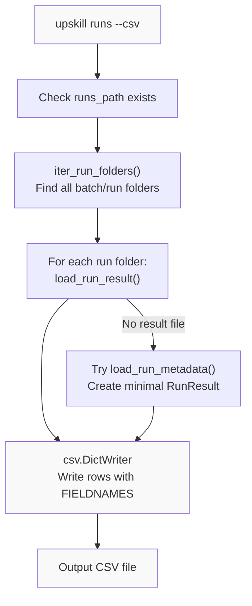
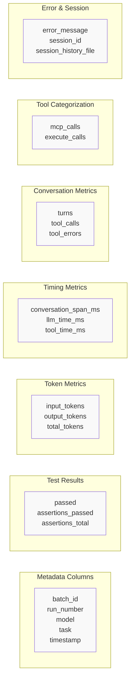
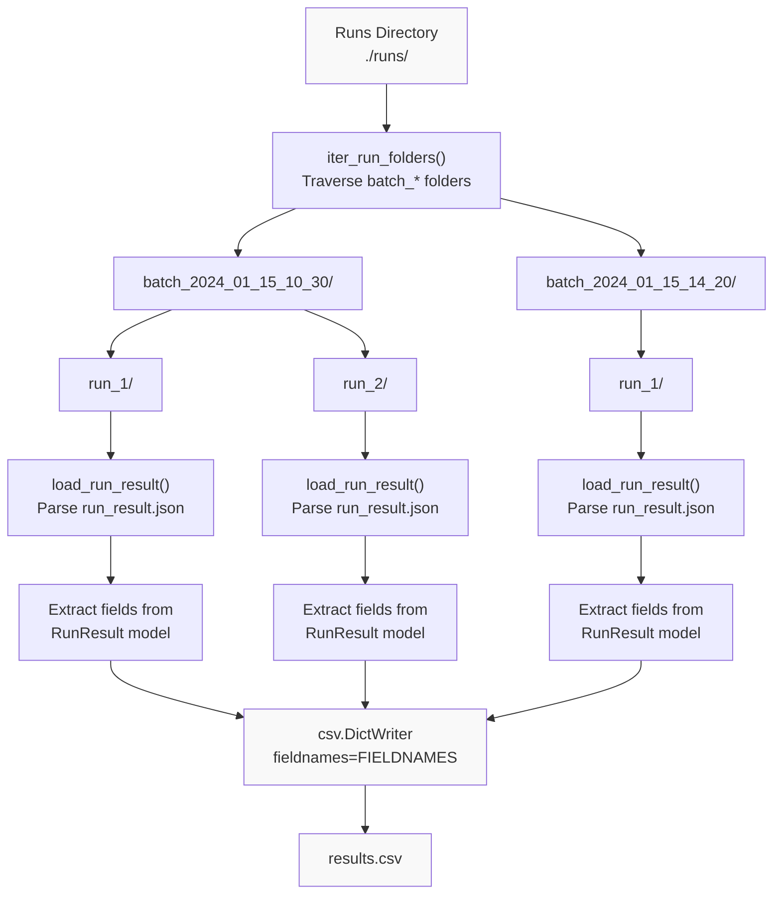
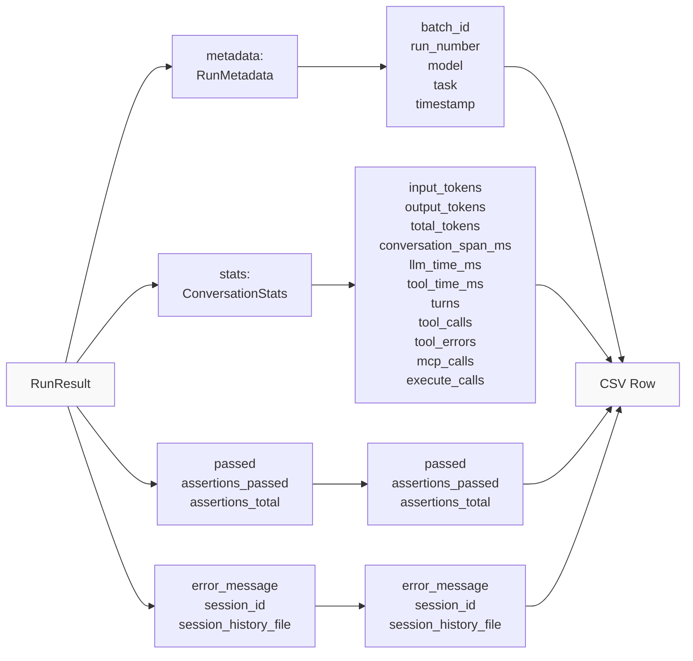
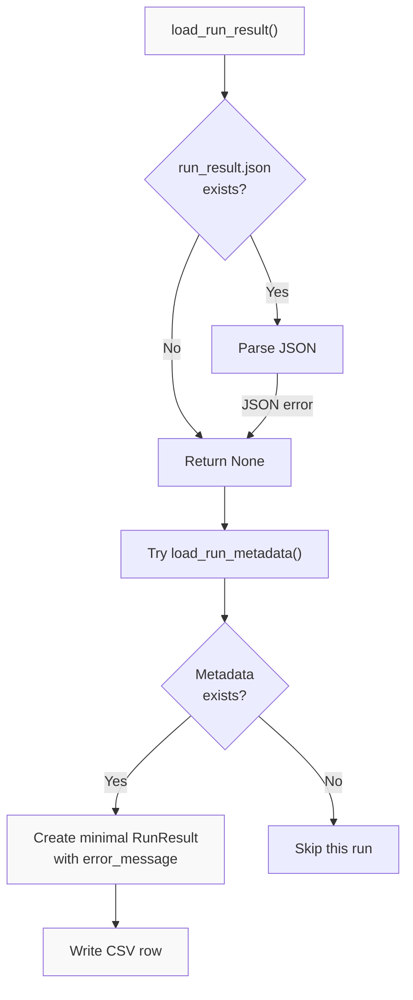
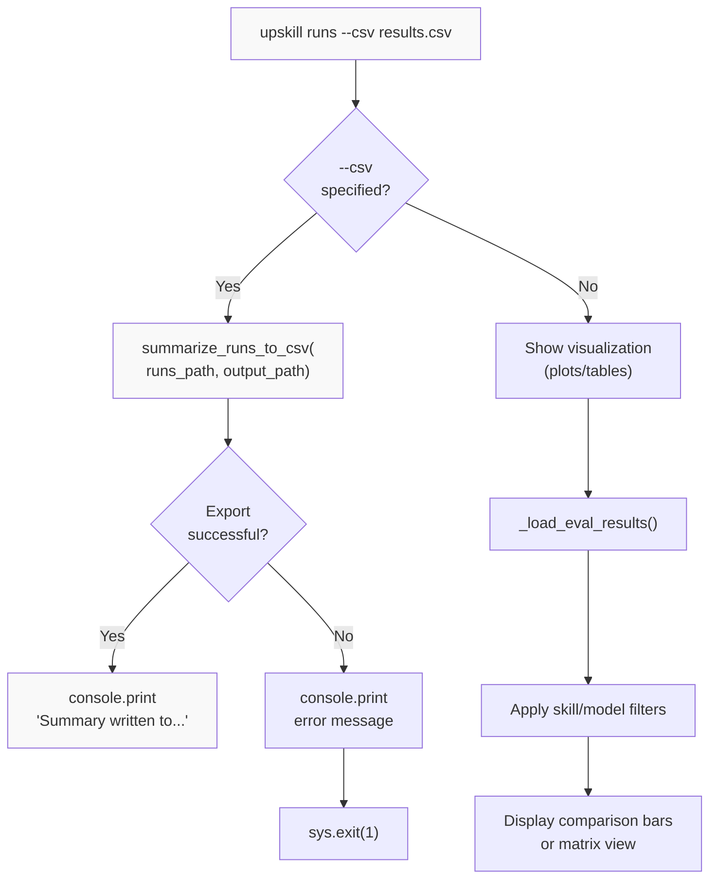
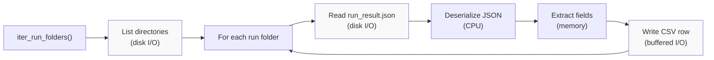

<!-- source: DeepWiki mcp.deepwiki.com · repo huggingface/upskill · page 8.4 CSV Export and Analysis · fetched 2026-10-26 -->

# CSV Export and Analysis

<details>
<summary>Relevant source files</summary>

The following files were used as context for generating this wiki page:

- [src/upskill/cli.py](src/upskill/cli.py)
- [src/upskill/logging.py](src/upskill/logging.py)
- [tests/test_smoke.py](tests/test_smoke.py)

</details>


This page describes the CSV export functionality for run results in the upskill system. CSV export enables external analysis of evaluation metrics using spreadsheet tools, statistical software, or custom analysis scripts. The export includes 24+ metrics columns covering test results, token usage, timing data, tool categorization, and conversation statistics.

For information about the underlying run directory structure, see [Run Directory Structure](#8.1). For details on the metrics being exported, see [Conversation Statistics](#8.2). For interactive visualization within the CLI, see [Results Visualization](#8.3).

---

## Purpose and Use Cases

The CSV export feature serves several analysis scenarios:

| Use Case | Description |
|----------|-------------|
| **Statistical Analysis** | Compare model performance across multiple runs with statistical significance testing |
| **Cost Analysis** | Track token usage patterns and estimate API costs over time |
| **Performance Profiling** | Identify bottlenecks by analyzing timing metrics across runs |
| **Tool Usage Patterns** | Understand which tools (MCP vs execute) are used most frequently |
| **Regression Detection** | Track metrics over time to detect performance degradations |
| **Batch Comparisons** | Aggregate results from multiple evaluation batches for reporting |

**Sources:** [src/upskill/cli.py:1321-1369](), [src/upskill/logging.py:336-408]()

---

## CSV Export Command

### Basic Usage

```bash
# Export all runs to CSV
upskill runs --csv results.csv

# Export with filters
upskill runs --skill my-skill --csv filtered.csv
upskill runs --model haiku --model sonnet --csv models.csv

# Specify custom runs directory
upskill runs --dir ./custom-runs/ --csv analysis.csv
```

### Command Flow



**Sources:** [src/upskill/cli.py:1361-1369](), [src/upskill/logging.py:336-408]()

---

## CSV Schema

### Column Definitions

The CSV export uses the `FIELDNAMES` constant defined in [src/upskill/logging.py:17-45]():



**Sources:** [src/upskill/logging.py:16-45]()

### Complete Field Reference

| Field Name | Type | Description |
|------------|------|-------------|
| `batch_id` | string | Timestamp-based batch identifier (YYYY_MM_DD_HH_MM) |
| `run_number` | int | Sequential run number within batch |
| `model` | string | Model identifier (e.g., "haiku", "sonnet") |
| `task` | string | Task description for the run |
| `timestamp` | ISO 8601 | Run execution timestamp |
| `passed` | boolean | Overall pass/fail status |
| `assertions_passed` | int | Number of assertions that passed |
| `assertions_total` | int | Total number of assertions |
| `input_tokens` | int | Total input tokens consumed |
| `output_tokens` | int | Total output tokens generated |
| `total_tokens` | int | Total tokens (input + output) |
| `conversation_span_ms` | float | Total conversation duration in milliseconds |
| `llm_time_ms` | float | Time spent in LLM calls |
| `tool_time_ms` | float | Time spent in tool execution |
| `turns` | int | Number of conversation turns |
| `tool_calls` | int | Total number of tool invocations |
| `tool_errors` | int | Number of tool errors encountered |
| `mcp_calls` | int | Number of MCP tool calls (tools with "__" in name) |
| `execute_calls` | int | Number of execute tool calls (non-MCP) |
| `error_message` | string | Error message if run failed |
| `session_id` | string | Session identifier for tracing |
| `session_history_file` | string | Path to session history file |

**Sources:** [src/upskill/logging.py:16-45](), [src/upskill/logging.py:377-405]()

---

## Implementation Architecture

### Data Flow



**Sources:** [src/upskill/logging.py:336-408]()

### Core Functions

#### `summarize_runs_to_csv`

Main export function that orchestrates the CSV generation process:

[src/upskill/logging.py:336-408]()

```python
def summarize_runs_to_csv(runs_folder: Path, output_path: Path | None = None) -> Path
```

**Algorithm:**

1. Determine output path (defaults to `runs_folder/results.csv`)
2. Call `iter_run_folders()` to discover all run folders
3. Create CSV file with `DictWriter` using `FIELDNAMES`
4. Write CSV header row
5. For each run folder:
   - Load `RunResult` via `load_run_result()`
   - If missing, attempt fallback with `load_run_metadata()`
   - Extract fields into dictionary matching `FIELDNAMES`
   - Write row to CSV
6. Return path to generated CSV file

**Sources:** [src/upskill/logging.py:336-408]()

#### `iter_run_folders`

Discovers all run folders across batches:

[src/upskill/logging.py:319-333]()

```python
def iter_run_folders(runs_folder: Path) -> list[Path]
```

**Algorithm:**

1. List all subdirectories in `runs_folder`
2. For each directory (batch folder):
   - Check if it contains `run_*` subdirectories
   - Glob for all `run_*` folders
   - Add to results list
3. Return sorted list of run folder paths

**Sources:** [src/upskill/logging.py:319-333]()

#### `load_run_result`

Loads a `RunResult` from JSON file:

[src/upskill/logging.py:98-107]()

```python
def load_run_result(run_folder: Path) -> RunResult | None
```

Reads `run_result.json` and deserializes into `RunResult` model. Returns `None` if file doesn't exist or parsing fails.

**Sources:** [src/upskill/logging.py:98-107]()

---

## Integration with RunResult Model

### Field Mapping

The CSV export extracts fields from the `RunResult` data model:



**Sources:** [src/upskill/logging.py:377-406](), [src/upskill/models.py:212-249]() (ConversationStats), [src/upskill/models.py:252-268]() (RunMetadata)

### Field Extraction Code

The CSV row construction in [src/upskill/logging.py:377-406]():

```python
row = {
    "batch_id": result.metadata.batch_id,
    "run_number": result.metadata.run_number,
    "model": result.metadata.model,
    "task": result.metadata.task,
    "timestamp": result.metadata.timestamp.isoformat(),
    "passed": result.passed,
    "assertions_passed": result.assertions_passed,
    "assertions_total": result.assertions_total,
    # Token metrics
    "input_tokens": result.stats.input_tokens,
    "output_tokens": result.stats.output_tokens,
    "total_tokens": result.stats.total_tokens,
    # Timing metrics
    "conversation_span_ms": result.stats.conversation_span_ms,
    "llm_time_ms": result.stats.llm_time_ms,
    "tool_time_ms": result.stats.tool_time_ms,
    # Conversation metrics
    "turns": result.stats.turns,
    "tool_calls": result.stats.tool_calls,
    "tool_errors": result.stats.tool_errors,
    # Tool categorization
    "mcp_calls": result.stats.mcp_calls,
    "execute_calls": result.stats.execute_calls,
    # Error and session info
    "error_message": result.error_message or "",
    "session_id": result.session_id or "",
    "session_history_file": result.session_history_file or "",
}
```

**Sources:** [src/upskill/logging.py:377-406]()

---

## Error Handling and Edge Cases

### Missing Result Files

When `run_result.json` is missing, the export attempts fallback reconstruction:



**Sources:** [src/upskill/logging.py:359-375]()

### Fallback Logic

From [src/upskill/logging.py:361-375]():

```python
if result is None:
    # Try to construct from metadata
    metadata = load_run_metadata(run_folder)
    if not metadata:
        continue
    result = RunResult(
        metadata=RunMetadata(
            model=metadata.get("model", ""),
            task=metadata.get("task", ""),
            batch_id=metadata.get("batch_id", ""),
            run_number=metadata.get("run_number", 0),
        ),
        passed=False,
        error_message="No result file found",
    )
```

This ensures that incomplete runs (e.g., from crashes) still appear in the CSV with available metadata.

**Sources:** [src/upskill/logging.py:361-375]()

---

## Analysis Examples

### Token Usage Analysis

Example CSV analysis for tracking token consumption:

```python
import pandas as pd

# Load exported CSV
df = pd.read_csv("results.csv")

# Calculate token statistics by model
token_stats = df.groupby("model").agg({
    "total_tokens": ["mean", "std", "min", "max"],
    "input_tokens": "mean",
    "output_tokens": "mean",
})

# Identify token-efficient runs
df["token_efficiency"] = df["assertions_passed"] / df["total_tokens"]
top_efficient = df.nlargest(10, "token_efficiency")
```

### Performance Regression Detection

```python
# Sort by timestamp
df["timestamp"] = pd.to_datetime(df["timestamp"])
df = df.sort_values("timestamp")

# Calculate rolling average for pass rate
df["pass_rate"] = df["assertions_passed"] / df["assertions_total"]
df["rolling_pass_rate"] = df["pass_rate"].rolling(window=5).mean()

# Detect significant drops
df["regression"] = (df["rolling_pass_rate"] < df["rolling_pass_rate"].shift(1) - 0.1)
```

### Tool Usage Patterns

```python
# Compare MCP vs execute tool usage
df["mcp_ratio"] = df["mcp_calls"] / (df["mcp_calls"] + df["execute_calls"])

# Group by skill and model
tool_usage = df.groupby(["skill_name", "model"]).agg({
    "mcp_calls": "mean",
    "execute_calls": "mean",
    "mcp_ratio": "mean",
})
```

**Sources:** Based on column schema from [src/upskill/logging.py:16-45]()

---

## CLI Integration

### Command Options

The `runs` command in [src/upskill/cli.py:1321-1434]() provides CSV export:

```bash
upskill runs [OPTIONS]

Options:
  -d, --dir PATH              Runs directory
  -s, --skill TEXT            Filter by skill name(s) (repeatable)
  -m, --model TEXT            Filter by model(s) (repeatable)
  --csv PATH                  Export to CSV file
  --metric [success|tokens]   Metric to display (default: success)
```

### Export Workflow



**Sources:** [src/upskill/cli.py:1361-1369]()

### Export Invocation

From [src/upskill/cli.py:1362-1369]():

```python
if csv_output:
    try:
        output_path = summarize_runs_to_csv(runs_path, Path(csv_output))
        console.print(f"Summary written to {output_path}")
    except FileNotFoundError as e:
        console.print(f"[red]{e}[/red]")
        sys.exit(1)
    return
```

**Sources:** [src/upskill/cli.py:1362-1369]()

---

## File System Layout

### Directory Structure

CSV export reads from the standard run directory structure:

```
./runs/
├── batch_2024_01_15_10_30/
│   ├── run_1/
│   │   ├── run_metadata.json      # Loaded by load_run_metadata()
│   │   └── run_result.json        # Loaded by load_run_result()
│   ├── run_2/
│   │   ├── run_metadata.json
│   │   └── run_result.json
│   └── batch_summary.json
├── batch_2024_01_15_14_20/
│   ├── run_1/
│   │   ├── run_metadata.json
│   │   └── run_result.json
│   └── batch_summary.json
└── results.csv                     # Generated by summarize_runs_to_csv()
```

**Sources:** Based on [src/upskill/logging.py:319-333](), [src/upskill/logging.py:48-64]()

---

## Performance Considerations

### Batch Processing

The export processes all runs sequentially:

| Metric | Typical Value |
|--------|---------------|
| **Runs per batch** | 1-10 |
| **Batches per export** | 1-100 |
| **Processing time** | ~1ms per run |
| **Memory usage** | O(n) where n = number of runs |

For large-scale exports (1000+ runs), consider:

1. **Filtering at directory level** - Only process relevant batch folders
2. **Streaming writes** - Current implementation already streams row-by-row
3. **Batch aggregation** - Pre-aggregate in `batch_summary.json` if possible

**Sources:** [src/upskill/logging.py:336-408]()

### File I/O Patterns



The CSV writer uses buffered I/O, so individual rows are accumulated in memory before being flushed to disk in larger chunks.

**Sources:** [src/upskill/logging.py:355-407]()

---

## Common Workflows

### Exporting All Results

```bash
# Generate CSV from default runs directory
upskill runs --csv all_results.csv

# The CSV will be created with all available metrics
```

### Filtered Exports

```bash
# Export only specific skill
upskill runs --skill my-skill --csv skill_analysis.csv

# Export multiple models for comparison
upskill runs --model haiku --model sonnet --csv model_comparison.csv

# Combine filters
upskill runs --skill skill-a --skill skill-b --model haiku --csv filtered.csv
```

**Note:** Filters are applied in the CLI before CSV export for visualization, but the `--csv` option bypasses filtering and exports all runs. To filter CSV exports, post-process the CSV file.

**Sources:** [src/upskill/cli.py:1332-1388]()

### Integration with External Tools

```bash
# Export and analyze with pandas
upskill runs --csv results.csv
python analysis.py results.csv

# Export and open in Excel/LibreOffice
upskill runs --csv results.csv
libreoffice results.csv

# Export and query with SQL
upskill runs --csv results.csv
sqlite3 -csv :memory: ".import results.csv runs" "SELECT model, AVG(total_tokens) FROM runs GROUP BY model"
```

**Sources:** Based on CSV format from [src/upskill/logging.py:16-45]()

---

