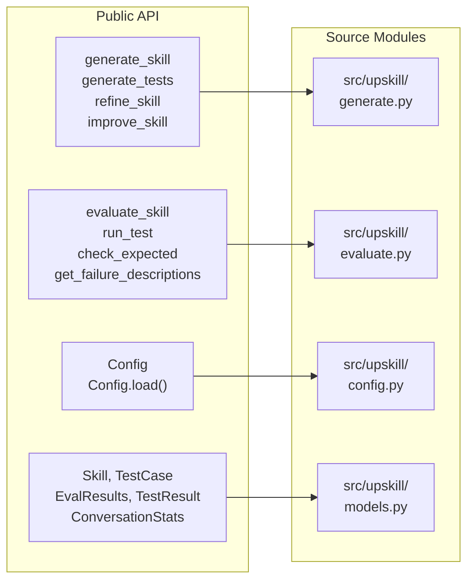
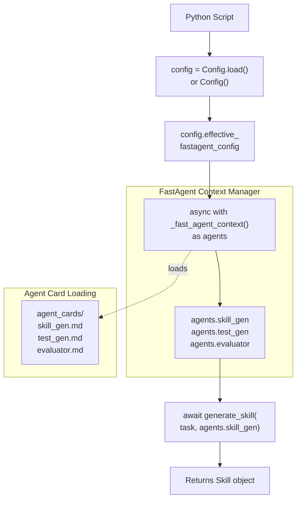
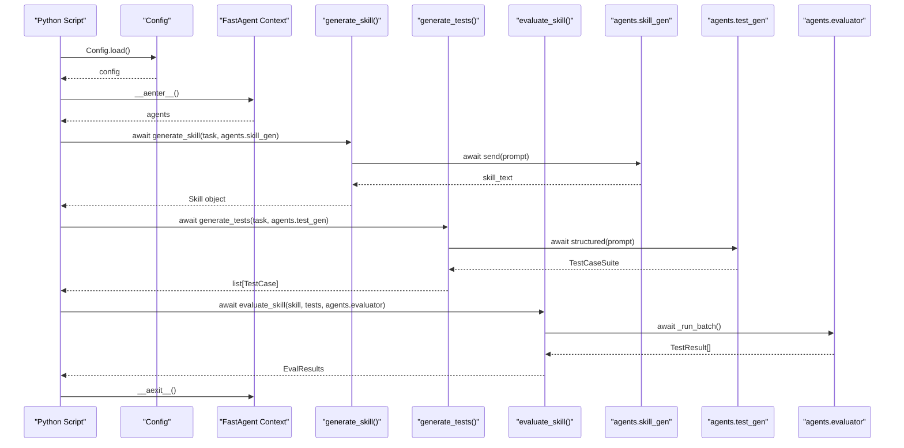
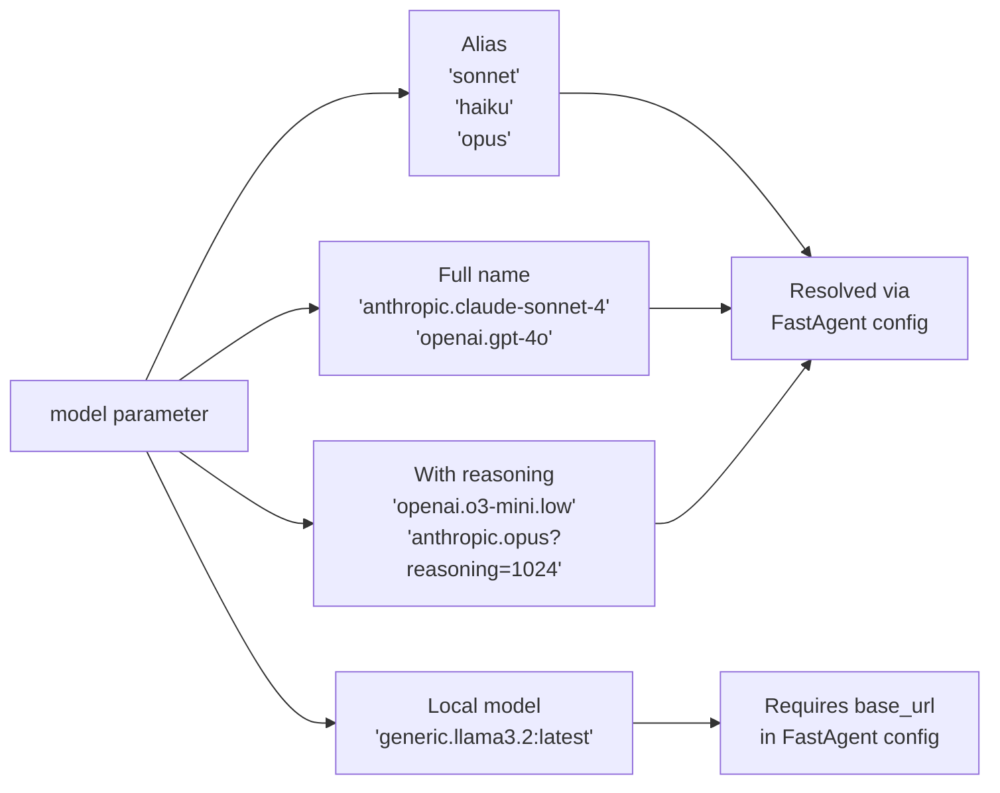
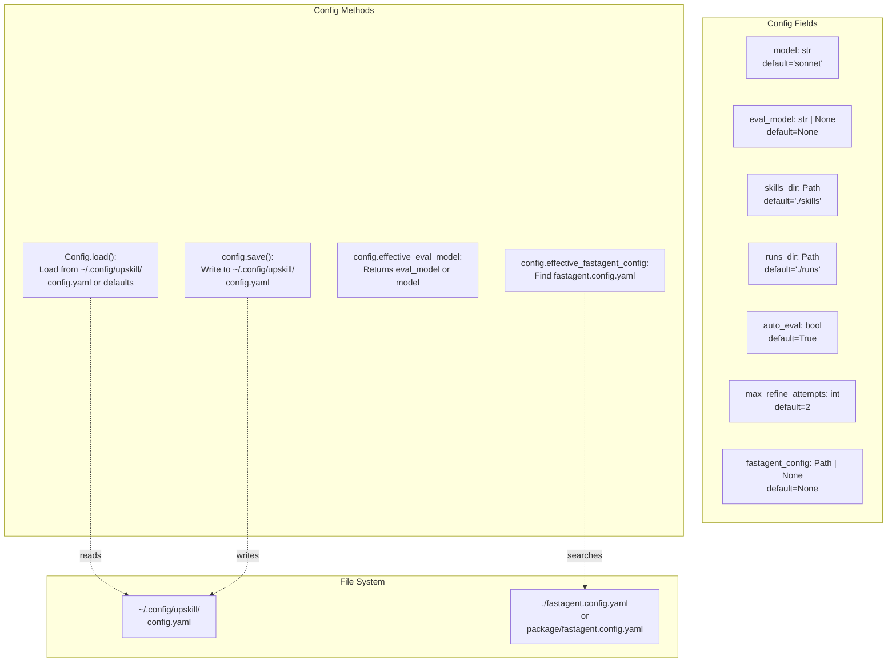
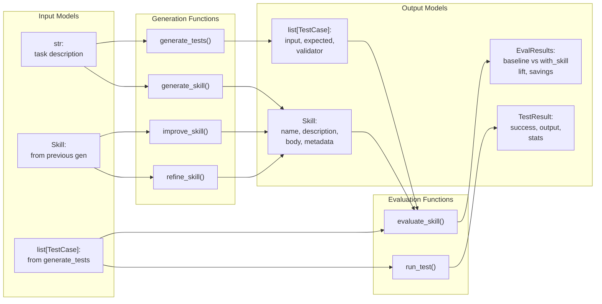
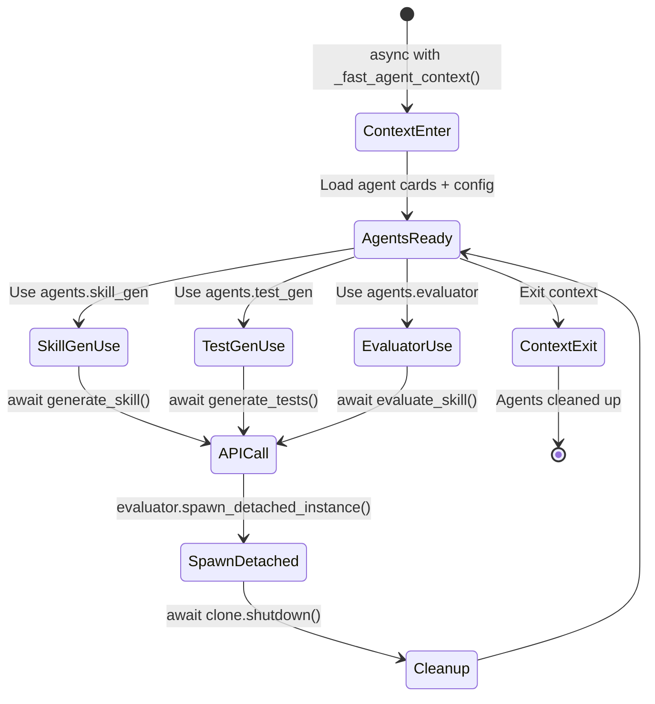

<!-- source: DeepWiki mcp.deepwiki.com · repo huggingface/upskill · page 9 Python API · fetched 2026-10-26 -->

# Python API

<details>
<summary>Relevant source files</summary>

The following files were used as context for generating this wiki page:

- [README.md](README.md)
- [src/upskill/config.py](src/upskill/config.py)
- [src/upskill/evaluate.py](src/upskill/evaluate.py)
- [src/upskill/generate.py](src/upskill/generate.py)

</details>


The Python API provides programmatic access to upskill's core functionality for skill generation, evaluation, and configuration management. This allows integration of upskill into custom workflows, scripts, and applications without using the CLI.

For detailed CLI command reference, see [CLI Reference](#4). For specific agent integration patterns, see [FastAgent Integration](#6.2).

---

## Overview

The Python API exposes all core upskill functions as importable async functions that accept FastAgent agent instances and return Pydantic data models. This design decouples upskill's domain logic from CLI concerns while maintaining the same workflow semantics.

**Key characteristics:**

- **Async-first**: All generation and evaluation functions are async and must be awaited
- **Agent-based**: Functions accept `AgentProtocol` or `LlmAgent` instances from FastAgent
- **Type-safe**: All inputs and outputs use Pydantic models defined in [src/upskill/models.py]()
- **Stateless**: Functions do not maintain internal state; configuration is passed explicitly

**Sources:** [README.md:424-465](), [src/upskill/generate.py:1-11](), [src/upskill/evaluate.py:1-31]()

---

## Import Structure



**Typical import pattern:**

```python
from upskill import (
    generate_skill,      # From generate.py
    generate_tests,      # From generate.py
    evaluate_skill,      # From evaluate.py
    refine_skill,        # From generate.py
    improve_skill,       # From generate.py
    Config,              # From config.py
)
from upskill.evaluate import (
    run_test,                    # Single test execution
    get_failure_descriptions,    # Extract failure info
)
from upskill.models import (
    Skill,              # Core data models
    TestCase,
    EvalResults,
)
```

**Sources:** [README.md:427-433](), [src/upskill/generate.py:1-11](), [src/upskill/evaluate.py:1-31]()

---

## FastAgent Context Pattern

All upskill functions require FastAgent agent instances (`skill_gen`, `test_gen`, `evaluator`). These must be obtained through FastAgent's context manager, which initializes the agent runtime with proper configuration and agent card loading.

### Context Manager Setup



The `_fast_agent_context` function is defined in [src/upskill/cli.py:25-48]() and provides:
- Agent card loading from `agent_cards/` directory
- FastAgent configuration from `fastagent.config.yaml`
- Properly initialized agent instances
- Automatic cleanup on context exit

**Sources:** [src/upskill/cli.py:25-48](), [src/upskill/config.py:97-101]()

---

## Async Function Patterns

All core upskill functions are async and follow consistent parameter patterns. The typical workflow involves:

1. Load configuration
2. Enter FastAgent context
3. Call async functions with agent instances
4. Process returned Pydantic models

### Complete Workflow Example



**Sources:** [README.md:435-465](), [src/upskill/generate.py](), [src/upskill/evaluate.py]()

---

## Function Signature Patterns

All async functions follow consistent parameter patterns based on their role:

| Function Category | Required Parameters | Optional Parameters | Return Type |
|------------------|-------------------|-------------------|-------------|
| **Generation** | `task: str`, `generator: AgentProtocol` | `model: str \| None`, `examples: list[str] \| None` | `Skill` |
| **Test Generation** | `task: str`, `generator: AgentProtocol` | `model: str \| None` | `list[TestCase]` |
| **Evaluation** | `skill: Skill`, `test_cases: list[TestCase]`, `evaluator: LlmAgent` | `model: str \| None`, `run_baseline: bool` | `EvalResults` |
| **Refinement** | `skill: Skill`, `failures: list[str]`, `generator: AgentProtocol` | `model: str \| None` | `Skill` |

**Key observations:**

- **Agent parameters**: Generation functions accept `AgentProtocol`, evaluation functions accept `LlmAgent`
- **Model parameter**: Always optional, defaults to agent's configured model
- **Return types**: Always concrete Pydantic models, never raw dictionaries or strings

**Sources:** [src/upskill/generate.py:104-128](), [src/upskill/evaluate.py:211-229](), [src/upskill/generate.py:164-195]()

---

## Model Specification

The `model` parameter in all functions accepts FastAgent model format strings:



**Model format structure:**

```
<provider>.<model_name>[.<reasoning_effort>|?reasoning=<tokens>]
```

**Provider mapping:**
- `anthropic.*` → Anthropic API
- `openai.*` → OpenAI API  
- `generic.*` → Custom base URL (Ollama, llama.cpp, etc.)
- Aliases (`sonnet`, `haiku`, `opus`) → Resolved via [fastagent.config.yaml]()

**Sources:** [README.md:467-483](), [src/upskill/config.py:42-43]()

---

## Configuration Management

The `Config` class provides programmatic access to upskill configuration with defaults and YAML persistence.

### Config Object Structure



**Usage pattern:**

```python
from upskill import Config

# Load from file or defaults
config = Config.load()

# Access fields
print(config.model)           # "sonnet"
print(config.skills_dir)      # Path('./skills')

# Use computed properties
eval_model = config.effective_eval_model  # Returns eval_model or falls back to model
fa_config = config.effective_fastagent_config  # Finds fastagent.config.yaml

# Modify and save
config.model = "opus"
config.max_refine_attempts = 5
config.save()
```

**Sources:** [src/upskill/config.py:38-102](), [README.md:376-384]()

---

## Data Model Flow

Understanding how data models flow through the API is critical for effective usage:



**Model hierarchy:**

- **Skill** [src/upskill/models.py:139-169](): Core skill representation with name, description, body, references, scripts, and metadata
- **TestCase** [src/upskill/models.py:98-123](): Single test with input, expected conditions, optional validator
- **TestResult** [src/upskill/models.py:251-268](): Outcome of running one test, includes success flag, output, tokens, and stats
- **EvalResults** [src/upskill/models.py:270-307](): Aggregate results comparing baseline vs with-skill performance

**Sources:** [src/upskill/models.py](), [src/upskill/generate.py](), [src/upskill/evaluate.py]()

---

## Error Handling

API functions raise standard Python exceptions for error conditions:

| Exception Type | Raised When | Example |
|---------------|-------------|---------|
| `ValueError` | Invalid skill manifest from LLM | Generator returns malformed YAML |
| `ValueError` | Test generation fails | Structured output parsing error |
| `Exception` | Agent execution error | Network timeout, API error |
| `FileNotFoundError` | Config file missing | When explicitly loading from path |
| `ValidationError` | Pydantic validation fails | Invalid model field types |

**Common error handling pattern:**

```python
from upskill import generate_skill, Config
from pydantic import ValidationError

config = Config.load()

try:
    skill = await generate_skill(
        task="parse JSON",
        generator=agents.skill_gen,
        model=config.model,
    )
except ValueError as e:
    # Handle LLM output parsing error
    print(f"Failed to generate valid skill: {e}")
except Exception as e:
    # Handle network/agent error
    print(f"Agent execution failed: {e}")
```

**Sources:** [src/upskill/generate.py:120-128](), [src/upskill/evaluate.py:166-168]()

---

## Working with Agent Instances

Agent instances must be obtained from FastAgent's context manager. The CLI provides a reference implementation in `_fast_agent_context()`:

### Agent Instance Lifecycle



**Key patterns:**

1. **Context management**: Agents must be used within the context manager scope
2. **Detached instances**: Evaluation spawns detached agent clones for isolation [src/upskill/evaluate.py:119]()
3. **Automatic cleanup**: Context exit handles agent shutdown
4. **Model switching**: Use `await agent.set_model(model)` to change models dynamically

**Sources:** [src/upskill/cli.py:25-48](), [src/upskill/evaluate.py:99-179]()

---

## Subsections

For detailed API documentation of specific function groups, see:

- **[Generation API](#9.1)**: `generate_skill()`, `generate_tests()`, `improve_skill()`, `refine_skill()`
- **[Evaluation API](#9.2)**: `evaluate_skill()`, `run_test()`, `get_failure_descriptions()`
- **[Configuration API](#9.3)**: `Config` class, loading, saving, and computed properties

---

**Sources:** [README.md:424-465](), [src/upskill/generate.py](), [src/upskill/evaluate.py](), [src/upskill/config.py](), [src/upskill/cli.py:25-48]()

---

