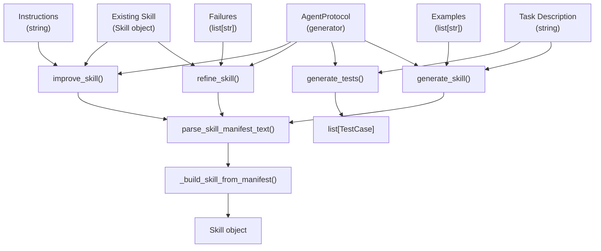
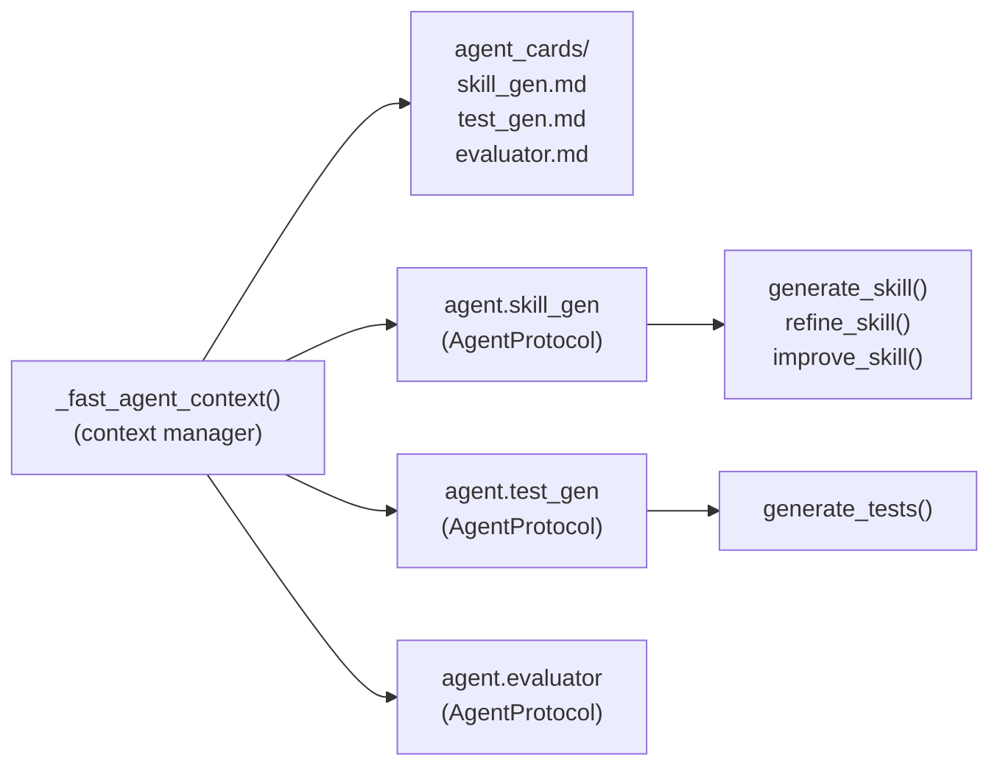
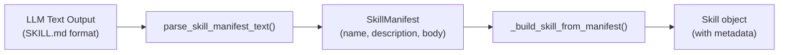
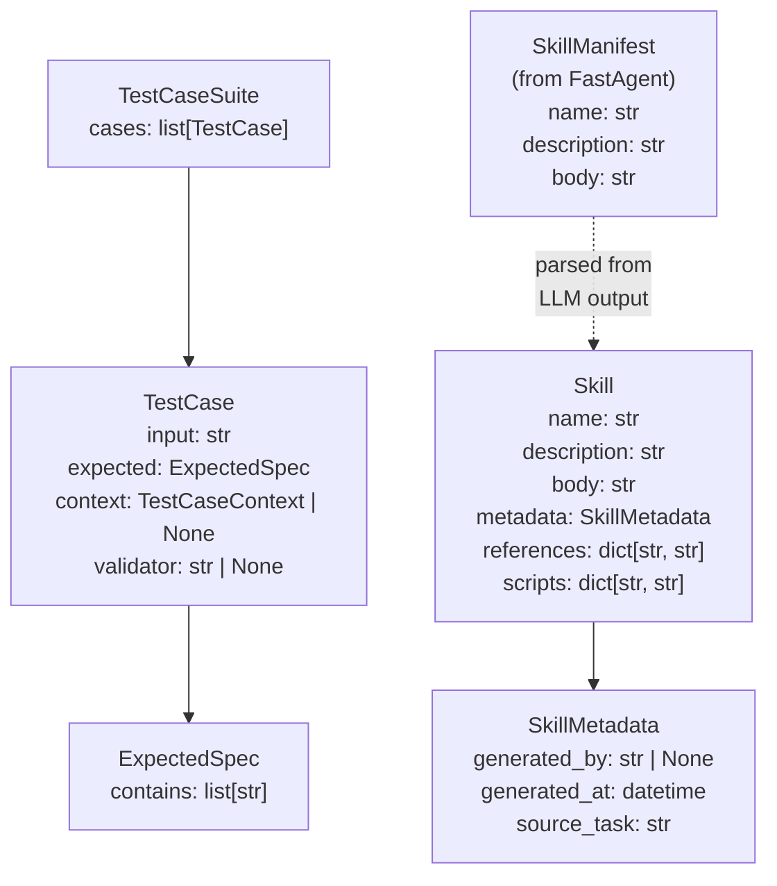

<!-- source: DeepWiki mcp.deepwiki.com · repo huggingface/upskill · page 9.1 Generation API · fetched 2026-10-26 -->

# Generation API

<details>
<summary>Relevant source files</summary>

The following files were used as context for generating this wiki page:

- [README.md](README.md)
- [src/upskill/generate.py](src/upskill/generate.py)

</details>


This page documents the programmatic Python API for generating skills, test cases, and improvements. These functions allow you to create and refine skills without using the CLI, enabling integration into custom workflows and automation scripts.

For information about evaluating generated skills, see [Evaluation API](#9.2). For CLI usage, see [upskill generate](#4.1).

**Sources:** [src/upskill/generate.py:1-266]()

---

## Overview

The Generation API provides four async functions that handle skill creation and refinement:

| Function | Purpose | Input | Output |
|----------|---------|-------|--------|
| `generate_skill` | Create a new skill from a task description | Task description, optional examples | `Skill` object |
| `generate_tests` | Generate test cases for a task | Task description | `list[TestCase]` |
| `refine_skill` | Improve a skill based on evaluation failures | Existing skill, failure descriptions | Refined `Skill` object |
| `improve_skill` | Enhance a skill with specific instructions | Existing skill, improvement instructions | Improved `Skill` object |

All functions are async and require an `AgentProtocol` instance (the "generator") to interact with the LLM. The generator is typically obtained from FastAgent's context manager.

**Sources:** [src/upskill/generate.py:104-265](), [README.md:424-465]()

---

## Function Signatures and Parameters

### generate_skill

```python
async def generate_skill(
    task: str,
    generator: AgentProtocol,
    examples: list[str] | None = None,
    model: str | None = None,
) -> Skill
```

Creates a new skill document from a task description.

**Parameters:**
- `task` (str): Description of what the skill should teach (e.g., "write good git commit messages")
- `generator` (AgentProtocol): FastAgent agent instance for skill generation (typically `agent.skill_gen`)
- `examples` (list[str] | None): Optional input/output example pairs to guide generation
- `model` (str | None): Model identifier for metadata tracking (e.g., "sonnet")

**Returns:** `Skill` object with generated name, description, body, and metadata

**Raises:** `ValueError` if the generator does not return valid SKILL.md format

The function constructs a prompt requesting a skill document, sends it to the generator, parses the response using `parse_skill_manifest_text`, and builds a `Skill` object with metadata including generation timestamp and source task.

**Sources:** [src/upskill/generate.py:104-128]()

---

### generate_tests

```python
async def generate_tests(
    task: str,
    generator: AgentProtocol,
    model: str | None = None,
) -> list[TestCase]
```

Generates synthetic test cases for evaluating a skill.

**Parameters:**
- `task` (str): Task description that the test cases should verify
- `generator` (AgentProtocol): FastAgent agent instance for test generation (typically `agent.test_gen`)
- `model` (str | None): Model identifier for logging purposes

**Returns:** List of `TestCase` objects with input prompts and expected outputs

**Raises:** `ValueError` if the generator does not return structured test cases

The function uses a few-shot prompt template (`TEST_GENERATION_PROMPT`) with example test cases to guide the LLM. It validates that test cases have at least two expected strings and prints warnings for invalid cases.

**Sources:** [src/upskill/generate.py:131-161](), [src/upskill/generate.py:14-78]()

---

### refine_skill

```python
async def refine_skill(
    skill: Skill,
    failures: list[str],
    generator: AgentProtocol,
    model: str | None = None,
) -> Skill
```

Refines an existing skill based on evaluation failures.

**Parameters:**
- `skill` (Skill): The skill to refine
- `failures` (list[str]): List of failure descriptions from evaluation (typically up to 3)
- `generator` (AgentProtocol): FastAgent agent instance for skill refinement (typically `agent.skill_gen`)
- `model` (str | None): Model identifier for metadata tracking

**Returns:** Refined `Skill` object with the same name but improved content

**Raises:** `ValueError` if the generator does not return valid SKILL.md format

The function shows the current skill (truncated to 500 characters) and the first 3 failures to the LLM, requesting an improved version. The refined skill preserves references and scripts from the original.

**Sources:** [src/upskill/generate.py:164-195]()

---

### improve_skill

```python
async def improve_skill(
    skill: Skill,
    instructions: str,
    generator: AgentProtocol,
    model: str | None = None,
) -> Skill
```

Improves an existing skill with specific enhancement instructions.

**Parameters:**
- `skill` (Skill): The skill to improve
- `instructions` (str): What improvements to make (e.g., "add more error handling examples")
- `generator` (AgentProtocol): FastAgent agent instance for skill improvement (typically `agent.skill_gen`)
- `model` (str | None): Model identifier for metadata tracking

**Returns:** Improved `Skill` object with enhanced content

**Raises:** `ValueError` if the generator does not return valid SKILL.md format

The function uses `IMPROVE_PROMPT` template to guide the LLM in preserving what works while addressing specific improvement requests. The source task in metadata is updated to reflect the improvement.

**Sources:** [src/upskill/generate.py:227-265](), [src/upskill/generate.py:198-224]()

---

## Generation Function Flow



**Sources:** [src/upskill/generate.py:80-265]()

---

## Obtaining the Generator (AgentProtocol)

The `generator` parameter required by all generation functions is an `AgentProtocol` instance from FastAgent. This is typically obtained using FastAgent's context manager pattern.

### FastAgent Context Pattern

The CLI uses `_fast_agent_context` to initialize FastAgent and load agent cards:



The context manager in the CLI is defined at [src/upskill/cli.py:25-36](). It yields an `agent` object with three specialized agent instances:

- `agent.skill_gen` - For generating and refining skills
- `agent.test_gen` - For generating test cases
- `agent.evaluator` - For running evaluations (used by Evaluation API)

**Typical usage pattern:**

1. Enter the FastAgent context manager
2. Access the appropriate agent instance (`agent.skill_gen` or `agent.test_gen`)
3. Pass it as the `generator` parameter to generation functions
4. The agent handles LLM interaction and returns responses

**Sources:** [src/upskill/cli.py:25-36](), [README.md:424-465]()

---

## Skill Manifest Parsing

All skill generation functions use a two-step process to convert LLM output into `Skill` objects:



### parse_skill_manifest_text

Defined in [src/upskill/manifest_utils.py](), this function:
- Parses YAML frontmatter (name, description)
- Extracts markdown body
- Returns `(SkillManifest, error)` tuple

### _build_skill_from_manifest

Defined at [src/upskill/generate.py:80-101](), this helper function:
- Creates a `Skill` object from the parsed manifest
- Adds metadata (generated_by, generated_at, source_task)
- Preserves references and scripts from base skill (if provided)
- Returns the complete `Skill` object

**Sources:** [src/upskill/generate.py:80-101](), [src/upskill/generate.py:120-128]()

---

## Test Generation Details

The `generate_tests` function uses a specialized prompt template with few-shot examples to ensure consistent test case generation.

### Test Generation Prompt Template

The prompt is defined at [src/upskill/generate.py:69-78]() and includes:

1. **Few-shot examples** (`TEST_EXAMPLES`): Two complete examples showing the expected JSON structure for test cases
2. **Task placeholder**: Replaced with the actual task description
3. **Validation requirements**: Each test case MUST include at least two expected strings

### Test Case Validation

The function validates generated test cases at [src/upskill/generate.py:146-160]():

- Checks that each `TestCase.expected.contains` has at least 2 non-empty strings
- Prints a warning if validation fails, but still returns the test cases
- Logs the total number of test cases and count of invalid ones

This validation ensures test cases are specific enough to meaningfully evaluate skill performance.

**Sources:** [src/upskill/generate.py:14-78](), [src/upskill/generate.py:131-161]()

---

## Error Handling

All generation functions raise `ValueError` when the LLM fails to produce valid output:

| Function | Error Condition | Error Message |
|----------|----------------|---------------|
| `generate_skill` | Invalid SKILL.md format | "Skill generator did not return valid SKILL.md: {error}" |
| `generate_tests` | Missing structured output | "Test generator did not return structured test cases." |
| `refine_skill` | Invalid SKILL.md format | "Skill refinement did not return valid SKILL.md: {error}" |
| `improve_skill` | Invalid SKILL.md format | "Skill improvement did not return valid SKILL.md: {error}" |

These errors typically occur when:
- The LLM wraps output in code fences (```markdown```) instead of raw text
- The YAML frontmatter is malformed
- The LLM produces JSON instead of SKILL.md format
- Network issues interrupt the generation

The CLI handles these errors and may retry with adjusted prompts.

**Sources:** [src/upskill/generate.py:122](), [src/upskill/generate.py:142](), [src/upskill/generate.py:188](), [src/upskill/generate.py:258]()

---

## Data Models

The generation functions work with these Pydantic models:



- **Skill**: Complete skill object with content and metadata (see [Skill Models](#7.1))
- **SkillMetadata**: Tracks generation context
- **TestCase**: Individual test with input and expected output (see [Test Models](#7.2))
- **TestCaseSuite**: Wrapper for structured test generation (used with `generator.structured()`)
- **SkillManifest**: FastAgent's representation of a skill (intermediate parsing format)

**Sources:** [src/upskill/models.py](), [src/upskill/generate.py:11]()

---

## Async Execution Pattern

All generation functions are async and must be awaited. Common patterns:

### Single Function Call

When calling a single generation function, use `asyncio.run()` or await within an async context:

```python
import asyncio
from upskill.generate import generate_skill

# The CLI uses the _fast_agent_context to get the generator
# In your code, you would obtain it similarly
async def main():
    async with _fast_agent_context() as agent:
        skill = await generate_skill(
            task="write good git commit messages",
            generator=agent.skill_gen,
            model="sonnet"
        )
        print(skill.name, skill.description)

asyncio.run(main())
```

### Sequential Generation

The typical workflow generates a skill, then generates tests:

```python
async def generate_and_test(task: str):
    async with _fast_agent_context() as agent:
        # Generate skill
        skill = await generate_skill(
            task=task,
            generator=agent.skill_gen,
            model="sonnet"
        )
        
        # Generate tests for the same task
        tests = await generate_tests(
            task=task,
            generator=agent.test_gen,
            model="sonnet"
        )
        
        return skill, tests
```

This pattern is used by the CLI at [src/upskill/cli.py:158-218]().

**Sources:** [README.md:424-465](), [src/upskill/cli.py:158-218]()

---

## Relationship to CLI Commands

The Generation API functions are the foundation of CLI commands:

| CLI Command | Functions Used | Flow |
|-------------|----------------|------|
| `upskill generate` | `generate_skill` → `generate_tests` → (optionally) `refine_skill` | Creates skill, generates tests, evaluates, and refines if needed |
| `upskill generate --from skill-dir` | `improve_skill` → `generate_tests` | Loads existing skill, improves it with instructions |
| `upskill generate --from trace.md` | `generate_skill` (with trace content) → `generate_tests` | Generates skill from agent trace |

The CLI implements the complete refinement loop:
1. Generate skill with `generate_skill`
2. Generate tests with `generate_tests`
3. Evaluate (see [Evaluation API](#9.2))
4. If not beneficial and under max attempts, call `refine_skill` with failures
5. Repeat until beneficial or plateau detected

**Sources:** [src/upskill/cli.py:112-329](), [README.md:47-111]()

---

## Prompt Templates

The generation functions use predefined prompt templates:

### Skill Generation Prompt

Created at [src/upskill/generate.py:112-116]():
```
Create a skill document that teaches an AI agent how to: {task}

Example input/output pairs for this task:
- {example1}
- {example2}
```

### Test Generation Prompt

Defined at [src/upskill/generate.py:69-78]() with few-shot examples from [src/upskill/generate.py:14-64]().

### Refinement Prompt

Created at [src/upskill/generate.py:172-183]():
```
Improve this skill based on failures:

Name: {skill.name}
Description: {skill.description}
Body: {skill.body[:500]}...

Failures:
- {failure1}
- {failure2}
- {failure3}

Output a complete SKILL.md document with YAML frontmatter...
```

### Improvement Prompt

Defined at [src/upskill/generate.py:198-224]() with structured guidelines for preserving working content while addressing specific improvements.

**Sources:** [src/upskill/generate.py:14-224]()

---

