<!-- source: DeepWiki mcp.deepwiki.com · repo huggingface/upskill · page 9.2 Evaluation API · fetched 2026-10-26 -->

# Evaluation API

<details>
<summary>Relevant source files</summary>

The following files were used as context for generating this wiki page:

- [README.md](README.md)
- [src/upskill/evaluate.py](src/upskill/evaluate.py)

</details>


This page documents the programmatic evaluation API for upskill. These functions allow you to evaluate skills, run individual test cases, and analyze results through Python code instead of using the CLI.

For skill generation functions, see [Generation API](#9.1). For the conceptual understanding of evaluation, see [Skill Evaluation](#5.3). For data structures used in evaluation, see [Evaluation Models](#7.3).

## Overview

The evaluation API is located in [src/upskill/evaluate.py]() and provides three primary functions:

| Function | Purpose | Returns |
|----------|---------|---------|
| `evaluate_skill()` | Evaluate a skill against multiple test cases with baseline comparison | `EvalResults` |
| `run_test()` | Execute a single test case with or without a skill | `TestResult` |
| `get_failure_descriptions()` | Extract human-readable failure descriptions for refinement | `list[str]` |

**Sources:** [src/upskill/evaluate.py:1-303]()

## Core Functions

### evaluate_skill()

The primary evaluation function that runs a complete A/B test comparing baseline (no skill) against with-skill performance.

```python
async def evaluate_skill(
    skill: Skill,
    test_cases: list[TestCase],
    evaluator: LlmAgent,
    model: str | None = None,
    run_baseline: bool = True,
) -> EvalResults
```

**Parameters:**
- `skill` - The skill to evaluate (see [Skill Models](#7.1))
- `test_cases` - List of test cases to run (see [Test Models](#7.2))
- `evaluator` - FastAgent `LlmAgent` instance from the evaluator agent card
- `model` - Optional model identifier to override the evaluator's default
- `run_baseline` - Whether to run tests without the skill for comparison (default: `True`)

**Returns:** `EvalResults` containing baseline vs with-skill metrics including success rates, token usage, and derived metrics like `skill_lift` and `token_savings`.

**Behavior:**
- Composes skill content into agent instructions using `compose_instruction()`
- Runs all test cases in parallel using `asyncio.gather()`
- Creates detached agent instances for each test to ensure isolation
- Calculates aggregate metrics: success rates, total tokens, average turns
- Determines if skill is beneficial based on lift and savings thresholds

**Sources:** [src/upskill/evaluate.py:211-286]()

### run_test()

Execute a single test case with optional skill injection and workspace isolation.

```python
async def run_test(
    test_case: TestCase,
    evaluator: LlmAgent,
    skill: Skill | None,
    use_workspace: bool | None = None,
    model: str | None = None,
) -> TestResult
```

**Parameters:**
- `test_case` - The test case to execute
- `evaluator` - FastAgent `LlmAgent` instance
- `skill` - Optional skill to inject (`None` for baseline runs)
- `use_workspace` - Force workspace isolation (auto-detected from `test_case.validator`)
- `model` - Optional model identifier to override evaluator's default

**Returns:** `TestResult` containing success status, output, token usage, conversation statistics, and validation results.

**Workspace Auto-Detection:** If `use_workspace` is not specified, workspace isolation is automatically enabled when `test_case.validator` is set, as custom validators typically need filesystem access.

**Sources:** [src/upskill/evaluate.py:181-208]()

### get_failure_descriptions()

Extract human-readable descriptions of failed test cases for skill refinement.

```python
def get_failure_descriptions(results: EvalResults) -> list[str]
```

**Parameters:**
- `results` - Evaluation results containing test outcomes

**Returns:** List of failure description strings formatted as:
```
"Input: {input} | Error: {error}" (if error occurred)
"Input: {input} | Output: {output[:200]}... | Expected: {expected}" (if validation failed)
```

These descriptions are used by `refine_skill()` to improve skills based on failures. See [Skill Refinement](#5.4).

**Sources:** [src/upskill/evaluate.py:289-302]()

## Evaluation Workflow

The following diagram shows the execution flow for `evaluate_skill()`, mapping natural language concepts to code entities:

```mermaid
graph TD
    Start["evaluate_skill()"] --> ComposeSkill["compose_instruction(base_instruction, skill)"]
    Start --> Model{model param<br/>provided?}
    
    Model -->|Yes| SetModel["evaluator.set_model(model)"]
    Model -->|No| Continue["Use evaluator's<br/>default model"]
    SetModel --> Continue
    
    ComposeSkill --> WithSkillBatch["_run_batch(skill_instruction, 'skill')"]
    Continue --> WithSkillBatch
    
    WithSkillBatch --> SpawnInstances["For each test_case:<br/>_run_test_with_evaluator(tc, evaluator, ...)"]
    
    SpawnInstances --> DetachClone["evaluator.spawn_detached_instance()<br/>Creates isolated LlmAgent"]
    
    DetachClone --> CheckWorkspace{test_case.validator<br/>exists?}
    
    CheckWorkspace -->|Yes| IsolatedWS["isolated_workspace()<br/>Creates temp directory"]
    CheckWorkspace -->|No| NoWS["Run without<br/>workspace"]
    
    IsolatedWS --> EnableShell["clone.enable_shell(working_directory=workspace)"]
    EnableShell --> SetInstruction
    NoWS --> SetInstruction["clone.set_instruction(instruction)"]
    
    SetInstruction --> SendInput["clone.send(test_case.input)"]
    
    SendInput --> ExtractStats["extract_stats_from_summary(ConversationSummary)"]
    
    ExtractStats --> Validate["check_expected(output, expected, workspace, test_case)"]
    
    Validate --> CustomValidator{test_case.validator<br/>specified?}
    
    CustomValidator -->|Yes| GetValidator["get_validator(test_case.validator)<br/>Returns validator function"]
    CustomValidator -->|No| StringMatch["Check expected.contains<br/>in output"]
    
    GetValidator --> CallValidator["validator(workspace, output_file, **validator_config)"]
    
    CallValidator --> CreateResult["TestResult(success, output, stats, ...)"]
    StringMatch --> CreateResult
    
    CreateResult --> Shutdown["clone.shutdown()"]
    
    Shutdown --> GatherResults["asyncio.gather(*tasks)<br/>Collects all TestResults"]
    
    GatherResults --> CalcMetrics["Calculate metrics:<br/>with_skill_success_rate<br/>with_skill_total_tokens<br/>with_skill_avg_turns"]
    
    CalcMetrics --> RunBaseline{run_baseline<br/>== True?}
    
    RunBaseline -->|Yes| BaselineBatch["_run_batch(None, 'baseline')<br/>Runs tests without skill"]
    RunBaseline -->|No| ReturnResults["Return EvalResults"]
    
    BaselineBatch --> CalcBaselineMetrics["Calculate metrics:<br/>baseline_success_rate<br/>baseline_total_tokens<br/>baseline_avg_turns"]
    
    CalcBaselineMetrics --> DeriveLift["Derive skill_lift and token_savings<br/>from EvalResults properties"]
    
    DeriveLift --> ReturnResults
```



**Sources:** [src/upskill/evaluate.py:211-286](), [src/upskill/evaluate.py:99-178](), [src/upskill/fastagent_integration.py]()

## Workspace Isolation

The evaluation API provides isolated workspace directories for tests that need filesystem access, particularly for custom validators.

### isolated_workspace()

Context manager that creates and cleans up temporary directories for test execution.

```python
@contextmanager
def isolated_workspace(
    base_dir: Path | None = None, 
    cleanup: bool = True
) -> Generator[Path]
```

**Parameters:**
- `base_dir` - Optional parent directory (defaults to system temp)
- `cleanup` - Whether to remove workspace after use (default: `True`)

**Usage Pattern:**
```python
with isolated_workspace() as workspace:
    # workspace is Path to temporary directory
    # Run tests that create files, execute scripts, etc.
    # Directory is automatically cleaned up on exit
```

**Integration with Shell Runtime:** When workspace isolation is enabled, the evaluation system automatically configures the agent's shell runtime to use the workspace as the working directory via `clone.enable_shell(working_directory=workspace)`.

**Sources:** [src/upskill/evaluate.py:39-59](), [src/upskill/evaluate.py:120-124]()

## Output Validation

The evaluation API supports two validation methods: simple string containment and custom validators.

### check_expected()

Validates test output against expected conditions.

```python
def check_expected(
    output: str,
    expected: ExpectedSpec,
    workspace: Path | None = None,
    test_case: TestCase | None = None,
) -> tuple[bool, ValidationResult | None]
```

**Validation Logic:**
1. If `test_case.validator` is specified and workspace is provided, load and execute the custom validator function
2. Otherwise, perform string containment check: all items in `expected.contains` must appear in output (case-insensitive)

**Returns:** Tuple of `(success: bool, validation_result: ValidationResult | None)`

**Sources:** [src/upskill/evaluate.py:62-96]()

### Custom Validators

Custom validators are Python functions registered via the validator system. They receive workspace path and configuration, and return a `ValidationResult`.

**Validator Signature:**
```python
def my_validator(
    workspace: Path,
    output_file: str,
    **config: dict
) -> ValidationResult
```

For detailed information on creating custom validators, see [Custom Validators](#10.1).

**Sources:** [src/upskill/evaluate.py:79-89](), [src/upskill/validators.py]()

## Data Flow Through Evaluation

This diagram shows how data models flow through the evaluation process:

```mermaid
graph LR
    subgraph "Input"
        Skill["Skill<br/>(name, body, metadata)"]
        TestCases["list[TestCase]<br/>(input, expected, validator)"]
        Evaluator["LlmAgent<br/>(FastAgent instance)"]
    end
    
    subgraph "evaluate_skill()"
        ComposeInstr["compose_instruction()<br/>Returns formatted instruction"]
        RunBatch["_run_batch()<br/>Parallel test execution"]
    end
    
    subgraph "_run_test_with_evaluator()"
        SpawnClone["spawn_detached_instance()<br/>Returns isolated LlmAgent"]
        SendMessage["clone.send(user_content)<br/>Returns output: str"]
        MessageHistory["clone.message_history<br/>List of messages"]
        ConvSummary["ConversationSummary(messages)<br/>FastAgent class"]
        ExtractStats["extract_stats_from_summary()<br/>Returns ConversationStats"]
        CheckExpected["check_expected()<br/>Returns (bool, ValidationResult?)"]
    end
    
    subgraph "Output"
        TestResult["TestResult<br/>(success, output, stats, validation_result)"]
        WithSkillResults["list[TestResult]<br/>with_skill_results"]
        BaselineResults["list[TestResult]<br/>baseline_results"]
        EvalResults["EvalResults<br/>(success_rates, tokens, lift, savings)"]
    end
    
    Skill --> ComposeInstr
    Evaluator --> ComposeInstr
    ComposeInstr --> RunBatch
    TestCases --> RunBatch
    
    RunBatch --> SpawnClone
    SpawnClone --> SendMessage
    SendMessage --> MessageHistory
    MessageHistory --> ConvSummary
    ConvSummary --> ExtractStats
    
    ExtractStats --> TestResult
    CheckExpected --> TestResult
    
    TestResult --> WithSkillResults
    TestResult --> BaselineResults
    
    WithSkillResults --> EvalResults
    BaselineResults --> EvalResults
```



**Sources:** [src/upskill/evaluate.py:211-286](), [src/upskill/models.py:156-191](), [src/upskill/models.py:270-307](), [src/upskill/logging.py:96-148]()

## Metrics Collection

The evaluation API captures comprehensive metrics through the `ConversationStats` model, extracted from FastAgent's message history.

### Extracted Metrics

| Metric | Source | Description |
|--------|--------|-------------|
| `conversation_span_ms` | `FAST_AGENT_TIMING` | Total time from first to last message |
| `llm_time_ms` | `FAST_AGENT_TIMING` | Cumulative LLM inference time |
| `tool_time_ms` | `FAST_AGENT_TIMING` | Cumulative tool execution time |
| `input_tokens` | `FAST_AGENT_USAGE` | Tokens sent to LLM |
| `output_tokens` | `FAST_AGENT_USAGE` | Tokens generated by LLM |
| `total_tokens` | Calculated | `input_tokens + output_tokens` |
| `turns` | Message history | Number of user-assistant exchanges |
| `total_tool_calls` | Message history | Count of all tool invocations |
| `mcp_calls` | Message history | MCP tool invocations (from manifest) |
| `execute_calls` | Message history | Direct function executions |
| `tool_call_map` | Message history | Per-tool invocation counts |
| `tool_error_map` | Message history | Per-tool error counts |

### extract_stats_from_summary()

This function is called internally by `_run_test_with_evaluator()` to parse FastAgent's conversation data:

```python
# From logging.py
def extract_stats_from_summary(summary: ConversationSummary) -> ConversationStats
```

The function:
1. Extracts token usage from `FAST_AGENT_USAGE` channel messages
2. Extracts timing data from `FAST_AGENT_TIMING` channel messages
3. Analyzes tool calls in message history to categorize MCP vs execute calls
4. Builds tool call and error maps

For detailed information on `ConversationStats` structure, see [Conversation Statistics](#8.2).

**Sources:** [src/upskill/evaluate.py:133-139](), [src/upskill/logging.py:96-148](), [src/upskill/models.py:212-249]()

## Example Usage Patterns

### Basic Skill Evaluation

```python
from upskill import Config
from upskill.evaluate import evaluate_skill
from upskill.models import Skill, TestCase, ExpectedSpec
from fast_agent import _fast_agent_context

# Load configuration and agent context
config = Config.load()

async with _fast_agent_context():
    from fast_agent.agents import agent
    
    # Load skill from disk
    skill = Skill.load(config.skills_dir / "my-skill")
    
    # Define test cases
    test_cases = [
        TestCase(
            input="Write a commit message for adding login",
            expected=ExpectedSpec(contains=["feat", "login"])
        ),
        TestCase(
            input="Fix null pointer bug",
            expected=ExpectedSpec(contains=["fix", "bug"])
        ),
    ]
    
    # Evaluate with baseline comparison
    results = await evaluate_skill(
        skill=skill,
        test_cases=test_cases,
        evaluator=agent.evaluator,
        model="haiku",
        run_baseline=True,
    )
    
    print(f"Baseline success: {results.baseline_success_rate:.0%}")
    print(f"With skill success: {results.with_skill_success_rate:.0%}")
    print(f"Skill lift: {results.skill_lift:.1%}")
    print(f"Token savings: {results.token_savings:.1%}")
    print(f"Is beneficial: {results.is_beneficial}")
```

**Sources:** [src/upskill/evaluate.py:211-286](), [README.md:424-465]()

### Running Individual Tests

```python
from upskill.evaluate import run_test
from upskill.models import Skill, TestCase, ExpectedSpec
from fast_agent import _fast_agent_context

async with _fast_agent_context():
    from fast_agent.agents import agent
    
    skill = Skill.load("./skills/my-skill")
    test_case = TestCase(
        input="Parse this JSON: {...}",
        expected=ExpectedSpec(contains=["success"])
    )
    
    # Run with skill
    result_with = await run_test(
        test_case=test_case,
        evaluator=agent.evaluator,
        skill=skill,
        model="haiku",
    )
    
    # Run baseline (no skill)
    result_baseline = await run_test(
        test_case=test_case,
        evaluator=agent.evaluator,
        skill=None,  # No skill for baseline
        model="haiku",
    )
    
    print(f"With skill: {result_with.success} ({result_with.stats.total_tokens} tokens)")
    print(f"Baseline: {result_baseline.success} ({result_baseline.stats.total_tokens} tokens)")
```

**Sources:** [src/upskill/evaluate.py:181-208]()

### Extracting Failures for Refinement

```python
from upskill.evaluate import evaluate_skill, get_failure_descriptions
from upskill.generate import refine_skill
from fast_agent import _fast_agent_context

async with _fast_agent_context():
    from fast_agent.agents import agent
    
    # Evaluate skill
    results = await evaluate_skill(skill, test_cases, agent.evaluator)
    
    # If not beneficial, extract failures and refine
    if not results.is_beneficial:
        failures = get_failure_descriptions(results)
        print(f"Found {len(failures)} failures:")
        for failure in failures:
            print(f"  - {failure}")
        
        # Refine skill based on failures
        improved_skill = await refine_skill(
            skill=skill,
            failures=failures,
            agent=agent.skill_gen,
        )
```

**Sources:** [src/upskill/evaluate.py:289-302](), [README.md:460-464]()

### Cross-Model Evaluation

Evaluate the same skill on different models to compare performance:

```python
from upskill.evaluate import evaluate_skill

models = ["haiku", "sonnet", "opus"]
results_by_model = {}

async with _fast_agent_context():
    from fast_agent.agents import agent
    
    for model in models:
        results = await evaluate_skill(
            skill=skill,
            test_cases=test_cases,
            evaluator=agent.evaluator,
            model=model,
            run_baseline=True,
        )
        results_by_model[model] = results
    
    # Compare results
    for model, results in results_by_model.items():
        print(f"{model:10} {results.skill_lift:+.1%} lift, "
              f"{results.token_savings:+.1%} savings")
```

For more information on cross-model evaluation strategies, see [Cross-Model Evaluation](#10.3).

**Sources:** [src/upskill/evaluate.py:211-286]()

### Using Custom Validators

When test cases require file-based validation:

```python
from upskill.models import TestCase, ExpectedSpec

test_case = TestCase(
    input="Generate a Python script that sorts numbers",
    expected=ExpectedSpec(contains=["sorted"]),
    validator="python_syntax",  # Custom validator name
    validator_config={"strict": True},
    output_file="script.py",
)

# Workspace isolation is automatically enabled
result = await run_test(
    test_case=test_case,
    evaluator=agent.evaluator,
    skill=skill,
)

if result.validation_result:
    print(f"Validation: {result.validation_result.message}")
    print(f"Details: {result.validation_result.details}")
```

For implementing custom validators, see [Custom Validators](#10.1). For workspace isolation details, see [Workspace Isolation](#10.2).

**Sources:** [src/upskill/evaluate.py:62-96](), [src/upskill/evaluate.py:142-148](), [src/upskill/models.py:75-112]()

## Integration with Logging

The evaluation API automatically integrates with the run logging system when called through the CLI, but can also be used with manual logging:

```python
from upskill.logging import (
    create_batch_folder,
    write_run_result,
    RunMetadata,
    RunResult,
)

# Create batch folder
batch_dir = create_batch_folder(runs_dir=Path("./runs"))

# Run evaluation
results = await evaluate_skill(skill, test_cases, agent.evaluator, model="haiku")

# Log each test result
for idx, test_result in enumerate(results.with_skill_results, start=1):
    metadata = RunMetadata(
        model="haiku",
        task=skill.name,
        batch_id=batch_dir.name,
        run_number=idx,
    )
    
    run_result = RunResult(
        metadata=metadata,
        stats=test_result.stats,
        passed=test_result.success,
        assertions=1 if test_result.success else 0,
        max_assertions=1,
    )
    
    write_run_result(batch_dir, idx, metadata, run_result)
```

For complete logging documentation, see [Run Logging and Metrics](#8).

**Sources:** [src/upskill/logging.py:1-296](), [src/upskill/models.py:252-268](), [src/upskill/models.py:310-340]()

## Function Reference Summary

| Function | Module | Purpose | Async |
|----------|--------|---------|-------|
| `evaluate_skill()` | `evaluate` | Full A/B evaluation with baseline | ✓ |
| `run_test()` | `evaluate` | Single test execution | ✓ |
| `check_expected()` | `evaluate` | Validate output against expectations | - |
| `get_failure_descriptions()` | `evaluate` | Extract failure messages | - |
| `isolated_workspace()` | `evaluate` | Create temporary workspace | - |
| `extract_stats_from_summary()` | `logging` | Extract metrics from conversation | - |

**Sources:** [src/upskill/evaluate.py:1-303](), [src/upskill/logging.py:96-148]()

---

