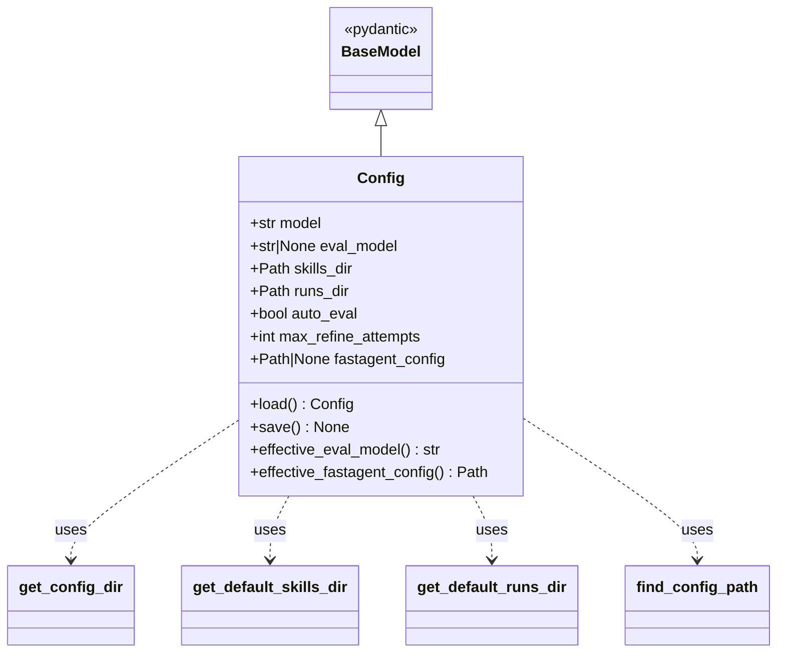
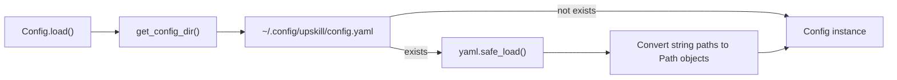
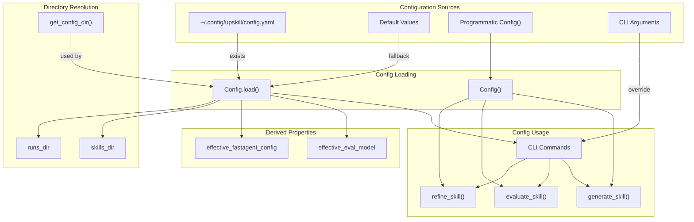
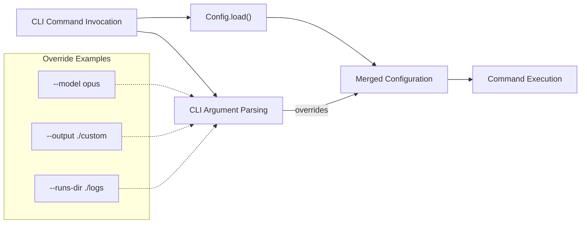

<!-- source: DeepWiki mcp.deepwiki.com · repo huggingface/upskill · page 9.3 Configuration API · fetched 2026-10-26 -->

# Configuration API

<details>
<summary>Relevant source files</summary>

The following files were used as context for generating this wiki page:

- [README.md](README.md)
- [src/upskill/config.py](src/upskill/config.py)

</details>


This document describes the programmatic interface for loading and manipulating configuration in upskill. The `Config` class provides access to all system settings including model selection, directory paths, and generation parameters.

For command-line configuration, see [Configuration](#2.2). For using configuration with generation functions, see [Generation API](#9.1). For using configuration with evaluation functions, see [Evaluation API](#9.2).

## Config Class Overview

The `Config` class is defined in [src/upskill/config.py:38-102]() as a Pydantic `BaseModel` that encapsulates all upskill configuration settings. It can be loaded from YAML files, created programmatically, or used with default values.

### Config Class Structure



**Sources:** [src/upskill/config.py:38-102]()

## Loading Configuration

### From Default Location

The `Config.load()` class method loads configuration from `~/.config/upskill/config.yaml` if it exists, otherwise returns a `Config` instance with default values.

```python
from upskill import Config

# Load from file or defaults
config = Config.load()

print(config.model)        # "sonnet"
print(config.skills_dir)   # Path("./skills")
```

The loading logic is implemented in [src/upskill/config.py:60-75]() and automatically converts string paths in YAML to `Path` objects.

### Configuration File Location



**Sources:** [src/upskill/config.py:11-13](), [src/upskill/config.py:60-75]()

## Creating Configuration Programmatically

### Using Default Values

```python
from upskill import Config

# Create with all defaults
config = Config()

# Defaults are:
# model: "sonnet"
# eval_model: None
# skills_dir: Path("./skills")
# runs_dir: Path("./runs")
# auto_eval: True
# max_refine_attempts: 2
# fastagent_config: None
```

### Using Custom Values

```python
from pathlib import Path
from upskill import Config

# Create with custom values
config = Config(
    model="opus",
    eval_model="haiku",
    skills_dir=Path("./my-skills"),
    runs_dir=Path("./my-runs"),
    max_refine_attempts=5
)
```

### Saving Configuration

```python
config = Config(
    model="opus",
    skills_dir=Path("./custom-skills")
)

# Save to ~/.config/upskill/config.yaml
config.save()
```

The `save()` method in [src/upskill/config.py:77-89]() creates the config directory if it doesn't exist and converts `Path` objects to strings before writing YAML.

**Sources:** [src/upskill/config.py:38-75](), [src/upskill/config.py:77-89]()

## Configuration Fields Reference

| Field | Type | Default | Description |
|-------|------|---------|-------------|
| `model` | `str` | `"sonnet"` | Model for skill generation in FastAgent format |
| `eval_model` | `str \| None` | `None` | Model for evaluation (defaults to `model` if not set) |
| `skills_dir` | `Path` | `./skills` | Directory where generated skills are saved |
| `runs_dir` | `Path` | `./runs` | Directory where run logs are saved |
| `auto_eval` | `bool` | `True` | Whether to run evaluation after generation |
| `max_refine_attempts` | `int` | `2` | Maximum number of refinement iterations |
| `fastagent_config` | `Path \| None` | `None` | Path to `fastagent.config.yaml` file |

**Sources:** [src/upskill/config.py:41-58]()

## Derived Properties

The `Config` class provides two computed properties that resolve default values:

### effective_eval_model

Returns the model to use for evaluation. If `eval_model` is set, returns that value; otherwise returns `model`.

```python
config = Config(model="sonnet")
print(config.effective_eval_model)  # "sonnet"

config = Config(model="sonnet", eval_model="haiku")
print(config.effective_eval_model)  # "haiku"
```

Implementation: [src/upskill/config.py:91-94]()

### effective_fastagent_config

Returns the path to the FastAgent config file to use. Resolution order:
1. If `fastagent_config` is set and exists, return it
2. Otherwise call `find_config_path()` which checks:
   - `./fastagent.config.yaml` in current working directory
   - `fastagent.config.yaml` in package root
   - Falls back to `./fastagent.config.yaml` (even if not exists)

```python
config = Config()
path = config.effective_fastagent_config
# Returns first existing path, or ./fastagent.config.yaml
```

Implementation: [src/upskill/config.py:96-101](), [src/upskill/config.py:26-35]()

**Sources:** [src/upskill/config.py:91-101]()

## Directory Helper Functions

The config module provides standalone functions for directory resolution:

### get_config_dir()

Returns `~/.config/upskill` as the config directory.

```python
from upskill.config import get_config_dir

config_dir = get_config_dir()
# Path.home() / ".config" / "upskill"
```

Implementation: [src/upskill/config.py:11-13]()

### get_default_skills_dir()

Returns `./skills` in the current working directory as the default skills directory.

```python
from upskill.config import get_default_skills_dir

skills_dir = get_default_skills_dir()
# Path.cwd() / "skills"
```

Implementation: [src/upskill/config.py:16-18]()

### get_default_runs_dir()

Returns `./runs` in the current working directory as the default runs directory.

```python
from upskill.config import get_default_runs_dir

runs_dir = get_default_runs_dir()
# Path.cwd() / "runs"
```

Implementation: [src/upskill/config.py:21-23]()

### find_config_path()

Searches for `fastagent.config.yaml` in the current directory, then falls back to the package root.

```python
from upskill.config import find_config_path

config_path = find_config_path()
# Checks ./fastagent.config.yaml, then package/fastagent.config.yaml
```

Implementation: [src/upskill/config.py:26-35]()

**Sources:** [src/upskill/config.py:11-35]()

## Configuration Flow in Upskill



**Sources:** [src/upskill/config.py:1-102](), [README.md:426-465]()

## Usage Examples

### Basic Configuration Loading

```python
from upskill import Config, generate_skill

# Load config from file or defaults
config = Config.load()

# Use with generation
skill = await generate_skill(
    "write git commit messages",
    model=config.model,
    config=config
)

# Skills are saved to config.skills_dir
```

### Custom Configuration

```python
from pathlib import Path
from upskill import Config, evaluate_skill

# Create custom config
config = Config(
    eval_model="haiku",
    skills_dir=Path("./custom-skills"),
    runs_dir=Path("./custom-runs"),
    auto_eval=False,
    max_refine_attempts=5
)

# Use with evaluation
results = await evaluate_skill(
    skill,
    tests,
    model=config.effective_eval_model,
    config=config
)
```

### Modifying and Saving Configuration

```python
from upskill import Config

# Load existing config
config = Config.load()

# Modify settings
config.model = "opus"
config.eval_model = "haiku"
config.max_refine_attempts = 5

# Save back to file
config.save()
```

### Using Directory Helpers

```python
from upskill.config import (
    get_config_dir,
    get_default_skills_dir,
    get_default_runs_dir,
    find_config_path
)

# Get standard directories
config_dir = get_config_dir()          # ~/.config/upskill
skills_dir = get_default_skills_dir()  # ./skills
runs_dir = get_default_runs_dir()      # ./runs

# Find FastAgent config
fa_config = find_config_path()         # ./fastagent.config.yaml or package default
```

**Sources:** [README.md:426-465](), [src/upskill/config.py:1-102]()

## Configuration in CLI Context

When using CLI commands, configuration is loaded automatically and can be overridden by command-line arguments:



The CLI loads configuration in [src/upskill/cli.py]() and merges it with command-line arguments, where CLI arguments take precedence.

**Sources:** [src/upskill/config.py:60-75](), [README.md:376-423]()

---

