# Page: Overview

# Overview

<details>
<summary>Relevant source files</summary>

The following files were used as context for generating this wiki page:

- [README.md](README.md)
- [pyproject.toml](pyproject.toml)
- [src/upskill/cli.py](src/upskill/cli.py)
- [tests/test_smoke.py](tests/test_smoke.py)
- [uv.lock](uv.lock)

</details>


## Purpose and Scope

This document provides a high-level introduction to the **upskill** system, a framework for automatically generating and evaluating agent skills using large language models. The system implements a teacher-student paradigm where powerful "teacher models" (e.g., Claude Opus, GPT-4) generate structured skill documents that less capable "student models" (e.g., Claude Haiku, smaller local models) can use to improve their performance on specific tasks.

Upskill enables:
- **Automated skill generation** from task descriptions, examples, or agent traces
- **Systematic evaluation** with baseline comparison and statistical metrics
- **Iterative refinement** through feedback loops
- **Cross-model testing** to validate skill effectiveness on different models
- **Comprehensive logging** for performance analysis and debugging

For detailed information on specific subsystems, see:
- Installation and configuration: [Getting Started](#2)
- Core concepts and terminology: [Core Concepts](#3)
- CLI command reference: [CLI Reference](#4)
- Skill lifecycle workflows: [Skill Lifecycle](#5)
- Data structures: [Data Models Reference](#7)

**Sources**: [README.md:1-514](), [src/upskill/cli.py:1-43](), Diagram 1 and 2 from context

---

## Teacher-Student Model Paradigm

The upskill system is built around the concept that expensive, high-capability models can teach cheaper, faster models to perform specific tasks more effectively. A **teacher model** analyzes a task and generates a skill document (SKILL.md) containing instructions, examples, and guidance. A **student model** then loads this skill into its context when executing tasks, improving success rates and often reducing token usage.

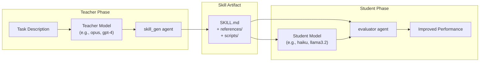

The evaluation system measures skill effectiveness using two key metrics:
- **Skill lift**: percentage improvement in success rate (must exceed 5% for acceptance)
- **Token savings**: reduction in token usage (must exceed 20% if success rate doesn't improve significantly)

A skill is considered **beneficial** if `lift > 5%` OR `(lift >= 0 AND token_savings > 20%)`.

**Sources**: [README.md:5-6](), [src/upskill/models.py:270-307](), Diagram 2 from context

---

## System Architecture

### Component Overview

The upskill system has a layered architecture with four main layers:

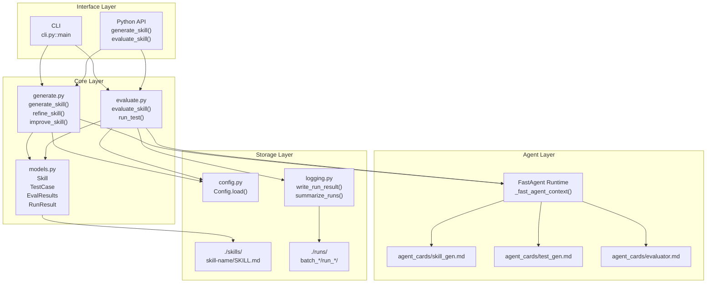

**Sources**: [src/upskill/cli.py:49-66](), [src/upskill/generate.py](), [src/upskill/evaluate.py](), [src/upskill/models.py](), Diagram 1 from context

### Key Code Entities

| Layer | Component | Primary Code Entities | Purpose |
|-------|-----------|----------------------|---------|
| **Interface** | CLI | `cli.py::main()`, `cli.py::generate()`, `cli.py::eval_cmd()` | Command-line interface |
| | Python API | `generate.py::generate_skill()`, `evaluate.py::evaluate_skill()` | Programmatic access |
| **Core** | Generation | `generate.py::generate_skill()`, `generate.py::refine_skill()` | Skill creation and improvement |
| | Evaluation | `evaluate.py::evaluate_skill()`, `evaluate.py::run_test()` | Performance testing |
| | Data Models | `models.py::Skill`, `models.py::TestCase`, `models.py::EvalResults` | Data structures |
| **Agent** | FastAgent | `cli.py::_fast_agent_context()`, `fast.run()` | Agent orchestration |
| | Agent Cards | `agent_cards/skill_gen.md`, `agent_cards/test_gen.md`, `agent_cards/evaluator.md` | Agent definitions |
| **Storage** | Configuration | `config.py::Config`, `Config.load()` | System settings |
| | Logging | `logging.py::create_batch_folder()`, `logging.py::write_run_result()` | Run tracking |
| | Persistence | `Skill.save()`, `Skill.load()` | Skill storage |

**Sources**: [src/upskill/cli.py:162-254](), [src/upskill/generate.py](), [src/upskill/evaluate.py](), [src/upskill/models.py](), [src/upskill/config.py](), [src/upskill/logging.py]()

---

## Main Workflows

### Skill Generation and Evaluation Flow

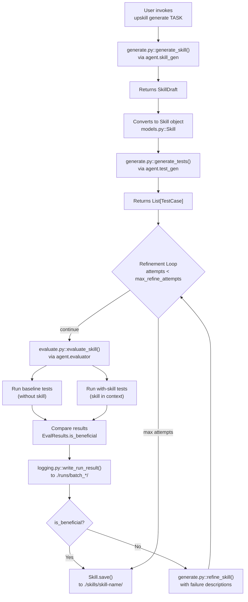

**Sources**: [src/upskill/cli.py:256-536](), [src/upskill/generate.py:60-134](), [src/upskill/evaluate.py:140-204](), Diagram 2 from context

### Agent Card System

The system uses declarative YAML-frontmatter markdown files to define specialized agents:

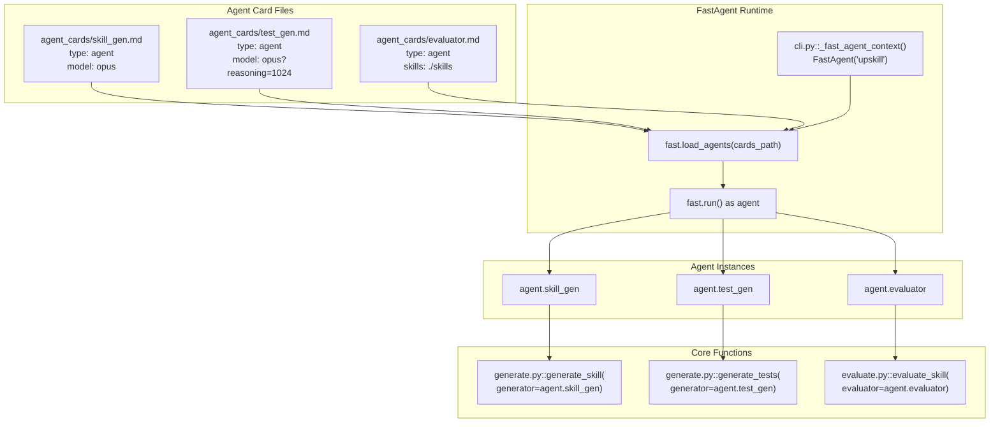

**Sources**: [src/upskill/cli.py:49-66](), [src/upskill/generate.py](), [src/upskill/evaluate.py](), Diagram 3 from context

---

## Data Models

### Core Data Structures

The system defines several Pydantic models in `models.py` that represent the data flowing through the system:

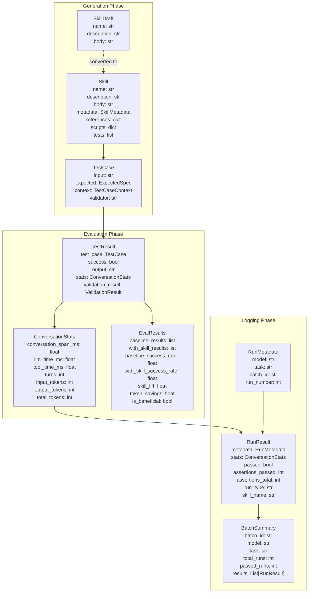

**Sources**: [src/upskill/models.py:1-307](), Diagram 4 from context

### Key Model Relationships

| Model | Purpose | Key Fields | Created By |
|-------|---------|------------|------------|
| `Skill` | Complete skill artifact | `name`, `body`, `references`, `scripts` | `generate.py::generate_skill()` |
| `TestCase` | Individual test specification | `input`, `expected`, `validator` | `generate.py::generate_tests()` |
| `EvalResults` | Comparison of baseline vs with-skill | `skill_lift`, `token_savings`, `is_beneficial` | `evaluate.py::evaluate_skill()` |
| `ConversationStats` | Detailed execution metrics | `llm_time_ms`, `total_tokens`, `tool_calls` | `logging.py::extract_stats()` |
| `RunResult` | Single evaluation run record | `metadata`, `stats`, `passed` | CLI during evaluation |
| `BatchSummary` | Aggregated batch results | `total_runs`, `passed_runs`, `results` | `logging.py::write_batch_summary()` |

**Sources**: [src/upskill/models.py:31-307](), [src/upskill/logging.py:96-270]()

---

## Evaluation and Metrics System

### Test Execution Pipeline

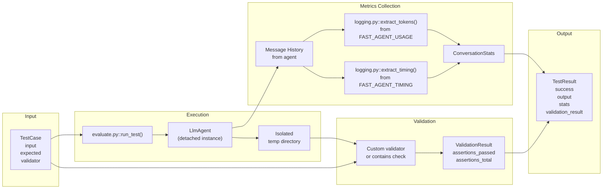

**Sources**: [src/upskill/evaluate.py:50-204](), [src/upskill/logging.py:96-216](), Diagram 6 from context

### Metrics Calculation

The system tracks comprehensive metrics during evaluation:

| Metric | Calculation | Purpose |
|--------|-------------|---------|
| **conversation_span_ms** | Total time from first to last message | Overall execution time |
| **llm_time_ms** | Sum of LLM call durations | Time spent in model inference |
| **tool_time_ms** | Sum of tool execution durations | Time spent in tool/MCP calls |
| **turns** | Count of conversation turns | Interaction complexity |
| **input_tokens** | Sum from FAST_AGENT_USAGE | Input cost estimation |
| **output_tokens** | Sum from FAST_AGENT_USAGE | Output cost estimation |
| **total_tokens** | input_tokens + output_tokens | Total cost estimation |
| **skill_lift** | `(with_skill_rate - baseline_rate) / baseline_rate` | Performance improvement |
| **token_savings** | `(baseline_tokens - with_skill_tokens) / baseline_tokens` | Efficiency gain |

The **is_beneficial** decision logic is implemented in [src/upskill/models.py:297-307]():

```python
@property
def is_beneficial(self) -> bool:
    """Skill is beneficial if it improves success rate by >5% OR maintains/improves 
    success while saving >20% tokens."""
    lift = self.skill_lift
    savings = self.token_savings
    
    # Significant success improvement
    if lift > 0.05:
        return True
    
    # Maintains success with significant token savings
    if lift >= 0 and savings > 0.20:
        return True
    
    return False
```

**Sources**: [src/upskill/models.py:212-307](), [src/upskill/logging.py:96-216](), Diagram 6 from context

---

## Storage and Persistence

### Directory Structure

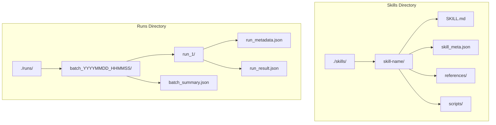

Skills are saved using `Skill.save()` [src/upskill/models.py:100-139]() and loaded using `Skill.load()` [src/upskill/models.py:141-186]().

Run results are logged using functions in `logging.py`:
- `create_batch_folder()` [src/upskill/logging.py:27-47]() creates timestamped batch directories
- `create_run_folder()` [src/upskill/logging.py:50-60]() creates individual run directories
- `write_run_result()` [src/upskill/logging.py:80-93]() writes JSON result files
- `write_batch_summary()` [src/upskill/logging.py:273-282]() writes aggregate batch statistics

**Sources**: [src/upskill/models.py:100-186](), [src/upskill/logging.py:27-282](), [README.md:356-370](), Diagram 4 from context

---

## Dependencies and External Systems

### Core Dependencies

| Dependency | Purpose | Usage |
|------------|---------|-------|
| **fast-agent-mcp** | Agent orchestration, LLM providers, MCP support | Core runtime for executing agents |
| **pydantic** | Data validation and serialization | All data models in `models.py` |
| **click** | CLI framework | Command definitions in `cli.py` |
| **rich** | Terminal output formatting | Progress display, tables, panels |
| **pyyaml** | Configuration parsing | `config.yaml` and agent card frontmatter |

### Module Dependency Graph

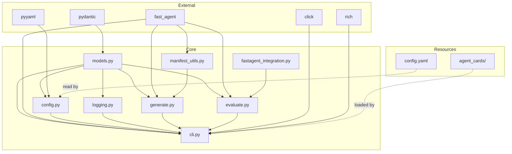

The system integrates with FastAgent through:
1. **Context manager**: `_fast_agent_context()` [src/upskill/cli.py:49-66]() initializes FastAgent and loads agent cards
2. **Agent instances**: Accessed via `agent.skill_gen`, `agent.test_gen`, `agent.evaluator`
3. **Skill composition**: `compose_instruction()` in `fastagent_integration.py` formats skills for agent consumption
4. **Message channels**: Uses `FAST_AGENT_USAGE` and `FAST_AGENT_TIMING` for metrics extraction

**Sources**: [pyproject.toml:1-38](), [src/upskill/cli.py:49-66](), Diagram 5 from context

---

## Configuration System

The system uses two configuration files:

### upskill Configuration

`~/.config/upskill/config.yaml` or `./upskill.config.yaml`:

```yaml
model: sonnet                    # Default generation model
eval_model: haiku               # Default evaluation model (optional)
skills_dir: ./skills            # Where to save skills
runs_dir: ./runs                # Where to save run logs
max_refine_attempts: 3          # Refinement iterations
```

Loaded via `Config.load()` [src/upskill/config.py:21-58]()

### FastAgent Configuration

`./fastagent.config.yaml`:

```yaml
default_model: sonnet

logger:
  progress_display: true
  show_chat: false
  streaming: markdown

# MCP servers (optional)
mcp:
  servers:
    fetch:
      command: "uvx"
      args: ["mcp-server-fetch"]
```

FastAgent automatically loads this configuration when initialized.

**Sources**: [src/upskill/config.py:1-70](), [README.md:374-423]()

---

## Summary

The upskill system provides a complete framework for automatically generating, evaluating, and refining agent skills. Its architecture separates concerns across four layers (interface, core, agent, storage) while maintaining clear data flow through well-defined Pydantic models. The teacher-student paradigm enables powerful models to create skills that improve the performance of less capable models, with comprehensive evaluation metrics ensuring skills provide measurable benefits.

Key architectural patterns:
- **Agent card declarative configuration** for flexible model substitution
- **Detached agent instances** for isolated test execution
- **Comprehensive metrics extraction** from FastAgent message channels
- **Iterative refinement loops** with plateau detection
- **Structured persistence** with both skill artifacts and evaluation logs

The system's modular design supports both CLI and programmatic usage, making it suitable for interactive development as well as automated pipelines.

**Sources**: All diagrams and sections above

---

# Page: Getting Started

# Getting Started

<details>
<summary>Relevant source files</summary>

The following files were used as context for generating this wiki page:

- [README.md](README.md)
- [fastagent.config.yaml](fastagent.config.yaml)
- [pyproject.toml](pyproject.toml)
- [src/upskill/config.py](src/upskill/config.py)
- [uv.lock](uv.lock)

</details>


This section guides you through installing upskill, configuring it for your environment, and generating your first skill. By the end of this guide, you will have upskill installed, configured with API keys for your model provider, and will have generated and evaluated a working skill.

**Scope**: This page covers installation, configuration, and a basic tutorial. For detailed information about core concepts like skills and test cases, see [Core Concepts](#3). For comprehensive CLI command reference, see [CLI Reference](#4). For programmatic usage, see [Python API](#9).

---

## Installation

upskill requires Python 3.13.5 or higher and can be installed via pip or run directly with uvx.

### Python Version Requirements

```
Python: >=3.13.5, <3.14
```

**Sources**: [pyproject.toml:5]()

### Installation Methods

#### Method 1: pip Install

```bash
pip install upskill
```

After installation, the `upskill` command will be available in your shell.

#### Method 2: uvx (No Installation)

```bash
uvx upskill
```

This runs upskill directly without installing it to your environment. Useful for trying upskill or running it in CI/CD pipelines.

**Verification**:

```bash
upskill --help
```

If successful, you should see the CLI help output with available commands: `generate`, `eval`, `list`, `benchmark`, `runs`.

### Dependencies

upskill automatically installs these core dependencies:

| Package | Purpose |
|---------|---------|
| `fast-agent-mcp>=0.4.41` | Agent runtime and MCP server integration |
| `click>=8.1` | CLI framework |
| `pydantic>=2.0` | Data validation and models |
| `pyyaml>=6.0` | Configuration file parsing |
| `rich>=13.0` | Terminal output formatting |
| `python-dotenv>=1.0` | Environment variable loading |

**Sources**: [pyproject.toml:6-13](), [README.md:9-15]()

---

## Configuration

upskill uses two configuration files and environment variables to control its behavior:

1. **`config.yaml`**: upskill-specific settings (model, directories, refinement)
2. **`fastagent.config.yaml`**: FastAgent runtime settings (logging, MCP servers, providers)
3. **Environment variables**: API keys and custom endpoints

### Configuration Architecture

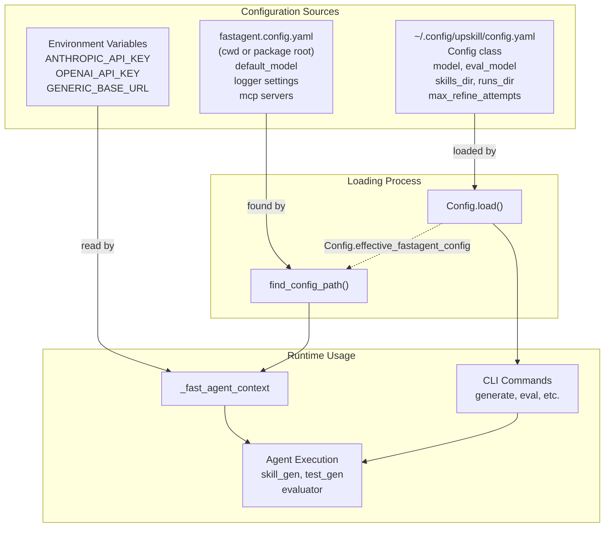

**Sources**: [src/upskill/config.py:11-102](), [fastagent.config.yaml:1-33]()

### upskill Configuration (`config.yaml`)

The `Config` class defines upskill's settings. The configuration file is optional and defaults are used if not present.

**Location**: `~/.config/upskill/config.yaml`

**Structure**:

```yaml
# Model settings
model: sonnet                    # Default generation model (FastAgent format)
eval_model: haiku               # Optional: different model for evaluation

# Directory settings
skills_dir: ./skills            # Where to save generated skills
runs_dir: ./runs                # Where to save run logs

# Generation settings
auto_eval: true                 # Run evaluation after generation
max_refine_attempts: 2          # Max refinement iterations

# FastAgent settings (optional)
fastagent_config: ./fastagent.config.yaml  # Custom FastAgent config path
```

**Configuration Loading**:

| Method | Description |
|--------|-------------|
| `Config.load()` | Loads from `~/.config/upskill/config.yaml` or returns defaults |
| `Config.save()` | Saves current config to `~/.config/upskill/config.yaml` |
| `Config.effective_eval_model` | Returns `eval_model` if set, otherwise `model` |
| `Config.effective_fastagent_config` | Returns `fastagent_config` if set, otherwise finds config via `find_config_path()` |

**Sources**: [src/upskill/config.py:38-102](), [README.md:376-384]()

### FastAgent Configuration (`fastagent.config.yaml`)

FastAgent runtime configuration controls agent behavior, logging, and model providers.

**Location**: Searched in order:
1. `./fastagent.config.yaml` (current working directory)
2. `<package_root>/fastagent.config.yaml` (bundled with upskill)

**Structure**:

```yaml
# Default model for agents
default_model: sonnet

# Logging configuration
logger:
  progress_display: false       # Show progress bars
  show_chat: false             # Display agent conversations
  show_tools: false            # Show tool calls
  truncate_tools: true         # Truncate long tool outputs
  streaming: none              # Streaming mode: none, markdown, json

# Generic provider for local models
generic:
  api_key: "local"             # API key for generic provider
  base_url: "http://localhost:11434/v1"  # OpenAI-compatible endpoint

# MCP timeline display
mcp_timeline:
  steps: 20                    # Number of timeline steps
  step_seconds: 15             # Seconds per step

# Shell execution settings
shell_execution:
  show_bash: true              # Show bash commands
```

**Model Format**: upskill uses FastAgent's model format: `<provider>.<model>.<reasoning_effort?>`.

Examples:
- `sonnet` - Anthropic Claude Sonnet (alias)
- `haiku` - Anthropic Claude Haiku (alias)
- `anthropic.claude-sonnet-4-20250514` - Full model name
- `openai.gpt-4o` - OpenAI GPT-4o
- `generic.llama3.2:latest` - Local model via Ollama

**Sources**: [fastagent.config.yaml:1-33](), [src/upskill/config.py:26-36](), [README.md:386-404](), [README.md:467-484]()

### Environment Variables

Environment variables provide API keys and custom endpoints for model providers.

```bash
# Anthropic (required for Claude models)
export ANTHROPIC_API_KEY=sk-ant-...

# OpenAI (required for GPT models)
export OPENAI_API_KEY=sk-...

# Optional: Custom endpoints
export ANTHROPIC_BASE_URL=http://localhost:8080
export OPENAI_API_BASE=http://localhost:11434/v1

# Generic provider (for local models)
export GENERIC_BASE_URL=http://localhost:8080/v1
export GENERIC_API_KEY=local  # Optional, defaults to "local"
```

**Provider Configuration Table**:

| Provider | Required Env Var | Optional Env Var | Model Examples |
|----------|-----------------|------------------|----------------|
| Anthropic | `ANTHROPIC_API_KEY` | `ANTHROPIC_BASE_URL` | `sonnet`, `haiku`, `opus` |
| OpenAI | `OPENAI_API_KEY` | `OPENAI_API_BASE` | `openai.gpt-4o`, `openai.o3-mini` |
| Generic | None (defaults to `"local"`) | `GENERIC_BASE_URL`, `GENERIC_API_KEY` | `generic.llama3.2:latest` |

**Sources**: [README.md:407-422](), [fastagent.config.yaml:11-15]()

### Directory Structure After Configuration

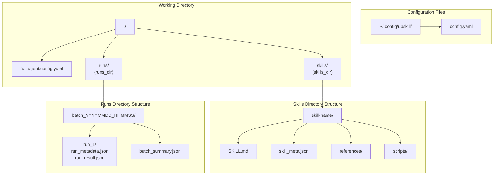

**Sources**: [README.md:302-312](), [README.md:357-372](), [src/upskill/config.py:11-24]()

---

## Quick Start Tutorial

This tutorial walks through generating and evaluating your first skill using the CLI.

### Prerequisites

1. upskill installed (see Installation above)
2. API key configured for your model provider (e.g., `ANTHROPIC_API_KEY`)

### Step 1: Generate a Simple Skill

Generate a skill from a task description:

```bash
upskill generate "write good git commit messages"
```

**What happens**:

```mermaid
sequenceDiagram
    participant User
    participant CLI["CLI (generate command)"]
    participant SkillGen["agent.skill_gen<br/>(FastAgent)"]
    participant TestGen["agent.test_gen<br/>(FastAgent)"]
    participant Evaluator["agent.evaluator<br/>(FastAgent)"]
    participant Disk["File System"]
    
    User->>CLI: upskill generate "task"
    CLI->>SkillGen: generate_skill(task, model)
    SkillGen->>SkillGen: Create SkillDraft
    SkillGen-->>CLI: Skill object
    
    CLI->>TestGen: generate_tests(task)
    TestGen->>TestGen: Create TestCase list
    TestGen-->>CLI: TestCase[]
    
    CLI->>Evaluator: evaluate_skill(skill, tests)
    Evaluator->>Evaluator: Run baseline (no skill)
    Evaluator->>Evaluator: Run with skill
    Evaluator->>Evaluator: Calculate metrics
    Evaluator-->>CLI: EvalResults
    
    alt Skill is beneficial
        CLI->>Disk: Save to skills/skill-name/
        CLI->>Disk: Save runs to runs/batch_*/
        CLI-->>User: Success + metrics
    else Not beneficial & attempts < max
        CLI->>SkillGen: refine_skill(failures)
        Note over CLI,SkillGen: Loop until beneficial or max attempts
    end
```

**Expected Output**:

```
Generating skill with sonnet...
Generating test cases...
Evaluating on sonnet... (attempt 1)
  60% -> 100% (+40%) OK

  git-commit-messages
  Write clear, conventional commit messages that follow best practices.

  SKILL.md              ~450 tokens

  baseline   ████████████░░░░░░░░   60%
  with skill ████████████████████  100%  (+40%)

  tokens: 1200 → 800  (-33%)

Saved to ./skills/git-commit-messages
```

**Generated Files**:

```
./skills/git-commit-messages/
├── SKILL.md              # Main skill instructions
├── skill_meta.json       # Metadata (created_at, description, etc.)
├── references/           # Supporting documents (if any)
└── scripts/              # Executable scripts (if any)
```

**Sources**: [README.md:17-24](), [README.md:92-111](), [src/upskill/cli.py:112-329]()

### Step 2: Examine the Generated Skill

View the skill content:

```bash
cat ./skills/git-commit-messages/SKILL.md
```

Example content:

```markdown
# git-commit-messages

Write clear, conventional commit messages that follow best practices.

## Instructions

This skill teaches how to write effective git commit messages
following the Conventional Commits specification.

## Format

Commit messages should follow this structure:

<type>(<scope>): <subject>

<body>

<footer>

## Types

- `feat`: New feature
- `fix`: Bug fix
- `docs`: Documentation changes
...

## Examples

### Simple feature commit
feat(auth): add password reset functionality

### Bug fix with explanation
fix(api): handle null response from user service

The user service can return null when not found.
Added proper null checking to prevent crashes.

Closes #123
```

**Sources**: [README.md:313-354]()

### Step 3: List Generated Skills

View all skills in the skills directory:

```bash
upskill list
```

**Output**:

```
./skills
├── git-commit-messages
│   ├── Write clear, conventional commit messages...
│   └── files
│       └── SKILL.md
```

With verbose mode to see skill contents preview:

```bash
upskill list -v
```

**Sources**: [README.md:197-240]()

### Step 4: Evaluate an Existing Skill

Evaluate the skill on a different model:

```bash
upskill eval ./skills/git-commit-messages/ -m haiku
```

**What happens**:

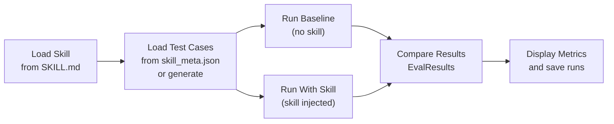

**Expected Output**:

```
Evaluating git-commit-messages on haiku

  baseline   ████████████░░░░░░░░   60%
  with skill ████████████████░░░░   80%  (+20%)

  tokens: 1200 → 950  (-21%)
```

**Key Metrics**:

| Metric | Description | Beneficial Threshold |
|--------|-------------|---------------------|
| `skill_lift` | Success rate improvement | > 5% |
| `token_savings` | Percentage of tokens saved | > 20% (if lift >= 0) |
| `is_beneficial` | Overall skill utility | `lift > 5%` OR `(lift >= 0 AND savings > 20%)` |

**Sources**: [README.md:113-166](), [src/upskill/evaluate.py:140-204]()

### Step 5: View Run History

View all evaluation runs:

```bash
upskill runs
```

**Output**:

```
skill: git-commit-messages

sonnet
  baseline   ████████████░░░░░░░░   60%
  with skill ████████████████████  100%  (+40%)

haiku
  baseline   ████████████░░░░░░░░   60%
  with skill ████████████████░░░░   80%  (+20%)
```

Filter by skill and models:

```bash
upskill runs -s git-commit-messages -m haiku -m sonnet
```

Export to CSV for analysis:

```bash
upskill runs --csv results.csv
```

**CSV Columns**: Contains 24+ metrics including:
- `model`, `skill_name`, `run_type` (baseline/with_skill)
- `passed`, `total_assertions`
- `conversation_span_ms`, `llm_time_ms`, `tool_time_ms`
- `input_tokens`, `output_tokens`, `total_tokens`
- `turns`, `tool_calls`, `mcp_calls`, `execute_calls`

**Sources**: [README.md:242-300](), [src/upskill/logging.py:96-216]()

### Step 6: Advanced - Teacher/Student Model Workflow

Generate a skill with a powerful "teacher" model and evaluate it on a less capable "student" model:

```bash
upskill generate "write good git commit messages" \
    --model sonnet \
    --eval-model haiku
```

**Workflow**:

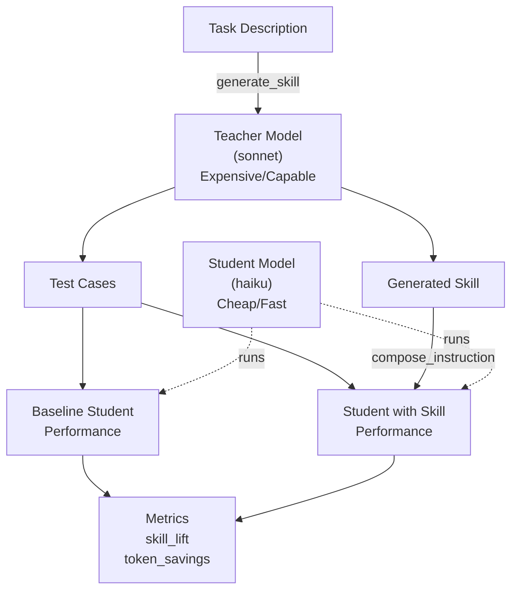

This pattern allows expensive models to create knowledge that cheaper models can leverage, improving their performance without the cost of using the expensive model at inference time.

**Sources**: [README.md:26-30](), [README.md:76-79]()

---

## Next Steps

Now that you have upskill installed and running, explore:

- **[Core Concepts](#3)**: Understand skills, test cases, and evaluation metrics in depth
- **[CLI Reference](#4)**: Complete documentation of all CLI commands and options
- **[Skill Lifecycle](#5)**: Learn about generation, evaluation, and refinement workflows
- **[Agent System](#6)**: Understand agent cards and FastAgent integration
- **[Python API](#9)**: Use upskill programmatically in your own code

**Sources**: [README.md:1-514](), [src/upskill/config.py:1-102](), [fastagent.config.yaml:1-33](), [pyproject.toml:1-38]()

---

# Page: Installation

# Installation

<details>
<summary>Relevant source files</summary>

The following files were used as context for generating this wiki page:

- [README.md](README.md)
- [pyproject.toml](pyproject.toml)
- [uv.lock](uv.lock)

</details>


This page covers the system requirements, installation process, and environment setup for upskill. For configuration of model providers and system settings, see [Configuration](#2.2).

## System Requirements

upskill requires Python 3.13.5 or higher (but below 3.14). The Python version constraint is defined in [pyproject.toml:5]().

```
requires-python = ">=3.13.5,<3.14"
```

**Sources:** [pyproject.toml:5]()

## Installation Methods

### Using pip

Install the latest stable release from PyPI:

```bash
pip install upskill
```

### Using uv (Recommended)

For direct execution without installation:

```bash
uvx upskill
```

This command downloads and executes upskill in an isolated environment, avoiding conflicts with system packages.

**Sources:** [README.md:11-14]()

## Dependency Architecture

The following diagram shows upskill's core dependencies and their roles in the system:

```mermaid
graph TB
    upskill["upskill<br/>(src/upskill)"]
    
    subgraph "CLI & UI"
        click["click>=8.1<br/>Command-line interface"]
        rich["rich>=13.0<br/>Terminal output formatting"]
    end
    
    subgraph "Agent Runtime"
        fastagent["fast-agent-mcp>=0.4.41<br/>Agent execution & MCP"]
    end
    
    subgraph "Data & Configuration"
        pydantic["pydantic>=2.0<br/>Data validation & models"]
        pyyaml["pyyaml>=6.0<br/>Config file parsing"]
        dotenv["python-dotenv>=1.0<br/>Environment variables"]
    end
    
    subgraph "Development (Optional)"
        pytest["pytest>=8.0"]
        pytestasync["pytest-asyncio>=0.23"]
        ruff["ruff>=0.4<br/>Linting"]
    end
    
    upskill --> click
    upskill --> rich
    upskill --> fastagent
    upskill --> pydantic
    upskill --> pyyaml
    upskill --> dotenv
    
    upskill -.->|dev only| pytest
    upskill -.->|dev only| pytestasync
    upskill -.->|dev only| ruff
```

### Core Dependencies

| Dependency | Version | Purpose |
|------------|---------|---------|
| `click` | ≥8.1 | CLI framework for command parsing and option handling |
| `fast-agent-mcp` | ≥0.4.41 | FastAgent runtime for agent execution and MCP server integration |
| `pydantic` | ≥2.0 | Data models for Skill, TestCase, EvalResults, and other structures |
| `python-dotenv` | ≥1.0 | Loading API keys and configuration from `.env` files |
| `pyyaml` | ≥6.0 | Parsing `config.yaml` and `fastagent.config.yaml` |
| `rich` | ≥13.0 | Formatted terminal output with progress bars and tables |

### Development Dependencies

Development dependencies are installed with:

```bash
pip install upskill[dev]
```

| Dependency | Version | Purpose |
|------------|---------|---------|
| `pytest` | ≥8.0 | Test framework |
| `pytest-asyncio` | ≥0.23 | Async test support |
| `ruff` | ≥0.4 | Linting and code formatting |

**Sources:** [pyproject.toml:6-20]()

## Entry Point Configuration

After installation, the `upskill` command becomes available in your shell. This is configured via the `project.scripts` section:

```toml
[project.scripts]
upskill = "upskill.cli:main"
```

The entry point maps to the `main()` function in [src/upskill/cli.py]().

**Sources:** [pyproject.toml:22-23]()

## Environment Setup

upskill requires API keys for model providers. The system loads environment variables using `python-dotenv` from `.env` files or system environment.

### Environment Variable Flow

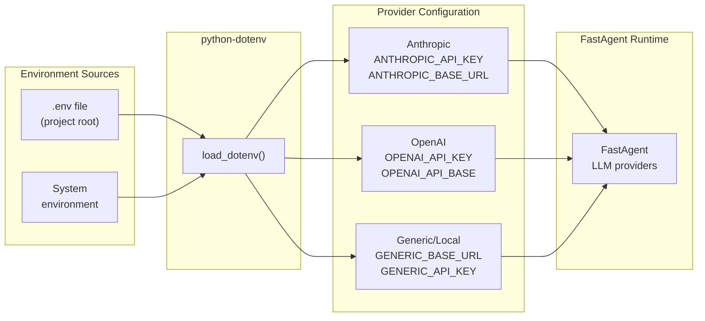

### Required Environment Variables

At minimum, one model provider must be configured:

| Variable | Required For | Default | Description |
|----------|-------------|---------|-------------|
| `ANTHROPIC_API_KEY` | Anthropic models | None | API key for Claude models (sonnet, haiku, opus) |
| `OPENAI_API_KEY` | OpenAI models | None | API key for GPT models |
| `GENERIC_API_KEY` | Local models | `"local"` | API key for generic OpenAI-compatible endpoints |

### Optional Environment Variables

| Variable | Purpose | Default |
|----------|---------|---------|
| `ANTHROPIC_BASE_URL` | Custom Anthropic endpoint | Official API |
| `OPENAI_API_BASE` | Custom OpenAI endpoint | Official API |
| `GENERIC_BASE_URL` | Base URL for local models | None |

### Example .env File

Create a `.env` file in your project root:

```bash
# For Claude models
ANTHROPIC_API_KEY=sk-ant-api03-...

# For OpenAI models
OPENAI_API_KEY=sk-proj-...

# For local models (Ollama, llama.cpp, etc.)
GENERIC_BASE_URL=http://localhost:8080/v1
GENERIC_API_KEY=local
```

**Sources:** [README.md:408-422]()

## Verification

After installation, verify the setup:

```bash
# Check version
upskill --version

# List available commands
upskill --help

# Verify model access (requires API keys)
upskill generate "test task" --no-eval
```

If the installation is successful, the `upskill` command will be available and the help output will show available commands: `generate`, `eval`, `list`, `benchmark`, and `runs`.

**Sources:** [README.md:11-14](), [pyproject.toml:22-23]()

## Build Configuration

upskill uses Hatchling as its build backend. The package structure maps source files as follows:

```
src/upskill/  →  upskill/  (in installed package)
```

The build configuration is defined in [pyproject.toml:25-30]():

```toml
[build-system]
requires = ["hatchling"]
build-backend = "hatchling.build"

[tool.hatch.build.targets.wheel]
packages = ["src/upskill"]
```

This configuration is relevant for developers building from source or contributing to the project. For development setup, see [Development Setup](#11.2).

**Sources:** [pyproject.toml:25-30]()

---

# Page: Configuration

# Configuration

<details>
<summary>Relevant source files</summary>

The following files were used as context for generating this wiki page:

- [README.md](README.md)
- [fastagent.config.yaml](fastagent.config.yaml)
- [src/upskill/config.py](src/upskill/config.py)

</details>


## Purpose and Scope

This document covers all configuration aspects of the upskill system, including the upskill-specific configuration file (`config.yaml`), the FastAgent runtime configuration file (`fastagent.config.yaml`), environment variables for API keys and endpoints, and model provider setup. For details on programmatically manipulating configuration objects, see [Configuration API](#9.3). For information about agent card configuration (which defines agent behavior), see [Agent Cards](#6.1).

---

## Configuration Architecture

The upskill system uses a layered configuration approach with three sources that are merged at runtime:

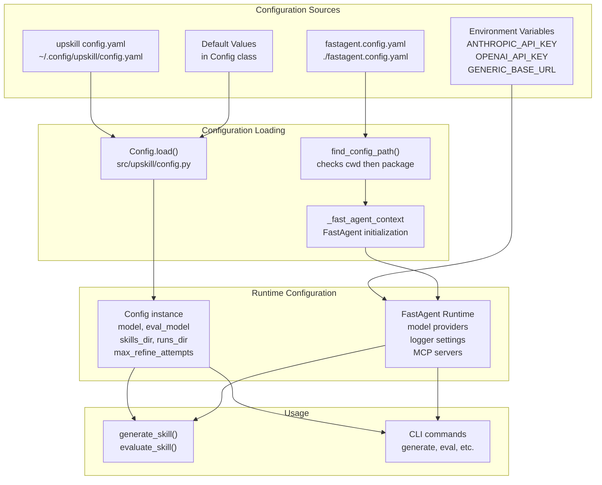

**Sources:** [src/upskill/config.py:1-102](), [README.md:374-423](), [fastagent.config.yaml:1-33]()

---

## upskill Configuration

The upskill configuration file (`config.yaml`) controls generation and evaluation behavior. It is located at `~/.config/upskill/config.yaml` by default.

### Configuration Options

| Field | Type | Default | Description |
|-------|------|---------|-------------|
| `model` | string | `"sonnet"` | Default model for skill generation |
| `eval_model` | string | `null` | Default model for evaluation (uses `model` if not set) |
| `skills_dir` | path | `./skills` | Directory for saving generated skills |
| `runs_dir` | path | `./runs` | Directory for saving run logs |
| `auto_eval` | boolean | `true` | Whether to run evaluation after generation |
| `max_refine_attempts` | integer | `2` | Maximum number of refinement iterations |
| `fastagent_config` | path | `null` | Override path to fastagent.config.yaml |

### Example Configuration

```yaml
# ~/.config/upskill/config.yaml
model: sonnet                    # Default generation model
eval_model: haiku                # Default evaluation model (optional)
skills_dir: ./skills             # Where to save skills
runs_dir: ./runs                 # Where to save run logs
max_refine_attempts: 3           # Refinement iterations
auto_eval: true                  # Auto-evaluate after generation
```

### Config Class Structure

The `Config` class in [src/upskill/config.py:38-102]() uses Pydantic to validate and manage configuration:

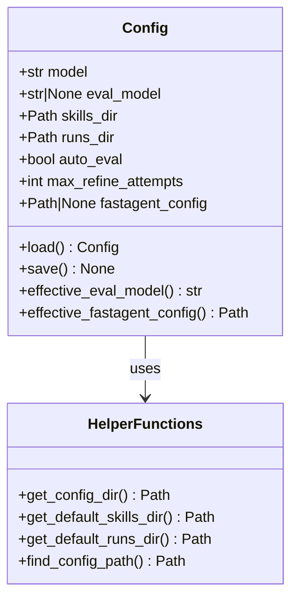

**Key methods:**

- `Config.load()` - Loads config from file or returns defaults [src/upskill/config.py:61-75]()
- `Config.save()` - Saves config to file [src/upskill/config.py:77-89]()
- `effective_eval_model` - Returns `eval_model` if set, otherwise `model` [src/upskill/config.py:92-94]()
- `effective_fastagent_config` - Resolves the FastAgent config path [src/upskill/config.py:97-101]()

**Sources:** [src/upskill/config.py:38-102](), [README.md:376-384]()

---

## FastAgent Configuration

The FastAgent configuration file (`fastagent.config.yaml`) controls the agent runtime, including model providers, logging, and MCP servers. The system searches for this file in the current working directory first, then falls back to the package-bundled version [src/upskill/config.py:26-35]().

### Configuration Sections

#### Default Model

```yaml
default_model: sonnet
```

Specifies the default model when not overridden by command-line arguments or upskill config. Supports the FastAgent model format: `<provider>.<model>.<reasoning_effort?>`.

#### Generic Provider (Local Models)

```yaml
generic:
  api_key: "local"
  base_url: "http://localhost:11434/v1"
```

Configures the generic provider for OpenAI-compatible endpoints (Ollama, llama.cpp, vLLM, etc.). Can be overridden by `GENERIC_BASE_URL` and `GENERIC_API_KEY` environment variables.

#### MCP Timeline Display

```yaml
mcp_timeline:
  steps: 20
  step_seconds: 15
```

Controls the visual display of MCP (Model Context Protocol) server operations in the terminal.

#### Shell Execution

```yaml
shell_execution:
  show_bash: true
```

Controls whether bash commands executed by agents are displayed.

#### Logger Settings

```yaml
logger:
  progress_display: false
  show_chat: false
  show_tools: false
  truncate_tools: true
  streaming: none
```

Controls FastAgent's terminal output verbosity:

| Setting | Values | Description |
|---------|--------|-------------|
| `progress_display` | boolean | Show agent execution progress |
| `show_chat` | boolean | Display agent chat messages |
| `show_tools` | boolean | Display tool calls |
| `truncate_tools` | boolean | Truncate long tool outputs |
| `streaming` | `none`, `markdown`, `text` | Agent response streaming mode |

### Complete Example

```yaml
# FastAgent Configuration for upskill
default_model: sonnet

# Generic provider for local models
generic:
  api_key: "local"
  base_url: "http://localhost:11434/v1"

# MCP timeline display
mcp_timeline:
  steps: 20
  step_seconds: 15

# Shell execution
shell_execution:
  show_bash: true

# Logging and console output
logger:
  progress_display: false
  show_chat: false
  show_tools: false
  truncate_tools: true
  streaming: none

# Optional: MCP servers
mcp:
  servers:
    fetch:
      command: "uvx"
      args: ["mcp-server-fetch"]
```

**Sources:** [fastagent.config.yaml:1-33](), [README.md:386-404]()

---

## Environment Variables

Environment variables configure API credentials and endpoints, primarily for FastAgent's model providers.

### Environment Variable Reference

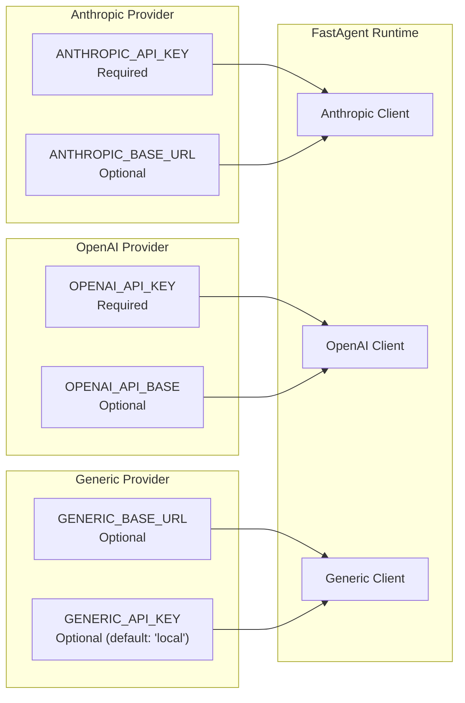

### Variable Details

| Variable | Required | Default | Purpose |
|----------|----------|---------|---------|
| `ANTHROPIC_API_KEY` | Yes (for Anthropic) | - | Anthropic API authentication |
| `ANTHROPIC_BASE_URL` | No | Anthropic default | Custom Anthropic endpoint |
| `OPENAI_API_KEY` | Yes (for OpenAI) | - | OpenAI API authentication |
| `OPENAI_API_BASE` | No | OpenAI default | Custom OpenAI endpoint |
| `GENERIC_BASE_URL` | No | `http://localhost:11434/v1` | Local/custom OpenAI-compatible endpoint |
| `GENERIC_API_KEY` | No | `"local"` | API key for generic provider |

### Example Setup

```bash
# Anthropic models (required for sonnet, haiku, opus aliases)
export ANTHROPIC_API_KEY=sk-ant-api03-...

# OpenAI models
export OPENAI_API_KEY=sk-...

# Custom Anthropic endpoint (optional)
export ANTHROPIC_BASE_URL=http://localhost:8080

# Ollama for local models (optional)
export GENERIC_BASE_URL=http://localhost:11434/v1
export GENERIC_API_KEY=local
```

**Sources:** [README.md:406-422]()

---

## Model Provider Setup

The upskill system supports three model provider types through FastAgent: Anthropic, OpenAI, and generic (for local/custom endpoints).

### Model Format

All models use the FastAgent format:

```
<provider>.<model>.<reasoning_effort?>
```

**Components:**
- `provider` - `anthropic`, `openai`, or `generic`
- `model` - Model identifier (e.g., `claude-sonnet-4-20250514`, `gpt-4.1`, `llama3.2:latest`)
- `reasoning_effort` - Optional reasoning parameter (e.g., `low`, `medium`, `high`, or token count)

### Provider Configuration Mapping

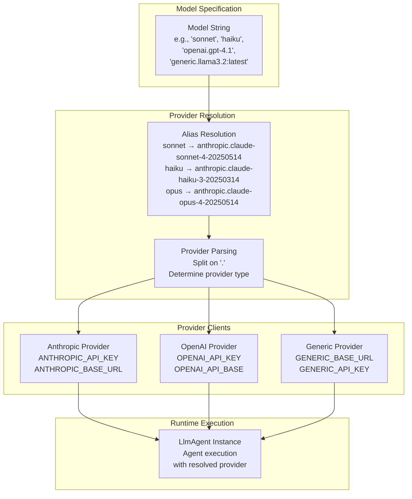

### Anthropic Provider

**Model Aliases:**
- `sonnet` → `anthropic.claude-sonnet-4-20250514`
- `haiku` → `anthropic.claude-haiku-3-20250314`
- `opus` → `anthropic.claude-opus-4-20250514`

**Configuration:**
```bash
export ANTHROPIC_API_KEY=sk-ant-api03-...
# Optional: custom endpoint
export ANTHROPIC_BASE_URL=http://localhost:8080
```

**Usage examples:**
```bash
# Using alias
upskill generate "task description" --model sonnet

# Using full model name
upskill generate "task description" --model anthropic.claude-sonnet-4-20250514

# With reasoning effort
upskill generate "task description" --model anthropic.opus.1024
```

### OpenAI Provider

**Model Aliases:**
- `gpt-4.1` → `openai.gpt-4.1`
- `o3-mini` → `openai.o3-mini`

**Configuration:**
```bash
export OPENAI_API_KEY=sk-...
# Optional: custom endpoint
export OPENAI_API_BASE=http://localhost:11434/v1
```

**Usage examples:**
```bash
# Using alias
upskill generate "task description" --model gpt-4.1

# Using full model name
upskill generate "task description" --model openai.gpt-4.1

# With reasoning effort
upskill generate "task description" --model openai.o3-mini.low
```

### Generic Provider (Local Models)

The generic provider enables local model usage through any OpenAI-compatible API (Ollama, llama.cpp, vLLM, etc.).

**Configuration:**
```bash
export GENERIC_BASE_URL=http://localhost:11434/v1
export GENERIC_API_KEY=local  # Optional
```

Or in `fastagent.config.yaml`:
```yaml
generic:
  api_key: "local"
  base_url: "http://localhost:11434/v1"
```

**Usage examples:**

**With Ollama:**
```bash
# Start Ollama
ollama serve

# Use Ollama model
upskill generate "task" --model generic.llama3.2:latest \
    --base-url http://localhost:11434/v1
```

**With llama.cpp:**
```bash
# Start llama.cpp server
./llama-server -m model.gguf --port 8080

# Use local model
upskill generate "task" --model generic.my-model \
    --base-url http://localhost:8080/v1
```

**Auto-detection:** When `--base-url` is provided without `--provider`, the provider is automatically set to `generic`.

**Sources:** [README.md:467-513](), [fastagent.config.yaml:11-15]()

---

## Configuration Loading and Precedence

The configuration system uses a specific precedence order when merging settings from multiple sources:

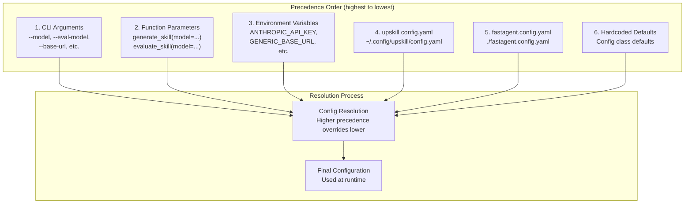

### Precedence Rules

1. **CLI Arguments** - Highest priority, always overrides other sources
2. **Function Parameters** - When using Python API, explicit parameters override config
3. **Environment Variables** - API keys and endpoints from environment
4. **upskill config.yaml** - User-specific upskill settings
5. **fastagent.config.yaml** - Project-specific FastAgent settings
6. **Hardcoded Defaults** - Lowest priority, used when no other source provides value

### Loading Flow

```mermaid
sequenceDiagram
    participant CLI as CLI/Python API
    participant ConfigLoad as Config.load()
    participant FileSystem as File System
    participant FastAgent as FastAgent Init
    participant Runtime as Runtime
    
    CLI->>ConfigLoad: Request config
    ConfigLoad->>FileSystem: Check ~/.config/upskill/config.yaml
    alt Config exists
        FileSystem-->>ConfigLoad: Load YAML
    else Config not found
        ConfigLoad->>ConfigLoad: Use defaults
    end
    ConfigLoad->>ConfigLoad: Validate with Pydantic
    ConfigLoad-->>CLI: Config instance
    
    CLI->>FastAgent: Initialize context
    FastAgent->>FileSystem: find_config_path()
    FileSystem->>FileSystem: Check ./fastagent.config.yaml
    alt CWD config exists
        FileSystem-->>FastAgent: Use CWD config
    else CWD config not found
        FileSystem->>FileSystem: Check package config
        FileSystem-->>FastAgent: Use package config or defaults
    end
    FastAgent->>FastAgent: Parse environment variables
    FastAgent-->>CLI: FastAgent context
    
    CLI->>Runtime: Execute with merged config
```

**Sources:** [src/upskill/config.py:26-102](), [README.md:374-423]()

---

## Default Values

When no configuration is provided, the system uses these defaults:

### upskill Defaults

| Setting | Default Value | Source |
|---------|--------------|--------|
| `model` | `"sonnet"` | [src/upskill/config.py:42]() |
| `eval_model` | `None` (uses `model`) | [src/upskill/config.py:43]() |
| `skills_dir` | `./skills` | [src/upskill/config.py:16-18]() |
| `runs_dir` | `./runs` | [src/upskill/config.py:21-23]() |
| `auto_eval` | `true` | [src/upskill/config.py:54]() |
| `max_refine_attempts` | `2` | [src/upskill/config.py:55]() |
| `fastagent_config` | `None` (auto-detected) | [src/upskill/config.py:58]() |

### FastAgent Defaults

| Setting | Default Value | Source |
|---------|--------------|--------|
| `default_model` | `"kimi"` | [fastagent.config.yaml:9]() |
| `generic.api_key` | `"local"` | [fastagent.config.yaml:14]() |
| `generic.base_url` | `"http://localhost:11434/v1"` | [fastagent.config.yaml:15]() |
| `logger.progress_display` | `false` | [fastagent.config.yaml:28]() |
| `logger.show_chat` | `false` | [fastagent.config.yaml:29]() |
| `logger.streaming` | `"none"` | [fastagent.config.yaml:32]() |

### Directory Resolution

The system resolves directory paths in this order:

```mermaid
graph TD
    Request["Directory Request<br/>(skills_dir or runs_dir)"]
    
    CLIArg{"CLI --output<br/>or --runs-dir?"}
    ConfigFile{"In config.yaml?"}
    Relative{"Relative path?"}
    
    CLIPath["Use CLI path"]
    ConfigPath["Use config path"]
    DefaultPath["Use default path"]
    
    ResolveCWD["Resolve relative to CWD"]
    AbsolutePath["Use absolute path"]
    
    FinalPath["Final resolved path"]
    
    Request --> CLIArg
    CLIArg -->|Yes| CLIPath
    CLIArg -->|No| ConfigFile
    ConfigFile -->|Yes| ConfigPath
    ConfigFile -->|No| DefaultPath
    
    CLIPath --> Relative
    ConfigPath --> Relative
    DefaultPath --> ResolveCWD
    
    Relative -->|Yes| ResolveCWD
    Relative -->|No| AbsolutePath
    
    ResolveCWD --> FinalPath
    AbsolutePath --> FinalPath
```

**Example:**
- Default `skills_dir` → `./skills` → resolved to `{CWD}/skills`
- Config `skills_dir: /absolute/path` → used as-is
- CLI `--output ./custom` → `{CWD}/custom`

**Sources:** [src/upskill/config.py:16-24](), [src/upskill/config.py:38-56](), [fastagent.config.yaml:1-33]()

---

# Page: Quick Start Tutorial

# Quick Start Tutorial

<details>
<summary>Relevant source files</summary>

The following files were used as context for generating this wiki page:

- [README.md](README.md)
- [src/upskill/cli.py](src/upskill/cli.py)
- [src/upskill/generate.py](src/upskill/generate.py)
- [tests/test_smoke.py](tests/test_smoke.py)

</details>


## Purpose and Scope

This tutorial walks you through generating and evaluating your first skill using upskill's CLI. You will learn how to create a skill from a task description, understand the automatic evaluation process, and interpret the results. This tutorial assumes you have already completed installation ([2.1](#2.1)) and configuration ([2.2](#2.2)).

For programmatic usage of upskill, see the Python API documentation ([9](#9)). For detailed information about the skill lifecycle, see [5](#5).

---

## Prerequisites

Before starting, verify your setup:

```bash
# Check upskill is installed
upskill --version

# Verify API keys are configured
echo $ANTHROPIC_API_KEY  # or $OPENAI_API_KEY
```

Ensure you have a `fastagent.config.yaml` in your working directory or have configured the default model in `~/.config/upskill/config.yaml`.

**Sources:** [src/upskill/cli.py:14](), [src/upskill/config.py]()

---

## Step 1: Generate Your First Skill

Let's create a skill that teaches an AI agent how to write git commit messages:

```bash
upskill generate "write good git commit messages"
```

### What Happens During Generation

```mermaid
graph LR
    User["User provides task"] --> CLI["upskill generate command<br/>cli.py:189"]
    CLI --> GenSkill["generate_skill()<br/>generate.py:104"]
    GenSkill --> SkillGenAgent["agent.skill_gen<br/>agent_cards/skill_gen.md"]
    SkillGenAgent --> ParseManifest["parse_skill_manifest_text()<br/>manifest_utils.py"]
    ParseManifest --> SkillObj["Skill object<br/>models.py:72"]
    SkillObj --> GenTests["generate_tests()<br/>generate.py:131"]
    GenTests --> TestGenAgent["agent.test_gen<br/>agent_cards/test_gen.md"]
    TestGenAgent --> TestCases["list[TestCase]<br/>models.py:16"]
    TestCases --> Eval["evaluate_skill()<br/>evaluate.py:140"]
    Eval --> Results["EvalResults<br/>models.py:270"]
    Results --> Decision{"is_beneficial?"}
    Decision -->|Yes| Save["Save to ./skills/"]
    Decision -->|No| Refine["refine_skill()<br/>generate.py:164"]
    Refine --> GenTests
```

**Sources:** [src/upskill/cli.py:189-253](), [src/upskill/generate.py:104-128](), [src/upskill/generate.py:131-161]()

### Understanding the Console Output

The command will display progress through several phases:

```
Generating skill with sonnet...
Generating test cases...
Evaluating on sonnet... (attempt 1)
  60% -> 100% (+40%) OK

  git-commit-messages
  Write clear, conventional commit messages that follow best practices.

  SKILL.md              ~450 tokens

  baseline   ████████████░░░░░░░░   60%
  with skill ████████████████████  100%  (+40%)

  tokens: 1200 → 800  (-33%)

Saved to ./skills/git-commit-messages
```

| Phase | Description | Implementation |
|-------|-------------|----------------|
| **Skill Generation** | Creates SKILL.md with instructions | [generate.py:104-128]() |
| **Test Generation** | Creates 3-5 test cases automatically | [generate.py:131-161]() |
| **Baseline Evaluation** | Runs tests without the skill | [evaluate.py:140-204]() |
| **With-Skill Evaluation** | Runs tests with the skill loaded | [evaluate.py:140-204]() |
| **Comparison** | Calculates `skill_lift` and `token_savings` | [models.py:294-307]() |
| **Decision** | Checks if `is_beneficial` criteria met | [models.py:302-307]() |

**Sources:** [src/upskill/cli.py:256-536](), [src/upskill/generate.py](), [src/upskill/evaluate.py:140-204]()

---

## Step 2: Examine the Generated Skill

Navigate to the skill directory:

```bash
cd ./skills/git-commit-messages
ls -la
```

You'll see:

```
./skills/git-commit-messages/
├── SKILL.md           # Main skill document
├── skill_meta.json    # Metadata (model, timestamp, metrics)
└── tests.json         # Generated test cases (optional)
```

### Skill Structure

The `SKILL.md` file contains YAML frontmatter and markdown body:

```markdown
---
name: git-commit-messages
description: Write clear, conventional commit messages
---

# Git Commit Messages Skill

## Format

Commit messages should follow: <type>(<scope>): <subject>

## Types
- feat: New feature
- fix: Bug fix
...
```

The `skill_meta.json` contains:

```json
{
  "generated_by": "anthropic.claude-sonnet-4-20250514",
  "generated_at": "2025-01-21T15:30:00Z",
  "source_task": "write good git commit messages",
  "test_pass_rate": 1.0
}
```

**Sources:** [src/upskill/models.py:72-137](), [src/upskill/models.py:49-69](), [README.md:302-354]()

---

## Step 3: Understanding Evaluation Metrics

### Key Metrics

```mermaid
graph TB
    TestResults["Test Results<br/>TestResult objects"] --> Baseline["baseline_results<br/>without skill"]
    TestResults --> WithSkill["with_skill_results<br/>with skill loaded"]
    
    Baseline --> BaselineRate["baseline_success_rate<br/>% tests passed"]
    WithSkill --> WithSkillRate["with_skill_success_rate<br/>% tests passed"]
    
    BaselineRate --> Lift["skill_lift = with_skill - baseline"]
    WithSkillRate --> Lift
    
    Baseline --> BaselineTokens["baseline_total_tokens"]
    WithSkill --> WithSkillTokens["with_skill_total_tokens"]
    
    BaselineTokens --> Savings["token_savings = 1 - (with/baseline)"]
    WithSkillTokens --> Savings
    
    Lift --> Beneficial["is_beneficial"]
    Savings --> Beneficial
    
    Beneficial --> Decision{"lift > 0.05<br/>OR<br/>(lift >= 0 AND<br/>savings > 0.20)"}
```

The `is_beneficial` property in [models.py:302-307]() implements this logic:

```python
@property
def is_beneficial(self) -> bool:
    """True if skill improves success rate >5% OR saves >20% tokens."""
    return self.skill_lift > 0.05 or (
        self.skill_lift >= 0 and self.token_savings > 0.20
    )
```

**Sources:** [src/upskill/models.py:270-307](), [src/upskill/evaluate.py:140-204]()

### Test Case Format

Test cases in `tests.json` follow the `TestCase` structure:

```json
[
  {
    "input": "Write a commit message for adding login feature",
    "expected": {
      "contains": ["feat", "login"]
    }
  },
  {
    "input": "Write a commit for fixing null pointer bug",
    "expected": {
      "contains": ["fix", "bug", "null"]
    }
  }
]
```

Each test case is validated using the `ExpectedSpec` which checks if the agent's output contains all required strings.

**Sources:** [src/upskill/models.py:16-48](), [src/upskill/generate.py:14-78]()

---

## Step 4: Evaluate on a Different Model

You can generate a skill with one model (teacher) and evaluate it on another (student):

```bash
upskill generate "write good git commit messages" \
    --model sonnet \
    --eval-model haiku
```

### Teacher-Student Flow

```mermaid
graph TD
    Task["Task: 'write good git commits'"] --> GenModel["Generation Model<br/>--model sonnet"]
    GenModel --> Skill["Skill object<br/>SKILL.md generated"]
    Skill --> GenTests["Test Generation<br/>agent.test_gen"]
    GenTests --> Tests["Test cases<br/>list[TestCase]"]
    
    Tests --> EvalGen["Evaluate on Generation Model<br/>sonnet"]
    EvalGen --> RefineLoop{"Refinement Loop<br/>max_refine_attempts"}
    RefineLoop -->|"lift < 0.05"| Refine["refine_skill()<br/>generate.py:164"]
    Refine --> Skill
    RefineLoop -->|"lift > 0.05"| FinalSkill["Final Skill"]
    
    FinalSkill --> EvalStudent["Evaluate on Student Model<br/>--eval-model haiku"]
    EvalStudent --> CrossResults["Cross-model EvalResults"]
    CrossResults --> Display["Display both results"]
```

The console output will show both evaluations:

```
Evaluating on sonnet... (attempt 1)
  60% -> 100% (+40%) OK

Evaluating on haiku...
  60% -> 80% (+20%)

  sonnet
    baseline   ████████████░░░░░░░░   60%
    with skill ████████████████████  100%  (+40%)

  haiku
    baseline   ████████████░░░░░░░░   60%
    with skill ████████████████░░░░   80%  (+20%)
```

**Sources:** [src/upskill/cli.py:256-536](), [src/upskill/generate.py:164-195]()

---

## Step 5: Review Run Logs

By default, all evaluation runs are logged to `./runs/`:

```bash
ls -la ./runs/
```

### Run Directory Structure

```
./runs/
└── batch_20250121_153000/
    ├── run_1/
    │   ├── run_metadata.json
    │   └── run_result.json
    ├── run_2/
    │   ├── run_metadata.json
    │   └── run_result.json
    └── batch_summary.json
```

| File | Data Structure | Purpose |
|------|----------------|---------|
| `run_metadata.json` | `RunMetadata` | Model, task, batch_id, run_number |
| `run_result.json` | `RunResult` | Pass/fail, assertions, ConversationStats |
| `batch_summary.json` | `BatchSummary` | Aggregated results for all runs |

**Sources:** [src/upskill/logging.py:24-94](), [src/upskill/models.py:252-332]()

### ConversationStats Details

Each run captures detailed metrics in the `ConversationStats` object:

```json
{
  "conversation_span_ms": 1234,
  "llm_time_ms": 890,
  "tool_time_ms": 234,
  "turns": 3,
  "tool_calls": 5,
  "mcp_calls": 2,
  "execute_calls": 3,
  "input_tokens": 450,
  "output_tokens": 350,
  "total_tokens": 800,
  "tool_call_map": {"read_file": 2, "write_file": 3},
  "tool_error_map": {}
}
```

**Sources:** [src/upskill/models.py:212-249](), [src/upskill/logging.py:96-216]()

---

## Step 6: View Results Later

Use the `runs` command to visualize logged results:

```bash
upskill runs --skill git-commit-messages
```

Output:

```
skill: git-commit-messages

sonnet
  baseline   ████████████░░░░░░░░   60%
  with skill ████████████████████  100%  (+40%)

haiku
  baseline   ████████████░░░░░░░░   60%
  with skill ████████████████░░░░   80%  (+20%)
```

Export to CSV for analysis:

```bash
upskill runs --csv ./results.csv
```

The CSV contains 24+ metrics columns including all `ConversationStats` fields, success rates, and token usage.

**Sources:** [src/upskill/cli.py:111-159](), [src/upskill/logging.py:218-343]()

---

## Common Workflows

### Workflow 1: Generate from Examples

```bash
upskill generate "parse JSON files" \
    -e "Input: {\"name\": \"test\"} -> Output: parsed successfully" \
    -e "Input: invalid json -> Output: error: invalid syntax"
```

The `--example` flag passes input/output pairs to [generate.py:112-116]() which includes them in the generation prompt.

**Sources:** [src/upskill/cli.py:169-171](), [src/upskill/generate.py:104-128]()

### Workflow 2: Improve Existing Skill

```bash
upskill generate "add more error handling examples" \
    --from ./skills/api-errors/
```

When `--from` points to a directory, [cli.py:230-238]() detects it as a skill directory and calls `improve_skill()` instead of `generate_skill()`.

**Sources:** [src/upskill/cli.py:230-238](), [src/upskill/generate.py:227-265]()

### Workflow 3: Generate from Agent Trace

```bash
upskill generate "document this pattern" --from ./trace.json
```

When `--from` points to a file, [cli.py:286-303]() loads the trace content and includes it in the generation prompt as context.

**Sources:** [src/upskill/cli.py:286-303]()

### Workflow 4: Skip Evaluation

```bash
upskill generate "quick prototype skill" --no-eval
```

The `--no-eval` flag skips test generation and evaluation, immediately saving the skill to disk.

**Sources:** [src/upskill/cli.py:185](), [src/upskill/cli.py:332-334]()

---

## Understanding the Refinement Loop

When a skill doesn't meet the `is_beneficial` criteria, upskill automatically refines it:

```mermaid
graph TD
    Eval["evaluate_skill()"] --> Results["EvalResults"]
    Results --> Check{"is_beneficial?<br/>models.py:302"}
    Check -->|Yes| Save["Save skill"]
    Check -->|No| CheckAttempts{"attempt < max_refine_attempts?"}
    CheckAttempts -->|No| SaveBest["Save best attempt"]
    CheckAttempts -->|Yes| CheckPlateau{"abs(rate - prev_rate) < 0.05?"}
    CheckPlateau -->|Yes| Plateau["Plateaued, stop"]
    CheckPlateau -->|No| GetFailures["get_failure_descriptions()<br/>evaluate.py:219"]
    GetFailures --> Refine["refine_skill()<br/>generate.py:164"]
    Refine --> NewSkill["Updated Skill"]
    NewSkill --> Eval
```

The refinement logic is in [cli.py:339-439]():

```python
for attempt in range(attempts):
    results = await evaluate_skill(...)
    
    if results.is_beneficial:
        break
    
    if abs(results.with_skill_success_rate - prev_success_rate) < 0.05:
        console.print("Plateaued, stopping")
        break
    
    if attempt < attempts - 1:
        failures = get_failure_descriptions(results)
        skill = await refine_skill(skill, failures, ...)
```

**Sources:** [src/upskill/cli.py:339-439](), [src/upskill/generate.py:164-195](), [src/upskill/evaluate.py:219-232]()

---

## Next Steps

Now that you've generated and evaluated your first skill, you can:

1. **Evaluate existing skills** - Use `upskill eval` to test skills on new models ([4.2](#4.2))
2. **List all skills** - Use `upskill list -v` to see your skill collection ([4.3](#4.3))
3. **Benchmark skills** - Compare multiple models with `upskill benchmark` ([4.4](#4.4))
4. **Use the Python API** - Integrate upskill into your own code ([9](#9))
5. **Understand skill structure** - Learn about SKILL.md format and references ([3.1](#3.1))
6. **Explore evaluation metrics** - Deep dive into success rates and token savings ([3.3](#3.3))

**Sources:** [README.md:1-514](), [src/upskill/cli.py]()

---

# Page: Core Concepts

# Core Concepts

<details>
<summary>Relevant source files</summary>

The following files were used as context for generating this wiki page:

- [README.md](README.md)
- [src/upskill/evaluate.py](src/upskill/evaluate.py)
- [src/upskill/models.py](src/upskill/models.py)

</details>


This page introduces the fundamental concepts and data models in the upskill system. These building blocks enable the teacher-student model paradigm where powerful AI models generate reusable skills that less capable models can use to improve their performance. For detailed information about generating skills, see [Skill Generation](#5.1). For evaluation workflows, see [Skill Evaluation](#5.3). For CLI usage, see [CLI Reference](#4).

## Core Data Model Architecture

The upskill system is built around four primary Pydantic models that represent the complete lifecycle from skill creation to evaluation:

```mermaid
graph TB
    subgraph "Skill Definition"
        Skill["Skill<br/>--<br/>name: str<br/>description: str<br/>body: str<br/>references: dict<br/>scripts: dict<br/>metadata: SkillMetadata<br/>tests: list[TestCase]"]
        
        SkillMetadata["SkillMetadata<br/>--<br/>version: str<br/>generated_by: str<br/>generated_at: datetime<br/>source_task: str<br/>test_pass_rate: float"]
    end
    
    subgraph "Test Definition"
        TestCase["TestCase<br/>--<br/>input: str<br/>context: TestCaseContext<br/>expected: ExpectedSpec<br/>validator: str<br/>validator_config: dict"]
        
        ExpectedSpec["ExpectedSpec<br/>--<br/>contains: list[str]"]
        
        TestCaseContext["TestCaseContext<br/>--<br/>files: dict[str, str]"]
    end
    
    subgraph "Evaluation Results"
        TestResult["TestResult<br/>--<br/>test_case: TestCase<br/>success: bool<br/>output: str<br/>stats: ConversationStats<br/>validation_result: ValidationResult"]
        
        ConversationStats["ConversationStats<br/>--<br/>conversation_span_ms: float<br/>llm_time_ms: float<br/>tool_time_ms: float<br/>turns: int<br/>tool_calls: int<br/>total_tokens: int<br/>tool_call_map: dict"]
        
        ValidationResult["ValidationResult<br/>--<br/>passed: bool<br/>assertions_passed: int<br/>assertions_total: int<br/>error_message: str"]
    end
    
    subgraph "Comparison & Metrics"
        EvalResults["EvalResults<br/>--<br/>skill_name: str<br/>model: str<br/>with_skill_results: list[TestResult]<br/>baseline_results: list[TestResult]<br/>with_skill_success_rate: float<br/>baseline_success_rate: float<br/>--<br/>skill_lift (property)<br/>token_savings (property)<br/>is_beneficial (property)"]
    end
    
    Skill -->|"contains"| SkillMetadata
    Skill -->|"includes"| TestCase
    
    TestCase -->|"defines"| ExpectedSpec
    TestCase -->|"may have"| TestCaseContext
    
    TestResult -->|"references"| TestCase
    TestResult -->|"contains"| ConversationStats
    TestResult -->|"may have"| ValidationResult
    
    EvalResults -->|"aggregates"| TestResult
```

**Sources:** [src/upskill/models.py:1-426]()

## The Teacher-Student Paradigm

The upskill system implements a teacher-student model approach where expensive, high-capability models (teachers) generate skills that cheaper, faster models (students) can use to improve performance on complex tasks.

```mermaid
graph LR
    subgraph "Teacher Model Phase"
        Task["Task Description<br/>or Trace"]
        TeacherModel["Teacher Model<br/>(e.g., opus, sonnet)"]
        SkillGen["generate_skill()<br/>src/upskill/generate.py:60-108"]
        
        Task --> SkillGen
        TeacherModel --> SkillGen
        SkillGen --> GeneratedSkill["Skill Object<br/>with body, references,<br/>scripts"]
    end
    
    subgraph "Test Generation Phase"
        TestGen["generate_tests()<br/>src/upskill/generate.py:111-165"]
        TestGenAgent["agent.test_gen<br/>(opus with<br/>reasoning=1024)"]
        
        GeneratedSkill --> TestGen
        TestGenAgent --> TestGen
        TestGen --> TestCases["list[TestCase]"]
    end
    
    subgraph "Student Model Evaluation"
        StudentModel["Student Model<br/>(e.g., haiku, gpt-4o-mini)"]
        EvalFunc["evaluate_skill()<br/>src/upskill/evaluate.py:211-286"]
        Baseline["Baseline Run<br/>(without skill)"]
        WithSkill["With-Skill Run<br/>(skill injected)"]
        
        GeneratedSkill --> EvalFunc
        TestCases --> EvalFunc
        StudentModel --> EvalFunc
        
        EvalFunc --> Baseline
        EvalFunc --> WithSkill
    end
    
    subgraph "Decision"
        Compare["Compare Results<br/>skill_lift > 5% OR<br/>token_savings > 20%"]
        
        Baseline --> Compare
        WithSkill --> Compare
        Compare --> IsBeneficial["is_beneficial<br/>property"]
    end
    
    IsBeneficial -->|"True"| SaveSkill["Save to<br/>./skills/"]
    IsBeneficial -->|"False"| Refine["refine_skill()<br/>Iterate with failures"]
    
    Refine --> SkillGen
```

**Key principle:** Teachers are used for generation (creating skill content), while students are used for evaluation (testing if the skill actually helps). This allows organizations to use expensive models sparingly for skill creation, then deploy skills to cheaper models in production.

**Sources:** [README.md:1-514](), [src/upskill/generate.py:60-186](), [src/upskill/evaluate.py:211-286]()

## Skill Object Structure

A `Skill` is the central data model representing an agent skill. It follows the Claude Code `SKILL.md` specification with additional upskill-specific metadata.

### Skill Fields

| Field | Type | Purpose |
|-------|------|---------|
| `name` | `str` | Kebab-case identifier (e.g., `git-commit-messages`) |
| `description` | `str` | Short summary (max 1024 chars) |
| `body` | `str` | Main instruction content (markdown) |
| `references` | `dict[str, str]` | Supporting documents (filename → content) |
| `scripts` | `dict[str, str]` | Executable code (filename → code) |
| `metadata` | `SkillMetadata` | Generation provenance and statistics |
| `tests` | `list[TestCase]` | Evaluation test cases |
| `allowed_tools` | `list[str] \| None` | Tool restrictions |
| `user_invocable` | `bool` | Whether users can invoke directly |

### Skill Persistence Format

Skills are saved as directories with a standardized structure:

```
./skills/{skill-name}/
├── SKILL.md              # Claude Code format with YAML frontmatter
├── skill_meta.json       # SkillMetadata + tests
├── references/           # Supporting documents (optional)
│   └── *.md
└── scripts/              # Executable scripts (optional)
    └── *.py
```

The `Skill.save()` method at [src/upskill/models.py:148-183]() handles serialization, while `Skill.load()` at [src/upskill/models.py:184-273]() handles deserialization.

**Sources:** [src/upskill/models.py:94-273]()

## Test Cases and Validation

### TestCase Structure

A `TestCase` defines a single evaluation scenario:

```mermaid
graph TB
    TestCase["TestCase"]
    
    Input["input: str<br/>(Agent prompt)"]
    Context["context: TestCaseContext<br/>(Optional files, env)"]
    Expected["expected: ExpectedSpec<br/>(Success criteria)"]
    Validator["validator: str<br/>(Custom validator name)"]
    ValidatorConfig["validator_config: dict<br/>(Validator parameters)"]
    OutputFile["output_file: str<br/>(File to validate)"]
    
    TestCase --> Input
    TestCase --> Context
    TestCase --> Expected
    TestCase --> Validator
    TestCase --> ValidatorConfig
    TestCase --> OutputFile
    
    Context --> Files["files: dict[str, str]<br/>(filename → content)"]
    Expected --> Contains["contains: list[str]<br/>(Required substrings)"]
```

### Validation Flow

The `check_expected()` function at [src/upskill/evaluate.py:62-97]() implements a two-tier validation system:

1. **Custom Validators**: If `test_case.validator` is set, the system loads a custom validator function via `get_validator()` and executes it with workspace isolation
2. **String Containment**: Falls back to checking if all strings in `expected.contains` appear in the agent's output

Custom validators return a `ValidationResult` with detailed metrics:

```python
ValidationResult(
    passed=True,
    assertions_passed=5,
    assertions_total=5,
    metrics_count=3,
    benchmarks_found=["accuracy", "f1_score"]
)
```

**Sources:** [src/upskill/models.py:25-72](), [src/upskill/evaluate.py:62-97]()

## Evaluation Metrics

### Core Metrics

The `EvalResults` model at [src/upskill/models.py:329-364]() captures comprehensive evaluation data:

| Metric | Calculation | Purpose |
|--------|-------------|---------|
| `with_skill_success_rate` | `successes / total_tests` | How often the skill succeeds |
| `baseline_success_rate` | `successes / total_tests` | How often without skill succeeds |
| `skill_lift` | `with_skill_rate - baseline_rate` | Improvement in success rate |
| `with_skill_total_tokens` | `sum(test.stats.total_tokens)` | Token usage with skill |
| `baseline_total_tokens` | `sum(test.stats.total_tokens)` | Token usage without skill |
| `token_savings` | `1 - (with_skill / baseline)` | Percentage tokens saved |

### Derived Properties

Three computed properties determine skill value:

```python
# From src/upskill/models.py:347-363

@property
def skill_lift(self) -> float:
    """Improvement in success rate from using skill."""
    return self.with_skill_success_rate - self.baseline_success_rate

@property
def token_savings(self) -> float:
    """Percentage of tokens saved (negative means more tokens used)."""
    if self.baseline_total_tokens == 0:
        return 0.0
    return 1 - (self.with_skill_total_tokens / self.baseline_total_tokens)

@property
def is_beneficial(self) -> bool:
    """Skill provides net benefit."""
    return self.skill_lift > 0.05 or (self.skill_lift >= 0 and self.token_savings > 0.2)
```

### The is_beneficial Decision Logic

A skill is considered beneficial if **either** condition is met:

1. **Significant improvement**: `skill_lift > 5%` (more than 5 percentage point increase in success rate)
2. **Efficiency gain**: `skill_lift >= 0` AND `token_savings > 20%` (maintains success while saving >20% tokens)

This dual-criteria approach values both:
- **Capability improvement**: Skills that enable new behaviors
- **Efficiency improvement**: Skills that reduce computational cost

**Sources:** [src/upskill/models.py:329-364]()

## ConversationStats: Detailed Performance Tracking

Every test execution captures comprehensive statistics via the `ConversationStats` model:

```mermaid
graph TB
    subgraph "Timing Metrics"
        ConvSpan["conversation_span_ms<br/>(Total wall time)"]
        LLMTime["llm_time_ms<br/>(LLM API time)"]
        ToolTime["tool_time_ms<br/>(Tool execution time)"]
    end
    
    subgraph "Interaction Metrics"
        Turns["turns: int<br/>(Conversation rounds)"]
        ToolCalls["tool_calls: int<br/>(Total tool invocations)"]
        ToolErrors["tool_errors: int<br/>(Failed tool calls)"]
    end
    
    subgraph "Tool Categorization"
        MCPCalls["mcp_calls: int<br/>(Tools with '__')"]
        ExecuteCalls["execute_calls: int<br/>(Built-in tools)"]
    end
    
    subgraph "Per-Tool Tracking"
        CallMap["tool_call_map: dict<br/>(tool → count)"]
        ErrorMap["tool_error_map: dict<br/>(tool → errors)"]
    end
    
    subgraph "Token Usage"
        InputTokens["input_tokens: int"]
        OutputTokens["output_tokens: int"]
        TotalTokens["total_tokens: int"]
    end
    
    ConversationStats["ConversationStats"] --> ConvSpan
    ConversationStats --> LLMTime
    ConversationStats --> ToolTime
    ConversationStats --> Turns
    ConversationStats --> ToolCalls
    ConversationStats --> ToolErrors
    ConversationStats --> MCPCalls
    ConversationStats --> ExecuteCalls
    ConversationStats --> CallMap
    ConversationStats --> ErrorMap
    ConversationStats --> InputTokens
    ConversationStats --> OutputTokens
    ConversationStats --> TotalTokens
```

The `extract_stats_from_summary()` function at [src/upskill/logging.py:96-216]() parses FastAgent's `FAST_AGENT_USAGE` and `FAST_AGENT_TIMING` message channels to populate these fields.

**Tool categorization logic:** Tools with `__` in their name (e.g., `fetch__get`) are MCP server tools; others are built-in execute commands. This distinction helps identify which skills rely on external tool integrations vs. shell operations.

**Sources:** [src/upskill/models.py:277-312](), [src/upskill/logging.py:96-216]()

## Skill Benefits and Refinement Loop

When a skill is not initially beneficial, the system enters a refinement loop:

```mermaid
graph TD
    Evaluate["evaluate_skill()<br/>Returns EvalResults"]
    
    CheckBeneficial{"is_beneficial<br/>property"}
    
    GetFailures["get_failure_descriptions()<br/>src/upskill/evaluate.py:289-302"]
    
    RefineSkill["refine_skill()<br/>src/upskill/generate.py:169-186<br/>Passes failures to skill_gen agent"]
    
    CheckAttempts{"attempts <<br/>max_refine_attempts"}
    
    CheckPlateau{"Plateau<br/>detected?<br/>(same score 2x)"}
    
    SaveSkill["skill.save()<br/>Persist to ./skills/"]
    
    ReportFailure["Report failure<br/>Save best attempt"]
    
    Evaluate --> CheckBeneficial
    
    CheckBeneficial -->|"True"| SaveSkill
    CheckBeneficial -->|"False"| CheckAttempts
    
    CheckAttempts -->|"Yes"| GetFailures
    CheckAttempts -->|"No"| CheckPlateau
    
    CheckPlateau -->|"Yes"| ReportFailure
    CheckPlateau -->|"No"| ReportFailure
    
    GetFailures --> RefineSkill
    RefineSkill --> Evaluate
```

The `get_failure_descriptions()` function extracts diagnostic information from failed tests:

```python
# From src/upskill/evaluate.py:289-302

def get_failure_descriptions(results: EvalResults) -> list[str]:
    """Extract descriptions of failed tests for refinement."""
    failures = []
    for result in results.with_skill_results:
        if not result.success:
            desc = f"Input: {result.test_case.input}"
            if result.error:
                desc += f" | Error: {result.error}"
            elif result.output:
                desc += f" | Output: {result.output[:200]}..."
            if result.test_case.expected:
                desc += f" | Expected: {result.test_case.expected}"
            failures.append(desc)
    return failures
```

These failure descriptions are passed to the skill generation agent to guide improvement.

**Sources:** [src/upskill/generate.py:169-186](), [src/upskill/evaluate.py:289-302]()

## Workspace Isolation

Test execution uses the `isolated_workspace()` context manager at [src/upskill/evaluate.py:39-60]() to provide clean, temporary directories for file-based tests:

```python
@contextmanager
def isolated_workspace(base_dir: Path | None = None, cleanup: bool = True) -> Generator[Path]:
    """Create an isolated workspace for a test run."""
    workspace = tempfile.mkdtemp(dir=base_dir, prefix="upskill_run_")
    workspace_path = Path(workspace)
    try:
        yield workspace_path
    finally:
        if cleanup:
            try:
                shutil.rmtree(workspace_path, ignore_errors=True)
            except Exception:
                pass
```

This isolation ensures:
- Each test runs in a clean environment
- File-based validators can inspect generated artifacts
- Tests don't interfere with each other
- Shell tools operate in a safe sandbox

Workspace isolation is automatically enabled when `test_case.validator` is set, or can be forced via the `use_workspace` parameter in `run_test()`.

**Sources:** [src/upskill/evaluate.py:39-60](), [src/upskill/evaluate.py:99-179]()

---

# Page: Skills

# Skills

<details>
<summary>Relevant source files</summary>

The following files were used as context for generating this wiki page:

- [README.md](README.md)
- [src/upskill/agent_cards/skill_gen.md](src/upskill/agent_cards/skill_gen.md)
- [src/upskill/manifest_utils.py](src/upskill/manifest_utils.py)
- [src/upskill/models.py](src/upskill/models.py)

</details>


This page explains what skills are, their structure and format, and how they improve agent performance. Skills are the core artifact of the upskill system—instruction documents that teach AI agents how to perform tasks reliably.

For information about how skills are generated from task descriptions, see [Skill Generation](#5.1). For details on how skills are saved and loaded from disk, see [Skill Persistence](#5.5). For the complete data model reference, see [Skill Models](#7.1).

---

## Purpose

Skills are structured instruction documents designed to teach AI coding agents how to perform specific tasks. They serve as reusable knowledge that can be generated by powerful "teacher" models (like Claude Opus or Sonnet) and then used by less capable "student" models (like Claude Haiku or local models) to achieve better performance on tasks they would otherwise struggle with.

A skill captures best practices, step-by-step instructions, code examples, and common pitfalls for a specific task domain (e.g., writing git commit messages, handling API errors, parsing YAML files). When an agent is given access to a skill, it can reference the instructions to improve its task completion rate and reduce token usage.

**Sources:** [README.md:1-6](), [src/upskill/models.py:94-115](), [src/upskill/agent_cards/skill_gen.md:1-10]()

---

## Skill Anatomy

A skill consists of several components that work together to provide comprehensive guidance to an agent:

```mermaid
graph TB
    Skill[Skill Object]
    
    subgraph "Core Components"
        Frontmatter["Frontmatter<br/>(YAML)"]
        Body["Body<br/>(Markdown)"]
    end
    
    subgraph "Frontmatter Fields"
        Name["name: skill-name"]
        Desc["description: One-line summary"]
        AllowedTools["allowed_tools: [list]"]
        ArgHint["argument_hint: [optional]"]
        UserInvoke["user_invocable: bool"]
        DisableModel["disable_model_invocation: bool"]
    end
    
    subgraph "Supporting Assets"
        Refs["references/<br/>Supporting documents"]
        Scripts["scripts/<br/>Executable code"]
    end
    
    subgraph "Metadata"
        Meta["SkillMetadata<br/>generated_by, generated_at,<br/>source_task, test_pass_rate"]
        Tests["TestCase[]<br/>Evaluation test cases"]
    end
    
    Skill --> Frontmatter
    Skill --> Body
    Skill --> Refs
    Skill --> Scripts
    Skill --> Meta
    Skill --> Tests
    
    Frontmatter --> Name
    Frontmatter --> Desc
    Frontmatter --> AllowedTools
    Frontmatter --> ArgHint
    Frontmatter --> UserInvoke
    Frontmatter --> DisableModel
```

**Diagram: Skill Components and Structure**

**Sources:** [src/upskill/models.py:94-115](), [README.md:302-354]()

---

## SKILL.md Format

Skills follow the Claude Code SKILL.md specification, which uses YAML frontmatter followed by markdown instructions. This format is compatible with Claude's native skill system while being extensible for upskill-specific features.

### Frontmatter Fields

| Field | Type | Required | Description |
|-------|------|----------|-------------|
| `name` | `str` | Yes | Kebab-case identifier (e.g., `git-commit-messages`) |
| `description` | `str` | Yes | One-line summary under 1024 characters |
| `allowed-tools` | `list[str]` | No | Tools the skill is permitted to use |
| `argument-hint` | `str` | No | Hint for skill invocation arguments (e.g., `[issue-number]`) |
| `user-invocable` | `bool` | No | Whether users can invoke the skill directly (default: `true`) |
| `disable-model-invocation` | `bool` | No | Prevent model from auto-invoking (default: `false`) |

### Example SKILL.md

```markdown
---
name: git-commit-messages
description: Write clear, conventional commit messages that follow best practices.
---

# Git Commit Messages

## Overview

This guide explains how to write effective git commit messages that follow 
the Conventional Commits specification.

## Format

Commit messages should follow this structure:

```
<type>(<scope>): <subject>

<body>

<footer>
```

## Types

- `feat` – New feature  
- `fix` – Bug fix  
- `docs` – Documentation changes  
...
```

**Sources:** [src/upskill/models.py:123-146](), [README.md:313-354](), [src/upskill/agent_cards/skill_gen.md:17-83]()

---

## Skill Directory Structure

Skills are persisted as directories containing multiple files:

```mermaid
graph TD
    SkillDir["./skills/skill-name/"]
    
    SKILL["SKILL.md<br/>Claude Code format<br/>frontmatter + body"]
    Meta["skill_meta.json<br/>SkillMetadata + tests"]
    RefsDir["references/<br/>Supporting documents"]
    ScriptsDir["scripts/<br/>Executable code"]
    
    RefFile1["example.md"]
    RefFile2["api-spec.json"]
    ScriptFile1["validate.py"]
    ScriptFile2["helper.sh"]
    
    SkillDir --> SKILL
    SkillDir --> Meta
    SkillDir --> RefsDir
    SkillDir --> ScriptsDir
    
    RefsDir --> RefFile1
    RefsDir --> RefFile2
    ScriptsDir --> ScriptFile1
    ScriptsDir --> ScriptFile2
```

**Diagram: Skill Directory Layout on Disk**

### Files

- **SKILL.md**: The main skill document in Claude Code format. Generated by `Skill.render()` method.
- **skill_meta.json**: Contains `SkillMetadata` (generation provenance) and test cases. Generated by `Skill.save()` method.
- **references/**: Optional directory for supporting documents (e.g., API specifications, style guides, example data).
- **scripts/**: Optional directory for executable scripts referenced in the skill instructions.

**Sources:** [src/upskill/models.py:148-183](), [README.md:304-311]()

---

## Skill Data Model

The `Skill` class in [src/upskill/models.py:94-273]() is the primary data model for skills:

```mermaid
classDiagram
    class Skill {
        +str name
        +str description
        +list~str~ allowed_tools
        +str argument_hint
        +bool user_invocable
        +bool disable_model_invocation
        +SkillMetadata metadata
        +str body
        +dict~str,str~ references
        +dict~str,str~ scripts
        +list~TestCase~ tests
        +render() str
        +save(path: Path, tests: list~TestCase~) None
        +load(path: Path) Skill
    }
    
    class SkillMetadata {
        +str version
        +str generated_by
        +datetime generated_at
        +str source_task
        +float test_pass_rate
        +str license
        +str compatibility
    }
    
    class TestCase {
        +str input
        +TestCaseContext context
        +ExpectedSpec expected
        +str output_file
        +str validator
        +dict validator_config
    }
    
    Skill --> SkillMetadata
    Skill --> TestCase
```

**Diagram: Skill Class Model with Key Methods**

### Key Methods

- **`render() -> str`** [src/upskill/models.py:123-146](): Generates Claude Code compatible SKILL.md with YAML frontmatter
- **`save(path: Path, tests: list[TestCase] | None = None) -> None`** [src/upskill/models.py:148-183](): Writes skill directory with SKILL.md, skill_meta.json, references/, and scripts/
- **`load(path: Path) -> Skill`** [src/upskill/models.py:184-273](): Loads a skill from a directory, parsing frontmatter and reconstructing the skill object

### Name Validation

Skill names must match the pattern `^[a-z0-9]+(-[a-z0-9]+)*$` (lowercase alphanumeric with hyphens). This is enforced by the `validate_name` field validator at [src/upskill/models.py:116-121]().

**Sources:** [src/upskill/models.py:94-273]()

---

## SkillMetadata

The `SkillMetadata` class [src/upskill/models.py:13-22]() tracks provenance and performance information:

| Field | Type | Description |
|-------|------|-------------|
| `version` | `str` | Schema version (currently "1.0") |
| `generated_by` | `str \| None` | Model that generated the skill (e.g., "anthropic.claude-sonnet-4") |
| `generated_at` | `datetime \| None` | Timestamp of generation |
| `source_task` | `str \| None` | Original task description provided by user |
| `test_pass_rate` | `float \| None` | Success rate during final evaluation |
| `license` | `str \| None` | License information for the skill |
| `compatibility` | `str \| None` | Compatibility notes (e.g., required tools/APIs) |

This metadata is persisted to `skill_meta.json` alongside test cases and can be used to track which model generated which skills, when they were created, and how well they performed during evaluation.

**Sources:** [src/upskill/models.py:13-22](), [src/upskill/models.py:160-168]()

---

## Supporting Files

### References

The `references` dictionary maps filenames to content for supporting documents. These files are saved to the `references/` subdirectory and can include:

- API specifications (JSON, YAML)
- Style guides (Markdown)
- Example data files
- Documentation excerpts

Example:
```python
skill.references = {
    "error-codes.md": "# API Error Codes\n\n- 400: Bad Request\n...",
    "api-spec.json": '{"openapi": "3.0.0", ...}'
}
```

### Scripts

The `scripts` dictionary maps filenames to executable code. These files are saved to the `scripts/` subdirectory and can include:

- Python scripts for validation or data processing
- Shell scripts for automation
- Helper utilities referenced in skill instructions

Example:
```python
skill.scripts = {
    "validate.py": "#!/usr/bin/env python3\nimport sys\n...",
    "setup.sh": "#!/bin/bash\necho 'Setting up environment'\n..."
}
```

**Sources:** [src/upskill/models.py:110-111](), [src/upskill/models.py:171-182]()

---

## How Skills Improve Agent Performance

Skills improve agent performance through two primary mechanisms:

### 1. Knowledge Transfer

Skills encode expert knowledge that would otherwise require extensive prompting or fine-tuning. By providing structured instructions, examples, and best practices, skills enable less capable models to perform tasks they would otherwise fail at.

```mermaid
graph LR
    Teacher["Teacher Model<br/>(e.g., Claude Opus)"]
    Skill["Skill Document<br/>Instructions + Examples"]
    Student["Student Model<br/>(e.g., Claude Haiku)"]
    Task["Task Execution"]
    
    Teacher -->|"generates"| Skill
    Skill -->|"guides"| Student
    Student -->|"performs"| Task
```

**Diagram: Knowledge Flow from Teacher to Student via Skills**

### 2. Context Optimization

Skills provide targeted context for specific tasks, reducing the need for lengthy system prompts or examples in every request. This leads to:

- **Higher success rates**: Skills provide structured guidance that helps models avoid common mistakes
- **Lower token usage**: Concise, task-specific instructions replace verbose prompting
- **Faster execution**: Fewer tokens means faster processing and lower latency

### Evaluation Metrics

The system measures skill effectiveness using two key metrics (see [Evaluation Metrics](#3.3) for details):

- **Skill Lift**: Improvement in success rate (must exceed 5% for beneficial classification)
- **Token Savings**: Percentage reduction in tokens used (must exceed 20% if success rate doesn't improve)

A skill is considered beneficial if:
```python
skill_lift > 0.05 or (skill_lift >= 0 and token_savings > 0.2)
```

This is implemented in the `is_beneficial` property at [src/upskill/models.py:360-363]().

**Sources:** [README.md:1-6](), [src/upskill/models.py:347-363]()

---

## Skill Lifecycle Overview

```mermaid
graph LR
    TaskDesc["Task Description<br/>or Examples"]
    Generation["Skill Generation<br/>skill_gen agent"]
    SkillDraft["SkillDraft<br/>intermediate format"]
    SkillObj["Skill Object<br/>validated model"]
    TestGen["Test Generation<br/>test_gen agent"]
    Evaluation["Skill Evaluation<br/>baseline comparison"]
    Persistence["save()<br/>to disk"]
    Loading["load()<br/>from disk"]
    Usage["Agent Execution<br/>with skill enabled"]
    
    TaskDesc --> Generation
    Generation --> SkillDraft
    SkillDraft --> SkillObj
    SkillObj --> TestGen
    TestGen --> Evaluation
    Evaluation --> Persistence
    Persistence --> Loading
    Loading --> Usage
```

**Diagram: Skill Lifecycle from Task Description to Agent Usage**

The lifecycle progresses through several stages:

1. **Generation**: A teacher model creates a `SkillDraft` from a task description
2. **Validation**: The draft is validated and converted to a `Skill` object
3. **Test Generation**: Test cases are automatically generated for the skill
4. **Evaluation**: The skill is evaluated against baseline performance
5. **Persistence**: If beneficial, the skill is saved using `Skill.save()`
6. **Loading**: Later, skills can be loaded using `Skill.load()`
7. **Usage**: The loaded skill is provided to agents for task execution

For detailed information about each stage, see:
- [Skill Generation](#5.1)
- [Test Case Generation](#5.2)
- [Skill Evaluation](#5.3)
- [Skill Persistence](#5.5)

**Sources:** [src/upskill/models.py:84-273]()

---

## Integration with FastAgent

Skills are compatible with FastAgent's native skill system through the `SkillManifest` format. The `parse_skill_manifest_text()` utility at [src/upskill/manifest_utils.py:10-24]() converts skill text into FastAgent's `SkillManifest` type:

```python
from upskill.manifest_utils import parse_skill_manifest_text

skill_text = skill.render()
manifest, error = parse_skill_manifest_text(skill_text, path=skill_path)
```

This allows skills generated by upskill to be used directly with FastAgent's `SkillRegistry` and agent execution system.

**Sources:** [src/upskill/manifest_utils.py:1-24]()

---

## SkillDraft vs Skill

During generation, the skill_gen agent produces a `SkillDraft` [src/upskill/models.py:84-92](), which is a simplified intermediate format:

```python
class SkillDraft(BaseModel):
    name: str
    description: str
    body: str
    references: dict[str, str] | None = None
    scripts: dict[str, str] | None = None
```

The draft is then converted to a full `Skill` object with metadata, validation, and Claude Code compatibility. This separation allows the generation agent to focus on content while the system handles validation and formatting.

**Sources:** [src/upskill/models.py:84-92]()

---

## Example: Complete Skill

Here's a complete example of a skill as it would appear in memory and on disk:

### In Memory (Skill Object)

```python
from upskill.models import Skill, SkillMetadata
from datetime import datetime

skill = Skill(
    name="git-commit-messages",
    description="Write clear, conventional commit messages that follow best practices.",
    metadata=SkillMetadata(
        generated_by="anthropic.claude-sonnet-4-20250514",
        generated_at=datetime.now(),
        source_task="write good git commit messages",
        test_pass_rate=0.95
    ),
    body="""# Git Commit Messages

## Format

Commit messages should follow this structure:
...
""",
    references={
        "conventions.md": "# Conventional Commits Spec\n..."
    },
    tests=[...]
)
```

### On Disk (Directory Structure)

```
./skills/git-commit-messages/
├── SKILL.md                    # Generated by skill.render()
├── skill_meta.json             # Metadata + tests
└── references/
    └── conventions.md          # Supporting document
```

**Sources:** [src/upskill/models.py:94-183](), [README.md:304-354]()

---

# Page: Test Cases and Validation

# Test Cases and Validation

<details>
<summary>Relevant source files</summary>

The following files were used as context for generating this wiki page:

- [src/upskill/agent_cards/test_gen.md](src/upskill/agent_cards/test_gen.md)
- [src/upskill/evaluate.py](src/upskill/evaluate.py)
- [src/upskill/models.py](src/upskill/models.py)

</details>


## Purpose and Scope

This page describes how test cases are structured and validated in the upskill system. It covers the `TestCase` data model, expected output specifications, validation mechanisms (both simple string containment and custom validators), and how validation results are represented.

For information about how test cases are automatically generated, see [Test Case Generation](#5.2). For the broader evaluation workflow that uses test cases, see [Skill Evaluation](#5.3). For metrics like skill lift and token savings that determine skill benefit, see [Evaluation Metrics](#3.3).

---

## Test Case Data Model

Test cases in upskill are represented by the `TestCase` Pydantic model, which defines what the agent should do and what output is expected.

```mermaid
graph TB
    TestCase["TestCase<br/>(models.py:59-72)"]
    
    TestCase --> Input["input: str<br/>Task/prompt for agent"]
    TestCase --> Context["context: TestCaseContext | None<br/>Files and environment"]
    TestCase --> Expected["expected: ExpectedSpec<br/>Output validation rules"]
    TestCase --> OutputFile["output_file: str | None<br/>File to validate"]
    TestCase --> Validator["validator: str | None<br/>Custom validator name"]
    TestCase --> ValidatorConfig["validator_config: dict | None<br/>Validator parameters"]
    
    Context --> Files["files: dict[str, str]<br/>filename → content"]
    
    Expected --> Contains["contains: list[str]<br/>Required strings"]
    
    style TestCase fill:#f9f9f9
    style Context fill:#f0f0f0
    style Expected fill:#f0f0f0
```

**Sources:** [src/upskill/models.py:59-72](), [src/upskill/models.py:36-57]()

### Core Fields

| Field | Type | Description |
|-------|------|-------------|
| `input` | `str` | The task or prompt given to the agent to execute |
| `context` | `TestCaseContext \| None` | Optional context including files to provide |
| `expected` | `ExpectedSpec` | Validation rules for the agent's output |
| `output_file` | `str \| None` | Path to a file to validate (for file-based validators) |
| `validator` | `str \| None` | Name of a custom validator function (e.g., `"hf_eval_yaml"`) |
| `validator_config` | `dict \| None` | Configuration parameters passed to the custom validator |

### Test Case Suite

Multiple test cases are organized using `TestCaseSuite`, which provides a structured container:

```python
class TestCaseSuite(BaseModel):
    cases: list[TestCase] = Field(default_factory=list)
```

**Sources:** [src/upskill/models.py:76-82]()

---

## Expected Output Specification

The `ExpectedSpec` model defines what conditions the agent's output must satisfy. Currently, it supports string containment validation with automatic coercion.

```mermaid
graph LR
    ExpectedSpec["ExpectedSpec<br/>(models.py:36-48)"]
    
    ExpectedSpec --> ContainsField["contains: list[str]<br/>Required substrings"]
    
    ContainsField --> Validation["Validated case-insensitively<br/>All items must be present"]
    
    Input1["Input: str"] --> Coerce["Coercion:<br/>str → list[str]"]
    Input2["Input: list[str]"] --> Coerce
    
    Coerce --> ContainsField
    
    style ExpectedSpec fill:#f9f9f9
```

**Sources:** [src/upskill/models.py:36-48]()

### Field Coercion

The `contains` field accepts either a string or list of strings. Single strings are automatically coerced to single-element lists:

```python
@field_validator("contains", mode="before")
@classmethod
def coerce_contains(cls, value: str | list[str]) -> list[str]:
    if isinstance(value, str):
        return [value]
    return value
```

This allows test cases to be defined with simple string expectations:

```json
{
  "input": "Calculate 2 + 2",
  "expected": {
    "contains": "4"
  }
}
```

Or multiple required substrings:

```json
{
  "input": "List files in current directory",
  "expected": {
    "contains": ["file1.txt", "file2.txt"]
  }
}
```

**Sources:** [src/upskill/models.py:43-48]()

---

## Test Case Context

The `TestCaseContext` model provides additional resources to the agent during test execution, such as files that should be available in the workspace.

```mermaid
graph TB
    TestCaseContext["TestCaseContext<br/>(models.py:51-57)"]
    
    TestCaseContext --> Files["files: dict[str, str] | None<br/>filename → content mapping"]
    
    Files --> Injection["Files injected into<br/>agent prompt as<br/>code blocks"]
    
    Files --> Workspace["Files may be written<br/>to isolated workspace<br/>for validator access"]
    
    style TestCaseContext fill:#f9f9f9
```

**Sources:** [src/upskill/models.py:51-57]()

### File Injection

When a test case includes context files, they are appended to the agent's input as markdown code blocks:

```python
user_content = test_case.input
if test_case.context and test_case.context.files:
    for filename, content in test_case.context.files.items():
        user_content += f"\n\n```{filename}\n{content}\n```"
```

This makes files visible to the agent for tasks like code review, analysis, or processing.

**Sources:** [src/upskill/evaluate.py:108-111]()

---

## Validation Process

Validation determines whether an agent's output meets the expected criteria. The upskill system supports two validation modes: simple string containment and custom validators.

```mermaid
flowchart TD
    Start["check_expected()<br/>(evaluate.py:62-97)"]
    
    Start --> HasCustom{"test_case.validator<br/>exists?"}
    
    HasCustom -->|Yes| GetValidator["get_validator(name)<br/>from validators module"]
    
    GetValidator --> ValidatorExists{"validator<br/>found?"}
    
    ValidatorExists -->|Yes| HasWorkspace{"workspace<br/>provided?"}
    
    HasWorkspace -->|Yes| RunCustom["validator(workspace, output_file, **config)<br/>Returns ValidationResult"]
    
    HasWorkspace -->|No| DefaultValidation
    ValidatorExists -->|No| DefaultValidation
    HasCustom -->|No| DefaultValidation
    
    DefaultValidation["Default String Containment:<br/>Check expected.contains"]
    
    DefaultValidation --> CheckEach["For each required string:<br/>Check if in output (case-insensitive)"]
    
    CheckEach --> AllFound{"All strings<br/>found?"}
    
    AllFound -->|Yes| Success["Return (True, None)"]
    AllFound -->|No| Failure["Return (False, None)"]
    
    RunCustom --> CustomResult["Return (result.passed, result)"]
    
    style Start fill:#f9f9f9
    style RunCustom fill:#e1ffe1
    style DefaultValidation fill:#fff4e1
```

**Sources:** [src/upskill/evaluate.py:62-97]()

### Simple String Containment Validation

The default validation mode checks that all required strings in `expected.contains` appear in the agent's output. The comparison is case-insensitive:

```python
required = expected.contains
output_lower = output.lower()
if any(item.lower() not in output_lower for item in required):
    return False, None

return True, None
```

This validation mode returns a tuple of `(success: bool, validation_result: None)` where the second element is always `None` because no detailed validation result is produced.

**Sources:** [src/upskill/evaluate.py:91-96]()

### Custom Validator Support

Custom validators enable more sophisticated validation logic, such as:
- Validating structured output files (JSON, YAML, CSV)
- Running assertions against generated code
- Checking file system state
- Comparing metrics or benchmarks

To use a custom validator, specify the `validator` field in the test case:

| TestCase Field | Purpose |
|----------------|---------|
| `validator` | Name of the validator function (e.g., `"hf_eval_yaml"`) |
| `output_file` | Path to the file to validate (relative to workspace) |
| `validator_config` | Dictionary of parameters passed to the validator |

The custom validator is loaded using `get_validator()` from the validators module and receives:

```python
validator = get_validator(test_case.validator)
if validator and workspace:
    config = test_case.validator_config or {}
    result = validator(
        workspace=workspace,
        output_file=test_case.output_file or "",
        **config,
    )
    return result.passed, result
```

Custom validators return a `ValidationResult` object containing detailed information about the validation outcome.

**Sources:** [src/upskill/evaluate.py:79-89](), [src/upskill/models.py:68-71]()

---

## Validation Results

The `ValidationResult` model represents structured output from custom validators, providing detailed metrics and diagnostics.

```mermaid
graph TB
    ValidationResult["ValidationResult<br/>(models.py:25-34)"]
    
    ValidationResult --> Passed["passed: bool<br/>Overall validation success"]
    ValidationResult --> AssertionsPassed["assertions_passed: int<br/>Number of passing assertions"]
    ValidationResult --> AssertionsTotal["assertions_total: int<br/>Total assertions checked"]
    ValidationResult --> MetricsCount["metrics_count: int<br/>Number of metrics found"]
    ValidationResult --> Benchmarks["benchmarks_found: list[str]<br/>Discovered benchmark names"]
    ValidationResult --> ErrorMessage["error_message: str | None<br/>Validation failure details"]
    
    style ValidationResult fill:#f9f9f9
```

**Sources:** [src/upskill/models.py:25-34]()

### Fields

| Field | Type | Description |
|-------|------|-------------|
| `passed` | `bool` | Whether validation succeeded overall |
| `assertions_passed` | `int` | Number of assertions that passed |
| `assertions_total` | `int` | Total number of assertions checked |
| `metrics_count` | `int` | Count of metrics discovered (for metric-based validators) |
| `benchmarks_found` | `list[str]` | Names of benchmarks found in output |
| `error_message` | `str \| None` | Description of validation failure, if any |

### Usage in Test Results

When a test case is executed, the validation result (if produced by a custom validator) is stored in the `TestResult` object:

```python
class TestResult(BaseModel):
    test_case: TestCase
    success: bool
    output: str | None = None
    tokens_used: int = 0
    turns: int = 0
    error: str | None = None
    stats: ConversationStats = Field(default_factory=ConversationStats)
    validation_result: ValidationResult | None = None  # Detailed validation info
```

The `validation_result` field is `None` for simple string containment validation and populated for custom validators.

**Sources:** [src/upskill/models.py:314-327]()

---

## Workspace Isolation

Test cases that use custom validators or file-based validation run in isolated temporary workspaces to prevent interference between tests and ensure clean environments.

```mermaid
flowchart TD
    RunTest["_run_test_with_evaluator()<br/>(evaluate.py:99-178)"]
    
    RunTest --> CheckWorkspace{"needs_workspace?<br/>use_workspace or<br/>test_case.validator"}
    
    CheckWorkspace -->|Yes| CreateWorkspace["isolated_workspace()<br/>(evaluate.py:39-60)"]
    
    CreateWorkspace --> TempDir["tempfile.mkdtemp()<br/>prefix='upskill_run_'"]
    
    TempDir --> EnableShell["Enable shell runtime<br/>with workspace as<br/>working_directory"]
    
    CheckWorkspace -->|No| RunWithout["Run without workspace"]
    
    EnableShell --> SpawnAgent["evaluator.spawn_detached_instance()"]
    
    RunWithout --> SpawnAgent
    
    SpawnAgent --> Execute["Execute test case"]
    
    Execute --> Cleanup{"cleanup?<br/>(default: True)"}
    
    Cleanup -->|Yes| Remove["shutil.rmtree(workspace)"]
    Cleanup -->|No| Keep["Keep workspace for inspection"]
    
    style CreateWorkspace fill:#fff4e1
    style TempDir fill:#e1ffe1
```

**Sources:** [src/upskill/evaluate.py:39-60](), [src/upskill/evaluate.py:114-124](), [src/upskill/evaluate.py:175-178]()

### Context Manager Pattern

The `isolated_workspace()` function is a context manager that creates a temporary directory, yields it for use, and cleans it up afterward:

```python
@contextmanager
def isolated_workspace(base_dir: Path | None = None, cleanup: bool = True) -> Generator[Path]:
    workspace = tempfile.mkdtemp(dir=base_dir, prefix="upskill_run_")
    workspace_path = Path(workspace)
    try:
        yield workspace_path
    finally:
        if cleanup:
            try:
                shutil.rmtree(workspace_path, ignore_errors=True)
            except Exception:
                pass  # Ignore cleanup errors
```

**Sources:** [src/upskill/evaluate.py:39-60]()

### Shell Runtime Integration

When a workspace is created, the agent's shell runtime (if enabled) is configured to use the workspace as its working directory:

```python
if workspace is not None:
    enable_shell = getattr(clone, "enable_shell", None)
    shell_enabled = getattr(clone, "shell_runtime_enabled", False)
    if shell_enabled and callable(enable_shell):
        enable_shell(working_directory=workspace)
```

This ensures that any file operations performed by the agent or validator operate within the isolated environment.

**Sources:** [src/upskill/evaluate.py:120-124]()

### Automatic Workspace Detection

Workspace isolation is automatically enabled when a test case specifies a custom validator:

```python
needs_workspace = use_workspace if use_workspace is not None else bool(test_case.validator)
```

This can be overridden by explicitly passing `use_workspace=True` or `use_workspace=False` to the test execution function.

**Sources:** [src/upskill/evaluate.py:114]()

---

# Page: Evaluation Metrics

# Evaluation Metrics

<details>
<summary>Relevant source files</summary>

The following files were used as context for generating this wiki page:

- [README.md](README.md)
- [src/upskill/evaluate.py](src/upskill/evaluate.py)
- [src/upskill/models.py](src/upskill/models.py)

</details>


## Purpose and Scope

This document explains the metrics system used to evaluate skill performance in upskill. It covers how success rates, token usage, and timing data are collected, the derived metrics that determine skill effectiveness (skill lift and token savings), and the decision logic for whether a skill is beneficial.

For information about how test cases are structured and validated, see [Test Cases and Validation](#3.2). For the complete evaluation workflow including baseline comparison, see [Skill Evaluation](#5.3). For how metrics are logged and visualized, see [Run Logging and Metrics](#8).

---

## Metrics Architecture

The metrics system operates at three levels: per-test metrics captured in `TestResult`, aggregate comparison metrics in `EvalResults`, and detailed conversation statistics in `ConversationStats`.

```mermaid
graph TB
    subgraph "Test Execution"
        Agent["LlmAgent<br/>evaluator instance"]
        Test["TestCase<br/>input + expected"]
    end
    
    subgraph "Metrics Collection"
        MessageHistory["agent.message_history"]
        Summary["ConversationSummary"]
        Extract["extract_stats_from_summary()"]
        Stats["ConversationStats<br/>timing, tokens, tools"]
    end
    
    subgraph "Per-Test Results"
        Result["TestResult<br/>success, output,<br/>stats, validation_result"]
    end
    
    subgraph "Aggregate Comparison"
        Baseline["baseline_results<br/>list[TestResult]"]
        WithSkill["with_skill_results<br/>list[TestResult]"]
        EvalRes["EvalResults<br/>success rates,<br/>token totals,<br/>avg turns"]
    end
    
    subgraph "Derived Metrics"
        Lift["skill_lift<br/>success improvement"]
        Savings["token_savings<br/>% tokens saved"]
        Beneficial["is_beneficial<br/>decision logic"]
    end
    
    Test --> Agent
    Agent --> MessageHistory
    MessageHistory --> Summary
    Summary --> Extract
    Extract --> Stats
    
    Stats --> Result
    
    Result --> Baseline
    Result --> WithSkill
    
    Baseline --> EvalRes
    WithSkill --> EvalRes
    
    EvalRes --> Lift
    EvalRes --> Savings
    Lift --> Beneficial
    Savings --> Beneficial
```

**Sources:** [src/upskill/evaluate.py:99-209](), [src/upskill/models.py:277-364]()

---

## Core Metrics

### Success Rate

Success rate is the percentage of test cases that pass validation. Each test is run with either the baseline agent (no skill) or with the skill injected into the agent's instruction.

**Calculation:** `passed_tests / total_tests`

```mermaid
graph LR
    subgraph "Baseline Evaluation"
        B1["run_test()<br/>skill=None"]
        B2["TestResult<br/>success=True/False"]
        B3["baseline_success_rate<br/>sum(success) / count"]
    end
    
    subgraph "With-Skill Evaluation"
        W1["run_test()<br/>skill=Skill"]
        W2["TestResult<br/>success=True/False"]
        W3["with_skill_success_rate<br/>sum(success) / count"]
    end
    
    B1 --> B2
    B2 --> B3
    W1 --> W2
    W2 --> W3
```

Success is determined by the `check_expected` function, which validates output against expected conditions:

| Validation Type | Source | Implementation |
|----------------|--------|----------------|
| String containment | `ExpectedSpec.contains` | [src/upskill/evaluate.py:91-94]() |
| Custom validator | `TestCase.validator` | [src/upskill/evaluate.py:80-89]() |
| File-based validation | `TestCase.output_file` | [src/upskill/evaluate.py:86]() |

**Sources:** [src/upskill/evaluate.py:62-97](), [src/upskill/evaluate.py:256-284](), [src/upskill/models.py:336-345]()

### Token Usage

Token usage tracks input, output, and total tokens consumed during test execution. This is extracted from FastAgent's `FAST_AGENT_USAGE` message channel.

**Fields in ConversationStats:**

```python
input_tokens: int      # Tokens in prompts/inputs
output_tokens: int     # Tokens in LLM responses
total_tokens: int      # input + output
```

**Aggregation in EvalResults:**

| Metric | Calculation | Location |
|--------|-------------|----------|
| `baseline_total_tokens` | sum of all baseline test tokens | [src/upskill/models.py:344]() |
| `with_skill_total_tokens` | sum of all with-skill test tokens | [src/upskill/models.py:338]() |

The metrics are collected in `evaluate_skill` after running each batch of tests:

```mermaid
graph TB
    Tests["test_cases: list[TestCase]"]
    Batch["_run_batch()<br/>asyncio.gather"]
    Results["list[TestResult]"]
    Sum["sum(r.stats.total_tokens)"]
    Total["with_skill_total_tokens"]
    
    Tests --> Batch
    Batch --> Results
    Results --> Sum
    Sum --> Total
```

**Sources:** [src/upskill/evaluate.py:256-269](), [src/upskill/models.py:298-301]()

### Conversation Turns

A turn represents one complete user-assistant exchange. The `turns` metric counts how many rounds of interaction were needed to complete a task.

**Calculation:** Count of user messages in `agent.message_history`

**Aggregation:**

| Metric | Formula | Location |
|--------|---------|----------|
| `baseline_avg_turns` | `sum(turns) / test_count` | [src/upskill/models.py:345]() |
| `with_skill_avg_turns` | `sum(turns) / test_count` | [src/upskill/models.py:339]() |

**Sources:** [src/upskill/evaluate.py:265-269](), [src/upskill/models.py:286]()

---

## Derived Metrics

### Skill Lift

Skill lift measures the improvement in success rate when using the skill compared to baseline. It is computed as a simple difference, not a percentage increase.

**Formula:**

```python
skill_lift = with_skill_success_rate - baseline_success_rate
```

**Example:**
- Baseline: 60% (0.6)
- With skill: 100% (1.0)
- Skill lift: **+40%** (0.4)

**Implementation:** Property method in `EvalResults` class

```mermaid
graph LR
    WSR["with_skill_success_rate<br/>0.0 to 1.0"]
    BSR["baseline_success_rate<br/>0.0 to 1.0"]
    Lift["skill_lift<br/>-1.0 to +1.0"]
    
    WSR --> Lift
    BSR --> Lift
```

**Interpretation:**

| Lift Value | Meaning |
|------------|---------|
| > 0.05 | Significant improvement (>5%) |
| 0 to 0.05 | Marginal improvement |
| < 0 | Performance degradation |

**Sources:** [src/upskill/models.py:347-350]()

### Token Savings

Token savings measures the percentage reduction in token usage when using the skill. A positive value indicates savings; a negative value indicates the skill uses more tokens.

**Formula:**

```python
token_savings = 1 - (with_skill_total_tokens / baseline_total_tokens)
```

**Example:**
- Baseline: 1200 tokens
- With skill: 800 tokens
- Token savings: **33.3%** (0.333)

**Implementation:** Property method in `EvalResults` class

```mermaid
graph TB
    WST["with_skill_total_tokens"]
    BST["baseline_total_tokens"]
    Ratio["with_skill / baseline"]
    Savings["token_savings = 1 - ratio"]
    
    WST --> Ratio
    BST --> Ratio
    Ratio --> Savings
```

**Interpretation:**

| Savings Value | Meaning |
|---------------|---------|
| > 0.20 | Significant savings (>20%) |
| 0 to 0.20 | Marginal savings |
| < 0 | Uses more tokens than baseline |

**Edge case:** If `baseline_total_tokens == 0`, returns `0.0` to avoid division by zero.

**Sources:** [src/upskill/models.py:352-357]()

---

## Beneficial Skill Criteria

The `is_beneficial` property implements the decision logic for whether a skill provides net value. It uses a two-path evaluation:

**Path 1: Success Improvement**
- Skill lift > 5% → **Beneficial**

**Path 2: Token Efficiency**
- Skill lift ≥ 0% AND token savings > 20% → **Beneficial**

**Formula:**

```python
is_beneficial = (skill_lift > 0.05) or (skill_lift >= 0 and token_savings > 0.2)
```

```mermaid
graph TD
    Start["is_beneficial"]
    LiftCheck{"skill_lift > 0.05"}
    TokenCheck{"skill_lift >= 0 AND<br/>token_savings > 0.2"}
    
    Beneficial["True<br/>skill is beneficial"]
    NotBeneficial["False<br/>skill not beneficial"]
    
    Start --> LiftCheck
    LiftCheck -->|Yes| Beneficial
    LiftCheck -->|No| TokenCheck
    TokenCheck -->|Yes| Beneficial
    TokenCheck -->|No| NotBeneficial
```

**Rationale:**

| Scenario | Lift | Savings | Beneficial? | Why |
|----------|------|---------|-------------|-----|
| Accuracy gain | +10% | -10% | ✓ | Improved success justifies token cost |
| Efficiency gain | +2% | +25% | ✓ | Same success with much fewer tokens |
| Neutral improvement | +2% | +10% | ✗ | Neither metric meets threshold |
| Degradation | -5% | +30% | ✗ | Lower success not acceptable |
| Neutral efficiency | +2% | +0% | ✗ | No token savings, insufficient lift |

This design prioritizes accuracy improvements while allowing pure efficiency gains if the skill maintains performance.

**Sources:** [src/upskill/models.py:359-363]()

---

## ConversationStats Breakdown

The `ConversationStats` class captures detailed metrics from agent execution, including timing, tool usage, and token breakdown. This data is extracted from FastAgent's message channels.

### Timing Metrics

```mermaid
graph TB
    subgraph "Timing Components"
        Span["conversation_span_ms<br/>Total elapsed time"]
        LLM["llm_time_ms<br/>Time in LLM API calls"]
        Tool["tool_time_ms<br/>Time executing tools"]
    end
    
    subgraph "Data Sources"
        Channel["FAST_AGENT_TIMING<br/>message channel"]
        Extract["extract_timing()<br/>sum durations"]
    end
    
    Channel --> Extract
    Extract --> Span
    Extract --> LLM
    Extract --> Tool
```

| Field | Description | Unit |
|-------|-------------|------|
| `conversation_span_ms` | Total conversation duration | milliseconds |
| `llm_time_ms` | Time spent waiting for LLM responses | milliseconds |
| `tool_time_ms` | Time spent executing tools | milliseconds |

**Sources:** [src/upskill/models.py:280-283](), [src/upskill/logging.py:96-216]()

### Tool Call Metrics

Tool calls are categorized as MCP (Model Context Protocol) or execute (built-in) based on naming convention:

```mermaid
graph LR
    ToolName["tool name"]
    HasDoubleUnderscore{"contains '__'?"}
    MCP["mcp_calls++<br/>MCP server tool"]
    Execute["execute_calls++<br/>built-in tool"]
    
    ToolName --> HasDoubleUnderscore
    HasDoubleUnderscore -->|Yes| MCP
    HasDoubleUnderscore -->|No| Execute
```

**Fields:**

| Field | Type | Description |
|-------|------|-------------|
| `tool_calls` | int | Total tool invocations |
| `tool_errors` | int | Failed tool invocations |
| `mcp_calls` | int | MCP server tool calls |
| `execute_calls` | int | Built-in execute calls |
| `tool_call_map` | dict[str, int] | Per-tool call counts |
| `tool_error_map` | dict[str, int] | Per-tool error counts |

**Example:**

```python
ConversationStats(
    tool_calls=5,
    tool_errors=1,
    mcp_calls=3,           # fetch__get, filesystem__read, mcp_tools__search
    execute_calls=2,        # execute, execute
    tool_call_map={
        "fetch__get": 2,
        "filesystem__read": 1,
        "execute": 2
    },
    tool_error_map={
        "fetch__get": 1
    }
)
```

**Sources:** [src/upskill/models.py:285-296]()

### Token Breakdown

Token metrics are extracted from the `FAST_AGENT_USAGE` channel and aggregated across all turns:

```mermaid
graph TB
    Usage["FAST_AGENT_USAGE<br/>messages"]
    Extract["extract_tokens()"]
    
    Input["input_tokens"]
    Output["output_tokens"]
    Total["total_tokens"]
    
    Usage --> Extract
    Extract --> Input
    Extract --> Output
    Extract --> Total
    
    Input --> Sum["sum()"]
    Output --> Sum
    Sum --> Total
```

**Sources:** [src/upskill/models.py:298-301](), [src/upskill/logging.py:96-216]()

---

## Per-Test Result Structure

Each test execution produces a `TestResult` object containing success status, output, and detailed statistics:

```mermaid
graph TB
    subgraph "TestResult Structure"
        TC["test_case: TestCase"]
        Success["success: bool"]
        Output["output: str | None"]
        Error["error: str | None"]
        Stats["stats: ConversationStats"]
        Validation["validation_result: ValidationResult | None"]
    end
    
    subgraph "Legacy Fields"
        Tokens["tokens_used: int"]
        Turns["turns: int"]
    end
    
    Stats --> Tokens
    Stats --> Turns
```

**Field Reference:**

| Field | Type | Source | Purpose |
|-------|------|--------|---------|
| `test_case` | TestCase | Input | Original test case |
| `success` | bool | `check_expected()` | Whether test passed |
| `output` | str \| None | `agent.send()` | Agent's response |
| `error` | str \| None | Exception handler | Error message if failed |
| `stats` | ConversationStats | `extract_stats_from_summary()` | Detailed metrics |
| `validation_result` | ValidationResult \| None | Custom validator | Structured validation data |
| `tokens_used` | int | `stats.total_tokens` | Legacy field |
| `turns` | int | `stats.turns` | Legacy field |

**Sources:** [src/upskill/models.py:314-327](), [src/upskill/evaluate.py:157-165]()

---

## Metrics Extraction Pipeline

The metrics extraction process converts FastAgent's message history into structured statistics:

```mermaid
graph TB
    subgraph "Agent Execution"
        Clone["agent.spawn_detached_instance()"]
        Send["await clone.send(user_content)"]
        History["clone.message_history"]
    end
    
    subgraph "Conversion"
        Summary["ConversationSummary(messages=history)"]
        Extract["extract_stats_from_summary(summary)"]
    end
    
    subgraph "Statistics"
        Stats["ConversationStats"]
        Usage["usage_summaries<br/>from FAST_AGENT_USAGE"]
        Timing["timing_summaries<br/>from FAST_AGENT_TIMING"]
    end
    
    Clone --> Send
    Send --> History
    History --> Summary
    Summary --> Extract
    Extract --> Stats
    
    Stats --> Usage
    Stats --> Timing
```

**Function:** `extract_stats_from_summary(summary: ConversationSummary) -> ConversationStats`

**Process:**

1. Extract token usage from `FAST_AGENT_USAGE` messages
2. Extract timing data from `FAST_AGENT_TIMING` messages
3. Count turns, tool calls, and errors
4. Categorize tools as MCP vs execute
5. Build per-tool call and error maps

**Sources:** [src/upskill/evaluate.py:133-139](), [src/upskill/logging.py:96-216]()

---

## Metrics in Evaluation Workflow

The evaluation workflow collects metrics at multiple stages:

```mermaid
graph TB
    Start["evaluate_skill()"]
    
    subgraph "With-Skill Batch"
        WSBatch["_run_batch(skill_instruction)"]
        WSResults["with_skill_results: list[TestResult]"]
        WSCalc["Calculate:<br/>with_skill_success_rate<br/>with_skill_total_tokens<br/>with_skill_avg_turns"]
    end
    
    subgraph "Baseline Batch"
        BLBatch["_run_batch(None)"]
        BLResults["baseline_results: list[TestResult]"]
        BLCalc["Calculate:<br/>baseline_success_rate<br/>baseline_total_tokens<br/>baseline_avg_turns"]
    end
    
    subgraph "Derived Metrics"
        Lift["skill_lift property"]
        Savings["token_savings property"]
        Beneficial["is_beneficial property"]
    end
    
    Result["EvalResults"]
    
    Start --> WSBatch
    WSBatch --> WSResults
    WSResults --> WSCalc
    
    WSCalc --> BLBatch
    BLBatch --> BLResults
    BLResults --> BLCalc
    
    WSCalc --> Result
    BLCalc --> Result
    
    Result --> Lift
    Result --> Savings
    Result --> Beneficial
```

**Implementation:** The `_run_batch` helper runs all test cases concurrently using `asyncio.gather`, then aggregates results:

```python
# From evaluate_skill
successes = sum(1 for r in results.with_skill_results if r.success)
results.with_skill_success_rate = successes / len(test_cases) if test_cases else 0
results.with_skill_total_tokens = sum(r.stats.total_tokens for r in results.with_skill_results)
results.with_skill_avg_turns = (
    sum(r.stats.turns for r in results.with_skill_results) / len(test_cases)
    if test_cases else 0
)
```

**Sources:** [src/upskill/evaluate.py:211-286](), [src/upskill/evaluate.py:235-250]()

---

## Usage in Refinement Loop

Metrics drive the skill refinement process. When a skill is not beneficial, failure descriptions are generated for the skill generator to improve upon:

```mermaid
graph TB
    Eval["evaluate_skill()"]
    Results["EvalResults"]
    Check{"is_beneficial?"}
    
    Save["Save skill<br/>to skills/"]
    
    Failures["get_failure_descriptions()"]
    Refine["refine_skill(failures)"]
    Retry["Regenerate and<br/>evaluate again"]
    
    Eval --> Results
    Results --> Check
    Check -->|Yes| Save
    Check -->|No| Failures
    Failures --> Refine
    Refine --> Retry
    Retry --> Eval
```

**Failure Description Format:**

```
Input: {test_case.input}
Error: {result.error}  (if error)
Output: {result.output[:200]}...  (if no error)
Expected: {test_case.expected}
```

This structured feedback allows the skill generator to understand why tests failed and improve the skill accordingly.

**Sources:** [src/upskill/evaluate.py:289-302](), [src/upskill/generate.py:109-134]()

---

# Page: Teacher and Student Models

# Teacher and Student Models

<details>
<summary>Relevant source files</summary>

The following files were used as context for generating this wiki page:

- [README.md](README.md)
- [fastagent.config.yaml](fastagent.config.yaml)
- [src/upskill/cli.py](src/upskill/cli.py)
- [tests/test_smoke.py](tests/test_smoke.py)

</details>


## Purpose and Scope

This page explains the teacher-student model paradigm in upskill: how powerful "teacher" models generate skills that less capable "student" models can use to improve their performance. This document covers model roles, cross-model evaluation, and strategies for optimizing skill generation for specific target models.

For information about the skill generation process itself, see [Skill Generation](#5.1). For evaluation mechanics and metrics, see [Evaluation Metrics](#3.3).

---

## The Teacher-Student Paradigm

The upskill system implements a knowledge distillation pattern where expensive, powerful models create reusable knowledge artifacts (skills) that cheaper, faster models can leverage to perform better on complex tasks.

### Core Concept

```mermaid
graph LR
    subgraph "Teacher Model Phase"
        Teacher["Teacher Model<br/>(e.g., Claude Opus)"]
        SkillGen["Skill Generation<br/>agent.skill_gen"]
        Skill["Generated Skill<br/>SKILL.md"]
    end
    
    subgraph "Student Model Phase"
        Student["Student Model<br/>(e.g., Claude Haiku)"]
        Evaluator["Evaluation<br/>agent.evaluator"]
        Tests["Test Cases"]
    end
    
    Task["Task Description"] --> Teacher
    Teacher --> SkillGen
    SkillGen --> Skill
    
    Skill --> Evaluator
    Tests --> Evaluator
    Student --> Evaluator
    Evaluator --> Results["Performance Improvement<br/>skill_lift, token_savings"]
    
    style Teacher fill:#f9f9f9
    style Student fill:#f9f9f9
    style Skill fill:#f0f0f0
```

**Sources:** [README.md:1-5](), [README.md:26-30]()

### Why This Matters

| Aspect | Teacher Model | Student Model |
|--------|--------------|---------------|
| **Cost** | High (e.g., $15/1M tokens) | Low (e.g., $0.25/1M tokens) |
| **Speed** | Slow (10-30s/request) | Fast (1-5s/request) |
| **Capability** | Complex reasoning, nuanced understanding | Limited reasoning, needs guidance |
| **Use Case** | One-time skill generation | Repeated production use |
| **ROI** | Amortized across many uses | Per-request savings |

A skill generated by a $15 teacher model that improves a $0.25 student model pays for itself after ~60 production uses (assuming similar token counts).

**Sources:** [README.md:5](), [README.md:78]()

---

## Model Roles in the Generation Pipeline

### Teacher Model (Generation)

The teacher model is responsible for creating the skill document. It is used by:

- **`agent.skill_gen`**: Generates skill content from task descriptions, examples, or traces
- **`agent.test_gen`**: Creates test cases for evaluating the skill

Specified via:
- CLI: `--model <model_name>` (e.g., `upskill generate "task" --model sonnet`)
- Python API: `model` parameter in `generate_skill()` and `generate_tests()`
- Config: `model` field in `config.yaml`

**Code Location:** [src/upskill/cli.py:269-270]()

```python
gen_model = model or config.model
```

The teacher model is called during skill generation:

[src/upskill/cli.py:305-310]()

**Sources:** [src/upskill/cli.py:256-331](), [README.md:62]()

### Student Model (Evaluation)

The student model is the target audience for the skill. It uses the skill to perform tasks during evaluation.

Specified via:
- CLI: `--eval-model <model_name>` (e.g., `upskill generate "task" --eval-model haiku`)
- Python API: `model` parameter in `evaluate_skill()`
- Config: `eval_model` field in `config.yaml`

**Code Location:** [src/upskill/cli.py:442-466]()

```python
if eval_model:
    console.print(f"Evaluating on {eval_model}...", style="dim")
    eval_results = await evaluate_skill(
        skill,
        test_cases,
        evaluator=agent.evaluator,
        model=eval_model,
    )
```

**Sources:** [src/upskill/cli.py:186](), [src/upskill/cli.py:442-513]()

### Model Flow Diagram

```mermaid
flowchart TD
    Start["User Command<br/>upskill generate"] --> ModelConfig["Model Configuration"]
    
    ModelConfig --> GenModel["gen_model = --model<br/>or config.model"]
    ModelConfig --> EvalModel{"--eval-model<br/>specified?"}
    
    GenModel --> SkillGen["generate_skill()<br/>agent.skill_gen<br/>uses gen_model"]
    SkillGen --> TestGen["generate_tests()<br/>agent.test_gen<br/>uses gen_model"]
    
    TestGen --> GenEval["evaluate_skill()<br/>agent.evaluator<br/>uses gen_model"]
    
    GenEval --> Refine{"Skill<br/>beneficial?"}
    Refine -->|"No"| RefineLoop["refine_skill()<br/>uses gen_model"]
    RefineLoop --> GenEval
    Refine -->|"Yes"| EvalModel
    
    EvalModel -->|"Yes"| CrossEval["evaluate_skill()<br/>agent.evaluator<br/>uses eval_model"]
    EvalModel -->|"No"| Done["Skill Saved"]
    CrossEval --> Done
    
    style GenModel fill:#f0f0f0
    style EvalModel fill:#f0f0f0
    style SkillGen fill:#f9f9f9
    style GenEval fill:#f9f9f9
    style CrossEval fill:#f9f9f9
```

**Sources:** [src/upskill/cli.py:256-536]()

---

## Cross-Model Evaluation Workflow

Cross-model evaluation allows you to generate a skill with a teacher model and immediately test whether it improves a specific student model's performance.

### Execution Flow

1. **Generation Phase** (uses `gen_model`):
   - Skill generated by teacher model
   - Test cases generated by teacher model
   - Initial evaluation on teacher model
   - Refinement loop (if needed) on teacher model

2. **Cross-Evaluation Phase** (uses `eval_model`):
   - Same skill evaluated on student model
   - Same test cases used
   - Baseline vs with-skill comparison for student model

### Implementation

The cross-evaluation is implemented in [src/upskill/cli.py:442-513]():

```python
# If eval_model specified, also eval on that model
eval_results = None
if eval_model:
    console.print(f"Evaluating on {eval_model}...", style="dim")
    
    # Create run folder for eval model
    run_folder = None
    if log_runs and batch_folder:
        run_number = attempts + 1
        run_folder = create_run_folder(batch_folder, run_number)
        write_run_metadata(
            run_folder,
            RunMetadata(
                model=eval_model,
                task=task,
                batch_id=batch_id or "",
                run_number=run_number,
            ),
        )
    
    eval_results = await evaluate_skill(
        skill,
        test_cases,
        evaluator=agent.evaluator,
        model=eval_model,
    )
```

Both results are displayed side-by-side for comparison [src/upskill/cli.py:574-590]().

**Sources:** [src/upskill/cli.py:442-513](), [src/upskill/cli.py:574-590]()

### CLI Examples

```bash
# Generate with Opus, evaluate on Haiku
upskill generate "parse complex JSON" --model opus --eval-model haiku

# Generate with Sonnet, evaluate on local Llama
upskill generate "write SQL queries" \
    --model sonnet \
    --eval-model llama3.2:latest \
    --eval-base-url http://localhost:11434/v1
```

**Sources:** [README.md:26-30](), [README.md:77-89]()

---

## Model Configuration

### CLI Options

| Option | Purpose | Example |
|--------|---------|---------|
| `--model` | Teacher model for generation | `--model sonnet` |
| `--eval-model` | Student model for evaluation | `--eval-model haiku` |
| `--base-url` | Custom endpoint (for local models) | `--base-url http://localhost:8080/v1` |
| `--provider` | API provider override | `--provider generic` |

**Sources:** [src/upskill/cli.py:180-187](), [README.md:58-69]()

### Configuration Files

#### `config.yaml`

```yaml
model: sonnet                    # Default teacher model
eval_model: haiku               # Default student model (optional)
skills_dir: ./skills
runs_dir: ./runs
max_refine_attempts: 3
```

**Location:** `~/.config/upskill/config.yaml`

**Sources:** [README.md:376-384]()

#### `fastagent.config.yaml`

```yaml
default_model: sonnet

# For local models (Ollama, llama.cpp, etc.)
generic:
  api_key: "local"
  base_url: "http://localhost:11434/v1"
```

**Location:** Project directory

**Sources:** [fastagent.config.yaml:1-16](), [README.md:386-404]()

### Model Format

upskill uses FastAgent's model format: `<provider>.<model>.<reasoning_effort?>`

| Format | Example | Use Case |
|--------|---------|----------|
| Alias | `sonnet`, `haiku`, `opus` | Anthropic models |
| Full name | `anthropic.claude-sonnet-4-20250514` | Explicit model version |
| OpenAI | `openai.gpt-4.1` | OpenAI models |
| Local | `generic.llama3.2:latest` | Ollama models |

**Sources:** [README.md:467-483](), [fastagent.config.yaml:4-8]()

---

## Evaluation Metrics for Student Models

When evaluating how well a skill helps a student model, upskill tracks several key metrics:

### Core Metrics

```mermaid
graph TD
    TestRuns["Test Runs"] --> Baseline["Baseline Results<br/>(without skill)"]
    TestRuns --> WithSkill["With-Skill Results<br/>(using skill)"]
    
    Baseline --> BaselineRate["baseline_success_rate<br/>% tests passed"]
    Baseline --> BaselineTokens["baseline_total_tokens<br/>tokens used"]
    
    WithSkill --> WithSkillRate["with_skill_success_rate<br/>% tests passed"]
    WithSkill --> WithSkillTokens["with_skill_total_tokens<br/>tokens used"]
    
    BaselineRate --> Lift["skill_lift<br/>(success improvement)"]
    WithSkillRate --> Lift
    
    BaselineTokens --> Savings["token_savings<br/>(% tokens saved)"]
    WithSkillTokens --> Savings
    
    Lift --> Beneficial{"is_beneficial<br/>decision"}
    Savings --> Beneficial
    
    Beneficial -->|"lift > 5% OR<br/>(lift >= 0 AND<br/>savings > 20%)"| Accept["Accept Skill"]
    Beneficial -->|"No"| Reject["Refine or Reject"]
    
    style Beneficial fill:#f0f0f0
```

**Sources:** [src/upskill/models.py:270-307]()

### Calculation Details

| Metric | Formula | Threshold |
|--------|---------|-----------|
| **skill_lift** | `with_skill_rate - baseline_rate` | `> 5%` for acceptance |
| **token_savings** | `(baseline_tokens - with_skill_tokens) / baseline_tokens` | `> 20%` with neutral lift |
| **is_beneficial** | `lift > 0.05 OR (lift >= 0 AND savings > 0.20)` | Boolean |

A skill is considered beneficial if it either:
1. Improves success rate by more than 5%, OR
2. Maintains success rate while saving more than 20% of tokens

**Sources:** [src/upskill/models.py:270-307](), [README.md:456-458]()

### Cross-Model Comparison

The system logs separate run results for each model, allowing comparison:

[src/upskill/cli.py:471-506]()

```python
# Log baseline result for eval_model
baseline_result = RunResult(
    metadata=RunMetadata(
        model=eval_model,
        task=task,
        batch_id=batch_id or "",
        run_number=run_number,
    ),
    stats=aggregate_conversation_stats(eval_results.baseline_results),
    passed=eval_results.baseline_success_rate > 0.5,
    assertions_passed=int(eval_results.baseline_success_rate * len(test_cases)),
    assertions_total=len(test_cases),
    run_type="baseline",
    skill_name=skill.name,
)
```

**Sources:** [src/upskill/cli.py:468-506]()

---

## Use Cases and Patterns

### Pattern 1: Optimize for Production Model

Generate a skill specifically targeting a production model:

```bash
# You use Haiku in production
upskill generate "extract entities from text" \
    --model opus \
    --eval-model haiku
```

**Outcome:** Skill is refined until it demonstrably helps Haiku, even if Opus doesn't need it.

### Pattern 2: Multi-Tier Evaluation

Test a skill across multiple student models:

```bash
# Generate with Sonnet
upskill generate "validate JSON schemas" --model sonnet

# Then evaluate on multiple models
upskill eval ./skills/validate-json-schemas/ \
    -m haiku \
    -m gpt-4o-mini \
    -m llama3.2:latest \
    --runs 5
```

**Outcome:** Understand which models benefit most from the skill.

**Sources:** [README.md:150-154]()

### Pattern 3: Local Student Models

Generate skills for local models:

```bash
# Generate with cloud model, evaluate on local
upskill generate "write SQL queries" \
    --model sonnet \
    --eval-model llama3.2:latest \
    --eval-base-url http://localhost:11434/v1
```

**Outcome:** Create skills that make local models competitive with cloud models on specific tasks.

**Sources:** [README.md:223-227](), [README.md:486-513]()

### Pattern 4: Cost Optimization

```mermaid
graph LR
    Scenario["Production Scenario"] --> Baseline["Baseline:<br/>100k requests/day<br/>Claude Sonnet<br/>$15 per 1M tokens<br/>~1000 tokens/request"]
    
    Baseline --> Cost1["Daily Cost:<br/>$1,500"]
    
    Scenario --> WithSkill["With Skill:<br/>100k requests/day<br/>Claude Haiku + Skill<br/>$0.25 per 1M tokens<br/>~1200 tokens/request"]
    
    WithSkill --> Cost2["Daily Cost:<br/>$30"]
    
    Cost1 --> Savings["Daily Savings:<br/>$1,470"]
    Cost2 --> Savings
    
    Savings --> ROI["Skill Generation Cost<br/>amortized in < 1 day"]
    
    style Savings fill:#f0f0f0
    style ROI fill:#f0f0f0
```

**Assumptions:**
- Teacher model (Sonnet) costs ~$100 to generate and refine skill (one-time)
- Student model (Haiku) is 60x cheaper
- Skill adds 20% tokens but maintains quality
- Break-even: ~7,000 requests

**Sources:** [README.md:1-5]()

---

## Technical Implementation Details

### Model Parameter Flow

```mermaid
flowchart TD
    CLI["CLI Arguments<br/>--model, --eval-model"] --> Parser["Argument Parser<br/>src/upskill/cli.py"]
    
    Config["Config File<br/>config.yaml"] --> Load["Config.load()"]
    
    Parser --> GenModel["gen_model variable"]
    Load --> GenModel
    
    Parser --> EvalModel["eval_model variable"]
    Load --> EvalModel
    
    GenModel --> SkillGenCall["generate_skill(<br/>  generator=agent.skill_gen,<br/>  model=gen_model<br/>)"]
    
    GenModel --> TestGenCall["generate_tests(<br/>  generator=agent.test_gen,<br/>  model=gen_model<br/>)"]
    
    GenModel --> EvalCall1["evaluate_skill(<br/>  evaluator=agent.evaluator,<br/>  model=gen_model<br/>)"]
    
    EvalModel --> EvalCall2["evaluate_skill(<br/>  evaluator=agent.evaluator,<br/>  model=eval_model<br/>)"]
    
    style GenModel fill:#f0f0f0
    style EvalModel fill:#f0f0f0
```

**Sources:** [src/upskill/cli.py:269-270](), [src/upskill/cli.py:305-340](), [src/upskill/cli.py:461-466]()

### Agent Card Model Override

Agent cards define default models, but these can be overridden:

```yaml
# agent_cards/skill_gen.md frontmatter
type: agent
model: opus
```

When `model` parameter is passed to the agent function, it overrides the card's default. The model parameter is passed through the FastAgent runtime.

**Sources:** [fastagent.config.yaml:4-9]()

### Run Metadata Storage

Each run stores its model information in `RunMetadata`:

[src/upskill/cli.py:352-358]()

```python
RunMetadata(
    model=gen_model,
    task=task,
    batch_id=batch_id or "",
    run_number=baseline_run_num,
)
```

This enables filtering and comparison by model in the `upskill runs` command.

**Sources:** [src/upskill/cli.py:352-358](), [src/upskill/cli.py:845-857]()

---

## Best Practices

### 1. Choose Teacher Models Strategically

- **For complex reasoning tasks**: Use `opus` or `sonnet`
- **For structured output**: Use `sonnet` with extended thinking
- **For code generation**: Use `sonnet` or `gpt-4`

### 2. Validate Student Model Performance

Always test on the actual target model:

```bash
# Don't just generate and save
upskill generate "task" --model opus --no-eval

# Do test on target model
upskill generate "task" --model opus --eval-model haiku
```

### 3. Iterate on Student Failures

If a skill doesn't help the student model, the refinement loop will analyze student-specific failures and improve the skill accordingly.

### 4. Consider Token Overhead

Skills add tokens to the context. Monitor `token_savings` metric:
- Positive savings: Skill makes model more efficient
- Negative savings: Skill adds overhead but may still improve quality

### 5. Benchmark Across Models

Use `upskill eval` with multiple models to understand skill portability:

```bash
upskill eval ./skills/my-skill/ \
    -m haiku -m sonnet -m gpt-4o-mini \
    --runs 3
```

**Sources:** [README.md:144-166](), [README.md:606-615]()

---

# Page: CLI Reference

# CLI Reference

<details>
<summary>Relevant source files</summary>

The following files were used as context for generating this wiki page:

- [README.md](README.md)
- [src/upskill/cli.py](src/upskill/cli.py)
- [tests/test_smoke.py](tests/test_smoke.py)

</details>


This page provides a comprehensive reference for all `upskill` command-line interface (CLI) commands, their options, and usage patterns. The CLI is the primary interface for generating, evaluating, and managing agent skills. For programmatic usage, see [Python API](#9). For detailed workflow documentation, see [Skill Lifecycle](#5).

## Overview

The upskill CLI is built using the Click framework and provides five main commands for skill management. All commands support both synchronous invocation (via CLI) and asynchronous execution (internally). The CLI integrates with FastAgent to provide agent capabilities and supports multiple model providers through a unified interface.

**Command Structure:**

```
upskill [OPTIONS] COMMAND [ARGS]...
```

The CLI implements a consistent pattern across all commands:
- Commands accept model specifications in FastAgent format (e.g., `sonnet`, `anthropic.claude-sonnet-4-20250514`, `generic.llama3.2:latest`)
- Most commands support run logging to `./runs/` by default (controllable via `--log-runs/--no-log-runs`)
- Rich console output with progress indicators, bars, and formatted tables
- Async execution using `asyncio.run()` for concurrent operations

Sources: [src/upskill/cli.py:1-165]()

## CLI Architecture

```mermaid
graph TD
    Main["main()<br/>@click.group()<br/>line 163"]
    
    GenerateCmd["@main.command('generate')<br/>line 168<br/>generate()"]
    EvalCmd["@main.command('eval')<br/>line 621<br/>eval_cmd()"]
    ListCmd["@main.command('list')<br/>line 1042<br/>list_cmd()"]
    BenchmarkCmd["@main.command('benchmark')<br/>line 1120<br/>benchmark_cmd()"]
    RunsCmd["@main.command('runs')<br/>line 1321<br/>runs_cmd()"]
    PlotCmd["@main.command('plot', hidden=True)<br/>line 1437<br/>plot_cmd()"]
    
    GenerateAsync["_generate_async()<br/>line 256"]
    EvalAsync["_eval_async()<br/>line 694"]
    BenchmarkAsync["_benchmark_async()<br/>line 1156"]
    
    FastAgentCtx["_fast_agent_context()<br/>@asynccontextmanager<br/>line 49-65"]
    
    CoreGenerate["generate_skill()<br/>generate_tests()<br/>refine_skill()<br/>improve_skill()"]
    CoreEvaluate["evaluate_skill()<br/>run_test()"]
    
    Logging["create_batch_folder()<br/>write_run_result()<br/>write_batch_summary()"]
    
    Console["Rich Console<br/>console.print()<br/>line 46"]
    
    Main --> GenerateCmd
    Main --> EvalCmd
    Main --> ListCmd
    Main --> BenchmarkCmd
    Main --> RunsCmd
    Main --> PlotCmd
    
    GenerateCmd -->|"asyncio.run()"| GenerateAsync
    EvalCmd -->|"asyncio.run()"| EvalAsync
    BenchmarkCmd -->|"asyncio.run()"| BenchmarkAsync
    
    GenerateAsync --> FastAgentCtx
    EvalAsync --> FastAgentCtx
    BenchmarkAsync --> FastAgentCtx
    
    FastAgentCtx -->|"provides agent.skill_gen<br/>agent.test_gen<br/>agent.evaluator"| CoreGenerate
    FastAgentCtx --> CoreEvaluate
    
    GenerateAsync --> CoreGenerate
    EvalAsync --> CoreEvaluate
    BenchmarkAsync --> CoreEvaluate
    
    GenerateAsync --> Logging
    EvalAsync --> Logging
    BenchmarkAsync --> Logging
    
    GenerateAsync --> Console
    EvalAsync --> Console
    ListCmd --> Console
    BenchmarkCmd --> Console
    RunsCmd --> Console
```

The architecture separates command parsing (synchronous Click functions) from execution (asynchronous implementations). Each command follows this pattern:

1. **Command Function** - Decorated with `@main.command()`, parses CLI options
2. **Async Implementation** - Prefixed with `_`, performs actual work with `async/await`
3. **FastAgent Context** - Provides agent instances via `_fast_agent_context()`
4. **Core Functions** - Domain logic from `generate.py` and `evaluate.py`
5. **Logging Layer** - Tracks runs and results via `logging.py` functions

Sources: [src/upskill/cli.py:49-65](), [src/upskill/cli.py:163-167](), [src/upskill/cli.py:168-253]()

## Command Summary

| Command | Purpose | Key Options | Detailed Docs |
|---------|---------|-------------|---------------|
| `generate` | Generate or improve skills with automatic evaluation | `-m/--model`, `--eval-model`, `-f/--from`, `--no-eval` | [4.1](#4.1) |
| `eval` | Evaluate skills with baseline comparison | `-m/--model` (repeatable), `--runs`, `--no-baseline`, `-v/--verbose` | [4.2](#4.2) |
| `list` | Display skills in tree view | `-d/--dir`, `-v/--verbose` | [4.3](#4.3) |
| `benchmark` | Multi-model/multi-run evaluation | `-m/--model` (required, repeatable), `--runs`, `-t/--tests` | [4.4](#4.4) |
| `runs` | View evaluation history or export CSV | `-s/--skill`, `-m/--model`, `--metric`, `--csv` | [4.5](#4.5) |

Sources: [src/upskill/cli.py:168-1465]()

## FastAgent Context Manager

All async commands use the `_fast_agent_context()` context manager to initialize FastAgent and load agent cards:

```mermaid
graph LR
    Context["_fast_agent_context()<br/>lines 49-65"]
    
    FastAgent["FastAgent('upskill')<br/>ignore_unknown_args=True"]
    
    EmptyAgent["@fast.agent()<br/>async def empty()"]
    
    LoadCards["fast.load_agents(cards_path)<br/>agent_cards/ directory"]
    
    AgentObj["agent object<br/>agent.skill_gen<br/>agent.test_gen<br/>agent.evaluator"]
    
    Context --> FastAgent
    FastAgent --> EmptyAgent
    FastAgent --> LoadCards
    LoadCards --> AgentObj
    
    AgentObj -.->|"yields to<br/>async with block"| Context
```

**Usage Pattern:**

```python
async with _fast_agent_context() as agent:
    # agent.skill_gen, agent.test_gen, agent.evaluator available
    skill = await generate_skill(task, generator=agent.skill_gen, model=model)
    results = await evaluate_skill(skill, test_cases, evaluator=agent.evaluator, model=model)
```

The context manager:
1. Creates a `FastAgent` instance with name "upskill" [line 51-54]()
2. Registers an empty agent to satisfy FastAgent requirements [line 56-58]()
3. Loads agent cards from `upskill/agent_cards/` directory [line 60-62]()
4. Yields the agent object to the calling context [line 64-65]()
5. Automatically cleans up FastAgent resources on exit

Sources: [src/upskill/cli.py:49-65]()

## Common Options

Several options appear across multiple commands with consistent behavior:

### Model Specification

```
-m, --model MODEL
```

Specifies the model to use for generation or evaluation. Accepts FastAgent model format:
- **Aliases**: `sonnet`, `haiku`, `opus`
- **Full names**: `anthropic.claude-sonnet-4-20250514`, `openai.gpt-4o`
- **Reasoning effort**: `openai.o3-mini.low`, `anthropic.claude-opus?reasoning=1024`
- **Local models**: `generic.llama3.2:latest`, `generic.my-model`

For `eval` and `benchmark`, this option is repeatable to test multiple models.

**Examples:**
```bash
upskill generate "task" -m sonnet
upskill eval ./skills/my-skill/ -m haiku -m sonnet  # Multi-model
upskill benchmark ./skills/my-skill/ -m gpt-4o -m claude-sonnet
```

Sources: [src/upskill/cli.py:180-183](), [src/upskill/cli.py:625-626]()

### Run Logging

```
--log-runs / --no-log-runs     # Default: enabled
--runs-dir PATH                # Default: ./runs
```

Controls whether evaluation runs are logged to disk. When enabled:
- Creates timestamped batch folders in `./runs/` (or custom directory)
- Logs `run_metadata.json` and `run_result.json` for each run
- Writes `batch_summary.json` aggregating all runs
- Prints batch folder path: `Logging runs to: ./runs/batch_YYYYMMDD_HHMMSS`

Disable logging with `--no-log-runs` for ephemeral evaluations or testing.

**Examples:**
```bash
upskill generate "task" --no-log-runs           # Skip logging
upskill eval ./skills/my-skill/ --runs-dir ./my-logs/  # Custom location
```

Sources: [src/upskill/cli.py:188-189](), [src/upskill/cli.py:638-639](), [src/upskill/cli.py:273-280]()

### Local Model Configuration

```
--provider [anthropic|openai|generic]
--base-url URL
```

For local models via Ollama, llama.cpp, or other OpenAI-compatible servers:
- When `--base-url` is provided, `--provider` defaults to `generic`
- Model name should match the local model identifier
- API key defaults to "local" for generic provider

**Examples:**
```bash
# Ollama
upskill eval ./skills/my-skill/ \
    -m llama3.2:latest \
    --base-url http://localhost:11434/v1

# llama.cpp server
upskill generate "task" \
    --eval-model my-model \
    --base-url http://localhost:8080/v1
```

Sources: [src/upskill/cli.py:629-635](), [README.md:486-513]()

## Console Output Patterns

The CLI uses `rich` library for formatted output. Key patterns:

### Progress Indicators

```python
console.print("Generating skill with sonnet...", style="dim")  # Status message
console.print("[dim]Starting evaluation run...[/dim]")          # Subdued info
```

Sources: [src/upskill/cli.py:304](), [src/upskill/cli.py:361]()

### Success/Failure Display

```python
# Inline status
f"{results.baseline_success_rate:.0%} -> "
f"{results.with_skill_success_rate:.0%} ({lift_str}) [green]OK[/green]"

# Conditional styling
status = "[green]PASS[/green]" if all_passed else "[red]FAIL[/red]"
```

Sources: [src/upskill/cli.py:414-417](), [src/upskill/cli.py:867]()

### Bar Rendering

The `_render_bar()` helper creates text-based progress bars:

```python
def _render_bar(value: float, width: int = 20) -> str:
    """Render a simple text bar for a 0-1 value."""
    # Returns: "████████████░░░░░░░░" (filled + empty blocks)
```

**Usage:**
```python
baseline_bar = _render_bar(results.baseline_success_rate)
# Output: "baseline   ████████████░░░░░░░░   60%"
```

Sources: [src/upskill/cli.py:68-76](), [src/upskill/cli.py:579-590]()

## Command Execution Flow

```mermaid
sequenceDiagram
    participant User
    participant ClickCmd["Click Command<br/>(generate, eval, etc.)"]
    participant AsyncImpl["Async Implementation<br/>(_generate_async, etc.)"]
    participant FAContext["_fast_agent_context()"]
    participant FastAgent["FastAgent Runtime"]
    participant CoreLogic["Core Functions<br/>(generate_skill, evaluate_skill)"]
    participant Logging["Logging Functions"]
    participant Console["Rich Console"]
    
    User->>ClickCmd: upskill generate "task" -m sonnet
    ClickCmd->>ClickCmd: Parse arguments
    ClickCmd->>AsyncImpl: asyncio.run(_generate_async(...))
    AsyncImpl->>FAContext: async with _fast_agent_context()
    FAContext->>FastAgent: Initialize FastAgent('upskill')
    FAContext->>FastAgent: Load agent cards
    FastAgent-->>FAContext: agent object
    FAContext-->>AsyncImpl: yield agent
    
    AsyncImpl->>Logging: create_batch_folder(runs_path)
    Logging-->>AsyncImpl: batch_id, batch_folder
    AsyncImpl->>Console: print("Logging runs to: ...")
    
    AsyncImpl->>CoreLogic: await generate_skill(task, agent.skill_gen)
    CoreLogic->>FastAgent: Execute skill_gen agent
    FastAgent-->>CoreLogic: Skill object
    CoreLogic-->>AsyncImpl: skill
    
    AsyncImpl->>CoreLogic: await generate_tests(task, agent.test_gen)
    CoreLogic-->>AsyncImpl: test_cases
    
    AsyncImpl->>CoreLogic: await evaluate_skill(skill, test_cases, agent.evaluator)
    CoreLogic-->>AsyncImpl: EvalResults
    
    AsyncImpl->>Logging: write_run_result(run_folder, run_result)
    AsyncImpl->>Logging: write_batch_summary(batch_folder, summary)
    
    AsyncImpl->>Console: print(formatted results)
    AsyncImpl->>AsyncImpl: skill.save(output_path)
    
    AsyncImpl-->>ClickCmd: return
    ClickCmd-->>User: exit
```

Sources: [src/upskill/cli.py:240-253](), [src/upskill/cli.py:256-536]()

## Option Parsing and Data Flow

```mermaid
graph TB
    ClickOptions["Click Options<br/>@click.option decorators"]
    
    GenerateOpts["generate() parameters<br/>task, example, from_source,<br/>model, output, no_eval,<br/>eval_model, runs_dir, log_runs"]
    
    AsyncParams["_generate_async() parameters<br/>Parsed and transformed"]
    
    Config["Config.load()<br/>Default values from config.yaml"]
    
    GenModel["gen_model = model or config.model"]
    
    RunsPath["runs_path = Path(runs_dir) or config.runs_dir"]
    
    BatchSetup["if log_runs:<br/>create_batch_folder(runs_path)"]
    
    GenerateSkill["await generate_skill(<br/>task=task,<br/>examples=examples,<br/>generator=agent.skill_gen,<br/>model=model)"]
    
    ClickOptions --> GenerateOpts
    GenerateOpts -->|"asyncio.run()"| AsyncParams
    AsyncParams --> Config
    Config --> GenModel
    Config --> RunsPath
    RunsPath --> BatchSetup
    GenModel --> GenerateSkill
```

**Pattern Overview:**

1. Click decorators define CLI options with types, defaults, and help text
2. Command functions receive parsed arguments as parameters
3. Arguments are transformed (e.g., `tuple[str, ...]` to `list[str]`)
4. `Config.load()` provides system defaults
5. Option values override config defaults: `model or config.model`
6. Transformed values passed to async implementation

Sources: [src/upskill/cli.py:168-189](), [src/upskill/cli.py:256-270]()

## Error Handling and Exit Codes

The CLI uses `sys.exit()` for error conditions:

```python
# File not found
if not path.exists():
    console.print(f"[red]No skills directory found at {path}[/red]")
    sys.exit(1)

# Invalid skill directory
try:
    skill = Skill.load(skill_dir)
except FileNotFoundError:
    console.print(f"[red]No SKILL.md found in {skill_dir}[/red]")
    sys.exit(1)
```

**Exit Codes:**
- `0` - Success
- `1` - Error (file not found, invalid configuration, etc.)

Sources: [src/upskill/cli.py:712-716](), [src/upskill/cli.py:1358-1359]()

## Verbose Mode

Commands with `-v/--verbose` flag show detailed execution information:

### In `eval` command:
```python
if verbose:
    console.print(f"  Running test {tc_idx}/{len(test_cases)}...", style="dim")
    # Shows validation errors
    if result.validation_result.error_message:
        console.print(f"    Validation: {result.validation_result.error_message}", style="dim")
```

### In `benchmark` command:
```python
if verbose:
    console.print(f"  Run {run_num}: {status} ({total_assertions_passed}/{total_assertions} assertions passed)")
```

Sources: [src/upskill/cli.py:804-828](), [src/upskill/cli.py:1280-1284]()

## Batch and Run Management

Commands that perform evaluations create structured output in the runs directory:

```mermaid
graph TD
    RunsDir["./runs/ directory<br/>(or custom via --runs-dir)"]
    
    BatchFolder["batch_YYYYMMDD_HHMMSS/<br/>create_batch_folder()"]
    
    Run1["run_1/<br/>create_run_folder()"]
    Run2["run_2/"]
    RunN["run_N/"]
    
    Metadata1["run_metadata.json<br/>write_run_metadata()"]
    Result1["run_result.json<br/>write_run_result()"]
    
    BatchSummary["batch_summary.json<br/>write_batch_summary()"]
    
    RunsDir --> BatchFolder
    BatchFolder --> Run1
    BatchFolder --> Run2
    BatchFolder --> RunN
    BatchFolder --> BatchSummary
    
    Run1 --> Metadata1
    Run1 --> Result1
```

**Batch ID Format:** `batch_YYYYMMDD_HHMMSS` (timestamp-based)

**Run Numbering:**
- For `generate` with refinement: baseline=1, with_skill=2, baseline=3, with_skill=4, ...
- For `eval`: baseline=1, with_skill=2 (single pair)
- For `benchmark`: sequential numbering across all models and runs

Sources: [src/upskill/cli.py:273-280](), [src/upskill/cli.py:347-408](), [src/upskill/cli.py:760-766]()

## Command-Specific Details

For comprehensive documentation of each command, see the dedicated sub-pages:

- **[4.1 upskill generate](#4.1)** - Generate new skills or improve existing ones with automatic evaluation and refinement
- **[4.2 upskill eval](#4.2)** - Evaluate skills against test cases with baseline comparison and multi-model benchmarking
- **[4.3 upskill list](#4.3)** - List generated skills with tree view and verbose file structure display
- **[4.4 upskill benchmark](#4.4)** - Run comprehensive benchmarks across multiple models with statistical analysis
- **[4.5 upskill runs](#4.5)** - View evaluation history with visual plots, filtering, and CSV export

Sources: [src/upskill/cli.py:168-1593]()

---

# Page: upskill generate

# upskill generate

<details>
<summary>Relevant source files</summary>

The following files were used as context for generating this wiki page:

- [README.md](README.md)
- [src/upskill/cli.py](src/upskill/cli.py)
- [src/upskill/generate.py](src/upskill/generate.py)
- [tests/test_smoke.py](tests/test_smoke.py)

</details>


## Purpose and Scope

The `upskill generate` command creates new agent skills from task descriptions or improves existing skills. It orchestrates the complete skill generation lifecycle: creating the skill document, generating test cases, evaluating performance, and iteratively refining the skill until it demonstrates measurable benefit. This command serves as the primary entry point for skill creation in the upskill system.

For evaluating existing skills without generating new ones, see [upskill eval](#4.2). For viewing generated skill directories, see [upskill list](#4.3). For detailed information about the skill generation process itself, see [Skill Generation](#5.1) and [Skill Refinement](#5.4).

**Sources:** [src/upskill/cli.py:168-253](), [README.md:47-111]()

---

## Command Syntax

```bash
upskill generate TASK [OPTIONS]
```

The `TASK` argument is a natural language description of what the skill should teach an AI agent to do.

**Sources:** [src/upskill/cli.py:168-169]()

---

## Arguments and Options

| Argument/Option | Type | Description |
|----------------|------|-------------|
| `TASK` | string (required) | Natural language description of the skill to generate |
| `-e, --example` | string (repeatable) | Input → output example pair for the task |
| `--tool` | string | Generate from MCP tool schema (format: `path#tool_name`) |
| `-f, --from` | path | Improve existing skill (directory) or generate from trace (file) |
| `-m, --model` | string | Model for generation (e.g., `sonnet`, `anthropic.claude-sonnet-4-20250514`) |
| `-o, --output` | path | Output directory for the generated skill |
| `--no-eval` | flag | Skip evaluation and refinement phases |
| `--eval-model` | string | Model to evaluate skill on (different from generation model) |
| `--runs-dir` | path | Directory for run logs (default: `./runs`) |
| `--log-runs / --no-log-runs` | flag | Enable/disable run data logging (default: enabled) |

**Sources:** [src/upskill/cli.py:170-188](), [README.md:56-69]()

---

## Execution Modes

The `generate` command operates in three distinct modes, automatically detected based on the options provided:

### Basic Generation Mode

Generates a new skill from scratch using only the task description and optional examples.

```bash
upskill generate "parse JSON Schema files"
upskill generate "write git commits" -e "Added login → feat(auth): add login feature"
```

**Detection:** No `--from` option provided.

### Improvement Mode

Improves an existing skill based on new instructions.

```bash
upskill generate "add more error handling examples" --from ./skills/api-errors/
```

**Detection:** `--from` points to a directory containing `SKILL.md`.

**Implementation:** Uses `improve_skill()` function instead of `generate_skill()`, preserving the existing skill's references and scripts while applying the improvement instructions.

### Trace-Based Generation Mode

Generates a skill by analyzing an agent trace file.

```bash
upskill generate "document the pattern" --from ./trace.json
```

**Detection:** `--from` points to a file (not a directory).

**Implementation:** Reads the trace file content (JSON or plain text), truncates to 4000 characters, and appends it to the task description as context for the `generate_skill()` function.

**Sources:** [src/upskill/cli.py:230-303](), [src/upskill/generate.py:104-129](), [src/upskill/generate.py:227-265]()

---

## Execution Flow

```mermaid
graph TD
    Start["CLI: upskill generate"] --> ParseArgs["Parse arguments<br/>cli.py:189-199"]
    ParseArgs --> DetectMode{"Detect mode"}
    
    DetectMode -->|"--from is directory"| LoadSkill["Load existing Skill<br/>cli.py:312-313"]
    DetectMode -->|"--from is file"| LoadTrace["Load trace file<br/>cli.py:286-301"]
    DetectMode -->|"no --from"| BasicGen["Prepare basic generation<br/>cli.py:325-331"]
    
    LoadSkill --> ImproveSkill["improve_skill()<br/>generate.py:227-265"]
    LoadTrace --> GenFromTrace["Append trace to task<br/>cli.py:303"]
    GenFromTrace --> GenerateSkill["generate_skill()<br/>generate.py:104-129"]
    BasicGen --> GenerateSkill
    
    ImproveSkill --> CheckNoEval{"--no-eval?"}
    GenerateSkill --> CheckNoEval
    
    CheckNoEval -->|Yes| SaveOnly["Save skill and display<br/>cli.py:333-334"]
    CheckNoEval -->|No| GenTests["generate_tests()<br/>cli.py:336-337<br/>generate.py:131-161"]
    
    GenTests --> RefineLoop["Refinement loop<br/>cli.py:339-439"]
    RefineLoop --> CheckEvalModel{"--eval-model<br/>specified?"}
    
    CheckEvalModel -->|Yes| CrossEval["Cross-model evaluation<br/>cli.py:441-513"]
    CheckEvalModel -->|No| LogAndSave["Write batch summary<br/>cli.py:515-525"]
    
    CrossEval --> LogAndSave
    LogAndSave --> SaveAndDisplay["Save and display results<br/>cli.py:541-618"]
    SaveOnly --> End["End"]
    SaveAndDisplay --> End
    
    style Start fill:#f9f9f9
    style End fill:#f9f9f9
    style RefineLoop fill:#fff4e1
    style CrossEval fill:#e1ffe1
```

**Sources:** [src/upskill/cli.py:256-536]()

---

## Evaluation and Refinement Loop

When `--no-eval` is not specified, the command automatically evaluates the generated skill and refines it until it becomes beneficial.

### Refinement Loop Details

```mermaid
graph TB
    StartLoop["Start refinement loop<br/>cli.py:342"]
    StartLoop --> CreateRunFolder["Create run folder for logging<br/>cli.py:347-359"]
    CreateRunFolder --> Evaluate["evaluate_skill()<br/>cli.py:363-368<br/>evaluate.py"]
    
    Evaluate --> LogResults["Log baseline and with-skill results<br/>cli.py:371-408"]
    LogResults --> CheckBeneficial{"results.is_beneficial?"}
    
    CheckBeneficial -->|Yes: "lift > 5% OR<br/>lift >= 0 AND<br/>savings > 20%"| Success["Display success<br/>Break loop<br/>cli.py:413-418"]
    
    CheckBeneficial -->|No| DisplayFailure["Display metrics<br/>cli.py:420-423"]
    DisplayFailure --> CheckPlateau{"Success rate<br/>changed < 5%?"}
    
    CheckPlateau -->|Yes| Plateau["Display 'Plateaued'<br/>Break loop<br/>cli.py:425-427"]
    CheckPlateau -->|No| UpdateRate["Update prev_success_rate<br/>cli.py:429"]
    
    UpdateRate --> CheckAttempts{"attempt <<br/>max_refine_attempts?"}
    CheckAttempts -->|No| EndLoop["End loop"]
    CheckAttempts -->|Yes| GetFailures["get_failure_descriptions()<br/>cli.py:433"]
    
    GetFailures --> RefineSkill["refine_skill()<br/>cli.py:434-439<br/>generate.py:164-195"]
    RefineSkill --> StartLoop
    
    Success --> EndLoop
    Plateau --> EndLoop
```

### Evaluation Metrics

Each iteration evaluates the skill by running test cases both with and without the skill, measuring:

- **Baseline success rate:** Percentage of test cases passed without the skill
- **With-skill success rate:** Percentage of test cases passed with the skill
- **Skill lift:** `(with_skill_rate - baseline_rate)`
- **Token savings:** `(baseline_tokens - with_skill_tokens) / baseline_tokens`

### Acceptance Criteria

A skill is considered beneficial if:
```
skill_lift > 0.05  OR  (skill_lift >= 0 AND token_savings > 0.20)
```

This means: either improve success rate by >5%, OR maintain success rate while saving >20% of tokens.

### Plateau Detection

The loop exits early if the success rate improves by less than 5% between consecutive attempts, preventing infinite refinement when no progress is being made.

**Sources:** [src/upskill/cli.py:339-439](), [src/upskill/evaluate.py:140-204](), [src/upskill/models.py:270-307]()

---

## Cross-Model Evaluation

The `--eval-model` option enables teacher-student model paradigm: a powerful model generates the skill, and a less capable model evaluates it.

```bash
upskill generate "write git commits" --model sonnet --eval-model haiku
```

### Flow with Cross-Model Evaluation

1. **Generation Phase:** Uses `--model` (or default) to generate skill and run refinement loop
2. **Cross-Evaluation Phase:** After refinement succeeds, runs an additional evaluation with `--eval-model`
3. **Logging:** Creates separate run folders for each model's evaluation
4. **Display:** Shows comparison bars for both models

### Implementation

```mermaid
graph LR
    RefineDone["Refinement complete<br/>on generation model"] --> CheckCross{"--eval-model<br/>specified?"}
    CheckCross -->|No| Done["Save skill"]
    CheckCross -->|Yes| CreateRunFolder["Create eval run folders<br/>cli.py:447-459"]
    CreateRunFolder --> EvalCross["evaluate_skill()<br/>with eval_model<br/>cli.py:461-466"]
    EvalCross --> LogCross["Log eval model results<br/>cli.py:468-506"]
    LogCross --> DisplayCross["Display eval metrics<br/>cli.py:508-513"]
    DisplayCross --> Done
```

The evaluation results for both models are displayed side-by-side in the final output with horizontal bars showing success rates and lift percentages.

**Sources:** [src/upskill/cli.py:441-513](), [README.md:26-30]()

---

## Run Logging

By default, every evaluation run is logged to the runs directory for later analysis.

### Logging Structure

```
./runs/
└── batch_YYYYMMDD_HHMMSS/          # Created by create_batch_folder()
    ├── run_1/                       # Baseline run
    │   ├── run_metadata.json
    │   └── run_result.json
    ├── run_2/                       # With-skill run
    │   ├── run_metadata.json
    │   └── run_result.json
    ├── run_3/                       # Refinement attempt 2 baseline
    │   └── ...
    └── batch_summary.json           # Aggregated results
```

### Logging During Generate

```mermaid
graph TD
    CheckLog{"--log-runs enabled?<br/>(default: true)"}
    CheckLog -->|Yes| CreateBatch["create_batch_folder()<br/>cli.py:279<br/>logging.py"]
    CheckLog -->|No| SkipLog["Skip all logging"]
    
    CreateBatch --> LoopStart["For each refinement attempt"]
    LoopStart --> CreateBaseline["Create baseline run folder<br/>run number = attempt * 2 + 1<br/>cli.py:349-350"]
    CreateBaseline --> WriteBaselineMeta["write_run_metadata()<br/>cli.py:351-359"]
    WriteBaselineMeta --> EvaluateRun["Run evaluation"]
    
    EvaluateRun --> CreateBaselineResult["Create RunResult<br/>with run_type='baseline'<br/>cli.py:373-386"]
    CreateBaselineResult --> WriteBaselineResult["write_run_result()<br/>cli.py:387"]
    
    WriteBaselineResult --> CreateWithSkill["Create with-skill run folder<br/>run number = attempt * 2 + 2<br/>cli.py:391"]
    CreateWithSkill --> CreateWithSkillResult["Create RunResult<br/>with run_type='with_skill'<br/>cli.py:392-405"]
    CreateWithSkillResult --> WriteWithSkillResult["write_run_result()<br/>cli.py:406-408"]
    
    WriteWithSkillResult --> CheckDone{"More attempts?"}
    CheckDone -->|Yes| LoopStart
    CheckDone -->|No| WriteSummary["write_batch_summary()<br/>cli.py:517-525"]
    WriteSummary --> End["End"]
    
    SkipLog --> End
```

### RunResult Data Model

Each run logs comprehensive metrics including:

- **RunMetadata:** Model name, task, batch ID, run number
- **ConversationStats:** Tokens (input/output/total), turns, tool calls, timing (LLM time, tool time)
- **Assertions:** Passed count, total count
- **Run type:** `"baseline"` or `"with_skill"`

### Disabling Logging

```bash
upskill generate "task description" --no-log-runs
```

**Sources:** [src/upskill/cli.py:272-280](), [src/upskill/cli.py:347-408](), [src/upskill/logging.py:24-48](), [src/upskill/models.py:308-329]()

---

## Code Entity Mapping

### Key Functions and Their Roles

```mermaid
graph TB
    subgraph "CLI Layer: cli.py"
        generate_cmd["generate()<br/>lines 189-253<br/>Role: Parse args, dispatch"]
        generate_async["_generate_async()<br/>lines 256-536<br/>Role: Orchestrate workflow"]
    end
    
    subgraph "Generation Layer: generate.py"
        generate_skill["generate_skill()<br/>lines 104-129<br/>Role: Create skill from task"]
        improve_skill["improve_skill()<br/>lines 227-265<br/>Role: Improve existing skill"]
        refine_skill["refine_skill()<br/>lines 164-195<br/>Role: Fix failures"]
        generate_tests["generate_tests()<br/>lines 131-161<br/>Role: Create test cases"]
    end
    
    subgraph "Evaluation Layer: evaluate.py"
        evaluate_skill["evaluate_skill()<br/>Role: Run baseline vs with-skill"]
        get_failure_descriptions["get_failure_descriptions()<br/>Role: Extract failure text"]
    end
    
    subgraph "Logging Layer: logging.py"
        create_batch_folder["create_batch_folder()<br/>Role: Initialize logging"]
        write_run_result["write_run_result()<br/>Role: Save run data"]
        write_batch_summary["write_batch_summary()<br/>Role: Save aggregate"]
    end
    
    subgraph "Models Layer: models.py"
        Skill["Skill<br/>Role: Data structure"]
        EvalResults["EvalResults<br/>Role: Comparison metrics"]
        RunResult["RunResult<br/>Role: Single run data"]
    end
    
    generate_cmd --> generate_async
    generate_async --> generate_skill
    generate_async --> improve_skill
    generate_async --> generate_tests
    generate_async --> evaluate_skill
    generate_async --> get_failure_descriptions
    generate_async --> refine_skill
    generate_async --> create_batch_folder
    generate_async --> write_run_result
    generate_async --> write_batch_summary
    
    generate_skill --> Skill
    improve_skill --> Skill
    refine_skill --> Skill
    evaluate_skill --> EvalResults
    write_run_result --> RunResult
```

### Agent Integration Points

```mermaid
graph LR
    subgraph "FastAgent Context: cli.py:49-65"
        FastAgentCtx["_fast_agent_context()<br/>Role: Initialize FastAgent"]
        agent_skill_gen["agent.skill_gen<br/>Role: Skill generation agent"]
        agent_test_gen["agent.test_gen<br/>Role: Test generation agent"]
        agent_evaluator["agent.evaluator<br/>Role: Test execution agent"]
    end
    
    subgraph "Agent Cards: src/upskill/agent_cards/"
        skill_gen_md["skill_gen.md<br/>Type: agent<br/>Model: opus"]
        test_gen_md["test_gen.md<br/>Type: agent<br/>Model: opus?reasoning=1024"]
        evaluator_md["evaluator.md<br/>Type: agent<br/>Skills: ./skills"]
    end
    
    FastAgentCtx -->|loads| skill_gen_md
    FastAgentCtx -->|loads| test_gen_md
    FastAgentCtx -->|loads| evaluator_md
    
    skill_gen_md -->|exposes as| agent_skill_gen
    test_gen_md -->|exposes as| agent_test_gen
    evaluator_md -->|exposes as| agent_evaluator
    
    agent_skill_gen -->|passed to| generate_skill
    agent_skill_gen -->|passed to| improve_skill
    agent_skill_gen -->|passed to| refine_skill
    agent_test_gen -->|passed to| generate_tests
    agent_evaluator -->|passed to| evaluate_skill
```

**Sources:** [src/upskill/cli.py:49-65](), [src/upskill/cli.py:283-331](), [src/upskill/generate.py:1-266](), [src/upskill/evaluate.py:1-220]()

---

## Examples

### Basic Generation

Generate a simple skill from a task description:

```bash
upskill generate "parse JSON Schema files"
```

Output:
```
Generating skill with sonnet...
Generating test cases...
Evaluating on sonnet... (attempt 1)
  60% -> 80% (+20%) OK

  json-schema-parser
  Parse and validate JSON Schema documents with proper error handling.

  SKILL.md              ~420 tokens

  baseline   ████████████░░░░░░░░   60%
  with skill ████████████████░░░░   80%  (+20%)

  tokens: 1400 → 950  (-32%)

Saved to ./skills/json-schema-parser
```

### Generation with Examples

Provide input/output examples to guide generation:

```bash
upskill generate "write git commits" \
  -e "Added login → feat(auth): add login feature" \
  -e "Fixed bug → fix(api): handle null response" \
  -e "Updated docs → docs(readme): update installation guide"
```

### Improvement from Existing Skill

Improve an existing skill with new requirements:

```bash
upskill generate "add more error handling examples" \
  --from ./skills/api-errors/
```

### Generation from Trace File

Extract patterns from an agent trace:

```bash
upskill generate "document the pattern" --from ./trace.json
```

### Teacher-Student Model Generation

Use a powerful model to generate, evaluate on a less capable model:

```bash
upskill generate "write git commits" \
  --model sonnet \
  --eval-model haiku
```

Output includes evaluation on both models:
```
  sonnet
    baseline   ████████████░░░░░░░░   60%
    with skill ████████████████████  100%  (+40%)

  haiku
    baseline   ████████████░░░░░░░░   60%
    with skill ████████████████░░░░   80%  (+20%)
```

### Local Model Evaluation

Generate with cloud model, evaluate on local model:

```bash
upskill generate "parse YAML" \
  --model sonnet \
  --eval-model llama3.2:latest \
  --eval-base-url http://localhost:11434/v1
```

### Custom Output Directory

Save to a specific location:

```bash
upskill generate "validate forms" -o ./my-skills/validation
```

### Skip Evaluation

Generate without evaluation or refinement:

```bash
upskill generate "document code" --no-eval
```

### Disable Run Logging

Generate without creating run logs:

```bash
upskill generate "handle errors" --no-log-runs
```

**Sources:** [README.md:72-90](), [src/upskill/cli.py:201-228]()

---

## Output Format

### Generated Files

The command creates a skill directory containing:

```
./skills/{skill-name}/
├── SKILL.md                 # Main skill document with YAML frontmatter
├── skill_meta.json          # Metadata (generated_by, generated_at, source_task, test_pass_rate)
├── references/              # Optional: supporting documents (preserved from base skill)
└── scripts/                 # Optional: executable scripts (preserved from base skill)
```

### SKILL.md Structure

```markdown
---
name: json-schema-parser
description: Parse and validate JSON Schema documents
---

# JSON Schema Parser

This skill teaches how to parse and validate JSON Schema documents
with proper error handling.

## Core Concepts

- JSON Schema validation
- Error handling patterns
- Schema draft versions

## Examples

### Basic Validation
...
```

### skill_meta.json

```json
{
  "generated_by": "sonnet",
  "generated_at": "2025-01-21T15:30:00Z",
  "source_task": "parse JSON Schema files",
  "test_pass_rate": 0.8
}
```

### Accessing Generated Skills

Load a generated skill programmatically:

```python
from pathlib import Path
from upskill.models import Skill

skill = Skill.load(Path("./skills/json-schema-parser"))
print(f"Name: {skill.name}")
print(f"Description: {skill.description}")
print(f"Test pass rate: {skill.metadata.test_pass_rate}")
```

**Sources:** [src/upskill/models.py:51-102](), [src/upskill/models.py:125-180](), [README.md:302-354]()

---

## Configuration

### Model Selection

Models can be specified via:
1. `--model` option (highest priority)
2. `config.yaml` `model` field
3. FastAgent default model
4. Fallback: `"sonnet"`

### Configuration Files

The command respects configuration from:

- **upskill config:** `~/.config/upskill/config.yaml`
  ```yaml
  model: sonnet
  eval_model: haiku
  skills_dir: ./skills
  runs_dir: ./runs
  max_refine_attempts: 3
  ```

- **FastAgent config:** `./fastagent.config.yaml` (in working directory)
  ```yaml
  default_model: sonnet
  logger:
    progress_display: true
    show_chat: false
  ```

### Max Refinement Attempts

Control the number of refinement iterations:

```yaml
# config.yaml
max_refine_attempts: 5  # Default: 3
```

**Sources:** [src/upskill/config.py:1-62](), [src/upskill/cli.py:269-270](), [README.md:375-404]()

---

# Page: upskill eval

# upskill eval

<details>
<summary>Relevant source files</summary>

The following files were used as context for generating this wiki page:

- [README.md](README.md)
- [src/upskill/cli.py](src/upskill/cli.py)
- [src/upskill/evaluate.py](src/upskill/evaluate.py)
- [tests/test_smoke.py](tests/test_smoke.py)

</details>


## Purpose and Scope

The `upskill eval` command evaluates an existing skill against test cases by comparing agent performance with and without the skill. It provides baseline comparison, multi-model benchmarking, detailed metrics collection, and run logging capabilities. This command focuses on skill assessment and validation rather than skill creation or refinement.

For skill generation with automatic evaluation, see [upskill generate](#4.1). For viewing historical evaluation results, see [upskill runs](#4.5). For multi-model statistical comparisons, see [upskill benchmark](#4.4).

**Sources:** [src/upskill/cli.py:621-651](), [README.md:113-196]()

---

## Command Syntax

```bash
upskill eval SKILL_PATH [OPTIONS]
```

### Arguments

| Argument | Description |
|----------|-------------|
| `SKILL_PATH` | Path to skill directory containing SKILL.md |

### Options

| Option | Type | Default | Description |
|--------|------|---------|-------------|
| `-t, --tests` | Path | Auto-generated | Test cases JSON file |
| `-m, --model` | String(s) | config.eval_model | Model(s) to evaluate (repeatable) |
| `--runs` | Integer | 1 | Number of runs per model |
| `--provider` | Choice | Auto-detected | API provider: anthropic, openai, generic |
| `--base-url` | URL | - | Custom API endpoint for local models |
| `--no-baseline` | Flag | False | Skip baseline comparison |
| `-v, --verbose` | Flag | False | Show per-test results |
| `--log-runs` | Flag | True | Enable run data logging |
| `--runs-dir` | Path | ./runs | Directory for run logs |

**Sources:** [src/upskill/cli.py:621-651](), [README.md:117-134]()

---

## Execution Modes

The command operates in two distinct modes based on the provided options:

### Simple Evaluation Mode

**Trigger:** Single model with `--runs 1` (default)

**Behavior:**
- Loads skill and test cases
- Runs baseline tests (without skill) unless `--no-baseline` is specified
- Runs tests with skill enabled
- Compares performance metrics
- Displays results with horizontal progress bars
- Logs 2 runs (baseline + with_skill) when logging is enabled

**Code path:** [src/upskill/cli.py:918-1040]()

### Benchmark Mode

**Trigger:** Multiple models specified or `--runs > 1`

**Behavior:**
- Evaluates across all model/run combinations
- Runs only with skill enabled (no baseline comparison)
- Aggregates statistics per model
- Displays summary table with pass rates and averages
- Logs N × M runs where N = number of models, M = runs per model

**Code path:** [src/upskill/cli.py:774-916]()

**Sources:** [src/upskill/cli.py:694-722](), [src/upskill/cli.py:774-916](), [src/upskill/cli.py:918-1040]()

---

## Test Case Loading

The command loads test cases in the following priority order:

```mermaid
graph TD
    Start["eval command"]
    CheckTests{"--tests option<br/>provided?"}
    LoadFromFile["Load from JSON file"]
    CheckSkillMeta{"skill.tests<br/>populated?"}
    LoadFromMeta["Load from<br/>skill_meta.json"]
    GenerateTests["Generate tests using<br/>agent.test_gen"]
    
    Start --> CheckTests
    CheckTests -->|Yes| LoadFromFile
    CheckTests -->|No| CheckSkillMeta
    CheckSkillMeta -->|Yes| LoadFromMeta
    CheckSkillMeta -->|No| GenerateTests
    
    LoadFromFile --> TestCases["list[TestCase]"]
    LoadFromMeta --> TestCases
    GenerateTests --> TestCases
```

**Test case validation:** The command checks for invalid test cases missing expected values and warns the user.

**Sources:** [src/upskill/cli.py:725-758]()

---

## Evaluation Process

### Execution Pipeline

```mermaid
graph TB
    subgraph "CLI Layer"
        EvalCmd["eval_cmd()<br/>src/upskill/cli.py:640"]
        EvalAsync["_eval_async()<br/>src/upskill/cli.py:694"]
    end
    
    subgraph "FastAgent Integration"
        Context["_fast_agent_context()<br/>src/upskill/cli.py:49"]
        Evaluator["agent.evaluator<br/>LlmAgent instance"]
    end
    
    subgraph "Evaluation Layer"
        EvalSkill["evaluate_skill()<br/>src/upskill/evaluate.py:211"]
        RunTest["run_test()<br/>src/upskill/evaluate.py:181"]
        RunTestEval["_run_test_with_evaluator()<br/>src/upskill/evaluate.py:99"]
    end
    
    subgraph "Execution Context"
        SpawnDetached["evaluator.spawn_detached_instance()<br/>creates isolated agent"]
        ComposeInstr["compose_instruction()<br/>fastagent_integration.py"]
        Workspace["isolated_workspace()<br/>src/upskill/evaluate.py:39"]
    end
    
    subgraph "Validation"
        CheckExpected["check_expected()<br/>src/upskill/evaluate.py:62"]
        GetValidator["get_validator()<br/>src/upskill/validators.py"]
        ValidationResult["ValidationResult<br/>assertions_passed/total"]
    end
    
    subgraph "Results Collection"
        TestResult["TestResult<br/>success, output, stats"]
        ExtractStats["extract_stats_from_summary()<br/>src/upskill/logging.py"]
        ConvStats["ConversationStats<br/>tokens, turns, timing"]
    end
    
    EvalCmd --> EvalAsync
    EvalAsync --> Context
    Context --> Evaluator
    EvalAsync --> EvalSkill
    EvalSkill --> RunTest
    RunTest --> RunTestEval
    
    RunTestEval --> SpawnDetached
    RunTestEval --> ComposeInstr
    RunTestEval --> Workspace
    
    SpawnDetached --> AgentSend["agent.send(input)"]
    AgentSend --> CheckExpected
    CheckExpected --> GetValidator
    GetValidator --> ValidationResult
    
    AgentSend --> ExtractStats
    ExtractStats --> ConvStats
    ValidationResult --> TestResult
    ConvStats --> TestResult
    TestResult --> EvalSkill
```

**Sources:** [src/upskill/cli.py:694-1040](), [src/upskill/evaluate.py:99-209](), [src/upskill/evaluate.py:211-286]()

---

## Baseline Comparison

### Comparison Workflow

When `--no-baseline` is not specified (default behavior), the evaluation performs A/B testing:

```mermaid
sequenceDiagram
    participant CLI as _eval_async
    participant Eval as evaluate_skill
    participant Agent as LlmAgent
    
    Note over CLI,Agent: Phase 1: With-Skill Execution
    CLI->>Eval: evaluate_skill(skill, test_cases, model)
    Eval->>Eval: skill_instruction = compose_instruction(base_instruction, skill)
    loop for each test_case
        Eval->>Agent: spawn_detached_instance(name="evaluator[skill-N]")
        Agent-->>Eval: detached_agent
        Eval->>Agent: detached_agent.set_instruction(skill_instruction)
        Eval->>Agent: detached_agent.send(test_case.input)
        Agent-->>Eval: output
        Eval->>Eval: check_expected(output, test_case.expected)
        Eval->>Eval: extract_stats_from_summary()
        Eval->>Eval: TestResult(success, stats)
    end
    Eval-->>CLI: EvalResults.with_skill_results
    
    Note over CLI,Agent: Phase 2: Baseline Execution
    loop for each test_case
        Eval->>Agent: spawn_detached_instance(name="evaluator[baseline-N]")
        Agent-->>Eval: detached_agent
        Eval->>Agent: detached_agent.set_instruction(None)
        Eval->>Agent: detached_agent.send(test_case.input)
        Agent-->>Eval: output
        Eval->>Eval: check_expected(output, test_case.expected)
        Eval->>Eval: extract_stats_from_summary()
        Eval->>Eval: TestResult(success, stats)
    end
    Eval-->>CLI: EvalResults.baseline_results
    
    Note over CLI,Agent: Comparison
    CLI->>CLI: Calculate lift and savings
    CLI->>CLI: Display results with bars
```

**Key implementation details:**
- Tests run in parallel using `asyncio.gather()` for each phase: [src/upskill/evaluate.py:235-250]()
- Each test gets a detached agent instance to ensure isolation: [src/upskill/evaluate.py:119]()
- Baseline instruction is `None`, which clears the agent's instruction: [src/upskill/evaluate.py:126-129]()
- With-skill instruction is composed using `compose_instruction()`: [src/upskill/evaluate.py:200](), [src/upskill/evaluate.py:256]()

**Sources:** [src/upskill/evaluate.py:211-286](), [src/upskill/cli.py:922-928](), [src/upskill/cli.py:987-1040]()

---

## Metrics and Results

### Result Data Structures

```mermaid
classDiagram
    class TestResult {
        +TestCase test_case
        +bool success
        +str output
        +int tokens_used
        +int turns
        +ConversationStats stats
        +ValidationResult validation_result
        +str error
    }
    
    class ConversationStats {
        +int conversation_span_ms
        +int llm_time_ms
        +int tool_time_ms
        +int turns
        +int tool_calls
        +int input_tokens
        +int output_tokens
        +int total_tokens
        +dict tool_call_map
        +dict tool_error_map
    }
    
    class ValidationResult {
        +bool passed
        +int assertions_passed
        +int assertions_total
        +str error_message
    }
    
    class EvalResults {
        +str skill_name
        +str model
        +list~TestResult~ baseline_results
        +list~TestResult~ with_skill_results
        +float baseline_success_rate
        +float with_skill_success_rate
        +int baseline_total_tokens
        +int with_skill_total_tokens
        +float baseline_avg_turns
        +float with_skill_avg_turns
        +float skill_lift
        +float token_savings
        +bool is_beneficial
    }
    
    class RunResult {
        +RunMetadata metadata
        +ConversationStats stats
        +bool passed
        +int assertions_passed
        +int assertions_total
        +str run_type
        +str skill_name
    }
    
    TestResult --> ConversationStats
    TestResult --> ValidationResult
    EvalResults --> TestResult
    RunResult --> ConversationStats
```

### Derived Metrics

The `EvalResults` class computes comparison metrics:

| Metric | Formula | Meaning |
|--------|---------|---------|
| `skill_lift` | `with_skill_success_rate - baseline_success_rate` | Success rate improvement |
| `token_savings` | `1 - (with_skill_total_tokens / baseline_total_tokens)` | Token usage reduction percentage |
| `is_beneficial` | `lift > 0.05 OR (lift >= 0 AND savings > 0.20)` | Whether skill meets benefit criteria |

**Computation location:** [src/upskill/models.py:270-307]()

**Sources:** [src/upskill/models.py:160-210](), [src/upskill/models.py:212-249](), [src/upskill/models.py:251-268](), [src/upskill/models.py:270-307](), [src/upskill/models.py:317-337]()

---

## Run Logging

### Logging Workflow

When `--log-runs` is enabled (default), the evaluation creates detailed logs:

```mermaid
graph TB
    subgraph "Batch Folder Creation"
        CreateBatch["create_batch_folder(runs_dir)<br/>src/upskill/logging.py:24"]
        BatchFolder["runs/batch_YYYYMMDD_HHMMSS_NNN/"]
    end
    
    subgraph "Simple Eval Mode"
        Run1["create_run_folder(batch, 1)<br/>run_1/ (baseline)"]
        Run2["create_run_folder(batch, 2)<br/>run_2/ (with_skill)"]
    end
    
    subgraph "Benchmark Mode"
        RunLoop["Loop: model × run_number"]
        RunN["create_run_folder(batch, N)<br/>run_N/ (with_skill only)"]
    end
    
    subgraph "Per-Run Files"
        Metadata["run_metadata.json<br/>model, task, batch_id, run_number"]
        Result["run_result.json<br/>stats, passed, assertions"]
    end
    
    subgraph "Batch Summary"
        Summary["batch_summary.json<br/>aggregate stats, all results"]
    end
    
    CreateBatch --> BatchFolder
    BatchFolder --> Run1
    BatchFolder --> Run2
    BatchFolder --> RunLoop
    RunLoop --> RunN
    
    Run1 --> Metadata
    Run1 --> Result
    Run2 --> Metadata
    Run2 --> Result
    RunN --> Metadata
    RunN --> Result
    
    BatchFolder --> Summary
```

### Logged Data

**Per-run metadata** (`run_metadata.json`):
```json
{
  "model": "sonnet",
  "task": "Parse JSON Schema files",
  "batch_id": "20250121_153045_001",
  "run_number": 1
}
```

**Per-run result** (`run_result.json`):
```json
{
  "metadata": {...},
  "stats": {
    "conversation_span_ms": 12450,
    "llm_time_ms": 8200,
    "tool_time_ms": 3100,
    "turns": 5,
    "tool_calls": 8,
    "input_tokens": 2300,
    "output_tokens": 850,
    "total_tokens": 3150,
    "tool_call_map": {"read_file": 3, "write_file": 2},
    "tool_error_map": {}
  },
  "passed": true,
  "assertions_passed": 8,
  "assertions_total": 10,
  "run_type": "with_skill",
  "skill_name": "json-schema-parser"
}
```

**Batch summary** (`batch_summary.json`):
```json
{
  "batch_id": "20250121_153045_001",
  "model": "sonnet",
  "task": "Parse JSON Schema files",
  "total_runs": 2,
  "passed_runs": 2,
  "results": [...]
}
```

**Sources:** [src/upskill/cli.py:760-767](), [src/upskill/cli.py:859-861](), [src/upskill/logging.py:24-43](), [src/upskill/logging.py:46-58](), [src/upskill/logging.py:61-75](), [src/upskill/logging.py:78-93](), [src/upskill/logging.py:219-236]()

---

## Output Formats

### Simple Evaluation Output

```
Running 5 test cases...

  baseline   ████████████░░░░░░░░   60%
  with skill ████████████████░░░░   80%  (+20%)

  tokens: 1200 → 950  (-21%)

Recommendation: keep skill
```

**Display logic:** [src/upskill/cli.py:998-1040]()

**Bar rendering:** [src/upskill/cli.py:68-76]()

### Verbose Mode Output

With `-v` flag, displays per-test comparison:

```
  1. Parse simple schema  OK base  OK skill
  2. Handle nested objects  FAIL base  OK skill
  3. Validate array types  OK base  OK skill
  4. Complex union types  FAIL base  FAIL skill
  5. Optional properties  OK base  OK skill
```

**Display logic:** [src/upskill/cli.py:987-996]()

### Benchmark Mode Output

```
Evaluating json-schema-parser across 2 model(s)
  5 test case(s), 3 run(s) per model

haiku
  Run 1: PASS (4/5 assertions passed)
  Run 2: PASS (5/5 assertions passed)
  Run 3: PASS (4/5 assertions passed)

sonnet
  Run 1: PASS (5/5 assertions passed)
  Run 2: PASS (5/5 assertions passed)
  Run 3: PASS (5/5 assertions passed)

Summary

haiku
  Runs: 3 | Passed: 3 (100%)
  Avg tokens: 1250 | Avg turns: 4.3

sonnet
  Runs: 3 | Passed: 3 (100%)
  Avg tokens: 1890 | Avg turns: 3.7
```

**Display logic:** [src/upskill/cli.py:876-903]()

**Sources:** [src/upskill/cli.py:68-76](), [src/upskill/cli.py:876-903](), [src/upskill/cli.py:987-1040]()

---

## Usage Examples

### Basic Evaluation

```bash
# Evaluate with baseline comparison
upskill eval ./skills/my-skill/

# Skip baseline (faster, just tests with skill)
upskill eval ./skills/my-skill/ --no-baseline

# Verbose output showing per-test results
upskill eval ./skills/my-skill/ -v
```

### Custom Test Cases

```bash
# Use external test file
upskill eval ./skills/my-skill/ --tests ./tests.json

# Test JSON format
cat tests.json
[
  {
    "input": "Parse this schema: {...}",
    "expected": {"contains": ["valid", "parsed"]}
  }
]
```

### Multi-Model Evaluation

```bash
# Compare two models
upskill eval ./skills/my-skill/ -m haiku -m sonnet

# Multiple runs per model for statistical significance
upskill eval ./skills/my-skill/ -m haiku -m sonnet --runs 5

# Benchmark across three models with 10 runs each
upskill eval ./skills/my-skill/ -m haiku -m sonnet -m opus --runs 10
```

### Local Model Evaluation

```bash
# Ollama
upskill eval ./skills/my-skill/ \
    -m llama3.2:latest \
    --base-url http://localhost:11434/v1

# llama.cpp server
upskill eval ./skills/my-skill/ \
    -m "unsloth/GLM-4.7-Flash-GGUF:Q4_0" \
    --base-url http://localhost:8080/v1

# Custom provider with API key
export GENERIC_API_KEY=my-secret-key
upskill eval ./skills/my-skill/ \
    -m custom-model \
    --provider generic \
    --base-url http://localhost:9000/v1
```

### Controlling Logging

```bash
# Disable run logging (no disk writes)
upskill eval ./skills/my-skill/ --no-log-runs

# Custom runs directory
upskill eval ./skills/my-skill/ --runs-dir ./my-experiments/

# Default behavior (logging enabled to ./runs/)
upskill eval ./skills/my-skill/
```

**Sources:** [README.md:136-166](), [src/upskill/cli.py:652-677]()

---

## Integration with Evaluation API

The CLI command is a thin wrapper around the programmatic evaluation API. For direct Python usage:

```python
from upskill import evaluate_skill
from upskill.models import Skill, TestCase

# Load skill
skill = Skill.load(Path("./skills/my-skill/"))

# Define test cases
test_cases = [
    TestCase(
        input="Parse this schema",
        expected={"contains": ["valid", "schema"]}
    )
]

# Evaluate (requires FastAgent context)
async with _fast_agent_context() as agent:
    results = await evaluate_skill(
        skill,
        test_cases,
        evaluator=agent.evaluator,
        model="haiku",
        run_baseline=True
    )
    
    print(f"Baseline: {results.baseline_success_rate:.0%}")
    print(f"With skill: {results.with_skill_success_rate:.0%}")
    print(f"Lift: {results.skill_lift:+.0%}")
    print(f"Beneficial: {results.is_beneficial}")
```

**Key differences:**
- CLI handles configuration loading, logging setup, and output formatting
- API requires manual FastAgent context management
- CLI supports benchmark mode with aggregation; API runs single evaluations
- CLI creates batch folders and writes results; API returns in-memory objects

For API details, see [Evaluation API](#9.2).

**Sources:** [src/upskill/cli.py:694-1040](), [src/upskill/evaluate.py:211-286]()

---

# Page: upskill list

# upskill list

<details>
<summary>Relevant source files</summary>

The following files were used as context for generating this wiki page:

- [README.md](README.md)
- [src/upskill/cli.py](src/upskill/cli.py)
- [tests/test_smoke.py](tests/test_smoke.py)

</details>


## Purpose and Scope

The `upskill list` command provides a visual directory listing of generated skills with optional detailed structure inspection. It displays skills in a tree format showing their contents and estimated token counts. This command is primarily used for skill inventory management and quick inspection of skill artifacts.

For generating new skills, see [upskill generate](#4.1). For evaluating skills, see [upskill eval](#4.2). For viewing evaluation history, see [upskill runs](#4.5).

---

## Command Signature

```bash
upskill list [OPTIONS]
```

The command scans a skills directory (default: `./skills/`) and displays all valid skill directories that contain a `SKILL.md` file.

**Sources:** [src/upskill/cli.py:1042-1118]()

---

## Options

| Option | Short | Type | Default | Description |
|--------|-------|------|---------|-------------|
| `--dir` | `-d` | Path | `config.skills_dir` | Skills directory to list |
| `--verbose` | `-v` | Flag | `False` | Show detailed skill structure with file listings |

**Sources:** [src/upskill/cli.py:1043-1044]()

---

## Skill Discovery Process

The command follows a specific process to identify and display skills:

```mermaid
graph TD
    Start["Command invoked"] --> LoadConfig["Load Config<br/>(Config.load)"]
    LoadConfig --> DetermineDir{"--dir<br/>specified?"}
    DetermineDir -->|Yes| UseCLIDir["path = Path(skills_dir)"]
    DetermineDir -->|No| UseConfigDir["path = config.skills_dir"]
    
    UseCLIDir --> CheckExists["Check if path.exists()"]
    UseConfigDir --> CheckExists
    
    CheckExists -->|False| NoDir["Print 'No skills directory found'<br/>Return"]
    CheckExists -->|True| ScanDir["skills = [d for d in path.iterdir()<br/>if d.is_dir() and (d / 'SKILL.md').exists()]"]
    
    ScanDir --> CheckSkills{"skills<br/>empty?"}
    CheckSkills -->|Yes| NoSkills["Print 'No skills found'<br/>Return"]
    CheckSkills -->|No| BuildTree["Build Tree view<br/>using rich.tree.Tree"]
    
    BuildTree --> IterateSkills["For each skill_dir in sorted(skills)"]
    IterateSkills --> ProcessSkill["Process skill<br/>(see Skill Processing)"]
    ProcessSkill --> DisplayTree["console.print(tree)<br/>Print token summary"]
    
    NoDir --> End["End"]
    NoSkills --> End
    DisplayTree --> End
```

**Validation criteria:**
- Directory must exist and be a directory (`d.is_dir()`)
- Must contain a `SKILL.md` file (`(d / "SKILL.md").exists()`)

**Sources:** [src/upskill/cli.py:1047-1061]()

---

## Skill Processing and Display Modes

### Simple Mode (Default)

When `--verbose` is not specified, the command shows a condensed view:

```mermaid
graph LR
    SkillDir["skill_dir"] --> ReadSKILL["Read SKILL.md content"]
    ReadSKILL --> SplitLines["lines = content.split('\\n')"]
    SplitLines --> ExtractDesc["description = lines[2]<br/>(third line)"]
    ExtractDesc --> TruncateDesc["Truncate to 60 chars<br/>with ellipsis"]
    TruncateDesc --> AddBranch["skill_branch.add<br/>(dimmed description)"]
    
    ReadSKILL --> EstimateTokens["skill_tokens = int(len(content.split()) * 1.3)"]
    EstimateTokens --> AddToTotal["total_tokens += skill_tokens"]
```

**Output format:**
```
Skills in ./skills
├── skill-name-1
│   └── Brief description from line 3...
└── skill-name-2
    └── Another brief description...
```

**Sources:** [src/upskill/cli.py:1108-1112]()

### Verbose Mode (`-v` flag)

When `--verbose` is specified, the command displays detailed file structure:

```mermaid
graph TD
    SkillDir["skill_dir"] --> AddSKILL["Add 'SKILL.md' branch<br/>with token count"]
    
    SkillDir --> CheckRefs{"references/<br/>exists?"}
    CheckRefs -->|Yes| RefsBranch["refs_branch = skill_branch.add('references/')"]
    CheckRefs -->|No| CheckScripts
    
    RefsBranch --> IterateRefs["For ref_file in sorted(refs_dir.iterdir())"]
    IterateRefs --> CalcRefTokens["ref_tokens = int(len(ref_file.read_text().split()) * 1.3)"]
    CalcRefTokens --> AddRefFile["refs_branch.add(ref_file.name + token count)"]
    AddRefFile --> AddRefToTotal["total_tokens += ref_tokens"]
    
    AddRefToTotal --> CheckScripts{"scripts/<br/>exists?"}
    CheckScripts -->|Yes| ScriptsBranch["scripts_branch = skill_branch.add('scripts/')"]
    CheckScripts -->|No| CheckTests
    
    ScriptsBranch --> IterateScripts["For script_file in sorted(scripts_dir.iterdir())"]
    IterateScripts --> AddScriptFile["scripts_branch.add(script_file.name)<br/>(no token count - exec only)"]
    
    AddScriptFile --> CheckTests{"tests.json<br/>exists?"}
    CheckTests -->|Yes| LoadTests["Load JSON<br/>Extract num_cases"]
    CheckTests -->|No| Done
    
    LoadTests --> AddTests["skill_branch.add('tests.json (N cases)')"]
    AddTests --> Done["Done processing skill"]
```

**Output format:**
```
Skills in ./skills
└── skill-name
    ├── SKILL.md (~450 tokens)
    ├── references/
    │   ├── example.md (~120 tokens)
    │   └── guide.txt (~85 tokens)
    ├── scripts/
    │   └── helper.py
    └── tests.json (5 cases)
```

**Sources:** [src/upskill/cli.py:1079-1107]()

---

## File Structure Recognition

The command recognizes the standard skill directory structure:

```mermaid
graph TB
    subgraph "Skill Directory Structure"
        SkillRoot["skill-name/"]
        
        SKILL["SKILL.md<br/>(required)"]
        Meta["skill_meta.json<br/>(optional - not displayed)"]
        Tests["tests.json<br/>(optional - displayed)"]
        
        RefsDir["references/<br/>(optional directory)"]
        RefFile1["file1.md"]
        RefFile2["file2.txt"]
        
        ScriptsDir["scripts/<br/>(optional directory)"]
        ScriptFile1["script1.py"]
        ScriptFile2["helper.sh"]
        
        SkillRoot --> SKILL
        SkillRoot --> Meta
        SkillRoot --> Tests
        SkillRoot --> RefsDir
        SkillRoot --> ScriptsDir
        
        RefsDir --> RefFile1
        RefsDir --> RefFile2
        
        ScriptsDir --> ScriptFile1
        ScriptsDir --> ScriptFile2
    end
    
    subgraph "list_cmd Processing"
        Direction["Scan order:<br/>1. Check SKILL.md (required)<br/>2. Read content for tokens/description<br/>3. Check references/ directory<br/>4. Check scripts/ directory<br/>5. Check tests.json file"]
    end
```

**Required files:**
- `SKILL.md` - Main skill document (must exist for directory to be recognized as a skill)

**Optional components (shown in verbose mode):**
- `references/` - Supporting documentation files (token counts displayed)
- `scripts/` - Executable scripts (no token counts)
- `tests.json` - Test case definitions (case count displayed)

**Not displayed:**
- `skill_meta.json` - Metadata file (internal use only)

**Sources:** [src/upskill/cli.py:1068-1107](), [README.md:303-311]()

---

## Token Estimation Algorithm

The command estimates token counts using a word-based heuristic:

```mermaid
graph LR
    FileContent["File content<br/>(text string)"] --> Split["content.split()<br/>(split on whitespace)"]
    Split --> CountWords["len(words)<br/>(count words)"]
    CountWords --> Multiply["words * 1.3<br/>(multiply by factor)"]
    Multiply --> RoundDown["int(result)<br/>(round to integer)"]
    RoundDown --> Tokens["~N tokens"]
    
    style Tokens fill:#f9f9f9
```

**Formula:** `tokens = int(len(content.split()) * 1.3)`

**Rationale:**
- Word count provides a baseline
- Multiplier of 1.3 accounts for tokenization overhead (punctuation, subwords)
- Result is an approximation, not exact token count

**Applied to:**
- `SKILL.md` files
- All files in `references/` directory
- **Not** applied to `scripts/` (marked as "exec only")

**Total calculation:**
```python
total_tokens = 0
for skill in skills:
    total_tokens += skill_md_tokens
    total_tokens += sum(reference_tokens for each reference)
```

**Sources:** [src/upskill/cli.py:1074, 1089]()

---

## Tree Rendering

The command uses `rich.tree.Tree` for hierarchical display:

```mermaid
graph TD
    CreateTree["tree = Tree(f'Skills in {path}')<br/>(bold title)"] --> IterateSkills["For skill_dir in sorted(skills)"]
    
    IterateSkills --> AddSkillBranch["skill_branch = tree.add<br/>('[bold]{name}[/bold]')"]
    
    AddSkillBranch --> VerboseCheck{"verbose<br/>mode?"}
    
    VerboseCheck -->|Yes| AddSKILL["skill_branch.add<br/>('SKILL.md [dim](~N tokens)[/dim]')"]
    VerboseCheck -->|No| AddDesc["skill_branch.add<br/>('[dim]{description}...[/dim]')"]
    
    AddSKILL --> AddReferences["If references/ exists:<br/>refs_branch = skill_branch.add('references/')<br/>refs_branch.add(file + tokens)"]
    AddDesc --> NextSkill
    
    AddReferences --> AddScripts["If scripts/ exists:<br/>scripts_branch = skill_branch.add('scripts/')<br/>scripts_branch.add(file name only)"]
    
    AddScripts --> AddTests["If tests.json exists:<br/>skill_branch.add('tests.json [dim](N cases)[/dim]')"]
    
    AddTests --> NextSkill["Next skill"]
    NextSkill --> PrintTree["console.print(tree)<br/>console.print(summary)"]
```

**Rich markup used:**
- `[bold]text[/bold]` - Skill names
- `[dim]text[/dim]` - Descriptions, token counts, metadata
- Tree structure with `├──`, `│`, and `└──` characters

**Sources:** [src/upskill/cli.py:1064-1115]()

---

## Data Flow

```mermaid
graph LR
    subgraph "Input Sources"
        CLIArgs["CLI Arguments<br/>--dir, --verbose"]
        ConfigFile["config.yaml<br/>skills_dir"]
    end
    
    subgraph "list_cmd Function"
        LoadConf["Config.load()"]
        PathDet["Path determination"]
        ScanFS["Filesystem scan<br/>path.iterdir()"]
        Filter["Filter valid skills<br/>(has SKILL.md)"]
        TreeBuild["Tree construction<br/>rich.tree.Tree"]
        TokenCalc["Token calculation<br/>word count * 1.3"]
    end
    
    subgraph "Output"
        TreeDisp["Tree display<br/>console.print(tree)"]
        Summary["Summary line<br/>N skills, ~N tokens"]
    end
    
    CLIArgs --> PathDet
    ConfigFile --> LoadConf
    LoadConf --> PathDet
    PathDet --> ScanFS
    ScanFS --> Filter
    Filter --> TreeBuild
    Filter --> TokenCalc
    TreeBuild --> TreeDisp
    TokenCalc --> Summary
    TreeDisp --> Summary
```

**Sources:** [src/upskill/cli.py:1042-1118]()

---

## Usage Examples

### Basic Listing

```bash
upskill list
```

**Output:**
```
Skills in ./skills
├── git-commit-messages
│   └── Write clear, conventional commit messages...
└── json-parser
    └── Parse and validate JSON Schema files with error...

2 skills, ~1,250 total tokens
```

**Sources:** [README.md:212-214]()

---

### Verbose Listing

```bash
upskill list -v
```

**Output:**
```
Skills in ./skills
└── git-commit-messages
    ├── SKILL.md (~450 tokens)
    ├── references/
    │   ├── conventional-commits.md (~200 tokens)
    │   └── examples.md (~150 tokens)
    ├── scripts/
    │   └── validate_commit.py
    └── tests.json (8 cases)

1 skills, ~800 total tokens
```

**Shows:**
- All files with token estimates
- Test case counts
- Directory structure

**Sources:** [README.md:218-220](), [src/upskill/cli.py:1079-1107]()

---

### Custom Directory

```bash
upskill list --dir ./my-skills/
```

**Behavior:**
- Overrides `config.skills_dir`
- Scans specified directory instead of default
- Same validation and display logic applies

**Sources:** [README.md:215-216](), [src/upskill/cli.py:1048-1051]()

---

## Summary Display

After the tree, the command prints a summary line:

```python
console.print(f"[dim]{len(skills)} skills, ~{total_tokens:,} total tokens[/dim]")
```

**Format:**
- Skill count: Number of valid skill directories found
- Token count: Sum of all SKILL.md and references/ files
- Thousand separators: e.g., `~1,250 total tokens`
- Dimmed styling for visual hierarchy

**Sources:** [src/upskill/cli.py:1117]()

---

## Error Handling

The command handles various edge cases:

| Condition | Behavior | Output |
|-----------|----------|--------|
| Directory doesn't exist | Early return | `"No skills directory found at {path}"` |
| Directory is empty | Early return | `"No skills found in {path}"` |
| No SKILL.md in directory | Skip directory | Directory not listed |
| Invalid JSON in tests.json | Silent skip | tests.json not shown |
| Unreadable file | Continue | File skipped from tree |

**No exceptions raised** - command is designed for graceful degradation.

**Sources:** [src/upskill/cli.py:1053-1061]()

---

## Integration with Config System

The command integrates with the upskill configuration:

```mermaid
graph LR
    ConfigLoad["Config.load()"] --> CheckDirs{"--dir<br/>provided?"}
    
    CheckDirs -->|No| UseDefault["path = config.skills_dir<br/>(from config.yaml)"]
    CheckDirs -->|Yes| UseCLI["path = Path(skills_dir)<br/>(from CLI arg)"]
    
    UseDefault --> DefaultPath["Default: ./skills/<br/>or custom from ~/.config/upskill/config.yaml"]
    UseCLI --> CustomPath["Custom path from user"]
    
    DefaultPath --> ListOp["List operation"]
    CustomPath --> ListOp
```

**Configuration file location:** `~/.config/upskill/config.yaml`

**Relevant config key:**
```yaml
skills_dir: ./skills  # Default skills directory
```

**Sources:** [src/upskill/cli.py:1047-1051](), [README.md:376-384]()

---

## Related Commands

- **[upskill generate](#4.1)** - Creates skills that will appear in this listing
- **[upskill eval](#4.2)** - Evaluates skills shown in this listing
- **[upskill benchmark](#4.4)** - Benchmarks skills across models
- **Skill directory structure** - See [Skill Persistence](#5.5) for details on how skills are stored

---

# Page: upskill benchmark

# upskill benchmark

<details>
<summary>Relevant source files</summary>

The following files were used as context for generating this wiki page:

- [README.md](README.md)
- [src/upskill/cli.py](src/upskill/cli.py)
- [src/upskill/evaluate.py](src/upskill/evaluate.py)
- [tests/test_smoke.py](tests/test_smoke.py)

</details>


The `upskill benchmark` command evaluates a skill across multiple models and/or multiple runs to establish statistical significance. Unlike `upskill eval` which compares baseline vs with-skill performance, `benchmark` focuses on measuring consistent performance of a skill across different models or runs, making it ideal for model comparison and reliability testing.

For simple skill evaluation with baseline comparison, see [upskill eval](#4.2). For viewing historical benchmark results, see [upskill runs](#4.5).

## Command Syntax

```bash
upskill benchmark SKILL_PATH -m MODEL [OPTIONS]
```

## Arguments and Options

| Argument/Option | Type | Required | Default | Description |
|----------------|------|----------|---------|-------------|
| `SKILL_PATH` | Path | Yes | - | Path to skill directory containing `SKILL.md` |
| `-m, --model` | String | Yes | - | Model to benchmark (repeatable for multiple models) |
| `--runs` | Integer | No | 3 | Number of runs per model |
| `-t, --tests` | Path | No | - | Test cases JSON file (auto-generated if not provided) |
| `-o, --output` | Path | No | `./runs/` | Output directory for results |
| `-v, --verbose` | Flag | No | False | Show per-run and per-test details |

**Sources:** [src/upskill/cli.py:1120-1148]()

## Workflow Overview

```mermaid
graph TB
    Start["upskill benchmark<br/>SKILL_PATH -m MODEL"] --> LoadSkill["Load Skill<br/>from SKILL_PATH"]
    LoadSkill --> LoadTests["Load or Generate<br/>Test Cases"]
    LoadTests --> CreateBatch["create_batch_folder()<br/>in runs_dir"]
    
    CreateBatch --> ModelLoop{"For each<br/>MODEL"}
    ModelLoop --> RunLoop{"For each<br/>RUN (1..num_runs)"}
    
    RunLoop --> CreateRun["create_run_folder()<br/>run_number++"]
    CreateRun --> TestLoop{"For each<br/>Test Case"}
    
    TestLoop --> RunTest["run_test()<br/>with skill enabled"]
    RunTest --> ExtractStats["Extract Assertions<br/>from ValidationResult"]
    ExtractStats --> TestLoop
    
    TestLoop -->|All tests done| AggStats["aggregate_conversation_stats()<br/>tokens, turns, timing"]
    AggStats --> CreateRunResult["RunResult<br/>run_type='with_skill'<br/>assertions_passed/total"]
    CreateRunResult --> WriteRun["write_run_result()<br/>to run_folder"]
    WriteRun --> RunLoop
    
    RunLoop -->|All runs done| DisplayModel["Display Model Summary<br/>pass rate, avg tokens"]
    DisplayModel --> ModelLoop
    
    ModelLoop -->|All models done| WriteBatch["write_batch_summary()<br/>aggregated results"]
    WriteBatch --> DisplaySummary["Display Summary Table<br/>all models compared"]
    DisplaySummary --> End["Results saved to<br/>batch_folder/"]

    style LoadSkill fill:#f9f9f9
    style RunTest fill:#f9f9f9
    style CreateRunResult fill:#f9f9f9
    style DisplaySummary fill:#f9f9f9
```

**Sources:** [src/upskill/cli.py:1156-1282]()

## Test Execution Details

```mermaid
graph LR
    subgraph "Per-Model Execution"
        Model["Model:<br/>haiku, sonnet, etc."]
        
        subgraph "Run Loop (1..num_runs)"
            Run1["Run 1"]
            Run2["Run 2"]
            Run3["Run 3"]
        end
        
        Model --> Run1
        Model --> Run2
        Model --> Run3
    end
    
    subgraph "Per-Run Execution"
        RunFolder["create_run_folder()"]
        
        subgraph "Test Cases"
            TC1["Test Case 1<br/>run_test()"]
            TC2["Test Case 2<br/>run_test()"]
            TC3["Test Case N<br/>run_test()"]
        end
        
        RunFolder --> TC1
        RunFolder --> TC2
        RunFolder --> TC3
        
        TC1 --> Aggregate["aggregate_conversation_stats()<br/>Sum: tokens, turns, timing<br/>Count: assertions_passed"]
        TC2 --> Aggregate
        TC3 --> Aggregate
        
        Aggregate --> Result["RunResult<br/>metadata + stats<br/>passed: bool<br/>assertions_passed/total"]
    end
    
    subgraph "Result Storage"
        Result --> RunMetadata["run_metadata.json<br/>model, task, run_number"]
        Result --> RunResultFile["run_result.json<br/>stats, passed, assertions"]
    end

    style TC1 fill:#f9f9f9
    style Aggregate fill:#f9f9f9
    style Result fill:#f9f9f9
```

**Sources:** [src/upskill/cli.py:1207-1263](), [src/upskill/evaluate.py:181-209]()

## Output Format

### Terminal Output

When benchmarking completes, the command displays a summary for each model:

```
Benchmarking my-skill across 2 model(s)
  3 test case(s), 5 run(s) per model

haiku
  Run 1: PASS (3/3 assertions passed)
  Run 2: PASS (3/3 assertions passed)
  Run 3: FAIL (2/3 assertions passed)
  Run 4: PASS (3/3 assertions passed)
  Run 5: PASS (3/3 assertions passed)

sonnet
  Run 1: PASS (3/3 assertions passed)
  Run 2: PASS (3/3 assertions passed)
  Run 3: PASS (3/3 assertions passed)
  Run 4: PASS (3/3 assertions passed)
  Run 5: PASS (3/3 assertions passed)

Summary

haiku
  Runs: 5 | Passed: 4 (80%)
  Avg tokens: 1250 | Avg turns: 3.2

sonnet
  Runs: 5 | Passed: 5 (100%)
  Avg tokens: 1890 | Avg turns: 2.8
```

**Sources:** [src/upskill/cli.py:1264-1282]()

### Logged Data Structure

Benchmark results are written to a batch folder in the runs directory:

```
./runs/batch_YYYYMMDD_HHMMSS/
├── run_1/
│   ├── run_metadata.json    # model: haiku, run_number: 1
│   └── run_result.json      # stats, assertions, passed: true
├── run_2/
│   ├── run_metadata.json    # model: haiku, run_number: 2
│   └── run_result.json
├── run_3/
│   ├── run_metadata.json    # model: haiku, run_number: 3
│   └── run_result.json
├── run_4/
│   ├── run_metadata.json    # model: sonnet, run_number: 1
│   └── run_result.json
├── run_5/
│   ├── run_metadata.json    # model: sonnet, run_number: 2
│   └── run_result.json
└── batch_summary.json       # aggregated results across all runs
```

**Sources:** [src/upskill/cli.py:1194-1198](), [src/upskill/logging.py:30-50]()

## RunResult Structure

Each benchmark run generates a `RunResult` object with detailed metrics:

```mermaid
graph TD
    RunResult["RunResult"]
    
    RunResult --> Metadata["metadata: RunMetadata<br/>model: str<br/>task: str<br/>batch_id: str<br/>run_number: int"]
    
    RunResult --> Stats["stats: ConversationStats<br/>total_tokens: int<br/>turns: int<br/>conversation_span_ms: int<br/>llm_time_ms: int<br/>tool_time_ms: int<br/>tool_calls: int<br/>mcp_calls: int<br/>execute_calls: int"]
    
    RunResult --> TestResults["passed: bool<br/>assertions_passed: int<br/>assertions_total: int"]
    
    RunResult --> Classification["run_type: 'with_skill'<br/>skill_name: str"]

    style RunResult fill:#f9f9f9
    style Stats fill:#f9f9f9
```

**Sources:** [src/upskill/models.py:310-328](), [src/upskill/cli.py:1242-1257]()

## Assertion Counting Logic

The benchmark command extracts assertion counts from test validation results:

```mermaid
graph LR
    TestCase["TestCase<br/>input, expected,<br/>validator"] --> RunTest["run_test()"]
    
    RunTest --> TestResult["TestResult<br/>success: bool<br/>validation_result?"]
    
    TestResult --> CheckValidation{"validation_result<br/>exists?"}
    
    CheckValidation -->|Yes| ExtractFromValidator["assertions_passed =<br/>validation_result.assertions_passed<br/>assertions_total =<br/>validation_result.assertions_total"]
    
    CheckValidation -->|No, but error| CountError["assertions_passed = 0<br/>assertions_total = 1"]
    
    CheckValidation -->|No, success| CountSuccess["assertions_passed = 1<br/>assertions_total = 1"]
    
    ExtractFromValidator --> Aggregate["Sum across all<br/>test cases in run"]
    CountError --> Aggregate
    CountSuccess --> Aggregate
    
    Aggregate --> RunResult["RunResult<br/>assertions_passed: int<br/>assertions_total: int"]

    style TestResult fill:#f9f9f9
    style RunResult fill:#f9f9f9
```

**Sources:** [src/upskill/cli.py:1230-1241]()

## Examples

### Basic Benchmark Across Models

```bash
upskill benchmark ./skills/my-skill/ -m haiku -m sonnet
```

Runs the skill's test cases once per model and compares performance.

**Sources:** [README.md:142-145]()

### Statistical Significance Testing

```bash
upskill benchmark ./skills/my-skill/ -m gpt-4o -m claude-sonnet --runs 5
```

Runs each model 5 times to establish confidence in the results. This is useful when:
- Test cases have non-deterministic behavior
- You need to measure consistency across runs
- You're comparing models with similar performance

**Sources:** [README.md:145]()

### Custom Test Cases

```bash
upskill benchmark ./skills/my-skill/ -m haiku -t ./custom_tests.json
```

Uses custom test cases instead of auto-generating from the skill description.

**Sources:** [src/upskill/cli.py:1172-1178]()

### Verbose Output

```bash
upskill benchmark ./skills/my-skill/ -m haiku -m sonnet --runs 3 -v
```

Shows per-test progress during execution:

```
haiku
  Running test 1/3...
  Running test 2/3...
  Running test 3/3...
  Run 1: PASS (3/3 assertions passed)
```

**Sources:** [src/upskill/cli.py:1217-1218]()

## Key Differences from `upskill eval`

| Feature | `upskill benchmark` | `upskill eval` |
|---------|-------------------|----------------|
| **Primary Purpose** | Compare models or measure consistency | Compare baseline vs with-skill |
| **Baseline Runs** | No | Yes (unless `--no-baseline`) |
| **Run Type** | Always `"with_skill"` | Both `"baseline"` and `"with_skill"` |
| **Multi-model Support** | Primary mode (required) | Optional via multiple `-m` flags |
| **Default Runs** | 3 per model | 1 |
| **Metrics Displayed** | Pass rate, avg assertions | Skill lift, token savings |
| **is_beneficial Check** | Not performed | Computed and reported |

**Sources:** [src/upskill/cli.py:1120-1282](), [src/upskill/cli.py:694-1040]()

## When to Use Benchmark

Use `upskill benchmark` when you want to:

1. **Compare model performance**: Evaluate which model executes a skill most reliably
   ```bash
   upskill benchmark ./skills/api-handler/ -m haiku -m sonnet -m opus --runs 5
   ```

2. **Measure consistency**: Determine if a skill produces consistent results across runs
   ```bash
   upskill benchmark ./skills/parser/ -m haiku --runs 10
   ```

3. **Statistical confidence**: Establish confidence intervals for skill performance
   ```bash
   upskill benchmark ./skills/validator/ -m sonnet --runs 20
   ```

4. **Regression testing**: Verify a skill still works after modifications
   ```bash
   upskill benchmark ./skills/my-skill/ -m haiku --runs 3
   ```

Use `upskill eval` instead when you want to:
- Determine if a skill is beneficial (baseline comparison)
- Calculate skill lift and token savings
- Evaluate a single model once

**Sources:** [README.md:32-36](), [src/upskill/cli.py:1135-1148]()

## Integration with Run Logging

All benchmark results are automatically logged to the runs directory and can be viewed later:

```bash
# Run benchmark
upskill benchmark ./skills/my-skill/ -m haiku -m sonnet --runs 5

# View results later
upskill runs --skill my-skill

# Export to CSV for analysis
upskill runs --skill my-skill --csv ./results.csv
```

The batch summary includes all run results for aggregation and visualization.

**Sources:** [src/upskill/cli.py:1194-1198](), [src/upskill/cli.py:1271-1282](), [src/upskill/logging.py:229-269]()

## Implementation Details

### FastAgent Context

Benchmark uses the same FastAgent context as other commands, loading agent cards for the evaluator:

```python
async with _fast_agent_context() as agent:
    # agent.evaluator is loaded from agent_cards/evaluator.md
    result = await run_test(tc, evaluator=agent.evaluator, skill=skill)
```

**Sources:** [src/upskill/cli.py:49-65](), [src/upskill/cli.py:1170]()

### Test Case Loading Priority

The benchmark command loads test cases in this order:

1. Custom test file specified via `-t/--tests`
2. Embedded test cases in `skill.tests` (from `skill_meta.json`)
3. Auto-generated test cases using `agent.test_gen`

**Sources:** [src/upskill/cli.py:1172-1186]()

### Aggregation of Conversation Stats

Each run aggregates statistics across all test cases:

```python
run_results: list[TestResult] = []
# ... run all test cases ...
aggregated_stats = aggregate_conversation_stats(run_results)
```

The `aggregate_conversation_stats` function sums tokens, timing, and tool calls across all test results.

**Sources:** [src/upskill/cli.py:1242](), [src/upskill/logging.py:118-139]()

### Batch Summary Structure

After all runs complete, a batch summary is written containing:

```python
BatchSummary(
    batch_id=batch_id,
    model=", ".join(models),  # Comma-separated list
    task=skill.description,
    total_runs=len(all_run_results),
    passed_runs=sum(1 for r in all_run_results if r.passed),
    results=all_run_results,  # List[RunResult]
)
```

**Sources:** [src/upskill/cli.py:1271-1282](), [src/upskill/models.py:331-344]()

---

# Page: upskill runs

# upskill runs

<details>
<summary>Relevant source files</summary>

The following files were used as context for generating this wiki page:

- [README.md](README.md)
- [src/upskill/cli.py](src/upskill/cli.py)
- [src/upskill/logging.py](src/upskill/logging.py)
- [tests/test_smoke.py](tests/test_smoke.py)

</details>


**Purpose**: The `upskill runs` command provides tools for viewing, analyzing, and exporting evaluation history. It reads run results from the `./runs/` directory and displays them in various formats including visual comparison bars, matrix tables, and CSV exports. This command enables retrospective analysis of skill performance across different models and evaluation sessions.

**Scope**: This page covers the runs command functionality for viewing historical evaluation data. For information about how run data is initially logged during evaluation, see [Run Directory Structure](#8.1). For details about the metrics collected, see [Conversation Statistics](#8.2). For the evaluation process itself, see [upskill eval](#4.2).

---

## Overview

The `upskill runs` command serves as the primary interface for viewing evaluation history. Every time you run `upskill generate` or `upskill eval` with logging enabled (default), the system creates timestamped batch folders containing detailed run results. The `runs` command loads this historical data and presents it in formats optimized for different analysis needs.

**Sources:** [src/upskill/cli.py:1242-1375](), [README.md:242-300]()

---

## Command Syntax and Options

```bash
upskill runs [OPTIONS]
```

### Options

| Option | Type | Description |
|--------|------|-------------|
| `-d, --dir PATH` | Path | Runs directory to read from (default: `./runs/`) |
| `-s, --skill TEXT` | Text (repeatable) | Filter by skill name(s) |
| `-m, --model TEXT` | Text (repeatable) | Filter by model(s) |
| `--metric [success\|tokens]` | Choice | Metric to display (default: `success`) |
| `--csv PATH` | Path | Export to CSV file instead of displaying plot |

### Example Usage

```bash
# View all results with default settings
upskill runs

# Filter by specific skill
upskill runs -s git-commit-messages

# Filter by multiple models
upskill runs -m haiku -m sonnet

# Show token usage instead of success rate
upskill runs --metric tokens

# Export all data to CSV
upskill runs --csv ./results.csv

# Combine filters and custom directory
upskill runs -d ./my-runs/ -s my-skill -m haiku --csv output.csv
```

**Sources:** [src/upskill/cli.py:1242-1288](), [README.md:257-274]()

---

## Run Directory Structure

The command reads evaluation data from a hierarchical directory structure created by the logging system:

```
./runs/
├── batch_20250121_143022/
│   ├── run_1/
│   │   ├── run_metadata.json
│   │   └── run_result.json
│   ├── run_2/
│   │   ├── run_metadata.json
│   │   └── run_result.json
│   └── batch_summary.json
├── batch_20250121_150515/
│   └── ...
└── results.csv (generated by --csv option)
```

### Data Files

- **`run_metadata.json`**: Contains `RunMetadata` with model, task, batch_id, run_number, and timestamp
- **`run_result.json`**: Contains complete `RunResult` including metadata, stats, assertions, and run type
- **`batch_summary.json`**: Contains `BatchSummary` aggregating all runs in a batch (optional, used for faster loading)

**Sources:** [README.md:356-372](), [src/upskill/logging.py:48-108]()

---

## Data Loading Flow

```mermaid
graph TD
    RunsDir["./runs/"] --> LoadFunc["_load_eval_results()"]
    
    LoadFunc --> IterBatch["Iterate batch folders<br/>(sorted by timestamp)"]
    
    IterBatch --> CheckSummary{"batch_summary.json<br/>exists?"}
    
    CheckSummary -->|Yes| LoadSummary["Load BatchSummary<br/>with all RunResults"]
    CheckSummary -->|No| IterRuns["Iterate run_* folders"]
    
    IterRuns --> LoadRun["load_run_result()<br/>for each run"]
    LoadRun --> RunResults["List of RunResults"]
    LoadSummary --> RunResults
    
    RunResults --> Group["Group by (model, skill_name)"]
    
    Group --> Categorize["Categorize as<br/>baseline or with_skill"]
    
    Categorize --> Match["Match baseline runs<br/>to with-skill runs"]
    
    Match --> EvalPlotResult["EvalPlotResult objects<br/>with comparison data"]
    
    EvalPlotResult --> Filter["Apply filters<br/>(skill, model)"]
    
    Filter --> Display["Display or export"]
```

### Loading Logic

The `_load_eval_results` function [src/upskill/cli.py:111-159]() implements the data loading pipeline:

1. **Batch Discovery**: Scans for all batch folders (directories with names like `batch_YYYYMMDD_HHMMSS`)
2. **Result Loading**: For each batch, tries to load `batch_summary.json` first for efficiency, falls back to loading individual run folders
3. **Grouping**: Groups results by `(model, skill_name)` tuple
4. **Categorization**: Separates runs into `baseline` and `with_skill` based on `run_type` field
5. **Baseline Matching**: For each with-skill run, selects the most recent baseline run with `run_number <= with_skill_run_number`
6. **Comparison**: Creates `EvalPlotResult` objects containing both baseline and with-skill metrics

**Sources:** [src/upskill/cli.py:111-159](), [src/upskill/logging.py:98-108](), [src/upskill/logging.py:418-427]()

---

## Visualization Modes

### Plot View (Default)

When no `--csv` option is provided, the command displays a visual plot with horizontal bars comparing baseline and with-skill performance.

#### Single Skill View

```
skill: git-commit-messages

haiku
  baseline   ████████████░░░░░░░░   60%
  with skill ████████████████░░░░   80%  (+20%)

sonnet
  baseline   ████████████░░░░░░░░   60%
  with skill ████████████████████  100%  (+40%)
```

The bars are rendered using the `_render_bar` function [src/upskill/cli.py:68-75]() which creates filled blocks (`█`) and empty blocks (`░`) based on a 0-1 value.

#### Matrix View (Multiple Skills/Models)

When results contain multiple skills and models, the command automatically switches to a matrix table format:

```
┏━━━━━━━━━━━━━━━━━━━━━┳━━━━━━━━━━━━━━┳━━━━━━━━━━━━━━┓
┃ skill               ┃ haiku        ┃ sonnet       ┃
┡━━━━━━━━━━━━━━━━━━━━━╇━━━━━━━━━━━━━━╇━━━━━━━━━━━━━━┩
│ git-commit-messages │ 60%→80%      │ 60%→100%     │
│ api-error-handling  │ 40%→70%      │ 50%→90%      │
│ yaml-parsing        │ 70%→90%      │ 80%→100%     │
└─────────────────────┴──────────────┴──────────────┘
```

**Sources:** [src/upskill/cli.py:1289-1375](), [README.md:276-300]()

### Metric Selection

The `--metric` option controls which metric is displayed:

- **`success`** (default): Shows success rates as percentages
- **`tokens`**: Shows token usage counts

For token metrics, the display shows actual token counts instead of percentages:

```
haiku
  baseline   1200 tokens
  with skill  800 tokens  (-33%)
```

**Sources:** [src/upskill/cli.py:1315-1328]()

---

## Baseline Run Selection

A critical aspect of the visualization is matching with-skill runs to appropriate baseline runs. The `_select_baseline_run` function [src/upskill/cli.py:97-108]() implements this logic:

```mermaid
graph TD
    WithSkillRun["with_skill run<br/>(run_number = N)"] --> Filter["Filter baselines where<br/>run_number <= N"]
    
    Filter --> CheckEligible{"Eligible<br/>baselines?"}
    
    CheckEligible -->|Yes| TakeLast["Return last<br/>eligible baseline"]
    CheckEligible -->|No| TakeFallback["Return last<br/>baseline overall"]
    
    TakeLast --> Result["Selected baseline"]
    TakeFallback --> Result
```

This ensures that each with-skill run is compared against the most recent baseline that preceded or coincided with it, which is important when multiple refinement iterations occur in a single batch.

**Sources:** [src/upskill/cli.py:97-108](), [src/upskill/cli.py:144-157]()

---

## Filtering and Selection

### Skill Filtering

The `-s, --skill` option filters results to only include runs for specific skills. This option is repeatable:

```bash
upskill runs -s skill1 -s skill2
```

The filtering is implemented in `_runs_async` [src/upskill/cli.py:1289-1375]() by checking each `EvalPlotResult.skill_name` against the provided list.

### Model Filtering

The `-m, --model` option filters results to only include runs for specific models:

```bash
upskill runs -m haiku -m sonnet
```

Similar to skill filtering, this checks `EvalPlotResult.model` against the provided list.

### Combined Filtering

Filters can be combined to create precise queries:

```bash
upskill runs -s my-skill -m haiku --metric tokens
```

This shows only token usage for `my-skill` evaluated on `haiku`.

**Sources:** [src/upskill/cli.py:1289-1375]()

---

## CSV Export

The `--csv` option bypasses visualization and exports all data to a CSV file for external analysis.

### Export Process

```mermaid
graph LR
    RunsDir["./runs/"] --> IterFolders["iter_run_folders()"]
    
    IterFolders --> LoadResults["Load RunResult<br/>from each run folder"]
    
    LoadResults --> ConvertRows["Convert to CSV rows<br/>with 24+ columns"]
    
    ConvertRows --> WriteCSV["Write to CSV file"]
```

The `summarize_runs_to_csv` function [src/upskill/logging.py:336-408]() handles the export:

1. Iterates through all run folders using `iter_run_folders` [src/upskill/logging.py:319-333]()
2. Loads `RunResult` from each `run_result.json` file
3. Extracts all metrics into a flat dictionary
4. Writes to CSV using predefined `FIELDNAMES` [src/upskill/logging.py:17-45]()

### CSV Columns

The CSV export includes 24+ columns defined in `FIELDNAMES`:

| Category | Columns |
|----------|---------|
| **Metadata** | `batch_id`, `run_number`, `model`, `task`, `timestamp` |
| **Results** | `passed`, `assertions_passed`, `assertions_total` |
| **Tokens** | `input_tokens`, `output_tokens`, `total_tokens` |
| **Timing** | `conversation_span_ms`, `llm_time_ms`, `tool_time_ms` |
| **Conversation** | `turns`, `tool_calls`, `tool_errors` |
| **Tool Types** | `mcp_calls`, `execute_calls` |
| **Session** | `error_message`, `session_id`, `session_history_file` |

### Example CSV Usage

```bash
# Export all runs
upskill runs --csv results.csv

# Export filtered subset
upskill runs -s my-skill -m haiku -m sonnet --csv filtered.csv

# Then analyze with external tools
python analyze.py results.csv
# or
import pandas as pd
df = pd.read_csv("results.csv")
```

**Sources:** [src/upskill/logging.py:336-408](), [src/upskill/logging.py:16-45]()

---

## Data Models

The runs command works with several Pydantic data models that structure the evaluation history:

### EvalPlotResult

A TypedDict [src/upskill/cli.py:78-88]() used internally for visualization:

```python
class EvalPlotResult(TypedDict):
    model: str
    skill_name: str
    with_skill_rate: float
    with_skill_tokens: int
    baseline_rate: float
    baseline_tokens: int
    has_baseline: bool
```

This structure is created by `_load_eval_results` and contains the comparison data needed for display.

### RunResult

The primary data model [src/upskill/models.py]() representing a single run:

- `metadata`: RunMetadata with model, task, batch_id, run_number, timestamp
- `stats`: ConversationStats with tokens, timing, tool calls
- `passed`: Boolean indicating if assertions passed
- `assertions_passed`: Number of assertions that passed
- `assertions_total`: Total number of assertions
- `run_type`: Either `"baseline"` or `"with_skill"`
- `skill_name`: Name of the skill being evaluated

### BatchSummary

An aggregation model [src/upskill/models.py]() containing:

- `batch_id`: Timestamp-based identifier
- `model`: Model(s) used in the batch
- `task`: Task description
- `total_runs`: Count of runs in batch
- `passed_runs`: Count of passing runs
- `results`: List of all `RunResult` objects

**Sources:** [src/upskill/cli.py:78-88](), [src/upskill/models.py](), [src/upskill/logging.py:35-42]()

---

## Success Rate Calculation

The `_success_rate` helper function [src/upskill/cli.py:90-94]() computes success rates from `RunResult` objects:

```python
def _success_rate(run: RunResult) -> float:
    if run.assertions_total == 0:
        return 0.0
    return run.assertions_passed / run.assertions_total
```

This is used throughout the visualization logic to convert assertion counts to percentages for display.

**Sources:** [src/upskill/cli.py:90-94]()

---

## Integration with Other Commands

```mermaid
graph TD
    Generate["upskill generate"] --> LogRuns["Log runs to<br/>./runs/ directory"]
    Eval["upskill eval"] --> LogRuns
    Benchmark["upskill benchmark"] --> LogRuns
    
    LogRuns --> CreateBatch["create_batch_folder()"]
    CreateBatch --> CreateRun["create_run_folder()"]
    CreateRun --> WriteMetadata["write_run_metadata()"]
    CreateRun --> WriteResult["write_run_result()"]
    WriteMetadata --> RunsDir["./runs/batch_*/run_*/"]
    WriteResult --> RunsDir
    
    RunsDir --> RunsCmd["upskill runs"]
    
    RunsCmd --> LoadData["_load_eval_results()"]
    LoadData --> Display["Display or CSV"]
```

The runs command is the read-side of the evaluation logging system:

- **Write side**: `upskill generate` [src/upskill/cli.py:189-537](), `upskill eval` [src/upskill/cli.py:621-1040](), and `upskill benchmark` [src/upskill/cli.py:1120-1240]() write run data
- **Read side**: `upskill runs` reads and displays the logged data

This separation allows you to perform evaluations at any time and review results later without re-running expensive evaluations.

**Sources:** [src/upskill/cli.py:272-280](), [src/upskill/cli.py:760-766](), [src/upskill/cli.py:1194-1195]()

---

## Example Workflows

### Workflow 1: Track Improvement Over Time

```bash
# Generate a skill (creates runs in ./runs/)
upskill generate "parse JSON files" --model sonnet

# Improve it later
upskill generate "handle edge cases better" --from ./skills/parse-json-files/

# View all attempts to see progression
upskill runs -s parse-json-files
```

### Workflow 2: Compare Models

```bash
# Evaluate a skill on multiple models
upskill eval ./skills/my-skill/ -m haiku -m sonnet -m gpt-4o

# View comparison
upskill runs -s my-skill
```

### Workflow 3: Statistical Analysis

```bash
# Run multiple evaluations for statistical significance
upskill benchmark ./skills/my-skill/ -m haiku -m sonnet --runs 10

# Export to CSV for analysis
upskill runs --csv benchmark_results.csv

# Analyze in Python/R/Excel
python -c "
import pandas as pd
df = pd.read_csv('benchmark_results.csv')
print(df.groupby('model')['assertions_passed'].describe())
"
```

**Sources:** [README.md:257-274](), [src/upskill/cli.py:1242-1375]()

---

## Performance Considerations

### Batch Summary Optimization

The loading logic prefers `batch_summary.json` files when available [src/upskill/cli.py:120-122]():

```python
summary = load_batch_summary(batch_folder)
if summary:
    run_results = summary.results
else:
    # Fallback to loading individual run folders
```

This optimization significantly speeds up loading when evaluating batches with many runs, as it reads one file instead of N×2 files per batch.

### Lazy Loading

The command only loads runs from batches that exist, scanning the directory structure on demand rather than maintaining an index. This keeps the implementation simple but may be slow for very large run histories (thousands of batches).

**Sources:** [src/upskill/cli.py:117-132](), [src/upskill/logging.py:418-427]()

---

## Error Handling

The command gracefully handles missing or corrupted data:

- Missing `batch_summary.json`: Falls back to individual run files
- Missing `run_result.json`: Attempts to load `run_metadata.json` and creates minimal `RunResult`
- Empty runs directory: Displays message "No runs found"
- Corrupted JSON: Skips the affected run and continues loading others

**Sources:** [src/upskill/cli.py:111-159](), [src/upskill/logging.py:98-108](), [src/upskill/logging.py:360-375]()

---

# Page: Skill Lifecycle

# Skill Lifecycle

<details>
<summary>Relevant source files</summary>

The following files were used as context for generating this wiki page:

- [README.md](README.md)
- [src/upskill/cli.py](src/upskill/cli.py)
- [src/upskill/evaluate.py](src/upskill/evaluate.py)
- [src/upskill/generate.py](src/upskill/generate.py)
- [tests/test_smoke.py](tests/test_smoke.py)

</details>


## Purpose and Scope

This document describes the complete lifecycle of a skill in upskill: from initial generation through evaluation, refinement, and persistence. It covers the orchestration logic that coordinates the skill_gen, test_gen, and evaluator agents, the iterative refinement loop, and the decision criteria for determining when a skill is beneficial.

For detailed information about individual phases, see:
- Skill generation mechanics: [5.1](#5.1)
- Test case generation: [5.2](#5.2)
- Evaluation implementation: [5.3](#5.3)
- Refinement strategies: [5.4](#5.4)
- Persistence formats: [5.5](#5.5)

---

## Lifecycle Phases

The skill lifecycle consists of five main phases executed in sequence, with an optional refinement loop:

| Phase | Function | Agent | Output |
|-------|----------|-------|--------|
| **Generation** | `generate_skill()` | skill_gen | `Skill` object |
| **Test Creation** | `generate_tests()` | test_gen | `list[TestCase]` |
| **Evaluation** | `evaluate_skill()` | evaluator | `EvalResults` |
| **Decision** | `EvalResults.is_beneficial` | - | Boolean |
| **Refinement** | `refine_skill()` | skill_gen | Improved `Skill` |
| **Persistence** | `Skill.save()` | - | Directory structure |

The lifecycle is orchestrated by the `_generate_async()` function in [src/upskill/cli.py:256-536](), which implements the control flow and logging.

**Sources:** [src/upskill/cli.py:256-536](), [src/upskill/generate.py:104-266](), [src/upskill/evaluate.py:211-286]()

---

## Complete Lifecycle Flow

```mermaid
graph TB
    Start["User invokes<br/>'upskill generate'"]
    
    subgraph Init["Initialization"]
        LoadConfig["Load Config<br/>Config.load()"]
        CreateBatch["Create batch folder<br/>create_batch_folder()"]
        FastAgentCtx["Initialize FastAgent context<br/>_fast_agent_context()"]
    end
    
    subgraph Generation["Generation Phase"]
        DetectSource{"Input type?"}
        GenFromTask["generate_skill()<br/>agent.skill_gen"]
        ImproveExisting["improve_skill()<br/>agent.skill_gen"]
        GenFromTrace["generate_skill()<br/>with trace context"]
        GenTests["generate_tests()<br/>agent.test_gen"]
    end
    
    subgraph EvalLoop["Evaluation Loop"]
        LoopCheck{"attempt <<br/>max_refine_attempts?"}
        CreateRuns["create_run_folder()<br/>for baseline & with_skill"]
        RunEval["evaluate_skill()<br/>agent.evaluator"]
        LogResults["write_run_result()<br/>RunResult"]
        CheckBeneficial{"is_beneficial?<br/>lift > 5% OR<br/>savings > 20%"}
        CheckPlateau{"Plateaued?<br/>delta < 0.05"}
        Refine["refine_skill()<br/>agent.skill_gen<br/>with failures"]
    end
    
    subgraph Optional["Optional Cross-Eval"]
        HasEvalModel{"--eval-model<br/>specified?"}
        CrossEval["evaluate_skill()<br/>with different model"]
        LogCrossEval["Log cross-eval results"]
    end
    
    subgraph Persistence["Persistence"]
        SaveSkill["skill.save()<br/>to skills_dir"]
        WriteBatch["write_batch_summary()<br/>BatchSummary"]
        Display["Display report<br/>_save_and_display()"]
    end
    
    Start --> LoadConfig
    LoadConfig --> CreateBatch
    CreateBatch --> FastAgentCtx
    FastAgentCtx --> DetectSource
    
    DetectSource -->|"task + examples"| GenFromTask
    DetectSource -->|"--from skill_dir"| ImproveExisting
    DetectSource -->|"--from trace.json"| GenFromTrace
    
    GenFromTask --> GenTests
    ImproveExisting --> GenTests
    GenFromTrace --> GenTests
    
    GenTests --> LoopCheck
    
    LoopCheck -->|"Yes"| CreateRuns
    LoopCheck -->|"No"| HasEvalModel
    
    CreateRuns --> RunEval
    RunEval --> LogResults
    LogResults --> CheckBeneficial
    
    CheckBeneficial -->|"Yes"| HasEvalModel
    CheckBeneficial -->|"No"| CheckPlateau
    
    CheckPlateau -->|"Yes"| HasEvalModel
    CheckPlateau -->|"No"| Refine
    
    Refine --> LoopCheck
    
    HasEvalModel -->|"Yes"| CrossEval
    HasEvalModel -->|"No"| SaveSkill
    
    CrossEval --> LogCrossEval
    LogCrossEval --> SaveSkill
    
    SaveSkill --> WriteBatch
    WriteBatch --> Display
    
    Display --> End["End"]
```

**Lifecycle Orchestration with Code Entities**

This diagram maps the conceptual flow to actual function calls and data structures used in the implementation.

**Sources:** [src/upskill/cli.py:256-536](), [src/upskill/generate.py:104-266](), [src/upskill/evaluate.py:211-286]()

---

## Data Flow Through Lifecycle

```mermaid
graph LR
    subgraph Inputs
        TaskDesc["task: str"]
        Examples["examples: list[str]"]
        FromSkill["from_skill: str<br/>(path)"]
        FromTrace["from_trace: str<br/>(path)"]
    end
    
    subgraph Generation
        GenOutput["Skill<br/>name, description,<br/>body, metadata"]
        TestOutput["list[TestCase]<br/>input, expected,<br/>validator"]
    end
    
    subgraph Evaluation
        EvalOut["EvalResults<br/>baseline_results<br/>with_skill_results<br/>is_beneficial"]
        RunOut["RunResult<br/>metadata, stats,<br/>assertions_passed"]
    end
    
    subgraph Decision
        IsBeneficial["is_beneficial: bool<br/>skill_lift > 0.05 OR<br/>(skill_lift >= 0 AND<br/>token_savings > 0.20)"]
        Plateaued["plateaued: bool<br/>abs(curr_rate -<br/>prev_rate) < 0.05"]
    end
    
    subgraph Refinement
        Failures["failures: list[str]<br/>get_failure_descriptions()"]
        RefinedSkill["Refined Skill"]
    end
    
    subgraph Output
        SkillDir["skills/{name}/<br/>SKILL.md<br/>skill_meta.json"]
        RunsDir["runs/batch_*/<br/>run_*/run_result.json<br/>batch_summary.json"]
    end
    
    TaskDesc --> GenOutput
    Examples --> GenOutput
    FromSkill --> GenOutput
    FromTrace --> GenOutput
    
    GenOutput --> TestOutput
    
    GenOutput --> EvalOut
    TestOutput --> EvalOut
    
    EvalOut --> RunOut
    EvalOut --> IsBeneficial
    EvalOut --> Failures
    
    IsBeneficial -->|"False"| Plateaued
    Plateaued -->|"False"| Failures
    
    Failures --> RefinedSkill
    RefinedSkill --> EvalOut
    
    IsBeneficial -->|"True"| SkillDir
    GenOutput --> SkillDir
    RunOut --> RunsDir
```

**Data Transformations and Storage**

This diagram shows how data structures flow through the lifecycle and where they are persisted.

**Sources:** [src/upskill/models.py:1-350](), [src/upskill/cli.py:256-536](), [src/upskill/evaluate.py:289-302]()

---

## Lifecycle Control Flow

The main lifecycle loop is implemented in [src/upskill/cli.py:339-439](). Key control variables:

| Variable | Type | Purpose | Default |
|----------|------|---------|---------|
| `attempts` | `int` | Maximum refinement iterations | `config.max_refine_attempts` (3) |
| `attempt` | `int` | Current iteration counter | 0 to `attempts - 1` |
| `prev_success_rate` | `float` | Previous iteration's success rate | 0.0 |
| `results.is_beneficial` | `bool` | Whether skill meets acceptance criteria | Computed |
| `no_eval` | `bool` | Skip evaluation entirely | CLI flag |

### Refinement Loop Logic

```python
for attempt in range(attempts):
    # 1. Evaluate skill
    results = await evaluate_skill(skill, test_cases, evaluator, model)
    
    # 2. Check if beneficial
    if results.is_beneficial:
        break  # Success - exit loop
    
    # 3. Check for plateau
    if abs(results.with_skill_success_rate - prev_success_rate) < 0.05:
        break  # Plateaued - exit loop
    
    # 4. Refine if more attempts available
    if attempt < attempts - 1:
        failures = get_failure_descriptions(results)
        skill = await refine_skill(skill, failures, generator, model)
    
    prev_success_rate = results.with_skill_success_rate
```

**Sources:** [src/upskill/cli.py:339-439](), [src/upskill/config.py:1-50]()

---

## Benefit Determination

The `is_beneficial` property of `EvalResults` determines whether a skill is accepted. It is computed in [src/upskill/models.py:297-307]():

```python
@property
def is_beneficial(self) -> bool:
    """Whether the skill provides measurable benefit."""
    if self.skill_lift > 0.05:  # >5% improvement in success rate
        return True
    if self.skill_lift >= 0 and self.token_savings > 0.20:  # No harm + >20% token savings
        return True
    return False
```

### Acceptance Criteria

| Metric | Threshold | Condition |
|--------|-----------|-----------|
| **Skill Lift** | `> 0.05` | Success rate improves by more than 5% |
| **Token Savings** | `> 0.20` | Tokens reduced by more than 20% (with non-negative lift) |
| **Combined** | - | Either condition satisfied |

### Metric Calculations

```python
# Success rate lift
skill_lift = with_skill_success_rate - baseline_success_rate

# Token savings (percentage reduction)
if baseline_total_tokens > 0:
    token_savings = 1 - (with_skill_total_tokens / baseline_total_tokens)
else:
    token_savings = 0
```

**Sources:** [src/upskill/models.py:270-307]()

---

## Entry Points and Variations

The lifecycle supports multiple entry points based on input type:

### 1. Task Description (Standard)

```bash
upskill generate "write good git commit messages"
```

Flow: `task` → `generate_skill()` → `generate_tests()` → evaluation loop

Implementation: [src/upskill/cli.py:324-331]()

### 2. Task with Examples

```bash
upskill generate "format dates" -e "2024-01-01 → Jan 1, 2024" -e "2024-12-31 → Dec 31, 2024"
```

Flow: `task` + `examples` → `generate_skill()` → tests → evaluation

Implementation: [src/upskill/generate.py:104-128]()

### 3. Improve Existing Skill

```bash
upskill generate "add error handling" --from ./skills/my-skill/
```

Flow: Load existing `Skill` → `improve_skill()` → tests → evaluation

Implementation: [src/upskill/cli.py:312-323]()

### 4. Generate from Trace

```bash
upskill generate "document the pattern" --from ./trace.json
```

Flow: Read trace file → augment `task` with trace context → `generate_skill()` → tests → evaluation

Implementation: [src/upskill/cli.py:286-310]()

**Sources:** [src/upskill/cli.py:189-253](), [src/upskill/generate.py:104-266]()

---

## Run Logging During Lifecycle

Each evaluation creates two run folders within a batch:

```
runs/batch_20250121_153045/
├── run_1/                      # Baseline (attempt 1)
│   ├── run_metadata.json       # RunMetadata
│   └── run_result.json         # RunResult (run_type="baseline")
├── run_2/                      # With skill (attempt 1)
│   ├── run_metadata.json
│   └── run_result.json         # RunResult (run_type="with_skill")
├── run_3/                      # Baseline (attempt 2, if refined)
├── run_4/                      # With skill (attempt 2)
└── batch_summary.json          # BatchSummary (all runs)
```

### Run Numbering

| Phase | Run Type | Run Number Formula |
|-------|----------|--------------------|
| Baseline | `"baseline"` | `attempt * 2 + 1` |
| With Skill | `"with_skill"` | `attempt * 2 + 2` |
| Cross-eval Baseline | `"baseline"` | `attempts + 1` |
| Cross-eval With Skill | `"with_skill"` | `attempts + 2` |

Implementation: [src/upskill/cli.py:347-408]()

### Logged Data Structures

**RunMetadata** (per run):
```python
RunMetadata(
    model=str,           # e.g., "sonnet"
    task=str,            # Task description
    batch_id=str,        # Timestamp-based batch ID
    run_number=int,      # Sequential run number
)
```

**RunResult** (per run):
```python
RunResult(
    metadata=RunMetadata,
    stats=ConversationStats,    # Aggregated from all test cases
    passed=bool,                # Overall pass/fail
    assertions_passed=int,      # Total passed assertions
    assertions_total=int,       # Total assertions
    run_type=str,              # "baseline" or "with_skill"
    skill_name=str,            # Skill being evaluated
)
```

**BatchSummary** (per batch):
```python
BatchSummary(
    batch_id=str,
    model=str,
    task=str,
    total_runs=int,
    passed_runs=int,
    results=list[RunResult],   # All runs in this batch
)
```

**Sources:** [src/upskill/models.py:251-324](), [src/upskill/logging.py:1-100](), [src/upskill/cli.py:274-526]()

---

## Lifecycle Exit Conditions

The lifecycle can terminate in three ways:

### 1. Success: Beneficial Skill

**Condition:** `results.is_beneficial == True`

**Actions:**
1. Exit refinement loop immediately
2. Run optional cross-model evaluation (if `--eval-model` specified)
3. Save skill to `skills_dir / skill.name`
4. Write batch summary
5. Display report with metrics

**Code:** [src/upskill/cli.py:413-418]()

### 2. Plateau Detection

**Condition:** `abs(with_skill_success_rate - prev_success_rate) < 0.05`

**Actions:**
1. Print "Plateaued, stopping" message
2. Exit refinement loop
3. Save best attempt (even if not beneficial)
4. Write batch summary
5. Display report

**Code:** [src/upskill/cli.py:425-427]()

### 3. Max Attempts Exhausted

**Condition:** `attempt == attempts - 1` and not beneficial

**Actions:**
1. Exit refinement loop naturally
2. Save last attempt
3. Write batch summary
4. Display report (may show negative lift)

**Code:** [src/upskill/cli.py:431-439]()

**Sources:** [src/upskill/cli.py:339-536]()

---

## Cross-Model Evaluation

After the refinement loop completes (regardless of outcome), the lifecycle can optionally evaluate the final skill on a different model:

```bash
upskill generate "task" --model sonnet --eval-model haiku
```

**Purpose:** Test if a skill generated by a powerful model (teacher) is useful for a less capable model (student).

**Implementation:**
1. Check if `eval_model` parameter is provided ([src/upskill/cli.py:442-443]())
2. Run `evaluate_skill()` with the eval model ([src/upskill/cli.py:461-466]())
3. Log results as separate runs with run type "baseline" and "with_skill" ([src/upskill/cli.py:469-506]())
4. Display comparison for both models ([src/upskill/cli.py:574-590]())

Cross-evaluation results are included in the batch summary but do not affect whether the skill is saved.

**Sources:** [src/upskill/cli.py:442-513](), [src/upskill/evaluate.py:211-286]()

---

## Lifecycle Configuration

The lifecycle behavior is controlled by `Config` and CLI parameters:

| Config Field | CLI Parameter | Purpose | Default |
|--------------|---------------|---------|---------|
| `model` | `--model` | Generation model | `"sonnet"` |
| `eval_model` | `--eval-model` | Cross-eval model | `None` |
| `skills_dir` | `--output` | Skill output directory | `./skills` |
| `runs_dir` | `--runs-dir` | Run logs directory | `./runs` |
| `max_refine_attempts` | - | Refinement iterations | `3` |
| - | `--no-eval` | Skip evaluation | `False` |
| - | `--log-runs` | Enable run logging | `True` |

**Config Loading:** [src/upskill/config.py:21-48]()

**CLI Parameter Processing:** [src/upskill/cli.py:189-253]()

**Sources:** [src/upskill/config.py:1-50](), [src/upskill/cli.py:168-253]()

---

## Lifecycle Timing

Typical execution times for each phase (varies by model and complexity):

| Phase | Agent | Typical Duration |
|-------|-------|------------------|
| Skill Generation | skill_gen | 10-30 seconds |
| Test Generation | test_gen | 5-15 seconds |
| Single Test Evaluation | evaluator | 2-10 seconds |
| Full Evaluation (5 tests) | evaluator | 10-50 seconds (parallel) |
| Refinement | skill_gen | 10-30 seconds |

Total lifecycle for a simple skill with 2 refinement attempts: **~2-5 minutes**

**Note:** The evaluator runs test cases in parallel using `asyncio.gather()` ([src/upskill/evaluate.py:239-250]()), significantly reducing evaluation time compared to sequential execution.

**Sources:** [src/upskill/evaluate.py:211-286](), [src/upskill/models.py:212-249]()

---

# Page: Skill Generation

# Skill Generation

<details>
<summary>Relevant source files</summary>

The following files were used as context for generating this wiki page:

- [src/upskill/agent_cards/skill_gen.md](src/upskill/agent_cards/skill_gen.md)
- [src/upskill/cli.py](src/upskill/cli.py)
- [src/upskill/generate.py](src/upskill/generate.py)
- [src/upskill/manifest_utils.py](src/upskill/manifest_utils.py)
- [tests/test_smoke.py](tests/test_smoke.py)

</details>


This page documents how skills are generated from task descriptions, input/output examples, agent traces, or existing skills using the `skill_gen` agent. It covers the core generation functions (`generate_skill`, `improve_skill`, `refine_skill`), input processing, prompt construction, and skill manifest parsing.

For test case generation, see [Test Case Generation](#5.2). For the iterative refinement loop that improves skills based on evaluation failures, see [Skill Refinement](#5.4). For details on the `skill_gen` agent card definition, see [Agent Cards](#6.1).

---

## Generation Overview

Skill generation transforms high-level task descriptions into structured instruction documents that teach AI agents how to perform specific tasks. The system supports four generation modes:

| Generation Mode | Input Type | Function | Use Case |
|----------------|------------|----------|----------|
| **From scratch** | Task description + optional examples | `generate_skill` | Creating new skills |
| **From trace** | Task description + agent execution trace | `generate_skill` | Learning from successful agent runs |
| **Improvement** | Existing skill + improvement instructions | `improve_skill` | Enhancing existing skills |
| **Refinement** | Existing skill + failure descriptions | `refine_skill` | Fixing skills that fail evaluation |

All generation modes use the `skill_gen` agent, which is a FastAgent agent configured via [agent_cards/skill_gen.md:1-268](). The agent receives a structured prompt and returns a SKILL.md document with YAML frontmatter and markdown body.

**Generation Data Flow**

```mermaid
graph LR
    subgraph "Input Sources"
        TaskDesc["Task Description<br/>(string)"]
        Examples["Examples<br/>(list[str])"]
        Trace["Trace File<br/>(JSON/text)"]
        ExistingSkill["Existing Skill<br/>(Skill object)"]
        Failures["Failure Descriptions<br/>(list[str])"]
    end
    
    subgraph "Generation Functions"
        GenerateSkill["generate_skill()<br/>src/upskill/generate.py:104-128"]
        ImproveSkill["improve_skill()<br/>src/upskill/generate.py:227-265"]
        RefineSkill["refine_skill()<br/>src/upskill/generate.py:164-195"]
    end
    
    subgraph "Processing"
        PromptBuilder["Prompt Construction<br/>(format strings)"]
        SkillGenAgent["agent.skill_gen<br/>(AgentProtocol)"]
        ManifestParser["parse_skill_manifest_text()<br/>manifest_utils.py:10-24"]
    end
    
    subgraph "Output"
        SkillManifest["SkillManifest<br/>(FastAgent object)"]
        SkillObject["Skill<br/>(Pydantic model)"]
    end
    
    TaskDesc --> GenerateSkill
    Examples --> GenerateSkill
    Trace --> GenerateSkill
    ExistingSkill --> ImproveSkill
    ExistingSkill --> RefineSkill
    Failures --> RefineSkill
    
    GenerateSkill --> PromptBuilder
    ImproveSkill --> PromptBuilder
    RefineSkill --> PromptBuilder
    
    PromptBuilder --> SkillGenAgent
    SkillGenAgent --> ManifestParser
    ManifestParser --> SkillManifest
    SkillManifest --> SkillObject
```

**Sources:** [src/upskill/generate.py:1-266](), [src/upskill/cli.py:256-336](), [Diagram 2 and Diagram 4 from high-level architecture]()

---

## Generation Inputs

### Task Descriptions

The primary input for skill generation is a task description string that specifies what the skill should teach the agent to do. Task descriptions should be clear, specific, and action-oriented.

Examples from CLI usage:
- `"parse JSON Schema files"`
- `"write git commits"`
- `"handle API errors gracefully"`

Task descriptions are passed to [generate_skill:112]() where they are formatted into a prompt: `"Create a skill document that teaches an AI agent how to: {task}"`.

**Sources:** [src/upskill/cli.py:169-229](), [src/upskill/generate.py:104-128]()

### Input/Output Examples

Optional examples provide concrete input/output pairs that demonstrate the task. Examples are appended to the generation prompt to guide the `skill_gen` agent toward practical, well-grounded instructions.

Example format from CLI:
```bash
upskill generate "parse YAML" -e "input: config.yaml" -e "output: dict"
```

Examples are processed in [generate_skill:113-116]():
```python
if examples:
    prompt += "\n\nExample input/output pairs for this task:\n" + "\n".join(
        f"- {ex}" for ex in examples
    )
```

**Sources:** [src/upskill/cli.py:170](), [src/upskill/generate.py:113-116]()

### Agent Traces

Traces are execution logs from agent runs that can be used to generate skills from successful patterns. Traces can be JSON or plain text files containing agent message history, tool calls, and outputs.

Trace processing in CLI [cli.py:285-303]():
1. Read trace file from path
2. Parse as JSON if `.json` extension, otherwise use as text
3. Truncate to 4000 characters
4. Append to task description with context

The trace is integrated into the task prompt:
```python
task = f"{task}\n\nBased on this agent trace:\n\n{trace_context}"
```

**Sources:** [src/upskill/cli.py:285-303]()

### Existing Skills

Existing skills can be improved or refined. The system distinguishes between:

- **Improvement** (`--from <directory>`): User-directed changes with custom instructions
- **Refinement** (automatic): Changes based on evaluation failures

When improving, the CLI auto-detects directories [cli.py:230-238]():
```python
if from_source:
    source_path = Path(from_source)
    if source_path.is_dir():
        from_skill = from_source
    else:
        from_trace = from_source
```

The existing skill is loaded via `Skill.load(Path(from_skill))` [cli.py:313]() and passed to `improve_skill` with user instructions.

**Sources:** [src/upskill/cli.py:230-238,312-323](), [src/upskill/generate.py:227-265]()

---

## The skill_gen Agent

The `skill_gen` agent is defined in [agent_cards/skill_gen.md:1-268]() and loaded by FastAgent at runtime. The agent card specifies:

**Agent Card Structure**

```yaml
type: agent
description: Generate skill documents from task descriptions.
```

The agent is trained via few-shot examples embedded in the card [skill_gen.md:9-237](). Three complete examples are provided:

1. **Git Commit Messages** - Shows conventional commit format
2. **API Error Handling** - Demonstrates error handling patterns
3. **Form Input Validation** - Covers validation and sanitization

Each example includes:
- Task description
- Complete SKILL.md output with frontmatter
- Practical code examples
- Best practices

**Agent Invocation Flow**

```mermaid
graph TD
    subgraph "CLI Layer"
        GenerateCmd["generate command<br/>cli.py:168-253"]
        FastAgentCtx["_fast_agent_context()<br/>cli.py:49-65"]
    end
    
    subgraph "FastAgent Runtime"
        LoadAgents["fast.load_agents()<br/>cli.py:62"]
        AgentCard["agent_cards/skill_gen.md"]
        AgentInstance["agent.skill_gen<br/>(AgentProtocol)"]
    end
    
    subgraph "Generation Function"
        GenerateFunc["generate_skill()<br/>generate.py:104-128"]
        SendPrompt["generator.send(prompt)<br/>generate.py:119"]
        ParseManifest["parse_skill_manifest_text()<br/>generate.py:120"]
    end
    
    subgraph "LLM Provider"
        LLM["LLM<br/>(e.g., Claude Opus)"]
    end
    
    GenerateCmd --> FastAgentCtx
    FastAgentCtx --> LoadAgents
    LoadAgents --> AgentCard
    AgentCard --> AgentInstance
    
    GenerateCmd --> GenerateFunc
    GenerateFunc --> SendPrompt
    SendPrompt --> AgentInstance
    AgentInstance --> LLM
    LLM --> SendPrompt
    SendPrompt --> ParseManifest
```

The agent is accessed through the FastAgent context manager [cli.py:49-65](), which loads all agent cards from the `agent_cards/` directory and exposes them as attributes (e.g., `agent.skill_gen`).

**Sources:** [src/upskill/agent_cards/skill_gen.md:1-268](), [src/upskill/cli.py:49-65]()

---

## Generation Functions

### generate_skill

**Function Signature:** [generate.py:104-128]()

```python
async def generate_skill(
    task: str,
    generator: AgentProtocol,
    examples: list[str] | None = None,
    model: str | None = None,
) -> Skill
```

Generates a new skill from scratch using a task description and optional examples.

**Process:**

1. **Prompt Construction** [generate.py:112-116]():
   - Base prompt: `"Create a skill document that teaches an AI agent how to: {task}"`
   - Append examples if provided
   
2. **Agent Invocation** [generate.py:119]():
   ```python
   skill_text = await generator.send(prompt)
   ```
   
3. **Manifest Parsing** [generate.py:120-122]():
   ```python
   manifest, error = parse_skill_manifest_text(skill_text)
   if manifest is None:
       raise ValueError(f"Skill generator did not return valid SKILL.md: {error}")
   ```
   
4. **Skill Object Construction** [generate.py:124-128]():
   - Calls `_build_skill_from_manifest` helper
   - Creates `Skill` object with metadata

**Return Value:** `Skill` object with `name`, `description`, `body`, and `metadata` populated.

**Sources:** [src/upskill/generate.py:104-128]()

### improve_skill

**Function Signature:** [generate.py:227-265]()

```python
async def improve_skill(
    skill: Skill,
    instructions: str,
    generator: AgentProtocol,
    model: str | None = None,
) -> Skill
```

Improves an existing skill based on user-provided instructions. Used for manual skill enhancement (e.g., "add more error handling examples", "make it more concise").

**Prompt Template:** [generate.py:198-224]()

The `IMPROVE_PROMPT` constant contains a structured template:
- Current skill (name, description, body)
- Improvement instructions
- Guidelines for preserving what works while addressing requests

**Process:**

1. Format prompt with skill details and instructions [generate.py:247-252]()
2. Send to generator agent [generate.py:255]()
3. Parse returned SKILL.md [generate.py:256-258]()
4. Build improved `Skill` object with updated `source_task` metadata [generate.py:260-265]()

**Metadata Tracking:** The new skill's `source_task` is set to `f"Improved from {skill.name}: {instructions}"` [generate.py:263]() to track provenance.

**Sources:** [src/upskill/generate.py:198-265]()

### refine_skill

**Function Signature:** [generate.py:164-195]()

```python
async def refine_skill(
    skill: Skill,
    failures: list[str],
    generator: AgentProtocol,
    model: str | None = None,
) -> Skill
```

Refines a skill based on evaluation failures. This function is called automatically during the evaluation/refinement loop (see [Skill Refinement](#5.4)).

**Prompt Construction:** [generate.py:172-183]()

The prompt includes:
- Skill name, description, and truncated body (first 500 chars)
- Up to 3 failure descriptions
- Instruction to output complete SKILL.md with frontmatter

Example structure:
```
Improve this skill based on failures:

Name: {skill.name}
Description: {skill.description}
Body: {skill.body[:500]}...

Failures:
- {failure_1}
- {failure_2}
- {failure_3}

Output a complete SKILL.md document...
```

**Failure Descriptions:** Generated by `get_failure_descriptions()` in [evaluate.py:217-246](), which extracts test case failures from evaluation results.

**Sources:** [src/upskill/generate.py:164-195](), [src/upskill/evaluate.py:217-246]()

---

## Skill Manifest Format

Skills are represented as markdown documents with YAML frontmatter, following the FastAgent `SkillManifest` format.

**Structure:**

```markdown
---
name: skill-name
description: One-sentence description
---

# Skill Title

## Section 1
Content with examples...

## Section 2
More content...
```

**Field Requirements** (from [skill_gen.md:253-262]()):

| Field | Format | Requirements |
|-------|--------|--------------|
| `name` | String | Lowercase alphanumeric with hyphens (e.g., `"parse-yaml-files"`) |
| `description` | String | One sentence under 100 characters |
| `body` | Markdown | 200-400 word guide with overview, instructions, 2-3 code examples, best practices |

**Manifest Parsing Flow**

```mermaid
graph TD
    subgraph "Generated Text"
        LLMOutput["LLM Output<br/>(string with frontmatter)"]
    end
    
    subgraph "Parsing Layer"
        ParseFunc["parse_skill_manifest_text()<br/>manifest_utils.py:10-24"]
        SkillRegistry["SkillRegistry.parse_manifest_text()<br/>(FastAgent)"]
    end
    
    subgraph "Validation"
        YAMLParser["YAML Frontmatter Parser"]
        MarkdownParser["Markdown Body Parser"]
        ValidationChecks["Validation<br/>(name, description required)"]
    end
    
    subgraph "Output"
        SkillManifest["SkillManifest<br/>(name, description, body)"]
        Error["Error Message<br/>(if invalid)"]
    end
    
    LLMOutput --> ParseFunc
    ParseFunc --> SkillRegistry
    SkillRegistry --> YAMLParser
    SkillRegistry --> MarkdownParser
    YAMLParser --> ValidationChecks
    MarkdownParser --> ValidationChecks
    
    ValidationChecks -->|Valid| SkillManifest
    ValidationChecks -->|Invalid| Error
```

**Parsing Implementation:** [manifest_utils.py:10-24]()

```python
def parse_skill_manifest_text(
    manifest_text: str,
    *,
    path: Path | None = None,
) -> tuple[SkillManifest | None, str | None]:
    """Parse a SkillManifest from raw SKILL.md content."""
    return SkillRegistry.parse_manifest_text(manifest_text, path=path)
```

The function returns a tuple: `(SkillManifest | None, error message | None)`. If parsing fails, the manifest is `None` and an error message is provided.

**Error Handling:** All generation functions validate the parsed manifest and raise `ValueError` if parsing fails [generate.py:121-122,187-188,257-258]():

```python
manifest, error = parse_skill_manifest_text(skill_text)
if manifest is None:
    raise ValueError(f"Skill generator did not return valid SKILL.md: {error}")
```

**Sources:** [src/upskill/manifest_utils.py:10-24](), [src/upskill/generate.py:120-122](), [src/upskill/agent_cards/skill_gen.md:240-262]()

---

## Building Skill Objects

After parsing the manifest, the system converts the FastAgent `SkillManifest` to an upskill `Skill` object using the helper function `_build_skill_from_manifest`.

**Function:** [generate.py:80-101]()

```python
def _build_skill_from_manifest(
    manifest: SkillManifest,
    *,
    model: str | None,
    source_task: str,
    base_skill: Skill | None = None,
) -> Skill:
    references = base_skill.references if base_skill else {}
    scripts = base_skill.scripts if base_skill else {}
    return Skill(
        name=manifest.name,
        description=manifest.description,
        body=manifest.body,
        references=references,
        scripts=scripts,
        metadata=SkillMetadata(
            generated_by=model,
            generated_at=datetime.now(UTC),
            source_task=source_task,
        ),
    )
```

**Key Behaviors:**

1. **Extracts Core Fields:** Maps `manifest.name`, `manifest.description`, `manifest.body` to `Skill` fields
2. **Preserves Artifacts:** If `base_skill` is provided (for improvement/refinement), preserves existing `references` and `scripts` [generate.py:87-88]()
3. **Tracks Metadata:** Records `generated_by` (model), `generated_at` (timestamp), and `source_task` for provenance

**Metadata Fields:** [models.py:52-66]()

```python
class SkillMetadata(BaseModel):
    generated_by: str | None = None         # Model used for generation
    generated_at: datetime | None = None    # Generation timestamp
    source_task: str | None = None          # Original task description
    test_pass_rate: float | None = None     # Evaluation success rate
```

The `test_pass_rate` is populated later during evaluation [cli.py:529]().

**Sources:** [src/upskill/generate.py:80-101](), [src/upskill/models.py:52-66]()

---

## CLI Integration

The `generate` command in [cli.py:168-253]() provides the primary interface for skill generation.

**Command Signature:**

```bash
upskill generate TASK [OPTIONS]
```

**Key Options:**

| Option | Type | Description |
|--------|------|-------------|
| `-e, --example` | Multiple | Input/output example pairs |
| `--tool` | String | Generate from MCP tool schema |
| `-f, --from` | Path | Improve existing skill (dir) or generate from trace (file) |
| `-m, --model` | String | Model for generation |
| `-o, --output` | Path | Output directory |
| `--no-eval` | Flag | Skip evaluation and refinement |
| `--eval-model` | String | Model for evaluation (different from generation) |
| `--runs-dir` | Path | Directory for run logs |
| `--log-runs/--no-log-runs` | Boolean | Enable/disable run logging |

**Generation Workflow in CLI:**

```mermaid
graph TD
    Start["generate command<br/>cli.py:189-253"]
    
    DetectMode["Detect Mode<br/>cli.py:230-238"]
    
    FromScratch["Generate from scratch<br/>cli.py:325-331"]
    FromTrace["Generate from trace<br/>cli.py:285-310"]
    Improve["Improve existing<br/>cli.py:312-323"]
    
    EvalCheck{"--no-eval?<br/>cli.py:332"}
    
    GenTests["Generate test cases<br/>cli.py:336-337"]
    EvalLoop["Evaluation loop<br/>cli.py:339-440"]
    CrossEval["Cross-model eval<br/>cli.py:441-513"]
    
    Save["Save skill<br/>cli.py:556"]
    Display["Display report<br/>cli.py:558-618"]
    
    Start --> DetectMode
    DetectMode -->|No --from| FromScratch
    DetectMode -->|--from file| FromTrace
    DetectMode -->|--from dir| Improve
    
    FromScratch --> EvalCheck
    FromTrace --> EvalCheck
    Improve --> EvalCheck
    
    EvalCheck -->|Yes| Save
    EvalCheck -->|No| GenTests
    
    GenTests --> EvalLoop
    EvalLoop -->|eval-model set| CrossEval
    EvalLoop -->|eval-model not set| Save
    CrossEval --> Save
    
    Save --> Display
```

**Mode Detection:** [cli.py:230-238]()

The CLI auto-detects generation mode based on the `--from` option:
- If `--from` points to a directory: Load as existing skill and call `improve_skill`
- If `--from` points to a file: Read as trace and pass to `generate_skill`
- If no `--from`: Generate from task description

**Async Implementation:** The command delegates to `_generate_async` [cli.py:256-536](), which:
1. Loads config and resolves model [cli.py:269-270]()
2. Sets up run logging if enabled [cli.py:277-280]()
3. Enters FastAgent context manager [cli.py:283]()
4. Executes generation based on detected mode [cli.py:285-331]()
5. Optionally runs evaluation and refinement loops [cli.py:332-440]()
6. Saves and displays results [cli.py:527-536]()

**Sources:** [src/upskill/cli.py:168-536]()

---

## Summary

Skill generation is the entry point to the skill lifecycle, transforming task descriptions into structured instruction documents. The process leverages:

- **Input Flexibility:** Task descriptions, examples, traces, or existing skills
- **Few-Shot Learning:** The `skill_gen` agent card contains detailed examples
- **Structured Output:** YAML frontmatter + Markdown body validated through `SkillManifest`
- **Metadata Tracking:** Records model, timestamp, and source task for provenance
- **Multiple Modes:** From-scratch generation, improvement, and refinement

Generated skills proceed to [Test Case Generation](#5.2) and [Skill Evaluation](#5.3) in the full lifecycle.

**Sources:** [src/upskill/generate.py:1-266](), [src/upskill/cli.py:168-536](), [src/upskill/agent_cards/skill_gen.md:1-268]()

---

# Page: Test Case Generation

# Test Case Generation

<details>
<summary>Relevant source files</summary>

The following files were used as context for generating this wiki page:

- [src/upskill/agent_cards/test_gen.md](src/upskill/agent_cards/test_gen.md)
- [src/upskill/generate.py](src/upskill/generate.py)
- [src/upskill/models.py](src/upskill/models.py)

</details>


## Purpose and Scope

This page documents the automatic test case generation system in upskill. Test cases are used to evaluate whether generated skills actually improve agent performance on specific tasks. For information about how skills are initially generated, see [Skill Generation](#5.1). For details on how these test cases are executed during evaluation, see [Skill Evaluation](#5.3).

Test case generation transforms a task description into a set of concrete input/output test scenarios that validate skill effectiveness. The system uses a specialized `test_gen` agent with few-shot prompting to create realistic test cases that exercise the skill's core concepts.

---

## Test Generation Workflow

The test generation process takes a task description and produces a validated list of test cases suitable for skill evaluation:

```mermaid
graph TB
    TaskDesc["Task Description<br/>(string)"]
    Prompt["TEST_GENERATION_PROMPT<br/>with few-shot examples"]
    TestGenAgent["agent.test_gen<br/>(AgentProtocol)"]
    StructuredCall["generator.structured()<br/>with TestCaseSuite model"]
    RawOutput["TestCaseSuite<br/>(Pydantic model)"]
    Validation["Validate Expected Strings<br/>(minimum 2 per test)"]
    Warning["Print warning if<br/>invalid_expected > 0"]
    TestCases["list[TestCase]<br/>(validated output)"]
    
    TaskDesc --> Prompt
    Prompt --> TestGenAgent
    TestGenAgent --> StructuredCall
    StructuredCall --> RawOutput
    RawOutput --> Validation
    Validation --> Warning
    Validation --> TestCases
    
    style TaskDesc fill:#f9f9f9
    style TestCases fill:#f9f9f9
    style TestGenAgent fill:#f0f0f0
```

**Sources:** [src/upskill/generate.py:131-161]()

---

## Core Function: `generate_tests()`

The primary entry point for test case generation is the `generate_tests()` function:

```mermaid
graph LR
    Input["generate_tests()"]
    Params["Parameters:<br/>task: str<br/>generator: AgentProtocol<br/>model: str | None"]
    Process["Build prompt<br/>Call generator.structured()<br/>Validate expected fields"]
    Output["Returns:<br/>list[TestCase]"]
    
    Input --> Params
    Params --> Process
    Process --> Output
```

| Parameter | Type | Purpose |
|-----------|------|---------|
| `task` | `str` | The task description to generate tests for |
| `generator` | `AgentProtocol` | The test_gen agent instance from FastAgent |
| `model` | `str \| None` | Model identifier (for metadata tracking) |

The function performs these steps:

1. **Prompt Construction**: Replaces `TASK_PLACEHOLDER` in the template with the actual task description
2. **Structured Generation**: Calls `await generator.structured(prompt, TestCaseSuite)` to get type-safe output
3. **Validation**: Checks that each test case has at least 2 expected strings
4. **Quality Reporting**: Prints statistics about generated tests and warnings for invalid cases

**Sources:** [src/upskill/generate.py:131-161]()

---

## Test Generation Prompt Template

The system uses a carefully crafted prompt with few-shot examples to guide test generation:

### Prompt Structure

```mermaid
graph TD
    Header["Instructions:<br/>Generate 3-5 test cases<br/>for evaluating task"]
    Examples["TEST_EXAMPLES<br/>(few-shot demonstrations)"]
    TaskSection["Your Task:<br/>TASK_PLACEHOLDER"]
    Requirements["Requirements:<br/>- Include expected strings<br/>- Focus on practical scenarios<br/>- Test core concepts"]
    
    Header --> Examples
    Examples --> TaskSection
    TaskSection --> Requirements
```

### Few-Shot Examples

The prompt includes two complete examples showing how to generate test cases:

| Example Task | Test Case Pattern | Key Features |
|-------------|-------------------|--------------|
| "Write good git commit messages" | 4 test cases covering feat, fix, docs, BREAKING changes | Each test expects specific keywords like `["feat", "login"]` |
| "Handle API errors gracefully in Python" | 3 test cases covering retry logic, 500 errors, exception handling | Tests verify presence of implementation keywords |

The prompt template is defined at [src/upskill/generate.py:69-78]() and uses the constant `TEST_EXAMPLES` from [src/upskill/generate.py:14-64]().

**Sources:** [src/upskill/generate.py:14-78]()

---

## Data Structures

### TestCase Model

The `TestCase` model represents a single evaluation scenario:

```mermaid
graph LR
    TestCase["TestCase"]
    Fields["Fields:<br/>• input: str<br/>• expected: ExpectedSpec<br/>• context: TestCaseContext | None<br/>• output_file: str | None<br/>• validator: str | None<br/>• validator_config: dict | None"]
    
    TestCase --> Fields
```

| Field | Type | Required | Purpose |
|-------|------|----------|---------|
| `input` | `str` | Yes | Task/prompt to give the agent |
| `expected` | `ExpectedSpec` | Yes | Expected output checks (contains strings) |
| `context` | `TestCaseContext \| None` | No | Files, environment variables for the test |
| `output_file` | `str \| None` | No | File to validate instead of agent output |
| `validator` | `str \| None` | No | Custom validator name (e.g., "hf_eval_yaml") |
| `validator_config` | `dict \| None` | No | Configuration for custom validator |

**Sources:** [src/upskill/models.py:59-72]()

### ExpectedSpec Model

Defines what strings must appear in the agent's output:

```mermaid
graph LR
    ExpectedSpec["ExpectedSpec"]
    Contains["contains: list[str]<br/>(coerced from string if needed)"]
    
    ExpectedSpec --> Contains
```

The `contains` field uses a Pydantic validator to accept either a single string or a list, automatically coercing single strings into lists. During test generation, the system validates that at least 2 strings are present.

**Sources:** [src/upskill/models.py:36-48]()

### TestCaseSuite Model

Container model for structured output generation:

```mermaid
graph LR
    TestCaseSuite["TestCaseSuite"]
    Cases["cases: list[TestCase]<br/>(default: empty list)"]
    
    TestCaseSuite --> Cases
```

This model is used as the type parameter to `generator.structured()` to ensure type-safe JSON output from the LLM.

**Sources:** [src/upskill/models.py:76-82]()

### TestCaseContext Model

Provides additional context for test execution:

| Field | Type | Purpose |
|-------|------|---------|
| `files` | `dict[str, str] \| None` | File name to content mappings created in workspace |

This allows test cases to include file-based scenarios where the evaluator needs specific files present during execution.

**Sources:** [src/upskill/models.py:51-57]()

---

## Agent Configuration

Test generation uses the `test_gen` agent card, which configures the LLM for optimal test creation:

```mermaid
graph TB
    AgentCard["agent_cards/test_gen.md"]
    Frontmatter["YAML Frontmatter:<br/>type: agent<br/>model: opus?reasoning=1024<br/>description: Generate test cases..."]
    Prompt["Prompt:<br/>You generate test cases for<br/>evaluating AI agent skills.<br/>Output only valid JSON."]
    
    AgentCard --> Frontmatter
    AgentCard --> Prompt
```

### Key Configuration Details

| Setting | Value | Rationale |
|---------|-------|-----------|
| `type` | `agent` | Defines this as an agent card |
| `model` | `opus?reasoning=1024` | Uses Claude Opus with 1024 extended thinking tokens |
| Output format | JSON | Required for structured output parsing |

The extended thinking budget (`reasoning=1024`) allows the model to carefully consider test case design before generating the final JSON structure. This leads to higher quality test cases that better cover edge cases and core concepts.

**Sources:** [src/upskill/agent_cards/test_gen.md:1-9]()

---

## Validation and Quality Checks

After generating test cases, the system performs validation to ensure quality:

```mermaid
graph TB
    Generated["Generated TestCaseSuite"]
    Extract["Extract cases from suite"]
    CountTotal["Count total cases"]
    CheckEach["For each test case:<br/>Check expected.contains"]
    ValidateLength["Strip whitespace,<br/>count valid strings"]
    InvalidCheck["len(expected_values) < 2?"]
    Increment["Increment invalid_expected"]
    PrintStats["Print statistics:<br/>total, invalid_expected"]
    Warning["Print warning if<br/>invalid_expected > 0"]
    Return["Return list[TestCase]"]
    
    Generated --> Extract
    Extract --> CountTotal
    CountTotal --> CheckEach
    CheckEach --> ValidateLength
    ValidateLength --> InvalidCheck
    InvalidCheck -->|Yes| Increment
    InvalidCheck -->|No| CheckEach
    Increment --> PrintStats
    PrintStats --> Warning
    Warning --> Return
```

### Validation Logic

The validation code at [src/upskill/generate.py:145-160]() implements the following checks:

1. **Expected String Validation**: Each test case's `expected.contains` list must have at least 2 non-empty strings after stripping whitespace
2. **Warning Generation**: If any test cases fail validation, prints: `"Warning: some test cases are missing at least two expected strings; review generated tests."`
3. **Statistics Reporting**: Always prints `total=N invalid_expected=M` for transparency

### Example Output

```
Generated test cases: total=4 invalid_expected=0
```

or

```
Generated test cases: total=5 invalid_expected=2
Warning: some test cases are missing at least two expected strings; review generated tests.
```

**Sources:** [src/upskill/generate.py:145-160]()

---

## Integration with Skill Lifecycle

Test case generation occurs at specific points in the skill development workflow:

```mermaid
graph TB
    GenerateSkill["generate_skill()<br/>creates Skill object"]
    GenerateTests["generate_tests()<br/>creates test cases"]
    SaveSkill["skill.save()<br/>persists to disk"]
    SkillMeta["skill_meta.json<br/>stores tests array"]
    EvaluateSkill["evaluate_skill()<br/>runs tests"]
    RefineLoop["refine_skill()<br/>if not beneficial"]
    
    GenerateSkill --> GenerateTests
    GenerateTests --> SaveSkill
    SaveSkill --> SkillMeta
    SkillMeta --> EvaluateSkill
    EvaluateSkill --> RefineLoop
    RefineLoop -.-> GenerateTests
```

### Persistence

Test cases are persisted in two ways:

1. **In-Memory**: The `Skill` object has a `tests` field ([src/upskill/models.py:114]()) that holds the list of test cases
2. **On-Disk**: The `skill.save()` method writes test cases to `skill_meta.json` under the `"tests"` key ([src/upskill/models.py:161-168]())

### Loading

When loading a skill from disk, `Skill.load()` reads the test cases back from `skill_meta.json` ([src/upskill/models.py:242-243]()):

```mermaid
graph LR
    LoadCall["Skill.load(path)"]
    ReadMeta["Read skill_meta.json"]
    ParseTests["Parse tests array"]
    ValidateModel["TestCase.model_validate()<br/>for each test"]
    AttachToSkill["Attach to skill.tests"]
    
    LoadCall --> ReadMeta
    ReadMeta --> ParseTests
    ParseTests --> ValidateModel
    ValidateModel --> AttachToSkill
```

### Refinement Loop

If a skill is not beneficial after evaluation, the refinement loop ([Skill Refinement](#5.4)) may regenerate test cases to better capture failure modes. The `refine_skill()` function can be followed by another call to `generate_tests()` with an updated task description that incorporates failure analysis.

**Sources:** [src/upskill/models.py:114](), [src/upskill/models.py:148-168](), [src/upskill/models.py:238-243]()

---

## Structured Output Generation

The test generation system uses FastAgent's structured output capability to ensure type-safe results:

```mermaid
graph LR
    Agent["test_gen agent<br/>(AgentProtocol)"]
    StructuredMethod["generator.structured(<br/>  prompt,<br/>  TestCaseSuite<br/>)"]
    LLMCall["LLM generates<br/>JSON conforming<br/>to schema"]
    Parse["FastAgent parses<br/>and validates"]
    Result["Returns:<br/>(TestCaseSuite | None,<br/>error)"]
    
    Agent --> StructuredMethod
    StructuredMethod --> LLMCall
    LLMCall --> Parse
    Parse --> Result
```

### Error Handling

The structured generation can fail if the LLM does not produce valid JSON:

```python
result, _ = await generator.structured(prompt, TestCaseSuite)
if result is None:
    raise ValueError("Test generator did not return structured test cases.")
```

This ensures that test generation either succeeds with valid test cases or fails explicitly rather than silently producing malformed data.

**Sources:** [src/upskill/generate.py:140-142]()

---

## Test Case Examples

Based on the few-shot examples in the prompt, here are typical test case patterns:

### Git Commit Messages

```json
{
  "input": "Write a commit message for adding a new login feature",
  "expected": {"contains": ["feat", "login"]}
}
```

### API Error Handling

```json
{
  "input": "Write code to fetch data from an API with retry logic",
  "expected": {"contains": ["retry", "error"]}
}
```

### Custom Validator Test Case

```json
{
  "input": "Create a YAML evaluation file for the upskill project",
  "expected": {"contains": ["upskill", "evaluation"]},
  "output_file": "eval.yaml",
  "validator": "hf_eval_yaml",
  "validator_config": {"required_keys": ["project", "metrics"]}
}
```

The third example shows advanced features like custom validators and output file validation, which are supported by the `TestCase` model but typically not generated automatically (see [Custom Validators](#10.1) for details).

**Sources:** [src/upskill/generate.py:14-64](), [src/upskill/models.py:59-72]()

---

# Page: Skill Evaluation

# Skill Evaluation

<details>
<summary>Relevant source files</summary>

The following files were used as context for generating this wiki page:

- [src/upskill/agent_cards/evaluator.md](src/upskill/agent_cards/evaluator.md)
- [src/upskill/evaluate.py](src/upskill/evaluate.py)
- [src/upskill/models.py](src/upskill/models.py)

</details>


## Purpose and Scope

This page documents the skill evaluation system, which compares agent performance with and without skills using an A/B testing methodology. Evaluation runs test cases in isolated environments, collects comprehensive metrics, and determines whether a skill provides measurable benefit.

For information about generating test cases, see [Test Case Generation](#5.2). For the iterative refinement process that uses evaluation results, see [Skill Refinement](#5.4). For viewing evaluation history and results, see [upskill runs](#4.5) and [Run Logging and Metrics](#8).

**Sources:** [src/upskill/evaluate.py:1-303]()

## Evaluation Architecture

The evaluation system implements A/B testing by running test cases both with and without the skill, then comparing success rates, token usage, and execution metrics. The `evaluate_skill` function orchestrates this comparison, while `run_test` executes individual test cases.

```mermaid
graph TB
    subgraph "Input"
        Skill["Skill<br/>(from models.py)"]
        TestCases["list[TestCase]<br/>(from models.py)"]
        Evaluator["LlmAgent<br/>(evaluator agent)"]
    end
    
    subgraph "Evaluation Orchestration"
        EvaluateSkill["evaluate_skill()<br/>src/upskill/evaluate.py:211-286"]
        BaseInstruction["base_instruction<br/>(from evaluator.instruction)"]
        SkillInstruction["compose_instruction()<br/>(inject skill)"]
    end
    
    subgraph "Test Execution"
        RunBatch["_run_batch()<br/>parallel execution"]
        RunTestInternal["_run_test_with_evaluator()<br/>src/upskill/evaluate.py:99-178"]
        SpawnDetached["evaluator.spawn_detached_instance()"]
        IsolatedWorkspace["isolated_workspace()<br/>src/upskill/evaluate.py:39-59"]
    end
    
    subgraph "Validation"
        CheckExpected["check_expected()<br/>src/upskill/evaluate.py:62-96"]
        CustomValidator["get_validator()<br/>from validators module"]
        ValidationResult["ValidationResult<br/>(models.py:25-33)"]
    end
    
    subgraph "Results"
        TestResult["TestResult<br/>success, output, stats"]
        EvalResults["EvalResults<br/>baseline vs with_skill<br/>lift, savings"]
    end
    
    Skill --> EvaluateSkill
    TestCases --> EvaluateSkill
    Evaluator --> EvaluateSkill
    
    EvaluateSkill --> BaseInstruction
    EvaluateSkill --> SkillInstruction
    
    SkillInstruction --> RunBatch
    BaseInstruction --> RunBatch
    
    RunBatch --> RunTestInternal
    RunTestInternal --> SpawnDetached
    RunTestInternal --> IsolatedWorkspace
    
    RunTestInternal --> CheckExpected
    CheckExpected --> CustomValidator
    CustomValidator --> ValidationResult
    
    ValidationResult --> TestResult
    TestResult --> EvalResults
```

**Sources:** [src/upskill/evaluate.py:211-286](), [src/upskill/models.py:314-364]()

## Evaluation Workflow

The evaluation process follows a structured workflow that ensures reproducible, isolated test execution with comprehensive metrics collection.

```mermaid
sequenceDiagram
    participant CLI as "CLI/API"
    participant ES as "evaluate_skill()"
    participant RB as "_run_batch()"
    participant RT as "_run_test_with_evaluator()"
    participant Agent as "LlmAgent (detached)"
    participant Validator as "check_expected()"
    
    CLI->>ES: skill, test_cases, evaluator
    
    Note over ES: Set evaluator model
    ES->>ES: compose_instruction(base, skill)
    
    Note over ES: Run with skill
    ES->>RB: skill_instruction, label="skill"
    loop for each test_case
        RB->>RT: test_case, evaluator, instruction
        RT->>Agent: spawn_detached_instance()
        RT->>Agent: set_instruction(instruction)
        
        alt needs_workspace
            RT->>RT: Create isolated workspace
            RT->>Agent: enable_shell(workspace)
        end
        
        RT->>Agent: send(user_content)
        Agent-->>RT: output
        RT->>RT: extract_stats_from_summary()
        RT->>Validator: check_expected(output, expected)
        Validator-->>RT: success, validation_result
        RT->>Agent: shutdown()
        RT-->>RB: TestResult
    end
    RB-->>ES: with_skill_results[]
    
    Note over ES: Calculate with-skill metrics
    ES->>ES: success_rate, total_tokens, avg_turns
    
    Note over ES: Run baseline
    ES->>RB: None (no instruction), label="baseline"
    loop for each test_case
        RB->>RT: test_case, evaluator, None
        Note right of RT: Same process as above
        RT-->>RB: TestResult
    end
    RB-->>ES: baseline_results[]
    
    Note over ES: Calculate baseline metrics
    ES->>ES: success_rate, total_tokens, avg_turns
    
    ES-->>CLI: EvalResults
```

**Sources:** [src/upskill/evaluate.py:211-286](), [src/upskill/evaluate.py:99-178]()

## Test Execution with Detached Instances

Each test case runs in a detached agent instance to ensure isolation. The `_run_test_with_evaluator` function manages the lifecycle of these instances.

### Detached Instance Pattern

```mermaid
graph LR
    BaseEvaluator["Base Evaluator<br/>LlmAgent"]
    
    subgraph "Detached Instances"
        Clone1["Clone 1<br/>skill-1"]
        Clone2["Clone 2<br/>skill-2"]
        Clone3["Clone N<br/>skill-N"]
        
        Clone4["Clone 1<br/>baseline-1"]
        Clone5["Clone 2<br/>baseline-2"]
    end
    
    BaseEvaluator -->|"spawn_detached_instance()"| Clone1
    BaseEvaluator -->|"spawn_detached_instance()"| Clone2
    BaseEvaluator -->|"spawn_detached_instance()"| Clone3
    BaseEvaluator -->|"spawn_detached_instance()"| Clone4
    BaseEvaluator -->|"spawn_detached_instance()"| Clone5
    
    Clone1 -->|"shutdown()"| X1[X]
    Clone2 -->|"shutdown()"| X2[X]
    Clone3 -->|"shutdown()"| X3[X]
    Clone4 -->|"shutdown()"| X4[X]
    Clone5 -->|"shutdown()"| X5[X]
```

Each detached instance:
1. Gets a unique name: `evaluator[skill-1]`, `evaluator[baseline-1]`, etc.
2. Has its own message history
3. Receives a custom instruction (with or without skill)
4. Executes independently
5. Is shut down after completion

**Sources:** [src/upskill/evaluate.py:119-173]()

### Instance Naming Convention

| Label | Instance Name Format | Purpose |
|-------|---------------------|---------|
| `"skill"` | `evaluator[skill-1]`, `evaluator[skill-2]`, ... | Tests with skill injected |
| `"baseline"` | `evaluator[baseline-1]`, `evaluator[baseline-2]`, ... | Tests without skill |

**Sources:** [src/upskill/evaluate.py:241-242]()

## Isolated Workspace Management

The `isolated_workspace` context manager creates temporary directories for test execution, enabling file-based operations and custom validators that require workspace access.

```mermaid
graph TB
    TestCase["TestCase"]
    
    Decision{"needs_workspace?"}
    
    CreateWorkspace["Create temp directory<br/>tempfile.mkdtemp()"]
    EnableShell["Enable shell runtime<br/>agent.enable_shell(workspace)"]
    
    RunTest["Execute test in workspace"]
    Cleanup["Clean up workspace<br/>shutil.rmtree()"]
    
    RunNoWorkspace["Execute test without workspace"]
    
    TestCase --> Decision
    
    Decision -->|"test_case.validator OR<br/>use_workspace=True"| CreateWorkspace
    Decision -->|"No"| RunNoWorkspace
    
    CreateWorkspace --> EnableShell
    EnableShell --> RunTest
    RunTest --> Cleanup
```

### Workspace Creation Logic

```python
# From src/upskill/evaluate.py:114
needs_workspace = use_workspace if use_workspace is not None else bool(test_case.validator)
```

Workspaces are created when:
- `use_workspace=True` is explicitly passed
- `test_case.validator` is set (auto-detection)

**Sources:** [src/upskill/evaluate.py:39-59](), [src/upskill/evaluate.py:114-124]()

### Workspace Configuration

The workspace context manager accepts two parameters:

| Parameter | Type | Purpose |
|-----------|------|---------|
| `base_dir` | `Path \| None` | Parent directory for workspace (default: system temp) |
| `cleanup` | `bool` | Whether to delete workspace after (default: `True`) |

**Sources:** [src/upskill/evaluate.py:40-49]()

## Validation System

The `check_expected` function validates test outputs using either default string containment checks or custom validators.

```mermaid
graph TB
    CheckExpected["check_expected()<br/>src/upskill/evaluate.py:62-96"]
    
    HasCustom{"test_case.validator<br/>specified?"}
    
    GetValidator["get_validator(validator_name)"]
    ValidatorFunc["validator(workspace, output_file, **config)"]
    
    StringCheck["Check output.lower()<br/>contains all required strings"]
    
    ValidationResult["ValidationResult<br/>passed, assertions_passed,<br/>assertions_total, error_message"]
    
    SimpleResult["(success: bool, None)"]
    
    CheckExpected --> HasCustom
    
    HasCustom -->|"Yes"| GetValidator
    GetValidator --> ValidatorFunc
    ValidatorFunc --> ValidationResult
    
    HasCustom -->|"No"| StringCheck
    StringCheck --> SimpleResult
```

### Default Validation: String Containment

When no custom validator is specified, the system checks if the agent's output contains all required strings:

```python
# From ExpectedSpec model (models.py:36-48)
class ExpectedSpec(BaseModel):
    contains: list[str]  # All strings must appear in output (case-insensitive)
```

Example validation logic:
```python
required = expected.contains  # ["created file", "success"]
output_lower = output.lower()
if any(item.lower() not in output_lower for item in required):
    return False, None  # Validation failed
return True, None  # All strings found
```

**Sources:** [src/upskill/evaluate.py:91-96](), [src/upskill/models.py:36-48]()

### Custom Validators

Custom validators provide structured validation with detailed metrics:

```mermaid
graph LR
    TestCase["TestCase<br/>validator='hf_eval_yaml'<br/>output_file='results.yaml'<br/>validator_config={'min_score': 0.8}"]
    
    GetValidator["get_validator('hf_eval_yaml')"]
    ValidatorFunc["validator_function"]
    
    Workspace["Workspace<br/>/tmp/upskill_run_xyz/"]
    OutputFile["results.yaml"]
    
    ValidationResult["ValidationResult<br/>passed=True<br/>assertions_passed=8<br/>assertions_total=10<br/>benchmarks_found=['accuracy', 'f1']"]
    
    TestCase --> GetValidator
    GetValidator --> ValidatorFunc
    
    Workspace --> ValidatorFunc
    OutputFile --> ValidatorFunc
    TestCase --> ValidatorFunc
    
    ValidatorFunc --> ValidationResult
```

Custom validators receive:
- `workspace`: `Path` to the temporary directory
- `output_file`: `str` filename to validate (relative to workspace)
- `**config`: Additional validator-specific configuration

**Sources:** [src/upskill/evaluate.py:79-89](), [src/upskill/models.py:25-33](), [src/upskill/models.py:68-71]()

### TestCase Validator Fields

| Field | Type | Purpose |
|-------|------|---------|
| `validator` | `str \| None` | Validator name (e.g., `"hf_eval_yaml"`) |
| `output_file` | `str \| None` | File to validate instead of agent output |
| `validator_config` | `dict \| None` | Configuration passed to validator function |

**Sources:** [src/upskill/models.py:68-71]()

## Metrics Collection

The evaluation system collects detailed conversation statistics by extracting data from the agent's message history after each test run.

```mermaid
graph TB
    Agent["LlmAgent<br/>(detached instance)"]
    MessageHistory["message_history<br/>(list of messages)"]
    
    ConvSummary["ConversationSummary<br/>(from FastAgent)"]
    
    ExtractStats["extract_stats_from_summary()<br/>logging.py"]
    
    subgraph "ConversationStats"
        Timing["conversation_span_ms<br/>llm_time_ms<br/>tool_time_ms"]
        Conversation["turns<br/>tool_calls<br/>tool_errors"]
        Categorization["mcp_calls<br/>execute_calls"]
        PerTool["tool_call_map<br/>tool_error_map"]
        Tokens["input_tokens<br/>output_tokens<br/>total_tokens"]
    end
    
    Agent --> MessageHistory
    MessageHistory --> ConvSummary
    ConvSummary --> ExtractStats
    
    ExtractStats --> Timing
    ExtractStats --> Conversation
    ExtractStats --> Categorization
    ExtractStats --> PerTool
    ExtractStats --> Tokens
```

**Sources:** [src/upskill/evaluate.py:133-139](), [src/upskill/models.py:277-312]()

### ConversationStats Structure

The `ConversationStats` model captures comprehensive metrics from each test execution:

```python
class ConversationStats(BaseModel):
    # Timing metrics (milliseconds)
    conversation_span_ms: float = 0.0  # Total duration
    llm_time_ms: float = 0.0           # Time in LLM calls
    tool_time_ms: float = 0.0          # Time in tool execution
    
    # Conversation metrics
    turns: int = 0                      # Number of agent turns
    tool_calls: int = 0                 # Total tool invocations
    tool_errors: int = 0                # Failed tool calls
    
    # Tool categorization
    mcp_calls: int = 0                  # Tools with "__" (MCP servers)
    execute_calls: int = 0              # Tools without "__" (built-in)
    
    # Per-tool breakdown
    tool_call_map: dict[str, int]       # tool_name -> call count
    tool_error_map: dict[str, int]      # tool_name -> error count
    
    # Token usage
    input_tokens: int = 0
    output_tokens: int = 0
    total_tokens: int = 0
```

**Sources:** [src/upskill/models.py:277-312]()

### MCP vs Execute Categorization

Tool calls are categorized based on naming conventions:

| Category | Pattern | Examples |
|----------|---------|----------|
| `mcp_calls` | Contains `"__"` | `filesystem__read_file`, `browser__navigate` |
| `execute_calls` | No `"__"` | `execute`, `read_file`, `write_file` |

**Sources:** [src/upskill/models.py:291-292]()

## TestResult Structure

The `TestResult` model aggregates all information from a single test execution:

```mermaid
graph TB
    subgraph "TestResult Components"
        TestCase["test_case: TestCase<br/>(input, expected, validator)"]
        Success["success: bool<br/>(validation passed)"]
        Output["output: str | None<br/>(agent response)"]
        Stats["stats: ConversationStats<br/>(timing, tokens, tools)"]
        Validation["validation_result: ValidationResult | None<br/>(custom validator details)"]
        Error["error: str | None<br/>(exception message)"]
    end
    
    Legacy["Legacy Fields<br/>tokens_used (use stats.total_tokens)<br/>turns (use stats.turns)"]
    
    TestCase --- TestResult["TestResult"]
    Success --- TestResult
    Output --- TestResult
    Stats --- TestResult
    Validation --- TestResult
    Error --- TestResult
    
    Legacy -.->|"deprecated"| TestResult
```

**Sources:** [src/upskill/models.py:314-327]()

### Creating TestResult Instances

```python
# Success case (from evaluate.py:157-165)
return TestResult(
    test_case=test_case,
    success=success,
    output=output,
    tokens_used=stats.total_tokens,  # Legacy field
    turns=stats.turns,               # Legacy field
    stats=stats,                     # Detailed metrics
    validation_result=validation_result,  # From custom validator
)

# Error case (from evaluate.py:167)
return TestResult(test_case=test_case, success=False, error=str(exc))
```

**Sources:** [src/upskill/evaluate.py:157-167]()

## EvalResults: Baseline Comparison

The `EvalResults` model compares performance with and without the skill, providing derived metrics for decision-making.

```mermaid
graph TB
    subgraph "With Skill"
        WSResults["with_skill_results: list[TestResult]"]
        WSRate["with_skill_success_rate: float<br/>(successes / total)"]
        WSTokens["with_skill_total_tokens: int<br/>(sum of all tokens)"]
        WSTurns["with_skill_avg_turns: float<br/>(average turns per test)"]
    end
    
    subgraph "Baseline"
        BResults["baseline_results: list[TestResult]"]
        BRate["baseline_success_rate: float"]
        BTokens["baseline_total_tokens: int"]
        BTurns["baseline_avg_turns: float"]
    end
    
    subgraph "Derived Metrics"
        Lift["skill_lift: float<br/>=with_skill_rate - baseline_rate"]
        Savings["token_savings: float<br/>=1 - (with_skill_tokens / baseline_tokens)"]
        Beneficial["is_beneficial: bool<br/>=lift > 0.05 OR<br/>(lift >= 0 AND savings > 0.2)"]
    end
    
    WSResults --> WSRate
    WSResults --> WSTokens
    WSResults --> WSTurns
    
    BResults --> BRate
    BResults --> BTokens
    BResults --> BTurns
    
    WSRate --> Lift
    BRate --> Lift
    
    WSTokens --> Savings
    BTokens --> Savings
    
    Lift --> Beneficial
    Savings --> Beneficial
```

**Sources:** [src/upskill/models.py:329-364]()

### Derived Metrics Calculation

The `EvalResults` class provides three computed properties:

#### 1. skill_lift

```python
@property
def skill_lift(self) -> float:
    """Improvement in success rate from using skill."""
    return self.with_skill_success_rate - self.baseline_success_rate
```

Interpretation:
- Positive: Skill improves success rate
- Zero: No change in success rate
- Negative: Skill decreases success rate

**Sources:** [src/upskill/models.py:347-350]()

#### 2. token_savings

```python
@property
def token_savings(self) -> float:
    """Percentage of tokens saved (negative means more tokens used)."""
    if self.baseline_total_tokens == 0:
        return 0.0
    return 1 - (self.with_skill_total_tokens / self.baseline_total_tokens)
```

Interpretation:
- `0.2`: 20% fewer tokens used
- `0.0`: Same tokens used
- `-0.5`: 50% more tokens used

**Sources:** [src/upskill/models.py:352-357]()

#### 3. is_beneficial

```python
@property
def is_beneficial(self) -> bool:
    """Skill provides net benefit."""
    # Beneficial if: better success, OR same success with fewer tokens
    return self.skill_lift > 0.05 or (self.skill_lift >= 0 and self.token_savings > 0.2)
```

A skill is considered beneficial if:
- **Primary criterion**: Success rate improves by >5%, OR
- **Efficiency criterion**: Success rate maintained (≥0) AND tokens reduced by >20%

**Sources:** [src/upskill/models.py:359-363]()

### Benefit Decision Matrix

| skill_lift | token_savings | is_beneficial | Reason |
|------------|--------------|---------------|---------|
| `0.10` (10%) | `-0.1` (-10% more) | ✅ `True` | Success improvement >5% |
| `0.03` (3%) | `0.25` (25% less) | ✅ `True` | Efficiency gain >20% |
| `0.02` (2%) | `0.15` (15% less) | ❌ `False` | Neither criterion met |
| `-0.02` (-2%) | `0.30` (30% less) | ❌ `False` | Success decreased |
| `0.00` (0%) | `0.25` (25% less) | ✅ `True` | Efficiency gain with no loss |

**Sources:** [src/upskill/models.py:359-363]()

## Parallel Test Execution

The evaluation system uses `asyncio.gather` to run test cases in parallel, significantly reducing evaluation time.

```mermaid
graph TB
    RunBatch["_run_batch(instruction, label)"]
    
    subgraph "Task Creation"
        TC1["Test Case 1<br/>instance: evaluator[skill-1]"]
        TC2["Test Case 2<br/>instance: evaluator[skill-2]"]
        TC3["Test Case 3<br/>instance: evaluator[skill-3]"]
        TCN["Test Case N<br/>instance: evaluator[skill-N]"]
    end
    
    Gather["asyncio.gather(*tasks)"]
    
    subgraph "Parallel Execution"
        Run1["_run_test_with_evaluator(tc1)"]
        Run2["_run_test_with_evaluator(tc2)"]
        Run3["_run_test_with_evaluator(tc3)"]
        RunN["_run_test_with_evaluator(tcN)"]
    end
    
    Results["list[TestResult]"]
    
    RunBatch --> TC1
    RunBatch --> TC2
    RunBatch --> TC3
    RunBatch --> TCN
    
    TC1 --> Gather
    TC2 --> Gather
    TC3 --> Gather
    TCN --> Gather
    
    Gather --> Run1
    Gather --> Run2
    Gather --> Run3
    Gather --> RunN
    
    Run1 --> Results
    Run2 --> Results
    Run3 --> Results
    RunN --> Results
```

**Sources:** [src/upskill/evaluate.py:235-250]()

### _run_batch Implementation

```python
# From src/upskill/evaluate.py:235-250
async def _run_batch(
    instruction: str | None,
    label: str,
) -> list[TestResult]:
    tasks = []
    for index, tc in enumerate(test_cases, start=1):
        instance_name = f"{evaluator.name}[{label}-{index}]"
        tasks.append(
            _run_test_with_evaluator(
                tc,
                evaluator,
                instruction,
                instance_name=instance_name,
            )
        )
    return await asyncio.gather(*tasks)
```

Each test case gets a unique instance name for debugging and tracing purposes.

**Sources:** [src/upskill/evaluate.py:235-250]()

## API Functions

The evaluation module exports two primary functions for public use:

### evaluate_skill()

Main evaluation function that performs A/B testing:

```python
async def evaluate_skill(
    skill: Skill,
    test_cases: list[TestCase],
    evaluator: LlmAgent,
    model: str | None = None,
    run_baseline: bool = True,
) -> EvalResults
```

| Parameter | Type | Purpose |
|-----------|------|---------|
| `skill` | `Skill` | Skill to evaluate |
| `test_cases` | `list[TestCase]` | Test cases to run |
| `evaluator` | `LlmAgent` | Agent instance for execution |
| `model` | `str \| None` | Model override (defaults to evaluator's model) |
| `run_baseline` | `bool` | Whether to run baseline comparison (default: `True`) |

Returns: `EvalResults` with complete comparison metrics

**Sources:** [src/upskill/evaluate.py:211-286]()

### run_test()

Run a single test case with optional skill injection:

```python
async def run_test(
    test_case: TestCase,
    evaluator: LlmAgent,
    skill: Skill | None,
    use_workspace: bool | None = None,
    model: str | None = None,
) -> TestResult
```

| Parameter | Type | Purpose |
|-----------|------|---------|
| `test_case` | `TestCase` | Single test to run |
| `evaluator` | `LlmAgent` | Agent instance for execution |
| `skill` | `Skill \| None` | Skill to inject (None for baseline) |
| `use_workspace` | `bool \| None` | Force workspace isolation |
| `model` | `str \| None` | Model override |

Returns: `TestResult` with execution details

**Sources:** [src/upskill/evaluate.py:181-208]()

### get_failure_descriptions()

Extract failure information for refinement:

```python
def get_failure_descriptions(results: EvalResults) -> list[str]
```

Returns a list of formatted failure descriptions including:
- Test input
- Error message (if exception occurred)
- Agent output (first 200 characters)
- Expected output

Used by the refinement loop to generate improved skills based on failure patterns.

**Sources:** [src/upskill/evaluate.py:289-302]()

## Evaluator Agent Card

The evaluator agent is defined by a markdown agent card at [src/upskill/agent_cards/evaluator.md]():

```yaml
---
description: Evaluate skill performance against test cases.
skills: ["./skills"]
---
You are an evaluator of skills. You are given a skill and a test case. 
You need to evaluate the skill on the test case and return a score.

{{agentSkills}}
```

Key configuration:
- **skills**: `["./skills"]` - Skills directory for evaluation
- **agentSkills placeholder**: Expands to skill content when injected via `compose_instruction()`
- Can be extended with MCP servers if needed

**Sources:** [src/upskill/agent_cards/evaluator.md:1-8]()

## Integration with Skill Lifecycle

The evaluation system integrates with other lifecycle components:

```mermaid
graph LR
    Generate["generate_skill()<br/>5.1"]
    TestGen["generate_tests()<br/>5.2"]
    Evaluate["evaluate_skill()<br/>5.3"]
    Refine["refine_skill()<br/>5.4"]
    Persist["skill.save()<br/>5.5"]
    
    Generate --> TestGen
    TestGen --> Evaluate
    
    Evaluate -->|"is_beneficial=True"| Persist
    Evaluate -->|"is_beneficial=False"| Refine
    
    Refine --> TestGen
```

1. After [Skill Generation](#5.1) and [Test Case Generation](#5.2), `evaluate_skill()` runs A/B tests
2. If `is_beneficial=True`, skill proceeds to [Skill Persistence](#5.5)
3. If `is_beneficial=False`, skill enters [Skill Refinement](#5.4) loop
4. `get_failure_descriptions()` provides feedback for refinement

**Sources:** [src/upskill/evaluate.py:1-303]()

---

# Page: Skill Refinement

# Skill Refinement

<details>
<summary>Relevant source files</summary>

The following files were used as context for generating this wiki page:

- [src/upskill/cli.py](src/upskill/cli.py)
- [src/upskill/evaluate.py](src/upskill/evaluate.py)
- [src/upskill/generate.py](src/upskill/generate.py)
- [tests/test_smoke.py](tests/test_smoke.py)

</details>


This page describes the iterative refinement loop that automatically improves skills based on evaluation failures. Skill refinement is triggered when a generated skill does not meet the beneficial criteria during evaluation, and continues until the skill demonstrates measurable improvement or plateau is detected.

For information about the initial skill generation process, see [Skill Generation](#5.1). For details on how skills are evaluated, see [Skill Evaluation](#5.3). For information about manually improving existing skills with instructions, see [Python API - Generation](#9.1).

---

## Overview

Skill refinement is an automatic feedback loop integrated into the `upskill generate` command. When a skill is initially generated and evaluated, the system checks whether it meets the **beneficial criteria**. If not, the system enters a refinement loop where:

1. Failed test cases are analyzed to extract failure descriptions
2. The skill is regenerated using the failure information as feedback
3. The refined skill is re-evaluated against the same test cases
4. This process repeats until the skill becomes beneficial or plateau is detected

The refinement loop is controlled by the `max_refine_attempts` configuration parameter and automatically terminates when improvement stagnates.

**Sources:** [src/upskill/cli.py:339-440](), [src/upskill/generate.py:164-195]()

---

## Beneficial Criteria

A skill is considered **beneficial** when it meets one of two conditions defined in the `EvalResults.is_beneficial` property:

| Criterion | Threshold | Rationale |
|-----------|-----------|-----------|
| **Success Rate Lift** | `> 5%` | Skill meaningfully improves task success |
| **Token Savings** | `> 20%` | Skill maintains success while reducing cost |

The second criterion is only checked if `skill_lift >= 0` (non-negative lift), allowing skills that don't hurt performance but significantly reduce tokens to be considered beneficial.

```python
# From models.py
@property
def is_beneficial(self) -> bool:
    """Check if skill provides meaningful improvement."""
    if self.skill_lift > 0.05:  # >5% improvement
        return True
    if self.skill_lift >= 0 and self.token_savings > 0.20:  # maintains + saves >20%
        return True
    return False
```

**Sources:** [src/upskill/models.py:293-307]()

---

## Refinement Loop Architecture

```mermaid
graph TB
    Start["generate_skill()"] --> GenTests["generate_tests()"]
    GenTests --> Loop{Refinement Loop<br/>attempt < max_refine_attempts}
    
    Loop --> Eval["evaluate_skill()<br/>(baseline + with_skill)"]
    Eval --> CheckBeneficial{is_beneficial?}
    
    CheckBeneficial -->|Yes| Success["Save Skill<br/>skill.save()"]
    
    CheckBeneficial -->|No| CheckPlateau{Plateau<br/>Detection<br/>abs(rate - prev_rate) < 0.05?}
    
    CheckPlateau -->|Yes| StopPlateau["Stop: Plateaued<br/>Save best attempt"]
    CheckPlateau -->|No| CheckAttempts{attempt + 1 <<br/>max_refine_attempts?}
    
    CheckAttempts -->|Yes| StopMax["Stop: Max attempts<br/>Save current skill"]
    CheckAttempts -->|No| Refine["get_failure_descriptions()<br/>refine_skill()"]
    
    Refine --> UpdatePrev["prev_success_rate =<br/>current_success_rate"]
    UpdatePrev --> Loop
    
    Success --> End([Skill Ready])
    StopPlateau --> End
    StopMax --> End
    
    style Eval fill:#f9f9f9
    style CheckBeneficial fill:#f9f9f9
    style Refine fill:#f9f9f9
```

**Refinement Loop Process Diagram** - Shows the complete refinement flow from initial generation through iterative improvement to final skill persistence.

**Sources:** [src/upskill/cli.py:339-440]()

---

## Failure Analysis and Extraction

When a skill fails to meet the beneficial criteria, the system extracts detailed failure information from the `EvalResults` object to inform the refinement process.

### Failure Description Extraction

The `get_failure_descriptions()` function analyzes failed test results and creates human-readable descriptions:

```mermaid
graph LR
    EvalResults["EvalResults<br/>with_skill_results"] --> Filter{Filter<br/>!result.success}
    Filter --> Failed["Failed TestResults"]
    
    Failed --> Extract["Extract Fields:<br/>• test_case.input<br/>• result.error<br/>• result.output<br/>• test_case.expected"]
    
    Extract --> Format["Format as:<br/>'Input: X | Error: Y | Output: Z | Expected: W'"]
    
    Format --> List["list[str]<br/>failure descriptions"]
    List --> RefineSkill["refine_skill()"]
```

**Failure Extraction Pipeline** - Shows how test failures are converted into actionable feedback for skill refinement.

**Sources:** [src/upskill/evaluate.py:289-302]()

### Failure Information Structure

Each failure description includes:

| Component | Source | Purpose |
|-----------|--------|---------|
| **Input** | `test_case.input` | The task that failed |
| **Error** | `result.error` | Exception message if test errored |
| **Output** | `result.output[:200]` | Truncated agent output (first 200 chars) |
| **Expected** | `test_case.expected` | What the test expected to find |

Only the first 3 failures are passed to `refine_skill()` to keep the refinement prompt focused:

```python
# From generate.py refine_skill prompt
Failures:
{chr(10).join(f"- {f}" for f in failures[:3])}
```

**Sources:** [src/upskill/evaluate.py:289-302](), [src/upskill/generate.py:172-183]()

---

## The Refinement Function

The `refine_skill()` function regenerates the skill using failure information as context:

```mermaid
graph TB
    Input["refine_skill()<br/>skill, failures, generator"] --> BuildPrompt["Build Prompt:<br/>• Skill name/description<br/>• Skill body (first 500 chars)<br/>• Top 3 failures"]
    
    BuildPrompt --> AgentCall["generator.send(prompt)"]
    AgentCall --> Parse["parse_skill_manifest_text()"]
    
    Parse --> Validate{Valid<br/>SKILL.md?}
    Validate -->|No| Error["raise ValueError"]
    Validate -->|Yes| Build["_build_skill_from_manifest()"]
    
    Build --> Preserve["Preserve:<br/>• references (from base_skill)<br/>• scripts (from base_skill)<br/>• metadata.source_task"]
    
    Preserve --> Return["Return refined Skill"]
```

**Skill Refinement Function Flow** - Maps the `refine_skill()` function implementation showing how failures inform skill regeneration.

### Refinement Prompt Structure

The prompt sent to the skill generation agent includes:

```
Improve this skill based on failures:

Name: {skill.name}
Description: {skill.description}
Body: {skill.body[:500]}...

Failures:
- Input: ... | Error: ... | Output: ... | Expected: ...
- Input: ... | Error: ... | Output: ... | Expected: ...
- Input: ... | Error: ... | Output: ... | Expected: ...

Output a complete SKILL.md document with YAML frontmatter (name, description) and a markdown body.
Do not wrap the output in code fences.
```

The skill body is truncated to 500 characters to keep the prompt focused on the core skill content while leaving room for failure details.

**Sources:** [src/upskill/generate.py:164-195]()

---

## Plateau Detection

Plateau detection prevents infinite refinement loops when the skill stops improving. The system considers improvement to have plateaued when the success rate change between consecutive attempts is less than **5%**.

### Plateau Detection Logic

```python
# From cli.py _generate_async function
if abs(results.with_skill_success_rate - prev_success_rate) < 0.05:
    console.print("  [yellow]Plateaued, stopping[/yellow]")
    break

prev_success_rate = results.with_skill_success_rate
```

| Variable | Purpose |
|----------|---------|
| `prev_success_rate` | Success rate from previous refinement attempt |
| `results.with_skill_success_rate` | Success rate from current attempt |
| Threshold | `0.05` (5% absolute change) |

### Plateau Detection Example

Consider a skill being refined over multiple attempts:

| Attempt | Success Rate | Change from Previous | Action |
|---------|--------------|---------------------|--------|
| 1 | 0.40 (40%) | - | Continue (not beneficial) |
| 2 | 0.55 (55%) | +0.15 | Continue (not beneficial) |
| 3 | 0.58 (58%) | +0.03 | **Plateau detected** - Stop |

In this example, even though the skill improved from attempt 2 to 3, the improvement was only 3%, which is below the 5% threshold. The system recognizes that further refinement is unlikely to yield significant improvement.

**Sources:** [src/upskill/cli.py:425-427]()

---

## Refinement Loop in the Generate Command

The complete refinement loop is implemented in the `_generate_async()` function within the `generate` command:

```mermaid
stateDiagram-v2
    [*] --> GenerateSkill: generate_skill()
    GenerateSkill --> GenerateTests: generate_tests()
    GenerateTests --> AttemptLoop: attempts = 0
    
    AttemptLoop --> CreateRunFolder: log_runs enabled
    CreateRunFolder --> Evaluate
    AttemptLoop --> Evaluate: log_runs disabled
    
    Evaluate --> LogResults: Write baseline + with_skill RunResults
    LogResults --> CheckBeneficial
    
    CheckBeneficial --> Success: is_beneficial = True
    CheckBeneficial --> CheckPlateau: is_beneficial = False
    
    CheckPlateau --> StopPlateau: |delta| < 0.05
    CheckPlateau --> CheckMoreAttempts: |delta| >= 0.05
    
    CheckMoreAttempts --> RefineSkill: attempt < max_refine_attempts - 1
    CheckMoreAttempts --> StopMaxAttempts: attempt >= max_refine_attempts - 1
    
    RefineSkill --> AttemptLoop: attempt++, update prev_success_rate
    
    Success --> EvalModel: eval_model specified
    Success --> SaveSkill: no eval_model
    EvalModel --> SaveSkill
    
    StopPlateau --> SaveSkill
    StopMaxAttempts --> SaveSkill
    SaveSkill --> [*]
```

**Generate Command State Machine** - Shows the complete state flow including refinement, plateau detection, and optional cross-model evaluation.

### Key Variables in the Loop

| Variable | Type | Purpose | Initial Value |
|----------|------|---------|---------------|
| `attempts` | `int` | Maximum refinement attempts | `max(1, config.max_refine_attempts)` |
| `prev_success_rate` | `float` | Previous attempt's success rate | `0.0` |
| `results` | `EvalResults \| None` | Current evaluation results | `None` |
| `skill` | `Skill` | Current skill being refined | From `generate_skill()` |

**Sources:** [src/upskill/cli.py:256-536]()

---

## Configuration

The refinement behavior is controlled by configuration settings:

| Configuration | Location | Default | Description |
|--------------|----------|---------|-------------|
| `max_refine_attempts` | `config.yaml` | `3` | Maximum number of refinement iterations |

### Setting Max Refine Attempts

Edit your `config.yaml`:

```yaml
max_refine_attempts: 5  # Allow up to 5 refinement attempts
```

Or set to 0 to disable refinement entirely (equivalent to `--no-eval` flag):

```yaml
max_refine_attempts: 0  # No refinement, just generate and save
```

**Sources:** [src/upskill/cli.py:342](), [src/upskill/config.py]()

---

## Run Logging During Refinement

During refinement, each evaluation produces **two run results** that are logged:

1. **Baseline run** - Agent performance without the skill
2. **With-skill run** - Agent performance with the current skill version

### Run Numbering Scheme

```
Attempt 0 (initial):
  run_1: baseline
  run_2: with_skill

Attempt 1 (first refinement):
  run_3: baseline
  run_4: with_skill

Attempt 2 (second refinement):
  run_5: baseline
  run_6: with_skill
```

The run number calculation:
- Baseline: `attempt * 2 + 1`
- With-skill: `attempt * 2 + 2`

Each run is stored in its own folder within the batch directory:

```
runs/batch_YYYYMMDD_HHMMSS/
├── run_1/          # Baseline for attempt 0
├── run_2/          # With-skill for attempt 0
├── run_3/          # Baseline for attempt 1
├── run_4/          # With-skill for attempt 1
└── batch_summary.json
```

**Sources:** [src/upskill/cli.py:346-408]()

---

## Refinement vs. Improvement

The system provides two distinct functions for modifying skills:

| Function | Purpose | When to Use | Input |
|----------|---------|-------------|-------|
| `refine_skill()` | Automatic refinement based on failures | During `generate` command evaluation loop | Failure descriptions from tests |
| `improve_skill()` | Manual improvement with instructions | Explicit skill enhancement via `--from` flag | User-provided improvement instructions |

### Refinement Example

```python
# Automatic refinement during evaluation
failures = get_failure_descriptions(results)
skill = await refine_skill(
    skill,
    failures,
    generator=agent.skill_gen,
    model=model,
)
```

### Improvement Example

```python
# Manual improvement with instructions
skill = await improve_skill(
    existing_skill,
    instructions="add more error handling examples",
    generator=agent.skill_gen,
    model=model,
)
```

The key difference:
- **Refinement** is data-driven (failures) and automatic
- **Improvement** is instruction-driven and manual

**Sources:** [src/upskill/generate.py:164-195](), [src/upskill/generate.py:227-265](), [src/upskill/cli.py:312-323]()

---

## Complete Refinement Flow Example

Here's a complete example of how refinement works in practice:

### Initial Generation

```bash
$ upskill generate "parse JSON Schema files"
Generating skill with sonnet...
Generating test cases...
Evaluating on sonnet... (attempt 1)
  40% -> 55% (+15%) not good enough
```

### First Refinement

The system extracts failures:
```
- Input: Parse this schema: {"type": "object"} | Output: Invalid format... | Expected: ["type", "object"]
- Input: Extract all properties from schema | Error: KeyError: 'properties' | Expected: ["properties", "list"]
```

And generates a refined skill focusing on these failure patterns.

```bash
Refining...
Evaluating on sonnet... (attempt 2)
  40% -> 70% (+30%) not good enough
```

### Second Refinement

More failures extracted, skill refined again:

```bash
Refining...
Evaluating on sonnet... (attempt 3)
  40% -> 73% (+33%) not good enough
  Plateaued, stopping
```

The improvement from 70% to 73% (3%) is below the 5% threshold, so refinement stops even though the skill isn't beneficial yet.

**Sources:** [src/upskill/cli.py:339-440]()

---

## Integration with Evaluation Metrics

Refinement decisions are based on the metrics collected during evaluation:

```mermaid
graph TB
    Eval["evaluate_skill()"] --> Metrics["EvalResults<br/>• baseline_success_rate<br/>• with_skill_success_rate<br/>• baseline_total_tokens<br/>• with_skill_total_tokens"]
    
    Metrics --> CalcLift["skill_lift =<br/>with_skill_rate - baseline_rate"]
    Metrics --> CalcSavings["token_savings =<br/>(baseline - with_skill) / baseline"]
    
    CalcLift --> IsBeneficial{is_beneficial?}
    CalcSavings --> IsBeneficial
    
    IsBeneficial -->|"lift > 0.05"| Accept["Accept Skill"]
    IsBeneficial -->|"lift >= 0 AND<br/>savings > 0.20"| Accept
    IsBeneficial -->|"else"| Refine["Continue Refinement<br/>(if not plateaued)"]
```

**Refinement Decision Logic** - Shows how evaluation metrics determine whether to accept the skill or continue refining.

For detailed information about these metrics and how they're calculated, see [Evaluation Metrics](#3.3).

**Sources:** [src/upskill/models.py:270-307](), [src/upskill/cli.py:410-427]()

---

## Summary

Skill refinement is an automatic iterative process that:

1. **Triggers** when a skill doesn't meet beneficial criteria (lift > 5% OR savings > 20% with non-negative lift)
2. **Extracts** failure information from test results (input, error, output, expected)
3. **Refines** the skill by sending failures to the generation agent
4. **Re-evaluates** the refined skill against the same test cases
5. **Terminates** when the skill becomes beneficial, plateau is detected (<5% improvement), or max attempts reached

The refinement loop is configured via `max_refine_attempts` and logs detailed run data for each iteration, enabling analysis of how skills improve over multiple refinement cycles.

**Sources:** [src/upskill/cli.py:256-536](), [src/upskill/generate.py:164-195](), [src/upskill/evaluate.py:289-302](), [src/upskill/models.py:270-307]()

---

# Page: Skill Persistence

# Skill Persistence

<details>
<summary>Relevant source files</summary>

The following files were used as context for generating this wiki page:

- [README.md](README.md)
- [src/upskill/models.py](src/upskill/models.py)

</details>


This document describes how skills are persisted to disk and loaded back into memory. It covers the directory structure, file formats, and the `Skill.save()` and `Skill.load()` methods that handle serialization and deserialization.

For information about how skills are generated before persistence, see [Skill Generation](#5.1). For information about the skill data models themselves, see [Skill Models](#7.1).

---

## Overview

Skills are persisted to a standardized directory structure on disk, with each skill occupying its own directory under the configured `skills_dir` (default: `./skills/`). The persistence layer maintains compatibility with the Claude Code SKILL.md specification while storing upskill-specific metadata and test cases separately.

**Key Components:**
- **SKILL.md**: Claude Code compatible skill document with YAML frontmatter
- **skill_meta.json**: upskill-specific metadata and test cases
- **references/**: Supporting documents referenced by the skill
- **scripts/**: Executable scripts used by the skill

**Sources:** [src/upskill/models.py:148-183](), [README.md:302-354]()

---

## Directory Structure

Each skill is saved as a self-contained directory with a predictable layout:

```mermaid
graph TB
    subgraph "skills_dir (./skills/)"
        SkillDir["skill-name/"]
        
        SkillMD["SKILL.md<br/>(Claude Code format)"]
        SkillMeta["skill_meta.json<br/>(upskill metadata)"]
        RefsDir["references/<br/>(optional)"]
        ScriptsDir["scripts/<br/>(optional)"]
        
        RefFile1["example.md"]
        RefFile2["api-docs.txt"]
        
        ScriptFile1["validate.py"]
        ScriptFile2["transform.sh"]
    end
    
    SkillDir --> SkillMD
    SkillDir --> SkillMeta
    SkillDir --> RefsDir
    SkillDir --> ScriptsDir
    
    RefsDir --> RefFile1
    RefsDir --> RefFile2
    
    ScriptsDir --> ScriptFile1
    ScriptsDir --> ScriptFile2
```

**Directory Layout:**
```
./skills/git-commit-messages/
├── SKILL.md               # Main skill document (required)
├── skill_meta.json        # Metadata + test cases (required)
├── references/            # Supporting documents (optional)
│   ├── conventions.md
│   └── examples.txt
└── scripts/               # Executable scripts (optional)
    └── validate-commit.py
```

The skill directory name must match the skill's `name` field and follow the naming convention: lowercase alphanumeric with hyphens (validated by regex `^[a-z0-9]+(-[a-z0-9]+)*$`).

**Sources:** [src/upskill/models.py:116-121](), [README.md:306-311]()

---

## File Formats

### SKILL.md Format

The `SKILL.md` file follows the Claude Code specification with YAML frontmatter:

```markdown
---
name: git-commit-messages
description: Write clear, conventional commit messages
allowed-tools: execute
argument-hint: [commit-message]
user-invocable: true
---

# Instructions

This skill teaches how to write effective git commit messages...

## Format

<type>(<scope>): <subject>
...
```

**Frontmatter Fields:**
| Field | Type | Required | Description |
|-------|------|----------|-------------|
| `name` | string | Yes | Skill identifier (kebab-case) |
| `description` | string | Yes | Brief description (max 1024 chars) |
| `allowed-tools` | string | No | Comma-separated tool names |
| `argument-hint` | string | No | Usage hint (e.g., "[file-path]") |
| `user-invocable` | boolean | No | Whether users can invoke directly (default: true) |
| `disable-model-invocation` | boolean | No | Prevent model from invoking (default: false) |

The `Skill.render()` method generates this format by building frontmatter from the model fields and appending the `body` content.

**Sources:** [src/upskill/models.py:123-146](), [README.md:313-354]()

### skill_meta.json Format

The `skill_meta.json` file stores upskill-specific data that isn't part of the Claude Code spec:

```json
{
  "metadata": {
    "version": "1.0",
    "generated_by": "anthropic.claude-sonnet-4-20250514",
    "generated_at": "2025-01-21T15:30:00Z",
    "source_task": "write good git commit messages",
    "test_pass_rate": 1.0,
    "license": null,
    "compatibility": null
  },
  "tests": [
    {
      "input": "Write a commit for adding login",
      "expected": {
        "contains": ["feat", "login"]
      },
      "context": null,
      "output_file": null,
      "validator": null,
      "validator_config": null
    }
  ]
}
```

**Metadata Fields (SkillMetadata):**
| Field | Type | Description |
|-------|------|-------------|
| `version` | string | Schema version (currently "1.0") |
| `generated_by` | string | Model name that created the skill |
| `generated_at` | datetime | Timestamp of generation |
| `source_task` | string | Original task description |
| `test_pass_rate` | float | Success rate from evaluation |
| `license` | string | License information (optional) |
| `compatibility` | string | Compatibility notes (optional) |

**Sources:** [src/upskill/models.py:13-23](), [src/upskill/models.py:160-168]()

---

## Save Operation

The `Skill.save()` method persists a skill to disk. It creates the directory structure and writes all files atomically.

```mermaid
graph LR
    SkillObj["Skill object<br/>(in memory)"]
    
    RenderStep["Skill.render()<br/>Generate SKILL.md<br/>with frontmatter"]
    
    WriteSkillMD["Write SKILL.md"]
    WriteMeta["Write skill_meta.json<br/>(metadata + tests)"]
    WriteRefs["Write references/<br/>(if present)"]
    WriteScripts["Write scripts/<br/>(if present)"]
    
    PathCreated["Directory created<br/>(path.mkdir)"]
    
    SkillObj --> RenderStep
    RenderStep --> WriteSkillMD
    SkillObj --> WriteMeta
    SkillObj --> WriteRefs
    SkillObj --> WriteScripts
    
    PathCreated --> WriteSkillMD
    PathCreated --> WriteMeta
    PathCreated --> WriteRefs
    PathCreated --> WriteScripts
```

**Method Signature:**
```python
def save(self, path: Path, tests: list[TestCase] | None = None) -> None
```

**Save Process:**

1. **Create Directory** - Creates the skill directory with `path.mkdir(parents=True, exist_ok=True)`

2. **Write SKILL.md** - Calls `self.render()` to generate Claude Code format and writes to `path / "SKILL.md"`

3. **Write skill_meta.json** - Serializes metadata and tests to JSON:
   ```python
   meta_dict = {
       "metadata": self.metadata.model_dump(mode="json"),
       "tests": [t.model_dump(mode="json") for t in tests_to_save],
   }
   ```

4. **Write References** - If `self.references` is non-empty, creates `references/` directory and writes each file

5. **Write Scripts** - If `self.scripts` is non-empty, creates `scripts/` directory and writes each file

**Test Handling:**
The `tests` parameter allows overriding `self.tests` at save time. This is used during skill generation when tests are created separately from the skill object.

**Sources:** [src/upskill/models.py:148-183]()

---

## Load Operation

The `Skill.load()` class method deserializes a skill from disk. It reads all files in the skill directory and reconstructs the `Skill` object.

```mermaid
graph LR
    SkillDir["Skill directory<br/>(path)"]
    
    ReadSkillMD["Read SKILL.md"]
    ParseFrontmatter["Parse YAML<br/>frontmatter"]
    ReadMeta["Read skill_meta.json<br/>(if exists)"]
    ReadRefs["Read references/<br/>(if exists)"]
    ReadScripts["Read scripts/<br/>(if exists)"]
    
    ExtractMetadata["Extract SkillMetadata"]
    ExtractTests["Extract TestCase list"]
    
    SkillObj["Skill object<br/>(reconstructed)"]
    
    SkillDir --> ReadSkillMD
    ReadSkillMD --> ParseFrontmatter
    SkillDir --> ReadMeta
    SkillDir --> ReadRefs
    SkillDir --> ReadScripts
    
    ParseFrontmatter --> SkillObj
    ReadMeta --> ExtractMetadata
    ReadMeta --> ExtractTests
    ExtractMetadata --> SkillObj
    ExtractTests --> SkillObj
    ReadRefs --> SkillObj
    ReadScripts --> SkillObj
```

**Method Signature:**
```python
@classmethod
def load(cls, path: Path) -> Skill
```

**Load Process:**

1. **Validate Path** - Checks that `path / "SKILL.md"` exists, raises `FileNotFoundError` if not

2. **Parse SKILL.md** - Reads file and parses YAML frontmatter:
   - Splits content on `---` delimiters
   - Parses frontmatter line-by-line (simple key-value parser)
   - Extracts: `name`, `description`, `allowed-tools`, `argument-hint`, `user-invocable`, `disable-model-invocation`
   - Remaining content becomes `body`

3. **Load Metadata and Tests** - If `skill_meta.json` exists:
   - Reads JSON file
   - Validates `metadata` as `SkillMetadata`
   - Validates `tests` as list of `TestCase`

4. **Load References** - If `references/` directory exists:
   - Iterates all files in directory
   - Loads each file's content into `references` dict (filename → content)

5. **Load Scripts** - If `scripts/` directory exists:
   - Iterates all files in directory
   - Loads each file's content into `scripts` dict (filename → content)

6. **Construct Skill** - Creates `Skill` instance with all loaded data

**Default Values:**
- If `skill_meta.json` is missing, uses default `SkillMetadata()` and empty tests list
- If `references/` or `scripts/` are missing, uses empty dicts

**Sources:** [src/upskill/models.py:184-273]()

---

## Frontmatter Parsing

The frontmatter parser in `Skill.load()` is a simple line-by-line parser that handles the YAML subset used by Claude Code:

```mermaid
graph TB
    Start["content.startswith('---')"]
    Split["Split on '---'<br/>(max 2 splits)"]
    ParseLine["For each line in<br/>frontmatter"]
    
    CheckColon["Line contains ':'?"]
    SplitKV["Split on ':' (max 1)"]
    ExtractKey["key = parts[0].strip()"]
    ExtractValue["value = parts[1].strip()"]
    
    MatchKey["Match key"]
    
    SetName["name = value"]
    SetDesc["description = value"]
    SetTools["allowed_tools =<br/>split on ','"]
    SetHint["argument_hint = value"]
    SetInvocable["user_invocable =<br/>value.lower() != 'false'"]
    SetDisable["disable_model_invocation =<br/>value.lower() == 'true'"]
    
    ExtractBody["body = parts[2].strip()"]
    
    Start --> Split
    Split --> ParseLine
    ParseLine --> CheckColon
    CheckColon -->|Yes| SplitKV
    SplitKV --> ExtractKey
    SplitKV --> ExtractValue
    ExtractKey --> MatchKey
    ExtractValue --> MatchKey
    
    MatchKey --> SetName
    MatchKey --> SetDesc
    MatchKey --> SetTools
    MatchKey --> SetHint
    MatchKey --> SetInvocable
    MatchKey --> SetDisable
    
    Split --> ExtractBody
```

**Implementation Notes:**
- Uses simple string splitting, not a full YAML parser
- Boolean fields use string comparison (`value.lower() != "false"`)
- `allowed-tools` are split on commas and stripped
- If frontmatter is missing, falls back to directory name for `name` field

**Sources:** [src/upskill/models.py:209-232]()

---

## Persistence Flow in CLI

The CLI commands use `Skill.save()` and `Skill.load()` at specific points in their workflows:

```mermaid
graph TB
    Generate["upskill generate"]
    Eval["upskill eval"]
    List["upskill list"]
    
    CreateSkill["Create Skill object<br/>(from generation)"]
    SaveSkill["skill.save(path)"]
    
    LoadSkill["Skill.load(path)"]
    UseSkill["Use in evaluation"]
    
    ListSkills["Walk skills_dir"]
    LoadMultiple["Skill.load(skill_path)<br/>for each skill"]
    DisplayTree["Display tree view"]
    
    Generate --> CreateSkill
    CreateSkill --> SaveSkill
    
    Eval --> LoadSkill
    LoadSkill --> UseSkill
    
    List --> ListSkills
    ListSkills --> LoadMultiple
    LoadMultiple --> DisplayTree
```

**Generate Command:**
- Creates `Skill` object from `SkillDraft` output
- Calls `skill.save(output_path, tests=test_cases)` after successful evaluation
- Output path is `skills_dir / skill.name` by default

**Eval Command:**
- Calls `Skill.load(skill_path)` to load skill from directory
- Uses loaded skill for evaluation

**List Command:**
- Walks `skills_dir` to find all subdirectories
- Calls `Skill.load(skill_dir)` for each directory
- Displays skill name, description, and file tree

**Sources:** [README.md:47-110](), [README.md:113-166](), [README.md:197-240]()

---

## Separation of Concerns

The persistence layer maintains a clear separation between Claude Code compatibility and upskill-specific features:

| Concern | File | Purpose |
|---------|------|---------|
| **Claude Code Spec** | `SKILL.md` | Agent-facing skill instructions and metadata |
| **upskill Metadata** | `skill_meta.json` | Generation context and test cases |
| **Supporting Files** | `references/`, `scripts/` | Additional resources referenced by skill |

**Design Rationale:**

1. **Interoperability** - `SKILL.md` can be used by any Claude Code compatible agent without upskill
2. **Metadata Isolation** - upskill-specific data doesn't pollute the skill document
3. **Test Persistence** - Test cases can be regenerated or modified without changing the skill
4. **Version Evolution** - `skill_meta.json` schema can evolve independently of Claude Code spec

**Sources:** [src/upskill/models.py:157-168]()

---

## Data Model Mapping

The following table shows how `Skill` model fields map to persisted files:

| Skill Field | File | Format |
|-------------|------|--------|
| `name` | `SKILL.md` frontmatter | YAML: `name: skill-name` |
| `description` | `SKILL.md` frontmatter | YAML: `description: Description text` |
| `allowed_tools` | `SKILL.md` frontmatter | YAML: `allowed-tools: tool1, tool2` |
| `argument_hint` | `SKILL.md` frontmatter | YAML: `argument-hint: [hint]` |
| `user_invocable` | `SKILL.md` frontmatter | YAML: `user-invocable: false` (if false) |
| `disable_model_invocation` | `SKILL.md` frontmatter | YAML: `disable-model-invocation: true` (if true) |
| `body` | `SKILL.md` content | Markdown after frontmatter |
| `metadata` | `skill_meta.json` | JSON: `metadata` object |
| `tests` | `skill_meta.json` | JSON: `tests` array |
| `references` | `references/*.{md,txt,...}` | Files in references/ directory |
| `scripts` | `scripts/*.{py,sh,...}` | Files in scripts/ directory |

**Sources:** [src/upskill/models.py:94-115](), [src/upskill/models.py:123-146](), [src/upskill/models.py:160-168]()

---

## Error Handling

The persistence layer handles several error conditions:

**Load Errors:**
- `FileNotFoundError` if `SKILL.md` doesn't exist at path
- Pydantic validation errors if `skill_meta.json` has invalid format
- Missing `skill_meta.json` is not an error (uses defaults)

**Save Errors:**
- `ValueError` if skill name doesn't match validation regex
- File system errors propagate (permissions, disk full, etc.)

**Validation:**
- Skill name validated with regex: `^[a-z0-9]+(-[a-z0-9]+)*$`
- String length constraints: `name` ≤ 64 chars, `description` ≤ 1024 chars
- All validation done by Pydantic during model construction

**Sources:** [src/upskill/models.py:116-121](), [src/upskill/models.py:194-196]()

---

## Configuration

Skill persistence is controlled by the `Config` object:

```python
class Config(BaseModel):
    skills_dir: Path = Path("./skills")  # Where skills are saved/loaded
    # ... other fields
```

**Default Skills Directory:**
- Default: `./skills/` (relative to current working directory)
- Can be overridden via `config.yaml` or `--output` CLI flag
- Created automatically if it doesn't exist (via `mkdir(parents=True, exist_ok=True)`)

**Sources:** [src/upskill/models.py:148](), [README.md:376-384]()

---

# Page: Agent System

# Agent System

<details>
<summary>Relevant source files</summary>

The following files were used as context for generating this wiki page:

- [src/upskill/agent_cards/evaluator.md](src/upskill/agent_cards/evaluator.md)
- [src/upskill/agent_cards/skill_gen.md](src/upskill/agent_cards/skill_gen.md)
- [src/upskill/agent_cards/test_gen.md](src/upskill/agent_cards/test_gen.md)
- [src/upskill/fastagent_integration.py](src/upskill/fastagent_integration.py)
- [src/upskill/manifest_utils.py](src/upskill/manifest_utils.py)

</details>


## Purpose and Scope

The agent system in upskill provides an abstraction layer for leveraging Large Language Models (LLMs) to perform skill generation, test case creation, and evaluation tasks. This system uses a declarative agent card pattern where agents are defined in markdown files with YAML frontmatter, and the FastAgent runtime orchestrates their execution. This document covers the overall agent system architecture and how it integrates with the core upskill workflows.

For details on individual agent card definitions, see [Agent Cards](#6.1). For FastAgent runtime integration specifics, see [FastAgent Integration](#6.2). For configuring LLM providers, see [Model Providers](#6.3).

**Sources:** Diagram 3 from high-level architecture diagrams

---

## System Architecture

The agent system consists of three layers: declarative agent card definitions, the FastAgent runtime, and an integration layer that connects agents to upskill's core functionality.

### Agent System Component Diagram

```mermaid
graph TB
    subgraph AgentCards["Agent Card Definitions"]
        SkillGenCard["skill_gen.md<br/>Generates skills"]
        TestGenCard["test_gen.md<br/>Generates test cases"]
        EvalCard["evaluator.md<br/>Evaluates performance"]
    end
    
    subgraph Runtime["FastAgent Runtime"]
        Context["_fast_agent_context<br/>Loads agent cards"]
        SkillGenAgent["agent.skill_gen"]
        TestGenAgent["agent.test_gen"]
        EvaluatorAgent["agent.evaluator"]
        LLMProviders["LLM Providers<br/>Anthropic/OpenAI/Generic"]
    end
    
    subgraph Integration["Integration Layer"]
        ComposeInstr["compose_instruction()<br/>Injects skills into prompts"]
        ManifestUtils["parse_skill_manifest_text()<br/>Parses skill manifests"]
    end
    
    subgraph Core["Core Upskill Functions"]
        GenSkill["generate_skill()"]
        GenTests["generate_tests()"]
        EvalSkill["evaluate_skill()"]
    end
    
    SkillGenCard --> Context
    TestGenCard --> Context
    EvalCard --> Context
    
    Context --> SkillGenAgent
    Context --> TestGenAgent
    Context --> EvaluatorAgent
    
    SkillGenAgent --> LLMProviders
    TestGenAgent --> LLMProviders
    EvaluatorAgent --> LLMProviders
    
    SkillGenAgent --> GenSkill
    TestGenAgent --> GenTests
    EvaluatorAgent --> EvalSkill
    
    ComposeInstr --> EvalSkill
    ManifestUtils --> GenSkill
```

**Sources:** [src/upskill/agent_cards/skill_gen.md:1-268](), [src/upskill/agent_cards/test_gen.md:1-9](), [src/upskill/agent_cards/evaluator.md:1-8](), [src/upskill/fastagent_integration.py:1-17]()

---

## The Three Core Agents

The upskill system uses three specialized agents, each defined by an agent card and optimized for a specific task in the skill lifecycle.

| Agent | Agent Card | Primary Function | Model Configuration |
|-------|-----------|------------------|---------------------|
| **skill_gen** | `skill_gen.md` | Generates skill documents from task descriptions, examples, traces, or MCP tool schemas | Configurable via CLI or card frontmatter |
| **test_gen** | `test_gen.md` | Generates test cases with inputs, expected outputs, and validators | `opus?reasoning=1024` by default |
| **evaluator** | `evaluator.md` | Executes test cases and evaluates skill performance | Has access to skills directory |

### Agent Invocation Flow

```mermaid
sequenceDiagram
    participant User
    participant CLI
    participant Generate
    participant SkillGenAgent
    participant TestGenAgent
    participant Evaluate
    participant EvaluatorAgent
    
    User->>CLI: upskill generate --task "..."
    CLI->>Generate: generate_skill(agent, task_desc)
    Generate->>SkillGenAgent: Generate skill document
    SkillGenAgent-->>Generate: Skill markdown
    Generate->>TestGenAgent: Generate test cases
    TestGenAgent-->>Generate: Test cases JSON
    Generate->>Evaluate: evaluate_skill(agent, skill, tests)
    Evaluate->>EvaluatorAgent: Run test (baseline)
    EvaluatorAgent-->>Evaluate: TestResult
    Evaluate->>EvaluatorAgent: Run test (with skill)
    EvaluatorAgent-->>Evaluate: TestResult
    Evaluate-->>Generate: EvalResults
    Generate-->>CLI: Skill + evaluation
    CLI-->>User: Display results
```

**Sources:** [src/upskill/agent_cards/skill_gen.md:1-268](), [src/upskill/agent_cards/test_gen.md:1-9](), [src/upskill/agent_cards/evaluator.md:1-8](), Diagram 2 from high-level architecture diagrams

---

## Agent Card Structure

Agent cards are markdown files with YAML frontmatter that define agent behavior. They are stored in the `agent_cards/` directory and loaded by the FastAgent runtime.

### Agent Card Anatomy

```
---
type: agent                          # Agent type declaration
model: opus?reasoning=1024           # Model configuration (optional)
description: Agent purpose           # Human-readable description
skills: ["./skills"]                 # Skills directory path (optional)
---
System prompt content

Instructions for the agent

{{agentSkills}}                      # Placeholder for skills (optional)
```

### skill_gen Agent Card

The `skill_gen` agent generates skill documents from task descriptions. It includes detailed examples showing the expected output format, field requirements, and best practices.

**Key Frontmatter:**
- `type: agent`
- `description: Generate skill documents from task descriptions.`

**Prompt Structure:**
- Role definition: "You generate 'skills' - instruction documents..."
- Three complete examples (git commit, API error handling, form validation)
- Output format specification with field requirements
- Clear instructions on what NOT to do

**Sources:** [src/upskill/agent_cards/skill_gen.md:1-268]()

### test_gen Agent Card

The `test_gen` agent generates test cases for evaluating skills. It is configured with extended reasoning capabilities.

**Key Frontmatter:**
- `type: agent`
- `model: opus?reasoning=1024` (enables extended reasoning, overrides CLI settings)
- `description: Generate test cases for evaluating skills.`

**Prompt Structure:**
- Brief role definition
- Output constraint: "Output only valid JSON."

**Sources:** [src/upskill/agent_cards/test_gen.md:1-9]()

### evaluator Agent Card

The `evaluator` agent executes test cases and evaluates skill performance. It is configured with access to the skills directory.

**Key Frontmatter:**
- `description: Evaluate skill performance against test cases.`
- `skills: ["./skills"]` (enables skill loading from directory)

**Prompt Structure:**
- Role definition
- `{{agentSkills}}` placeholder for dynamic skill injection

**Sources:** [src/upskill/agent_cards/evaluator.md:1-8]()

---

## FastAgent Runtime Integration

The FastAgent runtime loads agent cards and provides agent instances that upskill's core functions use to perform generation and evaluation tasks.

### Agent Loading Pattern

```mermaid
graph LR
    subgraph Initialization["CLI Initialization"]
        CLIStart["cli.py:25-36<br/>_fast_agent_context"]
    end
    
    subgraph FastAgent["FastAgent Runtime"]
        LoadCards["Load agent cards<br/>from agent_cards/"]
        CreateAgents["Create agent instances"]
    end
    
    subgraph AgentInstances["Available Agents"]
        SkillGen["agent.skill_gen"]
        TestGen["agent.test_gen"]
        Evaluator["agent.evaluator"]
    end
    
    subgraph CoreFunctions["Core Functions"]
        GenerateFn["generate.py functions<br/>receive agent param"]
        EvaluateFn["evaluate.py functions<br/>receive agent param"]
    end
    
    CLIStart --> LoadCards
    LoadCards --> CreateAgents
    CreateAgents --> SkillGen
    CreateAgents --> TestGen
    CreateAgents --> Evaluator
    
    SkillGen --> GenerateFn
    TestGen --> GenerateFn
    Evaluator --> EvaluateFn
```

The agent instances are passed as parameters to core functions, maintaining decoupling between FastAgent and upskill's domain logic. This pattern allows functions to work with any agent implementation, not just FastAgent.

**Sources:** Diagram 5 from high-level architecture diagrams

---

## Integration Layer

The integration layer provides utilities for working with agent-generated content and formatting prompts for agent consumption.

### compose_instruction Function

The `compose_instruction` function injects skill content into agent instructions when evaluating with skills enabled.

**Function Signature:**
```python
def compose_instruction(instruction: str, skill: Skill | None) -> str
```

**Behavior:**
- If `skill` is `None`, returns the instruction unchanged
- If `skill` is provided, appends the skill to the instruction in this format:
  ```
  {instruction}
  
  ## Skill: {skill.name}
  
  {skill.body}
  ```

This function is used during evaluation to ensure the evaluator agent has access to the skill being tested.

**Sources:** [src/upskill/fastagent_integration.py:11-16]()

### parse_skill_manifest_text Function

The `parse_skill_manifest_text` function parses skill manifest content (SKILL.md with frontmatter) into a `SkillManifest` object from FastAgent's skill registry.

**Function Signature:**
```python
def parse_skill_manifest_text(
    manifest_text: str,
    *,
    path: Path | None = None,
) -> tuple[SkillManifest | None, str | None]
```

**Returns:**
- Tuple of `(SkillManifest | None, error message | None)`
- Used to validate skill format after generation

**Sources:** [src/upskill/manifest_utils.py:10-24]()

---

## Agent Execution Data Flow

The following diagram shows how data flows through the agent system during a typical skill generation and evaluation workflow.

### Generation and Evaluation Data Flow

```mermaid
graph TD
    TaskInput["Task Description<br/>Examples/Traces/Tools"]
    
    SkillGenAgent["skill_gen agent"]
    SkillMarkdown["Skill Markdown<br/>with frontmatter"]
    ParseManifest["parse_skill_manifest_text()"]
    SkillObj["Skill object"]
    
    TestGenAgent["test_gen agent"]
    TestJSON["Test cases JSON"]
    TestCases["TestCase objects"]
    
    EvaluatorAgent["evaluator agent"]
    ComposeBaseline["compose_instruction()<br/>baseline - no skill"]
    ComposeWithSkill["compose_instruction()<br/>with skill injected"]
    
    BaselineResults["Baseline results"]
    WithSkillResults["With-skill results"]
    EvalResults["EvalResults<br/>lift & savings"]
    
    TaskInput --> SkillGenAgent
    SkillGenAgent --> SkillMarkdown
    SkillMarkdown --> ParseManifest
    ParseManifest --> SkillObj
    
    SkillObj --> TestGenAgent
    TestGenAgent --> TestJSON
    TestJSON --> TestCases
    
    TestCases --> ComposeBaseline
    TestCases --> ComposeWithSkill
    SkillObj --> ComposeWithSkill
    
    ComposeBaseline --> EvaluatorAgent
    ComposeWithSkill --> EvaluatorAgent
    
    EvaluatorAgent --> BaselineResults
    EvaluatorAgent --> WithSkillResults
    
    BaselineResults --> EvalResults
    WithSkillResults --> EvalResults
```

**Sources:** [src/upskill/fastagent_integration.py:11-16](), [src/upskill/manifest_utils.py:10-24](), Diagram 4 from high-level architecture diagrams

---

## Agent Configuration and Model Selection

Agent behavior and model selection can be configured at multiple levels with the following precedence (highest to lowest):

| Configuration Level | Location | Example |
|---------------------|----------|---------|
| **Agent Card Frontmatter** | `model:` field in agent card YAML | `model: opus?reasoning=1024` in test_gen.md |
| **CLI Arguments** | `--model` flag | `upskill generate --model claude-3-5-sonnet-20241022` |
| **Environment Variables** | FastAgent config | Model provider API keys and base URLs |

### Model String Format

Model strings support query parameters for advanced configuration:

- `opus?reasoning=1024` - Enable extended reasoning with 1024 tokens
- `opus?structured=tool_use` - Use structured output mode
- Model provider prefixes are resolved by FastAgent configuration

**Sources:** [src/upskill/agent_cards/test_gen.md:4-5]()

---

## Extending the Agent System

The agent system is designed for extensibility:

1. **Adding new agents:** Create a new markdown file in `agent_cards/` with appropriate frontmatter
2. **Customizing agent behavior:** Modify agent card prompts or add examples
3. **Switching models:** Update the `model:` field in agent card frontmatter or use CLI flags
4. **Provider configuration:** See [Model Providers](#6.3) for LLM provider setup

The declarative agent card pattern separates agent definition from implementation, allowing rapid iteration on agent behavior without code changes.

**Sources:** [src/upskill/agent_cards/skill_gen.md:1-268](), [src/upskill/agent_cards/test_gen.md:1-9](), [src/upskill/agent_cards/evaluator.md:1-8]()

---

# Page: Agent Cards

# Agent Cards

<details>
<summary>Relevant source files</summary>

The following files were used as context for generating this wiki page:

- [src/upskill/agent_cards/evaluator.md](src/upskill/agent_cards/evaluator.md)
- [src/upskill/agent_cards/skill_gen.md](src/upskill/agent_cards/skill_gen.md)
- [src/upskill/agent_cards/test_gen.md](src/upskill/agent_cards/test_gen.md)
- [src/upskill/manifest_utils.py](src/upskill/manifest_utils.py)

</details>


## Purpose and Scope

This page documents the **agent card system** in upskill, which defines the behavior and configuration of the three specialized AI agents used throughout the skill lifecycle: `skill_gen`, `test_gen`, and `evaluator`. Agent cards are declarative markdown files with YAML frontmatter that FastAgent loads to instantiate agent instances.

For information about how FastAgent integrates these agents into the upskill runtime, see [FastAgent Integration](#6.2). For details on the skill generation and evaluation workflows that use these agents, see [Skill Generation](#5.1), [Test Case Generation](#5.2), and [Skill Evaluation](#5.3).

---

## Agent Card Overview

Agent cards are markdown files located in `src/upskill/agent_cards/` that define agent behavior through a combination of YAML frontmatter (configuration) and markdown body (instructions). Each agent card specifies:

- **Agent identity**: Type, description, and capabilities
- **Model configuration**: Which LLM to use and model-specific parameters
- **Skill access**: Which skills the agent can load and use
- **Behavioral instructions**: Natural language directives that guide agent behavior

The three agent cards in the system serve distinct roles:

| Agent Card | File | Primary Purpose |
|------------|------|-----------------|
| **skill_gen** | `skill_gen.md` | Generate skill documents from task descriptions |
| **test_gen** | `test_gen.md` | Generate test cases for evaluating skills |
| **evaluator** | `evaluator.md` | Execute test cases and evaluate skill performance |

**Sources:** [src/upskill/agent_cards/skill_gen.md](), [src/upskill/agent_cards/test_gen.md](), [src/upskill/agent_cards/evaluator.md]()

---

## Agent Card Structure

Each agent card follows a standard structure with YAML frontmatter followed by markdown instructions:

```mermaid
graph TB
    AgentCard["Agent Card<br/>(*.md file)"]
    
    Frontmatter["YAML Frontmatter<br/>---<br/>type: agent<br/>model: opus<br/>description: ...<br/>skills: [...]<br/>---"]
    
    Body["Markdown Body<br/>Instructions for agent behavior<br/>Examples and guidelines<br/>Template variables"]
    
    FastAgent["FastAgent Runtime"]
    
    AgentInstance["LlmAgent Instance<br/>agent.skill_gen<br/>agent.test_gen<br/>agent.evaluator"]
    
    AgentCard --> Frontmatter
    AgentCard --> Body
    
    FastAgent -->|loads| AgentCard
    FastAgent -->|instantiates| AgentInstance
    
    Frontmatter -->|configures| AgentInstance
    Body -->|defines behavior| AgentInstance
```

**Sources:** [src/upskill/agent_cards/skill_gen.md:1-9](), [src/upskill/agent_cards/test_gen.md:1-9](), [src/upskill/agent_cards/evaluator.md:1-8]()

---

## YAML Frontmatter Configuration

The YAML frontmatter section defines agent metadata and configuration. Available fields:

### Core Fields

| Field | Type | Description | Example |
|-------|------|-------------|---------|
| `type` | string | Agent type (usually `"agent"`) | `type: agent` |
| `model` | string | Model identifier with optional parameters | `model: opus?reasoning=1024` |
| `description` | string | Human-readable description of agent purpose | `description: Generate skill documents` |
| `skills` | list[string] | Paths to skill directories the agent can access | `skills: ["./skills"]` |

### Model String Format

The `model` field supports a flexible parameter syntax:

```
model: <model_name>?<param1>=<value1>&<param2>=<value2>
```

Examples:
- `opus` - Base Anthropic Claude Opus model
- `opus?reasoning=1024` - Enable extended thinking with 1024 tokens
- `opus?structured=tool_use` - Enable structured output mode
- `sonnet` - Anthropic Claude Sonnet model

**Note:** The model string in the frontmatter takes precedence over CLI model switches like `--model`.

**Sources:** [src/upskill/agent_cards/test_gen.md:3-5](), [src/upskill/agent_cards/skill_gen.md:2-3]()

---

## The skill_gen Agent Card

The `skill_gen` agent generates skill documents from task descriptions. It acts as the "teacher model" that creates instructional content.

### Configuration

[src/upskill/agent_cards/skill_gen.md:1-4]()
```yaml
---
type: agent
description: Generate skill documents from task descriptions.
---
```

### Key Responsibilities

1. **Convert task descriptions into skill documents** with proper frontmatter and structured content
2. **Follow skill formatting conventions**: lowercase-hyphenated names, concise descriptions
3. **Provide practical examples**: 2-3 code examples with real implementations
4. **Include best practices**: Guidelines, common pitfalls, security notes

### Instruction Strategy

The agent card provides three complete example skills ([src/upskill/agent_cards/skill_gen.md:9-237]()):

1. **Git Commit Messages** - Demonstrates conventional commits format
2. **API Error Handling** - Shows retry logic and exception handling patterns
3. **Form Input Validation** - Illustrates validation layers and sanitization

These examples teach the agent the expected structure, tone, and level of detail through demonstration rather than abstract rules.

### Output Format Requirements

[src/upskill/agent_cards/skill_gen.md:240-267]()

The agent must output only markdown with frontmatter:
- **name**: lowercase-alphanumeric-with-hyphens
- **description**: one sentence under 100 characters
- **body**: 200-400 word guide with overview, instructions, examples, and best practices

**Sources:** [src/upskill/agent_cards/skill_gen.md:1-268]()

---

## The test_gen Agent Card

The `test_gen` agent generates test cases for evaluating skills. It creates diverse, realistic test scenarios that measure skill effectiveness.

### Configuration

[src/upskill/agent_cards/test_gen.md:1-7]()
```yaml
---
type: agent
model: opus?reasoning=1024
description: Generate test cases for evaluating skills.
---
```

### Model Configuration

The `test_gen` agent uses extended reasoning (`reasoning=1024`) to think through test case generation more carefully. This enables:
- More thorough consideration of edge cases
- Better coverage of skill capabilities
- More realistic and varied test scenarios

### Output Format

[src/upskill/agent_cards/test_gen.md:8]()
```
You generate test cases for evaluating AI agent skills. Output only valid JSON.
```

The agent outputs JSON conforming to the `TestCaseSuite` schema (see [Test Models](#7.2)), typically containing:
- Multiple test cases with varying complexity
- Input strings that trigger skill usage
- Expected outputs or validation criteria
- Contextual information for test execution

**Sources:** [src/upskill/agent_cards/test_gen.md:1-9]()

---

## The evaluator Agent Card

The `evaluator` agent executes test cases and evaluates skill performance. Unlike the other agents, it has access to the skills directory.

### Configuration

[src/upskill/agent_cards/evaluator.md:1-5]()
```yaml
---
description: Evaluate skill performance against test cases.
skills: ["./skills"]
---
```

### Skills Access

The `skills: ["./skills"]` directive enables the evaluator to:
- Load skills from the `./skills` directory
- Execute test cases both with and without skills enabled
- Compare baseline performance against with-skill performance

### Template Variables

[src/upskill/agent_cards/evaluator.md:8]()
```
{{agentSkills}}
```

The `{{agentSkills}}` placeholder is replaced at runtime with the agent's available skills, formatted according to FastAgent's skill injection mechanism (see [compose_instruction](#6.2)).

### Behavioral Instructions

[src/upskill/agent_cards/evaluator.md:6-7]()
```
You are an evaluator of skills. You are given a skill and a test case. 
You need to evaluate the skill on the test case and return a score.
```

The evaluator receives test inputs and must produce outputs that can be validated against expected results. The evaluation framework (see [Skill Evaluation](#5.3)) handles the comparison and metrics calculation.

**Sources:** [src/upskill/agent_cards/evaluator.md:1-8]()

---

## Agent Card Loading and Usage

The following diagram shows how agent cards flow from filesystem to runtime usage:

```mermaid
graph LR
    subgraph AgentCardsDir["agent_cards/"]
        SkillGenMD["skill_gen.md"]
        TestGenMD["test_gen.md"]
        EvaluatorMD["evaluator.md"]
    end
    
    subgraph FastAgentRuntime["FastAgent Runtime"]
        Context["_fast_agent_context()<br/>context manager"]
        AgentSkillGen["agent.skill_gen<br/>LlmAgent"]
        AgentTestGen["agent.test_gen<br/>LlmAgent"]
        AgentEvaluator["agent.evaluator<br/>LlmAgent"]
    end
    
    subgraph CoreFunctions["Core Functions"]
        GenerateSkill["generate_skill()<br/>improve_skill()<br/>refine_skill()"]
        GenerateTests["generate_tests()"]
        EvaluateSkill["evaluate_skill()<br/>run_test()"]
    end
    
    SkillGenMD -->|loaded by| Context
    TestGenMD -->|loaded by| Context
    EvaluatorMD -->|loaded by| Context
    
    Context -->|provides| AgentSkillGen
    Context -->|provides| AgentTestGen
    Context -->|provides| AgentEvaluator
    
    AgentSkillGen -->|passed to| GenerateSkill
    AgentTestGen -->|passed to| GenerateTests
    AgentEvaluator -->|passed to| EvaluateSkill
```

### Loading Process

Agent cards are loaded through FastAgent's context manager pattern. The upskill CLI establishes this context:

1. **Context Manager Initialization**: Creates `_fast_agent_context()` with configuration from `fastagent.config.yaml`
2. **Agent Card Discovery**: FastAgent scans `agent_cards/` directory for `*.md` files
3. **Frontmatter Parsing**: Extracts YAML configuration (model, skills, etc.)
4. **Agent Instantiation**: Creates `LlmAgent` instances with parsed configuration
5. **Namespace Injection**: Makes agents available as `agent.skill_gen`, `agent.test_gen`, `agent.evaluator`

### Usage in Core Functions

Core functions receive agent instances as parameters:

```python
# Example from generate.py
def generate_skill(
    task: str,
    agent: AgentProtocol,  # Typically agent.skill_gen
    ...
) -> tuple[Skill | None, SkillDraft | None]:
    # Uses agent to generate skill content
    ...
```

This dependency injection pattern:
- Decouples core logic from FastAgent implementation
- Enables testing with mock agents
- Allows runtime agent configuration without code changes

**Sources:** High-level architecture diagrams (Diagram 3), [src/upskill/agent_cards/]() directory structure

---

## Agent Card to Code Entity Mapping

The following diagram maps agent card files to their usage in core functions:

```mermaid
graph TB
    subgraph Files["Agent Card Files"]
        SkillGenCard["skill_gen.md<br/>lines 1-268"]
        TestGenCard["test_gen.md<br/>lines 1-9"]
        EvaluatorCard["evaluator.md<br/>lines 1-8"]
    end
    
    subgraph GeneratePy["src/upskill/generate.py"]
        GenSkillFunc["generate_skill()<br/>line ~30"]
        ImproveFunc["improve_skill()<br/>line ~190"]
        RefineFunc["refine_skill()<br/>line ~110"]
        GenTestsFunc["generate_tests()<br/>line ~220"]
    end
    
    subgraph EvaluatePy["src/upskill/evaluate.py"]
        EvalSkillFunc["evaluate_skill()<br/>line ~30"]
        RunTestFunc["run_test()<br/>line ~140"]
    end
    
    subgraph CLI["src/upskill/cli.py"]
        GenerateCmd["@generate command<br/>line ~112"]
        EvalCmd["@eval command<br/>line ~330"]
        Context["_fast_agent_context()<br/>line ~25"]
    end
    
    SkillGenCard -->|"agent.skill_gen"| GenSkillFunc
    SkillGenCard -->|"agent.skill_gen"| ImproveFunc
    SkillGenCard -->|"agent.skill_gen"| RefineFunc
    
    TestGenCard -->|"agent.test_gen"| GenTestsFunc
    
    EvaluatorCard -->|"agent.evaluator"| EvalSkillFunc
    EvaluatorCard -->|"agent.evaluator"| RunTestFunc
    
    Context -->|loads all| SkillGenCard
    Context -->|loads all| TestGenCard
    Context -->|loads all| EvaluatorCard
    
    GenerateCmd -->|uses| GenSkillFunc
    GenerateCmd -->|uses| GenTestsFunc
    EvalCmd -->|uses| EvalSkillFunc
```

### Function Signatures with Agent Parameters

**Skill Generation:**
- `generate_skill(task: str, agent: AgentProtocol, ...)` - Receives `agent.skill_gen`
- `improve_skill(skill: Skill, failures: list[str], agent: AgentProtocol, ...)` - Receives `agent.skill_gen`
- `refine_skill(skill: Skill, failures: list[str], agent: AgentProtocol, ...)` - Receives `agent.skill_gen`

**Test Generation:**
- `generate_tests(skill: Skill, agent: AgentProtocol, ...)` - Receives `agent.test_gen`

**Evaluation:**
- `evaluate_skill(skill: Skill, test_cases: list[TestCase], agent: AgentProtocol, ...)` - Receives `agent.evaluator`
- `run_test(test_case: TestCase, agent: AgentProtocol, ...)` - Receives `agent.evaluator`

**Sources:** High-level architecture diagrams (Diagram 3), [src/upskill/generate.py](), [src/upskill/evaluate.py](), [src/upskill/cli.py:25-36]()

---

## Skill Manifest Parsing

While agent cards define agent behavior, the skills they generate follow the `SkillManifest` format from FastAgent. The `manifest_utils.py` module provides utilities for parsing skill content:

### parse_skill_manifest_text Function

[src/upskill/manifest_utils.py:10-24]()

```python
def parse_skill_manifest_text(
    manifest_text: str,
    *,
    path: Path | None = None,
) -> tuple[SkillManifest | None, str | None]:
    """Parse a SkillManifest from raw SKILL.md content."""
    return SkillRegistry.parse_manifest_text(manifest_text, path=path)
```

This function:
- Parses the YAML frontmatter and markdown body from `SKILL.md` content
- Returns a `SkillManifest` object or an error message
- Delegates to FastAgent's `SkillRegistry.parse_manifest_text()`

The `SkillManifest` format produced by `skill_gen` agent must conform to this parsing logic, ensuring generated skills can be loaded by FastAgent's skill system.

**Sources:** [src/upskill/manifest_utils.py:1-25]()

---

## Agent Card Customization

Agent cards can be customized by editing the markdown files directly. Common customizations include:

### Changing Models

Edit the `model` field in frontmatter:

```yaml
# Use a different model for test generation
model: sonnet?reasoning=512

# Use OpenAI instead
model: gpt-4?structured=tool_use
```

### Adding MCP Servers

The evaluator card can reference MCP servers defined in `fastagent.config.yaml`:

```yaml
# Add MCP server access (referenced from config file)
# mcp_servers: ["filesystem", "database"]
```

### Modifying Instructions

The markdown body can be edited to change agent behavior:
- Add more examples to `skill_gen.md` for different skill types
- Adjust test generation criteria in `test_gen.md`
- Modify evaluator instructions for custom validation logic

### Template Variables

Agent cards can use template variables that FastAgent replaces at runtime:
- `{{agentSkills}}` - Replaced with formatted skill content
- Custom variables can be defined in FastAgent configuration

**Sources:** [src/upskill/agent_cards/evaluator.md:4-8](), [src/upskill/agent_cards/test_gen.md:3-5]()

---

## Summary

Agent cards provide a declarative, file-based approach to defining AI agent behavior in upskill. The three agent cards (`skill_gen`, `test_gen`, `evaluator`) serve distinct roles in the skill lifecycle:

- **skill_gen** creates instructional skill documents from task descriptions
- **test_gen** generates comprehensive test cases with extended reasoning
- **evaluator** executes tests with access to the skills directory

By combining YAML frontmatter (configuration) with markdown bodies (instructions), agent cards enable model substitution, behavioral customization, and clear separation between agent orchestration and domain logic. FastAgent loads these cards at runtime and provides agent instances to core upskill functions through dependency injection.

**Sources:** All agent card files in [src/upskill/agent_cards/](), high-level architecture diagrams (Diagram 3)

---

# Page: FastAgent Integration

# FastAgent Integration

<details>
<summary>Relevant source files</summary>

The following files were used as context for generating this wiki page:

- [fastagent.config.yaml](fastagent.config.yaml)
- [src/upskill/cli.py](src/upskill/cli.py)
- [src/upskill/fastagent_integration.py](src/upskill/fastagent_integration.py)
- [tests/test_smoke.py](tests/test_smoke.py)

</details>


This document explains how upskill integrates with the FastAgent runtime to execute AI agents for skill generation, test case creation, and evaluation. It covers the context manager pattern used to manage agent lifecycle, the `compose_instruction` utility for injecting skills into prompts, and how agent instances are accessed throughout the codebase.

For information about the agent card definitions themselves (skill_gen, test_gen, evaluator), see [Agent Cards](#6.1). For details on model provider configuration, see [Model Providers](#6.3).

---

## Overview

The upskill system delegates all LLM interactions to the FastAgent framework. Rather than making direct API calls, upskill:

1. Initializes a FastAgent runtime using an async context manager
2. Loads agent cards from the `agent_cards/` directory
3. Accesses typed agent instances (e.g., `agent.skill_gen`, `agent.evaluator`)
4. Uses a helper function to inject skills into agent instructions

This abstraction allows upskill to remain decoupled from specific LLM providers and agent implementation details.

**Sources:** [src/upskill/cli.py:49-66](), [src/upskill/fastagent_integration.py]()

---

## FastAgent Context Manager

### The _fast_agent_context Pattern

All agent interactions in upskill occur within an async context manager that manages the FastAgent runtime lifecycle:

```python
async with _fast_agent_context() as agent:
    # agent.skill_gen, agent.test_gen, agent.evaluator are now available
    skill = await generate_skill(task, generator=agent.skill_gen, model=model)
```

#### Context Manager Lifecycle

```mermaid
sequenceDiagram
    participant CLI as "CLI Command"
    participant Context as "_fast_agent_context()"
    participant FastAgent as "FastAgent Runtime"
    participant Resources as "Agent Cards"
    participant Agents as "Agent Instances"

    CLI->>Context: async with _fast_agent_context()
    Context->>FastAgent: FastAgent("upskill", ...)
    Context->>FastAgent: @fast.agent() empty()
    Context->>Resources: resources.files("upskill").joinpath("agent_cards")
    Resources-->>Context: cards_path
    Context->>FastAgent: fast.load_agents(cards_path)
    FastAgent->>Resources: Load skill_gen.md, test_gen.md, evaluator.md
    Context->>FastAgent: async with fast.run()
    FastAgent-->>Agents: agent object with .skill_gen, .test_gen, .evaluator
    Agents-->>Context: yield agent
    Context-->>CLI: agent instance available
    
    Note over CLI,Agents: CLI code executes with agent access
    
    CLI->>Context: exit context
    Context->>FastAgent: cleanup
```

**Sources:** [src/upskill/cli.py:49-66]()

### Implementation Details

The context manager is implemented in [src/upskill/cli.py:49-66]():

| Step | Code | Purpose |
|------|------|---------|
| **Initialize FastAgent** | `FastAgent("upskill", ignore_unknown_args=True)` | Creates the runtime with project name "upskill" |
| **Register Empty Agent** | `@fast.agent() async def empty()` | Required placeholder to initialize the decorator system |
| **Locate Agent Cards** | `resources.files("upskill").joinpath("agent_cards")` | Uses importlib.resources to find the packaged agent_cards directory |
| **Load Agent Cards** | `fast.load_agents(cards_path)` | Parses all `.md` files in agent_cards/ and registers them as agents |
| **Enter Runtime** | `async with fast.run() as agent` | Starts the FastAgent runtime and yields the agent container object |

**Sources:** [src/upskill/cli.py:49-66]()

---

## Agent Instance Access

### Agent Container Object

The `agent` object yielded by the context manager exposes agent instances as attributes based on their agent card filenames:

```mermaid
graph LR
    AgentContainer["agent object<br/>(from context)"]
    
    SkillGen["agent.skill_gen<br/>(from skill_gen.md)"]
    TestGen["agent.test_gen<br/>(from test_gen.md)"]
    Evaluator["agent.evaluator<br/>(from evaluator.md)"]
    
    AgentContainer --> SkillGen
    AgentContainer --> TestGen
    AgentContainer --> Evaluator
    
    SkillGen --> GenSkill["generate_skill(generator=agent.skill_gen)"]
    TestGen --> GenTests["generate_tests(generator=agent.test_gen)"]
    Evaluator --> RunTest["run_test(evaluator=agent.evaluator)"]
```

### Usage Pattern in Core Functions

Core upskill functions accept agent instances as parameters, maintaining separation from the FastAgent initialization:

| Function | Agent Parameter | Agent Used | File Location |
|----------|----------------|------------|---------------|
| `generate_skill()` | `generator` | `agent.skill_gen` | [src/upskill/generate.py]() |
| `improve_skill()` | `generator` | `agent.skill_gen` | [src/upskill/generate.py]() |
| `refine_skill()` | `generator` | `agent.skill_gen` | [src/upskill/generate.py]() |
| `generate_tests()` | `generator` | `agent.test_gen` | [src/upskill/generate.py]() |
| `evaluate_skill()` | `evaluator` | `agent.evaluator` | [src/upskill/evaluate.py]() |
| `run_test()` | `evaluator` | `agent.evaluator` | [src/upskill/evaluate.py]() |

**Example from generate command:**

```python
async with _fast_agent_context() as agent:
    skill = await generate_skill(
        task=task,
        examples=examples,
        generator=agent.skill_gen,  # Pass agent instance
        model=model,
    )
    
    test_cases = await generate_tests(
        task,
        generator=agent.test_gen,  # Different agent for different task
        model=model,
    )
    
    results = await evaluate_skill(
        skill,
        test_cases=test_cases,
        evaluator=agent.evaluator,  # Yet another agent
        model=model,
    )
```

**Sources:** [src/upskill/cli.py:283-368](), [src/upskill/cli.py:724-928]()

---

## Skill Injection with compose_instruction

### Purpose

The `compose_instruction()` function is the integration point where skills are injected into agent prompts. When evaluating an agent with a skill, the skill content must be prepended to the agent's instruction so the agent can reference it.

### Function Signature

```python
def compose_instruction(instruction: str, skill: Skill | None) -> str:
    """Inject the skill content into an instruction when provided."""
```

**Sources:** [src/upskill/fastagent_integration.py:11-16]()

### How It Works

```mermaid
graph TD
    Instruction["Original Instruction<br/>(e.g., test case input)"]
    Skill["Skill Object<br/>(optional)"]
    
    ComposeFunc["compose_instruction()"]
    
    Instruction --> ComposeFunc
    Skill --> ComposeFunc
    
    SkillNull{Skill is None?}
    ComposeFunc --> SkillNull
    
    SkillNull -->|Yes| ReturnOrig["Return original instruction"]
    SkillNull -->|No| Format["Format:<br/>instruction<br/>## Skill: {skill.name}<br/>{skill.body}"]
    
    Format --> ReturnComposed["Return composed instruction"]
    
    ReturnOrig --> AgentPrompt["Agent receives prompt"]
    ReturnComposed --> AgentPrompt
```

### Implementation

The function performs a simple string composition:

```python
if not skill:
    return instruction
return f"{instruction}\n\n## Skill: {skill.name}\n\n{skill.body}"
```

**Key aspects:**
- If no skill is provided, the instruction is returned unchanged (baseline evaluation)
- If a skill is provided, it's appended with a markdown header format
- Only `skill.body` is injected, not references or scripts (those are loaded separately via FastAgent's skill manifest system)

**Sources:** [src/upskill/fastagent_integration.py:11-16]()

### Usage in Evaluation

The function is used within the evaluation system when running tests with skills:

```mermaid
sequenceDiagram
    participant Eval as "evaluate_skill()"
    participant RunTest as "run_test()"
    participant Compose as "compose_instruction()"
    participant Agent as "agent.evaluator"
    
    Eval->>RunTest: run_test(test_case, skill=skill)
    RunTest->>Compose: compose_instruction(test_case.input, skill)
    Compose-->>RunTest: instruction_with_skill
    RunTest->>Agent: Send prompt with skill injected
    Agent-->>RunTest: Result
    RunTest-->>Eval: TestResult
```

**Sources:** [src/upskill/evaluate.py](), [src/upskill/fastagent_integration.py:11-16]()

---

## Configuration

### FastAgent Configuration File

FastAgent is configured via `fastagent.config.yaml` in the project root:

```yaml
# Default model for agent execution
default_model: kimi

# Generic provider for local OpenAI-compatible endpoints
generic:
  api_key: "local"
  base_url: "http://localhost:11434/v1"

# Logging and display settings
logger:
  progress_display: false
  show_chat: false
  show_tools: false
  truncate_tools: true
  streaming: none
```

**Key configuration sections:**

| Section | Purpose | Example |
|---------|---------|---------|
| `default_model` | Default LLM to use if not specified | `kimi`, `sonnet`, `gpt-4.1` |
| `generic` | Configuration for local/generic OpenAI-compatible APIs | Ollama, llama.cpp endpoints |
| `logger` | Console output and streaming behavior | Chat display, tool logging |
| `mcp_timeline` | MCP server timeline display settings | Step count, intervals |
| `shell_execution` | Shell tool execution settings | Bash command display |

**Sources:** [fastagent.config.yaml]()

### Model Override Pattern

While `fastagent.config.yaml` sets defaults, models can be overridden at multiple levels:

```mermaid
graph TD
    Default["fastagent.config.yaml<br/>default_model"]
    UpskillConfig["config.yaml<br/>model setting"]
    CLIFlag["CLI --model flag"]
    FunctionParam["Function model parameter"]
    
    Default --> UpskillConfig
    UpskillConfig --> CLIFlag
    CLIFlag --> FunctionParam
    
    FunctionParam --> AgentCall["Agent invocation<br/>with specified model"]
    
    style FunctionParam fill:#f9f9f9
```

**Sources:** [fastagent.config.yaml](), [src/upskill/cli.py:269-270]()

---

## Integration Points

### Where FastAgent Integration Occurs

The following table maps upskill subsystems to their FastAgent integration points:

| Subsystem | Integration Point | FastAgent Component | Purpose |
|-----------|-------------------|---------------------|---------|
| **CLI Commands** | [src/upskill/cli.py:49-66]() | `_fast_agent_context()` | Initialize runtime for all CLI operations |
| **Skill Generation** | [src/upskill/generate.py]() | `agent.skill_gen` | Generate skill content from task descriptions |
| **Test Generation** | [src/upskill/generate.py]() | `agent.test_gen` | Create test cases for skills |
| **Skill Evaluation** | [src/upskill/evaluate.py]() | `agent.evaluator` | Execute tests with/without skills |
| **Skill Injection** | [src/upskill/fastagent_integration.py]() | `compose_instruction()` | Format prompts with skill content |

### Data Flow Through Integration Layer

```mermaid
graph TB
    subgraph "Upskill Layer"
        CLI["CLI<br/>(cli.py)"]
        Generate["generate.py<br/>improve_skill()<br/>refine_skill()"]
        Evaluate["evaluate.py<br/>evaluate_skill()<br/>run_test()"]
        Models["models.py<br/>Skill, TestCase, EvalResults"]
    end
    
    subgraph "Integration Layer"
        Context["_fast_agent_context()<br/>[cli.py:49-66]"]
        Compose["compose_instruction()<br/>[fastagent_integration.py:11-16]"]
    end
    
    subgraph "FastAgent Layer"
        Runtime["FastAgent Runtime"]
        SkillGenAgent["agent.skill_gen"]
        TestGenAgent["agent.test_gen"]
        EvaluatorAgent["agent.evaluator"]
        Config["fastagent.config.yaml"]
    end
    
    subgraph "Agent Cards"
        SkillGenCard["skill_gen.md"]
        TestGenCard["test_gen.md"]
        EvaluatorCard["evaluator.md"]
    end
    
    CLI --> Context
    Context --> Runtime
    Runtime --> SkillGenCard
    Runtime --> TestGenCard
    Runtime --> EvaluatorCard
    
    SkillGenCard --> SkillGenAgent
    TestGenCard --> TestGenAgent
    EvaluatorCard --> EvaluatorAgent
    
    SkillGenAgent --> Generate
    TestGenAgent --> Generate
    EvaluatorAgent --> Evaluate
    
    Evaluate --> Compose
    Models --> Compose
    
    Config --> Runtime
    
    Generate --> Models
    Evaluate --> Models
    Models --> CLI
```

**Sources:** [src/upskill/cli.py:49-66](), [src/upskill/fastagent_integration.py](), [src/upskill/generate.py](), [src/upskill/evaluate.py]()

---

## Summary

The FastAgent integration provides a clean abstraction layer between upskill's domain logic and LLM execution:

- **Context Manager Pattern**: `_fast_agent_context()` manages the FastAgent lifecycle and exposes agent instances
- **Agent Card Loading**: Agent definitions are loaded from `agent_cards/` at runtime
- **Typed Agent Access**: Agents are accessed as `agent.skill_gen`, `agent.test_gen`, `agent.evaluator`
- **Skill Injection**: `compose_instruction()` formats prompts to include skill content when needed
- **Configuration**: `fastagent.config.yaml` controls runtime behavior, model defaults, and logging

This design allows upskill to treat agents as injectable dependencies, supporting multiple model providers and enabling easy testing and model substitution.

**Sources:** [src/upskill/cli.py:49-66](), [src/upskill/fastagent_integration.py:11-16](), [fastagent.config.yaml]()

---

# Page: Model Providers

# Model Providers

<details>
<summary>Relevant source files</summary>

The following files were used as context for generating this wiki page:

- [README.md](README.md)
- [fastagent.config.yaml](fastagent.config.yaml)
- [src/upskill/config.py](src/upskill/config.py)

</details>


This page explains how upskill configures and uses different model providers (Anthropic, OpenAI, and local/generic providers) for skill generation and evaluation. For information about how models are integrated into the agent system, see [FastAgent Integration](#6.2). For details on how agent cards specify models, see [Agent Cards](#6.1).

## Provider Types

upskill supports three model provider types, each designed for different use cases and deployment scenarios:

| Provider | Purpose | Primary Use Case | API Compatibility |
|----------|---------|------------------|-------------------|
| `anthropic` | Anthropic's Claude models | Production skill generation with Claude Opus/Sonnet | Anthropic API |
| `openai` | OpenAI models | Production skill generation with GPT-4, o-series | OpenAI API |
| `generic` | Local or custom endpoints | Development, testing, custom deployments | OpenAI-compatible API |

**Sources:** [README.md:408-422](), [README.md:467-513](), [fastagent.config.yaml:1-33]()

## Model Format

Models are specified using FastAgent's hierarchical naming convention:

```
<provider>.<model_string>.<reasoning_effort?>
```

### Format Components

**Provider prefix** - Identifies the API provider and authentication method
- `anthropic` - Uses `ANTHROPIC_API_KEY` and Anthropic API
- `openai` - Uses `OPENAI_API_KEY` and OpenAI API  
- `generic` - Uses `GENERIC_API_KEY` (or `GENERIC_BASE_URL` environment variables)

**Model string** - The model identifier
- Full model names: `claude-sonnet-4-20250514`, `gpt-4.1`
- Model aliases: `sonnet`, `haiku`, `opus`, `gpt-4.1`, `o3-mini`
- Local model names: `llama3.2:latest`, `my-model`

**Reasoning effort** (optional) - For reasoning-capable models
- `low`, `medium`, `high` - Controls reasoning budget
- Only applicable to models like `o3-mini`, `o1`, etc.

### Model Format Examples

```bash
# Anthropic models
anthropic.claude-sonnet-4-20250514  # Full model name
sonnet                               # Alias for Anthropic Sonnet
haiku                                # Alias for Anthropic Haiku
opus                                 # Alias for Anthropic Opus

# OpenAI models
openai.gpt-4.1                      # Full model name
openai.o3-mini.low                  # With reasoning effort
gpt-4.1                             # Alias for OpenAI GPT-4.1
o3-mini                             # Alias for OpenAI o3-mini

# Local/generic models
generic.llama3.2:latest             # Ollama model
generic.my-model                    # Custom local model
llama3.2:latest                     # Alias (provider inferred from context)
```

**Sources:** [README.md:467-483](), [fastagent.config.yaml:4-8]()

## Provider Configuration Architecture

```mermaid
graph TB
    subgraph "Configuration Sources"
        EnvVars["Environment Variables<br/>ANTHROPIC_API_KEY<br/>OPENAI_API_KEY<br/>GENERIC_API_KEY<br/>*_BASE_URL"]
        FAConfig["fastagent.config.yaml<br/>default_model<br/>generic.api_key<br/>generic.base_url"]
        UpConfig["~/.config/upskill/config.yaml<br/>model<br/>eval_model"]
    end
    
    subgraph "CLI Layer"
        GenCmd["upskill generate<br/>--model MODEL<br/>--eval-model MODEL<br/>--eval-provider PROVIDER<br/>--eval-base-url URL"]
        EvalCmd["upskill eval<br/>--model MODEL<br/>--provider PROVIDER<br/>--base-url URL"]
    end
    
    subgraph "Config.effective_eval_model"
        ConfigModel["Config.model<br/>(generation)"]
        ConfigEvalModel["Config.eval_model<br/>(evaluation)"]
        EffectiveModel["effective_eval_model<br/>property"]
    end
    
    subgraph "FastAgent Context"
        FAContext["_fast_agent_context<br/>config_file path"]
        FARuntime["FastAgent Runtime<br/>Model resolution<br/>Provider detection"]
    end
    
    subgraph "Model Providers"
        Anthropic["Anthropic Provider<br/>API: api.anthropic.com<br/>or ANTHROPIC_BASE_URL"]
        OpenAI["OpenAI Provider<br/>API: api.openai.com<br/>or OPENAI_API_BASE"]
        Generic["Generic Provider<br/>API: GENERIC_BASE_URL<br/>or fastagent.config.yaml"]
    end
    
    EnvVars --> FARuntime
    FAConfig --> FAContext
    UpConfig --> ConfigModel
    UpConfig --> ConfigEvalModel
    
    GenCmd --> ConfigModel
    GenCmd --> ConfigEvalModel
    EvalCmd --> ConfigModel
    
    ConfigModel --> EffectiveModel
    ConfigEvalModel --> EffectiveModel
    
    FAContext --> FARuntime
    EffectiveModel --> FARuntime
    
    FARuntime --> Anthropic
    FARuntime --> OpenAI
    FARuntime --> Generic
```

**Sources:** [src/upskill/config.py:38-102](), [README.md:374-422](), [fastagent.config.yaml:1-33]()

## Anthropic Provider

The Anthropic provider connects to Claude models through the Anthropic API.

### Configuration

**API Key** (required)
```bash
export ANTHROPIC_API_KEY=sk-ant-...
```

**Base URL** (optional, for proxies or custom endpoints)
```bash
export ANTHROPIC_BASE_URL=http://localhost:8080
```

### Model Aliases

| Alias | Full Model Name | Typical Use |
|-------|-----------------|-------------|
| `haiku` | `claude-3-5-haiku-*` | Fast evaluation, student model |
| `sonnet` | `claude-sonnet-4-*` | Balanced generation and evaluation |
| `opus` | `claude-opus-4-*` | Complex skill generation, teacher model |

### Usage Examples

```bash
# Using alias (default provider is Anthropic)
upskill generate "parse JSON" --model sonnet

# Using full model name
upskill generate "parse JSON" --model anthropic.claude-sonnet-4-20250514

# Cross-model evaluation: Opus generates, Haiku evaluates
upskill generate "parse JSON" --model opus --eval-model haiku
```

**Sources:** [README.md:408-410](), [README.md:475-479]()

## OpenAI Provider

The OpenAI provider connects to GPT and reasoning models through the OpenAI API.

### Configuration

**API Key** (required)
```bash
export OPENAI_API_KEY=sk-...
```

**Base URL** (optional, for proxies or Azure OpenAI)
```bash
export OPENAI_API_BASE=https://your-azure-endpoint.openai.azure.com
```

### Model Aliases

| Alias | Full Model Name | Typical Use |
|-------|-----------------|-------------|
| `gpt-4.1` | `openai.gpt-4.1` | General-purpose generation |
| `o3-mini` | `openai.o3-mini` | Reasoning-capable evaluation |

### Reasoning Models

OpenAI's reasoning models support effort parameters:

```bash
# Low reasoning effort (faster, cheaper)
upskill eval ./skills/my-skill/ --model openai.o3-mini.low

# Medium reasoning effort (default)
upskill eval ./skills/my-skill/ --model openai.o3-mini

# High reasoning effort (thorough, expensive)
upskill eval ./skills/my-skill/ --model openai.o3-mini.high
```

**Sources:** [README.md:412-414](), [README.md:480-481]()

## Generic Provider

The generic provider enables integration with local models and OpenAI-compatible endpoints, including Ollama, llama.cpp, vLLM, and other inference servers.

### Configuration Methods

#### Environment Variables

```bash
# Base URL (required for local models)
export GENERIC_BASE_URL=http://localhost:11434/v1

# API key (optional, defaults to "local")
export GENERIC_API_KEY=local
```

#### fastagent.config.yaml

```yaml
generic:
  api_key: "local"
  base_url: "http://localhost:11434/v1"
```

### Supported Endpoints

| Endpoint Type | Default Port | Base URL Format | Example Model |
|--------------|--------------|-----------------|---------------|
| Ollama | 11434 | `http://localhost:11434/v1` | `llama3.2:latest` |
| llama.cpp | 8080 | `http://localhost:8080/v1` | `my-model` |
| vLLM | 8000 | `http://localhost:8000/v1` | `meta-llama/Llama-3.2-8B` |
| LM Studio | 1234 | `http://localhost:1234/v1` | `local-model` |

### Usage Examples

**Ollama**

```bash
# Start Ollama server
ollama serve

# Evaluate with Ollama model
upskill eval ./skills/my-skill/ \
    --model llama3.2:latest \
    --base-url http://localhost:11434/v1
```

**llama.cpp**

```bash
# Start llama.cpp server
./llama-server -m model.gguf --port 8080

# Evaluate with llama.cpp model
upskill eval ./skills/my-skill/ \
    --model my-model \
    --base-url http://localhost:8080/v1
```

**Explicit generic prefix**

```bash
# Using generic prefix explicitly
upskill generate "parse YAML" \
    --eval-model generic.llama3.2:latest \
    --eval-base-url http://localhost:11434/v1
```

**Sources:** [README.md:486-513](), [fastagent.config.yaml:11-15]()

## Model Selection Flow

```mermaid
graph TD
    Start["CLI invocation<br/>upskill generate/eval"]
    
    CLIModel{"CLI --model<br/>provided?"}
    CLIEvalModel{"CLI --eval-model<br/>provided?"}
    
    ConfigModel["Config.model<br/>(config.yaml)"]
    ConfigEvalModel["Config.eval_model<br/>(config.yaml)"]
    
    DefaultModel["default_model<br/>(fastagent.config.yaml)"]
    
    CheckEvalModel{"Evaluation<br/>phase?"}
    
    UseGenModel["Use generation model"]
    UseEvalModel["Use evaluation model"]
    
    EffectiveModel["effective_eval_model<br/>property"]
    
    ProviderDetect{"--base-url<br/>provided?"}
    
    GenericProvider["Provider: generic<br/>(auto-detected)"]
    ParseProvider["Parse provider<br/>from model string"]
    
    ExplicitProvider{"--provider<br/>provided?"}
    
    UseExplicit["Use explicit provider"]
    
    FAResolve["FastAgent resolves<br/>model + provider"]
    
    Start --> CLIModel
    CLIModel -->|Yes| UseGenModel
    CLIModel -->|No| ConfigModel
    ConfigModel --> UseGenModel
    
    Start --> CLIEvalModel
    CLIEvalModel -->|Yes| UseEvalModel
    CLIEvalModel -->|No| ConfigEvalModel
    ConfigEvalModel -->|Set| UseEvalModel
    ConfigEvalModel -->|Null| CheckEvalModel
    
    CheckEvalModel -->|Yes| EffectiveModel
    CheckEvalModel -->|No| UseGenModel
    
    EffectiveModel -->|eval_model exists| UseEvalModel
    EffectiveModel -->|eval_model is None| UseGenModel
    
    UseGenModel --> ProviderDetect
    UseEvalModel --> ProviderDetect
    
    ProviderDetect -->|Yes| ExplicitProvider
    ProviderDetect -->|No| ParseProvider
    
    ExplicitProvider -->|Yes| UseExplicit
    ExplicitProvider -->|No| GenericProvider
    
    GenericProvider --> FAResolve
    UseExplicit --> FAResolve
    ParseProvider --> FAResolve
    
    FAResolve --> End["Model provider<br/>configuration complete"]
```

**Sources:** [src/upskill/config.py:91-94](), [src/upskill/config.py:42-43]()

## Base URL Configuration

Base URLs allow connecting to custom endpoints, proxies, or local inference servers. When a base URL is provided, the system automatically selects the appropriate provider.

### Auto-Detection Rules

```mermaid
graph LR
    Input["Model + Base URL"]
    
    CheckBaseURL{"--base-url<br/>provided?"}
    
    CheckProvider{"--provider<br/>provided?"}
    
    AutoGeneric["Auto-set provider<br/>to 'generic'"]
    
    ExplicitProvider["Use explicit<br/>--provider value"]
    
    ParsePrefix["Parse provider<br/>from model prefix"]
    
    Result["Final provider<br/>configuration"]
    
    Input --> CheckBaseURL
    
    CheckBaseURL -->|Yes| CheckProvider
    CheckBaseURL -->|No| ParsePrefix
    
    CheckProvider -->|Yes| ExplicitProvider
    CheckProvider -->|No| AutoGeneric
    
    AutoGeneric --> Result
    ExplicitProvider --> Result
    ParsePrefix --> Result
```

### Configuration Hierarchy

The system resolves base URLs using the following precedence:

1. **CLI arguments** (highest priority)
   ```bash
   --base-url http://localhost:8080/v1
   ```

2. **Environment variables**
   - `ANTHROPIC_BASE_URL` for Anthropic provider
   - `OPENAI_API_BASE` for OpenAI provider
   - `GENERIC_BASE_URL` for generic provider

3. **fastagent.config.yaml**
   ```yaml
   generic:
     base_url: "http://localhost:11434/v1"
   ```

### Provider-Specific Base URLs

**Anthropic with custom proxy**

```bash
upskill generate "parse JSON" \
    --model sonnet \
    --eval-provider anthropic \
    --eval-base-url http://my-proxy.com/anthropic
```

**OpenAI with Azure endpoint**

```bash
upskill eval ./skills/my-skill/ \
    --model gpt-4.1 \
    --provider openai \
    --base-url https://my-azure.openai.azure.com
```

**Generic with local server**

```bash
# Auto-detected as generic when --base-url provided
upskill eval ./skills/my-skill/ \
    --model my-local-model \
    --base-url http://localhost:8080/v1

# Explicit generic provider
upskill eval ./skills/my-skill/ \
    --model my-local-model \
    --provider generic \
    --base-url http://localhost:8080/v1
```

**Sources:** [README.md:128-129](), [README.md:415-421](), [README.md:513]()

## Environment Variable Reference

Complete list of environment variables used for model provider configuration:

```bash
# Anthropic Configuration
ANTHROPIC_API_KEY=sk-ant-...              # Required for Anthropic models
ANTHROPIC_BASE_URL=http://localhost:8080  # Optional: custom endpoint

# OpenAI Configuration
OPENAI_API_KEY=sk-...                     # Required for OpenAI models
OPENAI_API_BASE=http://localhost:11434/v1 # Optional: custom endpoint

# Generic Provider Configuration
GENERIC_BASE_URL=http://localhost:8080/v1 # Required for local models
GENERIC_API_KEY=local                     # Optional: defaults to "local"
```

### Environment Variable Precedence

CLI arguments override environment variables, which override configuration file values:

```
CLI flags > Environment Variables > fastagent.config.yaml > Built-in defaults
```

**Sources:** [README.md:407-422]()

## Configuration File Integration

### upskill Configuration

The upskill configuration file `~/.config/upskill/config.yaml` specifies default models:

```yaml
model: sonnet                    # Default generation model
eval_model: haiku                # Default evaluation model (optional)
```

These are accessed through the `Config` class:

- [src/upskill/config.py:42]() - `model` field (generation)
- [src/upskill/config.py:43]() - `eval_model` field (evaluation)
- [src/upskill/config.py:91-94]() - `effective_eval_model` property

### FastAgent Configuration

The FastAgent configuration file `fastagent.config.yaml` specifies provider details:

```yaml
default_model: sonnet

generic:
  api_key: "local"
  base_url: "http://localhost:11434/v1"
```

This configuration is loaded by FastAgent when upskill creates its context manager at [src/upskill/cli.py:25-36]().

**Sources:** [src/upskill/config.py:38-102](), [fastagent.config.yaml:1-33]()

## Model Provider Selection in Code

```mermaid
graph TB
    subgraph "CLI Layer"
        CLIGenerate["cli.py:generate<br/>--model, --eval-model<br/>--eval-provider<br/>--eval-base-url"]
        CLIEval["cli.py:eval<br/>--model, --provider<br/>--base-url"]
    end
    
    subgraph "Config Layer"
        ConfigLoad["Config.load()"]
        ConfigModel["config.model"]
        ConfigEvalModel["config.eval_model"]
        EffectiveProp["effective_eval_model<br/>property"]
    end
    
    subgraph "FastAgent Context"
        FAConfigPath["config.effective_fastagent_config"]
        FAContext["_fast_agent_context<br/>context manager"]
        FAAgents["agent.skill_gen<br/>agent.test_gen<br/>agent.evaluator"]
    end
    
    subgraph "Generation Functions"
        GenSkill["generate_skill(model=...)"]
        GenTests["generate_tests(model=...)"]
        EvalSkill["evaluate_skill(model=...)"]
    end
    
    subgraph "Agent Execution"
        AgentCall["agent.run_sync()<br/>or<br/>agent.arun()"]
        ProviderAPI["Provider API<br/>Anthropic/OpenAI/Generic"]
    end
    
    CLIGenerate --> ConfigLoad
    CLIEval --> ConfigLoad
    
    ConfigLoad --> ConfigModel
    ConfigLoad --> ConfigEvalModel
    ConfigEvalModel --> EffectiveProp
    ConfigModel --> EffectiveProp
    
    ConfigLoad --> FAConfigPath
    FAConfigPath --> FAContext
    
    FAContext --> FAAgents
    
    EffectiveProp --> GenSkill
    EffectiveProp --> GenTests
    EffectiveProp --> EvalSkill
    
    GenSkill --> FAAgents
    GenTests --> FAAgents
    EvalSkill --> FAAgents
    
    FAAgents --> AgentCall
    AgentCall --> ProviderAPI
```

**Sources:** [src/upskill/config.py:91-101](), [README.md:25-36]()

## Common Configuration Patterns

### Pattern 1: Single Model for Everything

Use the same model for generation and evaluation:

```bash
# In config.yaml
model: sonnet

# No eval_model specified, so sonnet is used for both
upskill generate "parse JSON"
```

### Pattern 2: Teacher-Student Paradigm

Use a powerful model to generate skills and a weaker model to evaluate:

```bash
# In config.yaml
model: opus          # Expensive teacher model
eval_model: haiku    # Cheap student model

# Opus generates, Haiku evaluates
upskill generate "parse JSON"
```

### Pattern 3: Cloud Generation, Local Evaluation

Generate skills with cloud models, evaluate on local models:

```bash
# Generate with Anthropic Opus
upskill generate "parse JSON" --model opus

# Evaluate on local Llama
upskill eval ./skills/parse-json/ \
    --model llama3.2:latest \
    --base-url http://localhost:11434/v1
```

### Pattern 4: Multi-Model Benchmarking

Compare multiple models' performance with a skill:

```bash
# Test skill on multiple providers
upskill eval ./skills/my-skill/ \
    -m haiku \
    -m sonnet \
    -m gpt-4.1 \
    -m generic.llama3.2:latest \
    --base-url http://localhost:11434/v1 \
    --runs 5
```

**Sources:** [README.md:26-30](), [README.md:150-186]()

---

# Page: Data Models Reference

# Data Models Reference

<details>
<summary>Relevant source files</summary>

The following files were used as context for generating this wiki page:

- [src/upskill/models.py](src/upskill/models.py)

</details>


This document provides a comprehensive reference for all Pydantic data models defined in [src/upskill/models.py](). These models form the type-safe data layer for the entire upskill system, defining the structure of skills, test cases, evaluation results, and run logging. 

For guidance on using these models through the Python API, see [Python API](#9). For details on how skills are persisted to disk, see [Skill Persistence](#5.5). For information on how evaluation metrics are calculated, see [Evaluation Metrics](#3.3).

**Sources:** [src/upskill/models.py:1-426]()

---

## Overview

The upskill data models are organized into four primary categories:

| Category | Purpose | Key Models |
|----------|---------|------------|
| **Skill Models** | Define skill structure and metadata | `Skill`, `SkillDraft`, `SkillMetadata` |
| **Test Models** | Define test cases and validation | `TestCase`, `TestCaseContext`, `ExpectedSpec`, `ValidationResult`, `TestCaseSuite` |
| **Evaluation Models** | Capture test execution and comparison results | `TestResult`, `EvalResults` |
| **Logging Models** | Track performance metrics and run history | `ConversationStats`, `RunMetadata`, `RunResult`, `BatchSummary` |

All models inherit from `pydantic.BaseModel` and provide type validation, JSON serialization, and structured data access throughout the system.

### Model Relationships Overview

```mermaid
graph TB
    subgraph "Skill Models"
        Skill["Skill"]
        SkillDraft["SkillDraft"]
        SkillMetadata["SkillMetadata"]
    end
    
    subgraph "Test Models"
        TestCase["TestCase"]
        TestCaseContext["TestCaseContext"]
        ExpectedSpec["ExpectedSpec"]
        ValidationResult["ValidationResult"]
        TestCaseSuite["TestCaseSuite"]
    end
    
    subgraph "Evaluation Models"
        TestResult["TestResult"]
        EvalResults["EvalResults"]
    end
    
    subgraph "Logging Models"
        ConversationStats["ConversationStats"]
        RunMetadata["RunMetadata"]
        RunResult["RunResult"]
        BatchSummary["BatchSummary"]
    end
    
    Skill -->|"contains"| SkillMetadata
    Skill -->|"has list of"| TestCase
    SkillDraft -->|"generates"| Skill
    
    TestCase -->|"has"| TestCaseContext
    TestCase -->|"has"| ExpectedSpec
    TestCaseSuite -->|"contains list of"| TestCase
    
    TestResult -->|"references"| TestCase
    TestResult -->|"contains"| ConversationStats
    TestResult -->|"may have"| ValidationResult
    
    EvalResults -->|"contains list of"| TestResult
    
    RunResult -->|"contains"| RunMetadata
    RunResult -->|"contains"| ConversationStats
    
    BatchSummary -->|"contains list of"| RunResult
```

**Sources:** [src/upskill/models.py:1-426]()

---

## Skill Models

Skill models define the structure of agent skills, including their Claude Code-compatible frontmatter, instructional content, and associated metadata.

### Skill

The `Skill` class represents a complete agent skill following the Claude Code SKILL.md specification. It combines Claude Code frontmatter fields with upskill-specific metadata and content.

**Key Fields:**

| Field | Type | Description |
|-------|------|-------------|
| `name` | `str` | Skill identifier (lowercase, alphanumeric with hyphens) |
| `description` | `str` | Brief description (1-1024 chars) |
| `allowed_tools` | `list[str] \| None` | Tools the skill is permitted to use |
| `argument_hint` | `str \| None` | Hint for skill invocation (e.g., `"[issue-number]"`) |
| `user_invocable` | `bool` | Whether users can explicitly invoke the skill |
| `disable_model_invocation` | `bool` | Prevent LLM from auto-invoking the skill |
| `metadata` | `SkillMetadata` | Generation metadata and provenance |
| `body` | `str` | Main instructional markdown content |
| `references` | `dict[str, str]` | Reference files (filename → content) |
| `scripts` | `dict[str, str]` | Script files (filename → code) |
| `tests` | `list[TestCase]` | Test cases for evaluation |

**Key Methods:**

| Method | Returns | Description |
|--------|---------|-------------|
| `render()` | `str` | Generate Claude Code compatible SKILL.md with YAML frontmatter |
| `save(path: Path, tests: list[TestCase] \| None)` | `None` | Write skill directory with SKILL.md, skill_meta.json, references/, scripts/ |
| `load(path: Path)` | `Skill` | Load skill from directory containing SKILL.md |

**Name Validation:** The `name` field must match the pattern `^[a-z0-9]+(-[a-z0-9]+)*$` as enforced by the validator at [src/upskill/models.py:116-121]().

**Persistence Structure:**

```
skill-name/
├── SKILL.md           # Claude Code compatible, with YAML frontmatter + body
├── skill_meta.json    # {metadata: {...}, tests: [...]}
├── references/        # Optional reference files
│   └── example.txt
└── scripts/          # Optional script files
    └── helper.py
```

**Sources:** [src/upskill/models.py:94-273]()

---

### SkillDraft

The `SkillDraft` class is the structured output model returned by the `skill_gen` agent during skill generation. It contains the raw components that are then assembled into a full `Skill` object.

**Fields:**

| Field | Type | Description |
|-------|------|-------------|
| `name` | `str` | Skill name |
| `description` | `str` | Brief description |
| `body` | `str` | Main instructional content |
| `references` | `dict[str, str] \| None` | Optional reference files |
| `scripts` | `dict[str, str] \| None` | Optional scripts |

**Usage:** The `skill_gen` agent outputs this structured format, which is then converted to a `Skill` object with additional metadata populated by the generation process.

**Sources:** [src/upskill/models.py:84-92]()

---

### SkillMetadata

The `SkillMetadata` class captures provenance and generation information about a skill. This metadata is persisted to `skill_meta.json` alongside the skill.

**Fields:**

| Field | Type | Description |
|-------|------|-------------|
| `version` | `str` | Metadata schema version (default: `"1.0"`) |
| `generated_by` | `str \| None` | Model that created the skill |
| `generated_at` | `datetime \| None` | Timestamp of generation |
| `source_task` | `str \| None` | Original task description |
| `test_pass_rate` | `float \| None` | Pass rate during evaluation |
| `license` | `str \| None` | License information |
| `compatibility` | `str \| None` | Compatibility notes |

**Sources:** [src/upskill/models.py:13-22]()

---

### Skill Model Relationships

```mermaid
graph LR
    SkillGenAgent["skill_gen agent"] -->|"outputs"| SkillDraft
    SkillDraft -->|"converted to"| Skill
    
    Skill -->|"contains"| SkillMetadata
    Skill -->|"renders to"| SkillMD["SKILL.md"]
    Skill -->|"serializes to"| SkillMetaJSON["skill_meta.json"]
    
    SkillMetaJSON -->|"contains"| SkillMetadata
    SkillMetaJSON -->|"contains"| TestCaseList["tests: list[TestCase]"]
    
    Skill -->|"save()"| SkillDir["skill-name/"]
    SkillDir -->|"contains"| SkillMD
    SkillDir -->|"contains"| SkillMetaJSON
    SkillDir -->|"contains"| RefsDir["references/"]
    SkillDir -->|"contains"| ScriptsDir["scripts/"]
    
    SkillDir -->|"load()"| Skill
```

**Sources:** [src/upskill/models.py:84-273]()

---

## Test Models

Test models define the structure of test cases used to evaluate skills, including input specifications, context payloads, expected outputs, and validation results.

### TestCase

The `TestCase` class represents a single test case for skill evaluation.

**Fields:**

| Field | Type | Description |
|-------|------|-------------|
| `input` | `str` | Task/prompt to give the agent |
| `context` | `TestCaseContext \| None` | Files, environment variables, etc. |
| `expected` | `ExpectedSpec` | Expected output checks |
| `output_file` | `str \| None` | File to validate instead of agent output |
| `validator` | `str \| None` | Custom validator name (e.g., `"hf_eval_yaml"`) |
| `validator_config` | `dict[str, str \| int \| float \| bool] \| None` | Configuration for custom validator |

**Extra Fields:** The model uses `ConfigDict(extra="forbid")`, meaning any additional fields will raise validation errors.

**Custom Validation:** When `validator` is specified, the evaluation system uses a custom validation function instead of simple string containment checks. See [Custom Validators](#10.1) for details.

**Sources:** [src/upskill/models.py:59-72]()

---

### TestCaseContext

The `TestCaseContext` class defines additional context provided to the evaluator agent during test execution.

**Fields:**

| Field | Type | Description |
|-------|------|-------------|
| `files` | `dict[str, str] \| None` | Files to create in workspace (filename → content) |

**Workspace Isolation:** Files specified in context are created in an isolated temporary workspace before test execution. See [Workspace Isolation](#10.2) for details.

**Sources:** [src/upskill/models.py:51-57]()

---

### ExpectedSpec

The `ExpectedSpec` class defines expected output checks for a test case.

**Fields:**

| Field | Type | Description |
|-------|------|-------------|
| `contains` | `list[str]` | Strings that must appear in the output |

**Coercion:** The field validator at [src/upskill/models.py:43-48]() automatically converts a single string to a list, allowing both `contains: "text"` and `contains: ["text1", "text2"]` formats.

**Sources:** [src/upskill/models.py:36-48]()

---

### ValidationResult

The `ValidationResult` class represents structured output from custom validators.

**Fields:**

| Field | Type | Description |
|-------|------|-------------|
| `passed` | `bool` | Whether validation passed |
| `assertions_passed` | `int` | Number of assertions that passed |
| `assertions_total` | `int` | Total number of assertions |
| `metrics_count` | `int` | Number of metrics collected |
| `benchmarks_found` | `list[str]` | Benchmarks discovered during validation |
| `error_message` | `str \| None` | Error message if validation failed |

**Usage:** Custom validators return this structured result, which is then stored in `TestResult.validation_result`.

**Sources:** [src/upskill/models.py:25-33]()

---

### TestCaseSuite

The `TestCaseSuite` class is a structured container for a list of test cases.

**Fields:**

| Field | Type | Description |
|-------|------|-------------|
| `cases` | `list[TestCase]` | List of test cases |

**Usage:** The `test_gen` agent outputs this structured format when generating multiple test cases.

**Sources:** [src/upskill/models.py:76-82]()

---

### Test Model Workflow

```mermaid
graph TB
    TestGenAgent["test_gen agent"] -->|"outputs"| TestCaseSuite
    TestCaseSuite -->|"contains"| TestCaseList["list[TestCase]"]
    
    TestCase -->|"has"| Input["input: str"]
    TestCase -->|"has"| Context["context: TestCaseContext"]
    TestCase -->|"has"| Expected["expected: ExpectedSpec"]
    TestCase -->|"optional"| ValidatorName["validator: str"]
    TestCase -->|"optional"| OutputFile["output_file: str"]
    
    Context -->|"contains"| Files["files: dict[str, str]"]
    Expected -->|"contains"| Contains["contains: list[str]"]
    
    TestCase -->|"executed by"| Evaluator["evaluator agent"]
    
    Evaluator -->|"uses"| ValidatorName
    ValidatorName -->|"returns"| ValidationResult
    
    Evaluator -->|"or checks"| Contains
    
    Evaluator -->|"produces"| TestResultOut["TestResult"]
    TestResultOut -->|"may contain"| ValidationResult
```

**Sources:** [src/upskill/models.py:25-82]()

---

## Evaluation Models

Evaluation models capture the results of test execution and comparison between baseline and with-skill performance.

### TestResult

The `TestResult` class represents the outcome of running a single test case against the evaluator agent.

**Fields:**

| Field | Type | Description |
|-------|------|-------------|
| `test_case` | `TestCase` | The test case that was executed |
| `success` | `bool` | Whether the test passed |
| `output` | `str \| None` | Agent's final output |
| `tokens_used` | `int` | Legacy field, use `stats.total_tokens` |
| `turns` | `int` | Legacy field, use `stats.turns` |
| `error` | `str \| None` | Error message if test failed |
| `stats` | `ConversationStats` | Detailed conversation metrics |
| `validation_result` | `ValidationResult \| None` | Structured validation result from custom validator |

**Legacy Fields:** The `tokens_used` and `turns` fields are maintained for backwards compatibility but should not be used in new code. Use `stats.total_tokens` and `stats.turns` instead.

**Sources:** [src/upskill/models.py:314-327]()

---

### EvalResults

The `EvalResults` class compares baseline performance (without skill) against with-skill performance across multiple test cases.

**Fields:**

| Field | Type | Description |
|-------|------|-------------|
| `skill_name` | `str` | Name of the skill being evaluated |
| `model` | `str` | Model used for evaluation |
| `with_skill_results` | `list[TestResult]` | Results with skill enabled |
| `with_skill_success_rate` | `float` | Success rate with skill (0.0-1.0) |
| `with_skill_total_tokens` | `int` | Total tokens used with skill |
| `with_skill_avg_turns` | `float` | Average turns with skill |
| `baseline_results` | `list[TestResult]` | Results without skill |
| `baseline_success_rate` | `float` | Success rate without skill (0.0-1.0) |
| `baseline_total_tokens` | `int` | Total tokens used without skill |
| `baseline_avg_turns` | `float` | Average turns without skill |

**Computed Properties:**

| Property | Returns | Formula | Description |
|----------|---------|---------|-------------|
| `skill_lift` | `float` | `with_skill_success_rate - baseline_success_rate` | Improvement in success rate |
| `token_savings` | `float` | `1 - (with_skill_total_tokens / baseline_total_tokens)` | Percentage of tokens saved |
| `is_beneficial` | `bool` | `skill_lift > 0.05 OR (skill_lift >= 0 AND token_savings > 0.2)` | Whether skill provides net benefit |

**Decision Logic:** A skill is considered beneficial if it either:
1. Improves success rate by more than 5%, OR
2. Maintains or improves success rate while saving more than 20% of tokens

See [Evaluation Metrics](#3.3) for detailed explanation of these criteria.

**Sources:** [src/upskill/models.py:329-364]()

---

### Evaluation Model Flow

```mermaid
graph TB
    TestCase1["TestCase"] -->|"run without skill"| BaselineRun["Baseline Execution"]
    TestCase1 -->|"run with skill"| WithSkillRun["With-Skill Execution"]
    
    BaselineRun -->|"produces"| BaselineResult["TestResult"]
    WithSkillRun -->|"produces"| WithSkillResult["TestResult"]
    
    BaselineResult -->|"contains"| BaselineStats["ConversationStats"]
    WithSkillResult -->|"contains"| WithSkillStats["ConversationStats"]
    
    BaselineResult -->|"added to"| EvalResults
    WithSkillResult -->|"added to"| EvalResults
    
    EvalResults -->|"computes"| SkillLift["skill_lift property"]
    EvalResults -->|"computes"| TokenSavings["token_savings property"]
    EvalResults -->|"computes"| IsBeneficial["is_beneficial property"]
    
    SkillLift -->|"with_skill_success_rate - baseline_success_rate"| Comparison
    TokenSavings -->|"1 - (with_skill_tokens / baseline_tokens)"| Comparison
    
    Comparison -->|"skill_lift > 0.05 OR"| Decision["Accept Skill"]
    Comparison -->|"(skill_lift >= 0 AND token_savings > 0.2)"| Decision
```

**Sources:** [src/upskill/models.py:314-364]()

---

## Logging Models

Logging models track performance metrics and run history for observability and analysis. These models enable batch evaluation, statistical analysis, and CSV export.

### ConversationStats

The `ConversationStats` class aggregates detailed metrics from agent execution, including timing, token usage, and tool call breakdown.

**Timing Metrics:**

| Field | Type | Description |
|-------|------|-------------|
| `conversation_span_ms` | `float` | Total elapsed time for conversation |
| `llm_time_ms` | `float` | Time spent in LLM calls |
| `tool_time_ms` | `float` | Time spent executing tools |

**Conversation Metrics:**

| Field | Type | Description |
|-------|------|-------------|
| `turns` | `int` | Number of conversation turns |
| `tool_calls` | `int` | Total tool calls |
| `tool_errors` | `int` | Number of tool execution errors |

**Tool Categorization:**

| Field | Type | Description |
|-------|------|-------------|
| `mcp_calls` | `int` | Tools with `"__"` in name (MCP server tools) |
| `execute_calls` | `int` | Tools without `"__"` (built-in execute) |
| `tool_call_map` | `dict[str, int]` | Tool name → call count |
| `tool_error_map` | `dict[str, int]` | Tool name → error count |

**Token Metrics:**

| Field | Type | Description |
|-------|------|-------------|
| `input_tokens` | `int` | Total input tokens |
| `output_tokens` | `int` | Total output tokens |
| `total_tokens` | `int` | Total tokens used |

**Raw Data:**

| Field | Type | Description |
|-------|------|-------------|
| `usage_summaries` | `list[dict[str, object]]` | Raw usage data from FastAgent |
| `timing_summaries` | `list[dict[str, object]]` | Raw timing data from FastAgent |

**Legacy Property:** The `tokens` property at [src/upskill/models.py:308-311]() returns `total_tokens` for backwards compatibility.

**Sources:** [src/upskill/models.py:277-312]()

---

### RunMetadata

The `RunMetadata` class captures contextual information about a test run execution.

**Fields:**

| Field | Type | Description |
|-------|------|-------------|
| `model` | `str` | Model identifier used for evaluation |
| `task` | `str` | Task description or test case input |
| `batch_id` | `str` | Unique batch identifier (timestamp-based) |
| `run_number` | `int` | Run number within the batch |
| `timestamp` | `datetime` | Execution timestamp |

**Sources:** [src/upskill/models.py:369-377]()

---

### RunResult

The `RunResult` class combines metadata, statistics, and validation results for a complete test execution record.

**Fields:**

| Field | Type | Description |
|-------|------|-------------|
| `metadata` | `RunMetadata` | Execution context |
| `stats` | `ConversationStats` | Performance metrics |
| `passed` | `bool` | Whether the run passed |
| `assertions_passed` | `int` | Number of passing assertions |
| `assertions_total` | `int` | Total assertions checked |
| `error_message` | `str \| None` | Error message if run failed |
| `session_id` | `str \| None` | Agent session identifier |
| `session_history_file` | `str \| None` | Path to session history file |
| `run_type` | `str` | `"with_skill"` or `"baseline"` |
| `skill_name` | `str \| None` | Name of skill being evaluated |

**Run Type:** The `run_type` field distinguishes between baseline runs (without skill) and with-skill runs, enabling comparison visualizations in the `upskill runs` command.

**Persistence:** Each `RunResult` is serialized to JSON at `runs/batch_YYYYMMDD_HHMMSS/run_N/run_result.json`.

**Sources:** [src/upskill/models.py:379-394]()

---

### BatchSummary

The `BatchSummary` class aggregates results across multiple runs within a batch.

**Fields:**

| Field | Type | Description |
|-------|------|-------------|
| `batch_id` | `str` | Unique batch identifier |
| `model` | `str` | Model used for all runs |
| `task` | `str` | Task description |
| `total_runs` | `int` | Total number of runs |
| `passed_runs` | `int` | Number of passing runs |
| `results` | `list[RunResult]` | All run results |

**Computed Properties:**

| Property | Returns | Formula | Description |
|----------|---------|---------|-------------|
| `pass_rate` | `float` | `passed_runs / total_runs` | Success rate across batch |
| `avg_tokens` | `float` | `sum(r.stats.total_tokens) / len(results)` | Average token usage |
| `avg_llm_time_ms` | `float` | `sum(r.stats.llm_time_ms) / len(results)` | Average LLM time |

**Persistence:** The `BatchSummary` is serialized to `runs/batch_YYYYMMDD_HHMMSS/batch_summary.json`.

**Sources:** [src/upskill/models.py:396-426]()

---

### Logging Model Data Flow

```mermaid
graph TB
    AgentExecution["Agent Execution"] -->|"extracts from messages"| UsageChannel["FAST_AGENT_USAGE channel"]
    AgentExecution -->|"extracts from messages"| TimingChannel["FAST_AGENT_TIMING channel"]
    
    UsageChannel -->|"extract_tokens()"| TokenData["Token counts"]
    TimingChannel -->|"extract_timing()"| TimingData["Timing metrics"]
    AgentExecution -->|"analyze messages"| ToolData["Tool call data"]
    
    TokenData -->|"populates"| ConversationStats
    TimingData -->|"populates"| ConversationStats
    ToolData -->|"populates"| ConversationStats
    
    ConversationStats -->|"included in"| TestResult
    TestResult -->|"converted to"| RunResult
    
    RunMetadata -->|"combined with"| RunResult
    ConversationStats -->|"included in"| RunResult
    
    RunResult -->|"saved to"| RunResultJSON["run_result.json"]
    RunResult -->|"added to"| BatchSummary
    
    BatchSummary -->|"saved to"| BatchSummaryJSON["batch_summary.json"]
    BatchSummary -->|"computes"| PassRate["pass_rate"]
    BatchSummary -->|"computes"| AvgTokens["avg_tokens"]
    BatchSummary -->|"computes"| AvgTime["avg_llm_time_ms"]
```

**Sources:** [src/upskill/models.py:277-426]()

---

## Model Lifecycle and Persistence

This diagram shows how data models flow through the complete skill generation, evaluation, and logging lifecycle, mapping to their on-disk representations.

```mermaid
graph TB
    subgraph "Generation Phase"
        SkillGenOut["skill_gen agent output"] -->|"structured as"| SkillDraft
        SkillDraft -->|"converted to"| Skill
        TestGenOut["test_gen agent output"] -->|"structured as"| TestCaseSuite
        TestCaseSuite -->|"extracted to"| TestCases["list[TestCase]"]
    end
    
    subgraph "Persistence Layer"
        Skill -->|"save()"| SkillDir["skills/skill-name/"]
        SkillDir -->|"contains"| SkillMDFile["SKILL.md"]
        SkillDir -->|"contains"| MetaJSONFile["skill_meta.json"]
        
        MetaJSONFile -->|"contains"| SkillMetadata
        MetaJSONFile -->|"contains"| TestCases
    end
    
    subgraph "Evaluation Phase"
        TestCases -->|"executed as"| TestCase
        TestCase -->|"run by evaluator"| TestResult
        TestResult -->|"contains"| ConversationStats
        TestResult -->|"may contain"| ValidationResult
        
        TestResult -->|"aggregated into"| EvalResults
        EvalResults -->|"computes"| Metrics["skill_lift, token_savings, is_beneficial"]
    end
    
    subgraph "Logging Phase"
        TestResult -->|"converted to"| RunResult
        RunMetadata -->|"added to"| RunResult
        ConversationStats -->|"included in"| RunResult
        
        RunResult -->|"saved to"| RunDir["runs/batch_*/run_N/"]
        RunDir -->|"contains"| RunMetaFile["run_metadata.json"]
        RunDir -->|"contains"| RunResultFile["run_result.json"]
        
        RunResult -->|"aggregated into"| BatchSummary
        BatchSummary -->|"saved to"| BatchFile["batch_summary.json"]
    end
```

**Sources:** [src/upskill/models.py:1-426]()

---

## Field Validation and Constraints

Several models implement custom validation logic and field constraints:

### Name Validation (Skill)

The `Skill.name` field must match the pattern `^[a-z0-9]+(-[a-z0-9]+)*$`:
- Lowercase alphanumeric characters only
- Hyphens allowed as separators (but not at start/end)
- Examples: `"code-review"`, `"api-testing"`, `"data-analysis"`

Enforced by `@field_validator` at [src/upskill/models.py:116-121]()

### Contains Coercion (ExpectedSpec)

The `ExpectedSpec.contains` field accepts either a string or list of strings and automatically normalizes to a list:

```python
# Both formats are valid:
expected = ExpectedSpec(contains="hello")          # → contains=["hello"]
expected = ExpectedSpec(contains=["a", "b", "c"])  # → contains=["a", "b", "c"]
```

Enforced by `@field_validator` at [src/upskill/models.py:43-48]()

### Extra Field Forbidding

Models with `ConfigDict(extra="forbid")` reject unknown fields during validation:
- `ExpectedSpec` [src/upskill/models.py:39]()
- `TestCaseContext` [src/upskill/models.py:54]()
- `TestCase` [src/upskill/models.py:62]()
- `TestCaseSuite` [src/upskill/models.py:79]()

This ensures strict schema compliance and prevents typos in test case definitions.

**Sources:** [src/upskill/models.py:39-121]()

---

## JSON Serialization

All models support JSON serialization through Pydantic's `model_dump()` method with `mode="json"`:

```python
# Example: Serialize a Skill to JSON
skill_dict = skill.model_dump(mode="json")
json_str = json.dumps(skill_dict, indent=2, default=str)

# Example: Deserialize from JSON
skill_dict = json.loads(json_str)
skill = Skill.model_validate(skill_dict)
```

**Date/Time Handling:** The `default=str` parameter in `json.dumps()` ensures `datetime` objects are serialized as ISO 8601 strings.

**Persistence Methods:** The `Skill.save()` method uses this pattern to write `skill_meta.json` at [src/upskill/models.py:166-168]().

**Sources:** [src/upskill/models.py:148-273]()

---

# Page: Skill Models

# Skill Models

<details>
<summary>Relevant source files</summary>

The following files were used as context for generating this wiki page:

- [src/upskill/agent_cards/skill_gen.md](src/upskill/agent_cards/skill_gen.md)
- [src/upskill/manifest_utils.py](src/upskill/manifest_utils.py)
- [src/upskill/models.py](src/upskill/models.py)

</details>


This page documents the core Pydantic data models that represent skills in the upskill system. These models define the structure, metadata, and persistence format for generated skills.

For test-related data models, see [Test Models](#7.2). For evaluation results and metrics, see [Evaluation Models](#7.3). For run logging and statistics, see [Logging Models](#7.4).

---

## Overview

The skill models in upskill provide a structured representation of agent skills that is compatible with FastAgent's skill system while adding upskill-specific metadata for generation tracking and evaluation. The three core models are:

- **`Skill`** - The primary model representing a complete skill with frontmatter, body, references, scripts, and metadata
- **`SkillDraft`** - A simplified intermediate model produced by the `skill_gen` agent during generation
- **`SkillMetadata`** - Metadata about how and when a skill was generated

**Sources:** [src/upskill/models.py:1-426]()

---

## Skill Model Hierarchy

```mermaid
graph TD
    SkillDraft["SkillDraft<br/>(Generated by agent)"]
    Skill["Skill<br/>(Complete representation)"]
    SkillMetadata["SkillMetadata<br/>(Generation tracking)"]
    TestCase["TestCase<br/>(from test models)"]
    
    SkillMD["SKILL.md<br/>(Claude Code format)"]
    SkillMetaJSON["skill_meta.json<br/>(upskill metadata)"]
    ReferencesDir["references/<br/>(support files)"]
    ScriptsDir["scripts/<br/>(executable code)"]
    
    SkillDraft -->|"expanded to"| Skill
    SkillMetadata -->|"embedded in"| Skill
    TestCase -->|"attached to"| Skill
    
    Skill -->|"render()"| SkillMD
    Skill -->|"save()"| SkillMetaJSON
    Skill -->|"save()"| ReferencesDir
    Skill -->|"save()"| ScriptsDir
    
    SkillMD -->|"load()"| Skill
    SkillMetaJSON -->|"load()"| Skill
    ReferencesDir -->|"load()"| Skill
    ScriptsDir -->|"load()"| Skill
```

**Sources:** [src/upskill/models.py:13-273]()

---

## SkillMetadata

The `SkillMetadata` class tracks generation provenance and evaluation results.

### Fields

| Field | Type | Description |
|-------|------|-------------|
| `version` | `str` | Schema version (default: "1.0") |
| `generated_by` | `str \| None` | Model identifier that created the skill (e.g., "claude-opus-4") |
| `generated_at` | `datetime \| None` | Timestamp of skill generation |
| `source_task` | `str \| None` | Original task description provided by user |
| `test_pass_rate` | `float \| None` | Final test pass rate after evaluation (0.0-1.0) |
| `license` | `str \| None` | License information for the skill |
| `compatibility` | `str \| None` | Compatible agent versions or systems |

### Usage

```python
from upskill.models import SkillMetadata
from datetime import datetime

metadata = SkillMetadata(
    generated_by="claude-opus-4",
    generated_at=datetime.now(),
    source_task="Handle API errors gracefully in Python",
    test_pass_rate=0.85
)
```

The metadata is persisted to `skill_meta.json` alongside the skill and loaded automatically when a skill is read from disk.

**Sources:** [src/upskill/models.py:13-22]()

---

## SkillDraft

The `SkillDraft` class represents the structured output from the `skill_gen` agent before it is expanded into a full `Skill` object.

### Fields

| Field | Type | Description |
|-------|------|-------------|
| `name` | `str` | Skill name (lowercase-with-hyphens format) |
| `description` | `str` | Brief description of what the skill teaches |
| `body` | `str` | Main instruction content in markdown |
| `references` | `dict[str, str] \| None` | Optional reference files (filename → content) |
| `scripts` | `dict[str, str] \| None` | Optional script files (filename → code) |

### Generation Flow

```mermaid
graph LR
    UserTask["User Task<br/>Description"]
    SkillGenAgent["agent.skill_gen<br/>(LLM)"]
    SkillDraft["SkillDraft<br/>(structured output)"]
    Skill["Skill<br/>(full model)"]
    
    UserTask -->|"task description"| SkillGenAgent
    SkillGenAgent -->|"generates"| SkillDraft
    SkillDraft -->|"expanded with metadata"| Skill
```

The agent generates a `SkillDraft` with structured fields, which is then converted to a full `Skill` object by adding metadata, test cases, and Claude Code frontmatter fields.

**Sources:** [src/upskill/models.py:84-92](), [src/upskill/agent_cards/skill_gen.md:1-268]()

---

## Skill

The `Skill` class is the primary data model representing a complete agent skill. It combines Claude Code compatibility (frontmatter format) with upskill-specific metadata and test cases.

### Claude Code Frontmatter Fields

These fields are rendered into the YAML frontmatter of `SKILL.md` for FastAgent compatibility:

| Field | Type | Default | Description |
|-------|------|---------|-------------|
| `name` | `str` | Required | Lowercase alphanumeric with hyphens (e.g., "git-commit-messages") |
| `description` | `str` | Required | Brief description (1-1024 chars) |
| `allowed_tools` | `list[str] \| None` | `None` | List of tool names this skill can use |
| `argument_hint` | `str \| None` | `None` | Hint for arguments (e.g., "[issue-number]") |
| `user_invocable` | `bool` | `True` | Whether users can explicitly invoke this skill |
| `disable_model_invocation` | `bool` | `False` | Prevent LLM from auto-invoking this skill |

### upskill-Specific Fields

These fields are stored in `skill_meta.json` and not in the frontmatter:

| Field | Type | Description |
|-------|------|-------------|
| `metadata` | `SkillMetadata` | Generation provenance and evaluation results |
| `tests` | `list[TestCase]` | Test cases for evaluating this skill |

### Content Fields

| Field | Type | Description |
|-------|------|-------------|
| `body` | `str` | Main instruction markdown content |
| `references` | `dict[str, str]` | Reference files (filename → content) |
| `scripts` | `dict[str, str]` | Executable scripts (filename → code) |

### Name Validation

The skill name must match the pattern `^[a-z0-9]+(-[a-z0-9]+)*$`:

```python
@field_validator("name")
@classmethod
def validate_name(cls, v: str) -> str:
    if not re.match(r"^[a-z0-9]+(-[a-z0-9]+)*$", v):
        raise ValueError("name must be lowercase alphanumeric with hyphens")
    return v
```

**Sources:** [src/upskill/models.py:94-121]()

---

## Skill Persistence Format

```mermaid
graph TB
    subgraph "Skill Directory Structure"
        SkillDir["skill-name/"]
        SkillMD["SKILL.md"]
        MetaJSON["skill_meta.json"]
        RefsDir["references/"]
        RefFile1["ref1.txt"]
        RefFile2["ref2.md"]
        ScriptsDir["scripts/"]
        Script1["setup.sh"]
        Script2["validate.py"]
    end
    
    SkillDir --> SkillMD
    SkillDir --> MetaJSON
    SkillDir --> RefsDir
    SkillDir --> ScriptsDir
    RefsDir --> RefFile1
    RefsDir --> RefFile2
    ScriptsDir --> Script1
    ScriptsDir --> Script2
    
    SkillMD -.->|"Contains"| Frontmatter["Frontmatter:<br/>name, description,<br/>allowed-tools, etc."]
    SkillMD -.->|"Contains"| Body["Body:<br/>Markdown instructions"]
    
    MetaJSON -.->|"Contains"| Metadata["metadata:<br/>generated_by, source_task, etc."]
    MetaJSON -.->|"Contains"| Tests["tests:<br/>Array of TestCase objects"]
```

### SKILL.md Format

The `SKILL.md` file follows the Claude Code specification with YAML frontmatter:

```markdown
---
name: git-commit-messages
description: Write clear, conventional commit messages
allowed-tools: git, write_file
user-invocable: true
---

# Git Commit Messages

## Overview
This guide explains how to write effective git commit messages...
```

### skill_meta.json Format

```json
{
  "metadata": {
    "version": "1.0",
    "generated_by": "claude-opus-4",
    "generated_at": "2024-01-15T10:30:00",
    "source_task": "Write good git commit messages",
    "test_pass_rate": 0.9
  },
  "tests": [
    {
      "input": "Create a commit message for adding a new feature",
      "expected": {
        "contains": ["feat", "add"]
      }
    }
  ]
}
```

**Sources:** [src/upskill/models.py:148-183]()

---

## Skill Methods

### render()

Generates a Claude Code-compatible `SKILL.md` string with YAML frontmatter:

```python
def render(self) -> str:
    """Generate Claude Code compatible SKILL.md with YAML frontmatter."""
```

The method:
1. Builds YAML frontmatter with all required and optional fields
2. Appends the skill body after a blank line
3. Returns the complete markdown document

**Example:**

```python
skill = Skill(
    name="git-commit-messages",
    description="Write clear commit messages",
    body="# Git Commit Messages\n\n..."
)

markdown = skill.render()
# Output:
# ---
# name: git-commit-messages
# description: Write clear commit messages
# ---
# 
# # Git Commit Messages
# ...
```

**Sources:** [src/upskill/models.py:123-146]()

---

### save()

Writes the skill to a directory with all associated files:

```python
def save(self, path: Path, tests: list[TestCase] | None = None) -> None:
    """Write skill directory with all files."""
```

The method creates:
- `SKILL.md` - Claude Code-compatible skill document
- `skill_meta.json` - upskill metadata and test cases
- `references/` - Directory with reference files (if any)
- `scripts/` - Directory with script files (if any)

**Example:**

```python
from pathlib import Path

skill.save(Path("./skills/git-commit-messages"))
```

This creates:
```
skills/git-commit-messages/
├── SKILL.md
├── skill_meta.json
├── references/
│   └── conventional-commits.md
└── scripts/
    └── validate-commit.sh
```

**Sources:** [src/upskill/models.py:148-183]()

---

### load()

Loads a skill from a directory:

```python
@classmethod
def load(cls, path: Path) -> Skill:
    """Load a skill from a directory."""
```

The method:
1. Reads and parses `SKILL.md` frontmatter and body
2. Loads metadata and tests from `skill_meta.json` (if present)
3. Loads all files from `references/` directory (if present)
4. Loads all files from `scripts/` directory (if present)
5. Returns a fully-populated `Skill` instance

**Example:**

```python
from pathlib import Path
from upskill.models import Skill

skill = Skill.load(Path("./skills/git-commit-messages"))
print(skill.name)  # "git-commit-messages"
print(skill.metadata.generated_by)  # "claude-opus-4"
print(len(skill.tests))  # 5
```

**Sources:** [src/upskill/models.py:184-273]()

---

## Integration with FastAgent

```mermaid
graph LR
    Skill["Skill<br/>(upskill model)"]
    SKILLMD["SKILL.md<br/>(file)"]
    ParseManifest["parse_skill_manifest_text()"]
    SkillManifest["SkillManifest<br/>(FastAgent model)"]
    SkillRegistry["SkillRegistry<br/>(FastAgent)"]
    
    Skill -->|"render()"| SKILLMD
    SKILLMD -->|"read text"| ParseManifest
    ParseManifest --> SkillManifest
    SkillManifest -->|"loaded into"| SkillRegistry
```

The `manifest_utils.py` module provides a bridge between upskill's `Skill` model and FastAgent's `SkillManifest`:

```python
from fast_agent.skills.registry import SkillManifest, SkillRegistry

def parse_skill_manifest_text(
    manifest_text: str,
    *,
    path: Path | None = None,
) -> tuple[SkillManifest | None, str | None]:
    """Parse a SkillManifest from raw SKILL.md content."""
    return SkillRegistry.parse_manifest_text(manifest_text, path=path)
```

This allows upskill to:
1. Generate skills as `Skill` objects with rich metadata
2. Render them to `SKILL.md` files compatible with FastAgent
3. Parse them back into FastAgent's `SkillManifest` for execution

**Sources:** [src/upskill/manifest_utils.py:1-24]()

---

## Model Relationships

```mermaid
graph TB
    subgraph "Generation Phase"
        SkillGenAgent["agent.skill_gen"]
        SkillDraft["SkillDraft"]
    end
    
    subgraph "Core Skill Model"
        Skill["Skill"]
        SkillMetadata["SkillMetadata"]
        Body["body: str"]
        References["references: dict[str, str]"]
        Scripts["scripts: dict[str, str]"]
    end
    
    subgraph "Test Integration"
        TestCase["TestCase<br/>(from test models)"]
        TestSuite["tests: list[TestCase]"]
    end
    
    subgraph "Persistence Layer"
        SkillDir["skill-name/ directory"]
        SkillMD["SKILL.md"]
        MetaJSON["skill_meta.json"]
    end
    
    subgraph "FastAgent Integration"
        SkillManifest["SkillManifest"]
        SkillRegistry["SkillRegistry"]
    end
    
    SkillGenAgent -->|"generates"| SkillDraft
    SkillDraft -->|"converted to"| Skill
    
    SkillMetadata -->|"embedded in"| Skill
    Body -->|"part of"| Skill
    References -->|"part of"| Skill
    Scripts -->|"part of"| Skill
    
    TestCase -->|"attached as"| TestSuite
    TestSuite -->|"part of"| Skill
    
    Skill -->|"save()"| SkillDir
    SkillDir --> SkillMD
    SkillDir --> MetaJSON
    
    SkillMD -->|"parsed into"| SkillManifest
    SkillManifest -->|"loaded by"| SkillRegistry
```

**Sources:** [src/upskill/models.py:1-426](), [src/upskill/manifest_utils.py:1-24]()

---

## Complete Field Reference

### Skill Model

```python
class Skill(BaseModel):
    # Claude Code frontmatter (rendered to SKILL.md)
    name: str
    description: str
    allowed_tools: list[str] | None = None
    argument_hint: str | None = None
    user_invocable: bool = True
    disable_model_invocation: bool = False
    
    # upskill metadata (stored in skill_meta.json)
    metadata: SkillMetadata
    tests: list[TestCase]
    
    # Content (body in SKILL.md, others in subdirectories)
    body: str
    references: dict[str, str]
    scripts: dict[str, str]
```

### SkillMetadata Model

```python
class SkillMetadata(BaseModel):
    version: str = "1.0"
    generated_by: str | None = None
    generated_at: datetime | None = None
    source_task: str | None = None
    test_pass_rate: float | None = None
    license: str | None = None
    compatibility: str | None = None
```

### SkillDraft Model

```python
class SkillDraft(BaseModel):
    name: str
    description: str
    body: str
    references: dict[str, str] | None = None
    scripts: dict[str, str] | None = None
```

**Sources:** [src/upskill/models.py:13-114]()

---

# Page: Test Models

# Test Models

<details>
<summary>Relevant source files</summary>

The following files were used as context for generating this wiki page:

- [src/upskill/models.py](src/upskill/models.py)

</details>


This page documents the Pydantic data models that define test cases, validation specifications, and test results used in the skill evaluation system. These models enable structured test case generation, validation of agent outputs, and custom validation workflows.

For information about how test cases are generated, see [Test Case Generation](#5.2). For information about how test cases are evaluated and results are produced, see [Skill Evaluation](#5.3) and [Evaluation Models](#7.3).

## Overview

The test models provide a structured way to define test inputs, expected outputs, validation logic, and test results. The system supports both simple string-based validation and complex custom validators that can check file outputs, parse structured data, or perform specialized validation logic.

**Test Models Architecture**

```mermaid
graph TB
    TestCase["TestCase<br/>(lines 59-72)"]
    TestCaseContext["TestCaseContext<br/>(lines 51-56)"]
    ExpectedSpec["ExpectedSpec<br/>(lines 36-48)"]
    ValidationResult["ValidationResult<br/>(lines 25-33)"]
    TestCaseSuite["TestCaseSuite<br/>(lines 76-82)"]
    
    TestCase -->|contains| TestCaseContext
    TestCase -->|contains| ExpectedSpec
    TestCase -->|validated to produce| ValidationResult
    TestCaseSuite -->|contains list of| TestCase
    
    TestCase -->|"input: str"| Input["Agent prompt/task"]
    TestCase -->|"output_file: str | None"| OutputFile["File to validate"]
    TestCase -->|"validator: str | None"| ValidatorName["Custom validator"]
    TestCase -->|"validator_config: dict | None"| ValidatorConfig["Validator parameters"]
    
    TestCaseContext -->|"files: dict[str, str] | None"| Files["Setup files"]
    
    ExpectedSpec -->|"contains: list[str]"| Contains["Expected strings"]
    
    ValidationResult -->|"passed: bool"| Passed["Overall pass/fail"]
    ValidationResult -->|"assertions_passed: int"| AssertionsPassed["Count passed"]
    ValidationResult -->|"assertions_total: int"| AssertionsTotal["Count total"]
    ValidationResult -->|"metrics_count: int"| MetricsCount["Metrics found"]
    ValidationResult -->|"benchmarks_found: list[str]"| Benchmarks["Benchmark identifiers"]
    ValidationResult -->|"error_message: str | None"| ErrorMsg["Failure details"]
```

**Sources:**
- [src/upskill/models.py:25-82]()

## TestCase Model

The `TestCase` class represents a single test case for skill evaluation. Each test case specifies an input prompt, optional context files, expected output criteria, and optional custom validation logic.

### Structure

```mermaid
graph LR
    subgraph "TestCase Fields"
        input["input: str<br/>Required<br/>Task/prompt for agent"]
        context["context: TestCaseContext | None<br/>Optional<br/>Setup files, env vars"]
        expected["expected: ExpectedSpec<br/>Required<br/>Output validation criteria"]
        output_file["output_file: str | None<br/>Optional<br/>File to validate instead of output"]
        validator["validator: str | None<br/>Optional<br/>Custom validator name"]
        validator_config["validator_config: dict | None<br/>Optional<br/>Validator configuration"]
    end
    
    subgraph "Model Configuration"
        extra_forbid["extra='forbid'<br/>No additional fields allowed"]
    end
    
    TestCase["TestCase<br/>(lines 59-72)"]
    TestCase --> input
    TestCase --> context
    TestCase --> expected
    TestCase --> output_file
    TestCase --> validator
    TestCase --> validator_config
    TestCase -.->|ConfigDict| extra_forbid
```

### Field Definitions

| Field | Type | Required | Description |
|-------|------|----------|-------------|
| `input` | `str` | Yes | The task or prompt to give to the agent being evaluated |
| `context` | `TestCaseContext \| None` | No | Context payloads including setup files |
| `expected` | `ExpectedSpec` | Yes | Expected output checks (string containment) |
| `output_file` | `str \| None` | No | File path to validate instead of agent's text output |
| `validator` | `str \| None` | No | Name of custom validator function (e.g., "hf_eval_yaml") |
| `validator_config` | `dict[str, str \| int \| float \| bool] \| None` | No | Configuration parameters passed to the custom validator |

### Usage Patterns

**Simple String Validation:**
```python
TestCase(
    input="Create a Python function that adds two numbers",
    expected=ExpectedSpec(contains=["def", "return"])
)
```

**File-Based Validation:**
```python
TestCase(
    input="Generate a valid JSON configuration file",
    output_file="config.json",
    expected=ExpectedSpec(contains=['"model"']),
    validator="json_validator"
)
```

**Custom Validator with Configuration:**
```python
TestCase(
    input="Evaluate model performance",
    output_file="metrics.yaml",
    validator="hf_eval_yaml",
    validator_config={"min_accuracy": 0.85}
)
```

**Sources:**
- [src/upskill/models.py:59-72]()

## TestCaseContext Model

The `TestCaseContext` class provides context payloads that are made available to the agent during test execution. This enables tests to operate on pre-existing files or configurations.

### Structure

```mermaid
graph TB
    TestCaseContext["TestCaseContext<br/>(lines 51-56)"]
    
    TestCaseContext -->|"files: dict[str, str] | None"| Files["File mapping<br/>filename -> content"]
    
    Files --> WorkspaceSetup["Written to isolated workspace<br/>before agent execution"]
    
    subgraph "Model Configuration"
        extra_forbid["extra='forbid'<br/>No additional fields allowed"]
    end
    
    TestCaseContext -.->|ConfigDict| extra_forbid
```

### Field Definitions

| Field | Type | Required | Description |
|-------|------|----------|-------------|
| `files` | `dict[str, str] \| None` | No | Dictionary mapping filenames to their text content |

### Usage

The `files` dictionary is used to create temporary files in an isolated workspace before the agent is executed. This allows test cases to validate file manipulation, code editing, or configuration updates.

**Example:**
```python
TestCaseContext(
    files={
        "data.csv": "name,age\nAlice,30\nBob,25",
        "config.yaml": "model: gpt-4\ntemperature: 0.7"
    }
)
```

During evaluation, these files are written to a temporary workspace directory, and the agent is executed in that context. See [Workspace Isolation](#10.2) for details.

**Sources:**
- [src/upskill/models.py:51-56]()

## ExpectedSpec Model

The `ExpectedSpec` class defines expected output criteria for a test case. It supports simple string containment checks, which are the primary validation mechanism for basic test cases.

### Structure

```mermaid
graph TB
    ExpectedSpec["ExpectedSpec<br/>(lines 36-48)"]
    
    ExpectedSpec -->|"contains: list[str]"| Contains["List of strings that must appear<br/>in agent output or output_file"]
    
    Contains --> Validation["Each string checked<br/>using 'in' operator"]
    
    subgraph "Field Validation"
        coerce_contains["@field_validator('contains')<br/>Coerces single string to list<br/>(lines 43-48)"]
    end
    
    ExpectedSpec -.->|applies| coerce_contains
    
    subgraph "Model Configuration"
        extra_forbid["extra='forbid'<br/>No additional fields allowed"]
    end
    
    ExpectedSpec -.->|ConfigDict| extra_forbid
```

### Field Definitions

| Field | Type | Required | Description |
|-------|------|----------|-------------|
| `contains` | `list[str]` | Yes | List of strings that must appear in the output |

### Validation Logic

The `contains` field includes a validator that accepts either a single string or a list of strings, automatically coercing single strings to a list:

```python
@field_validator("contains", mode="before")
@classmethod
def coerce_contains(cls, value: str | list[str]) -> list[str]:
    if isinstance(value, str):
        return [value]
    return value
```

This allows flexible API usage:
```python
# Both of these are valid:
ExpectedSpec(contains="success")
ExpectedSpec(contains=["success", "completed"])
```

### Validation Behavior

During test execution, the evaluation system checks if each string in `contains` appears in the agent's output (or the specified `output_file`). All strings must be present for the test to pass. This is a substring match, not an exact match.

**Sources:**
- [src/upskill/models.py:36-48]()

## ValidationResult Model

The `ValidationResult` class represents the structured outcome of test validation, particularly for custom validators that perform complex checks beyond simple string containment.

### Structure

```mermaid
graph TB
    ValidationResult["ValidationResult<br/>(lines 25-33)"]
    
    ValidationResult -->|"passed: bool"| Passed["Overall pass/fail status"]
    ValidationResult -->|"assertions_passed: int"| AssertionsPassed["Number of assertions passed"]
    ValidationResult -->|"assertions_total: int"| AssertionsTotal["Total assertions checked"]
    ValidationResult -->|"metrics_count: int = 0"| MetricsCount["Count of metrics found<br/>(default: 0)"]
    ValidationResult -->|"benchmarks_found: list[str] = []"| Benchmarks["List of benchmark identifiers<br/>(default: empty list)"]
    ValidationResult -->|"error_message: str | None"| ErrorMsg["Error details if validation failed"]
    
    subgraph "Derived Status"
        Passed -.->|computed from| AssertionsPassed
        Passed -.->|computed from| AssertionsTotal
    end
```

### Field Definitions

| Field | Type | Required | Default | Description |
|-------|------|----------|---------|-------------|
| `passed` | `bool` | Yes | - | Whether validation passed overall |
| `assertions_passed` | `int` | Yes | - | Number of individual assertions that passed |
| `assertions_total` | `int` | Yes | - | Total number of assertions checked |
| `metrics_count` | `int` | No | 0 | Count of metrics found in output |
| `benchmarks_found` | `list[str]` | No | `[]` | List of benchmark identifiers discovered |
| `error_message` | `str \| None` | No | `None` | Detailed error message if validation failed |

### Usage in Custom Validators

Custom validators return `ValidationResult` instances to provide detailed feedback on validation outcomes. This enables rich reporting of test failures and partial successes.

**Example from a custom validator:**
```python
def validate_yaml_metrics(output_file: Path, config: dict) -> ValidationResult:
    data = yaml.safe_load(output_file.read_text())
    
    assertions_total = len(config.get("required_metrics", []))
    assertions_passed = 0
    
    for metric in config.get("required_metrics", []):
        if metric in data:
            assertions_passed += 1
    
    return ValidationResult(
        passed=assertions_passed == assertions_total,
        assertions_passed=assertions_passed,
        assertions_total=assertions_total,
        metrics_count=len(data),
        error_message=None if assertions_passed == assertions_total else "Missing required metrics"
    )
```

**Sources:**
- [src/upskill/models.py:25-33]()

## TestCaseSuite Model

The `TestCaseSuite` class provides a structured container for a list of test cases. It is used primarily as the output format for the test generation agent.

### Structure

```mermaid
graph TB
    TestCaseSuite["TestCaseSuite<br/>(lines 76-82)"]
    
    TestCaseSuite -->|"cases: list[TestCase] = []"| Cases["List of TestCase instances<br/>(default: empty list)"]
    
    Cases --> TestCase1["TestCase #1"]
    Cases --> TestCase2["TestCase #2"]
    Cases --> TestCaseN["TestCase #N"]
    
    subgraph "Model Configuration"
        extra_forbid["extra='forbid'<br/>No additional fields allowed"]
    end
    
    TestCaseSuite -.->|ConfigDict| extra_forbid
```

### Field Definitions

| Field | Type | Required | Default | Description |
|-------|------|----------|---------|-------------|
| `cases` | `list[TestCase]` | No | `[]` | List of test cases in the suite |

### Usage in Test Generation

The test generation agent (`test_gen`) is configured with structured output to produce `TestCaseSuite` instances. This ensures consistent formatting and enables automatic parsing of generated tests.

**Example:**
```python
suite = TestCaseSuite(
    cases=[
        TestCase(input="Task 1", expected=ExpectedSpec(contains=["result"])),
        TestCase(input="Task 2", expected=ExpectedSpec(contains=["success"])),
        TestCase(input="Task 3", expected=ExpectedSpec(contains=["complete"]))
    ]
)
```

The suite can be serialized to JSON for persistence alongside skills in `skill_meta.json`.

**Sources:**
- [src/upskill/models.py:76-82]()

## Field Validation and Constraints

All test models use Pydantic's `ConfigDict(extra="forbid")` configuration, which prevents additional fields from being added. This ensures that test case definitions remain standardized and prevents typos or undefined fields from being silently ignored.

### Constraint Enforcement

```mermaid
graph LR
    subgraph "Validation Rules"
        ExtraForbid["extra='forbid'<br/>Applied to all test models"]
        ContainsCoerce["contains field coercion<br/>ExpectedSpec"]
    end
    
    TestCase["TestCase"] -.->|enforces| ExtraForbid
    TestCaseContext["TestCaseContext"] -.->|enforces| ExtraForbid
    ExpectedSpec["ExpectedSpec"] -.->|enforces| ExtraForbid
    TestCaseSuite["TestCaseSuite"] -.->|enforces| ExtraForbid
    
    ExpectedSpec -.->|applies| ContainsCoerce
    
    subgraph "Validation Effects"
        TypeSafety["Type safety at runtime"]
        EarlyErrors["Early error detection"]
        NoSilentFailures["No silent field ignoring"]
    end
    
    ExtraForbid --> TypeSafety
    ExtraForbid --> EarlyErrors
    ExtraForbid --> NoSilentFailures
```

**Sources:**
- [src/upskill/models.py:39]() (ExpectedSpec)
- [src/upskill/models.py:54]() (TestCaseContext)
- [src/upskill/models.py:62]() (TestCase)
- [src/upskill/models.py:79]() (TestCaseSuite)

## Integration with Evaluation Pipeline

Test models flow through the evaluation pipeline from generation to execution to validation. The following diagram shows how these models are used in the complete evaluation workflow.

```mermaid
graph TB
    subgraph "Generation Phase"
        TestGenAgent["agent.test_gen<br/>(configured with<br/>structured_output=TestCaseSuite)"]
        TestGenAgent --> Suite["TestCaseSuite<br/>with generated cases"]
    end
    
    subgraph "Persistence"
        Suite --> SkillMeta["skill_meta.json<br/>'tests' field"]
        SkillLoad["Skill.load()"] --> LoadedTests["List of TestCase instances"]
    end
    
    subgraph "Evaluation Phase"
        LoadedTests --> RunTest["run_test() function<br/>evaluate.py"]
        
        RunTest --> AgentExec["LlmAgent execution"]
        
        RunTest -->|if context.files| WriteFiles["Write files to workspace"]
        
        AgentExec --> Output["Agent output"]
        
        Output -->|if output_file| ReadFile["Read specified file"]
        Output -->|else| UseOutput["Use agent text output"]
        
        ReadFile --> CheckExpected["check_expected()"]
        UseOutput --> CheckExpected
        
        CheckExpected -->|if validator| CustomValidator["Execute custom validator<br/>returns ValidationResult"]
        CheckExpected -->|else| StringCheck["Check expected.contains<br/>in output"]
        
        CustomValidator --> ValidationResult["ValidationResult<br/>with detailed metrics"]
        StringCheck --> SimpleResult["Simple pass/fail<br/>converted to ValidationResult"]
    end
    
    subgraph "Results"
        ValidationResult --> TestResult["TestResult<br/>(see Evaluation Models)"]
        SimpleResult --> TestResult
    end
```

**Sources:**
- [src/upskill/models.py:59-82]() (Test models)
- Test generation: [Test Case Generation](#5.2)
- Evaluation logic: [Skill Evaluation](#5.3)

## Serialization and Persistence

Test cases are serialized to JSON format and persisted in the `skill_meta.json` file alongside each skill. The `Skill.save()` method handles serialization, while `Skill.load()` handles deserialization.

### Serialization Process

```mermaid
graph LR
    subgraph "Skill.save()"
        TestCases["self.tests<br/>list[TestCase]"]
        TestCases --> Serialize["model_dump(mode='json')"]
        Serialize --> JSON["JSON array"]
        JSON --> WriteFile["Write to skill_meta.json<br/>under 'tests' key"]
    end
    
    subgraph "Skill.load()"
        ReadFile["Read skill_meta.json"]
        ReadFile --> ParseJSON["Parse JSON 'tests' array"]
        ParseJSON --> Validate["TestCase.model_validate()"]
        Validate --> TestCases2["list[TestCase]"]
    end
```

### Example skill_meta.json Structure

```json
{
  "metadata": {
    "version": "1.0",
    "generated_by": "claude-opus-4-20250514",
    "generated_at": "2024-01-15T10:30:00",
    "source_task": "Generate CSV parsing utilities"
  },
  "tests": [
    {
      "input": "Parse the data.csv file and count rows",
      "context": {
        "files": {
          "data.csv": "name,age\nAlice,30\nBob,25"
        }
      },
      "expected": {
        "contains": ["2 rows"]
      }
    },
    {
      "input": "Extract names from data.csv",
      "context": {
        "files": {
          "data.csv": "name,age\nAlice,30\nBob,25"
        }
      },
      "expected": {
        "contains": ["Alice", "Bob"]
      },
      "output_file": "names.txt"
    }
  ]
}
```

**Sources:**
- [src/upskill/models.py:148-168]() (Skill.save method)
- [src/upskill/models.py:184-273]() (Skill.load method)
- [src/upskill/models.py:238-243]() (Test case loading)

## Summary

The test models provide a flexible framework for defining, executing, and validating test cases in the upskill system. Key capabilities include:

- **Structured test definitions** with `TestCase` supporting inputs, context, and expected outputs
- **Context provisioning** via `TestCaseContext` for file-based tests
- **Flexible validation** supporting both simple string containment (`ExpectedSpec`) and custom validators (`ValidationResult`)
- **Test suite organization** with `TestCaseSuite` for batch test generation
- **Type safety** enforced through Pydantic's `extra="forbid"` configuration
- **JSON serialization** for persistence alongside skills in `skill_meta.json`

These models enable the automated generation, evaluation, and refinement workflows described in [Skill Lifecycle](#5).

**Sources:**
- [src/upskill/models.py:25-82]() (All test models)

---

# Page: Evaluation Models

# Evaluation Models

<details>
<summary>Relevant source files</summary>

The following files were used as context for generating this wiki page:

- [src/upskill/evaluate.py](src/upskill/evaluate.py)
- [src/upskill/models.py](src/upskill/models.py)

</details>


This document describes the Pydantic data models that represent evaluation outcomes and performance comparisons. These models capture the results of running test cases and comparing baseline performance against with-skill performance.

For test case definitions, see [Test Models](#7.2). For run logging and batch analysis models, see [Logging Models](#7.4). For the evaluation workflow that produces these models, see [Skill Evaluation](#5.3).

---

## Overview

The evaluation system uses two primary models:

- **`TestResult`**: Represents the outcome of executing a single test case with an agent
- **`EvalResults`**: Aggregates and compares test results between baseline (no skill) and with-skill runs

These models provide comprehensive metrics for determining whether a skill provides measurable benefit, including success rates, token usage, conversation turns, and detailed validation results.

**Sources:** [src/upskill/models.py:314-364]()

---

## TestResult Model

The `TestResult` class captures the complete outcome of running a single test case through the evaluator agent.

### Structure

```python
class TestResult(BaseModel):
    test_case: TestCase
    success: bool
    output: str | None = None
    tokens_used: int = 0  # Legacy field
    turns: int = 0  # Legacy field
    error: str | None = None
    stats: ConversationStats = Field(default_factory=ConversationStats)
    validation_result: ValidationResult | None = None
```

### Fields Reference

| Field | Type | Description |
|-------|------|-------------|
| `test_case` | `TestCase` | The original test case that was executed |
| `success` | `bool` | Whether the test passed validation |
| `output` | `str \| None` | The agent's response to the test input |
| `tokens_used` | `int` | **Deprecated:** Total tokens (use `stats.total_tokens` instead) |
| `turns` | `int` | **Deprecated:** Conversation turns (use `stats.turns` instead) |
| `error` | `str \| None` | Error message if the test failed with an exception |
| `stats` | `ConversationStats` | Comprehensive conversation metrics (timing, tokens, tool calls) |
| `validation_result` | `ValidationResult \| None` | Detailed validation results for custom validators |

### Usage in Evaluation Workflow

```mermaid
graph LR
    subgraph "Test Execution"
        TC[TestCase] --> Run["run_test()"]
        Agent[LlmAgent] --> Run
        Skill[Skill?] --> Run
    end
    
    subgraph "Result Construction"
        Run --> Extract["extract_stats_from_summary()"]
        Run --> Validate["check_expected()"]
        Extract --> Stats[ConversationStats]
        Validate --> ValResult[ValidationResult?]
    end
    
    subgraph "TestResult Output"
        Stats --> TR[TestResult]
        ValResult --> TR
        TC --> TR
        Run --> TR
    end
    
    TR --> Eval[EvalResults]
```

**Diagram: TestResult Construction Flow**

The `TestResult` is constructed in the `_run_test_with_evaluator` function, which:
1. Spawns a detached agent instance
2. Optionally enables workspace isolation for file-based validators
3. Executes the test by sending input to the agent
4. Extracts conversation statistics from the message history
5. Validates output against expected conditions
6. Returns a complete `TestResult` with all metrics

**Sources:** [src/upskill/evaluate.py:99-179](), [src/upskill/models.py:314-327]()

---

## EvalResults Model

The `EvalResults` class aggregates test results and computes comparative metrics between baseline and with-skill performance.

### Structure

```python
class EvalResults(BaseModel):
    skill_name: str
    model: str
    
    # With skill
    with_skill_results: list[TestResult] = Field(default_factory=list)
    with_skill_success_rate: float = 0.0
    with_skill_total_tokens: int = 0
    with_skill_avg_turns: float = 0.0
    
    # Without skill (baseline)
    baseline_results: list[TestResult] = Field(default_factory=list)
    baseline_success_rate: float = 0.0
    baseline_total_tokens: int = 0
    baseline_avg_turns: float = 0.0
```

### Fields Reference

| Field | Type | Description |
|-------|------|-------------|
| `skill_name` | `str` | Name of the skill being evaluated |
| `model` | `str` | Model identifier used for evaluation |
| `with_skill_results` | `list[TestResult]` | Individual test results when skill is enabled |
| `with_skill_success_rate` | `float` | Ratio of successful tests with skill (0.0 to 1.0) |
| `with_skill_total_tokens` | `int` | Total tokens consumed across all with-skill tests |
| `with_skill_avg_turns` | `float` | Average conversation turns with skill enabled |
| `baseline_results` | `list[TestResult]` | Individual test results without skill |
| `baseline_success_rate` | `float` | Ratio of successful tests in baseline (0.0 to 1.0) |
| `baseline_total_tokens` | `int` | Total tokens consumed in baseline runs |
| `baseline_avg_turns` | `float` | Average conversation turns in baseline |

**Sources:** [src/upskill/models.py:329-346]()

---

## Derived Metrics

The `EvalResults` class provides computed properties that determine skill effectiveness:

### skill_lift

```python
@property
def skill_lift(self) -> float:
    """Improvement in success rate from using skill."""
    return self.with_skill_success_rate - self.baseline_success_rate
```

**Interpretation:**
- Positive values indicate the skill improves success rate
- Negative values indicate the skill degrades performance
- Value of 0.10 means 10% improvement in success rate

### token_savings

```python
@property
def token_savings(self) -> float:
    """Percentage of tokens saved (negative means more tokens used)."""
    if self.baseline_total_tokens == 0:
        return 0.0
    return 1 - (self.with_skill_total_tokens / self.baseline_total_tokens)
```

**Interpretation:**
- Positive values indicate token reduction
- Negative values indicate increased token usage
- Value of 0.25 means 25% token savings

### is_beneficial

```python
@property
def is_beneficial(self) -> bool:
    """Skill provides net benefit."""
    return self.skill_lift > 0.05 or (self.skill_lift >= 0 and self.token_savings > 0.2)
```

**Decision Logic:**

A skill is considered beneficial if either:
1. **Success improvement > 5%**: `skill_lift > 0.05`
2. **Efficiency gain**: `skill_lift >= 0` (no degradation) AND `token_savings > 0.2` (20%+ token savings)

This dual criterion allows skills to be accepted if they either improve accuracy or improve efficiency without harming accuracy.

**Sources:** [src/upskill/models.py:347-364]()

---

## Evaluation Comparison Flow

```mermaid
graph TB
    subgraph "Input"
        S[Skill]
        TC[TestCase List]
        Eval[LlmAgent evaluator]
    end
    
    subgraph "Baseline Execution"
        BaseBatch["_run_batch(instruction=None)"]
        BaseTasks["Parallel TestResult creation"]
        BaseResults["baseline_results: list[TestResult]"]
    end
    
    subgraph "With-Skill Execution"
        SkillInstr["compose_instruction(base, skill)"]
        SkillBatch["_run_batch(skill_instruction)"]
        SkillTasks["Parallel TestResult creation"]
        SkillResults["with_skill_results: list[TestResult]"]
    end
    
    subgraph "Metric Calculation"
        Agg["Aggregate success rates, tokens, turns"]
        ER[EvalResults]
        Lift["skill_lift property"]
        Savings["token_savings property"]
        Beneficial["is_beneficial property"]
    end
    
    S --> SkillInstr
    Eval --> SkillInstr
    TC --> BaseBatch
    TC --> SkillBatch
    
    BaseBatch --> BaseTasks
    BaseTasks --> BaseResults
    
    SkillInstr --> SkillBatch
    SkillBatch --> SkillTasks
    SkillTasks --> SkillResults
    
    BaseResults --> Agg
    SkillResults --> Agg
    Agg --> ER
    
    ER --> Lift
    ER --> Savings
    Lift --> Beneficial
    Savings --> Beneficial
```

**Diagram: EvalResults Construction and Metric Derivation**

The `evaluate_skill` function in [src/upskill/evaluate.py:211-286]() orchestrates the comparison:

1. **Parallel Execution**: Both baseline and with-skill batches run test cases concurrently using `asyncio.gather`
2. **Metric Aggregation**: Success rates and token totals are computed from individual `TestResult` objects
3. **Derived Properties**: `skill_lift`, `token_savings`, and `is_beneficial` are computed on-demand via properties

**Sources:** [src/upskill/evaluate.py:211-286](), [src/upskill/models.py:329-364]()

---

## Validation Results Integration

When custom validators are used (see [Custom Validators](#10.1)), the `TestResult` includes a `ValidationResult` object with detailed metrics:

```mermaid
graph LR
    subgraph "Custom Validator"
        WS[Workspace Path]
        OF[Output File]
        VC[Validator Config]
        Val["get_validator(name)"]
    end
    
    subgraph "Validator Execution"
        Val --> Func["validator_function()"]
        WS --> Func
        OF --> Func
        VC --> Func
    end
    
    subgraph "ValidationResult"
        Func --> VR[ValidationResult]
        VR --> Passed["passed: bool"]
        VR --> AP["assertions_passed: int"]
        VR --> AT["assertions_total: int"]
        VR --> MC["metrics_count: int"]
        VR --> BF["benchmarks_found: list[str]"]
        VR --> EM["error_message: str?"]
    end
    
    VR --> TR[TestResult.validation_result]
```

**Diagram: ValidationResult Integration in TestResult**

The `check_expected` function in [src/upskill/evaluate.py:62-97]() handles both simple string containment checks and custom validator invocation. When a custom validator is specified:

1. The validator function is retrieved by name
2. Workspace path and output file are provided
3. The validator returns a structured `ValidationResult`
4. This result is stored in `TestResult.validation_result`

**Sources:** [src/upskill/evaluate.py:62-97](), [src/upskill/models.py:25-33]()

---

## Relationship to ConversationStats

The `TestResult.stats` field contains a `ConversationStats` object that provides detailed performance metrics:

```mermaid
graph TB
    subgraph "TestResult"
        TR[TestResult]
        TRStats["stats: ConversationStats"]
    end
    
    subgraph "ConversationStats Fields"
        Timing["Timing:<br/>conversation_span_ms<br/>llm_time_ms<br/>tool_time_ms"]
        Conv["Conversation:<br/>turns<br/>tool_calls<br/>tool_errors"]
        Cat["Categorization:<br/>mcp_calls<br/>execute_calls"]
        Maps["Breakdowns:<br/>tool_call_map<br/>tool_error_map"]
        Tokens["Tokens:<br/>input_tokens<br/>output_tokens<br/>total_tokens"]
    end
    
    TR --> TRStats
    TRStats --> Timing
    TRStats --> Conv
    TRStats --> Cat
    TRStats --> Maps
    TRStats --> Tokens
```

**Diagram: ConversationStats Embedded in TestResult**

The `ConversationStats` object is populated by extracting data from FastAgent's message history channels (`FAST_AGENT_USAGE` and `FAST_AGENT_TIMING`). See [Logging Models](#7.4) for complete `ConversationStats` documentation.

**Sources:** [src/upskill/models.py:277-312](), [src/upskill/evaluate.py:131-139]()

---

## Code Entity Mapping

### TestResult Creation

```mermaid
graph LR
    RTW["_run_test_with_evaluator()"]
    RTW --> SAEA["spawn_detached_instance()"]
    RTW --> SI["set_instruction()"]
    RTW --> Send["send(user_content)"]
    RTW --> ESS["extract_stats_from_summary()"]
    RTW --> CE["check_expected()"]
    
    SAEA --> Clone[LlmAgent clone]
    Clone --> Send
    Send --> Output[output: str]
    
    Clone --> MH["message_history"]
    MH --> CS[ConversationSummary]
    CS --> ESS
    ESS --> Stats[ConversationStats]
    
    Output --> CE
    CE --> ValRes[ValidationResult?]
    
    Output --> TR["TestResult()"]
    Stats --> TR
    ValRes --> TR
```

**Diagram: TestResult Construction Code Flow**

Key functions:
- `_run_test_with_evaluator()` in [src/upskill/evaluate.py:99-179]()
- `extract_stats_from_summary()` in [src/upskill/logging.py:96-216]()
- `check_expected()` in [src/upskill/evaluate.py:62-97]()

**Sources:** [src/upskill/evaluate.py:99-179]()

### EvalResults Construction

```mermaid
graph LR
    ES["evaluate_skill()"]
    ES --> ER["EvalResults(skill_name, model)"]
    
    ES --> CI1["compose_instruction(base, skill)"]
    CI1 --> RB1["_run_batch(skill_instruction)"]
    RB1 --> WSR["with_skill_results"]
    WSR --> ER
    
    ES --> RB2["_run_batch(None)"]
    RB2 --> BR["baseline_results"]
    BR --> ER
    
    WSR --> CalcWS["Calculate with_skill metrics"]
    BR --> CalcBase["Calculate baseline metrics"]
    
    CalcWS --> ER
    CalcBase --> ER
    
    ER --> Props["Properties: skill_lift,<br/>token_savings,<br/>is_beneficial"]
```

**Diagram: EvalResults Construction Code Flow**

Key functions:
- `evaluate_skill()` in [src/upskill/evaluate.py:211-286]()
- `_run_batch()` local function in [src/upskill/evaluate.py:235-250]()
- `compose_instruction()` in [src/upskill/fastagent_integration.py]()

**Sources:** [src/upskill/evaluate.py:211-286]()

---

## Usage Examples

### Accessing Individual Test Results

```python
eval_results: EvalResults = await evaluate_skill(skill, test_cases, evaluator)

# Examine specific test failures
for result in eval_results.with_skill_results:
    if not result.success:
        print(f"Failed test: {result.test_case.input}")
        print(f"Error: {result.error}")
        print(f"Tokens used: {result.stats.total_tokens}")
        print(f"Turns: {result.stats.turns}")
```

### Comparing Performance Metrics

```python
# Check derived metrics
print(f"Success rate lift: {eval_results.skill_lift:.2%}")
print(f"Token savings: {eval_results.token_savings:.2%}")
print(f"Is beneficial: {eval_results.is_beneficial}")

# Compare averages
print(f"Avg turns (baseline): {eval_results.baseline_avg_turns:.1f}")
print(f"Avg turns (with skill): {eval_results.with_skill_avg_turns:.1f}")
```

### Extracting Failure Descriptions

The `get_failure_descriptions()` helper function formats failed tests for refinement:

```python
failures = get_failure_descriptions(eval_results)
for failure in failures:
    print(failure)
    # Output: "Input: <task> | Output: <response> | Expected: <conditions>"
```

**Sources:** [src/upskill/evaluate.py:289-302]()

---

## Summary

The evaluation models provide a comprehensive representation of test execution outcomes and performance comparisons:

- **`TestResult`**: Captures single test execution with success status, output, errors, and detailed conversation statistics
- **`EvalResults`**: Aggregates baseline vs with-skill results and computes derived metrics for benefit assessment

These models integrate with `ConversationStats` for detailed performance tracking and support custom validators through `ValidationResult`. The `is_beneficial` property implements the dual-criterion decision logic that determines whether skills should be accepted during the refinement loop.

**Sources:** [src/upskill/models.py:314-364](), [src/upskill/evaluate.py:1-303]()

---

# Page: Logging Models

# Logging Models

<details>
<summary>Relevant source files</summary>

The following files were used as context for generating this wiki page:

- [src/upskill/logging.py](src/upskill/logging.py)
- [src/upskill/models.py](src/upskill/models.py)

</details>


## Purpose and Scope

This page documents the Pydantic data models used for logging evaluation runs and tracking performance metrics. These models capture comprehensive statistics about agent conversations, including timing, token usage, tool calls, and validation results. 

For information about skill-related models (Skill, SkillDraft, SkillMetadata), see [Skill Models](#7.1). For test case models (TestCase, TestCaseSuite), see [Test Models](#7.2). For evaluation comparison models (EvalResults), see [Evaluation Models](#7.3).

## Overview

The logging models form a hierarchical structure for tracking individual test runs and aggregating results across batches:

```mermaid
graph TB
    ConversationStats["ConversationStats<br/>timing, tokens, tool calls"]
    RunMetadata["RunMetadata<br/>model, task, batch_id, run_number"]
    RunResult["RunResult<br/>metadata + stats + passed"]
    BatchSummary["BatchSummary<br/>aggregated results"]
    
    ConversationStats --> RunResult
    RunMetadata --> RunResult
    RunResult --> BatchSummary
    
    TestResult["TestResult<br/>(from Test Models)"] --> ConversationStats
    TestResult -.-> RunResult
```

**Sources:** [src/upskill/models.py:277-426]()

## ConversationStats

The `ConversationStats` model captures detailed metrics from a single agent conversation. It aggregates data from FastAgent's message channels and conversation summaries.

### Class Definition

Defined in [src/upskill/models.py:277-312]().

```python
class ConversationStats(BaseModel):
    """Statistics from a conversation/run."""
```

### Fields

| Field | Type | Description |
|-------|------|-------------|
| `conversation_span_ms` | `float` | Total elapsed time for the conversation in milliseconds |
| `llm_time_ms` | `float` | Time spent in LLM calls (milliseconds) |
| `tool_time_ms` | `float` | Time spent in tool execution (milliseconds) |
| `turns` | `int` | Number of conversation turns |
| `tool_calls` | `int` | Total number of tool invocations |
| `tool_errors` | `int` | Number of tool calls that resulted in errors |
| `mcp_calls` | `int` | Tool calls to MCP server tools (identified by "__" in name) |
| `execute_calls` | `int` | Tool calls to built-in execute functions |
| `tool_call_map` | `dict[str, int]` | Per-tool breakdown: tool_name → call count |
| `tool_error_map` | `dict[str, int]` | Per-tool error breakdown: tool_name → error count |
| `input_tokens` | `int` | Total input tokens consumed |
| `output_tokens` | `int` | Total output tokens generated |
| `total_tokens` | `int` | Total billing tokens (typically input + output) |
| `usage_summaries` | `list[dict[str, object]]` | Raw usage data from FastAgent |
| `timing_summaries` | `list[dict[str, object]]` | Raw timing data from FastAgent |

### Tool Categorization

The model distinguishes between two types of tool calls:

- **MCP calls**: Tools with "__" in their name (e.g., `filesystem__read_file`), which are proxied to MCP servers
- **Execute calls**: Tools without "__" (e.g., `execute_bash`), which are built-in agent capabilities

This categorization is computed in [src/upskill/logging.py:220-226]():

```python
mcp_calls = sum(count for name, count in tool_call_map.items() if "__" in name)
execute_calls = sum(count for name, count in tool_call_map.items() if "__" not in name)
```

### Legacy Property

For backwards compatibility, a `tokens` property provides access to `total_tokens`:

```python
@property
def tokens(self) -> int:
    """Legacy accessor for total tokens."""
    return self.total_tokens
```

**Sources:** [src/upskill/models.py:277-312](), [src/upskill/logging.py:220-226]()

## Metrics Extraction Flow

The following diagram shows how `ConversationStats` is populated from FastAgent execution:

```mermaid
graph LR
    subgraph "FastAgent Runtime"
        Agent["LlmAgent<br/>agent execution"]
        Messages["Message History"]
        Summary["ConversationSummary"]
    end
    
    subgraph "Message Channels"
        UsageChannel["FAST_AGENT_USAGE<br/>channel"]
        TimingChannel["FAST_AGENT_TIMING<br/>channel"]
    end
    
    subgraph "Extraction Functions"
        ExtractTokens["extract_tokens_from_messages<br/>src/upskill/logging.py:110"]
        ExtractTiming["extract_timing_from_messages<br/>src/upskill/logging.py:180"]
        ExtractStats["extract_stats_from_summary<br/>src/upskill/logging.py:204"]
    end
    
    subgraph "Output"
        ConvStats["ConversationStats"]
    end
    
    Agent --> Messages
    Agent --> Summary
    Messages --> UsageChannel
    Messages --> TimingChannel
    
    UsageChannel --> ExtractTokens
    TimingChannel --> ExtractTiming
    Summary --> ExtractStats
    
    ExtractTokens --> ConvStats
    ExtractTiming --> ConvStats
    ExtractStats --> ConvStats
```

### extract_stats_from_summary

The primary function for extracting statistics is `extract_stats_from_summary` [src/upskill/logging.py:204-250](). It processes a FastAgent `ConversationSummary` object:

```python
def extract_stats_from_summary(summary: ConversationSummary) -> ConversationStats
```

This function:
1. Extracts timing metrics from the summary (conversation span, LLM time)
2. Calculates tool time as the difference between total and LLM time
3. Gets tool call counts and per-tool breakdowns from `summary.tool_call_map` and `summary.tool_error_map`
4. Categorizes tools into MCP vs Execute calls based on "__" presence
5. Calls `extract_tokens_from_messages` to get token counts from message channels
6. Calls `extract_timing_from_messages` to get detailed timing payloads

### extract_tokens_from_messages

Defined in [src/upskill/logging.py:110-174](), this function parses the `FAST_AGENT_USAGE` message channel:

```python
def extract_tokens_from_messages(
    messages: list,
) -> tuple[int, int, int, list[dict[str, object]]]
```

Returns: `(input_tokens, output_tokens, total_tokens, usage_summaries)`

The function looks for JSON payloads in the usage channel, which contain either:
- Per-turn data: `{"turn": {"input_tokens": ..., "output_tokens": ..., "total_tokens": ...}}`
- Cumulative summaries: `{"summary": {"cumulative_input_tokens": ..., "cumulative_output_tokens": ..., "cumulative_billing_tokens": ...}}`

### extract_timing_from_messages

Defined in [src/upskill/logging.py:180-201](), this function extracts timing data from the `FAST_AGENT_TIMING` channel:

```python
def extract_timing_from_messages(messages: list) -> list[dict[str, object]]
```

Returns a list of timing payloads for detailed performance analysis.

**Sources:** [src/upskill/logging.py:110-250]()

## RunMetadata

The `RunMetadata` model captures context about a single evaluation run.

### Class Definition

Defined in [src/upskill/models.py:369-376]().

```python
class RunMetadata(BaseModel):
    """Metadata for a single run."""
```

### Fields

| Field | Type | Description |
|-------|------|-------------|
| `model` | `str` | Model identifier (e.g., "claude-3-5-sonnet-20241022") |
| `task` | `str` | Task description being evaluated |
| `batch_id` | `str` | Batch identifier (timestamp: YYYY_MM_DD_HH_MM) |
| `run_number` | `int` | Sequential run number within the batch |
| `timestamp` | `datetime` | When the run was executed |

### Persistence

`RunMetadata` is written to `run_metadata.json` in each run folder by `write_run_metadata` [src/upskill/logging.py:67-77]():

```python
def write_run_metadata(run_folder: Path, metadata: RunMetadata) -> None
```

Example JSON output:
```json
{
  "model": "claude-3-5-sonnet-20241022",
  "task": "Create a skill for code review",
  "batch_id": "2024_01_15_14_30",
  "run_number": 1,
  "timestamp": "2024-01-15T14:30:25.123456"
}
```

**Sources:** [src/upskill/models.py:369-376](), [src/upskill/logging.py:67-77]()

## RunResult

The `RunResult` model combines metadata, statistics, and validation results for a complete picture of a single run.

### Class Definition

Defined in [src/upskill/models.py:379-394]().

```python
class RunResult(BaseModel):
    """Complete result from a single run."""
```

### Fields

| Field | Type | Description |
|-------|------|-------------|
| `metadata` | `RunMetadata` | Context about the run (model, task, batch, etc.) |
| `stats` | `ConversationStats` | Detailed conversation metrics |
| `passed` | `bool` | Whether the run passed validation |
| `assertions_passed` | `int` | Number of passing assertions |
| `assertions_total` | `int` | Total number of assertions checked |
| `error_message` | `str \| None` | Error message if run failed |
| `session_id` | `str \| None` | FastAgent session identifier |
| `session_history_file` | `str \| None` | Path to session history JSON |
| `run_type` | `str` | "with_skill" or "baseline" |
| `skill_name` | `str \| None` | Name of skill being evaluated |

### Structure

```mermaid
graph TB
    RunResult["RunResult"]
    Metadata["metadata: RunMetadata"]
    Stats["stats: ConversationStats"]
    Validation["passed, assertions_passed,<br/>assertions_total"]
    Context["session_id, session_history_file,<br/>run_type, skill_name"]
    Error["error_message"]
    
    RunResult --> Metadata
    RunResult --> Stats
    RunResult --> Validation
    RunResult --> Context
    RunResult --> Error
```

### Persistence

`RunResult` is written to `run_result.json` by `write_run_result` [src/upskill/logging.py:91-95]():

```python
def write_run_result(run_folder: Path, result: RunResult) -> None
```

And loaded by `load_run_result` [src/upskill/logging.py:98-107]():

```python
def load_run_result(run_folder: Path) -> RunResult | None
```

**Sources:** [src/upskill/models.py:379-394](), [src/upskill/logging.py:91-107]()

## BatchSummary

The `BatchSummary` model aggregates results across multiple runs in a batch.

### Class Definition

Defined in [src/upskill/models.py:396-426]().

```python
class BatchSummary(BaseModel):
    """Summary of a batch of runs."""
```

### Fields

| Field | Type | Description |
|-------|------|-------------|
| `batch_id` | `str` | Batch identifier |
| `model` | `str` | Model used for the batch |
| `task` | `str` | Task being evaluated |
| `total_runs` | `int` | Total number of runs |
| `passed_runs` | `int` | Number of successful runs |
| `results` | `list[RunResult]` | Complete list of all run results |

### Computed Properties

The model provides three computed properties for analysis:

```python
@property
def pass_rate(self) -> float:
    """Calculate pass rate for the batch."""
    if self.total_runs == 0:
        return 0.0
    return self.passed_runs / self.total_runs

@property
def avg_tokens(self) -> float:
    """Calculate average tokens used across runs."""
    if not self.results:
        return 0.0
    return sum(r.stats.total_tokens for r in self.results) / len(self.results)

@property
def avg_llm_time_ms(self) -> float:
    """Calculate average LLM time across runs."""
    if not self.results:
        return 0.0
    return sum(r.stats.llm_time_ms for r in self.results) / len(self.results)
```

### Persistence

`BatchSummary` is written to `batch_summary.json` by `write_batch_summary` [src/upskill/logging.py:411-415]():

```python
def write_batch_summary(batch_folder: Path, summary: BatchSummary) -> None
```

**Sources:** [src/upskill/models.py:396-426](), [src/upskill/logging.py:411-415]()

## Data Flow Architecture

The following diagram shows how logging models are created, populated, and persisted:

```mermaid
graph TB
    subgraph "Test Execution"
        RunTest["run_test<br/>src/upskill/evaluate.py"]
        Agent["LlmAgent<br/>detached execution"]
        Summary["ConversationSummary<br/>from agent"]
    end
    
    subgraph "Metrics Extraction"
        ExtractStats["extract_stats_from_summary<br/>src/upskill/logging.py:204"]
        ConvStats["ConversationStats<br/>timing, tokens, tools"]
    end
    
    subgraph "Result Construction"
        CreateMeta["Create RunMetadata<br/>model, task, batch_id"]
        CreateResult["Create RunResult<br/>metadata + stats + validation"]
        AggregateStats["aggregate_conversation_stats<br/>src/upskill/logging.py:255"]
    end
    
    subgraph "Persistence Layer"
        CreateBatch["create_batch_folder<br/>src/upskill/logging.py:48"]
        CreateRun["create_run_folder<br/>src/upskill/logging.py:60"]
        WriteMeta["write_run_metadata<br/>run_metadata.json"]
        WriteResult["write_run_result<br/>run_result.json"]
        WriteBatch["write_batch_summary<br/>batch_summary.json"]
    end
    
    subgraph "File System"
        BatchDir["batch_YYYYMMDD_HHMM/"]
        RunDir["run_N/"]
        MetaFile["run_metadata.json"]
        ResultFile["run_result.json"]
        SummaryFile["batch_summary.json"]
    end
    
    RunTest --> Agent
    Agent --> Summary
    Summary --> ExtractStats
    ExtractStats --> ConvStats
    
    ConvStats --> CreateResult
    CreateMeta --> CreateResult
    
    CreateResult --> WriteResult
    CreateMeta --> WriteMeta
    
    CreateBatch --> BatchDir
    CreateRun --> RunDir
    
    WriteMeta --> MetaFile
    WriteResult --> ResultFile
    WriteBatch --> SummaryFile
    
    MetaFile --> RunDir
    ResultFile --> RunDir
    RunDir --> BatchDir
    SummaryFile --> BatchDir
    
    AggregateStats -.-> "Multiple ConversationStats"
```

**Sources:** [src/upskill/logging.py:48-65](), [src/upskill/logging.py:204-250](), [src/upskill/logging.py:255-279]()

## CSV Export

The logging system can export all run results to CSV format for external analysis.

### Field Names

The CSV export includes 24+ metrics columns, defined in [src/upskill/logging.py:16-45]():

```python
FIELDNAMES = [
    "batch_id",
    "run_number",
    "model",
    "task",
    "timestamp",
    "passed",
    "assertions_passed",
    "assertions_total",
    # Token metrics
    "input_tokens",
    "output_tokens",
    "total_tokens",
    # Timing metrics
    "conversation_span_ms",
    "llm_time_ms",
    "tool_time_ms",
    # Conversation metrics
    "turns",
    "tool_calls",
    "tool_errors",
    # Tool categorization
    "mcp_calls",
    "execute_calls",
    # Error and session info
    "error_message",
    "session_id",
    "session_history_file",
]
```

### Export Function

The `summarize_runs_to_csv` function [src/upskill/logging.py:336-408]() scans all run folders and exports results:

```python
def summarize_runs_to_csv(runs_folder: Path, output_path: Path | None = None) -> Path
```

This function:
1. Uses `iter_run_folders` [src/upskill/logging.py:319-333]() to find all run directories
2. Loads each `RunResult` using `load_run_result`
3. Extracts metrics from `RunResult.metadata` and `RunResult.stats`
4. Writes rows to CSV with all FIELDNAMES columns

### CSV Row Construction

Each CSV row maps `RunResult` fields to columns [src/upskill/logging.py:377-406]():

```python
row = {
    "batch_id": result.metadata.batch_id,
    "run_number": result.metadata.run_number,
    "model": result.metadata.model,
    "task": result.metadata.task,
    "timestamp": result.metadata.timestamp.isoformat(),
    "passed": result.passed,
    "assertions_passed": result.assertions_passed,
    "assertions_total": result.assertions_total,
    # Token metrics from stats
    "input_tokens": result.stats.input_tokens,
    "output_tokens": result.stats.output_tokens,
    "total_tokens": result.stats.total_tokens,
    # ... (timing, conversation, tool metrics)
}
```

**Sources:** [src/upskill/logging.py:16-45](), [src/upskill/logging.py:336-408]()

## Aggregation Functions

The logging module provides utility functions for aggregating statistics across multiple test results.

### aggregate_conversation_stats

Defined in [src/upskill/logging.py:255-279](), this function combines multiple `ConversationStats` objects:

```python
def aggregate_conversation_stats(results: list[TestResult]) -> ConversationStats
```

The function:
- Sums timing metrics (conversation_span_ms, llm_time_ms, tool_time_ms)
- Sums conversation metrics (turns, tool_calls, tool_errors, mcp_calls, execute_calls)
- Sums token metrics (input_tokens, output_tokens, total_tokens)
- Merges tool_call_map and tool_error_map dictionaries by summing counts
- Concatenates usage_summaries and timing_summaries lists

This is used in evaluation to aggregate baseline and with-skill results for comparison.

### summarize_conversation_stats

Defined in [src/upskill/logging.py:282-316](), this is a fallback function for extracting stats from session history files:

```python
def summarize_conversation_stats(history_path: Path | None) -> ConversationStats
```

This function is used when `ConversationSummary` is not available. It:
1. Loads the session history JSON file
2. Counts turns (user messages)
3. Attempts to extract token usage from the last assistant message
4. Returns a minimal `ConversationStats` with available data

**Sources:** [src/upskill/logging.py:255-316]()

## Usage Example

The following table shows how logging models are used during skill evaluation:

| Phase | Action | Models Used |
|-------|--------|-------------|
| **Setup** | Create batch folder | `batch_id` (string) |
| **Per Test** | Run test case | `TestResult` → `ConversationStats` |
| **Per Test** | Extract metrics | `ConversationSummary` → `ConversationStats` |
| **Per Run** | Create metadata | `RunMetadata(model, task, batch_id, run_number)` |
| **Per Run** | Aggregate test stats | `aggregate_conversation_stats(results)` |
| **Per Run** | Create result | `RunResult(metadata, stats, passed, ...)` |
| **Per Run** | Persist result | `write_run_result(run_folder, result)` |
| **Batch End** | Create summary | `BatchSummary(batch_id, model, task, results)` |
| **Batch End** | Persist summary | `write_batch_summary(batch_folder, summary)` |
| **Analysis** | Export to CSV | `summarize_runs_to_csv(runs_folder)` |

**Sources:** [src/upskill/logging.py:48-416](), [src/upskill/models.py:277-426]()

---

# Page: Run Logging and Metrics

# Run Logging and Metrics

<details>
<summary>Relevant source files</summary>

The following files were used as context for generating this wiki page:

- [src/upskill/cli.py](src/upskill/cli.py)
- [src/upskill/logging.py](src/upskill/logging.py)
- [src/upskill/models.py](src/upskill/models.py)
- [tests/test_smoke.py](tests/test_smoke.py)

</details>


## Purpose and Scope

This document explains how upskill tracks evaluation runs, collects performance metrics, and persists results for analysis. The logging system captures comprehensive execution data including token usage, timing information, tool call patterns, and success rates. This enables comparing skill performance across models and runs, identifying performance regressions, and exporting data for external analysis.

For information about the evaluation logic that generates these metrics, see [Skill Evaluation](#5.3). For the data models used in logging, see [Logging Models](#7.4).

## System Overview

The run logging system operates in three phases:

1. **Batch Creation**: Each evaluation session creates a timestamped batch folder to group related runs
2. **Run Recording**: Individual test executions are logged to numbered run folders with metadata and results
3. **Aggregation**: Batch summaries aggregate statistics across all runs for quick analysis

The system extracts rich metrics from FastAgent's message channels, including token counts from `FAST_AGENT_USAGE` and timing data from `FAST_AGENT_TIMING`. This provides detailed observability into agent behavior beyond simple pass/fail status.

```mermaid
graph TB
    subgraph "CLI Commands"
        GenerateCmd["generate command"]
        EvalCmd["eval command"]
        BenchmarkCmd["benchmark command"]
    end
    
    subgraph "Logging Functions"
        CreateBatch["create_batch_folder()"]
        CreateRun["create_run_folder()"]
        WriteMetadata["write_run_metadata()"]
        WriteResult["write_run_result()"]
        WriteSummary["write_batch_summary()"]
    end
    
    subgraph "Metrics Extraction"
        ExtractSummary["extract_stats_from_summary()"]
        ExtractTokens["extract_tokens_from_messages()"]
        ExtractTiming["extract_timing_from_messages()"]
        Aggregate["aggregate_conversation_stats()"]
    end
    
    subgraph "Data Models"
        RunMeta["RunMetadata"]
        ConvStats["ConversationStats"]
        RunRes["RunResult"]
        BatchSum["BatchSummary"]
    end
    
    subgraph "Persistence"
        BatchFolder["batch_YYYYMMDD_HHMM/"]
        RunFolder["run_N/"]
        MetaFile["run_metadata.json"]
        ResultFile["run_result.json"]
        SummaryFile["batch_summary.json"]
    end
    
    GenerateCmd --> CreateBatch
    EvalCmd --> CreateBatch
    BenchmarkCmd --> CreateBatch
    
    CreateBatch --> BatchFolder
    CreateRun --> RunFolder
    
    EvalCmd --> ExtractSummary
    ExtractSummary --> ExtractTokens
    ExtractSummary --> ExtractTiming
    Aggregate --> ConvStats
    
    RunMeta --> WriteMetadata
    ConvStats --> RunRes
    RunRes --> WriteResult
    BatchSum --> WriteSummary
    
    WriteMetadata --> MetaFile
    WriteResult --> ResultFile
    WriteSummary --> SummaryFile
    
    MetaFile --> RunFolder
    ResultFile --> RunFolder
    SummaryFile --> BatchFolder
    RunFolder --> BatchFolder
```

**Sources:** [src/upskill/logging.py:1-428](), [src/upskill/cli.py:24-34](), [src/upskill/models.py:277-426]()

## Run Directory Structure

### Batch and Run Hierarchy

The logging system organizes runs into a two-level directory structure:

```
./runs/
├── 2024_01_15_14_30/              # Batch folder (timestamped)
│   ├── run_1/                      # First run (baseline)
│   │   ├── run_metadata.json
│   │   └── run_result.json
│   ├── run_2/                      # Second run (with skill)
│   │   ├── run_metadata.json
│   │   └── run_result.json
│   ├── run_3/                      # Third run (refinement baseline)
│   │   ├── run_metadata.json
│   │   └── run_result.json
│   ├── run_4/                      # Fourth run (refined skill)
│   │   ├── run_metadata.json
│   │   └── run_result.json
│   └── batch_summary.json          # Aggregated statistics
└── 2024_01_15_16_45/              # Another batch
    └── ...
```

### Batch Folder Creation

Batch folders are created using `create_batch_folder()` which generates a timestamp-based identifier:

| Function | Location | Returns |
|----------|----------|---------|
| `create_batch_folder()` | [src/upskill/logging.py:48-57]() | `(batch_id: str, batch_folder: Path)` |
| `create_run_folder()` | [src/upskill/logging.py:60-64]() | `run_folder: Path` |

The batch ID format is `YYYY_MM_DD_HH_MM`, ensuring chronological sorting and preventing collisions within the same minute.

### File Contents

#### run_metadata.json

Contains execution context for the run:

```json
{
  "model": "claude-sonnet-4-20250514",
  "task": "parse JSON Schema files",
  "batch_id": "2024_01_15_14_30",
  "run_number": 1,
  "timestamp": "2024-01-15T14:30:45.123456"
}
```

#### run_result.json

Contains complete execution results including metrics:

```json
{
  "metadata": { ... },
  "stats": {
    "conversation_span_ms": 4523.5,
    "llm_time_ms": 3821.2,
    "tool_time_ms": 702.3,
    "turns": 3,
    "tool_calls": 5,
    "tool_errors": 0,
    "mcp_calls": 4,
    "execute_calls": 1,
    "tool_call_map": {
      "filesystem__read": 2,
      "filesystem__write": 2,
      "execute": 1
    },
    "input_tokens": 2450,
    "output_tokens": 850,
    "total_tokens": 3300
  },
  "passed": true,
  "assertions_passed": 8,
  "assertions_total": 10,
  "run_type": "with_skill",
  "skill_name": "json-schema-parser"
}
```

#### batch_summary.json

Aggregates all runs in the batch:

```json
{
  "batch_id": "2024_01_15_14_30",
  "model": "claude-sonnet-4-20250514",
  "task": "parse JSON Schema files",
  "total_runs": 4,
  "passed_runs": 3,
  "results": [ ... ]
}
```

**Sources:** [src/upskill/logging.py:48-108](), [src/upskill/models.py:369-426]()

## Data Models

### RunMetadata

Captures the execution context for a run:

| Field | Type | Description |
|-------|------|-------------|
| `model` | `str` | Model identifier (e.g., "sonnet", "claude-sonnet-4") |
| `task` | `str` | Task description or skill name being evaluated |
| `batch_id` | `str` | Parent batch identifier |
| `run_number` | `int` | Sequential run number within batch |
| `timestamp` | `datetime` | Run execution time |

**Source:** [src/upskill/models.py:369-376]()

### ConversationStats

Comprehensive metrics from agent execution:

```mermaid
graph LR
    subgraph "Timing Metrics"
        ConvSpan["conversation_span_ms"]
        LLMTime["llm_time_ms"]
        ToolTime["tool_time_ms"]
    end
    
    subgraph "Conversation Metrics"
        Turns["turns"]
        ToolCalls["tool_calls"]
        ToolErrors["tool_errors"]
    end
    
    subgraph "Tool Categorization"
        MCPCalls["mcp_calls"]
        ExecCalls["execute_calls"]
        CallMap["tool_call_map"]
        ErrorMap["tool_error_map"]
    end
    
    subgraph "Token Metrics"
        InputTokens["input_tokens"]
        OutputTokens["output_tokens"]
        TotalTokens["total_tokens"]
    end
    
    subgraph "Raw Data"
        UsageSums["usage_summaries"]
        TimingSums["timing_summaries"]
    end
    
    ConvSpan --> ConversationStats
    LLMTime --> ConversationStats
    ToolTime --> ConversationStats
    
    Turns --> ConversationStats
    ToolCalls --> ConversationStats
    ToolErrors --> ConversationStats
    
    MCPCalls --> ConversationStats
    ExecCalls --> ConversationStats
    CallMap --> ConversationStats
    ErrorMap --> ConversationStats
    
    InputTokens --> ConversationStats
    OutputTokens --> ConversationStats
    TotalTokens --> ConversationStats
    
    UsageSums --> ConversationStats
    TimingSums --> ConversationStats
```

| Category | Fields | Source |
|----------|--------|--------|
| **Timing** | `conversation_span_ms`, `llm_time_ms`, `tool_time_ms` | FastAgent ConversationSummary |
| **Conversation** | `turns`, `tool_calls`, `tool_errors` | Message history analysis |
| **Tool Breakdown** | `mcp_calls`, `execute_calls`, `tool_call_map`, `tool_error_map` | Tool name pattern matching |
| **Tokens** | `input_tokens`, `output_tokens`, `total_tokens` | `FAST_AGENT_USAGE` channel |
| **Raw Data** | `usage_summaries`, `timing_summaries` | Message channel payloads |

**Tool Categorization Logic:** MCP server tools are identified by the presence of `"__"` in their name (e.g., `"filesystem__read"`), while built-in tools like `"execute"` do not contain this separator.

**Source:** [src/upskill/models.py:277-312]()

### RunResult

Complete result from a single run execution:

| Field | Type | Description |
|-------|------|-------------|
| `metadata` | `RunMetadata` | Execution context |
| `stats` | `ConversationStats` | Performance metrics |
| `passed` | `bool` | Overall success status |
| `assertions_passed` | `int` | Number of successful assertions |
| `assertions_total` | `int` | Total assertions evaluated |
| `run_type` | `str` | `"baseline"` or `"with_skill"` |
| `skill_name` | `str | None` | Name of evaluated skill |
| `error_message` | `str | None` | Error details if run failed |

**Source:** [src/upskill/models.py:379-394]()

### BatchSummary

Aggregated results across all runs in a batch:

| Field | Type | Description |
|-------|------|-------------|
| `batch_id` | `str` | Unique batch identifier |
| `model` | `str` | Model(s) used in batch |
| `task` | `str` | Task description |
| `total_runs` | `int` | Number of runs executed |
| `passed_runs` | `int` | Number of successful runs |
| `results` | `list[RunResult]` | Complete run results |

**Computed Properties:**
- `pass_rate`: `passed_runs / total_runs`
- `avg_tokens`: Average total tokens across runs
- `avg_llm_time_ms`: Average LLM execution time

**Source:** [src/upskill/models.py:396-426]()

## Metrics Extraction from FastAgent

### Message Channel Architecture

FastAgent publishes metrics to specialized message channels during agent execution. The logging system extracts these metrics by parsing channel content:

```mermaid
graph TB
    subgraph "FastAgent Message Channels"
        Messages["agent.messages"]
        UsageChannel["FAST_AGENT_USAGE channel"]
        TimingChannel["FAST_AGENT_TIMING channel"]
    end
    
    subgraph "Extraction Functions"
        ExtractTokens["extract_tokens_from_messages()"]
        ExtractTiming["extract_timing_from_messages()"]
        ExtractSummary["extract_stats_from_summary()"]
    end
    
    subgraph "Channel Content"
        TurnData["turn data (per-request)"]
        SummaryData["summary data (cumulative)"]
        TimingPayloads["timing payloads (events)"]
    end
    
    subgraph "Extracted Metrics"
        Tokens["input_tokens<br/>output_tokens<br/>total_tokens"]
        Timing["conversation_span_ms<br/>llm_time_ms"]
        Tools["tool_calls<br/>tool_errors<br/>tool_call_map"]
    end
    
    Messages --> UsageChannel
    Messages --> TimingChannel
    
    UsageChannel --> ExtractTokens
    TimingChannel --> ExtractTiming
    Messages --> ExtractSummary
    
    UsageChannel --> TurnData
    UsageChannel --> SummaryData
    TimingChannel --> TimingPayloads
    
    ExtractTokens --> Tokens
    ExtractTiming --> Timing
    ExtractSummary --> Tools
    
    TurnData --> Tokens
    SummaryData --> Tokens
    TimingPayloads --> Timing
```

**Sources:** [src/upskill/logging.py:110-251](), [fast_agent/constants.py]() (for channel names)

### Token Extraction

The `extract_tokens_from_messages()` function parses usage data from the `FAST_AGENT_USAGE` channel:

**Algorithm:**
1. Iterate through all messages in the conversation
2. Extract content from the `FAST_AGENT_USAGE` channel
3. Parse JSON payloads containing token counts
4. Accumulate turn-level token counts
5. Use cumulative values from summary data if available
6. Return `(input_tokens, output_tokens, total_tokens, usage_summaries)`

**Channel Content Structure:**
```json
{
  "turn": {
    "input_tokens": 450,
    "output_tokens": 120,
    "total_tokens": 570
  },
  "summary": {
    "cumulative_input_tokens": 2450,
    "cumulative_output_tokens": 850,
    "cumulative_billing_tokens": 3300
  }
}
```

**Source:** [src/upskill/logging.py:110-174]()

### Timing Extraction

The `extract_timing_from_messages()` function extracts timing events from the `FAST_AGENT_TIMING` channel:

**Process:**
1. Iterate through message channels
2. Look for `FAST_AGENT_TIMING` content
3. Parse JSON timing payloads
4. Collect all timing events for the conversation
5. Return list of timing dictionaries

Timing payloads include events like LLM API calls, tool executions, and conversation milestones.

**Source:** [src/upskill/logging.py:180-201]()

### Summary-Based Extraction

The `extract_stats_from_summary()` function is the primary extraction method, using FastAgent's built-in `ConversationSummary` object:

**Metrics Extracted:**

| Metric | Source | Calculation |
|--------|--------|-------------|
| `conversation_span_ms` | `summary.conversation_span_ms` | Direct value |
| `llm_time_ms` | `summary.total_elapsed_time_ms` | Direct value |
| `tool_time_ms` | Derived | `conversation_span_ms - llm_time_ms` |
| `turns` | `summary.turn_count` | Direct value |
| `tool_calls` | `summary.tool_calls` | Direct value |
| `tool_errors` | `summary.tool_errors` | Direct value |
| `mcp_calls` | `summary.tool_call_map` | Count tools with `"__"` |
| `execute_calls` | `summary.tool_call_map` | Count tools without `"__"` |
| `tool_call_map` | `summary.tool_call_map` | Direct value |
| `tool_error_map` | `summary.tool_error_map` | Direct value |

**Token extraction** is performed by calling `extract_tokens_from_messages()` on the summary's message list.

**Source:** [src/upskill/logging.py:204-250]()

### Aggregation Across Test Cases

The `aggregate_conversation_stats()` function combines metrics from multiple `TestResult` objects:

**Aggregation Rules:**
- **Additive metrics** (summed): All timing, token, tool call, and turn counts
- **Map merging**: `tool_call_map` and `tool_error_map` are merged by summing counts per tool name
- **List concatenation**: `usage_summaries` and `timing_summaries` are concatenated
- **Fallback calculation**: If `total_tokens` is zero after aggregation, it's computed as `input_tokens + output_tokens`

**Source:** [src/upskill/logging.py:255-279]()

## Logging Integration in CLI

### Generate Command

The `generate` command creates a batch folder when `--log-runs` is enabled (default):

```mermaid
graph TB
    Start["generate command invoked"] --> CheckLogRuns{"--log-runs<br/>enabled?"}
    
    CheckLogRuns -->|Yes| CreateBatch["create_batch_folder()"]
    CheckLogRuns -->|No| SkipLogging["Skip logging"]
    
    CreateBatch --> GenSkill["Generate skill"]
    GenSkill --> EvalLoop["Evaluation loop<br/>(attempts)"]
    
    EvalLoop --> CreateRunBaseline["create_run_folder()<br/>for baseline"]
    CreateRunBaseline --> WriteMetaBaseline["write_run_metadata()"]
    WriteMetaBaseline --> RunBaseline["evaluate_skill()<br/>baseline run"]
    
    RunBaseline --> LogBaseline["write_run_result()<br/>baseline"]
    
    LogBaseline --> CreateRunSkill["create_run_folder()<br/>for with-skill"]
    CreateRunSkill --> WriteMetaSkill["write_run_metadata()"]
    WriteMetaSkill --> RunSkill["evaluate_skill()<br/>with skill"]
    
    RunSkill --> LogSkill["write_run_result()<br/>with skill"]
    
    LogSkill --> CheckBeneficial{"Skill<br/>beneficial?"}
    CheckBeneficial -->|Yes| WriteSummary["write_batch_summary()"]
    CheckBeneficial -->|No| CheckAttempts{"More<br/>attempts?"}
    
    CheckAttempts -->|Yes| Refine["Refine skill"]
    Refine --> EvalLoop
    CheckAttempts -->|No| WriteSummary
    
    WriteSummary --> End["Save skill"]
    SkipLogging --> End
```

**Key Patterns:**
- Each evaluation attempt creates **two run folders**: one for baseline, one for with-skill
- Run numbers are sequential: `attempt * 2 + 1` (baseline), `attempt * 2 + 2` (with skill)
- If `--eval-model` is specified, additional runs are created for cross-model evaluation
- Batch summary is written at the end with all `RunResult` objects

**Sources:** [src/upskill/cli.py:272-535]()

### Eval Command

The `eval` command supports two modes:

**Simple Mode** (single model, single run):
- Creates run folders for baseline and with-skill
- Logs both runs with appropriate `run_type` values
- Writes batch summary with 2 results (or 1 if `--no-baseline`)

**Benchmark Mode** (multiple models or runs):
- Creates run folders for each test execution
- Tracks results per model in `model_results` dictionary
- Aggregates all results in `all_run_results` list
- Writes batch summary with complete result set

**Sources:** [src/upskill/cli.py:760-986]()

### Benchmark Command

The `benchmark` command is similar to eval in benchmark mode but specifically designed for statistical analysis across models:

**Process:**
1. Create batch folder for the benchmark session
2. For each model:
   - Run test cases `num_runs` times
   - Create sequential run folders
   - Log each execution with full metrics
3. Aggregate results per model
4. Display summary statistics (pass rate, avg tokens, avg turns)
5. Write batch summary with all results

**Sources:** [src/upskill/cli.py:1194-1291]()

## Results Visualization

### Loading Evaluation Results

The CLI provides the `_load_eval_results()` function to load and structure evaluation data for visualization:

```mermaid
graph TB
    Start["_load_eval_results(runs_path)"] --> IterBatches["Iterate batch folders"]
    
    IterBatches --> LoadSummary["load_batch_summary()"]
    
    LoadSummary --> CheckSummary{"Summary<br/>exists?"}
    CheckSummary -->|Yes| UseSummary["Use summary.results"]
    CheckSummary -->|No| LoadIndividual["Load individual<br/>run_result.json files"]
    
    UseSummary --> Group["Group by (model, skill_name)"]
    LoadIndividual --> Group
    
    Group --> SeparateTypes["Separate 'baseline'<br/>vs 'with_skill' runs"]
    
    SeparateTypes --> PairRuns["Pair with-skill runs<br/>with baseline runs"]
    
    PairRuns --> ComputeMetrics["Compute:<br/>- success_rate<br/>- total_tokens<br/>for each pair"]
    
    ComputeMetrics --> CreateResult["Create EvalPlotResult"]
    
    CreateResult --> Return["Return list of results"]
```

**EvalPlotResult Structure:**
```python
{
    "model": "claude-sonnet-4-20250514",
    "skill_name": "json-schema-parser",
    "with_skill_rate": 0.8,
    "with_skill_tokens": 3200,
    "baseline_rate": 0.6,
    "baseline_tokens": 4100,
    "has_baseline": true
}
```

**Baseline Selection Logic:**
- Each with-skill run is paired with the most recent baseline run where `run_number <= with_skill_run.run_number`
- This ensures refinement iterations use the correct baseline for comparison

**Sources:** [src/upskill/cli.py:111-159]()

### Success Rate Visualization

The CLI renders horizontal bars for success rates using `_render_bar()`:

| Function | Input | Output |
|----------|-------|--------|
| `_render_bar(value, width=20)` | Float in [0.0, 1.0] | String of `█` (filled) and `░` (empty) chars |

**Example Output:**
```
baseline   ████████████░░░░░░░░  60%
with skill ████████████████░░░░  80%  (+20%)
```

**Sources:** [src/upskill/cli.py:68-75](), [src/upskill/cli.py:574-615]()

### Runs Command

The `upskill runs` command provides interactive visualization of evaluation history:

**Features:**
- Loads all batches from the runs directory
- Groups runs by (model, skill_name)
- Displays comparison bars for each evaluation
- Shows token usage changes
- Filters by skill name with `--skill` option
- Exports to CSV with `--export` option

**Display Format:**
```
Evaluation Results (3 skills, 12 runs)

json-schema-parser (claude-sonnet-4)
  baseline   ████████████░░░░░░░░  60%
  with skill ████████████████░░░░  80%  (+20%)
  tokens: 4100 → 3200  (-22%)

api-error-handler (claude-sonnet-4)
  baseline   ████████░░░░░░░░░░░░  40%
  with skill ████████████████████  100%  (+60%)
  tokens: 5200 → 3800  (-27%)
```

**Sources:** [src/upskill/cli.py:1350-1490]()

## CSV Export and Analysis

### Export Functionality

The `summarize_runs_to_csv()` function exports all run data to a CSV file for external analysis:

**Process:**
1. Call `iter_run_folders()` to find all run folders recursively
2. Load `run_result.json` from each folder
3. Flatten `RunResult` objects to CSV rows
4. Write to CSV with standardized field names

**CSV Schema:**

| Field Name | Type | Description |
|------------|------|-------------|
| `batch_id` | string | Batch identifier |
| `run_number` | integer | Sequential run number |
| `model` | string | Model identifier |
| `task` | string | Task description |
| `timestamp` | ISO datetime | Execution timestamp |
| `passed` | boolean | Overall success |
| `assertions_passed` | integer | Successful assertion count |
| `assertions_total` | integer | Total assertion count |
| `input_tokens` | integer | Input token count |
| `output_tokens` | integer | Output token count |
| `total_tokens` | integer | Total token count |
| `conversation_span_ms` | float | Total conversation time |
| `llm_time_ms` | float | LLM execution time |
| `tool_time_ms` | float | Tool execution time |
| `turns` | integer | Conversation turn count |
| `tool_calls` | integer | Total tool calls |
| `tool_errors` | integer | Tool error count |
| `mcp_calls` | integer | MCP server tool calls |
| `execute_calls` | integer | Built-in tool calls |
| `error_message` | string | Error details (if any) |
| `session_id` | string | Session identifier |
| `session_history_file` | string | History file path |

**Field Constants:**
```python
FIELDNAMES = [
    "batch_id", "run_number", "model", "task", "timestamp",
    "passed", "assertions_passed", "assertions_total",
    "input_tokens", "output_tokens", "total_tokens",
    "conversation_span_ms", "llm_time_ms", "tool_time_ms",
    "turns", "tool_calls", "tool_errors",
    "mcp_calls", "execute_calls",
    "error_message", "session_id", "session_history_file",
]
```

**Sources:** [src/upskill/logging.py:16-45](), [src/upskill/logging.py:336-408]()

### CSV Usage in CLI

The `runs` command supports CSV export via the `--export` option:

```bash
# Export all runs
upskill runs --export results.csv

# Export runs for specific skill
upskill runs --skill json-schema-parser --export parser_results.csv
```

**Export Process:**
```mermaid
graph LR
    RunsCmd["upskill runs --export"] --> CheckExport{"--export<br/>specified?"}
    CheckExport -->|Yes| SummarizeCSV["summarize_runs_to_csv()"]
    CheckExport -->|No| DisplayOnly["Display results only"]
    
    SummarizeCSV --> IterFolders["iter_run_folders()"]
    IterFolders --> LoadResults["load_run_result()"]
    LoadResults --> FlattenData["Flatten to CSV rows"]
    FlattenData --> WriteCSV["Write CSV file"]
    WriteCSV --> Confirm["Print confirmation"]
```

**Sources:** [src/upskill/cli.py:1450-1455]()

### Analysis Examples

The CSV format enables statistical analysis with tools like pandas, R, or Excel:

**Example Use Cases:**

1. **Performance Trends**: Plot token usage over time to identify model improvements
2. **Model Comparison**: Compare success rates and token efficiency across models
3. **Tool Usage Analysis**: Analyze `tool_call_map` to understand which tools are most utilized
4. **Timing Breakdown**: Calculate LLM vs tool time ratios to identify bottlenecks
5. **Error Analysis**: Filter by `tool_errors > 0` to investigate failure patterns

**Pandas Example:**
```python
import pandas as pd

df = pd.read_csv('results.csv')

# Calculate pass rate by model
pass_rates = df.groupby('model')['passed'].mean()

# Average token usage with vs without errors
token_stats = df.groupby('tool_errors > 0')['total_tokens'].describe()

# LLM time efficiency
df['llm_efficiency'] = df['llm_time_ms'] / df['total_tokens']
```

**Sources:** [src/upskill/logging.py:336-408]()

## Legacy Compatibility

### Session History Fallback

For backwards compatibility, the system provides `summarize_conversation_stats()` to extract metrics from raw session history files when `ConversationSummary` is unavailable:

**Limitations:**
- Only extracts basic metrics (turns, token counts)
- Does not provide timing or tool breakdown
- Used as fallback when FastAgent integration is not available

**Source:** [src/upskill/logging.py:282-316]()

### TestResult Token Fields

`TestResult` includes legacy fields for backwards compatibility:
- `tokens_used`: Deprecated, use `stats.total_tokens`
- `turns`: Deprecated, use `stats.turns`

These fields are retained to support existing code but should not be used in new implementations.

**Source:** [src/upskill/models.py:314-327]()

---

# Page: Run Directory Structure

# Run Directory Structure

<details>
<summary>Relevant source files</summary>

The following files were used as context for generating this wiki page:

- [README.md](README.md)
- [src/upskill/logging.py](src/upskill/logging.py)

</details>


This document describes the directory structure and file formats used by upskill's run logging system. Run logging captures detailed evaluation metrics for every test execution, enabling performance tracking, comparison, and analysis over time.

For information about the metrics stored within these files, see [Conversation Statistics](#8.2). For information about visualizing and analyzing run data, see [Results Visualization](#8.3) and [CSV Export and Analysis](#8.4).

## Overview

The run logging system organizes evaluation results into a hierarchical directory structure under the `runs_dir` (default: `./runs/`). Each evaluation session creates a timestamped batch folder containing individual run folders. Each run folder stores metadata and results in JSON format, while aggregate statistics are maintained at the batch level.

**Directory Hierarchy**

```mermaid
graph TD
    RunsDir["runs_dir<br/>(./runs/)"]
    
    Batch1["batch_YYYYMMDD_HHMM<br/>(2025_01_21_15_30)"]
    Batch2["batch_YYYYMMDD_HHMM<br/>(2025_01_22_10_45)"]
    
    Run1["run_1/"]
    Run2["run_2/"]
    Run3["run_3/"]
    
    Metadata1["run_metadata.json"]
    Result1["run_result.json"]
    
    Metadata2["run_metadata.json"]
    Result2["run_result.json"]
    
    BatchSummary["batch_summary.json"]
    CSV["results.csv"]
    
    RunsDir --> Batch1
    RunsDir --> Batch2
    RunsDir --> CSV
    
    Batch1 --> Run1
    Batch1 --> Run2
    Batch1 --> BatchSummary
    
    Batch2 --> Run3
    
    Run1 --> Metadata1
    Run1 --> Result1
    
    Run2 --> Metadata2
    Run2 --> Result2
```

**Sources:** [README.md:356-370](), [src/upskill/logging.py:1-14]()

## Batch Folders

Batch folders group related evaluation runs together using a timestamp-based naming convention: `batch_YYYYMMDD_HHMM`. Each batch folder is created by `create_batch_folder()` when a new evaluation session begins.

**Batch Folder Naming**

| Component | Format | Example |
|-----------|--------|---------|
| Year | `YYYY` | `2025` |
| Month | `MM` | `01` |
| Day | `DD` | `21` |
| Hour | `HH` | `15` |
| Minute | `MM` | `30` |

**Complete Path:** `./runs/2025_01_21_15_30/`

The batch ID is generated using `datetime.now().strftime("%Y_%m_%d_%H_%M")` in the `create_batch_folder()` function.

**Sources:** [src/upskill/logging.py:48-57]()

## Run Folders

Within each batch folder, individual runs are stored in numbered subdirectories: `run_1/`, `run_2/`, etc. Each run folder contains exactly two JSON files that capture the complete execution context and results.

**Run Folder Structure**

```
batch_2025_01_21_15_30/
├── run_1/
│   ├── run_metadata.json
│   └── run_result.json
├── run_2/
│   ├── run_metadata.json
│   └── run_result.json
└── batch_summary.json
```

Run folders are created by `create_run_folder()` which takes a batch folder path and run number as parameters.

**Sources:** [src/upskill/logging.py:60-64]()

## run_metadata.json

The `run_metadata.json` file stores execution context information written at the start of a run. This file is created by `write_run_metadata()` and contains a `RunMetadata` object serialized to JSON.

**File Structure**

```json
{
  "model": "anthropic.claude-sonnet-4-20250514",
  "task": "git-commit-messages",
  "batch_id": "2025_01_21_15_30",
  "run_number": 1,
  "timestamp": "2025-01-21T15:30:42.123456"
}
```

**Field Descriptions**

| Field | Type | Description |
|-------|------|-------------|
| `model` | string | Full model identifier used for evaluation |
| `task` | string | Task or skill name being evaluated |
| `batch_id` | string | Parent batch identifier (timestamp) |
| `run_number` | integer | Sequential run number within batch |
| `timestamp` | ISO 8601 string | Exact time the run was initiated |

The metadata is loaded using `load_run_metadata()` which returns an empty dict if the file doesn't exist or cannot be parsed.

**Sources:** [src/upskill/logging.py:67-89](), [src/upskill/models.py:252-269]()

## run_result.json

The `run_result.json` file stores complete evaluation results written at the end of a run. This file is created by `write_run_result()` and contains a `RunResult` object with embedded `RunMetadata` and `ConversationStats`.

**File Structure**

```json
{
  "metadata": {
    "model": "anthropic.claude-sonnet-4-20250514",
    "task": "git-commit-messages",
    "batch_id": "2025_01_21_15_30",
    "run_number": 1,
    "timestamp": "2025-01-21T15:30:42.123456"
  },
  "stats": {
    "conversation_span_ms": 8234.5,
    "llm_time_ms": 7123.2,
    "tool_time_ms": 1111.3,
    "turns": 5,
    "tool_calls": 12,
    "tool_errors": 0,
    "mcp_calls": 8,
    "execute_calls": 4,
    "input_tokens": 1200,
    "output_tokens": 800,
    "total_tokens": 2000,
    "tool_call_map": {
      "filesystem__read": 5,
      "execute_python": 4
    },
    "tool_error_map": {},
    "usage_summaries": [],
    "timing_summaries": []
  },
  "passed": true,
  "assertions_passed": 3,
  "assertions_total": 3,
  "run_type": "with_skill",
  "skill_name": "git-commit-messages",
  "session_id": "abc123",
  "session_history_file": "/path/to/session.json",
  "error_message": null
}
```

**Field Descriptions**

| Field | Type | Description |
|-------|------|-------------|
| `metadata` | object | `RunMetadata` object (see above) |
| `stats` | object | `ConversationStats` object with detailed metrics (see [#8.2](#8.2)) |
| `passed` | boolean | Whether all test assertions passed |
| `assertions_passed` | integer | Number of successful assertions |
| `assertions_total` | integer | Total number of assertions |
| `run_type` | string | "baseline" or "with_skill" |
| `skill_name` | string\|null | Name of skill being evaluated |
| `session_id` | string\|null | FastAgent session identifier |
| `session_history_file` | string\|null | Path to session history file |
| `error_message` | string\|null | Error message if run failed |

The result is loaded using `load_run_result()` which returns `None` if the file doesn't exist or cannot be parsed.

**Sources:** [src/upskill/logging.py:91-108](), [src/upskill/models.py:308-339]()

## batch_summary.json

The `batch_summary.json` file stores aggregate statistics for all runs within a batch. This file is created by `write_batch_summary()` and contains a `BatchSummary` object.

**File Structure**

```json
{
  "batch_id": "2025_01_21_15_30",
  "total_runs": 5,
  "passed_runs": 4,
  "failed_runs": 1,
  "pass_rate": 0.8,
  "avg_assertions_passed": 2.8,
  "avg_assertions_total": 3.0,
  "avg_input_tokens": 1150.0,
  "avg_output_tokens": 780.0,
  "avg_total_tokens": 1930.0,
  "avg_conversation_span_ms": 7845.2,
  "avg_llm_time_ms": 6823.4,
  "avg_tool_time_ms": 1021.8,
  "avg_turns": 4.6,
  "avg_tool_calls": 10.2,
  "models": ["sonnet", "haiku"],
  "tasks": ["git-commit-messages"]
}
```

**Field Descriptions**

| Field | Type | Description |
|-------|------|-------------|
| `batch_id` | string | Batch identifier |
| `total_runs` | integer | Total number of runs in batch |
| `passed_runs` | integer | Number of runs where `passed=true` |
| `failed_runs` | integer | Number of runs where `passed=false` |
| `pass_rate` | float | `passed_runs / total_runs` |
| `avg_assertions_passed` | float | Mean assertions passed across runs |
| `avg_assertions_total` | float | Mean total assertions across runs |
| `avg_input_tokens` | float | Mean input tokens across runs |
| `avg_output_tokens` | float | Mean output tokens across runs |
| `avg_total_tokens` | float | Mean total tokens across runs |
| `avg_conversation_span_ms` | float | Mean total conversation duration |
| `avg_llm_time_ms` | float | Mean LLM processing time |
| `avg_tool_time_ms` | float | Mean tool execution time |
| `avg_turns` | integer | Mean conversation turns |
| `avg_tool_calls` | float | Mean tool invocations |
| `models` | array[string] | List of unique models in batch |
| `tasks` | array[string] | List of unique tasks in batch |

The summary is loaded using `load_batch_summary()` which returns `None` if the file doesn't exist or cannot be parsed.

**Sources:** [src/upskill/logging.py:411-427](), [src/upskill/models.py:342-371]()

## results.csv

The `results.csv` file is generated at the runs directory root level by the `summarize_runs_to_csv()` function. It provides a flattened view of all runs across all batches for easy analysis in spreadsheet tools or data analysis frameworks.

**CSV Schema**

The CSV contains 24 columns defined in the `FIELDNAMES` constant:

| Column | Type | Description |
|--------|------|-------------|
| `batch_id` | string | Batch folder timestamp |
| `run_number` | integer | Run number within batch |
| `model` | string | Model identifier |
| `task` | string | Task/skill name |
| `timestamp` | ISO 8601 | Run start time |
| `passed` | boolean | Test passed flag |
| `assertions_passed` | integer | Successful assertions |
| `assertions_total` | integer | Total assertions |
| `input_tokens` | integer | Input token count |
| `output_tokens` | integer | Output token count |
| `total_tokens` | integer | Total token count |
| `conversation_span_ms` | float | Total conversation duration |
| `llm_time_ms` | float | LLM processing time |
| `tool_time_ms` | float | Tool execution time |
| `turns` | integer | Conversation turns |
| `tool_calls` | integer | Total tool invocations |
| `tool_errors` | integer | Tool errors encountered |
| `mcp_calls` | integer | MCP protocol tool calls |
| `execute_calls` | integer | Direct execution calls |
| `error_message` | string | Error message if failed |
| `session_id` | string | FastAgent session ID |
| `session_history_file` | string | Path to session history |

**Example CSV Content**

```csv
batch_id,run_number,model,task,timestamp,passed,assertions_passed,assertions_total,input_tokens,output_tokens,total_tokens,...
2025_01_21_15_30,1,sonnet,git-commit-messages,2025-01-21T15:30:42.123456,true,3,3,1200,800,2000,...
2025_01_21_15_30,2,haiku,git-commit-messages,2025-01-21T15:31:12.456789,true,3,3,950,650,1600,...
```

The CSV is generated by iterating over all run folders with `iter_run_folders()` and loading each `run_result.json` file. If a result file is missing, the function attempts to construct a minimal `RunResult` from `run_metadata.json`.

**Sources:** [src/upskill/logging.py:16-45](), [src/upskill/logging.py:336-408]()

## File Creation Workflow

The following diagram shows the code flow for creating run logging files during an evaluation session.

**Diagram: Run Logging Code Flow**

```mermaid
graph TB
    subgraph "CLI Entry Point"
        EvalCommand["upskill eval<br/>or<br/>upskill generate --eval"]
    end
    
    subgraph "Batch Initialization"
        CreateBatch["create_batch_folder()<br/>src/upskill/logging.py:48-57"]
        BatchFolder["batch_folder: Path<br/>e.g., ./runs/2025_01_21_15_30/"]
        BatchID["batch_id: str<br/>e.g., '2025_01_21_15_30'"]
    end
    
    subgraph "Run Execution Loop"
        CreateRun["create_run_folder()<br/>src/upskill/logging.py:60-64"]
        RunFolder["run_folder: Path<br/>e.g., ./runs/.../run_1/"]
        
        WriteMetadata["write_run_metadata()<br/>src/upskill/logging.py:67-78"]
        MetadataFile["run_metadata.json"]
        
        ExecuteTests["evaluate_skill()<br/>or run_test()"]
        ExtractStats["extract_stats_from_summary()<br/>src/upskill/logging.py:204-251"]
        
        WriteResult["write_run_result()<br/>src/upskill/logging.py:91-96"]
        ResultFile["run_result.json"]
    end
    
    subgraph "Batch Finalization"
        AggregateBatch["aggregate_conversation_stats()<br/>src/upskill/logging.py:255-279"]
        WriteSummary["write_batch_summary()<br/>src/upskill/logging.py:411-416"]
        SummaryFile["batch_summary.json"]
    end
    
    subgraph "CSV Export"
        IterFolders["iter_run_folders()<br/>src/upskill/logging.py:319-333"]
        LoadResults["load_run_result()<br/>for each run"]
        SummarizeCSV["summarize_runs_to_csv()<br/>src/upskill/logging.py:336-408"]
        CSVFile["results.csv"]
    end
    
    EvalCommand --> CreateBatch
    CreateBatch --> BatchFolder
    CreateBatch --> BatchID
    
    BatchFolder --> CreateRun
    CreateRun --> RunFolder
    
    RunFolder --> WriteMetadata
    WriteMetadata --> MetadataFile
    
    MetadataFile --> ExecuteTests
    ExecuteTests --> ExtractStats
    ExtractStats --> WriteResult
    WriteResult --> ResultFile
    
    ResultFile --> AggregateBatch
    AggregateBatch --> WriteSummary
    WriteSummary --> SummaryFile
    
    SummaryFile --> IterFolders
    IterFolders --> LoadResults
    LoadResults --> SummarizeCSV
    SummarizeCSV --> CSVFile
```

**Sources:** [src/upskill/logging.py:48-428]()

## Accessing Run Data Programmatically

The logging module provides a complete API for accessing run data programmatically. These functions can be used to build custom analysis tools or integrate run data into other systems.

**Loading Individual Run Data**

```python
from pathlib import Path
from upskill.logging import load_run_metadata, load_run_result

run_folder = Path("./runs/2025_01_21_15_30/run_1")

# Load metadata (dict)
metadata = load_run_metadata(run_folder)
print(f"Model: {metadata['model']}, Task: {metadata['task']}")

# Load complete result (RunResult object)
result = load_run_result(run_folder)
if result:
    print(f"Passed: {result.passed}")
    print(f"Tokens: {result.stats.total_tokens}")
    print(f"LLM Time: {result.stats.llm_time_ms}ms")
```

**Loading Batch Summaries**

```python
from upskill.logging import load_batch_summary

batch_folder = Path("./runs/2025_01_21_15_30")

summary = load_batch_summary(batch_folder)
if summary:
    print(f"Pass Rate: {summary.pass_rate:.1%}")
    print(f"Avg Tokens: {summary.avg_total_tokens:.0f}")
    print(f"Models: {', '.join(summary.models)}")
```

**Iterating Over All Runs**

```python
from upskill.logging import iter_run_folders, load_run_result

runs_dir = Path("./runs")

for run_folder in iter_run_folders(runs_dir):
    result = load_run_result(run_folder)
    if result:
        print(f"{result.metadata.batch_id}/run_{result.metadata.run_number}: "
              f"{result.metadata.model} - {result.passed}")
```

**Generating CSV Summaries**

```python
from upskill.logging import summarize_runs_to_csv

runs_dir = Path("./runs")
csv_path = summarize_runs_to_csv(runs_dir)
print(f"Summary exported to: {csv_path}")

# Export to custom location
custom_csv = summarize_runs_to_csv(runs_dir, Path("./analysis/results.csv"))
```

**Sources:** [src/upskill/logging.py:80-108](), [src/upskill/logging.py:319-408](), [src/upskill/logging.py:418-427]()

## Data Model Reference

The run logging system uses three primary Pydantic models defined in `src/upskill/models.py`:

| Model | Line Reference | Purpose |
|-------|---------------|---------|
| `RunMetadata` | [src/upskill/models.py:252-269]() | Execution context and identifiers |
| `ConversationStats` | [src/upskill/models.py:212-249]() | Detailed performance metrics (see [#8.2](#8.2)) |
| `RunResult` | [src/upskill/models.py:308-339]() | Complete run outcome with metadata and stats |
| `BatchSummary` | [src/upskill/models.py:342-371]() | Aggregated statistics across runs |

For detailed information about the metrics captured in `ConversationStats`, including timing breakdowns, token usage, and tool categorization, see [Conversation Statistics](#8.2).

For information about visualizing and filtering run data using the CLI, see [Results Visualization](#8.3).

For information about exporting and analyzing run data in external tools, see [CSV Export and Analysis](#8.4).

**Sources:** [src/upskill/models.py:212-371]()

---

# Page: Conversation Statistics

# Conversation Statistics

<details>
<summary>Relevant source files</summary>

The following files were used as context for generating this wiki page:

- [src/upskill/logging.py](src/upskill/logging.py)
- [src/upskill/models.py](src/upskill/models.py)

</details>


## Purpose and Scope

This document describes the `ConversationStats` data model and its associated extraction logic, which provides comprehensive observability into agent execution. `ConversationStats` captures timing metrics, token usage, tool call patterns, and categorizes tool invocations into MCP server tools versus built-in execute calls.

For information about the broader run logging infrastructure, see [Run Directory Structure](#8.1). For how these statistics are used in evaluation results, see [Evaluation Models](#7.3).

---

## Overview

The `ConversationStats` model aggregates detailed metrics from agent executions, enabling performance analysis and comparison between baseline and with-skill runs. Statistics are extracted from FastAgent's message channels (`FAST_AGENT_USAGE` and `FAST_AGENT_TIMING`) and summarized using the `ConversationSummary` object.

**Sources:** [src/upskill/models.py:277-312](), [src/upskill/logging.py:204-251]()

---

## ConversationStats Data Model

### Field Structure

The `ConversationStats` model defined in [src/upskill/models.py:277-312]() contains the following metric categories:

| Category | Field | Type | Description |
|----------|-------|------|-------------|
| **Timing** | `conversation_span_ms` | `float` | Total elapsed time for conversation |
| | `llm_time_ms` | `float` | Time spent in LLM API calls |
| | `tool_time_ms` | `float` | Time spent in tool execution |
| **Conversation** | `turns` | `int` | Number of conversation turns |
| | `tool_calls` | `int` | Total tool invocations |
| | `tool_errors` | `int` | Failed tool invocations |
| **Tool Categorization** | `mcp_calls` | `int` | MCP server tool calls (names contain "__") |
| | `execute_calls` | `int` | Built-in execute calls (no "__" in name) |
| **Per-Tool Breakdown** | `tool_call_map` | `dict[str, int]` | Tool name → invocation count |
| | `tool_error_map` | `dict[str, int]` | Tool name → error count |
| **Token Usage** | `input_tokens` | `int` | Tokens sent to model |
| | `output_tokens` | `int` | Tokens generated by model |
| | `total_tokens` | `int` | Total billable tokens |
| **Raw Data** | `usage_summaries` | `list[dict]` | Raw usage payloads from FastAgent |
| | `timing_summaries` | `list[dict]` | Raw timing payloads from FastAgent |

### ConversationStats Structure Diagram

```mermaid
graph TB
    ConversationStats["ConversationStats<br/>(models.py:277)"]
    
    TimingGroup["Timing Metrics"]
    ConvGroup["Conversation Metrics"]
    ToolCatGroup["Tool Categorization"]
    BreakdownGroup["Per-Tool Breakdown"]
    TokenGroup["Token Metrics"]
    RawGroup["Raw Summaries"]
    
    ConversationStats --> TimingGroup
    ConversationStats --> ConvGroup
    ConversationStats --> ToolCatGroup
    ConversationStats --> BreakdownGroup
    ConversationStats --> TokenGroup
    ConversationStats --> RawGroup
    
    TimingGroup --> conversation_span_ms["conversation_span_ms: float"]
    TimingGroup --> llm_time_ms["llm_time_ms: float"]
    TimingGroup --> tool_time_ms["tool_time_ms: float"]
    
    ConvGroup --> turns["turns: int"]
    ConvGroup --> tool_calls["tool_calls: int"]
    ConvGroup --> tool_errors["tool_errors: int"]
    
    ToolCatGroup --> mcp_calls["mcp_calls: int<br/>(tools with '__')"]
    ToolCatGroup --> execute_calls["execute_calls: int<br/>(tools without '__')"]
    
    BreakdownGroup --> tool_call_map["tool_call_map: dict[str, int]"]
    BreakdownGroup --> tool_error_map["tool_error_map: dict[str, int]"]
    
    TokenGroup --> input_tokens["input_tokens: int"]
    TokenGroup --> output_tokens["output_tokens: int"]
    TokenGroup --> total_tokens["total_tokens: int"]
    
    RawGroup --> usage_summaries["usage_summaries: list[dict]"]
    RawGroup --> timing_summaries["list[dict]"]
```

**Sources:** [src/upskill/models.py:277-312]()

---

## Metrics Extraction Process

### Extraction from ConversationSummary

The primary extraction method is `extract_stats_from_summary` in [src/upskill/logging.py:204-251](), which processes a `ConversationSummary` object from FastAgent:

```mermaid
graph TD
    Summary["ConversationSummary<br/>(from FastAgent)"]
    
    Extract["extract_stats_from_summary()<br/>(logging.py:204)"]
    
    TimingSource["summary.conversation_span_ms<br/>summary.total_elapsed_time_ms"]
    ToolSource["summary.tool_call_map<br/>summary.tool_error_map<br/>summary.tool_calls<br/>summary.tool_errors"]
    MessageSource["summary.messages"]
    
    TokenExtract["extract_tokens_from_messages()<br/>(logging.py:110)"]
    TimingExtract["extract_timing_from_messages()<br/>(logging.py:180)"]
    
    Categorize["Categorize Tools<br/>MCP: '__' in name<br/>Execute: no '__'"]
    
    Stats["ConversationStats"]
    
    Summary --> Extract
    
    Extract --> TimingSource
    Extract --> ToolSource
    Extract --> MessageSource
    
    MessageSource --> TokenExtract
    MessageSource --> TimingExtract
    
    ToolSource --> Categorize
    
    TimingSource --> Stats
    Categorize --> Stats
    TokenExtract --> Stats
    TimingExtract --> Stats
```

**Sources:** [src/upskill/logging.py:204-251]()

### Token Extraction from Message Channels

The `extract_tokens_from_messages` function in [src/upskill/logging.py:110-174]() parses FastAgent's `FAST_AGENT_USAGE` channel:

**Extraction Logic:**
1. Iterates through message list
2. Checks each message's `channels` attribute
3. Looks for content in `FAST_AGENT_USAGE` channel
4. Parses JSON payloads containing usage data
5. Extracts `turn` data (per-turn tokens) or `summary` data (cumulative tokens)
6. Aggregates token counts: `input_tokens`, `output_tokens`, `total_tokens`

**Example Usage Channel Payload:**
```json
{
  "turn": {
    "input_tokens": 1245,
    "output_tokens": 387,
    "total_tokens": 1632
  },
  "summary": {
    "cumulative_input_tokens": 1245,
    "cumulative_output_tokens": 387,
    "cumulative_billing_tokens": 1632
  }
}
```

**Sources:** [src/upskill/logging.py:110-174]()

### Timing Extraction from Message Channels

The `extract_timing_from_messages` function in [src/upskill/logging.py:180-201]() parses FastAgent's `FAST_AGENT_TIMING` channel:

**Extraction Logic:**
1. Iterates through message list
2. Checks each message's `channels` attribute
3. Looks for content in `FAST_AGENT_TIMING` channel
4. Parses JSON payloads containing timing data
5. Returns list of timing dictionaries for detailed analysis

**Sources:** [src/upskill/logging.py:180-201]()

---

## Tool Call Categorization

### MCP vs Execute Classification

Tools are categorized based on naming conventions in [src/upskill/logging.py:220-226]():

| Category | Identifier | Example Tools | Description |
|----------|-----------|---------------|-------------|
| **MCP Calls** | Contains `"__"` | `filesystem__read`, `mcp_server__fetch` | Tools from MCP servers |
| **Execute Calls** | No `"__"` | `execute`, `bash_execute` | Built-in execution tools |

**Categorization Algorithm:**
```python
mcp_calls = sum(count for name, count in tool_call_map.items() if "__" in name)
execute_calls = sum(count for name, count in tool_call_map.items() if "__" not in name)
```

### Tool Categorization Flow

```mermaid
graph LR
    ToolCallMap["tool_call_map<br/>from ConversationSummary"]
    
    CheckName{"Tool name<br/>contains '__'?"}
    
    MCPCalls["mcp_calls<br/>MCP Server Tools"]
    ExecuteCalls["execute_calls<br/>Built-in Tools"]
    
    ToolCallMap --> CheckName
    CheckName -->|Yes| MCPCalls
    CheckName -->|No| ExecuteCalls
    
    Example1["filesystem__read: 3<br/>mcp_server__fetch: 2"]
    Example2["execute: 5<br/>bash_execute: 1"]
    
    MCPCalls --> Example1
    ExecuteCalls --> Example2
```

**Sources:** [src/upskill/logging.py:220-226]()

---

## Aggregation and Analysis

### Aggregating Multiple Test Results

The `aggregate_conversation_stats` function in [src/upskill/logging.py:255-279]() combines statistics from multiple test runs:

**Aggregation Rules:**

| Metric Type | Aggregation Method |
|-------------|-------------------|
| Timing | Sum all durations |
| Counts | Sum all counts |
| Token Usage | Sum all tokens |
| Tool Maps | Merge dictionaries, summing counts per tool |
| Raw Summaries | Concatenate lists |

**Implementation:**
```python
def aggregate_conversation_stats(results: list[TestResult]) -> ConversationStats:
    aggregate = ConversationStats()
    for result in results:
        stats = result.stats
        # Sum timing metrics
        aggregate.conversation_span_ms += stats.conversation_span_ms
        aggregate.llm_time_ms += stats.llm_time_ms
        # ... sum all counters
        # Merge tool maps
        for name, count in stats.tool_call_map.items():
            aggregate.tool_call_map[name] = aggregate.tool_call_map.get(name, 0) + count
```

**Sources:** [src/upskill/logging.py:255-279]()

### Aggregation Diagram

```mermaid
graph TB
    Results["list[TestResult]"]
    
    Test1["TestResult 1<br/>stats: ConversationStats"]
    Test2["TestResult 2<br/>stats: ConversationStats"]
    Test3["TestResult 3<br/>stats: ConversationStats"]
    
    Aggregate["aggregate_conversation_stats()<br/>(logging.py:255)"]
    
    SumMetrics["Sum Metrics:<br/>tokens, turns, timing"]
    MergeMaps["Merge Tool Maps:<br/>aggregate tool_call_map<br/>aggregate tool_error_map"]
    
    AggregateStats["ConversationStats<br/>(aggregated)"]
    
    Results --> Test1
    Results --> Test2
    Results --> Test3
    
    Test1 --> Aggregate
    Test2 --> Aggregate
    Test3 --> Aggregate
    
    Aggregate --> SumMetrics
    Aggregate --> MergeMaps
    
    SumMetrics --> AggregateStats
    MergeMaps --> AggregateStats
```

**Sources:** [src/upskill/logging.py:255-279]()

---

## Integration with Test Results

### TestResult Model Integration

The `TestResult` model in [src/upskill/models.py:314-327]() embeds `ConversationStats`:

```python
class TestResult(BaseModel):
    test_case: TestCase
    success: bool
    output: str | None = None
    tokens_used: int = 0  # Legacy field
    turns: int = 0  # Legacy field
    error: str | None = None
    stats: ConversationStats = Field(default_factory=ConversationStats)
    validation_result: ValidationResult | None = None
```

**Note:** The `tokens_used` and `turns` fields are legacy fields maintained for backward compatibility. Current code should access these values via `stats.total_tokens` and `stats.turns`.

**Sources:** [src/upskill/models.py:314-327]()

### RunResult Model Integration

The `RunResult` model in [src/upskill/models.py:379-394]() also embeds `ConversationStats`:

```python
class RunResult(BaseModel):
    metadata: RunMetadata
    stats: ConversationStats = Field(default_factory=ConversationStats)
    passed: bool = False
    assertions_passed: int = 0
    assertions_total: int = 0
    # ... other fields
```

**Sources:** [src/upskill/models.py:379-394]()

---

## Statistics Flow in Evaluation

### End-to-End Statistics Collection

```mermaid
graph TD
    AgentRun["Agent Execution<br/>(with/without skill)"]
    
    Messages["Message History<br/>with channels"]
    
    Summary["ConversationSummary<br/>(FastAgent)"]
    
    Extract["extract_stats_from_summary()<br/>(logging.py:204)"]
    
    Stats["ConversationStats"]
    
    TestResult["TestResult<br/>(models.py:314)"]
    
    Multiple["Multiple Tests"]
    
    Aggregate["aggregate_conversation_stats()<br/>(logging.py:255)"]
    
    EvalResults["EvalResults<br/>baseline vs with_skill"]
    
    RunResult["RunResult<br/>(models.py:379)"]
    
    CSV["CSV Export<br/>(logging.py:336)"]
    
    AgentRun --> Messages
    Messages --> Summary
    Summary --> Extract
    Extract --> Stats
    Stats --> TestResult
    TestResult --> Multiple
    Multiple --> Aggregate
    Aggregate --> EvalResults
    Stats --> RunResult
    RunResult --> CSV
```

**Sources:** [src/upskill/logging.py:204-251](), [src/upskill/logging.py:255-279](), [src/upskill/logging.py:336-408]()

---

## CSV Export Schema

When exporting to CSV via `summarize_runs_to_csv` in [src/upskill/logging.py:336-408](), the following `ConversationStats` fields are included:

| CSV Column | Source Field | Type |
|------------|--------------|------|
| `input_tokens` | `stats.input_tokens` | int |
| `output_tokens` | `stats.output_tokens` | int |
| `total_tokens` | `stats.total_tokens` | int |
| `conversation_span_ms` | `stats.conversation_span_ms` | float |
| `llm_time_ms` | `stats.llm_time_ms` | float |
| `tool_time_ms` | `stats.tool_time_ms` | float |
| `turns` | `stats.turns` | int |
| `tool_calls` | `stats.tool_calls` | int |
| `tool_errors` | `stats.tool_errors` | int |
| `mcp_calls` | `stats.mcp_calls` | int |
| `execute_calls` | `stats.execute_calls` | int |

The CSV export flattens the `ConversationStats` structure for analysis in external tools like Excel or pandas.

**Sources:** [src/upskill/logging.py:336-408](), [src/upskill/logging.py:17-45]()

---

## Fallback Extraction

### History File Parsing

When `ConversationSummary` is unavailable, `summarize_conversation_stats` in [src/upskill/logging.py:282-316]() provides fallback extraction from session history JSON files:

**Fallback Capabilities (Limited):**
- Counts conversation turns (user messages)
- Extracts token usage from assistant message metadata
- Returns minimal `ConversationStats` object

**Limitation:** The fallback method cannot extract timing data or tool call breakdowns, as these are only available through FastAgent's message channels.

**Sources:** [src/upskill/logging.py:282-316]()

---

## Usage Example

### Extracting Statistics from Agent Execution

```python
from fast_agent import ConversationSummary
from upskill.logging import extract_stats_from_summary

# After agent execution
summary: ConversationSummary = agent.conversation_summary()
stats = extract_stats_from_summary(summary)

# Access metrics
print(f"Total tokens: {stats.total_tokens}")
print(f"LLM time: {stats.llm_time_ms}ms")
print(f"MCP calls: {stats.mcp_calls}, Execute calls: {stats.execute_calls}")
print(f"Tool breakdown: {stats.tool_call_map}")
```

### Aggregating Test Results

```python
from upskill.logging import aggregate_conversation_stats

# Aggregate across multiple test results
aggregate_stats = aggregate_conversation_stats(baseline_results)

# Use in EvalResults
eval_results.baseline_total_tokens = aggregate_stats.total_tokens
eval_results.baseline_avg_turns = aggregate_stats.turns / len(baseline_results)
```

**Sources:** [src/upskill/logging.py:204-251](), [src/upskill/logging.py:255-279]()

---

# Page: Results Visualization

# Results Visualization

<details>
<summary>Relevant source files</summary>

The following files were used as context for generating this wiki page:

- [README.md](README.md)
- [src/upskill/cli.py](src/upskill/cli.py)
- [src/upskill/logging.py](src/upskill/logging.py)
- [tests/test_smoke.py](tests/test_smoke.py)

</details>


## Purpose and Scope

This document covers the results visualization system in upskill, which provides visual feedback for skill evaluation performance through the `upskill runs` command. The visualization system loads run history from the runs directory, compares baseline and with-skill performance, and presents results through ASCII bar charts and tabular formats. For details on the underlying run data structures, see [Run Directory Structure](#8.1) and [Conversation Statistics](#8.2). For exporting results to CSV format, see [CSV Export and Analysis](#8.4).

The visualization system supports:
- Side-by-side comparison of baseline vs with-skill performance
- Multi-model and multi-skill matrix views
- Filtering by skill name or model
- Metric selection (success rate or token usage)
- Color-coded lift indicators

---

## Command-Line Interface

The `upskill runs` command provides the primary interface for visualizing evaluation results. It accepts several options for filtering and formatting output.

[src/upskill/cli.py:1317-1347]()

### Command Syntax

```bash
upskill runs [OPTIONS]
```

### Options

| Option | Description | Default |
|--------|-------------|---------|
| `-d, --dir PATH` | Runs directory to load | `./runs` from config |
| `-s, --skill TEXT` | Filter by skill name (repeatable) | All skills |
| `-m, --model TEXT` | Filter by model name (repeatable) | All models |
| `--metric [success\|tokens]` | Metric to display | `success` |
| `--csv PATH` | Export to CSV instead of plot | Display in terminal |

### Example Usage

```bash
# View all results
upskill runs

# Filter by specific skill
upskill runs -s git-commit-messages

# Compare multiple models for a skill
upskill runs -s my-skill -m haiku -m sonnet

# Show token usage instead of success rate
upskill runs --metric tokens

# Export to CSV
upskill runs --csv ./results.csv
```

**Sources:** [src/upskill/cli.py:1317-1347](), [README.md:242-300]()

---

## Data Loading Pipeline

The visualization system follows a multi-stage pipeline to load and prepare evaluation results for display.

```mermaid
graph TB
    subgraph "Data Loading"
        RunsDir["runs_dir<br/>(Path)"]
        LoadResults["_load_eval_results()"]
        BatchFolders["Batch Folders<br/>(timestamped dirs)"]
        
        RunsDir --> LoadResults
        LoadResults --> BatchFolders
    end
    
    subgraph "Result Aggregation"
        LoadBatch["load_batch_summary()"]
        LoadRun["load_run_result()"]
        RunResults["list[RunResult]"]
        
        BatchFolders --> LoadBatch
        BatchFolders --> LoadRun
        LoadBatch --> RunResults
        LoadRun --> RunResults
    end
    
    subgraph "Grouping and Matching"
        GroupByKey["Group by<br/>(model, skill_name)"]
        BaselineRuns["baseline runs"]
        WithSkillRuns["with_skill runs"]
        SelectBaseline["_select_baseline_run()"]
        
        RunResults --> GroupByKey
        GroupByKey --> BaselineRuns
        GroupByKey --> WithSkillRuns
        BaselineRuns --> SelectBaseline
        WithSkillRuns --> SelectBaseline
    end
    
    subgraph "Output Data"
        EvalPlotResult["list[EvalPlotResult]"]
        
        SelectBaseline --> EvalPlotResult
    end
```

### Loading Function

The `_load_eval_results()` function orchestrates the data loading process:

[src/upskill/cli.py:111-159]()

**Key steps:**

1. **Iterate batch folders:** Scans the runs directory for timestamped batch folders
2. **Load results:** Attempts to load `batch_summary.json`, falls back to individual `run_result.json` files
3. **Group by (model, skill):** Creates a dictionary keyed by `(model, skill_name)` tuples
4. **Separate baseline/with-skill:** Categorizes runs by `run_type` field
5. **Match pairs:** Associates each with-skill run with the most recent baseline run

### Baseline Selection Strategy

When multiple baseline runs exist, the system selects the most appropriate baseline for each with-skill run:

[src/upskill/cli.py:97-108]()

**Selection logic:**
- Prefers baseline runs with `run_number <= with_skill_run_number`
- If multiple eligible baselines exist, selects the most recent (highest run_number)
- Falls back to the last baseline if no eligible baselines exist

This ensures that each with-skill run is compared against a baseline from the same evaluation session or an earlier one, avoiding anachronistic comparisons.

### EvalPlotResult Structure

The `EvalPlotResult` TypedDict structures the data for visualization:

[src/upskill/cli.py:78-87]()

```python
class EvalPlotResult(TypedDict):
    model: str                  # Model name (e.g., "haiku", "sonnet")
    skill_name: str             # Skill identifier
    with_skill_rate: float      # Success rate with skill (0.0-1.0)
    with_skill_tokens: int      # Total tokens used with skill
    baseline_rate: float        # Success rate without skill
    baseline_tokens: int        # Total tokens used without skill
    has_baseline: bool          # Whether baseline data exists
```

**Sources:** [src/upskill/cli.py:111-159](), [src/upskill/cli.py:78-87](), [src/upskill/cli.py:97-108]()

---

## Display Formats

The visualization system provides multiple display formats depending on the data being shown and the context.

### Horizontal Bar Visualization

The primary visualization format is a horizontal ASCII bar chart that compares baseline and with-skill performance.

#### Bar Rendering

The `_render_bar()` function creates ASCII progress bars:

[src/upskill/cli.py:68-75]()

**Implementation:**
- Accepts a float value (0.0-1.0) and width in characters
- Clamps input to valid range
- Renders filled portion with `█` (U+2588 Full Block)
- Renders empty portion with `░` (U+2591 Light Shade)

**Example output:**
```
baseline   ████████████░░░░░░░░   60%
with skill ████████████████░░░░   80%  (+20%)
```

#### Single-Model Comparison

When displaying results for a single model, the system shows a side-by-side comparison:

[src/upskill/cli.py:998-1033]()

**Format:**
```
baseline   [bar]  XX%
with skill [bar]  YY%  ([lift])

tokens: X → Y  ([savings])
```

**Color coding:**
- Green: Positive lift or savings
- Red: Negative lift or increase
- Dim: No change

#### Multi-Model Comparison

For multiple models, each model gets its own section:

[src/upskill/cli.py:574-590]()

**Format:**
```
haiku
  baseline   [bar]  XX%
  with skill [bar]  YY%  ([lift])

sonnet
  baseline   [bar]  XX%
  with skill [bar]  YY%  ([lift])
```

### Matrix View

When the `upskill runs` command displays multiple skills across multiple models, it uses a matrix format:

[src/upskill/cli.py:1386-1428]()

**Table structure:**
```
┏━━━━━━━━━━━━━━━━━━━━━┳━━━━━━━━━━━━━━┳━━━━━━━━━━━━━━┓
┃ skill               ┃ haiku        ┃ sonnet       ┃
┡━━━━━━━━━━━━━━━━━━━━━╇━━━━━━━━━━━━━━╇━━━━━━━━━━━━━━┩
│ git-commit-messages │ 60%→80%      │ 60%→100%     │
│ api-error-handling  │ 40%→70%      │ 50%→90%      │
└─────────────────────┴──────────────┴──────────────┘
```

**Cell format:**
- For success metric: `baseline% → with_skill%`
- For token metric: `baseline_tokens → with_skill_tokens`
- Empty cells when no data available

### Benchmark Summary

The `upskill eval` and `upskill benchmark` commands display summary statistics after multi-run evaluations:

[src/upskill/cli.py:876-903]()

**Format:**
```
Summary

haiku
  Runs: 5 | Passed: 4 (80%)
  Avg tokens: 1250 | Avg turns: 3.2

sonnet
  Runs: 5 | Passed: 5 (100%)
  Avg tokens: 1890 | Avg turns: 2.8
```

**Sources:** [src/upskill/cli.py:68-75](), [src/upskill/cli.py:998-1033](), [src/upskill/cli.py:574-590](), [src/upskill/cli.py:1386-1428](), [src/upskill/cli.py:876-903]()

---

## Filtering and Metric Selection

The visualization system provides flexible filtering options to focus on specific subsets of results.

```mermaid
graph LR
    subgraph "Input Filters"
        SkillFilter["--skill filters<br/>(list[str])"]
        ModelFilter["--model filters<br/>(list[str])"]
        MetricSelect["--metric<br/>(success|tokens)"]
    end
    
    subgraph "Filter Application"
        Results["EvalPlotResult list"]
        SkillMatch["skill_name in filters"]
        ModelMatch["model in filters"]
        FilteredResults["Filtered results"]
    end
    
    subgraph "Metric Extraction"
        SuccessMetric["baseline_rate,<br/>with_skill_rate"]
        TokenMetric["baseline_tokens,<br/>with_skill_tokens"]
        SelectedMetric["Display values"]
    end
    
    SkillFilter --> SkillMatch
    ModelFilter --> ModelMatch
    Results --> SkillMatch
    Results --> ModelMatch
    SkillMatch --> FilteredResults
    ModelMatch --> FilteredResults
    
    MetricSelect --> SuccessMetric
    MetricSelect --> TokenMetric
    FilteredResults --> SuccessMetric
    FilteredResults --> TokenMetric
    SuccessMetric --> SelectedMetric
    TokenMetric --> SelectedMetric
```

### Skill Filtering

The `--skill` option can be repeated to filter for multiple skills:

[src/upskill/cli.py:1374-1377]()

**Behavior:**
- If no `--skill` filters specified, all skills are included
- If one or more `--skill` filters specified, only matching skills are included
- Matching is case-sensitive and exact

**Example:**
```bash
# Show only git-commit-messages skill
upskill runs -s git-commit-messages

# Show multiple skills
upskill runs -s skill-1 -s skill-2
```

### Model Filtering

The `--model` option can be repeated to filter for multiple models:

[src/upskill/cli.py:1378-1381]()

**Behavior:**
- If no `--model` filters specified, all models are included
- If one or more `--model` filters specified, only matching models are included
- Matching is case-sensitive and exact

**Example:**
```bash
# Show only haiku results
upskill runs -m haiku

# Compare haiku and sonnet
upskill runs -m haiku -m sonnet
```

### Metric Selection

The `--metric` option controls which metric is displayed:

[src/upskill/cli.py:1395-1403]()

**Options:**
- `success` (default): Displays success rates as percentages
- `tokens`: Displays token usage as absolute counts

**Display differences:**

| Metric | Display Format | Example |
|--------|----------------|---------|
| `success` | Percentage bars with lift | `60% → 80% (+20%)` |
| `tokens` | Token counts with savings | `1200 → 800 (-33%)` |

**Sources:** [src/upskill/cli.py:1374-1381](), [src/upskill/cli.py:1395-1403]()

---

## Integration with Evaluation Commands

The visualization system is tightly integrated with the evaluation workflow, providing immediate feedback during skill generation and evaluation.

### Inline Visualization During Generation

The `upskill generate` command displays inline visualizations after each refinement iteration:

[src/upskill/cli.py:410-423]()

**Output format:**
```
Evaluating on sonnet... (attempt 1)
  60% -> 100% (+40%) OK
```

**Success criteria:**
- Green `OK` indicator when `results.is_beneficial` is True
- No indicator with `not good enough` message when evaluation fails
- Yellow `Plateaued, stopping` when improvement stalls

### Post-Generation Summary

After successful skill generation, a comprehensive summary is displayed:

[src/upskill/cli.py:541-619]()

**Components:**

1. **Skill metadata:** Name and description
2. **File sizes:** Token estimates for SKILL.md, references, and scripts
3. **Performance bars:** Baseline vs with-skill comparison
4. **Token savings:** Absolute counts and percentage reduction
5. **Save location:** Final skill directory path

**Example:**
```
  git-commit-messages
  Write clear, conventional commit messages

  SKILL.md              ~450 tokens
  references/guide.md   ~120 tokens

  baseline   ████████████░░░░░░░░   60%
  with skill ████████████████████  100%  (+40%)

  tokens: 1200 → 800  (-33%)

Saved to ./skills/git-commit-messages
```

### Evaluation Command Output

The `upskill eval` command provides immediate visualization after test execution:

[src/upskill/cli.py:998-1039]()

**Single-run mode:**
```
baseline   ████████████░░░░░░░░   60%
with skill ████████████████░░░░   80%  (+20%)

tokens: 1200 → 1000  (-17%)

Recommendation: keep skill
```

**Benchmark mode:** Shows summary table after all runs complete

[src/upskill/cli.py:876-903]()

### Verbose Test Output

When `-v/--verbose` is specified, the evaluation commands display per-test results:

[src/upskill/cli.py:987-996]()

**Format:**
```
1. Write a commit for adding login  OK base  OK skill
2. Fix the null pointer bug         FAIL base  OK skill
3. Document API changes             OK base  OK skill
```

**Sources:** [src/upskill/cli.py:410-423](), [src/upskill/cli.py:541-619](), [src/upskill/cli.py:998-1039](), [src/upskill/cli.py:876-903](), [src/upskill/cli.py:987-996]()

---

## Success Rate Calculation

The visualization system calculates success rates from run results using assertion-based metrics.

### Success Rate Function

[src/upskill/cli.py:90-94]()

**Implementation:**
```python
def _success_rate(run: RunResult) -> float:
    if run.assertions_total == 0:
        return 0.0
    return run.assertions_passed / run.assertions_total
```

**Behavior:**
- Returns 0.0 if no assertions were run
- Returns the ratio of passed assertions to total assertions
- Values range from 0.0 (all failed) to 1.0 (all passed)

### Lift Calculation

Lift represents the improvement in success rate from baseline to with-skill:

**Formula:**
```
lift = with_skill_rate - baseline_rate
```

**Display formatting:**
- Positive lift: `+XX%` in green
- Negative lift: `-XX%` in red
- Zero lift: `+0%` in dim style

**Sources:** [src/upskill/cli.py:90-94](), [src/upskill/cli.py:410-423]()

---

## Rich Console Integration

The visualization system uses the `rich` library for enhanced terminal output with styling and formatting.

### Console Instance

[src/upskill/cli.py:46]()

```python
console = Console()
```

### Styling Conventions

| Style | Use Case | Example |
|-------|----------|---------|
| `[bold]` | Skill names, model names, section headers | `[bold]haiku[/bold]` |
| `[green]` | Positive indicators (OK, pass, positive lift) | `[green]OK[/green]` |
| `[red]` | Negative indicators (FAIL, errors) | `[red]FAIL[/red]` |
| `[yellow]` | Warnings, recommendations | `[yellow]Plateaued[/yellow]` |
| `[dim]` | Secondary information, progress messages | `[dim]Loading...[/dim]` |

### Rich Tables

For matrix views, the system uses `rich.table.Table`:

[src/upskill/cli.py:1386-1428]()

**Features:**
- Unicode box drawing characters
- Header row styling
- Column alignment
- Automatic width calculation

**Sources:** [src/upskill/cli.py:16-19](), [src/upskill/cli.py:46](), [src/upskill/cli.py:1386-1428]()

---

## Visualization Architecture

```mermaid
graph TB
    subgraph "Data Sources"
        BatchSummary["batch_summary.json"]
        RunResult["run_result.json"]
        RunMetadata["run_metadata.json"]
    end
    
    subgraph "Loading Layer"
        LoadBatchSummary["load_batch_summary()"]
        LoadRunResult["load_run_result()"]
        LoadEvalResults["_load_eval_results()"]
        
        BatchSummary --> LoadBatchSummary
        RunResult --> LoadRunResult
        LoadBatchSummary --> LoadEvalResults
        LoadRunResult --> LoadEvalResults
    end
    
    subgraph "Processing Layer"
        SelectBaseline["_select_baseline_run()"]
        SuccessRate["_success_rate()"]
        FilterResults["Filter by skill/model"]
        
        LoadEvalResults --> SelectBaseline
        LoadEvalResults --> SuccessRate
        SelectBaseline --> FilterResults
        SuccessRate --> FilterResults
    end
    
    subgraph "Rendering Layer"
        RenderBar["_render_bar()"]
        RichConsole["Rich Console"]
        RichTable["Rich Table"]
        
        FilterResults --> RenderBar
        FilterResults --> RichTable
        RenderBar --> RichConsole
        RichTable --> RichConsole
    end
    
    subgraph "Output"
        Terminal["Terminal Display"]
        CSV["CSV Export"]
        
        RichConsole --> Terminal
        FilterResults --> CSV
    end
```

**Key components:**

1. **Data Sources:** JSON files in the runs directory hierarchy
2. **Loading Layer:** Functions that read and parse run data
3. **Processing Layer:** Functions that calculate metrics and apply filters
4. **Rendering Layer:** Functions that format data for display
5. **Output:** Terminal visualization or CSV file export

**Sources:** [src/upskill/cli.py:68-159](), [src/upskill/cli.py:1317-1447](), [src/upskill/logging.py:98-108](), [src/upskill/logging.py:418-427]()

---

# Page: CSV Export and Analysis

# CSV Export and Analysis

<details>
<summary>Relevant source files</summary>

The following files were used as context for generating this wiki page:

- [src/upskill/cli.py](src/upskill/cli.py)
- [src/upskill/logging.py](src/upskill/logging.py)
- [tests/test_smoke.py](tests/test_smoke.py)

</details>


This page describes the CSV export functionality for run results in the upskill system. CSV export enables external analysis of evaluation metrics using spreadsheet tools, statistical software, or custom analysis scripts. The export includes 24+ metrics columns covering test results, token usage, timing data, tool categorization, and conversation statistics.

For information about the underlying run directory structure, see [Run Directory Structure](#8.1). For details on the metrics being exported, see [Conversation Statistics](#8.2). For interactive visualization within the CLI, see [Results Visualization](#8.3).

---

## Purpose and Use Cases

The CSV export feature serves several analysis scenarios:

| Use Case | Description |
|----------|-------------|
| **Statistical Analysis** | Compare model performance across multiple runs with statistical significance testing |
| **Cost Analysis** | Track token usage patterns and estimate API costs over time |
| **Performance Profiling** | Identify bottlenecks by analyzing timing metrics across runs |
| **Tool Usage Patterns** | Understand which tools (MCP vs execute) are used most frequently |
| **Regression Detection** | Track metrics over time to detect performance degradations |
| **Batch Comparisons** | Aggregate results from multiple evaluation batches for reporting |

**Sources:** [src/upskill/cli.py:1321-1369](), [src/upskill/logging.py:336-408]()

---

## CSV Export Command

### Basic Usage

```bash
# Export all runs to CSV
upskill runs --csv results.csv

# Export with filters
upskill runs --skill my-skill --csv filtered.csv
upskill runs --model haiku --model sonnet --csv models.csv

# Specify custom runs directory
upskill runs --dir ./custom-runs/ --csv analysis.csv
```

### Command Flow

```mermaid
graph TD
    Command["upskill runs --csv"] --> CheckPath["Check runs_path exists"]
    CheckPath --> IterBatches["iter_run_folders()<br/>Find all batch/run folders"]
    IterBatches --> LoadResults["For each run folder:<br/>load_run_result()"]
    LoadResults --> WriteCSV["csv.DictWriter<br/>Write rows with FIELDNAMES"]
    WriteCSV --> Output["Output CSV file"]
    
    LoadResults --> |"No result file"| TryMetadata["Try load_run_metadata()<br/>Create minimal RunResult"]
    TryMetadata --> WriteCSV
    
    style Command fill:#f9f9f9
    style WriteCSV fill:#f9f9f9
    style Output fill:#f9f9f9
```

**Sources:** [src/upskill/cli.py:1361-1369](), [src/upskill/logging.py:336-408]()

---

## CSV Schema

### Column Definitions

The CSV export uses the `FIELDNAMES` constant defined in [src/upskill/logging.py:17-45]():

```mermaid
graph LR
    subgraph "Metadata Columns"
        A["batch_id<br/>run_number<br/>model<br/>task<br/>timestamp"]
    end
    
    subgraph "Test Results"
        B["passed<br/>assertions_passed<br/>assertions_total"]
    end
    
    subgraph "Token Metrics"
        C["input_tokens<br/>output_tokens<br/>total_tokens"]
    end
    
    subgraph "Timing Metrics"
        D["conversation_span_ms<br/>llm_time_ms<br/>tool_time_ms"]
    end
    
    subgraph "Conversation Metrics"
        E["turns<br/>tool_calls<br/>tool_errors"]
    end
    
    subgraph "Tool Categorization"
        F["mcp_calls<br/>execute_calls"]
    end
    
    subgraph "Error & Session"
        G["error_message<br/>session_id<br/>session_history_file"]
    end
    
    style A fill:#f9f9f9
    style B fill:#f9f9f9
    style C fill:#f9f9f9
    style D fill:#f9f9f9
    style E fill:#f9f9f9
    style F fill:#f9f9f9
    style G fill:#f9f9f9
```

**Sources:** [src/upskill/logging.py:16-45]()

### Complete Field Reference

| Field Name | Type | Description |
|------------|------|-------------|
| `batch_id` | string | Timestamp-based batch identifier (YYYY_MM_DD_HH_MM) |
| `run_number` | int | Sequential run number within batch |
| `model` | string | Model identifier (e.g., "haiku", "sonnet") |
| `task` | string | Task description for the run |
| `timestamp` | ISO 8601 | Run execution timestamp |
| `passed` | boolean | Overall pass/fail status |
| `assertions_passed` | int | Number of assertions that passed |
| `assertions_total` | int | Total number of assertions |
| `input_tokens` | int | Total input tokens consumed |
| `output_tokens` | int | Total output tokens generated |
| `total_tokens` | int | Total tokens (input + output) |
| `conversation_span_ms` | float | Total conversation duration in milliseconds |
| `llm_time_ms` | float | Time spent in LLM calls |
| `tool_time_ms` | float | Time spent in tool execution |
| `turns` | int | Number of conversation turns |
| `tool_calls` | int | Total number of tool invocations |
| `tool_errors` | int | Number of tool errors encountered |
| `mcp_calls` | int | Number of MCP tool calls (tools with "__" in name) |
| `execute_calls` | int | Number of execute tool calls (non-MCP) |
| `error_message` | string | Error message if run failed |
| `session_id` | string | Session identifier for tracing |
| `session_history_file` | string | Path to session history file |

**Sources:** [src/upskill/logging.py:16-45](), [src/upskill/logging.py:377-405]()

---

## Implementation Architecture

### Data Flow

```mermaid
graph TB
    RunsDir["Runs Directory<br/>./runs/"] --> IterFolders["iter_run_folders()<br/>Traverse batch_* folders"]
    
    IterFolders --> Batch1["batch_2024_01_15_10_30/"]
    IterFolders --> Batch2["batch_2024_01_15_14_20/"]
    
    Batch1 --> Run1["run_1/"]
    Batch1 --> Run2["run_2/"]
    Batch2 --> Run3["run_1/"]
    
    Run1 --> LoadResult1["load_run_result()<br/>Parse run_result.json"]
    Run2 --> LoadResult2["load_run_result()<br/>Parse run_result.json"]
    Run3 --> LoadResult3["load_run_result()<br/>Parse run_result.json"]
    
    LoadResult1 --> Extract1["Extract fields from<br/>RunResult model"]
    LoadResult2 --> Extract2["Extract fields from<br/>RunResult model"]
    LoadResult3 --> Extract3["Extract fields from<br/>RunResult model"]
    
    Extract1 --> CSVWriter["csv.DictWriter<br/>fieldnames=FIELDNAMES"]
    Extract2 --> CSVWriter
    Extract3 --> CSVWriter
    
    CSVWriter --> OutputFile["results.csv"]
    
    style RunsDir fill:#f9f9f9
    style CSVWriter fill:#f9f9f9
    style OutputFile fill:#f9f9f9
```

**Sources:** [src/upskill/logging.py:336-408]()

### Core Functions

#### `summarize_runs_to_csv`

Main export function that orchestrates the CSV generation process:

[src/upskill/logging.py:336-408]()

```python
def summarize_runs_to_csv(runs_folder: Path, output_path: Path | None = None) -> Path
```

**Algorithm:**

1. Determine output path (defaults to `runs_folder/results.csv`)
2. Call `iter_run_folders()` to discover all run folders
3. Create CSV file with `DictWriter` using `FIELDNAMES`
4. Write CSV header row
5. For each run folder:
   - Load `RunResult` via `load_run_result()`
   - If missing, attempt fallback with `load_run_metadata()`
   - Extract fields into dictionary matching `FIELDNAMES`
   - Write row to CSV
6. Return path to generated CSV file

**Sources:** [src/upskill/logging.py:336-408]()

#### `iter_run_folders`

Discovers all run folders across batches:

[src/upskill/logging.py:319-333]()

```python
def iter_run_folders(runs_folder: Path) -> list[Path]
```

**Algorithm:**

1. List all subdirectories in `runs_folder`
2. For each directory (batch folder):
   - Check if it contains `run_*` subdirectories
   - Glob for all `run_*` folders
   - Add to results list
3. Return sorted list of run folder paths

**Sources:** [src/upskill/logging.py:319-333]()

#### `load_run_result`

Loads a `RunResult` from JSON file:

[src/upskill/logging.py:98-107]()

```python
def load_run_result(run_folder: Path) -> RunResult | None
```

Reads `run_result.json` and deserializes into `RunResult` model. Returns `None` if file doesn't exist or parsing fails.

**Sources:** [src/upskill/logging.py:98-107]()

---

## Integration with RunResult Model

### Field Mapping

The CSV export extracts fields from the `RunResult` data model:

```mermaid
graph LR
    RunResult["RunResult"] --> Metadata["metadata:<br/>RunMetadata"]
    RunResult --> Stats["stats:<br/>ConversationStats"]
    RunResult --> Results["passed<br/>assertions_passed<br/>assertions_total"]
    RunResult --> Error["error_message<br/>session_id<br/>session_history_file"]
    
    Metadata --> CSVMeta["batch_id<br/>run_number<br/>model<br/>task<br/>timestamp"]
    Stats --> CSVStats["input_tokens<br/>output_tokens<br/>total_tokens<br/>conversation_span_ms<br/>llm_time_ms<br/>tool_time_ms<br/>turns<br/>tool_calls<br/>tool_errors<br/>mcp_calls<br/>execute_calls"]
    Results --> CSVResults["passed<br/>assertions_passed<br/>assertions_total"]
    Error --> CSVError["error_message<br/>session_id<br/>session_history_file"]
    
    CSVMeta --> CSV["CSV Row"]
    CSVStats --> CSV
    CSVResults --> CSV
    CSVError --> CSV
    
    style RunResult fill:#f9f9f9
    style CSV fill:#f9f9f9
```

**Sources:** [src/upskill/logging.py:377-406](), [src/upskill/models.py:212-249]() (ConversationStats), [src/upskill/models.py:252-268]() (RunMetadata)

### Field Extraction Code

The CSV row construction in [src/upskill/logging.py:377-406]():

```python
row = {
    "batch_id": result.metadata.batch_id,
    "run_number": result.metadata.run_number,
    "model": result.metadata.model,
    "task": result.metadata.task,
    "timestamp": result.metadata.timestamp.isoformat(),
    "passed": result.passed,
    "assertions_passed": result.assertions_passed,
    "assertions_total": result.assertions_total,
    # Token metrics
    "input_tokens": result.stats.input_tokens,
    "output_tokens": result.stats.output_tokens,
    "total_tokens": result.stats.total_tokens,
    # Timing metrics
    "conversation_span_ms": result.stats.conversation_span_ms,
    "llm_time_ms": result.stats.llm_time_ms,
    "tool_time_ms": result.stats.tool_time_ms,
    # Conversation metrics
    "turns": result.stats.turns,
    "tool_calls": result.stats.tool_calls,
    "tool_errors": result.stats.tool_errors,
    # Tool categorization
    "mcp_calls": result.stats.mcp_calls,
    "execute_calls": result.stats.execute_calls,
    # Error and session info
    "error_message": result.error_message or "",
    "session_id": result.session_id or "",
    "session_history_file": result.session_history_file or "",
}
```

**Sources:** [src/upskill/logging.py:377-406]()

---

## Error Handling and Edge Cases

### Missing Result Files

When `run_result.json` is missing, the export attempts fallback reconstruction:

```mermaid
graph TD
    LoadResult["load_run_result()"] --> CheckFile{"run_result.json<br/>exists?"}
    CheckFile --> |Yes| ParseJSON["Parse JSON"]
    CheckFile --> |No| ReturnNone["Return None"]
    
    ReturnNone --> Fallback["Try load_run_metadata()"]
    Fallback --> CheckMeta{"Metadata<br/>exists?"}
    CheckMeta --> |Yes| CreateMinimal["Create minimal RunResult<br/>with error_message"]
    CheckMeta --> |No| Skip["Skip this run"]
    
    ParseJSON --> |"JSON error"| ReturnNone
    
    CreateMinimal --> WriteRow["Write CSV row"]
    
    style LoadResult fill:#f9f9f9
    style CreateMinimal fill:#f9f9f9
    style WriteRow fill:#f9f9f9
```

**Sources:** [src/upskill/logging.py:359-375]()

### Fallback Logic

From [src/upskill/logging.py:361-375]():

```python
if result is None:
    # Try to construct from metadata
    metadata = load_run_metadata(run_folder)
    if not metadata:
        continue
    result = RunResult(
        metadata=RunMetadata(
            model=metadata.get("model", ""),
            task=metadata.get("task", ""),
            batch_id=metadata.get("batch_id", ""),
            run_number=metadata.get("run_number", 0),
        ),
        passed=False,
        error_message="No result file found",
    )
```

This ensures that incomplete runs (e.g., from crashes) still appear in the CSV with available metadata.

**Sources:** [src/upskill/logging.py:361-375]()

---

## Analysis Examples

### Token Usage Analysis

Example CSV analysis for tracking token consumption:

```python
import pandas as pd

# Load exported CSV
df = pd.read_csv("results.csv")

# Calculate token statistics by model
token_stats = df.groupby("model").agg({
    "total_tokens": ["mean", "std", "min", "max"],
    "input_tokens": "mean",
    "output_tokens": "mean",
})

# Identify token-efficient runs
df["token_efficiency"] = df["assertions_passed"] / df["total_tokens"]
top_efficient = df.nlargest(10, "token_efficiency")
```

### Performance Regression Detection

```python
# Sort by timestamp
df["timestamp"] = pd.to_datetime(df["timestamp"])
df = df.sort_values("timestamp")

# Calculate rolling average for pass rate
df["pass_rate"] = df["assertions_passed"] / df["assertions_total"]
df["rolling_pass_rate"] = df["pass_rate"].rolling(window=5).mean()

# Detect significant drops
df["regression"] = (df["rolling_pass_rate"] < df["rolling_pass_rate"].shift(1) - 0.1)
```

### Tool Usage Patterns

```python
# Compare MCP vs execute tool usage
df["mcp_ratio"] = df["mcp_calls"] / (df["mcp_calls"] + df["execute_calls"])

# Group by skill and model
tool_usage = df.groupby(["skill_name", "model"]).agg({
    "mcp_calls": "mean",
    "execute_calls": "mean",
    "mcp_ratio": "mean",
})
```

**Sources:** Based on column schema from [src/upskill/logging.py:16-45]()

---

## CLI Integration

### Command Options

The `runs` command in [src/upskill/cli.py:1321-1434]() provides CSV export:

```bash
upskill runs [OPTIONS]

Options:
  -d, --dir PATH              Runs directory
  -s, --skill TEXT            Filter by skill name(s) (repeatable)
  -m, --model TEXT            Filter by model(s) (repeatable)
  --csv PATH                  Export to CSV file
  --metric [success|tokens]   Metric to display (default: success)
```

### Export Workflow

```mermaid
graph TD
    CLI["upskill runs --csv results.csv"] --> CheckCSV{"--csv<br/>specified?"}
    CheckCSV --> |Yes| CallExport["summarize_runs_to_csv(<br/>runs_path, output_path)"]
    CheckCSV --> |No| ShowViz["Show visualization<br/>(plots/tables)"]
    
    CallExport --> TryExport{"Export<br/>successful?"}
    TryExport --> |Yes| PrintSuccess["console.print<br/>'Summary written to...'"]
    TryExport --> |No| PrintError["console.print<br/>error message"]
    
    PrintError --> Exit1["sys.exit(1)"]
    
    ShowViz --> LoadResults["_load_eval_results()"]
    LoadResults --> Filter["Apply skill/model filters"]
    Filter --> Display["Display comparison bars<br/>or matrix view"]
    
    style CLI fill:#f9f9f9
    style CallExport fill:#f9f9f9
    style PrintSuccess fill:#f9f9f9
```

**Sources:** [src/upskill/cli.py:1361-1369]()

### Export Invocation

From [src/upskill/cli.py:1362-1369]():

```python
if csv_output:
    try:
        output_path = summarize_runs_to_csv(runs_path, Path(csv_output))
        console.print(f"Summary written to {output_path}")
    except FileNotFoundError as e:
        console.print(f"[red]{e}[/red]")
        sys.exit(1)
    return
```

**Sources:** [src/upskill/cli.py:1362-1369]()

---

## File System Layout

### Directory Structure

CSV export reads from the standard run directory structure:

```
./runs/
├── batch_2024_01_15_10_30/
│   ├── run_1/
│   │   ├── run_metadata.json      # Loaded by load_run_metadata()
│   │   └── run_result.json        # Loaded by load_run_result()
│   ├── run_2/
│   │   ├── run_metadata.json
│   │   └── run_result.json
│   └── batch_summary.json
├── batch_2024_01_15_14_20/
│   ├── run_1/
│   │   ├── run_metadata.json
│   │   └── run_result.json
│   └── batch_summary.json
└── results.csv                     # Generated by summarize_runs_to_csv()
```

**Sources:** Based on [src/upskill/logging.py:319-333](), [src/upskill/logging.py:48-64]()

---

## Performance Considerations

### Batch Processing

The export processes all runs sequentially:

| Metric | Typical Value |
|--------|---------------|
| **Runs per batch** | 1-10 |
| **Batches per export** | 1-100 |
| **Processing time** | ~1ms per run |
| **Memory usage** | O(n) where n = number of runs |

For large-scale exports (1000+ runs), consider:

1. **Filtering at directory level** - Only process relevant batch folders
2. **Streaming writes** - Current implementation already streams row-by-row
3. **Batch aggregation** - Pre-aggregate in `batch_summary.json` if possible

**Sources:** [src/upskill/logging.py:336-408]()

### File I/O Patterns

```mermaid
graph LR
    A["iter_run_folders()"] --> B["List directories<br/>(disk I/O)"]
    B --> C["For each run folder"]
    C --> D["Read run_result.json<br/>(disk I/O)"]
    D --> E["Deserialize JSON<br/>(CPU)"]
    E --> F["Extract fields<br/>(memory)"]
    F --> G["Write CSV row<br/>(buffered I/O)"]
    G --> C
    
    style B fill:#f9f9f9
    style D fill:#f9f9f9
    style G fill:#f9f9f9
```

The CSV writer uses buffered I/O, so individual rows are accumulated in memory before being flushed to disk in larger chunks.

**Sources:** [src/upskill/logging.py:355-407]()

---

## Common Workflows

### Exporting All Results

```bash
# Generate CSV from default runs directory
upskill runs --csv all_results.csv

# The CSV will be created with all available metrics
```

### Filtered Exports

```bash
# Export only specific skill
upskill runs --skill my-skill --csv skill_analysis.csv

# Export multiple models for comparison
upskill runs --model haiku --model sonnet --csv model_comparison.csv

# Combine filters
upskill runs --skill skill-a --skill skill-b --model haiku --csv filtered.csv
```

**Note:** Filters are applied in the CLI before CSV export for visualization, but the `--csv` option bypasses filtering and exports all runs. To filter CSV exports, post-process the CSV file.

**Sources:** [src/upskill/cli.py:1332-1388]()

### Integration with External Tools

```bash
# Export and analyze with pandas
upskill runs --csv results.csv
python analysis.py results.csv

# Export and open in Excel/LibreOffice
upskill runs --csv results.csv
libreoffice results.csv

# Export and query with SQL
upskill runs --csv results.csv
sqlite3 -csv :memory: ".import results.csv runs" "SELECT model, AVG(total_tokens) FROM runs GROUP BY model"
```

**Sources:** Based on CSV format from [src/upskill/logging.py:16-45]()

---

# Page: Python API

# Python API

<details>
<summary>Relevant source files</summary>

The following files were used as context for generating this wiki page:

- [README.md](README.md)
- [src/upskill/config.py](src/upskill/config.py)
- [src/upskill/evaluate.py](src/upskill/evaluate.py)
- [src/upskill/generate.py](src/upskill/generate.py)

</details>


The Python API provides programmatic access to upskill's core functionality for skill generation, evaluation, and configuration management. This allows integration of upskill into custom workflows, scripts, and applications without using the CLI.

For detailed CLI command reference, see [CLI Reference](#4). For specific agent integration patterns, see [FastAgent Integration](#6.2).

---

## Overview

The Python API exposes all core upskill functions as importable async functions that accept FastAgent agent instances and return Pydantic data models. This design decouples upskill's domain logic from CLI concerns while maintaining the same workflow semantics.

**Key characteristics:**

- **Async-first**: All generation and evaluation functions are async and must be awaited
- **Agent-based**: Functions accept `AgentProtocol` or `LlmAgent` instances from FastAgent
- **Type-safe**: All inputs and outputs use Pydantic models defined in [src/upskill/models.py]()
- **Stateless**: Functions do not maintain internal state; configuration is passed explicitly

**Sources:** [README.md:424-465](), [src/upskill/generate.py:1-11](), [src/upskill/evaluate.py:1-31]()

---

## Import Structure

```mermaid
graph LR
    subgraph "Public API"
        GenerateAPI["generate_skill<br/>generate_tests<br/>refine_skill<br/>improve_skill"]
        EvaluateAPI["evaluate_skill<br/>run_test<br/>check_expected<br/>get_failure_descriptions"]
        ConfigAPI["Config<br/>Config.load()"]
        ModelsAPI["Skill, TestCase<br/>EvalResults, TestResult<br/>ConversationStats"]
    end
    
    subgraph "Source Modules"
        GenerateMod["src/upskill/<br/>generate.py"]
        EvaluateMod["src/upskill/<br/>evaluate.py"]
        ConfigMod["src/upskill/<br/>config.py"]
        ModelsMod["src/upskill/<br/>models.py"]
    end
    
    GenerateAPI --> GenerateMod
    EvaluateAPI --> EvaluateMod
    ConfigAPI --> ConfigMod
    ModelsAPI --> ModelsMod
```

**Typical import pattern:**

```python
from upskill import (
    generate_skill,      # From generate.py
    generate_tests,      # From generate.py
    evaluate_skill,      # From evaluate.py
    refine_skill,        # From generate.py
    improve_skill,       # From generate.py
    Config,              # From config.py
)
from upskill.evaluate import (
    run_test,                    # Single test execution
    get_failure_descriptions,    # Extract failure info
)
from upskill.models import (
    Skill,              # Core data models
    TestCase,
    EvalResults,
)
```

**Sources:** [README.md:427-433](), [src/upskill/generate.py:1-11](), [src/upskill/evaluate.py:1-31]()

---

## FastAgent Context Pattern

All upskill functions require FastAgent agent instances (`skill_gen`, `test_gen`, `evaluator`). These must be obtained through FastAgent's context manager, which initializes the agent runtime with proper configuration and agent card loading.

### Context Manager Setup

```mermaid
graph TB
    Start["Python Script"] --> LoadConfig["config = Config.load()<br/>or Config()"]
    LoadConfig --> FastAgentPath["config.effective_<br/>fastagent_config"]
    FastAgentPath --> Context["async with _fast_agent_context()<br/>as agents"]
    
    Context --> AgentAccess["agents.skill_gen<br/>agents.test_gen<br/>agents.evaluator"]
    
    AgentAccess --> APICall["await generate_skill(<br/>  task, agents.skill_gen)"]
    
    APICall --> Results["Returns Skill object"]
    
    subgraph "FastAgent Context Manager"
        Context
        AgentAccess
    end
    
    subgraph "Agent Card Loading"
        CardLoad["agent_cards/<br/>skill_gen.md<br/>test_gen.md<br/>evaluator.md"]
    end
    
    Context -.->|"loads"| CardLoad
```

The `_fast_agent_context` function is defined in [src/upskill/cli.py:25-48]() and provides:
- Agent card loading from `agent_cards/` directory
- FastAgent configuration from `fastagent.config.yaml`
- Properly initialized agent instances
- Automatic cleanup on context exit

**Sources:** [src/upskill/cli.py:25-48](), [src/upskill/config.py:97-101]()

---

## Async Function Patterns

All core upskill functions are async and follow consistent parameter patterns. The typical workflow involves:

1. Load configuration
2. Enter FastAgent context
3. Call async functions with agent instances
4. Process returned Pydantic models

### Complete Workflow Example

```mermaid
sequenceDiagram
    participant Script as "Python Script"
    participant Config as "Config"
    participant Context as "FastAgent Context"
    participant GenerateAPI as "generate_skill()"
    participant TestGenAPI as "generate_tests()"
    participant EvalAPI as "evaluate_skill()"
    participant SkillGen as "agents.skill_gen"
    participant TestGen as "agents.test_gen"
    participant Evaluator as "agents.evaluator"
    
    Script->>Config: Config.load()
    Config-->>Script: config
    
    Script->>Context: __aenter__()
    Context-->>Script: agents
    
    Script->>GenerateAPI: await generate_skill(task, agents.skill_gen)
    GenerateAPI->>SkillGen: await send(prompt)
    SkillGen-->>GenerateAPI: skill_text
    GenerateAPI-->>Script: Skill object
    
    Script->>TestGenAPI: await generate_tests(task, agents.test_gen)
    TestGenAPI->>TestGen: await structured(prompt)
    TestGen-->>TestGenAPI: TestCaseSuite
    TestGenAPI-->>Script: list[TestCase]
    
    Script->>EvalAPI: await evaluate_skill(skill, tests, agents.evaluator)
    EvalAPI->>Evaluator: await _run_batch()
    Evaluator-->>EvalAPI: TestResult[]
    EvalAPI-->>Script: EvalResults
    
    Script->>Context: __aexit__()
```

**Sources:** [README.md:435-465](), [src/upskill/generate.py](), [src/upskill/evaluate.py]()

---

## Function Signature Patterns

All async functions follow consistent parameter patterns based on their role:

| Function Category | Required Parameters | Optional Parameters | Return Type |
|------------------|-------------------|-------------------|-------------|
| **Generation** | `task: str`, `generator: AgentProtocol` | `model: str \| None`, `examples: list[str] \| None` | `Skill` |
| **Test Generation** | `task: str`, `generator: AgentProtocol` | `model: str \| None` | `list[TestCase]` |
| **Evaluation** | `skill: Skill`, `test_cases: list[TestCase]`, `evaluator: LlmAgent` | `model: str \| None`, `run_baseline: bool` | `EvalResults` |
| **Refinement** | `skill: Skill`, `failures: list[str]`, `generator: AgentProtocol` | `model: str \| None` | `Skill` |

**Key observations:**

- **Agent parameters**: Generation functions accept `AgentProtocol`, evaluation functions accept `LlmAgent`
- **Model parameter**: Always optional, defaults to agent's configured model
- **Return types**: Always concrete Pydantic models, never raw dictionaries or strings

**Sources:** [src/upskill/generate.py:104-128](), [src/upskill/evaluate.py:211-229](), [src/upskill/generate.py:164-195]()

---

## Model Specification

The `model` parameter in all functions accepts FastAgent model format strings:

```mermaid
graph LR
    ModelString["model parameter"] --> Alias["Alias<br/>'sonnet'<br/>'haiku'<br/>'opus'"]
    ModelString --> FullName["Full name<br/>'anthropic.claude-sonnet-4'<br/>'openai.gpt-4o'"]
    ModelString --> Reasoning["With reasoning<br/>'openai.o3-mini.low'<br/>'anthropic.opus?reasoning=1024'"]
    ModelString --> Generic["Local model<br/>'generic.llama3.2:latest'"]
    
    Alias --> Provider["Resolved via<br/>FastAgent config"]
    FullName --> Provider
    Reasoning --> Provider
    Generic --> BaseURL["Requires base_url<br/>in FastAgent config"]
```

**Model format structure:**

```
<provider>.<model_name>[.<reasoning_effort>|?reasoning=<tokens>]
```

**Provider mapping:**
- `anthropic.*` → Anthropic API
- `openai.*` → OpenAI API  
- `generic.*` → Custom base URL (Ollama, llama.cpp, etc.)
- Aliases (`sonnet`, `haiku`, `opus`) → Resolved via [fastagent.config.yaml]()

**Sources:** [README.md:467-483](), [src/upskill/config.py:42-43]()

---

## Configuration Management

The `Config` class provides programmatic access to upskill configuration with defaults and YAML persistence.

### Config Object Structure

```mermaid
graph TB
    subgraph "Config Fields"
        Model["model: str<br/>default='sonnet'"]
        EvalModel["eval_model: str | None<br/>default=None"]
        SkillsDir["skills_dir: Path<br/>default='./skills'"]
        RunsDir["runs_dir: Path<br/>default='./runs'"]
        AutoEval["auto_eval: bool<br/>default=True"]
        MaxRefine["max_refine_attempts: int<br/>default=2"]
        FastAgentCfg["fastagent_config: Path | None<br/>default=None"]
    end
    
    subgraph "Config Methods"
        LoadMethod["Config.load():<br/>Load from ~/.config/upskill/<br/>config.yaml or defaults"]
        SaveMethod["config.save():<br/>Write to ~/.config/upskill/<br/>config.yaml"]
        EffectiveEval["config.effective_eval_model:<br/>Returns eval_model or model"]
        EffectiveFA["config.effective_fastagent_config:<br/>Find fastagent.config.yaml"]
    end
    
    subgraph "File System"
        UserConfig["~/.config/upskill/<br/>config.yaml"]
        ProjectFA["./fastagent.config.yaml<br/>or<br/>package/fastagent.config.yaml"]
    end
    
    LoadMethod -.->|"reads"| UserConfig
    SaveMethod -.->|"writes"| UserConfig
    EffectiveFA -.->|"searches"| ProjectFA
```

**Usage pattern:**

```python
from upskill import Config

# Load from file or defaults
config = Config.load()

# Access fields
print(config.model)           # "sonnet"
print(config.skills_dir)      # Path('./skills')

# Use computed properties
eval_model = config.effective_eval_model  # Returns eval_model or falls back to model
fa_config = config.effective_fastagent_config  # Finds fastagent.config.yaml

# Modify and save
config.model = "opus"
config.max_refine_attempts = 5
config.save()
```

**Sources:** [src/upskill/config.py:38-102](), [README.md:376-384]()

---

## Data Model Flow

Understanding how data models flow through the API is critical for effective usage:

```mermaid
graph LR
    subgraph "Input Models"
        TaskDesc["str:<br/>task description"]
        ExistingSkill["Skill:<br/>from previous gen"]
        TestList["list[TestCase]:<br/>from generate_tests"]
    end
    
    subgraph "Generation Functions"
        GenSkill["generate_skill()"]
        GenTests["generate_tests()"]
        RefineSkill["refine_skill()"]
        ImproveSkill["improve_skill()"]
    end
    
    subgraph "Evaluation Functions"
        RunTest["run_test()"]
        EvalSkill["evaluate_skill()"]
    end
    
    subgraph "Output Models"
        SkillOut["Skill:<br/>name, description,<br/>body, metadata"]
        TestCaseOut["list[TestCase]:<br/>input, expected,<br/>validator"]
        TestResultOut["TestResult:<br/>success, output,<br/>stats"]
        EvalResultsOut["EvalResults:<br/>baseline vs with_skill<br/>lift, savings"]
    end
    
    TaskDesc --> GenSkill
    TaskDesc --> GenTests
    ExistingSkill --> RefineSkill
    ExistingSkill --> ImproveSkill
    
    GenSkill --> SkillOut
    GenTests --> TestCaseOut
    RefineSkill --> SkillOut
    ImproveSkill --> SkillOut
    
    SkillOut --> EvalSkill
    TestList --> RunTest
    TestList --> EvalSkill
    
    RunTest --> TestResultOut
    EvalSkill --> EvalResultsOut
    
    TestCaseOut --> EvalSkill
```

**Model hierarchy:**

- **Skill** [src/upskill/models.py:139-169](): Core skill representation with name, description, body, references, scripts, and metadata
- **TestCase** [src/upskill/models.py:98-123](): Single test with input, expected conditions, optional validator
- **TestResult** [src/upskill/models.py:251-268](): Outcome of running one test, includes success flag, output, tokens, and stats
- **EvalResults** [src/upskill/models.py:270-307](): Aggregate results comparing baseline vs with-skill performance

**Sources:** [src/upskill/models.py](), [src/upskill/generate.py](), [src/upskill/evaluate.py]()

---

## Error Handling

API functions raise standard Python exceptions for error conditions:

| Exception Type | Raised When | Example |
|---------------|-------------|---------|
| `ValueError` | Invalid skill manifest from LLM | Generator returns malformed YAML |
| `ValueError` | Test generation fails | Structured output parsing error |
| `Exception` | Agent execution error | Network timeout, API error |
| `FileNotFoundError` | Config file missing | When explicitly loading from path |
| `ValidationError` | Pydantic validation fails | Invalid model field types |

**Common error handling pattern:**

```python
from upskill import generate_skill, Config
from pydantic import ValidationError

config = Config.load()

try:
    skill = await generate_skill(
        task="parse JSON",
        generator=agents.skill_gen,
        model=config.model,
    )
except ValueError as e:
    # Handle LLM output parsing error
    print(f"Failed to generate valid skill: {e}")
except Exception as e:
    # Handle network/agent error
    print(f"Agent execution failed: {e}")
```

**Sources:** [src/upskill/generate.py:120-128](), [src/upskill/evaluate.py:166-168]()

---

## Working with Agent Instances

Agent instances must be obtained from FastAgent's context manager. The CLI provides a reference implementation in `_fast_agent_context()`:

### Agent Instance Lifecycle

```mermaid
stateDiagram-v2
    [*] --> ContextEnter: async with _fast_agent_context()
    ContextEnter --> AgentsReady: Load agent cards + config
    AgentsReady --> SkillGenUse: Use agents.skill_gen
    AgentsReady --> TestGenUse: Use agents.test_gen
    AgentsReady --> EvaluatorUse: Use agents.evaluator
    
    SkillGenUse --> APICall: await generate_skill()
    TestGenUse --> APICall: await generate_tests()
    EvaluatorUse --> APICall: await evaluate_skill()
    
    APICall --> SpawnDetached: evaluator.spawn_detached_instance()
    SpawnDetached --> Cleanup: await clone.shutdown()
    Cleanup --> AgentsReady
    
    AgentsReady --> ContextExit: Exit context
    ContextExit --> [*]: Agents cleaned up
```

**Key patterns:**

1. **Context management**: Agents must be used within the context manager scope
2. **Detached instances**: Evaluation spawns detached agent clones for isolation [src/upskill/evaluate.py:119]()
3. **Automatic cleanup**: Context exit handles agent shutdown
4. **Model switching**: Use `await agent.set_model(model)` to change models dynamically

**Sources:** [src/upskill/cli.py:25-48](), [src/upskill/evaluate.py:99-179]()

---

## Subsections

For detailed API documentation of specific function groups, see:

- **[Generation API](#9.1)**: `generate_skill()`, `generate_tests()`, `improve_skill()`, `refine_skill()`
- **[Evaluation API](#9.2)**: `evaluate_skill()`, `run_test()`, `get_failure_descriptions()`
- **[Configuration API](#9.3)**: `Config` class, loading, saving, and computed properties

---

**Sources:** [README.md:424-465](), [src/upskill/generate.py](), [src/upskill/evaluate.py](), [src/upskill/config.py](), [src/upskill/cli.py:25-48]()

---

# Page: Generation API

# Generation API

<details>
<summary>Relevant source files</summary>

The following files were used as context for generating this wiki page:

- [README.md](README.md)
- [src/upskill/generate.py](src/upskill/generate.py)

</details>


This page documents the programmatic Python API for generating skills, test cases, and improvements. These functions allow you to create and refine skills without using the CLI, enabling integration into custom workflows and automation scripts.

For information about evaluating generated skills, see [Evaluation API](#9.2). For CLI usage, see [upskill generate](#4.1).

**Sources:** [src/upskill/generate.py:1-266]()

---

## Overview

The Generation API provides four async functions that handle skill creation and refinement:

| Function | Purpose | Input | Output |
|----------|---------|-------|--------|
| `generate_skill` | Create a new skill from a task description | Task description, optional examples | `Skill` object |
| `generate_tests` | Generate test cases for a task | Task description | `list[TestCase]` |
| `refine_skill` | Improve a skill based on evaluation failures | Existing skill, failure descriptions | Refined `Skill` object |
| `improve_skill` | Enhance a skill with specific instructions | Existing skill, improvement instructions | Improved `Skill` object |

All functions are async and require an `AgentProtocol` instance (the "generator") to interact with the LLM. The generator is typically obtained from FastAgent's context manager.

**Sources:** [src/upskill/generate.py:104-265](), [README.md:424-465]()

---

## Function Signatures and Parameters

### generate_skill

```python
async def generate_skill(
    task: str,
    generator: AgentProtocol,
    examples: list[str] | None = None,
    model: str | None = None,
) -> Skill
```

Creates a new skill document from a task description.

**Parameters:**
- `task` (str): Description of what the skill should teach (e.g., "write good git commit messages")
- `generator` (AgentProtocol): FastAgent agent instance for skill generation (typically `agent.skill_gen`)
- `examples` (list[str] | None): Optional input/output example pairs to guide generation
- `model` (str | None): Model identifier for metadata tracking (e.g., "sonnet")

**Returns:** `Skill` object with generated name, description, body, and metadata

**Raises:** `ValueError` if the generator does not return valid SKILL.md format

The function constructs a prompt requesting a skill document, sends it to the generator, parses the response using `parse_skill_manifest_text`, and builds a `Skill` object with metadata including generation timestamp and source task.

**Sources:** [src/upskill/generate.py:104-128]()

---

### generate_tests

```python
async def generate_tests(
    task: str,
    generator: AgentProtocol,
    model: str | None = None,
) -> list[TestCase]
```

Generates synthetic test cases for evaluating a skill.

**Parameters:**
- `task` (str): Task description that the test cases should verify
- `generator` (AgentProtocol): FastAgent agent instance for test generation (typically `agent.test_gen`)
- `model` (str | None): Model identifier for logging purposes

**Returns:** List of `TestCase` objects with input prompts and expected outputs

**Raises:** `ValueError` if the generator does not return structured test cases

The function uses a few-shot prompt template (`TEST_GENERATION_PROMPT`) with example test cases to guide the LLM. It validates that test cases have at least two expected strings and prints warnings for invalid cases.

**Sources:** [src/upskill/generate.py:131-161](), [src/upskill/generate.py:14-78]()

---

### refine_skill

```python
async def refine_skill(
    skill: Skill,
    failures: list[str],
    generator: AgentProtocol,
    model: str | None = None,
) -> Skill
```

Refines an existing skill based on evaluation failures.

**Parameters:**
- `skill` (Skill): The skill to refine
- `failures` (list[str]): List of failure descriptions from evaluation (typically up to 3)
- `generator` (AgentProtocol): FastAgent agent instance for skill refinement (typically `agent.skill_gen`)
- `model` (str | None): Model identifier for metadata tracking

**Returns:** Refined `Skill` object with the same name but improved content

**Raises:** `ValueError` if the generator does not return valid SKILL.md format

The function shows the current skill (truncated to 500 characters) and the first 3 failures to the LLM, requesting an improved version. The refined skill preserves references and scripts from the original.

**Sources:** [src/upskill/generate.py:164-195]()

---

### improve_skill

```python
async def improve_skill(
    skill: Skill,
    instructions: str,
    generator: AgentProtocol,
    model: str | None = None,
) -> Skill
```

Improves an existing skill with specific enhancement instructions.

**Parameters:**
- `skill` (Skill): The skill to improve
- `instructions` (str): What improvements to make (e.g., "add more error handling examples")
- `generator` (AgentProtocol): FastAgent agent instance for skill improvement (typically `agent.skill_gen`)
- `model` (str | None): Model identifier for metadata tracking

**Returns:** Improved `Skill` object with enhanced content

**Raises:** `ValueError` if the generator does not return valid SKILL.md format

The function uses `IMPROVE_PROMPT` template to guide the LLM in preserving what works while addressing specific improvement requests. The source task in metadata is updated to reflect the improvement.

**Sources:** [src/upskill/generate.py:227-265](), [src/upskill/generate.py:198-224]()

---

## Generation Function Flow

```mermaid
graph TD
    Task["Task Description<br/>(string)"]
    Examples["Examples<br/>(list[str])"]
    ExistingSkill["Existing Skill<br/>(Skill object)"]
    Failures["Failures<br/>(list[str])"]
    Instructions["Instructions<br/>(string)"]
    
    Generator["AgentProtocol<br/>(generator)"]
    
    GenSkill["generate_skill()"]
    GenTests["generate_tests()"]
    RefineSkill["refine_skill()"]
    ImproveSkill["improve_skill()"]
    
    ParseManifest["parse_skill_manifest_text()"]
    BuildSkill["_build_skill_from_manifest()"]
    
    SkillOutput["Skill object"]
    TestsOutput["list[TestCase]"]
    
    Task --> GenSkill
    Examples --> GenSkill
    Generator --> GenSkill
    GenSkill --> ParseManifest
    ParseManifest --> BuildSkill
    BuildSkill --> SkillOutput
    
    Task --> GenTests
    Generator --> GenTests
    GenTests --> TestsOutput
    
    ExistingSkill --> RefineSkill
    Failures --> RefineSkill
    Generator --> RefineSkill
    RefineSkill --> ParseManifest
    
    ExistingSkill --> ImproveSkill
    Instructions --> ImproveSkill
    Generator --> ImproveSkill
    ImproveSkill --> ParseManifest
```

**Sources:** [src/upskill/generate.py:80-265]()

---

## Obtaining the Generator (AgentProtocol)

The `generator` parameter required by all generation functions is an `AgentProtocol` instance from FastAgent. This is typically obtained using FastAgent's context manager pattern.

### FastAgent Context Pattern

The CLI uses `_fast_agent_context` to initialize FastAgent and load agent cards:

```mermaid
graph LR
    ContextMgr["_fast_agent_context()<br/>(context manager)"]
    AgentCards["agent_cards/<br/>skill_gen.md<br/>test_gen.md<br/>evaluator.md"]
    
    SkillGen["agent.skill_gen<br/>(AgentProtocol)"]
    TestGen["agent.test_gen<br/>(AgentProtocol)"]
    Evaluator["agent.evaluator<br/>(AgentProtocol)"]
    
    GenFuncs["generate_skill()<br/>refine_skill()<br/>improve_skill()"]
    TestFuncs["generate_tests()"]
    
    ContextMgr --> AgentCards
    ContextMgr --> SkillGen
    ContextMgr --> TestGen
    ContextMgr --> Evaluator
    
    SkillGen --> GenFuncs
    TestGen --> TestFuncs
```

The context manager in the CLI is defined at [src/upskill/cli.py:25-36](). It yields an `agent` object with three specialized agent instances:

- `agent.skill_gen` - For generating and refining skills
- `agent.test_gen` - For generating test cases
- `agent.evaluator` - For running evaluations (used by Evaluation API)

**Typical usage pattern:**

1. Enter the FastAgent context manager
2. Access the appropriate agent instance (`agent.skill_gen` or `agent.test_gen`)
3. Pass it as the `generator` parameter to generation functions
4. The agent handles LLM interaction and returns responses

**Sources:** [src/upskill/cli.py:25-36](), [README.md:424-465]()

---

## Skill Manifest Parsing

All skill generation functions use a two-step process to convert LLM output into `Skill` objects:

```mermaid
graph LR
    LLMOutput["LLM Text Output<br/>(SKILL.md format)"]
    Parse["parse_skill_manifest_text()"]
    Manifest["SkillManifest<br/>(name, description, body)"]
    Build["_build_skill_from_manifest()"]
    Skill["Skill object<br/>(with metadata)"]
    
    LLMOutput --> Parse
    Parse --> Manifest
    Manifest --> Build
    Build --> Skill
```

### parse_skill_manifest_text

Defined in [src/upskill/manifest_utils.py](), this function:
- Parses YAML frontmatter (name, description)
- Extracts markdown body
- Returns `(SkillManifest, error)` tuple

### _build_skill_from_manifest

Defined at [src/upskill/generate.py:80-101](), this helper function:
- Creates a `Skill` object from the parsed manifest
- Adds metadata (generated_by, generated_at, source_task)
- Preserves references and scripts from base skill (if provided)
- Returns the complete `Skill` object

**Sources:** [src/upskill/generate.py:80-101](), [src/upskill/generate.py:120-128]()

---

## Test Generation Details

The `generate_tests` function uses a specialized prompt template with few-shot examples to ensure consistent test case generation.

### Test Generation Prompt Template

The prompt is defined at [src/upskill/generate.py:69-78]() and includes:

1. **Few-shot examples** (`TEST_EXAMPLES`): Two complete examples showing the expected JSON structure for test cases
2. **Task placeholder**: Replaced with the actual task description
3. **Validation requirements**: Each test case MUST include at least two expected strings

### Test Case Validation

The function validates generated test cases at [src/upskill/generate.py:146-160]():

- Checks that each `TestCase.expected.contains` has at least 2 non-empty strings
- Prints a warning if validation fails, but still returns the test cases
- Logs the total number of test cases and count of invalid ones

This validation ensures test cases are specific enough to meaningfully evaluate skill performance.

**Sources:** [src/upskill/generate.py:14-78](), [src/upskill/generate.py:131-161]()

---

## Error Handling

All generation functions raise `ValueError` when the LLM fails to produce valid output:

| Function | Error Condition | Error Message |
|----------|----------------|---------------|
| `generate_skill` | Invalid SKILL.md format | "Skill generator did not return valid SKILL.md: {error}" |
| `generate_tests` | Missing structured output | "Test generator did not return structured test cases." |
| `refine_skill` | Invalid SKILL.md format | "Skill refinement did not return valid SKILL.md: {error}" |
| `improve_skill` | Invalid SKILL.md format | "Skill improvement did not return valid SKILL.md: {error}" |

These errors typically occur when:
- The LLM wraps output in code fences (```markdown```) instead of raw text
- The YAML frontmatter is malformed
- The LLM produces JSON instead of SKILL.md format
- Network issues interrupt the generation

The CLI handles these errors and may retry with adjusted prompts.

**Sources:** [src/upskill/generate.py:122](), [src/upskill/generate.py:142](), [src/upskill/generate.py:188](), [src/upskill/generate.py:258]()

---

## Data Models

The generation functions work with these Pydantic models:

```mermaid
graph TD
    Skill["Skill<br/>name: str<br/>description: str<br/>body: str<br/>metadata: SkillMetadata<br/>references: dict[str, str]<br/>scripts: dict[str, str]"]
    
    SkillMetadata["SkillMetadata<br/>generated_by: str | None<br/>generated_at: datetime<br/>source_task: str"]
    
    TestCase["TestCase<br/>input: str<br/>expected: ExpectedSpec<br/>context: TestCaseContext | None<br/>validator: str | None"]
    
    TestCaseSuite["TestCaseSuite<br/>cases: list[TestCase]"]
    
    ExpectedSpec["ExpectedSpec<br/>contains: list[str]"]
    
    SkillManifest["SkillManifest<br/>(from FastAgent)<br/>name: str<br/>description: str<br/>body: str"]
    
    Skill --> SkillMetadata
    TestCase --> ExpectedSpec
    TestCaseSuite --> TestCase
    
    SkillManifest -.->|"parsed from<br/>LLM output"| Skill
```

- **Skill**: Complete skill object with content and metadata (see [Skill Models](#7.1))
- **SkillMetadata**: Tracks generation context
- **TestCase**: Individual test with input and expected output (see [Test Models](#7.2))
- **TestCaseSuite**: Wrapper for structured test generation (used with `generator.structured()`)
- **SkillManifest**: FastAgent's representation of a skill (intermediate parsing format)

**Sources:** [src/upskill/models.py](), [src/upskill/generate.py:11]()

---

## Async Execution Pattern

All generation functions are async and must be awaited. Common patterns:

### Single Function Call

When calling a single generation function, use `asyncio.run()` or await within an async context:

```python
import asyncio
from upskill.generate import generate_skill

# The CLI uses the _fast_agent_context to get the generator
# In your code, you would obtain it similarly
async def main():
    async with _fast_agent_context() as agent:
        skill = await generate_skill(
            task="write good git commit messages",
            generator=agent.skill_gen,
            model="sonnet"
        )
        print(skill.name, skill.description)

asyncio.run(main())
```

### Sequential Generation

The typical workflow generates a skill, then generates tests:

```python
async def generate_and_test(task: str):
    async with _fast_agent_context() as agent:
        # Generate skill
        skill = await generate_skill(
            task=task,
            generator=agent.skill_gen,
            model="sonnet"
        )
        
        # Generate tests for the same task
        tests = await generate_tests(
            task=task,
            generator=agent.test_gen,
            model="sonnet"
        )
        
        return skill, tests
```

This pattern is used by the CLI at [src/upskill/cli.py:158-218]().

**Sources:** [README.md:424-465](), [src/upskill/cli.py:158-218]()

---

## Relationship to CLI Commands

The Generation API functions are the foundation of CLI commands:

| CLI Command | Functions Used | Flow |
|-------------|----------------|------|
| `upskill generate` | `generate_skill` → `generate_tests` → (optionally) `refine_skill` | Creates skill, generates tests, evaluates, and refines if needed |
| `upskill generate --from skill-dir` | `improve_skill` → `generate_tests` | Loads existing skill, improves it with instructions |
| `upskill generate --from trace.md` | `generate_skill` (with trace content) → `generate_tests` | Generates skill from agent trace |

The CLI implements the complete refinement loop:
1. Generate skill with `generate_skill`
2. Generate tests with `generate_tests`
3. Evaluate (see [Evaluation API](#9.2))
4. If not beneficial and under max attempts, call `refine_skill` with failures
5. Repeat until beneficial or plateau detected

**Sources:** [src/upskill/cli.py:112-329](), [README.md:47-111]()

---

## Prompt Templates

The generation functions use predefined prompt templates:

### Skill Generation Prompt

Created at [src/upskill/generate.py:112-116]():
```
Create a skill document that teaches an AI agent how to: {task}

Example input/output pairs for this task:
- {example1}
- {example2}
```

### Test Generation Prompt

Defined at [src/upskill/generate.py:69-78]() with few-shot examples from [src/upskill/generate.py:14-64]().

### Refinement Prompt

Created at [src/upskill/generate.py:172-183]():
```
Improve this skill based on failures:

Name: {skill.name}
Description: {skill.description}
Body: {skill.body[:500]}...

Failures:
- {failure1}
- {failure2}
- {failure3}

Output a complete SKILL.md document with YAML frontmatter...
```

### Improvement Prompt

Defined at [src/upskill/generate.py:198-224]() with structured guidelines for preserving working content while addressing specific improvements.

**Sources:** [src/upskill/generate.py:14-224]()

---

# Page: Evaluation API

# Evaluation API

<details>
<summary>Relevant source files</summary>

The following files were used as context for generating this wiki page:

- [README.md](README.md)
- [src/upskill/evaluate.py](src/upskill/evaluate.py)

</details>


This page documents the programmatic evaluation API for upskill. These functions allow you to evaluate skills, run individual test cases, and analyze results through Python code instead of using the CLI.

For skill generation functions, see [Generation API](#9.1). For the conceptual understanding of evaluation, see [Skill Evaluation](#5.3). For data structures used in evaluation, see [Evaluation Models](#7.3).

## Overview

The evaluation API is located in [src/upskill/evaluate.py]() and provides three primary functions:

| Function | Purpose | Returns |
|----------|---------|---------|
| `evaluate_skill()` | Evaluate a skill against multiple test cases with baseline comparison | `EvalResults` |
| `run_test()` | Execute a single test case with or without a skill | `TestResult` |
| `get_failure_descriptions()` | Extract human-readable failure descriptions for refinement | `list[str]` |

**Sources:** [src/upskill/evaluate.py:1-303]()

## Core Functions

### evaluate_skill()

The primary evaluation function that runs a complete A/B test comparing baseline (no skill) against with-skill performance.

```python
async def evaluate_skill(
    skill: Skill,
    test_cases: list[TestCase],
    evaluator: LlmAgent,
    model: str | None = None,
    run_baseline: bool = True,
) -> EvalResults
```

**Parameters:**
- `skill` - The skill to evaluate (see [Skill Models](#7.1))
- `test_cases` - List of test cases to run (see [Test Models](#7.2))
- `evaluator` - FastAgent `LlmAgent` instance from the evaluator agent card
- `model` - Optional model identifier to override the evaluator's default
- `run_baseline` - Whether to run tests without the skill for comparison (default: `True`)

**Returns:** `EvalResults` containing baseline vs with-skill metrics including success rates, token usage, and derived metrics like `skill_lift` and `token_savings`.

**Behavior:**
- Composes skill content into agent instructions using `compose_instruction()`
- Runs all test cases in parallel using `asyncio.gather()`
- Creates detached agent instances for each test to ensure isolation
- Calculates aggregate metrics: success rates, total tokens, average turns
- Determines if skill is beneficial based on lift and savings thresholds

**Sources:** [src/upskill/evaluate.py:211-286]()

### run_test()

Execute a single test case with optional skill injection and workspace isolation.

```python
async def run_test(
    test_case: TestCase,
    evaluator: LlmAgent,
    skill: Skill | None,
    use_workspace: bool | None = None,
    model: str | None = None,
) -> TestResult
```

**Parameters:**
- `test_case` - The test case to execute
- `evaluator` - FastAgent `LlmAgent` instance
- `skill` - Optional skill to inject (`None` for baseline runs)
- `use_workspace` - Force workspace isolation (auto-detected from `test_case.validator`)
- `model` - Optional model identifier to override evaluator's default

**Returns:** `TestResult` containing success status, output, token usage, conversation statistics, and validation results.

**Workspace Auto-Detection:** If `use_workspace` is not specified, workspace isolation is automatically enabled when `test_case.validator` is set, as custom validators typically need filesystem access.

**Sources:** [src/upskill/evaluate.py:181-208]()

### get_failure_descriptions()

Extract human-readable descriptions of failed test cases for skill refinement.

```python
def get_failure_descriptions(results: EvalResults) -> list[str]
```

**Parameters:**
- `results` - Evaluation results containing test outcomes

**Returns:** List of failure description strings formatted as:
```
"Input: {input} | Error: {error}" (if error occurred)
"Input: {input} | Output: {output[:200]}... | Expected: {expected}" (if validation failed)
```

These descriptions are used by `refine_skill()` to improve skills based on failures. See [Skill Refinement](#5.4).

**Sources:** [src/upskill/evaluate.py:289-302]()

## Evaluation Workflow

The following diagram shows the execution flow for `evaluate_skill()`, mapping natural language concepts to code entities:

```mermaid
graph TD
    Start["evaluate_skill()"] --> ComposeSkill["compose_instruction(base_instruction, skill)"]
    Start --> Model{model param<br/>provided?}
    
    Model -->|Yes| SetModel["evaluator.set_model(model)"]
    Model -->|No| Continue["Use evaluator's<br/>default model"]
    SetModel --> Continue
    
    ComposeSkill --> WithSkillBatch["_run_batch(skill_instruction, 'skill')"]
    Continue --> WithSkillBatch
    
    WithSkillBatch --> SpawnInstances["For each test_case:<br/>_run_test_with_evaluator(tc, evaluator, ...)"]
    
    SpawnInstances --> DetachClone["evaluator.spawn_detached_instance()<br/>Creates isolated LlmAgent"]
    
    DetachClone --> CheckWorkspace{test_case.validator<br/>exists?}
    
    CheckWorkspace -->|Yes| IsolatedWS["isolated_workspace()<br/>Creates temp directory"]
    CheckWorkspace -->|No| NoWS["Run without<br/>workspace"]
    
    IsolatedWS --> EnableShell["clone.enable_shell(working_directory=workspace)"]
    EnableShell --> SetInstruction
    NoWS --> SetInstruction["clone.set_instruction(instruction)"]
    
    SetInstruction --> SendInput["clone.send(test_case.input)"]
    
    SendInput --> ExtractStats["extract_stats_from_summary(ConversationSummary)"]
    
    ExtractStats --> Validate["check_expected(output, expected, workspace, test_case)"]
    
    Validate --> CustomValidator{test_case.validator<br/>specified?}
    
    CustomValidator -->|Yes| GetValidator["get_validator(test_case.validator)<br/>Returns validator function"]
    CustomValidator -->|No| StringMatch["Check expected.contains<br/>in output"]
    
    GetValidator --> CallValidator["validator(workspace, output_file, **validator_config)"]
    
    CallValidator --> CreateResult["TestResult(success, output, stats, ...)"]
    StringMatch --> CreateResult
    
    CreateResult --> Shutdown["clone.shutdown()"]
    
    Shutdown --> GatherResults["asyncio.gather(*tasks)<br/>Collects all TestResults"]
    
    GatherResults --> CalcMetrics["Calculate metrics:<br/>with_skill_success_rate<br/>with_skill_total_tokens<br/>with_skill_avg_turns"]
    
    CalcMetrics --> RunBaseline{run_baseline<br/>== True?}
    
    RunBaseline -->|Yes| BaselineBatch["_run_batch(None, 'baseline')<br/>Runs tests without skill"]
    RunBaseline -->|No| ReturnResults["Return EvalResults"]
    
    BaselineBatch --> CalcBaselineMetrics["Calculate metrics:<br/>baseline_success_rate<br/>baseline_total_tokens<br/>baseline_avg_turns"]
    
    CalcBaselineMetrics --> DeriveLift["Derive skill_lift and token_savings<br/>from EvalResults properties"]
    
    DeriveLift --> ReturnResults
```

**Sources:** [src/upskill/evaluate.py:211-286](), [src/upskill/evaluate.py:99-178](), [src/upskill/fastagent_integration.py]()

## Workspace Isolation

The evaluation API provides isolated workspace directories for tests that need filesystem access, particularly for custom validators.

### isolated_workspace()

Context manager that creates and cleans up temporary directories for test execution.

```python
@contextmanager
def isolated_workspace(
    base_dir: Path | None = None, 
    cleanup: bool = True
) -> Generator[Path]
```

**Parameters:**
- `base_dir` - Optional parent directory (defaults to system temp)
- `cleanup` - Whether to remove workspace after use (default: `True`)

**Usage Pattern:**
```python
with isolated_workspace() as workspace:
    # workspace is Path to temporary directory
    # Run tests that create files, execute scripts, etc.
    # Directory is automatically cleaned up on exit
```

**Integration with Shell Runtime:** When workspace isolation is enabled, the evaluation system automatically configures the agent's shell runtime to use the workspace as the working directory via `clone.enable_shell(working_directory=workspace)`.

**Sources:** [src/upskill/evaluate.py:39-59](), [src/upskill/evaluate.py:120-124]()

## Output Validation

The evaluation API supports two validation methods: simple string containment and custom validators.

### check_expected()

Validates test output against expected conditions.

```python
def check_expected(
    output: str,
    expected: ExpectedSpec,
    workspace: Path | None = None,
    test_case: TestCase | None = None,
) -> tuple[bool, ValidationResult | None]
```

**Validation Logic:**
1. If `test_case.validator` is specified and workspace is provided, load and execute the custom validator function
2. Otherwise, perform string containment check: all items in `expected.contains` must appear in output (case-insensitive)

**Returns:** Tuple of `(success: bool, validation_result: ValidationResult | None)`

**Sources:** [src/upskill/evaluate.py:62-96]()

### Custom Validators

Custom validators are Python functions registered via the validator system. They receive workspace path and configuration, and return a `ValidationResult`.

**Validator Signature:**
```python
def my_validator(
    workspace: Path,
    output_file: str,
    **config: dict
) -> ValidationResult
```

For detailed information on creating custom validators, see [Custom Validators](#10.1).

**Sources:** [src/upskill/evaluate.py:79-89](), [src/upskill/validators.py]()

## Data Flow Through Evaluation

This diagram shows how data models flow through the evaluation process:

```mermaid
graph LR
    subgraph "Input"
        Skill["Skill<br/>(name, body, metadata)"]
        TestCases["list[TestCase]<br/>(input, expected, validator)"]
        Evaluator["LlmAgent<br/>(FastAgent instance)"]
    end
    
    subgraph "evaluate_skill()"
        ComposeInstr["compose_instruction()<br/>Returns formatted instruction"]
        RunBatch["_run_batch()<br/>Parallel test execution"]
    end
    
    subgraph "_run_test_with_evaluator()"
        SpawnClone["spawn_detached_instance()<br/>Returns isolated LlmAgent"]
        SendMessage["clone.send(user_content)<br/>Returns output: str"]
        MessageHistory["clone.message_history<br/>List of messages"]
        ConvSummary["ConversationSummary(messages)<br/>FastAgent class"]
        ExtractStats["extract_stats_from_summary()<br/>Returns ConversationStats"]
        CheckExpected["check_expected()<br/>Returns (bool, ValidationResult?)"]
    end
    
    subgraph "Output"
        TestResult["TestResult<br/>(success, output, stats, validation_result)"]
        WithSkillResults["list[TestResult]<br/>with_skill_results"]
        BaselineResults["list[TestResult]<br/>baseline_results"]
        EvalResults["EvalResults<br/>(success_rates, tokens, lift, savings)"]
    end
    
    Skill --> ComposeInstr
    Evaluator --> ComposeInstr
    ComposeInstr --> RunBatch
    TestCases --> RunBatch
    
    RunBatch --> SpawnClone
    SpawnClone --> SendMessage
    SendMessage --> MessageHistory
    MessageHistory --> ConvSummary
    ConvSummary --> ExtractStats
    
    ExtractStats --> TestResult
    CheckExpected --> TestResult
    
    TestResult --> WithSkillResults
    TestResult --> BaselineResults
    
    WithSkillResults --> EvalResults
    BaselineResults --> EvalResults
```

**Sources:** [src/upskill/evaluate.py:211-286](), [src/upskill/models.py:156-191](), [src/upskill/models.py:270-307](), [src/upskill/logging.py:96-148]()

## Metrics Collection

The evaluation API captures comprehensive metrics through the `ConversationStats` model, extracted from FastAgent's message history.

### Extracted Metrics

| Metric | Source | Description |
|--------|--------|-------------|
| `conversation_span_ms` | `FAST_AGENT_TIMING` | Total time from first to last message |
| `llm_time_ms` | `FAST_AGENT_TIMING` | Cumulative LLM inference time |
| `tool_time_ms` | `FAST_AGENT_TIMING` | Cumulative tool execution time |
| `input_tokens` | `FAST_AGENT_USAGE` | Tokens sent to LLM |
| `output_tokens` | `FAST_AGENT_USAGE` | Tokens generated by LLM |
| `total_tokens` | Calculated | `input_tokens + output_tokens` |
| `turns` | Message history | Number of user-assistant exchanges |
| `total_tool_calls` | Message history | Count of all tool invocations |
| `mcp_calls` | Message history | MCP tool invocations (from manifest) |
| `execute_calls` | Message history | Direct function executions |
| `tool_call_map` | Message history | Per-tool invocation counts |
| `tool_error_map` | Message history | Per-tool error counts |

### extract_stats_from_summary()

This function is called internally by `_run_test_with_evaluator()` to parse FastAgent's conversation data:

```python
# From logging.py
def extract_stats_from_summary(summary: ConversationSummary) -> ConversationStats
```

The function:
1. Extracts token usage from `FAST_AGENT_USAGE` channel messages
2. Extracts timing data from `FAST_AGENT_TIMING` channel messages
3. Analyzes tool calls in message history to categorize MCP vs execute calls
4. Builds tool call and error maps

For detailed information on `ConversationStats` structure, see [Conversation Statistics](#8.2).

**Sources:** [src/upskill/evaluate.py:133-139](), [src/upskill/logging.py:96-148](), [src/upskill/models.py:212-249]()

## Example Usage Patterns

### Basic Skill Evaluation

```python
from upskill import Config
from upskill.evaluate import evaluate_skill
from upskill.models import Skill, TestCase, ExpectedSpec
from fast_agent import _fast_agent_context

# Load configuration and agent context
config = Config.load()

async with _fast_agent_context():
    from fast_agent.agents import agent
    
    # Load skill from disk
    skill = Skill.load(config.skills_dir / "my-skill")
    
    # Define test cases
    test_cases = [
        TestCase(
            input="Write a commit message for adding login",
            expected=ExpectedSpec(contains=["feat", "login"])
        ),
        TestCase(
            input="Fix null pointer bug",
            expected=ExpectedSpec(contains=["fix", "bug"])
        ),
    ]
    
    # Evaluate with baseline comparison
    results = await evaluate_skill(
        skill=skill,
        test_cases=test_cases,
        evaluator=agent.evaluator,
        model="haiku",
        run_baseline=True,
    )
    
    print(f"Baseline success: {results.baseline_success_rate:.0%}")
    print(f"With skill success: {results.with_skill_success_rate:.0%}")
    print(f"Skill lift: {results.skill_lift:.1%}")
    print(f"Token savings: {results.token_savings:.1%}")
    print(f"Is beneficial: {results.is_beneficial}")
```

**Sources:** [src/upskill/evaluate.py:211-286](), [README.md:424-465]()

### Running Individual Tests

```python
from upskill.evaluate import run_test
from upskill.models import Skill, TestCase, ExpectedSpec
from fast_agent import _fast_agent_context

async with _fast_agent_context():
    from fast_agent.agents import agent
    
    skill = Skill.load("./skills/my-skill")
    test_case = TestCase(
        input="Parse this JSON: {...}",
        expected=ExpectedSpec(contains=["success"])
    )
    
    # Run with skill
    result_with = await run_test(
        test_case=test_case,
        evaluator=agent.evaluator,
        skill=skill,
        model="haiku",
    )
    
    # Run baseline (no skill)
    result_baseline = await run_test(
        test_case=test_case,
        evaluator=agent.evaluator,
        skill=None,  # No skill for baseline
        model="haiku",
    )
    
    print(f"With skill: {result_with.success} ({result_with.stats.total_tokens} tokens)")
    print(f"Baseline: {result_baseline.success} ({result_baseline.stats.total_tokens} tokens)")
```

**Sources:** [src/upskill/evaluate.py:181-208]()

### Extracting Failures for Refinement

```python
from upskill.evaluate import evaluate_skill, get_failure_descriptions
from upskill.generate import refine_skill
from fast_agent import _fast_agent_context

async with _fast_agent_context():
    from fast_agent.agents import agent
    
    # Evaluate skill
    results = await evaluate_skill(skill, test_cases, agent.evaluator)
    
    # If not beneficial, extract failures and refine
    if not results.is_beneficial:
        failures = get_failure_descriptions(results)
        print(f"Found {len(failures)} failures:")
        for failure in failures:
            print(f"  - {failure}")
        
        # Refine skill based on failures
        improved_skill = await refine_skill(
            skill=skill,
            failures=failures,
            agent=agent.skill_gen,
        )
```

**Sources:** [src/upskill/evaluate.py:289-302](), [README.md:460-464]()

### Cross-Model Evaluation

Evaluate the same skill on different models to compare performance:

```python
from upskill.evaluate import evaluate_skill

models = ["haiku", "sonnet", "opus"]
results_by_model = {}

async with _fast_agent_context():
    from fast_agent.agents import agent
    
    for model in models:
        results = await evaluate_skill(
            skill=skill,
            test_cases=test_cases,
            evaluator=agent.evaluator,
            model=model,
            run_baseline=True,
        )
        results_by_model[model] = results
    
    # Compare results
    for model, results in results_by_model.items():
        print(f"{model:10} {results.skill_lift:+.1%} lift, "
              f"{results.token_savings:+.1%} savings")
```

For more information on cross-model evaluation strategies, see [Cross-Model Evaluation](#10.3).

**Sources:** [src/upskill/evaluate.py:211-286]()

### Using Custom Validators

When test cases require file-based validation:

```python
from upskill.models import TestCase, ExpectedSpec

test_case = TestCase(
    input="Generate a Python script that sorts numbers",
    expected=ExpectedSpec(contains=["sorted"]),
    validator="python_syntax",  # Custom validator name
    validator_config={"strict": True},
    output_file="script.py",
)

# Workspace isolation is automatically enabled
result = await run_test(
    test_case=test_case,
    evaluator=agent.evaluator,
    skill=skill,
)

if result.validation_result:
    print(f"Validation: {result.validation_result.message}")
    print(f"Details: {result.validation_result.details}")
```

For implementing custom validators, see [Custom Validators](#10.1). For workspace isolation details, see [Workspace Isolation](#10.2).

**Sources:** [src/upskill/evaluate.py:62-96](), [src/upskill/evaluate.py:142-148](), [src/upskill/models.py:75-112]()

## Integration with Logging

The evaluation API automatically integrates with the run logging system when called through the CLI, but can also be used with manual logging:

```python
from upskill.logging import (
    create_batch_folder,
    write_run_result,
    RunMetadata,
    RunResult,
)

# Create batch folder
batch_dir = create_batch_folder(runs_dir=Path("./runs"))

# Run evaluation
results = await evaluate_skill(skill, test_cases, agent.evaluator, model="haiku")

# Log each test result
for idx, test_result in enumerate(results.with_skill_results, start=1):
    metadata = RunMetadata(
        model="haiku",
        task=skill.name,
        batch_id=batch_dir.name,
        run_number=idx,
    )
    
    run_result = RunResult(
        metadata=metadata,
        stats=test_result.stats,
        passed=test_result.success,
        assertions=1 if test_result.success else 0,
        max_assertions=1,
    )
    
    write_run_result(batch_dir, idx, metadata, run_result)
```

For complete logging documentation, see [Run Logging and Metrics](#8).

**Sources:** [src/upskill/logging.py:1-296](), [src/upskill/models.py:252-268](), [src/upskill/models.py:310-340]()

## Function Reference Summary

| Function | Module | Purpose | Async |
|----------|--------|---------|-------|
| `evaluate_skill()` | `evaluate` | Full A/B evaluation with baseline | ✓ |
| `run_test()` | `evaluate` | Single test execution | ✓ |
| `check_expected()` | `evaluate` | Validate output against expectations | - |
| `get_failure_descriptions()` | `evaluate` | Extract failure messages | - |
| `isolated_workspace()` | `evaluate` | Create temporary workspace | - |
| `extract_stats_from_summary()` | `logging` | Extract metrics from conversation | - |

**Sources:** [src/upskill/evaluate.py:1-303](), [src/upskill/logging.py:96-148]()

---

# Page: Configuration API

# Configuration API

<details>
<summary>Relevant source files</summary>

The following files were used as context for generating this wiki page:

- [README.md](README.md)
- [src/upskill/config.py](src/upskill/config.py)

</details>


This document describes the programmatic interface for loading and manipulating configuration in upskill. The `Config` class provides access to all system settings including model selection, directory paths, and generation parameters.

For command-line configuration, see [Configuration](#2.2). For using configuration with generation functions, see [Generation API](#9.1). For using configuration with evaluation functions, see [Evaluation API](#9.2).

## Config Class Overview

The `Config` class is defined in [src/upskill/config.py:38-102]() as a Pydantic `BaseModel` that encapsulates all upskill configuration settings. It can be loaded from YAML files, created programmatically, or used with default values.

### Config Class Structure

```mermaid
classDiagram
    class Config {
        +str model
        +str|None eval_model
        +Path skills_dir
        +Path runs_dir
        +bool auto_eval
        +int max_refine_attempts
        +Path|None fastagent_config
        +load() Config
        +save() None
        +effective_eval_model() str
        +effective_fastagent_config() Path
    }
    
    class BaseModel {
        <<pydantic>>
    }
    
    BaseModel <|-- Config
    
    Config ..> get_config_dir : uses
    Config ..> get_default_skills_dir : uses
    Config ..> get_default_runs_dir : uses
    Config ..> find_config_path : uses
```

**Sources:** [src/upskill/config.py:38-102]()

## Loading Configuration

### From Default Location

The `Config.load()` class method loads configuration from `~/.config/upskill/config.yaml` if it exists, otherwise returns a `Config` instance with default values.

```python
from upskill import Config

# Load from file or defaults
config = Config.load()

print(config.model)        # "sonnet"
print(config.skills_dir)   # Path("./skills")
```

The loading logic is implemented in [src/upskill/config.py:60-75]() and automatically converts string paths in YAML to `Path` objects.

### Configuration File Location

```mermaid
graph LR
    LoadCall["Config.load()"]
    GetConfigDir["get_config_dir()"]
    ConfigPath["~/.config/upskill/config.yaml"]
    YAMLLoad["yaml.safe_load()"]
    PathConversion["Convert string paths to Path objects"]
    ConfigInstance["Config instance"]
    
    LoadCall --> GetConfigDir
    GetConfigDir --> ConfigPath
    ConfigPath -->|exists| YAMLLoad
    ConfigPath -->|not exists| ConfigInstance
    YAMLLoad --> PathConversion
    PathConversion --> ConfigInstance
```

**Sources:** [src/upskill/config.py:11-13](), [src/upskill/config.py:60-75]()

## Creating Configuration Programmatically

### Using Default Values

```python
from upskill import Config

# Create with all defaults
config = Config()

# Defaults are:
# model: "sonnet"
# eval_model: None
# skills_dir: Path("./skills")
# runs_dir: Path("./runs")
# auto_eval: True
# max_refine_attempts: 2
# fastagent_config: None
```

### Using Custom Values

```python
from pathlib import Path
from upskill import Config

# Create with custom values
config = Config(
    model="opus",
    eval_model="haiku",
    skills_dir=Path("./my-skills"),
    runs_dir=Path("./my-runs"),
    max_refine_attempts=5
)
```

### Saving Configuration

```python
config = Config(
    model="opus",
    skills_dir=Path("./custom-skills")
)

# Save to ~/.config/upskill/config.yaml
config.save()
```

The `save()` method in [src/upskill/config.py:77-89]() creates the config directory if it doesn't exist and converts `Path` objects to strings before writing YAML.

**Sources:** [src/upskill/config.py:38-75](), [src/upskill/config.py:77-89]()

## Configuration Fields Reference

| Field | Type | Default | Description |
|-------|------|---------|-------------|
| `model` | `str` | `"sonnet"` | Model for skill generation in FastAgent format |
| `eval_model` | `str \| None` | `None` | Model for evaluation (defaults to `model` if not set) |
| `skills_dir` | `Path` | `./skills` | Directory where generated skills are saved |
| `runs_dir` | `Path` | `./runs` | Directory where run logs are saved |
| `auto_eval` | `bool` | `True` | Whether to run evaluation after generation |
| `max_refine_attempts` | `int` | `2` | Maximum number of refinement iterations |
| `fastagent_config` | `Path \| None` | `None` | Path to `fastagent.config.yaml` file |

**Sources:** [src/upskill/config.py:41-58]()

## Derived Properties

The `Config` class provides two computed properties that resolve default values:

### effective_eval_model

Returns the model to use for evaluation. If `eval_model` is set, returns that value; otherwise returns `model`.

```python
config = Config(model="sonnet")
print(config.effective_eval_model)  # "sonnet"

config = Config(model="sonnet", eval_model="haiku")
print(config.effective_eval_model)  # "haiku"
```

Implementation: [src/upskill/config.py:91-94]()

### effective_fastagent_config

Returns the path to the FastAgent config file to use. Resolution order:
1. If `fastagent_config` is set and exists, return it
2. Otherwise call `find_config_path()` which checks:
   - `./fastagent.config.yaml` in current working directory
   - `fastagent.config.yaml` in package root
   - Falls back to `./fastagent.config.yaml` (even if not exists)

```python
config = Config()
path = config.effective_fastagent_config
# Returns first existing path, or ./fastagent.config.yaml
```

Implementation: [src/upskill/config.py:96-101](), [src/upskill/config.py:26-35]()

**Sources:** [src/upskill/config.py:91-101]()

## Directory Helper Functions

The config module provides standalone functions for directory resolution:

### get_config_dir()

Returns `~/.config/upskill` as the config directory.

```python
from upskill.config import get_config_dir

config_dir = get_config_dir()
# Path.home() / ".config" / "upskill"
```

Implementation: [src/upskill/config.py:11-13]()

### get_default_skills_dir()

Returns `./skills` in the current working directory as the default skills directory.

```python
from upskill.config import get_default_skills_dir

skills_dir = get_default_skills_dir()
# Path.cwd() / "skills"
```

Implementation: [src/upskill/config.py:16-18]()

### get_default_runs_dir()

Returns `./runs` in the current working directory as the default runs directory.

```python
from upskill.config import get_default_runs_dir

runs_dir = get_default_runs_dir()
# Path.cwd() / "runs"
```

Implementation: [src/upskill/config.py:21-23]()

### find_config_path()

Searches for `fastagent.config.yaml` in the current directory, then falls back to the package root.

```python
from upskill.config import find_config_path

config_path = find_config_path()
# Checks ./fastagent.config.yaml, then package/fastagent.config.yaml
```

Implementation: [src/upskill/config.py:26-35]()

**Sources:** [src/upskill/config.py:11-35]()

## Configuration Flow in Upskill

```mermaid
graph TB
    subgraph "Configuration Sources"
        YAMLFile["~/.config/upskill/config.yaml"]
        Defaults["Default Values"]
        Programmatic["Programmatic Config()"]
        CLIArgs["CLI Arguments"]
    end
    
    subgraph "Config Loading"
        ConfigLoad["Config.load()"]
        ConfigCreate["Config()"]
    end
    
    subgraph "Config Usage"
        GenerateFn["generate_skill()"]
        EvaluateFn["evaluate_skill()"]
        RefineFn["refine_skill()"]
        CLI["CLI Commands"]
    end
    
    subgraph "Derived Properties"
        EffectiveEvalModel["effective_eval_model"]
        EffectiveFAConfig["effective_fastagent_config"]
    end
    
    subgraph "Directory Resolution"
        SkillsDir["skills_dir"]
        RunsDir["runs_dir"]
        ConfigDir["get_config_dir()"]
    end
    
    YAMLFile -->|exists| ConfigLoad
    Defaults -->|fallback| ConfigLoad
    Programmatic --> ConfigCreate
    
    ConfigLoad --> CLI
    ConfigCreate --> GenerateFn
    ConfigCreate --> EvaluateFn
    ConfigCreate --> RefineFn
    
    CLI --> GenerateFn
    CLI --> EvaluateFn
    CLI --> RefineFn
    
    CLIArgs -->|override| CLI
    
    ConfigLoad --> EffectiveEvalModel
    ConfigLoad --> EffectiveFAConfig
    ConfigLoad --> SkillsDir
    ConfigLoad --> RunsDir
    
    ConfigDir -->|used by| ConfigLoad
```

**Sources:** [src/upskill/config.py:1-102](), [README.md:426-465]()

## Usage Examples

### Basic Configuration Loading

```python
from upskill import Config, generate_skill

# Load config from file or defaults
config = Config.load()

# Use with generation
skill = await generate_skill(
    "write git commit messages",
    model=config.model,
    config=config
)

# Skills are saved to config.skills_dir
```

### Custom Configuration

```python
from pathlib import Path
from upskill import Config, evaluate_skill

# Create custom config
config = Config(
    eval_model="haiku",
    skills_dir=Path("./custom-skills"),
    runs_dir=Path("./custom-runs"),
    auto_eval=False,
    max_refine_attempts=5
)

# Use with evaluation
results = await evaluate_skill(
    skill,
    tests,
    model=config.effective_eval_model,
    config=config
)
```

### Modifying and Saving Configuration

```python
from upskill import Config

# Load existing config
config = Config.load()

# Modify settings
config.model = "opus"
config.eval_model = "haiku"
config.max_refine_attempts = 5

# Save back to file
config.save()
```

### Using Directory Helpers

```python
from upskill.config import (
    get_config_dir,
    get_default_skills_dir,
    get_default_runs_dir,
    find_config_path
)

# Get standard directories
config_dir = get_config_dir()          # ~/.config/upskill
skills_dir = get_default_skills_dir()  # ./skills
runs_dir = get_default_runs_dir()      # ./runs

# Find FastAgent config
fa_config = find_config_path()         # ./fastagent.config.yaml or package default
```

**Sources:** [README.md:426-465](), [src/upskill/config.py:1-102]()

## Configuration in CLI Context

When using CLI commands, configuration is loaded automatically and can be overridden by command-line arguments:

```mermaid
graph LR
    CLICommand["CLI Command Invocation"]
    ConfigLoad["Config.load()"]
    CLIOverrides["CLI Argument Parsing"]
    MergedConfig["Merged Configuration"]
    Execution["Command Execution"]
    
    CLICommand --> ConfigLoad
    CLICommand --> CLIOverrides
    ConfigLoad --> MergedConfig
    CLIOverrides -->|overrides| MergedConfig
    MergedConfig --> Execution
    
    subgraph "Override Examples"
        ModelArg["--model opus"]
        SkillsDirArg["--output ./custom"]
        RunsDirArg["--runs-dir ./logs"]
    end
    
    ModelArg -.-> CLIOverrides
    SkillsDirArg -.-> CLIOverrides
    RunsDirArg -.-> CLIOverrides
```

The CLI loads configuration in [src/upskill/cli.py]() and merges it with command-line arguments, where CLI arguments take precedence.

**Sources:** [src/upskill/config.py:60-75](), [README.md:376-423]()

---

# Page: Advanced Topics

# Advanced Topics

<details>
<summary>Relevant source files</summary>

The following files were used as context for generating this wiki page:

- [README.md](README.md)
- [src/upskill/cli.py](src/upskill/cli.py)
- [src/upskill/evaluate.py](src/upskill/evaluate.py)
- [tests/test_smoke.py](tests/test_smoke.py)

</details>


This page covers advanced features and techniques for maximizing the effectiveness of upskill. These topics build on the core concepts and workflows described in earlier sections.

**Scope:** This page focuses on four advanced capabilities:
1. Creating custom validation functions for complex test scenarios
2. Understanding workspace isolation for file-based operations
3. Evaluating skills across different models (teacher/student paradigm)
4. Strategies for generating more effective skills through refinement

For basic skill generation and evaluation workflows, see [Skill Lifecycle](#5). For the Python API, see [Python API](#9).

---

## Custom Validators

Custom validators enable complex validation logic beyond simple string matching. They are useful for file-based outputs, structured data validation, or domain-specific checks.

### Validator Architecture

```mermaid
graph TB
    subgraph "Test Execution Flow"
        TestCase["TestCase<br/>validator: str<br/>validator_config: dict<br/>output_file: str"]
        
        CheckExpected["check_expected()<br/>evaluate.py:62-96"]
        
        GetValidator["get_validator()<br/>validators.py"]
        
        CustomValidator["Custom Validator Function<br/>fn(workspace, output_file, **config)"]
        
        ValidationResult["ValidationResult<br/>passed: bool<br/>assertions_passed: int<br/>assertions_total: int<br/>error_message: str"]
    end
    
    subgraph "Built-in Validators"
        FileExists["file_exists"]
        JsonSchema["json_schema"]
        Regex["regex_match"]
    end
    
    TestCase --> CheckExpected
    CheckExpected --> GetValidator
    GetValidator --> CustomValidator
    GetValidator -.->|"if built-in"| FileExists
    GetValidator -.->|"if built-in"| JsonSchema
    GetValidator -.->|"if built-in"| Regex
    
    CustomValidator --> ValidationResult
    FileExists --> ValidationResult
    JsonSchema --> ValidationResult
    Regex --> ValidationResult
    
    CheckExpected --> ValidationResult
```

**Sources:** [src/upskill/evaluate.py:62-96](), [src/upskill/evaluate.py:79-89](), [src/upskill/models.py:98-107]()

### Validator Function Signature

A custom validator must accept these parameters:

| Parameter | Type | Description |
|-----------|------|-------------|
| `workspace` | `Path` | Isolated temporary directory for the test run |
| `output_file` | `str` | Expected output file name (from `TestCase.output_file`) |
| `**config` | `dict` | Additional configuration from `TestCase.validator_config` |

And return a `ValidationResult`:

```python
ValidationResult(
    passed: bool,
    assertions_passed: int,
    assertions_total: int,
    error_message: str | None = None
)
```

### Example: File Content Validator

```python
from pathlib import Path
from upskill.models import ValidationResult

def validate_file_content(
    workspace: Path,
    output_file: str,
    expected_lines: int = None,
    required_text: list[str] = None,
    **kwargs
) -> ValidationResult:
    """Validate that output file exists and contains expected content."""
    file_path = workspace / output_file
    
    if not file_path.exists():
        return ValidationResult(
            passed=False,
            assertions_passed=0,
            assertions_total=2 if required_text else 1,
            error_message=f"File {output_file} not found in workspace"
        )
    
    content = file_path.read_text()
    assertions_passed = 1  # File exists
    assertions_total = 1
    
    # Check line count
    if expected_lines is not None:
        assertions_total += 1
        if len(content.splitlines()) >= expected_lines:
            assertions_passed += 1
    
    # Check required text
    if required_text:
        assertions_total += len(required_text)
        for text in required_text:
            if text in content:
                assertions_passed += 1
    
    passed = assertions_passed == assertions_total
    return ValidationResult(
        passed=passed,
        assertions_passed=assertions_passed,
        assertions_total=assertions_total,
        error_message=None if passed else "Content validation failed"
    )
```

### Test Case Configuration

```json
{
  "input": "Generate a report on sales data",
  "expected": {"contains": ["report", "generated"]},
  "validator": "validate_file_content",
  "output_file": "sales_report.txt",
  "validator_config": {
    "expected_lines": 10,
    "required_text": ["Total Sales", "Summary"]
  }
}
```

**Sources:** [src/upskill/models.py:47-72](), [src/upskill/evaluate.py:79-89]()

---

## Workspace Isolation

Workspace isolation provides each test execution with an isolated temporary directory, preventing interference between tests and enabling file-based operations.

### Workspace Lifecycle

```mermaid
graph LR
    subgraph "Test Execution"
        RunTest["run_test()<br/>evaluate.py:181-208"]
        
        NeedsWorkspace{"needs_workspace?<br/>test_case.validator<br/>or use_workspace=True"}
        
        CreateWorkspace["tempfile.mkdtemp()<br/>evaluate.py:50"]
        
        WorkspacePath["Path to isolated<br/>temp directory"]
        
        SpawnAgent["spawn_detached_instance()<br/>evaluate.py:119"]
        
        EnableShell["enable_shell(<br/>working_directory=workspace)<br/>evaluate.py:121-124"]
        
        ExecuteTest["Agent executes<br/>test case"]
        
        Validator["Custom validator<br/>reads workspace files"]
        
        Cleanup["shutil.rmtree()<br/>evaluate.py:56-57"]
    end
    
    RunTest --> NeedsWorkspace
    NeedsWorkspace -->|"Yes"| CreateWorkspace
    NeedsWorkspace -->|"No"| SpawnAgent
    
    CreateWorkspace --> WorkspacePath
    WorkspacePath --> SpawnAgent
    SpawnAgent --> EnableShell
    EnableShell --> ExecuteTest
    
    ExecuteTest --> Validator
    Validator --> Cleanup
```

**Sources:** [src/upskill/evaluate.py:39-60](), [src/upskill/evaluate.py:99-178]()

### Workspace Features

#### Automatic Activation

The workspace is automatically created when:
- A `TestCase` specifies a custom `validator` field
- The `use_workspace=True` parameter is explicitly passed to `run_test()`

```python
# Workspace automatically enabled for custom validators
test_case = TestCase(
    input="Create a data file",
    expected={"contains": ["created"]},
    validator="file_exists",  # Triggers workspace
    output_file="data.json"
)
```

#### Shell Runtime Integration

When a workspace is active, the agent's shell runtime (if enabled) is configured to use the workspace as its working directory:

```python
# From evaluate.py:121-124
if workspace is not None:
    enable_shell = getattr(clone, "enable_shell", None)
    shell_enabled = getattr(clone, "shell_runtime_enabled", False)
    if shell_enabled and callable(enable_shell):
        enable_shell(working_directory=workspace)
```

This means any file operations performed by the agent (shell commands, script execution) happen in the isolated workspace.

**Sources:** [src/upskill/evaluate.py:114-124]()

#### Cleanup Behavior

By default, workspaces are cleaned up after test execution:

```python
# From isolated_workspace context manager
@contextmanager
def isolated_workspace(
    base_dir: Path | None = None,
    cleanup: bool = True  # Default: cleanup
) -> Generator[Path]:
    workspace = tempfile.mkdtemp(dir=base_dir, prefix="upskill_run_")
    workspace_path = Path(workspace)
    try:
        yield workspace_path
    finally:
        if cleanup:
            shutil.rmtree(workspace_path, ignore_errors=True)
```

Set `cleanup=False` during debugging to inspect workspace contents after test execution.

**Sources:** [src/upskill/evaluate.py:39-59]()

### Workspace Directory Structure

Each workspace is a unique temporary directory:

```
/tmp/upskill_run_<random>/
├── <files created by agent>
├── <files from test_case.context.files>
└── <output_file validated by custom validator>
```

**Sources:** [src/upskill/evaluate.py:50]()

---

## Cross-Model Evaluation

Cross-model evaluation enables the teacher/student paradigm: use a powerful model to generate skills, then evaluate how well those skills work on less capable (cheaper/faster) models.

### Teacher-Student Architecture

```mermaid
graph TB
    subgraph "Generation Phase (Teacher)"
        Task["Task Description<br/>+ Examples"]
        
        TeacherModel["Teacher Model<br/>--model sonnet<br/>(powerful, expensive)"]
        
        SkillGen["generate_skill()<br/>generate.py"]
        
        TestGen["generate_tests()<br/>generate.py"]
        
        Skill["Generated Skill<br/>SKILL.md"]
        
        TestCases["Test Cases<br/>tests.json"]
    end
    
    subgraph "Evaluation Phase (Student)"
        StudentModel["Student Model<br/>--eval-model haiku<br/>(fast, cheap)"]
        
        EvaluateSkill["evaluate_skill()<br/>evaluate.py:211-286"]
        
        BaselineRun["Baseline Run<br/>(no skill)"]
        
        WithSkillRun["With-Skill Run<br/>(skill injected)"]
        
        Comparison["Compare Results<br/>skill_lift<br/>token_savings"]
    end
    
    Task --> TeacherModel
    TeacherModel --> SkillGen
    SkillGen --> Skill
    SkillGen --> TestGen
    TestGen --> TestCases
    
    Skill --> StudentModel
    TestCases --> StudentModel
    StudentModel --> EvaluateSkill
    EvaluateSkill --> BaselineRun
    EvaluateSkill --> WithSkillRun
    BaselineRun --> Comparison
    WithSkillRun --> Comparison
```

**Sources:** [src/upskill/cli.py:256-536](), [src/upskill/evaluate.py:211-286]()

### CLI Usage

```bash
# Generate with teacher model, evaluate on student model
upskill generate "write git commits" \
    --model sonnet \
    --eval-model haiku

# Multiple student models
upskill generate "parse JSON" \
    --model opus \
    --eval-model haiku

# Then benchmark across models
upskill eval ./skills/json-parsing/ \
    -m haiku \
    -m sonnet \
    -m gpt-4o
```

### Implementation Details

The cross-model evaluation flow occurs in two phases within the `generate` command:

#### Phase 1: Generation and Initial Evaluation (Teacher Model)

```python
# From cli.py:305-331
skill = await generate_skill(
    task=task,
    examples=examples,
    generator=agent.skill_gen,
    model=model,  # Teacher model
)

test_cases = await generate_tests(
    task, 
    generator=agent.test_gen, 
    model=model  # Teacher model
)

# Initial evaluation on teacher model
results = await evaluate_skill(
    skill,
    test_cases=test_cases,
    evaluator=agent.evaluator,
    model=gen_model,  # Teacher model
)
```

**Sources:** [src/upskill/cli.py:305-368]()

#### Phase 2: Cross-Model Evaluation (Student Model)

```python
# From cli.py:441-513
if eval_model:
    console.print(f"Evaluating on {eval_model}...", style="dim")
    
    eval_results = await evaluate_skill(
        skill,
        test_cases,
        evaluator=agent.evaluator,
        model=eval_model,  # Student model
    )
    
    # Compare performance
    lift = eval_results.skill_lift
    console.print(
        f"  {eval_results.baseline_success_rate:.0%} -> "
        f"{eval_results.with_skill_success_rate:.0%} ({lift_str})"
    )
```

**Sources:** [src/upskill/cli.py:441-513]()

### Run Logging for Cross-Model Evaluation

Each evaluation creates separate run folders in the batch:

```
./runs/batch_20250121_153045/
├── run_1/          # Teacher baseline
├── run_2/          # Teacher with-skill
├── run_3/          # Student baseline (if --eval-model)
└── run_4/          # Student with-skill (if --eval-model)
```

The `RunMetadata` and `RunResult` for each run record the model used:

```json
{
  "model": "haiku",
  "task": "write git commits",
  "run_number": 3
}
```

**Sources:** [src/upskill/cli.py:469-506](), [src/upskill/models.py:252-268]()

### Metric Comparison

| Metric | Description | Interpretation |
|--------|-------------|----------------|
| `skill_lift` | `(with_skill_rate - baseline_rate) / baseline_rate` | Percentage improvement in success rate |
| `token_savings` | `(baseline_tokens - with_skill_tokens) / baseline_tokens` | Percentage reduction in token usage |
| `is_beneficial` | `lift > 5% OR (lift >= 0 AND savings > 20%)` | Whether skill is worth keeping |

A skill is considered beneficial if it either:
- Improves success rate by more than 5%, OR
- Maintains success rate while reducing tokens by more than 20%

**Sources:** [src/upskill/models.py:270-307]()

---

## Skill Improvement Strategies

Effective skills require thoughtful generation and iterative refinement. This section covers best practices for creating high-quality skills.

### Input Sources for Skill Generation

```mermaid
graph TB
    subgraph "Input Sources"
        TaskDesc["Task Description<br/>Plain text prompt"]
        
        Examples["Examples<br/>--example 'input->output'"]
        
        ExistingSkill["Existing Skill<br/>--from ./skills/my-skill/"]
        
        TraceFile["Agent Trace<br/>--from ./trace.json"]
        
        MCPTool["MCP Tool Schema<br/>--tool path#tool_name"]
    end
    
    subgraph "Generation Functions"
        GenSkill["generate_skill()<br/>generate.py:60-108"]
        
        ImpSkill["improve_skill()<br/>generate.py:111-134"]
        
        RefSkill["refine_skill()<br/>generate.py:137-186"]
    end
    
    subgraph "Outputs"
        InitialDraft["Initial SkillDraft"]
        
        ImprovedSkill["Improved Skill"]
        
        RefinedSkill["Refined Skill<br/>(after eval failures)"]
    end
    
    TaskDesc --> GenSkill
    Examples --> GenSkill
    TraceFile --> GenSkill
    MCPTool --> GenSkill
    
    GenSkill --> InitialDraft
    
    ExistingSkill --> ImpSkill
    ImpSkill --> ImprovedSkill
    
    InitialDraft --> RefSkill
    ImprovedSkill --> RefSkill
    RefSkill --> RefinedSkill
```

**Sources:** [src/upskill/generate.py:60-186](), [src/upskill/cli.py:230-303]()

### Strategy 1: Task Descriptions with Examples

Provide concrete input/output examples to guide skill generation:

```bash
upskill generate "write git commit messages" \
    -e "add login button -> feat(ui): add login button to header" \
    -e "fix null pointer -> fix(api): handle null response in user service" \
    -e "update docs -> docs: clarify authentication requirements"
```

The examples are formatted and passed to the skill generator:

```python
# From cli.py:326-331
skill = await generate_skill(
    task=task,
    examples=examples,  # List of example strings
    generator=agent.skill_gen,
    model=model,
)
```

**Sources:** [src/upskill/cli.py:169-170](), [src/upskill/generate.py:60-108]()

### Strategy 2: Learning from Agent Traces

Generate skills from successful agent execution traces:

```bash
# Capture agent trace (JSON or markdown)
./my_agent > trace.json

# Generate skill from trace
upskill generate "document the problem-solving approach" \
    --from ./trace.json
```

The trace content is automatically detected and parsed:

```python
# From cli.py:286-303
if from_trace:
    trace_path = Path(from_trace)
    with open(trace_path, encoding="utf-8") as f:
        trace_content = f.read()
    
    # Parse JSON if possible
    if trace_path.suffix.lower() == ".json":
        try:
            trace_data = json.loads(trace_content)
            trace_context = json.dumps(trace_data, indent=2)[:4000]
        except json.JSONDecodeError:
            trace_context = trace_content[:4000]
    
    # Append to task
    task = f"{task}\n\nBased on this agent trace:\n\n{trace_context}"
```

**Sources:** [src/upskill/cli.py:286-303]()

### Strategy 3: Iterative Refinement

Skills are automatically refined based on evaluation failures:

```mermaid
graph LR
    subgraph "Refinement Loop"
        GenSkill["Generate Skill<br/>attempt 1"]
        
        Evaluate["evaluate_skill()<br/>evaluate.py:211-286"]
        
        CheckBeneficial{"is_beneficial?<br/>lift > 5% OR<br/>savings > 20%"}
        
        ExtractFailures["get_failure_descriptions()<br/>evaluate.py:289-302"]
        
        Refine["refine_skill()<br/>generate.py:137-186"]
        
        CheckPlateau{"Plateaued?<br/>|rate_delta| < 0.05"}
        
        NextAttempt["attempt + 1"]
        
        Success["Save Skill"]
        
        MaxAttempts{"attempt <<br/>max_attempts?"}
        
        Stop["Stop, save best"]
    end
    
    GenSkill --> Evaluate
    Evaluate --> CheckBeneficial
    CheckBeneficial -->|"Yes"| Success
    CheckBeneficial -->|"No"| CheckPlateau
    CheckPlateau -->|"Yes"| Stop
    CheckPlateau -->|"No"| MaxAttempts
    MaxAttempts -->|"Yes"| ExtractFailures
    MaxAttempts -->|"No"| Stop
    ExtractFailures --> Refine
    Refine --> NextAttempt
    NextAttempt --> Evaluate
```

**Sources:** [src/upskill/cli.py:339-439](), [src/upskill/generate.py:137-186]()

The refinement loop implementation:

```python
# From cli.py:339-439
prev_success_rate = 0.0
attempts = max(1, config.max_refine_attempts)

for attempt in range(attempts):
    results = await evaluate_skill(
        skill,
        test_cases=test_cases,
        evaluator=agent.evaluator,
        model=gen_model,
    )
    
    if results.is_beneficial:
        # Success!
        break
    
    # Check for plateau
    if abs(results.with_skill_success_rate - prev_success_rate) < 0.05:
        console.print("Plateaued, stopping")
        break
    
    prev_success_rate = results.with_skill_success_rate
    
    if attempt < attempts - 1:
        # Extract failure descriptions
        failures = get_failure_descriptions(results)
        
        # Refine skill based on failures
        skill = await refine_skill(
            skill,
            failures,
            generator=agent.skill_gen,
            model=model,
        )
```

**Sources:** [src/upskill/cli.py:339-439]()

### Strategy 4: Improving Existing Skills

Enhance existing skills with new requirements:

```bash
# Add error handling examples
upskill generate "add more error cases" \
    --from ./skills/api-client/

# Make more concise
upskill generate "reduce to essential points only" \
    --from ./skills/my-skill/ \
    -o ./skills/my-skill-v2/
```

The `improve_skill` function preserves the skill structure while incorporating new instructions:

```python
# From generate.py:111-134
async def improve_skill(
    existing_skill: Skill,
    instructions: str,
    generator: LlmAgent,
    model: str | None = None,
) -> Skill:
    """Improve an existing skill based on instructions."""
    if model is not None:
        await generator.set_model(model)
    
    prompt = f"""Improve this skill based on these instructions: {instructions}

Existing skill:
{existing_skill.to_manifest_text()}

Return an improved version of the skill that incorporates the instructions while preserving what works."""
    
    response = await generator.send(prompt)
    # ... parse and return improved skill
```

**Sources:** [src/upskill/generate.py:111-134](), [src/upskill/cli.py:312-323]()

### Configuration Parameters

| Parameter | Default | Purpose |
|-----------|---------|---------|
| `max_refine_attempts` | 3 | Maximum refinement iterations |
| `plateau_threshold` | 0.05 | Success rate change to detect plateau |
| `min_skill_lift` | 0.05 | Minimum lift for "beneficial" (5%) |
| `min_token_savings` | 0.20 | Minimum savings for "beneficial" (20%) |

Configure in `~/.config/upskill/config.yaml`:

```yaml
max_refine_attempts: 5  # More refinement attempts
```

**Sources:** [src/upskill/config.py:1-57](), [src/upskill/models.py:270-307]()

---

## Performance Optimization Tips

### 1. Parallel Test Execution

Tests within a single evaluation run execute in parallel:

```python
# From evaluate.py:235-250
async def _run_batch(instruction: str | None, label: str) -> list[TestResult]:
    tasks = []
    for index, tc in enumerate(test_cases, start=1):
        instance_name = f"{evaluator.name}[{label}-{index}]"
        tasks.append(
            _run_test_with_evaluator(
                tc, evaluator, instruction, instance_name=instance_name
            )
        )
    return await asyncio.gather(*tasks)  # Parallel execution
```

**Sources:** [src/upskill/evaluate.py:235-250]()

### 2. Detached Agent Instances

Each test runs in a detached agent instance to prevent interference:

```python
# From evaluate.py:119
clone = await evaluator.spawn_detached_instance(name=instance_name)
```

This ensures tests don't share message history or state.

**Sources:** [src/upskill/evaluate.py:119]()

### 3. Workspace Cleanup

Disable cleanup during debugging to inspect workspace contents:

```python
from upskill.evaluate import isolated_workspace

with isolated_workspace(cleanup=False) as workspace:
    # Test execution
    print(f"Workspace: {workspace}")
    # Directory persists after test
```

**Sources:** [src/upskill/evaluate.py:39-59]()

### 4. Selective Baseline Runs

Skip baseline comparison when benchmarking:

```bash
# Faster evaluation, no baseline
upskill eval ./skills/my-skill/ --no-baseline
```

**Sources:** [src/upskill/cli.py:636](), [src/upskill/evaluate.py:216]()

---

## Advanced Example: File Processing Skill

Combining multiple advanced features:

```bash
# 1. Generate from trace with examples
upskill generate "process CSV files" \
    --from ./trace_csv_processing.json \
    -e "parse users.csv -> extract email addresses" \
    -e "validate data.csv -> check all required columns"

# 2. Evaluate with custom validator and workspace
upskill eval ./skills/process-csv/ \
    --tests ./csv_tests.json \
    --model sonnet \
    --eval-model haiku

# 3. Benchmark across models
upskill benchmark ./skills/process-csv/ \
    -m haiku \
    -m sonnet \
    -m gpt-4o \
    --runs 5
```

Test case with custom validator:

```json
{
  "input": "Process the sales data and generate a summary report",
  "expected": {"contains": ["processing", "complete"]},
  "validator": "validate_csv_output",
  "output_file": "summary.csv",
  "validator_config": {
    "expected_columns": ["Date", "Total", "Count"],
    "min_rows": 1
  },
  "context": {
    "files": {
      "sales.csv": "Date,Product,Amount\n2025-01-01,Widget,100\n2025-01-02,Gadget,150"
    }
  }
}
```

**Sources:** [src/upskill/models.py:47-72](), [src/upskill/evaluate.py:62-96]()

---

# Page: Custom Validators

# Custom Validators

<details>
<summary>Relevant source files</summary>

The following files were used as context for generating this wiki page:

- [src/upskill/evaluate.py](src/upskill/evaluate.py)
- [src/upskill/models.py](src/upskill/models.py)

</details>


Custom validators provide a mechanism for defining complex validation logic beyond simple string containment checks. They enable file-based validation, assertion counting, metrics extraction, and benchmark detection for test cases that require domain-specific evaluation criteria. For information about basic test case validation using string containment, see [Test Cases and Validation](#3.2). For details on workspace isolation used with validators, see [Workspace Isolation](#10.2).

---

## Purpose and Use Cases

The default validation mechanism checks if the agent's text output contains specific substrings (via `ExpectedSpec.contains`). Custom validators extend this by:

- **File-based validation**: Validating agent-generated files rather than terminal output
- **Structured assertions**: Counting passed/failed assertions with detailed reporting
- **Metrics extraction**: Extracting numeric metrics from output files (e.g., benchmark scores)
- **Format validation**: Checking YAML structure, JSON schemas, or other file formats
- **Multi-file validation**: Validating relationships between multiple generated files

Custom validators are essential when evaluating skills that produce structured artifacts rather than simple text responses.

**Sources:** [src/upskill/models.py:59-72](), [src/upskill/evaluate.py:62-96]()

---

## Validator Function Interface

Custom validators are Python functions registered by name through the `get_validator` lookup system. Each validator follows a standardized interface that receives workspace context and returns structured results.

### Function Signature

```python
def my_validator(
    workspace: Path,
    output_file: str,
    **config: str | int | float | bool
) -> ValidationResult:
    """
    Args:
        workspace: Path to isolated workspace directory
        output_file: Relative path to file being validated
        **config: Validator-specific configuration parameters
    
    Returns:
        ValidationResult with pass/fail status and metrics
    """
```

### Core Components

| Component | Type | Purpose |
|-----------|------|---------|
| `workspace` | `Path` | Isolated temporary directory for test execution |
| `output_file` | `str` | Path to primary file for validation (relative to workspace) |
| `**config` | `dict` | Custom parameters from `TestCase.validator_config` |
| Returns | `ValidationResult` | Structured validation outcome with metrics |

### ValidationResult Structure

The return type encapsulates all validation outcomes:

```python
class ValidationResult(BaseModel):
    passed: bool                        # Overall pass/fail status
    assertions_passed: int              # Number of successful assertions
    assertions_total: int               # Total assertions evaluated
    metrics_count: int = 0              # Number of metrics extracted
    benchmarks_found: list[str] = []    # Detected benchmark names
    error_message: str | None = None    # Failure explanation
```

**Sources:** [src/upskill/models.py:25-33](), [src/upskill/evaluate.py:79-89]()

---

## Validator Execution Flow

```mermaid
graph TB
    TestCase["TestCase<br/>(validator='hf_eval_yaml')"]
    CheckExpected["check_expected()<br/>src/upskill/evaluate.py:62"]
    GetValidator["get_validator()<br/>from upskill.validators"]
    
    HasValidator{"validator<br/>specified?"}
    HasWorkspace{"workspace<br/>available?"}
    
    InvokeValidator["validator(<br/>workspace=workspace,<br/>output_file=output_file,<br/>**validator_config)"]
    
    ValidationResult["ValidationResult<br/>(passed, assertions,<br/>metrics, benchmarks)"]
    
    StringContain["String containment<br/>check on output"]
    
    TestResult["TestResult<br/>(success,<br/>validation_result)"]
    
    TestCase --> CheckExpected
    CheckExpected --> HasValidator
    
    HasValidator -->|Yes| GetValidator
    HasValidator -->|No| StringContain
    
    GetValidator --> HasWorkspace
    HasWorkspace -->|Yes| InvokeValidator
    HasWorkspace -->|No| StringContain
    
    InvokeValidator --> ValidationResult
    ValidationResult --> TestResult
    StringContain --> TestResult
```

**Validator Execution Flow**: Shows how custom validators are invoked during test case evaluation with workspace isolation.

**Sources:** [src/upskill/evaluate.py:62-96](), [src/upskill/evaluate.py:142-155]()

---

## Specifying Validators in Test Cases

Test cases reference validators by name and provide configuration through three dedicated fields:

### TestCase Validator Fields

```python
class TestCase(BaseModel):
    input: str
    expected: ExpectedSpec
    
    # Custom validator configuration
    validator: str | None = None            # Validator name lookup key
    output_file: str | None = None          # File path to validate
    validator_config: dict[...] | None = None  # Validator parameters
```

### Example: YAML Validation Test Case

```json
{
  "input": "Generate eval.yaml with accuracy metric",
  "expected": {"contains": ["accuracy"]},
  "validator": "hf_eval_yaml",
  "output_file": "eval.yaml",
  "validator_config": {
    "min_metrics": 3,
    "require_benchmarks": true
  }
}
```

### Field Usage Patterns

| Field | Purpose | Example |
|-------|---------|---------|
| `validator` | Identifies validator function | `"hf_eval_yaml"`, `"json_schema"` |
| `output_file` | Specifies validation target | `"results.json"`, `"config.yaml"` |
| `validator_config` | Passes custom parameters | `{"min_score": 0.8}` |

The `output_file` path is always relative to the isolated workspace directory created for the test execution.

**Sources:** [src/upskill/models.py:59-72](), [src/upskill/evaluate.py:84-88]()

---

## Workspace Integration

Custom validators automatically trigger workspace isolation to ensure file operations don't interfere with the system:

### Automatic Workspace Creation

```mermaid
graph LR
    RunTest["run_test()<br/>src/upskill/evaluate.py:181"]
    
    CheckNeed{"needs_workspace =<br/>bool(test_case.validator)"}
    
    CreateWorkspace["isolated_workspace()<br/>context manager<br/>src/upskill/evaluate.py:40"]
    
    TempDir["tempfile.mkdtemp()<br/>upskill_run_*"]
    
    EnableShell["clone.enable_shell(<br/>working_directory=workspace)"]
    
    InvokeValidator["validator(<br/>workspace=workspace,<br/>output_file=...)"]
    
    Cleanup["shutil.rmtree()<br/>workspace cleanup"]
    
    RunTest --> CheckNeed
    CheckNeed -->|Yes| CreateWorkspace
    CheckNeed -->|No| EnableShell
    
    CreateWorkspace --> TempDir
    TempDir --> EnableShell
    EnableShell --> InvokeValidator
    InvokeValidator --> Cleanup
```

**Workspace Isolation for Validators**: Shows automatic workspace creation when validators are specified.

### Workspace Lifecycle

1. **Detection**: Workspace isolation enabled when `test_case.validator` is set [src/upskill/evaluate.py:114]()
2. **Creation**: Temporary directory created via `isolated_workspace()` context manager [src/upskill/evaluate.py:40-59]()
3. **Shell Configuration**: Agent's shell runtime pointed to workspace directory [src/upskill/evaluate.py:120-124]()
4. **Validator Execution**: Validator receives workspace `Path` object [src/upskill/evaluate.py:84-88]()
5. **Cleanup**: Workspace deleted after test completion [src/upskill/evaluate.py:55-59]()

### Accessing Generated Files

Validators use the workspace path to construct full file paths:

```python
def my_validator(workspace: Path, output_file: str, **config) -> ValidationResult:
    # Resolve output file relative to workspace
    file_path = workspace / output_file
    
    if not file_path.exists():
        return ValidationResult(
            passed=False,
            assertions_passed=0,
            assertions_total=1,
            error_message=f"Output file not found: {output_file}"
        )
    
    content = file_path.read_text()
    # Perform validation...
```

**Sources:** [src/upskill/evaluate.py:114-124](), [src/upskill/evaluate.py:40-59](), [src/upskill/evaluate.py:175-178]()

---

## Writing Custom Validators

### Basic Validator Structure

A well-structured validator follows this pattern:

```python
from pathlib import Path
from upskill.models import ValidationResult

def example_validator(
    workspace: Path,
    output_file: str,
    min_lines: int = 10,
    **config
) -> ValidationResult:
    """
    Validates that output file meets minimum line count.
    
    Args:
        workspace: Isolated workspace directory
        output_file: File to validate (relative path)
        min_lines: Minimum required lines (default 10)
    """
    assertions_total = 2
    assertions_passed = 0
    
    # Assertion 1: File exists
    file_path = workspace / output_file
    if not file_path.exists():
        return ValidationResult(
            passed=False,
            assertions_passed=0,
            assertions_total=assertions_total,
            error_message=f"File not found: {output_file}"
        )
    assertions_passed += 1
    
    # Assertion 2: Line count threshold
    lines = file_path.read_text().splitlines()
    if len(lines) >= min_lines:
        assertions_passed += 1
    
    return ValidationResult(
        passed=(assertions_passed == assertions_total),
        assertions_passed=assertions_passed,
        assertions_total=assertions_total,
        metrics_count=1,  # Line count is a metric
        error_message=None if assertions_passed == assertions_total else 
                     f"Expected {min_lines}+ lines, got {len(lines)}"
    )
```

### Error Handling Best Practices

| Scenario | Handling Strategy |
|----------|-------------------|
| Missing file | Return `ValidationResult` with `passed=False` and descriptive `error_message` |
| Invalid format | Catch parsing exceptions, count as failed assertion |
| Config errors | Validate config parameters early, fail gracefully |
| Workspace issues | Check `workspace.exists()` and handle `PermissionError` |

### Assertion Counting

Track assertions to provide detailed feedback:

```python
assertions = []

# Check 1: File existence
assertions.append(file_path.exists())

# Check 2: Valid JSON
try:
    data = json.loads(file_path.read_text())
    assertions.append(True)
except json.JSONDecodeError:
    assertions.append(False)

# Check 3: Required fields
assertions.append("metrics" in data)

passed = all(assertions)
return ValidationResult(
    passed=passed,
    assertions_passed=sum(assertions),
    assertions_total=len(assertions),
    error_message=None if passed else "Validation checks failed"
)
```

**Sources:** [src/upskill/models.py:25-33]()

---

## Validator Registration

Validators must be registered with the `get_validator` lookup function to be accessible by name:

```mermaid
graph TB
    TestCase["TestCase<br/>validator='hf_eval_yaml'"]
    
    GetValidator["get_validator(name)<br/>src/upskill/validators"]
    
    Registry["Validator Registry<br/>(name -> function)"]
    
    ValidatorFunc["hf_eval_yaml()<br/>validator function"]
    
    CheckExpected["check_expected()<br/>src/upskill/evaluate.py:81"]
    
    TestCase --> CheckExpected
    CheckExpected --> GetValidator
    GetValidator --> Registry
    Registry --> ValidatorFunc
    ValidatorFunc --> CheckExpected
```

**Validator Lookup System**: Shows how validator names are resolved to functions.

The registration mechanism is implemented in the `upskill.validators` module (imported at [src/upskill/evaluate.py:29]()). While the specific implementation isn't visible in the provided sources, validators are looked up by string name and must return callable functions matching the validator interface.

**Sources:** [src/upskill/evaluate.py:29](), [src/upskill/evaluate.py:81]()

---

## Integration with Test Results

Custom validators produce enhanced test results with detailed validation metrics:

### TestResult with Validation Data

```mermaid
graph TB
    subgraph "Test Execution"
        RunTest["_run_test_with_evaluator()"]
        Agent["LlmAgent.send()"]
        CheckExpected["check_expected()"]
    end
    
    subgraph "Validator Output"
        ValidationResult["ValidationResult<br/>passed=True<br/>assertions_passed=5<br/>assertions_total=5<br/>metrics_count=3<br/>benchmarks_found=['acc']"]
    end
    
    subgraph "Test Result"
        TestResult["TestResult<br/>success=True<br/>output='...'<br/>stats=ConversationStats<br/>validation_result=ValidationResult"]
    end
    
    RunTest --> Agent
    Agent --> CheckExpected
    CheckExpected --> ValidationResult
    ValidationResult --> TestResult
```

**Validation Results in Test Execution**: Shows how ValidationResult integrates into TestResult.

### TestResult Structure

```python
class TestResult(BaseModel):
    test_case: TestCase
    success: bool                                    # Overall test success
    output: str | None                               # Agent's text output
    tokens_used: int                                 # Token consumption
    turns: int                                       # Conversation turns
    error: str | None                                # Error message if failed
    stats: ConversationStats                         # Detailed metrics
    validation_result: ValidationResult | None       # Custom validator results
```

The `success` field is set to `validation_result.passed` when a custom validator is used [src/upskill/evaluate.py:143-159](). This ensures that custom validation logic determines test success rather than simple string matching.

**Sources:** [src/upskill/models.py:314-327](), [src/upskill/evaluate.py:157-165]()

---

## Validator Examples and Patterns

### Pattern 1: YAML Structure Validation

```python
def yaml_structure_validator(
    workspace: Path,
    output_file: str,
    required_keys: list[str] = None,
    **config
) -> ValidationResult:
    """Validates YAML file structure and required keys."""
    import yaml
    
    required_keys = required_keys or []
    file_path = workspace / output_file
    
    assertions = []
    
    # File existence
    assertions.append(file_path.exists())
    if not file_path.exists():
        return ValidationResult(
            passed=False,
            assertions_passed=0,
            assertions_total=len(required_keys) + 1,
            error_message=f"YAML file not found: {output_file}"
        )
    
    # Valid YAML
    try:
        data = yaml.safe_load(file_path.read_text())
        assertions.append(True)
    except yaml.YAMLError as e:
        return ValidationResult(
            passed=False,
            assertions_passed=1,
            assertions_total=len(required_keys) + 2,
            error_message=f"Invalid YAML: {e}"
        )
    
    # Required keys
    for key in required_keys:
        assertions.append(key in data)
    
    passed = all(assertions)
    return ValidationResult(
        passed=passed,
        assertions_passed=sum(assertions),
        assertions_total=len(assertions),
        metrics_count=len(data),
        error_message=None if passed else f"Missing keys: {required_keys}"
    )
```

### Pattern 2: Multi-File Validation

```python
def multi_file_validator(
    workspace: Path,
    output_file: str,
    additional_files: list[str] = None,
    **config
) -> ValidationResult:
    """Validates multiple related files."""
    additional_files = additional_files or []
    all_files = [output_file] + additional_files
    
    assertions = []
    
    # Check all files exist
    for fname in all_files:
        assertions.append((workspace / fname).exists())
    
    # Example: Check consistency between files
    if all(assertions):
        main_content = (workspace / output_file).read_text()
        # Perform cross-file validation...
        assertions.append(True)  # Consistency check
    
    passed = all(assertions)
    return ValidationResult(
        passed=passed,
        assertions_passed=sum(assertions),
        assertions_total=len(assertions),
        metrics_count=len(all_files)
    )
```

### Pattern 3: Benchmark Extraction

```python
def benchmark_extractor_validator(
    workspace: Path,
    output_file: str,
    min_score: float = 0.0,
    **config
) -> ValidationResult:
    """Extracts and validates benchmark scores."""
    import json
    
    file_path = workspace / output_file
    
    if not file_path.exists():
        return ValidationResult(
            passed=False,
            assertions_passed=0,
            assertions_total=1,
            error_message="Benchmark file not found"
        )
    
    data = json.loads(file_path.read_text())
    
    benchmarks_found = []
    assertions = [True]  # File exists
    
    # Extract benchmarks
    for key, value in data.items():
        if isinstance(value, (int, float)):
            benchmarks_found.append(key)
            if value >= min_score:
                assertions.append(True)
            else:
                assertions.append(False)
    
    passed = all(assertions)
    return ValidationResult(
        passed=passed,
        assertions_passed=sum(assertions),
        assertions_total=len(assertions),
        metrics_count=len(benchmarks_found),
        benchmarks_found=benchmarks_found,
        error_message=None if passed else f"Some scores below {min_score}"
    )
```

**Sources:** [src/upskill/models.py:25-33]()

---

## Best Practices Summary

| Practice | Rationale |
|----------|-----------|
| **Use workspace-relative paths** | Ensures portability across test environments |
| **Count all assertions** | Provides granular failure diagnostics |
| **Return descriptive error messages** | Aids in skill refinement and debugging |
| **Handle missing files gracefully** | Prevents validator crashes |
| **Extract metrics when possible** | Enables quantitative analysis of results |
| **Validate config parameters** | Prevents runtime errors from malformed configs |
| **Use type hints** | Improves code documentation and IDE support |
| **Document expected file formats** | Helps test case authors understand requirements |

Custom validators transform test evaluation from simple output matching into comprehensive artifact validation, enabling sophisticated skill evaluation scenarios that go far beyond text output comparison.

**Sources:** [src/upskill/evaluate.py:62-96](), [src/upskill/models.py:25-33](), [src/upskill/models.py:59-72]()

---

# Page: Workspace Isolation

# Workspace Isolation

<details>
<summary>Relevant source files</summary>

The following files were used as context for generating this wiki page:

- [src/upskill/evaluate.py](src/upskill/evaluate.py)

</details>


## Purpose and Scope

This document explains how the upskill system uses isolated temporary workspaces to ensure reproducible and secure test execution. Workspace isolation is automatically applied when test cases require file-based operations or custom validators that need to interact with the filesystem.

For information about custom validators themselves, see [Custom Validators](#10.1). For details on test case structure and validation, see [Test Cases and Validation](#3.2). For the overall evaluation process, see [Skill Evaluation](#5.3).

---

## Overview

Workspace isolation provides each test execution with its own temporary directory, ensuring that:
- File operations from different tests don't interfere with each other
- Tests run in a clean environment without residual state
- Security boundaries prevent unintended filesystem access
- Test results are reproducible across multiple runs

The system automatically detects when workspace isolation is needed and creates/manages temporary directories with optional cleanup.

**Sources:** [src/upskill/evaluate.py:39-60]()

---

## The `isolated_workspace()` Context Manager

The core of workspace isolation is the `isolated_workspace()` context manager, which handles the entire lifecycle of temporary workspaces.

### Function Signature and Behavior

```python
@contextmanager
def isolated_workspace(base_dir: Path | None = None, cleanup: bool = True) -> Generator[Path]
```

| Parameter | Type | Default | Purpose |
|-----------|------|---------|---------|
| `base_dir` | `Path \| None` | `None` | Parent directory for workspace creation (uses system temp if None) |
| `cleanup` | `bool` | `True` | Whether to remove workspace after use |

The context manager:
1. Creates a temporary directory using `tempfile.mkdtemp()` with prefix `upskill_run_`
2. Yields the workspace path for use within the context
3. Cleans up the workspace on exit if `cleanup=True`
4. Ignores cleanup errors to prevent test failures from filesystem issues

**Sources:** [src/upskill/evaluate.py:39-60]()

---

## Workspace Lifecycle

The following diagram illustrates the complete lifecycle of an isolated workspace during test execution:

### Workspace Lifecycle Diagram

```mermaid
graph TD
    TestStart["Test Execution Begins"] --> CheckNeed{"Workspace<br/>Needed?"}
    
    CheckNeed -->|"test_case.validator<br/>is set"| CreateWS["Create Workspace<br/>tempfile.mkdtemp()"]
    CheckNeed -->|"use_workspace=True"| CreateWS
    CheckNeed -->|"Neither"| RunDirect["Run Without<br/>Workspace"]
    
    CreateWS --> SetPath["workspace_path =<br/>Path(temp_dir)"]
    SetPath --> CloneAgent["Clone Evaluator Agent<br/>evaluator.spawn_detached_instance()"]
    
    CloneAgent --> CheckShell{"Shell Runtime<br/>Available?"}
    CheckShell -->|"shell_runtime_enabled"| EnableShell["clone.enable_shell()<br/>working_directory=workspace"]
    CheckShell -->|"No shell runtime"| SetInstruction
    
    EnableShell --> SetInstruction["clone.set_instruction()"]
    SetInstruction --> SendMessage["clone.send(user_content)"]
    
    SendMessage --> RunValidator{"Custom<br/>Validator?"}
    RunValidator -->|"test_case.validator"| CallValidator["validator(workspace, output_file,<br/>**validator_config)"]
    RunValidator -->|"No validator"| CheckExpected["check_expected(output,<br/>expected, workspace=None)"]
    
    CallValidator --> ValidatorResult["ValidationResult"]
    CheckExpected --> StringMatch["String Containment<br/>Check"]
    
    ValidatorResult --> CreateResult["Create TestResult"]
    StringMatch --> CreateResult
    
    CreateResult --> Shutdown["clone.shutdown()"]
    Shutdown --> Cleanup{"cleanup=True?"}
    
    Cleanup -->|"Yes"| RemoveWS["shutil.rmtree(workspace_path,<br/>ignore_errors=True)"]
    Cleanup -->|"No"| TestEnd
    
    RemoveWS --> TestEnd["Test Execution Complete"]
    RunDirect --> TestEnd
    
    style CreateWS fill:#f9f9f9
    style EnableShell fill:#f9f9f9
    style CallValidator fill:#f9f9f9
    style RemoveWS fill:#f9f9f9
```

**Sources:** [src/upskill/evaluate.py:99-179]()

---

## Automatic Workspace Detection

The system automatically determines when workspace isolation is needed based on test case configuration. The detection logic is implemented in the `_run_test_with_evaluator()` function.

### Detection Logic

```python
needs_workspace = use_workspace if use_workspace is not None else bool(test_case.validator)
```

| Condition | Workspace Created | Reason |
|-----------|------------------|---------|
| `use_workspace=True` | Yes | Explicit override |
| `use_workspace=False` | No | Explicit override |
| `use_workspace=None` and `test_case.validator` is set | Yes | Custom validator likely needs filesystem access |
| `use_workspace=None` and no validator | No | Simple string-based validation sufficient |

### Code Entity Mapping

```mermaid
graph LR
    subgraph "Test Case Model"
        TC["TestCase<br/>(models.py)"]
        ValidatorField["validator: str | None"]
        ValidatorConfig["validator_config: dict"]
        OutputFile["output_file: str | None"]
    end
    
    subgraph "Evaluation Function"
        RunTest["run_test()<br/>(evaluate.py:181-209)"]
        RunInternal["_run_test_with_evaluator()<br/>(evaluate.py:99-179)"]
        UseWorkspace["use_workspace parameter"]
    end
    
    subgraph "Workspace Manager"
        IsolatedWS["isolated_workspace()<br/>(evaluate.py:39-60)"]
        TempDir["tempfile.mkdtemp()"]
        Cleanup["shutil.rmtree()"]
    end
    
    subgraph "Detection Logic"
        NeedsCheck["needs_workspace =<br/>use_workspace if not None<br/>else bool(test_case.validator)"]
    end
    
    TC --> RunTest
    ValidatorField --> NeedsCheck
    UseWorkspace --> NeedsCheck
    RunTest --> RunInternal
    RunInternal --> NeedsCheck
    
    NeedsCheck -->|"True"| IsolatedWS
    IsolatedWS --> TempDir
    IsolatedWS --> Cleanup
    
    ValidatorConfig --> RunInternal
    OutputFile --> RunInternal
    
    style NeedsCheck fill:#f9f9f9
    style IsolatedWS fill:#f9f9f9
```

**Sources:** [src/upskill/evaluate.py:113-114](), [src/upskill/models.py]()

---

## Shell Runtime Integration

When a workspace is created and the evaluator agent has shell runtime capabilities, the workspace is configured as the working directory for shell commands. This enables test cases to perform file operations naturally.

### Shell Enablement Process

The following code segment from `_run_test_with_evaluator()` shows the integration:

```python
if workspace is not None:
    enable_shell = getattr(clone, "enable_shell", None)
    shell_enabled = getattr(clone, "shell_runtime_enabled", False)
    if shell_enabled and callable(enable_shell):
        enable_shell(working_directory=workspace)
```

### Shell Integration Flow

```mermaid
graph TD
    WorkspaceCreated["Workspace Created:<br/>Path(workspace)"] --> CloneAgent["Detached Agent Instance"]
    
    CloneAgent --> CheckAttr{"Has enable_shell<br/>attribute?"}
    CheckAttr -->|"No"| NoShell["Continue Without<br/>Shell Runtime"]
    CheckAttr -->|"Yes"| GetAttr["enable_shell =<br/>getattr(clone, 'enable_shell')"]
    
    GetAttr --> CheckEnabled{"shell_runtime_enabled<br/>== True?"}
    CheckEnabled -->|"No"| NoShell
    CheckEnabled -->|"Yes"| CheckCallable{"callable(enable_shell)?"}
    
    CheckCallable -->|"No"| NoShell
    CheckCallable -->|"Yes"| EnableShell["enable_shell(<br/>working_directory=workspace)"]
    
    EnableShell --> ShellReady["Shell commands execute<br/>in workspace directory"]
    NoShell --> Continue["Continue test execution"]
    ShellReady --> Continue
    
    Continue --> TestExecution["Agent receives test input<br/>and executes"]
    
    style EnableShell fill:#f9f9f9
    style ShellReady fill:#f9f9f9
```

**Sources:** [src/upskill/evaluate.py:120-124]()

---

## Custom Validator Integration

Custom validators receive the workspace path as a parameter, enabling them to inspect files created during test execution. This is the primary use case for workspace isolation.

### Validator Function Contract

Custom validators must accept the following parameters:

| Parameter | Type | Purpose |
|-----------|------|---------|
| `workspace` | `Path` | Directory where test execution occurred |
| `output_file` | `str` | Expected output filename (from `test_case.output_file`) |
| `**config` | `dict` | Additional configuration from `test_case.validator_config` |

### Validation Flow with Workspace

```mermaid
graph TD
    TestComplete["Test Execution Complete<br/>in workspace"] --> HasValidator{"test_case.validator<br/>is set?"}
    
    HasValidator -->|"No"| StringCheck["check_expected()<br/>String containment only"]
    HasValidator -->|"Yes"| GetValidator["get_validator(test_case.validator)<br/>Load validator function"]
    
    GetValidator --> CheckWorkspace{"workspace<br/>available?"}
    CheckWorkspace -->|"No"| Error["Validator needs workspace<br/>but none provided"]
    CheckWorkspace -->|"Yes"| PrepareConfig["Prepare config:<br/>validator_config or {}"]
    
    PrepareConfig --> CallValidator["validator(<br/>  workspace=workspace,<br/>  output_file=test_case.output_file,<br/>  **config<br/>)"]
    
    CallValidator --> ValidatorReturn["Returns ValidationResult:<br/>- passed: bool<br/>- message: str<br/>- details: dict"]
    
    ValidatorReturn --> SetResult["TestResult.validation_result<br/>= validation_result"]
    StringCheck --> SetSuccess["TestResult.success<br/>= string_check"]
    
    SetResult --> Cleanup
    SetSuccess --> Cleanup
    Cleanup["Workspace cleanup<br/>if cleanup=True"]
    
    style GetValidator fill:#f9f9f9
    style CallValidator fill:#f9f9f9
    style ValidatorReturn fill:#f9f9f9
```

**Sources:** [src/upskill/evaluate.py:79-90](), [src/upskill/evaluate.py:142-155]()

---

## Example: File-Based Test Execution

This diagram shows how a test case that creates files is executed with workspace isolation:

```mermaid
sequenceDiagram
    participant Test as Test Runner
    participant IWS as isolated_workspace()
    participant FS as Filesystem
    participant Agent as Detached Agent
    participant Validator as Custom Validator
    
    Test->>IWS: Enter context
    IWS->>FS: tempfile.mkdtemp(prefix="upskill_run_")
    FS-->>IWS: /tmp/upskill_run_abc123/
    IWS-->>Test: workspace_path
    
    Test->>Agent: spawn_detached_instance()
    Test->>Agent: enable_shell(working_directory=workspace_path)
    Test->>Agent: set_instruction(composed_instruction)
    
    Test->>Agent: send(test_case.input)
    Agent->>FS: Create files in workspace
    FS-->>Agent: Files written
    Agent-->>Test: output text
    
    Test->>Validator: validator(workspace, output_file, **config)
    Validator->>FS: Read files from workspace
    FS-->>Validator: File contents
    Validator-->>Test: ValidationResult(passed=True)
    
    Test->>Agent: shutdown()
    Test->>IWS: Exit context
    IWS->>FS: shutil.rmtree(workspace_path, ignore_errors=True)
    FS-->>IWS: Cleaned up
```

**Sources:** [src/upskill/evaluate.py:116-178]()

---

## Security and Isolation Benefits

Workspace isolation provides several important guarantees for test execution:

### Isolation Guarantees

| Aspect | Without Isolation | With Isolation |
|--------|------------------|----------------|
| **File Conflicts** | Tests may read/write same files | Each test has unique directory |
| **State Pollution** | Previous test artifacts affect current test | Clean environment per test |
| **Parallel Execution** | Race conditions on shared files | Safe concurrent execution |
| **Security Boundaries** | Agent can access entire filesystem | Agent confined to workspace directory |
| **Reproducibility** | Results depend on prior test state | Consistent results across runs |

### Security Model

```mermaid
graph TB
    subgraph "Without Workspace Isolation"
        Agent1["Agent Instance"] --> FullFS["Full Filesystem Access"]
        FullFS --> SystemFiles["System Files"]
        FullFS --> UserFiles["User Files"]
        FullFS --> SkillFiles["Skills Directory"]
    end
    
    subgraph "With Workspace Isolation"
        Agent2["Agent Instance"] --> ShellWD["Shell Working Directory<br/>= workspace_path"]
        ShellWD --> TempDir["/tmp/upskill_run_xyz/"]
        TempDir --> Limited["Limited Access<br/>to temp directory only"]
    end
    
    style FullFS fill:#f9f9f9
    style ShellWD fill:#f9f9f9
    style Limited fill:#f9f9f9
```

**Note:** The isolation is enforced through shell working directory configuration. Agents with explicit filesystem tools may still access paths outside the workspace if not properly constrained.

**Sources:** [src/upskill/evaluate.py:39-60](), [src/upskill/evaluate.py:120-124]()

---

## Configuration and Control

### Explicit Workspace Control

You can override the automatic detection by specifying `use_workspace` in the `run_test()` function:

```python
# Force workspace creation even without validator
result = await run_test(
    test_case=test_case,
    evaluator=agent,
    skill=skill,
    use_workspace=True  # Explicit override
)

# Disable workspace even with validator (not recommended)
result = await run_test(
    test_case=test_case,
    evaluator=agent,
    skill=skill,
    use_workspace=False  # Explicit override
)
```

### Cleanup Control

The `isolated_workspace()` context manager accepts a `cleanup` parameter:

```python
with isolated_workspace(cleanup=False) as workspace:
    # Workspace persists after context exit for debugging
    result = await _run_in_workspace(workspace)
    print(f"Workspace retained at: {workspace}")
```

This is useful for:
- Debugging test failures by inspecting workspace contents
- Development and troubleshooting
- Capturing test artifacts

### Custom Base Directory

You can specify a custom parent directory for workspaces:

```python
with isolated_workspace(base_dir=Path("/custom/temp")) as workspace:
    # Creates /custom/temp/upskill_run_xxx/
    result = await _run_in_workspace(workspace)
```

**Sources:** [src/upskill/evaluate.py:39-60](), [src/upskill/evaluate.py:181-209]()

---

## Integration Points

### Code Entities Involved in Workspace Isolation

```mermaid
graph TB
    subgraph "Data Models (models.py)"
        TestCase["TestCase<br/>validator, validator_config,<br/>output_file"]
        TestResult["TestResult<br/>success, validation_result"]
        ValidationResult["ValidationResult<br/>passed, message, details"]
    end
    
    subgraph "Evaluation Core (evaluate.py)"
        IsolatedWS["isolated_workspace()<br/>lines 39-60"]
        RunTest["run_test()<br/>lines 181-209"]
        RunInternal["_run_test_with_evaluator()<br/>lines 99-179"]
        CheckExpected["check_expected()<br/>lines 62-97"]
    end
    
    subgraph "Validators (validators.py)"
        GetValidator["get_validator()<br/>Loads custom validators"]
        CustomValidator["Custom Validator Function<br/>(workspace, output_file, **config)"]
    end
    
    subgraph "Agent Runtime"
        LlmAgent["LlmAgent<br/>spawn_detached_instance(),<br/>enable_shell()"]
    end
    
    subgraph "Filesystem"
        TempFile["tempfile.mkdtemp()"]
        ShutilRM["shutil.rmtree()"]
    end
    
    TestCase --> RunTest
    RunTest --> RunInternal
    RunInternal --> IsolatedWS
    IsolatedWS --> TempFile
    IsolatedWS --> ShutilRM
    
    RunInternal --> LlmAgent
    LlmAgent --> CheckExpected
    
    TestCase --> GetValidator
    GetValidator --> CustomValidator
    CustomValidator --> ValidationResult
    
    CheckExpected --> ValidationResult
    ValidationResult --> TestResult
    
    style IsolatedWS fill:#f9f9f9
    style RunInternal fill:#f9f9f9
    style CustomValidator fill:#f9f9f9
```

**Sources:** [src/upskill/evaluate.py](), [src/upskill/models.py](), [src/upskill/validators.py]()

---

## Best Practices

### When to Use Workspace Isolation

| Scenario | Use Workspace | Reason |
|----------|---------------|--------|
| **File output validation** | Yes | Validator needs to inspect created files |
| **Multi-file operations** | Yes | Agent creates/modifies multiple files |
| **Shell command execution** | Yes | Confine shell operations to isolated directory |
| **Simple text output** | No | String containment check sufficient |
| **Parallel test execution** | Yes | Prevent race conditions |
| **Development/debugging** | Yes (with `cleanup=False`) | Inspect workspace after test |

### Custom Validator Design

When designing custom validators that use workspaces:

1. **Always accept workspace parameter**: Your validator signature should include `workspace: Path`
2. **Handle missing files gracefully**: Check if expected files exist before reading
3. **Return meaningful ValidationResult**: Include details about what was checked
4. **Don't modify workspace**: Validators should be read-only
5. **Use relative paths**: Construct file paths relative to workspace

Example validator signature:
```python
def my_validator(
    workspace: Path,
    output_file: str,
    expected_lines: int = 0,
    **kwargs
) -> ValidationResult:
    file_path = workspace / output_file
    if not file_path.exists():
        return ValidationResult(
            passed=False,
            message=f"Expected file {output_file} not found",
            details={"workspace": str(workspace)}
        )
    # ... validation logic
```

### Error Handling

The workspace cleanup is wrapped in try-except to prevent cleanup failures from affecting test results:

```python
if cleanup:
    try:
        shutil.rmtree(workspace_path, ignore_errors=True)
    except Exception:
        pass  # Ignore cleanup errors
```

This ensures that:
- Test results are recorded even if cleanup fails
- Filesystem permission errors don't cause test failures
- Temporary files may persist on cleanup failure (OS will eventually clean up)

**Sources:** [src/upskill/evaluate.py:54-59](), [src/upskill/evaluate.py:79-90]()

---

## Summary

Workspace isolation is a critical feature that ensures test execution reliability and security. The system automatically creates isolated temporary directories when needed, configures agent shell runtimes to use these workspaces, and enables custom validators to inspect file-based outputs. The cleanup mechanism ensures resources are freed while gracefully handling errors to maintain test result integrity.

Key takeaways:
- Workspace isolation is automatic when `test_case.validator` is set
- Each workspace is a unique temporary directory with prefix `upskill_run_`
- Shell runtime working directory is set to workspace when available
- Custom validators receive workspace path for file inspection
- Cleanup is automatic but can be disabled for debugging
- Parallel test execution is safe with workspace isolation

**Sources:** [src/upskill/evaluate.py:39-209]()

---

# Page: Cross-Model Evaluation

# Cross-Model Evaluation

<details>
<summary>Relevant source files</summary>

The following files were used as context for generating this wiki page:

- [README.md](README.md)
- [src/upskill/cli.py](src/upskill/cli.py)
- [src/upskill/config.py](src/upskill/config.py)
- [tests/test_smoke.py](tests/test_smoke.py)

</details>


## Purpose and Scope

This page describes the cross-model evaluation feature, which allows skills to be generated with one model and evaluated on a different model. This enables a "teacher-student" workflow where powerful models create skills that less capable models can use to improve their performance.

For general skill evaluation concepts and metrics, see [Evaluation Metrics](#3.3). For the `upskill eval` command which also supports multi-model evaluation, see [upskill eval](#4.2). For the overall evaluation process, see [Skill Evaluation](#5.3).

---

## Overview

Cross-model evaluation enables testing whether skills generated by one model can successfully improve the performance of a different model. This is implemented through the `--eval-model` option in the `upskill generate` command, which triggers an additional evaluation phase after skill generation and refinement.

**Key Concept**: A skill generated by a "teacher" model (expensive, powerful) is evaluated on a "student" model (cheap, fast) to verify that the skill transfers and provides measurable benefit.

**Sources**: [src/upskill/cli.py:186](), [src/upskill/cli.py:441-513](), [README.md:26-29]()

---

## Teacher-Student Model Paradigm

The cross-model evaluation feature implements the teacher-student paradigm where:

| Role | Characteristics | Examples |
|------|----------------|----------|
| **Teacher Model** | Expensive, powerful, used for skill generation | `opus`, `sonnet`, `gpt-4o` |
| **Student Model** | Cheap, fast, consumes generated skills | `haiku`, `gpt-4o-mini`, local models |

### Workflow Pattern

```mermaid
graph TB
    Task["Task Description"] --> Teacher["Teacher Model<br/>(sonnet, opus)"]
    Teacher --> Skill["Generated Skill"]
    Skill --> RefineLoop["Refinement Loop<br/>on Teacher Model"]
    RefineLoop --> FinalSkill["Refined Skill"]
    FinalSkill --> StudentEval["Evaluation on<br/>Student Model"]
    StudentEval --> Results["Cross-Model Results"]
    
    RefineLoop -.->|iterations| Teacher
```

**Diagram**: Teacher-student workflow with cross-model evaluation

The teacher model generates and refines the skill until it meets quality criteria, then the skill is evaluated on the student model to verify transferability.

**Sources**: [src/upskill/cli.py:256-536](), [README.md:1-5]()

---

## Using Cross-Model Evaluation

### Command Line Usage

The `--eval-model` option triggers cross-model evaluation during skill generation:

```bash
# Generate with sonnet, evaluate on haiku
upskill generate "parse JSON files" --model sonnet --eval-model haiku

# Generate with opus, evaluate on local model
upskill generate "write git commits" --model opus \
    --eval-model llama3.2:latest \
    --eval-base-url http://localhost:11434/v1

# Using default generation model from config
upskill generate "handle API errors" --eval-model haiku
```

### Option Details

| Option | Description | Example |
|--------|-------------|---------|
| `--model` | Model for skill generation | `sonnet`, `opus` |
| `--eval-model` | Model for cross-evaluation | `haiku`, `gpt-4o-mini` |
| `--eval-provider` | API provider for eval model | `anthropic`, `openai`, `generic` |
| `--eval-base-url` | Custom endpoint for eval model | `http://localhost:11434/v1` |

**Sources**: [src/upskill/cli.py:168-188](), [README.md:58-90]()

---

## Evaluation Workflow

### Generation and Refinement Phase

```mermaid
sequenceDiagram
    participant CLI
    participant GenModel as "Generation Model<br/>(gen_model)"
    participant EvalModel as "Evaluation Model<br/>(eval_model)"
    participant Logging as "Run Logging"
    
    CLI->>GenModel: 1. Generate skill from task
    GenModel-->>CLI: Skill draft
    CLI->>GenModel: 2. Generate test cases
    GenModel-->>CLI: Test cases
    
    loop Refinement (max_refine_attempts)
        CLI->>GenModel: 3. Evaluate skill
        GenModel-->>CLI: Results (baseline vs with-skill)
        CLI->>Logging: Log run (baseline + with_skill)
        alt Not beneficial
            CLI->>GenModel: 4. Refine skill based on failures
            GenModel-->>CLI: Improved skill
        else Beneficial
            Note over CLI: Exit refinement loop
        end
    end
    
    alt eval_model specified
        CLI->>EvalModel: 5. Cross-evaluate on eval_model
        EvalModel-->>CLI: Eval results
        CLI->>Logging: Log eval runs
    end
    
    CLI->>CLI: Save skill + display results
```

**Diagram**: Cross-model evaluation sequence in generate command

### Implementation Details

The cross-model evaluation workflow is implemented in [src/upskill/cli.py:256-536]():

1. **Generation Phase** (lines 283-331): Skill is generated using `gen_model`
2. **Refinement Loop** (lines 339-440): Skill is evaluated and refined on `gen_model` until beneficial or plateau detected
3. **Cross-Evaluation Phase** (lines 441-513): If `eval_model` is specified, skill is evaluated on the different model
4. **Result Logging** (lines 469-506): Separate run results are logged for the eval model

**Sources**: [src/upskill/cli.py:256-536](), [src/upskill/cli.py:441-513]()

---

## Run Logging and Results

### Run Directory Structure

Cross-model evaluation creates separate run folders for each model:

```
./runs/batch_20250121_153045/
├── run_1/                          # Baseline (generation model, attempt 1)
│   ├── run_metadata.json
│   └── run_result.json
├── run_2/                          # With skill (generation model, attempt 1)
│   ├── run_metadata.json
│   └── run_result.json
├── run_3/                          # Baseline (generation model, attempt 2)
│   └── ...
├── run_4/                          # With skill (generation model, attempt 2)
│   └── ...
├── run_5/                          # Baseline (evaluation model)
│   ├── run_metadata.json
│   └── run_result.json
├── run_6/                          # With skill (evaluation model)
│   ├── run_metadata.json
│   └── run_result.json
└── batch_summary.json              # Aggregate results
```

### Run Metadata Structure

Each run folder contains metadata identifying the model used:

```json
{
  "model": "haiku",              // eval_model
  "task": "parse JSON files",
  "batch_id": "batch_20250121_153045",
  "run_number": 5
}
```

The `run_type` field in `run_result.json` indicates whether it's a "baseline" or "with_skill" run.

**Sources**: [src/upskill/cli.py:446-459](), [src/upskill/cli.py:469-506](), [src/upskill/logging.py:1-102]()

---

## Results Display

### Terminal Output

When cross-model evaluation is enabled, the terminal displays results for both models:

```
Generating skill with sonnet...
Generating test cases...
Evaluating on sonnet... (attempt 1)
  60% -> 100% (+40%) OK

Evaluating on haiku...
  60% -> 80% (+20%)

  parse-json-files
  Parse JSON files safely with proper error handling.

  SKILL.md              ~450 tokens

  sonnet
    baseline   ████████████░░░░░░░░   60%
    with skill ████████████████████  100%  (+40%)

  haiku
    baseline   ████████████░░░░░░░░   60%
    with skill ████████████████░░░░   80%  (+20%)

Saved to ./skills/parse-json-files
```

The output shows:
- Success rates for baseline and with-skill on each model
- Skill lift percentage for each model
- Token metrics (when available)

**Sources**: [src/upskill/cli.py:541-619](), [src/upskill/cli.py:574-590]()

---

## Evaluation Models and Configuration

### Model Specification

Cross-model evaluation supports multiple model types through FastAgent's model format:

| Model Type | Format | Example |
|------------|--------|---------|
| Anthropic alias | `<alias>` | `sonnet`, `haiku`, `opus` |
| Full model name | `<provider>.<model>` | `anthropic.claude-sonnet-4-20250514` |
| OpenAI models | `openai.<model>` | `openai.gpt-4o-mini` |
| Local models | `generic.<model>` | `generic.llama3.2:latest` |

### Configuration Priority

The evaluation model is determined by:

1. Command line `--eval-model` option (highest priority)
2. `config.yaml` `eval_model` setting
3. Command line `--model` option
4. `config.yaml` `model` setting (lowest priority)

```yaml
# ~/.config/upskill/config.yaml
model: sonnet                    # Default generation model
eval_model: haiku               # Default evaluation model
```

**Sources**: [src/upskill/cli.py:269-270](), [src/upskill/config.py:38-94](), [README.md:376-384]()

---

## Cross-Model Evaluation Metrics

### Per-Model Metrics

Cross-model evaluation collects independent metrics for each model:

```mermaid
graph LR
    TestCases["Test Cases"] --> GenEval["Generation Model<br/>Evaluation"]
    TestCases --> StudentEval["Student Model<br/>Evaluation"]
    
    GenEval --> GenBaseline["Baseline Results:<br/>- success_rate<br/>- total_tokens<br/>- avg_turns"]
    GenEval --> GenWithSkill["With-Skill Results:<br/>- success_rate<br/>- total_tokens<br/>- avg_turns"]
    
    StudentEval --> StudentBaseline["Baseline Results:<br/>- success_rate<br/>- total_tokens<br/>- avg_turns"]
    StudentEval --> StudentWithSkill["With-Skill Results:<br/>- success_rate<br/>- total_tokens<br/>- avg_turns"]
    
    GenBaseline --> GenMetrics["Gen Model Metrics:<br/>- skill_lift<br/>- token_savings<br/>- is_beneficial"]
    GenWithSkill --> GenMetrics
    
    StudentBaseline --> StudentMetrics["Student Model Metrics:<br/>- skill_lift<br/>- token_savings<br/>- is_beneficial"]
    StudentWithSkill --> StudentMetrics
```

**Diagram**: Independent metric collection for each model

### Comparative Analysis

The system evaluates whether a skill generated for one model successfully transfers to another:

| Metric | Description | Formula |
|--------|-------------|---------|
| **Gen Model Lift** | Success improvement on generation model | `(with_skill_rate - baseline_rate)` |
| **Student Model Lift** | Success improvement on evaluation model | `(with_skill_rate - baseline_rate)` |
| **Transfer Success** | Whether skill benefits both models | `both models show lift > 0` |

**Sources**: [src/upskill/cli.py:461-513](), [src/upskill/models.py:270-307]()

---

## Use Cases and Best Practices

### When to Use Cross-Model Evaluation

**Recommended scenarios**:
1. **Production Deployment**: Generate with `opus`/`sonnet`, deploy on `haiku` for cost savings
2. **Local Model Optimization**: Generate with API models, evaluate on local models for privacy/latency
3. **Model Migration**: Test if skills from old models work on new models
4. **Skill Portability Testing**: Verify skills generalize across model families

### Example Workflows

**Cost Optimization Workflow**:
```bash
# Generate expensive, high-quality skill with opus
# Verify it works on cheap, fast haiku
upskill generate "complex data extraction" \
    --model opus \
    --eval-model haiku

# If successful, deploy evaluator agent with haiku using this skill
```

**Local Deployment Workflow**:
```bash
# Generate with cloud model
# Test on local model before full deployment
upskill generate "code documentation" \
    --model sonnet \
    --eval-model llama3.2:latest \
    --eval-base-url http://localhost:11434/v1
```

**Sources**: [README.md:26-30](), [README.md:86-90](), [README.md:485-513]()

---

## Limitations and Considerations

### Model Capability Gaps

Skills generated by more capable models may not always transfer to less capable models:

```mermaid
graph TB
    Teacher["Teacher Model<br/>(opus, sonnet)"] --> Skill["Generated Skill"]
    
    Skill --> Student1["Strong Student<br/>(haiku)"]
    Skill --> Student2["Weak Student<br/>(small local model)"]
    
    Student1 --> Success1["Usually transfers well:<br/>- Similar training<br/>- Good instruction following"]
    Student2 --> Success2["May not transfer:<br/>- Limited capabilities<br/>- Poor instruction following"]
    
    style Success2 stroke-dasharray: 5 5
```

**Diagram**: Skill transfer success depends on student model capability

### Evaluation Considerations

| Factor | Impact | Mitigation |
|--------|--------|-----------|
| **Test Case Complexity** | Complex tests may fail on weaker models regardless of skill | Use graduated test difficulty |
| **Token Budget** | Weaker models may need shorter skills | Monitor token usage per model |
| **Skill Format** | Some models better at following structured instructions | Test skill format variations |
| **Baseline Performance** | Low baseline may indicate task is too hard for student model | Choose appropriate student models |

**Sources**: [src/upskill/cli.py:441-513](), [src/upskill/evaluate.py:140-204]()

---

## Python API Usage

Cross-model evaluation can also be performed programmatically:

```python
from upskill import generate_skill, generate_tests, evaluate_skill, Config

config = Config.load()

# Generate skill with teacher model
skill = await generate_skill(
    task="parse JSON Schema files",
    generator=agent.skill_gen,
    model="sonnet",  # Teacher model
)

# Generate test cases
test_cases = await generate_tests(
    task="parse JSON Schema files",
    generator=agent.test_gen,
    model="sonnet",
)

# Evaluate on teacher model
teacher_results = await evaluate_skill(
    skill,
    test_cases=test_cases,
    evaluator=agent.evaluator,
    model="sonnet",
)

# Cross-evaluate on student model
student_results = await evaluate_skill(
    skill,
    test_cases=test_cases,
    evaluator=agent.evaluator,
    model="haiku",  # Student model
)

# Compare results
print(f"Teacher lift: {teacher_results.skill_lift:.0%}")
print(f"Student lift: {student_results.skill_lift:.0%}")
print(f"Transfer successful: {student_results.is_beneficial}")
```

**Sources**: [src/upskill/cli.py:256-536](), [README.md:424-465]()

---

## Configuration Options Reference

### Command Line Options

| Option | Type | Description | Example |
|--------|------|-------------|---------|
| `--model` | string | Generation model | `--model sonnet` |
| `--eval-model` | string | Cross-evaluation model | `--eval-model haiku` |
| `--eval-provider` | choice | API provider | `--eval-provider anthropic` |
| `--eval-base-url` | url | Custom API endpoint | `--eval-base-url http://localhost:11434/v1` |
| `--no-eval` | flag | Skip all evaluation | `--no-eval` |
| `--log-runs` | flag | Enable run logging (default: on) | `--log-runs` |
| `--runs-dir` | path | Custom runs directory | `--runs-dir ./my-runs` |

### Configuration File Options

```yaml
# ~/.config/upskill/config.yaml
model: sonnet                    # Default generation model
eval_model: haiku               # Default cross-evaluation model
max_refine_attempts: 2          # Refinement iterations before cross-eval
runs_dir: ./runs                # Where to save run logs
```

**Sources**: [src/upskill/cli.py:168-200](), [src/upskill/config.py:38-102](), [README.md:374-384]()

---

# Page: Skill Improvement Strategies

# Skill Improvement Strategies

<details>
<summary>Relevant source files</summary>

The following files were used as context for generating this wiki page:

- [README.md](README.md)
- [src/upskill/cli.py](src/upskill/cli.py)
- [src/upskill/generate.py](src/upskill/generate.py)
- [tests/test_smoke.py](tests/test_smoke.py)

</details>


This page covers best practices for generating effective skills that demonstrably improve agent performance. It explains the different input strategies for skill generation (task descriptions, examples, traces, existing skills), the iterative refinement loop, and techniques for maximizing skill quality.

For information on the technical evaluation process and metrics calculation, see [Evaluation Metrics](#3.3). For details on the skill generation API, see [Generation API](#9.1). For the complete skill lifecycle, see [Skill Lifecycle](#5).

---

## Overview

The upskill system supports multiple strategies for creating skills, each optimized for different use cases. The most effective approach depends on your starting point and goals:

| Strategy | Use Case | Input Type | Code Entry Point |
|----------|----------|------------|------------------|
| **Task Description** | Creating new skills from scratch | Plain text task description | `generate_skill()` |
| **With Examples** | Providing concrete input/output pairs | Task + example strings | `generate_skill(examples=...)` |
| **From Trace** | Extracting patterns from agent behavior | Agent trace file (JSON/MD) | CLI: `--from trace.json` |
| **Improvement** | Enhancing existing skills | Skill directory + instructions | `improve_skill()` |
| **Refinement** | Fixing evaluation failures | Skill + failure descriptions | `refine_skill()` |

The system automatically applies iterative refinement during generation unless disabled with `--no-eval`, testing the skill against generated test cases and improving it based on failures.

**Sources:** [src/upskill/cli.py:169-253](), [src/upskill/generate.py:104-265](), [README.md:47-112]()

---

## Skill Generation Input Strategies

```mermaid
graph TB
    subgraph Input["Input Sources"]
        TaskDesc["Task Description<br/>(string)"]
        Examples["Examples<br/>(list of strings)"]
        TraceFile["Agent Trace File<br/>(.json, .md)"]
        ExistingSkill["Existing Skill<br/>(directory path)"]
        Failures["Failure Descriptions<br/>(from evaluation)"]
    end
    
    subgraph Functions["Generation Functions"]
        GenSkill["generate_skill()<br/>lines 104-128"]
        ImpSkill["improve_skill()<br/>lines 227-265"]
        RefSkill["refine_skill()<br/>lines 164-195"]
    end
    
    subgraph Agent["Agent System"]
        SkillGenAgent["agent.skill_gen<br/>(skill_gen.md)"]
    end
    
    subgraph Output["Output"]
        SkillObj["Skill object<br/>(with metadata)"]
    end
    
    TaskDesc --> GenSkill
    Examples --> GenSkill
    TraceFile --> GenSkill
    
    ExistingSkill --> ImpSkill
    TaskDesc --> ImpSkill
    
    ExistingSkill --> RefSkill
    Failures --> RefSkill
    
    GenSkill --> SkillGenAgent
    ImpSkill --> SkillGenAgent
    RefSkill --> SkillGenAgent
    
    SkillGenAgent --> SkillObj
```

**Diagram: Skill Generation Input Pathways**

**Sources:** [src/upskill/generate.py:104-265](), [src/upskill/cli.py:230-253]()

---

### Task Description Only

The simplest approach uses only a task description. The `skill_gen` agent generates skill content based on understanding the task requirements.

```bash
upskill generate "write good git commit messages"
```

Implementation uses `generate_skill()` with a formatted prompt:

```python
prompt = f"Create a skill document that teaches an AI agent how to: {task}"
skill_text = await generator.send(prompt)
```

This approach works well for:
- Well-defined tasks with established conventions
- Tasks the teacher model has strong training data for
- Initial skill drafts that will be refined

**Sources:** [src/upskill/generate.py:104-128](), [src/upskill/cli.py:325-331]()

---

### Using Examples

Providing input/output examples significantly improves skill quality by giving concrete demonstrations of desired behavior:

```bash
upskill generate "write git commits" \
    -e "Added login feature -> feat(auth): add password reset functionality" \
    -e "Fixed crash in API -> fix(api): handle null response from user service"
```

Examples are appended to the generation prompt:

```python
if examples:
    prompt += "\n\nExample input/output pairs for this task:\n" + "\n".join(
        f"- {ex}" for ex in examples
    )
```

The `skill_gen` agent uses these examples to:
- Understand the expected format and style
- Extract implicit patterns and conventions
- Generate similar examples in the skill body

**Best practices for examples:**
- Provide 3-5 diverse examples covering different scenarios
- Use actual input/output pairs from your domain
- Include edge cases and common pitfalls
- Format as `"input -> output"` for clarity

**Sources:** [src/upskill/generate.py:112-117](), [src/upskill/cli.py:170]()

---

### Generating from Agent Traces

Agent traces capture real task execution and provide rich context for skill generation:

```bash
upskill generate "document the pattern" --from ./trace.json
```

The CLI auto-detects file vs directory for the `--from` parameter:

```python
source_path = Path(from_source)
if source_path.is_dir():
    from_skill = from_source  # Existing skill to improve
else:
    from_trace = from_source  # Trace file to learn from
```

Trace processing extracts relevant content (truncated to 4000 chars to fit context):

```python
# Try JSON parsing first
if trace_path.suffix.lower() == ".json":
    try:
        trace_data = json.loads(trace_content)
        trace_context = json.dumps(trace_data, indent=2)[:4000]
    except json.JSONDecodeError:
        trace_context = trace_content[:4000]
else:
    # Plain text, markdown, etc.
    trace_context = trace_content[:4000]

task = f"{task}\n\nBased on this agent trace:\n\n{trace_context}"
```

**What makes a good trace:**
- Contains successful task completions with reasoning
- Includes tool calls and their results
- Shows error handling and recovery patterns
- Demonstrates decision-making process
- Has clear input → reasoning → output flow

**Trace formats supported:**
- JSON (parsed and pretty-printed)
- Markdown (used as-is)
- Plain text logs
- FastAgent conversation exports

**Sources:** [src/upskill/cli.py:230-304]()

---

### Improving Existing Skills

The `improve_skill()` function enhances existing skills based on specific improvement instructions:

```bash
upskill generate "add more error handling examples" --from ./skills/api-errors/
upskill generate "make it more concise" -f ./skills/my-skill/
```

Implementation loads the existing skill and applies improvement instructions:

```python
existing_skill = Skill.load(Path(from_skill))
skill = await improve_skill(
    existing_skill,
    instructions=task,
    generator=agent.skill_gen,
    model=model,
)
```

The improvement prompt preserves existing skill structure while addressing specific requests:

```python
IMPROVE_PROMPT = """You are improving an existing skill document for AI agents.

Given the current skill and improvement instructions, create an enhanced version.

## Current Skill

Name: {name}
Description: {description}

Body:
{body}

## Improvement Instructions

{instructions}

## Guidelines

1. Preserve what works well in the original skill
2. Address the specific improvement requests
3. Maintain the same general structure and format
4. Add new examples or sections as needed
5. Keep the skill focused and actionable
"""
```

**Effective improvement instructions:**
- Be specific about what to change: "add 3 examples of handling 429 rate limits"
- Request structural changes: "reorganize into beginner and advanced sections"
- Ask for elaboration: "expand the error handling section with edge cases"
- Request simplification: "make more concise, focus on core concepts"
- Add missing content: "include examples for async operations"

**Sources:** [src/upskill/generate.py:198-265](), [src/upskill/cli.py:312-323]()

---

## Iterative Refinement Loop

```mermaid
graph TD
    Start["Start Generation"] --> GenSkill["generate_skill()<br/>or improve_skill()"]
    
    GenSkill --> GenTests["generate_tests()<br/>lines 131-161"]
    
    GenTests --> Init["Initialize refinement loop<br/>attempts = max_refine_attempts<br/>prev_success_rate = 0.0"]
    
    Init --> Eval["evaluate_skill()<br/>Run baseline + with-skill"]
    
    Eval --> CheckBeneficial{"is_beneficial?<br/>(lift > 5% OR<br/>savings > 20%)"}
    
    CheckBeneficial -->|"Yes"| Success["Break loop<br/>Skill accepted"]
    
    CheckBeneficial -->|"No"| CheckPlateau{"Plateaued?<br/>abs(rate - prev_rate)<br/>< 0.05"}
    
    CheckPlateau -->|"Yes"| Plateau["Stop refinement<br/>Return best attempt"]
    
    CheckPlateau -->|"No"| CheckAttempts{"attempts<br/>remaining?"}
    
    CheckAttempts -->|"No"| Exhausted["Max attempts reached<br/>Return best attempt"]
    
    CheckAttempts -->|"Yes"| Refine["get_failure_descriptions()<br/>refine_skill()<br/>attempts -= 1"]
    
    Refine --> Eval
    
    Success --> Output["Save skill with metadata<br/>test_pass_rate recorded"]
    Plateau --> Output
    Exhausted --> Output
```

**Diagram: Refinement Loop Flow with Code Functions**

The refinement loop automatically improves skills by analyzing evaluation failures and regenerating the skill. This process runs during `upskill generate` unless `--no-eval` is specified.

**Sources:** [src/upskill/cli.py:339-440](), [src/upskill/evaluate.py:215-234]()

---

### Loop Configuration

The refinement loop is controlled by configuration and command-line flags:

| Parameter | Default | Description |
|-----------|---------|-------------|
| `max_refine_attempts` | 3 | Maximum refinement iterations (from config.yaml) |
| `--no-eval` | False | Skip evaluation and refinement entirely |
| Plateau threshold | 0.05 | Success rate change below 5% triggers stop |

Configuration is loaded from `config.yaml`:

```yaml
max_refine_attempts: 3  # Number of refinement iterations
```

The loop tracks state across attempts:

```python
prev_success_rate = 0.0
results = None
attempts = max(1, config.max_refine_attempts)

for attempt in range(attempts):
    console.print(f"Evaluating on {gen_model}... (attempt {attempt + 1})", style="dim")
    
    results = await evaluate_skill(
        skill,
        test_cases=test_cases,
        evaluator=agent.evaluator,
        model=gen_model,
    )
    
    if results.is_beneficial:
        console.print(f"  {results.baseline_success_rate:.0%} -> "
                     f"{results.with_skill_success_rate:.0%} (+{results.skill_lift:.0%}) OK")
        break
```

**Sources:** [src/upskill/cli.py:342-418](), [src/upskill/config.py:1-57]()

---

### Plateau Detection

The system stops refining when successive attempts show minimal improvement, indicating the skill has reached its effectiveness ceiling for the current approach:

```python
if abs(results.with_skill_success_rate - prev_success_rate) < 0.05:
    console.print("  [yellow]Plateaued, stopping[/yellow]")
    break

prev_success_rate = results.with_skill_success_rate
```

**Why plateau detection matters:**
- Prevents wasting tokens on marginal improvements
- Avoids infinite loops on difficult tasks
- Signals when a different strategy is needed (e.g., better examples, different task framing)

When plateau is detected, the system returns the best attempt so far rather than failing completely.

**Sources:** [src/upskill/cli.py:425-429]()

---

### Failure Analysis and Refinement

When a skill fails evaluation, `get_failure_descriptions()` extracts actionable failure information:

```python
failures = get_failure_descriptions(results)
skill = await refine_skill(
    skill,
    failures,
    generator=agent.skill_gen,
    model=model,
)
```

The `refine_skill()` function creates a targeted improvement prompt:

```python
prompt = f"""Improve this skill based on failures:

Name: {skill.name}
Description: {skill.description}
Body: {skill.body[:500]}...

Failures:
{chr(10).join(f"- {f}" for f in failures[:3])}

Output a complete SKILL.md document with YAML frontmatter (name, description) and a markdown body.
Do not wrap the output in code fences.
"""
```

The prompt includes:
- First 500 characters of skill body for context
- Up to 3 failure descriptions (most relevant)
- Instruction to output complete SKILL.md format

**Sources:** [src/upskill/generate.py:164-195](), [src/upskill/evaluate.py:215-234](), [src/upskill/cli.py:432-439]()

---

## Test Case Quality Impact

High-quality test cases are essential for effective skill refinement. The `generate_tests()` function creates test cases using few-shot examples:

```python
TEST_EXAMPLES = """
## Example Test Cases

Task: "Write good git commit messages"

Output:
```json
{
  "cases": [
    {
      "input": "Write a commit message for adding a new login feature",
      "expected": {"contains": ["feat", "login"]}
    },
    {
      "input": "Write a commit message for fixing a null pointer bug in the user service",
      "expected": {"contains": ["fix", "bug"]}
    }
  ]
}
```
"""
```

The system validates test quality:

```python
invalid_expected = 0
for tc in cases:
    expected_values = [value.strip() for value in tc.expected.contains if value.strip()]
    if len(expected_values) < 2:
        invalid_expected += 1

print(f"Generated test cases: total={len(cases)}, invalid_expected={invalid_expected}")
```

**Test case quality requirements:**
- Each test must have at least 2 expected strings (validation requirement)
- Tests should cover diverse scenarios (not just variations of the same pattern)
- Inputs should be realistic and representative
- Expected outputs should be specific enough to validate correctness

**Improving test quality:**
- Review generated tests with `-v` verbose flag
- Provide custom test files with `-t tests.json`
- Ensure test cases actually test the skill's purpose
- Include edge cases and failure scenarios

**Sources:** [src/upskill/generate.py:14-161](), [src/upskill/cli.py:747-758]()

---

## Cross-Model Evaluation Strategy

```mermaid
graph LR
    subgraph Generation["Generation Phase"]
        TeacherModel["Teacher Model<br/>(e.g., opus, sonnet)"]
        GenSkill["generate_skill()"]
        RefineLoop["Refinement Loop<br/>on teacher model"]
    end
    
    subgraph Evaluation["Evaluation Phase"]
        StudentModel["Student Model<br/>(e.g., haiku)"]
        EvalSkill["evaluate_skill()<br/>--eval-model"]
        CrossEval["Cross-model validation"]
    end
    
    subgraph Results["Results Analysis"]
        TeacherResults["Teacher: 60% → 100%<br/>(+40% lift)"]
        StudentResults["Student: 50% → 80%<br/>(+30% lift)"]
        Decision["Skill beneficial<br/>on both models"]
    end
    
    TeacherModel --> GenSkill
    GenSkill --> RefineLoop
    RefineLoop --> StudentModel
    
    StudentModel --> EvalSkill
    EvalSkill --> CrossEval
    
    RefineLoop --> TeacherResults
    CrossEval --> StudentResults
    
    TeacherResults --> Decision
    StudentResults --> Decision
```

**Diagram: Teacher-Student Evaluation Strategy**

Using different models for generation and evaluation validates that skills transfer to less capable models:

```bash
upskill generate "write git commits" --model opus --eval-model haiku
```

This strategy is implemented in the CLI's generate flow:

```python
# Generate and refine on teacher model (opus)
skill = await generate_skill(task=task, generator=agent.skill_gen, model=model)

# Eval loop with refinement on generation model
results = await evaluate_skill(skill, test_cases, evaluator=agent.evaluator, model=gen_model)

# If eval_model specified, also eval on that model (student)
if eval_model:
    eval_results = await evaluate_skill(
        skill, test_cases, evaluator=agent.evaluator, model=eval_model
    )
```

**Benefits of cross-model evaluation:**
- Validates skill generalization to cheaper/faster models
- Identifies over-fitting to teacher model capabilities
- Enables cost optimization (generate with opus, deploy with haiku)
- Tests skill robustness across model families

**When to use cross-model evaluation:**
- Production deployment uses different model than generation
- Cost constraints require cheaper inference models
- Validating skills work across model providers
- Testing skill portability

**Sources:** [src/upskill/cli.py:441-513](), [README.md:26-30]()

---

## Best Practices Summary

### Skill Generation Strategy Selection

| Scenario | Recommended Strategy | Example |
|----------|---------------------|---------|
| New skill from scratch | Task + Examples | `upskill generate "parse JSON" -e "..." -e "..."` |
| Learning from traces | Trace-based generation | `upskill generate "..." --from trace.json` |
| Fixing specific issues | Targeted improvement | `upskill generate "add error cases" -f ./skill/` |
| Skill not passing eval | Let refinement loop run | Default behavior (no --no-eval) |
| Initial exploration | Task description only | `upskill generate "task description"` |

### Example Quality Guidelines

Effective examples should:
1. **Be concrete**: Show actual inputs and outputs, not descriptions
2. **Cover diversity**: Different scenarios, not variations of one case
3. **Include edge cases**: Common pitfalls and failure modes
4. **Match format**: Use consistent format like `"input -> output"`
5. **Be realistic**: Represent actual usage, not toy examples

Example of good vs poor examples:

**Good:**
```bash
-e "Added login feature -> feat(auth): add password reset functionality"
-e "Fixed API crash -> fix(api): handle null response from user service"
-e "Updated docs -> docs(readme): add installation instructions"
```

**Poor:**
```bash
-e "Write a commit message for a feature"
-e "Write a commit message for a bug fix"
-e "Write a commit message for documentation"
```

### Refinement Loop Optimization

To maximize refinement effectiveness:
1. **Set appropriate max_refine_attempts**: Default 3 is good for most tasks, increase to 5 for complex skills
2. **Monitor plateau detection**: If consistently plateauing at attempt 1, revisit task description or examples
3. **Review test quality**: Poor tests lead to poor refinement (check with `-v`)
4. **Use cross-model eval**: Validate skills transfer to target deployment model

### Trace-Based Generation Tips

When generating from traces:
1. **Capture complete interactions**: Include inputs, reasoning, tool calls, outputs
2. **Focus on successes**: Use traces where the agent performed well
3. **Provide context**: Add task description explaining what pattern to extract
4. **Truncate appropriately**: System limits to 4000 chars, prioritize key steps
5. **Format for clarity**: JSON for structured data, Markdown for narratives

### Iterative Development Workflow

Recommended workflow for developing high-quality skills:

```bash
# 1. Start with task + examples
upskill generate "task description" -e "example1" -e "example2"

# 2. Review results, identify issues
upskill eval ./skills/task-name/ -v

# 3. Improve based on specific needs
upskill generate "add more error handling" --from ./skills/task-name/

# 4. Validate on target model
upskill eval ./skills/task-name/ --model haiku

# 5. Benchmark across models if needed
upskill benchmark ./skills/task-name/ -m haiku -m sonnet --runs 5
```

### Debugging Poor Skills

If skills consistently fail to improve:
1. **Check test case quality**: Use `-v` to see what tests are checking
2. **Verify task clarity**: Ambiguous tasks lead to inconsistent skills
3. **Review examples**: Ensure they demonstrate the actual pattern
4. **Try trace-based**: Capture a successful execution and generate from it
5. **Adjust target model**: Some tasks require more capable models
6. **Inspect refinement prompts**: Add logging to see what failures are reported

**Sources:** [src/upskill/cli.py:189-253](), [src/upskill/generate.py:104-265](), [README.md:47-112]()

---

# Page: Development and Contributing

# Development and Contributing

<details>
<summary>Relevant source files</summary>

The following files were used as context for generating this wiki page:

- [.github/workflows/ci.yml](.github/workflows/ci.yml)
- [.github/workflows/publish.yml](.github/workflows/publish.yml)
- [pyproject.toml](pyproject.toml)
- [uv.lock](uv.lock)

</details>


This page provides technical guidance for developers contributing to the upskill codebase. It covers development environment setup, testing procedures, code quality standards, and continuous integration workflows.

For information about the overall system architecture and module organization, see [Overview](#1). For usage examples of the Python API, see [Python API](#9).

---

## Overview

The upskill project uses modern Python tooling with a focus on reproducibility and developer experience. Key technologies include:

- **Python 3.13.5** - Required version for development
- **uv** - Fast Python package manager for dependency management
- **pytest** - Testing framework with async support
- **ruff** - Fast Python linter and formatter
- **GitHub Actions** - Continuous integration and deployment

The codebase follows a standard Python package structure with source code in `src/upskill/`, tests alongside the code, and development configurations defined in `pyproject.toml`.

**Sources:** [pyproject.toml:1-38](), [.github/workflows/ci.yml:1-43]()

---

## Project Structure

### Directory Layout

```
upskill/
├── src/upskill/          # Main package source code
│   ├── cli.py            # CLI commands (generate, eval, list, etc.)
│   ├── generate.py       # Skill generation logic
│   ├── evaluate.py       # Skill evaluation logic
│   ├── models.py         # Pydantic data models
│   ├── config.py         # Configuration management
│   ├── logging.py        # Run logging utilities
│   ├── manifest_utils.py # Skill manifest parsing
│   └── fastagent_integration.py  # FastAgent utilities
├── agent_cards/          # Agent card definitions
│   ├── skill_gen.md      # Skill generation agent
│   ├── test_gen.md       # Test case generation agent
│   └── evaluator.md      # Evaluation agent
├── pyproject.toml        # Package metadata and dependencies
├── uv.lock               # Locked dependency versions
├── fastagent.config.yaml # FastAgent configuration
└── .github/workflows/    # CI/CD pipeline definitions
    ├── ci.yml            # Lint and test workflow
    └── publish.yml       # PyPI publishing workflow
```

### Module Dependency Structure

```mermaid
graph TD
    cli["cli.py<br/>CLI Commands"]
    generate["generate.py<br/>Skill Generation"]
    evaluate["evaluate.py<br/>Skill Evaluation"]
    models["models.py<br/>Data Models"]
    config["config.py<br/>Configuration"]
    logging["logging.py<br/>Run Logging"]
    manifest["manifest_utils.py<br/>Manifest Parsing"]
    integration["fastagent_integration.py<br/>FastAgent Utils"]
    
    cli --> generate
    cli --> evaluate
    cli --> config
    cli --> logging
    
    generate --> models
    generate --> manifest
    
    evaluate --> models
    evaluate --> integration
    
    logging --> models
    
    models --> config
    
    style cli fill:#f9f9f9
    style models fill:#f9f9f9
```

**Diagram:** Core module dependencies showing the layered architecture with `models.py` as the foundation and `cli.py` as the entry point.

**Sources:** [pyproject.toml:29-30]()

---

## Development Environment Setup

### Prerequisites

1. **Python 3.13.5**: The project requires Python 3.13.5 specifically (not 3.14+)
2. **uv package manager**: Install from https://github.com/astral-sh/uv

### Installation Steps

```bash
# Clone the repository
git clone https://github.com/huggingface/upskill
cd upskill

# Install uv (if not already installed)
curl -LsSf https://astral.sh/uv/install.sh | sh

# Install Python 3.13.5
uv python install 3.13.5

# Install dependencies including dev tools
uv sync --extra dev

# Verify installation
uv run upskill --help
```

### Development Dependencies

The following tools are installed via the `dev` extra:

| Package | Version | Purpose |
|---------|---------|---------|
| `pytest` | >=8.0 | Unit testing framework |
| `pytest-asyncio` | >=0.23 | Async test support |
| `ruff` | >=0.4 | Linting and formatting |

**Sources:** [pyproject.toml:15-20](), [.github/workflows/ci.yml:17-22]()

---

## Testing and Quality Assurance

### Running Tests

The test suite uses `pytest` with async support:

```bash
# Run all tests with verbose output
uv run pytest -v

# Run specific test file
uv run pytest tests/test_generate.py -v

# Run tests matching a pattern
uv run pytest -k "test_skill_generation" -v

# Run with coverage report
uv run pytest --cov=upskill --cov-report=term-missing
```

### Test Organization

```mermaid
graph LR
    TestSuite["Test Suite"]
    Unit["Unit Tests<br/>Individual functions"]
    Integration["Integration Tests<br/>Agent interactions"]
    EndToEnd["End-to-End Tests<br/>Full workflows"]
    
    TestSuite --> Unit
    TestSuite --> Integration
    TestSuite --> EndToEnd
    
    Unit -.->|tests| generate["generate.py"]
    Unit -.->|tests| evaluate["evaluate.py"]
    Unit -.->|tests| models["models.py"]
    
    Integration -.->|tests| FastAgent["FastAgent<br/>Integration"]
    
    EndToEnd -.->|tests| CLI["CLI<br/>Commands"]
    
    style TestSuite fill:#f9f9f9
```

**Diagram:** Test organization strategy showing unit, integration, and end-to-end test layers.

### Async Test Support

Tests that interact with async functions use `pytest-asyncio`:

```python
import pytest

@pytest.mark.asyncio
async def test_async_skill_generation():
    # Test async operations
    result = await generate_skill(...)
    assert result is not None
```

**Sources:** [pyproject.toml:18](), [.github/workflows/ci.yml:41-42]()

---

## Code Quality Standards

### Linting with Ruff

The project uses `ruff` for fast Python linting with the following configuration:

| Setting | Value | Description |
|---------|-------|-------------|
| `line-length` | 100 | Maximum line length |
| `target-version` | py313 | Target Python version |
| `select` | E, F, I, UP | Enabled rule categories |

**Rule Categories:**
- **E**: pycodestyle errors
- **F**: Pyflakes errors (unused imports, variables)
- **I**: isort (import sorting)
- **UP**: pyupgrade (modern Python idioms)

### Running the Linter

```bash
# Check all source files
uv run ruff check src/

# Check and auto-fix issues
uv run ruff check src/ --fix

# Format code
uv run ruff format src/

# Check specific file
uv run ruff check src/upskill/cli.py
```

### Pre-commit Workflow

Before committing code, ensure it passes linting:

```bash
# 1. Format code
uv run ruff format src/

# 2. Fix auto-fixable issues
uv run ruff check src/ --fix

# 3. Check for remaining issues
uv run ruff check src/

# 4. Run tests
uv run pytest -v
```

**Sources:** [pyproject.toml:32-37](), [.github/workflows/ci.yml:24-25]()

---

## Continuous Integration

### CI Pipeline Architecture

```mermaid
graph TB
    Trigger["GitHub Push/PR<br/>to main branch"]
    
    subgraph "CI Workflow<br/>.github/workflows/ci.yml"
        LintJob["Lint Job<br/>ubuntu-latest"]
        TestJob["Test Job<br/>ubuntu-latest"]
    end
    
    subgraph "Lint Job Steps"
        L1["Checkout code"]
        L2["Install uv"]
        L3["Install Python 3.13.5"]
        L4["uv sync --extra dev"]
        L5["uv run ruff check src/"]
    end
    
    subgraph "Test Job Steps"
        T1["Checkout code"]
        T2["Install uv"]
        T3["Install Python 3.13.5"]
        T4["uv sync --extra dev"]
        T5["uv run pytest -v"]
    end
    
    Trigger --> LintJob
    Trigger --> TestJob
    
    LintJob --> L1 --> L2 --> L3 --> L4 --> L5
    TestJob --> T1 --> T2 --> T3 --> T4 --> T5
    
    L5 --> Success["✓ CI Passed"]
    T5 --> Success
    
    style Trigger fill:#f9f9f9
    style Success fill:#f9f9f9
```

**Diagram:** CI pipeline showing parallel lint and test jobs that run on every push/PR.

### CI Job Configuration

#### Lint Job
The lint job ensures code quality standards:

```yaml
lint:
  runs-on: ubuntu-latest
  steps:
    - uses: actions/checkout@v4
    - name: Install uv
      uses: astral-sh/setup-uv@v5
    - name: Set up Python
      run: uv python install 3.13.5
    - name: Install dependencies
      run: uv sync --extra dev
    - name: Lint with ruff
      run: uv run ruff check src/
```

#### Test Job
The test job runs the full test suite:

```yaml
test:
  runs-on: ubuntu-latest
  steps:
    - uses: actions/checkout@v4
    - name: Install uv
      uses: astral-sh/setup-uv@v5
    - name: Set up Python
      run: uv python install 3.13.5
    - name: Install dependencies
      run: uv sync --extra dev
    - name: Run tests
      run: uv run pytest -v
```

Both jobs run in parallel and must pass for CI to succeed.

**Sources:** [.github/workflows/ci.yml:1-43]()

---

## Publishing to PyPI

### Release Workflow

```mermaid
graph TB
    Release["GitHub Release<br/>Created"]
    
    subgraph "Build Job"
        B1["Checkout code"]
        B2["Install uv"]
        B3["Install Python 3.13.5"]
        B4["uv build"]
        B5["Upload dist/ artifacts"]
    end
    
    subgraph "Publish Job"
        P1["Download dist/ artifacts"]
        P2["Publish to PyPI<br/>using trusted publishing"]
    end
    
    Release --> B1 --> B2 --> B3 --> B4 --> B5
    B5 --> P1 --> P2
    
    P2 --> Published["Package Published<br/>pypi.org/project/upskill"]
    
    style Release fill:#f9f9f9
    style Published fill:#f9f9f9
```

**Diagram:** PyPI publishing workflow triggered by GitHub releases.

### Build Process

The build job creates distribution packages:

```bash
# Build creates:
# - dist/upskill-X.Y.Z.tar.gz (source distribution)
# - dist/upskill-X.Y.Z-py3-none-any.whl (wheel)
uv build
```

Build configuration from `pyproject.toml`:

```toml
[build-system]
requires = ["hatchling"]
build-backend = "hatchling.build"

[tool.hatch.build.targets.wheel]
packages = ["src/upskill"]
```

### Trusted Publishing

The publish job uses PyPI's trusted publishing mechanism (no API tokens required):

```yaml
publish:
  needs: build
  runs-on: ubuntu-latest
  environment: pypi
  permissions:
    id-token: write  # Required for trusted publishing
```

This requires configuring the GitHub repository as a trusted publisher in PyPI settings.

### Manual Release Process

To create a new release:

1. **Update version** in `pyproject.toml`:
   ```toml
   [project]
   version = "0.2.2"  # Increment version
   ```

2. **Commit and tag**:
   ```bash
   git add pyproject.toml
   git commit -m "Bump version to 0.2.2"
   git tag v0.2.2
   git push origin main --tags
   ```

3. **Create GitHub release**: Go to GitHub Releases and create a new release with tag `v0.2.2`

4. **Workflow triggers**: The publish workflow automatically builds and uploads to PyPI

**Sources:** [.github/workflows/publish.yml:1-44](), [pyproject.toml:1-4](), [pyproject.toml:25-30]()

---

## Package Metadata

### Package Configuration

The package is configured in `pyproject.toml`:

```toml
[project]
name = "upskill"
version = "0.2.1"
description = "Generate and evaluate agent skills"
requires-python = ">=3.13.5,<3.14"
```

### CLI Entry Point

The CLI is registered as a script entry point:

```toml
[project.scripts]
upskill = "upskill.cli:main"
```

This creates the `upskill` command that calls the `main()` function in [src/upskill/cli.py]().

### Production Dependencies

Core runtime dependencies:

| Package | Version | Purpose |
|---------|---------|---------|
| `click` | >=8.1 | CLI framework |
| `fast-agent-mcp` | >=0.4.41 | FastAgent runtime |
| `pydantic` | >=2.0 | Data validation |
| `python-dotenv` | >=1.0 | Environment variables |
| `pyyaml` | >=6.0 | YAML parsing |
| `rich` | >=13.0 | Terminal formatting |

**Sources:** [pyproject.toml:1-23]()

---

## Contributing Guidelines

### Code Style

1. **Line length**: Maximum 100 characters
2. **Imports**: Sorted using isort rules (E, F, I groups)
3. **Type hints**: Use modern Python 3.13 type hints
4. **Async functions**: Use `async`/`await` for I/O operations

### Pull Request Process

```mermaid
graph LR
    Fork["Fork Repository"]
    Branch["Create Feature Branch"]
    Code["Write Code"]
    Test["Run Tests Locally"]
    Lint["Run Linter"]
    Commit["Commit Changes"]
    Push["Push to Fork"]
    PR["Create Pull Request"]
    CI["CI Checks Run"]
    Review["Code Review"]
    Merge["Merge to Main"]
    
    Fork --> Branch
    Branch --> Code
    Code --> Test
    Test --> Lint
    Lint --> Commit
    Commit --> Push
    Push --> PR
    PR --> CI
    CI --> Review
    Review --> Merge
    
    Test -.->|fails| Code
    Lint -.->|issues| Code
    CI -.->|fails| Code
    Review -.->|changes requested| Code
    
    style Fork fill:#f9f9f9
    style Merge fill:#f9f9f9
```

**Diagram:** Pull request workflow from fork to merge showing feedback loops.

### Local Development Checklist

Before pushing changes:

- [ ] Code passes `uv run ruff check src/`
- [ ] Code passes `uv run ruff format src/ --check`
- [ ] All tests pass with `uv run pytest -v`
- [ ] New features have accompanying tests
- [ ] Documentation updated if public API changed
- [ ] Commit messages are descriptive

### Testing New Features

When adding new functionality:

1. **Write tests first**: Create test cases in the appropriate test file
2. **Implement feature**: Write the minimal code to pass tests
3. **Verify integration**: Ensure feature works with existing code
4. **Update docs**: Add examples to docstrings and README if needed

**Sources:** [pyproject.toml:32-37](), [.github/workflows/ci.yml:1-43]()

---

## Common Development Tasks

### Adding a New CLI Command

1. **Define command** in [src/upskill/cli.py]():
   ```python
   @cli.command()
   @click.option("--option", help="Description")
   def new_command(option):
       """Command description."""
       # Implementation
   ```

2. **Add tests** for the command
3. **Run linter** to ensure code quality
4. **Update documentation** if needed

### Adding a New Data Model

1. **Define model** in [src/upskill/models.py]():
   ```python
   class NewModel(BaseModel):
       field: str
       optional: Optional[int] = None
   ```

2. **Add serialization** methods if needed
3. **Write tests** for validation logic
4. **Update dependent modules** that use the model

### Debugging CI Failures

If CI fails:

1. **Check lint errors**: Run `uv run ruff check src/` locally
2. **Check test failures**: Run `uv run pytest -v` locally
3. **Review CI logs**: Check GitHub Actions logs for details
4. **Fix issues**: Address errors and push fixes

**Sources:** [src/upskill/cli.py](), [src/upskill/models.py]()

---

# Page: Project Structure

# Project Structure

<details>
<summary>Relevant source files</summary>

The following files were used as context for generating this wiki page:

- [pyproject.toml](pyproject.toml)
- [src/upskill/cli.py](src/upskill/cli.py)
- [tests/test_smoke.py](tests/test_smoke.py)
- [uv.lock](uv.lock)

</details>


This page provides an overview of the upskill codebase organization, including directory layout, module hierarchy, key files, and how the code is structured. For information about setting up a development environment, see [Development Setup](#11.2). For details on testing and code quality, see [Testing and Quality](#11.3).

---

## Directory Layout

The upskill project follows a standard Python package structure with source code in `src/`, configuration at the root, and resources bundled with the package.

```mermaid
graph TB
    Root["."]
    
    Root --> Src["src/"]
    Root --> Tests["tests/"]
    Root --> PyProject["pyproject.toml"]
    Root --> UVLock["uv.lock"]
    Root --> Skills["skills/"]
    Root --> Runs["runs/"]
    
    Src --> UpskillPkg["upskill/"]
    
    UpskillPkg --> CLI["cli.py"]
    UpskillPkg --> Generate["generate.py"]
    UpskillPkg --> Evaluate["evaluate.py"]
    UpskillPkg --> Models["models.py"]
    UpskillPkg --> Config["config.py"]
    UpskillPkg --> Logging["logging.py"]
    UpskillPkg --> Integration["fastagent_integration.py"]
    UpskillPkg --> ManifestUtils["manifest_utils.py"]
    UpskillPkg --> AgentCards["agent_cards/"]
    
    AgentCards --> SkillGen["skill_gen.md"]
    AgentCards --> TestGen["test_gen.md"]
    AgentCards --> EvaluatorCard["evaluator.md"]
    
    Tests --> TestSmoke["test_smoke.py"]
    
    Skills --> SkillDirs["skill-name/"]
    SkillDirs --> SkillMd["SKILL.md"]
    SkillDirs --> SkillMeta["skill_meta.json"]
    SkillDirs --> Refs["references/"]
    SkillDirs --> Scripts["scripts/"]
    
    Runs --> BatchDirs["batch_YYYYMMDD_HHMMSS/"]
    BatchDirs --> RunFolders["run_N/"]
    BatchDirs --> BatchSum["batch_summary.json"]
    RunFolders --> RunMeta["run_metadata.json"]
    RunFolders --> RunResult["run_result.json"]
    
    style UpskillPkg fill:#f9f9f9
    style AgentCards fill:#f9f9f9
    style Skills fill:#f0f0f0
    style Runs fill:#f0f0f0
```

**Sources:** [pyproject.toml:29-30](), [src/upskill/cli.py:1-43]()

---

## Source Code Organization

The main application code resides in `src/upskill/`, organized into focused modules with clear separation of concerns.

### Core Module Hierarchy

```mermaid
graph TB
    subgraph "Data Layer"
        Models["models.py<br/>Skill, TestCase,<br/>EvalResults, RunResult,<br/>ConversationStats"]
    end
    
    subgraph "Configuration & Utilities"
        Config["config.py<br/>Config.load()<br/>skills_dir, runs_dir"]
        ManifestUtils["manifest_utils.py<br/>parse_skill_manifest_text()"]
        Integration["fastagent_integration.py<br/>compose_instruction()"]
    end
    
    subgraph "Business Logic"
        Generate["generate.py<br/>generate_skill()<br/>generate_tests()<br/>refine_skill()<br/>improve_skill()"]
        Evaluate["evaluate.py<br/>evaluate_skill()<br/>run_test()<br/>check_expected()"]
        Logging["logging.py<br/>create_batch_folder()<br/>write_run_result()<br/>extract_stats()"]
    end
    
    subgraph "Interface Layer"
        CLI["cli.py<br/>@main.command()<br/>generate, eval, list,<br/>benchmark, runs"]
    end
    
    Models --> Generate
    Models --> Evaluate
    Models --> Logging
    Models --> CLI
    
    Config --> Generate
    Config --> Evaluate
    Config --> CLI
    
    ManifestUtils --> Generate
    Integration --> Evaluate
    
    Logging --> CLI
    Generate --> CLI
    Evaluate --> CLI
    
    style Models fill:#ffe1e1
    style CLI fill:#e1f5ff
    style Generate fill:#fff4e1
    style Evaluate fill:#fff4e1
```

**Sources:** [src/upskill/cli.py:21-42]()

---

## Module Responsibilities

### cli.py - Command-Line Interface

The main entry point providing five commands through the Click framework.

| Command | Function | Purpose |
|---------|----------|---------|
| `generate` | `generate()` [189-253]() | Generate or improve skills with optional evaluation |
| `eval` | `eval_cmd()` [640-691]() | Evaluate existing skills with baseline comparison |
| `list` | `list_cmd()` [1042-1118]() | List skills in directory with tree view |
| `benchmark` | `benchmark_cmd()` [1120-1153]() | Run skills across multiple models/runs |
| `runs` | `runs_cmd()` [1285-1391]() | Visualize evaluation history and export CSV |

Key internal functions:
- `_fast_agent_context()` [49-66](): AsyncContextManager that loads agent cards from `agent_cards/` directory
- `_render_bar()` [68-75](): Renders ASCII progress bars for success rates
- `_load_eval_results()` [111-159](): Loads evaluation data from `runs/` directory structure

**Sources:** [src/upskill/cli.py:162-1391]()

### models.py - Data Models

Defines all Pydantic models used throughout the system. Core classes include:

- `Skill`: Represents a skill with `name`, `description`, `body`, `metadata`, `references`, `scripts`, `tests`
- `SkillDraft`: Intermediate representation during generation
- `SkillMetadata`: Metadata including `test_pass_rate`, `created_at`, etc.
- `TestCase`: Test input/output specification with `input`, `expected`, `validator`, `context`
- `TestResult`: Individual test execution result with `success`, `output`, `stats`, `validation_result`
- `EvalResults`: Comparison between baseline and with-skill runs
- `ConversationStats`: Detailed metrics including `conversation_span_ms`, `llm_time_ms`, `tool_time_ms`, `input_tokens`, `output_tokens`, `tool_call_map`
- `RunMetadata`: Execution context with `model`, `task`, `batch_id`, `run_number`
- `RunResult`: Complete run information combining metadata, stats, and outcomes
- `BatchSummary`: Aggregated results across multiple runs

**Sources:** Diagram 4 and Module Dependency Graph (Diagram 5)

### generate.py - Skill Generation

Orchestrates skill generation workflows using FastAgent:

- `generate_skill()`: Creates new skill from task description and examples
- `generate_tests()`: Generates test cases for a skill
- `improve_skill()`: Improves existing skill based on instructions
- `refine_skill()`: Refines skill based on test failures
- Internal helper functions for prompt construction and result parsing

**Sources:** Diagram 2 (Complete Skill Lifecycle Workflow)

### evaluate.py - Skill Evaluation

Handles test execution and performance comparison:

- `evaluate_skill()`: Runs full evaluation comparing baseline vs with-skill
- `run_test()`: Executes single test case in isolated workspace
- `check_expected()`: Validates test output against expected results
- `get_failure_descriptions()`: Extracts failure information for refinement

**Sources:** Diagram 6 (Evaluation and Metrics System)

### logging.py - Run Logging

Manages persistence of evaluation results:

- `create_batch_folder()`: Creates timestamped batch directory
- `create_run_folder()`: Creates numbered run subdirectory
- `write_run_metadata()`: Persists `RunMetadata` to JSON
- `write_run_result()`: Persists `RunResult` to JSON
- `write_batch_summary()`: Persists `BatchSummary` aggregating all runs
- `extract_tokens()`: Extracts token usage from FastAgent message channels
- `extract_timing()`: Extracts timing data from FastAgent message channels
- `aggregate_conversation_stats()`: Combines stats across multiple test results
- `summarize_runs_to_csv()`: Exports run data to CSV with 24+ metric columns

**Sources:** Diagram 4 (Data Flow and Persistence Architecture), [src/upskill/cli.py:24-34]()

### config.py - Configuration Management

Loads and manages configuration from `config.yaml`:

- `Config.load()`: Loads configuration from file or creates defaults
- Properties: `skills_dir`, `runs_dir`, `model`, `eval_model`, `max_refine_attempts`

**Sources:** [src/upskill/cli.py:21]()

### fastagent_integration.py - FastAgent Integration

Provides integration utilities for FastAgent runtime:

- `compose_instruction()`: Formats skill content for agent consumption by injecting skill into agent instructions

**Sources:** Diagram 3 (Agent Card System and FastAgent Integration)

### manifest_utils.py - Skill Manifest Parsing

Utilities for parsing FastAgent skill manifest format:

- `parse_skill_manifest_text()`: Parses skill manifest YAML/markdown structure

**Sources:** Module Dependency Graph (Diagram 5)

---

## Resource Files

### Agent Cards Directory

The `src/upskill/agent_cards/` directory contains markdown files defining specialized AI agents using FastAgent's declarative agent card format.

```mermaid
graph LR
    AgentCards["agent_cards/"]
    
    AgentCards --> SkillGen["skill_gen.md<br/>model: opus<br/>Generates skills"]
    AgentCards --> TestGen["test_gen.md<br/>model: opus?reasoning=1024<br/>Generates test cases"]
    AgentCards --> Evaluator["evaluator.md<br/>skills: ./skills<br/>Evaluates with/without skill"]
    
    SkillGen -->|loaded by| FastAgent["FastAgent.load_agents()"]
    TestGen -->|loaded by| FastAgent
    Evaluator -->|loaded by| FastAgent
    
    FastAgent -->|provides| SkillGenAgent["agent.skill_gen"]
    FastAgent -->|provides| TestGenAgent["agent.test_gen"]
    FastAgent -->|provides| EvaluatorAgent["agent.evaluator"]
    
    style AgentCards fill:#fff4e1
```

These cards are loaded at runtime via [src/upskill/cli.py:60-62]():

```python
cards = resources.files("upskill").joinpath("agent_cards")
with resources.as_file(cards) as cards_path:
    fast.load_agents(cards_path)
```

**Sources:** [src/upskill/cli.py:49-66]()

---

## Data Directories

### Skills Directory Structure

Generated skills are saved to `./skills/` (configurable via `config.yaml`) with the following structure:

```
skills/
└── skill-name/
    ├── SKILL.md              # Main skill content
    ├── skill_meta.json       # Metadata (test_pass_rate, created_at, etc.)
    ├── references/           # Supporting reference documents
    │   └── example.txt
    └── scripts/              # Executable scripts
        └── helper.py
```

The `Skill` class provides:
- `Skill.save(path)`: Persists skill to directory
- `Skill.load(path)`: Loads skill from directory

**Sources:** Diagram 4 (Data Flow and Persistence Architecture)

### Runs Directory Structure

Evaluation results are logged to `./runs/` (configurable) with timestamped batches:

```
runs/
└── batch_20260125_143022/
    ├── run_1/
    │   ├── run_metadata.json
    │   └── run_result.json
    ├── run_2/
    │   ├── run_metadata.json
    │   └── run_result.json
    └── batch_summary.json
```

Each run folder contains:
- `run_metadata.json`: `RunMetadata` (model, task, batch_id, run_number)
- `run_result.json`: `RunResult` (metadata + stats + passed + assertions)

The batch folder contains:
- `batch_summary.json`: `BatchSummary` (aggregated results across all runs)

Created via [src/upskill/cli.py:279]():
```python
batch_id, batch_folder = create_batch_folder(runs_path)
```

**Sources:** [src/upskill/cli.py:272-280](), Diagram 4

---

## Dependency Management

### External Dependencies

The project uses modern Python tooling with dependencies specified in [pyproject.toml:6-13]():

| Dependency | Purpose |
|------------|---------|
| `click>=8.1` | CLI framework for command-line interface |
| `fast-agent-mcp>=0.4.41` | Agent runtime and LLM integration |
| `pydantic>=2.0` | Data validation and serialization |
| `python-dotenv>=1.0` | Environment variable management |
| `pyyaml>=6.0` | YAML configuration parsing |
| `rich>=13.0` | Terminal output formatting |

Development dependencies [pyproject.toml:15-20]():
- `pytest>=8.0`: Testing framework
- `pytest-asyncio>=0.23`: Async test support
- `ruff>=0.4`: Linting and formatting

**Sources:** [pyproject.toml:1-38]()

### Internal Module Dependencies

```mermaid
graph TB
    CLI["cli.py<br/>main()<br/>generate()<br/>eval_cmd()"]
    Generate["generate.py<br/>generate_skill()<br/>improve_skill()"]
    Evaluate["evaluate.py<br/>evaluate_skill()<br/>run_test()"]
    Models["models.py<br/>Skill<br/>TestCase<br/>EvalResults"]
    Config["config.py<br/>Config.load()"]
    Logging["logging.py<br/>create_batch_folder()<br/>write_run_result()"]
    
    CLI --> Generate
    CLI --> Evaluate
    CLI --> Logging
    CLI --> Config
    CLI --> Models
    
    Generate --> Models
    Evaluate --> Models
    Logging --> Models
    
    Generate --> Config
    Evaluate --> Config
    
    style CLI fill:#e1f5ff
    style Models fill:#ffe1e1
```

The dependency flow is bottom-up:
1. `models.py` has no internal dependencies (data layer)
2. `config.py` and `logging.py` depend only on `models.py`
3. `generate.py` and `evaluate.py` depend on `models.py` and `config.py`
4. `cli.py` depends on all modules (top-level orchestration)

**Sources:** Module Dependency Graph (Diagram 5)

---

## Build and Configuration Files

### pyproject.toml

Standard Python package configuration using modern `pyproject.toml` format:

- **Project metadata** [pyproject.toml:1-13](): name, version, description, dependencies
- **Entry point** [pyproject.toml:22-23](): `upskill` command maps to `upskill.cli:main`
- **Build system** [pyproject.toml:25-27](): Uses `hatchling` backend
- **Package structure** [pyproject.toml:29-30](): Sources in `src/upskill`
- **Ruff configuration** [pyproject.toml:32-37](): Linter settings (line length 100, Python 3.13, E/F/I/UP rules)

**Sources:** [pyproject.toml:1-38]()

### uv.lock

Dependency lock file managed by `uv` package manager, ensuring reproducible builds. Contains pinned versions and hashes for all direct and transitive dependencies.

**Sources:** [uv.lock:1-3]()

---

## Test Structure

Tests are located in the `tests/` directory. Currently includes:

- `test_smoke.py`: Basic smoke test to verify import and setup

The test suite uses `pytest` as the test runner with `pytest-asyncio` for async test support.

**Sources:** [tests/test_smoke.py:1-3](), [pyproject.toml:16-18]()

---

## Key File Paths Reference

For quick reference, here are the most important files in the codebase:

| Path | Purpose | Key Entities |
|------|---------|--------------|
| `src/upskill/cli.py` | CLI commands | `main()`, `generate()`, `eval_cmd()`, `list_cmd()`, `benchmark_cmd()`, `runs_cmd()` |
| `src/upskill/models.py` | Data models | `Skill`, `TestCase`, `EvalResults`, `RunResult`, `ConversationStats` |
| `src/upskill/generate.py` | Skill generation | `generate_skill()`, `generate_tests()`, `refine_skill()`, `improve_skill()` |
| `src/upskill/evaluate.py` | Skill evaluation | `evaluate_skill()`, `run_test()`, `check_expected()` |
| `src/upskill/logging.py` | Run logging | `create_batch_folder()`, `write_run_result()`, `extract_stats()` |
| `src/upskill/config.py` | Configuration | `Config.load()`, `Config.skills_dir`, `Config.runs_dir` |
| `src/upskill/agent_cards/` | Agent definitions | `skill_gen.md`, `test_gen.md`, `evaluator.md` |
| `pyproject.toml` | Package config | Dependencies, entry points, build settings |

**Sources:** [src/upskill/cli.py:1](), [pyproject.toml:1]()

---

# Page: Development Setup

# Development Setup

<details>
<summary>Relevant source files</summary>

The following files were used as context for generating this wiki page:

- [.github/workflows/ci.yml](.github/workflows/ci.yml)
- [.github/workflows/publish.yml](.github/workflows/publish.yml)
- [pyproject.toml](pyproject.toml)
- [uv.lock](uv.lock)

</details>


This document provides instructions for setting up a local development environment for contributing to the upskill project. This includes installing dependencies, configuring the environment, and verifying the installation.

For information about the project's code organization, see [Project Structure](#11.1). For details on running tests and code quality checks, see [Testing and Quality](#11.3).

---

## Prerequisites

The upskill project has specific requirements for Python version and dependency management tools.

### Python Version

The project requires **Python 3.13.5** or higher, but less than 3.14. This constraint is defined in [pyproject.toml:5]() as `requires-python = ">=3.13.5,<3.14"`.

You can verify your Python version with:
```bash
python --version
```

### uv Package Manager

The project uses [uv](https://github.com/astral-sh/uv) as its package manager. `uv` is a fast Python package installer and resolver that replaces pip and pip-tools.

Install `uv` following the official instructions:
```bash
curl -LsSf https://astral.sh/uv/install.sh | sh
```

Or on Windows:
```powershell
powershell -c "irm https://astral.sh/uv/install.ps1 | iex"
```

**Sources:** [pyproject.toml:1-38](), [.github/workflows/ci.yml:1-43]()

---

## Development Environment Setup

### Clone the Repository

```bash
git clone https://github.com/huggingface/upskill.git
cd upskill
```

### Install Python 3.13.5

Use `uv` to install the required Python version:

```bash
uv python install 3.13.5
```

This command ensures you have the exact Python version needed for development.

### Install Dependencies

Install all project dependencies, including development dependencies:

```bash
uv sync --extra dev
```

This command:
- Creates a virtual environment (`.venv/`)
- Installs all production dependencies from [pyproject.toml:6-13]()
- Installs development dependencies from [pyproject.toml:16-20]()
- Locks all dependencies to exact versions from [uv.lock]()

**Sources:** [pyproject.toml:1-38](), [.github/workflows/ci.yml:22](), [uv.lock:1-10]()

---

## Dependency Overview

The following diagram shows the categories of dependencies installed during setup:

```mermaid
graph TD
    uvSync["uv sync --extra dev"]
    
    subgraph Production["Production Dependencies"]
        click["click>=8.1<br/>CLI framework"]
        fastAgent["fast-agent-mcp>=0.4.41<br/>Agent runtime"]
        pydantic["pydantic>=2.0<br/>Data validation"]
        dotenv["python-dotenv>=1.0<br/>Environment config"]
        yaml["pyyaml>=6.0<br/>YAML parsing"]
        rich["rich>=13.0<br/>Terminal output"]
    end
    
    subgraph Development["Development Dependencies"]
        pytest["pytest>=8.0<br/>Testing framework"]
        pytestAsync["pytest-asyncio>=0.23<br/>Async testing"]
        ruff["ruff>=0.4<br/>Linter/formatter"]
    end
    
    uvSync --> Production
    uvSync --> Development
    
    fastAgent --> anthropic["anthropic<br/>OpenAI<br/>GenAI<br/>MCP servers"]
```

**Sources:** [pyproject.toml:6-20](), [uv.lock:1-100]()

---

## Environment Configuration

### Environment Variables

The upskill system requires API keys for LLM providers. Create a `.env` file in the project root:

```bash
# Required for Anthropic models (default)
ANTHROPIC_API_KEY=sk-ant-...

# Optional: for OpenAI models
OPENAI_API_KEY=sk-...

# Optional: for Google GenAI models
GOOGLE_API_KEY=...
```

The [python-dotenv]() dependency automatically loads these variables when the CLI starts.

### Configuration Files

Two configuration files are used by the system:

| File | Purpose | Location |
|------|---------|----------|
| `config.yaml` | Upskill-specific settings (skills directory, runs directory) | Project root |
| `fastagent.config.yaml` | FastAgent runtime configuration (model providers, agent cards) | Project root |

These files are typically auto-generated on first run, but you can create them manually following the examples in the repository.

For detailed configuration options, see [Configuration](#2.2).

**Sources:** [pyproject.toml:10]()

---

## Running in Development Mode

### Using uv run

The recommended way to run commands during development is with `uv run`, which automatically uses the virtual environment:

```bash
# Run the CLI
uv run upskill --help

# Generate a skill
uv run upskill generate --task "Your task description"

# Run tests
uv run pytest

# Run linter
uv run ruff check src/
```

### Editable Installation

Alternatively, you can activate the virtual environment and install the package in editable mode:

```bash
# Activate virtual environment
source .venv/bin/activate  # On Unix/macOS
# or
.venv\Scripts\activate     # On Windows

# The package is already installed in editable mode by uv sync
# You can now run commands directly:
upskill --help
pytest
ruff check src/
```

The editable installation means changes to source files are immediately reflected without reinstalling.

**Sources:** [pyproject.toml:22-23](), [.github/workflows/ci.yml:25-42]()

---

## Development Workflow

The following diagram illustrates the typical development workflow from setup to verification:

```mermaid
graph TD
    Start["Start Development"]
    
    Clone["git clone upskill"]
    InstallUV["curl -LsSf uv/install.sh | sh"]
    InstallPython["uv python install 3.13.5"]
    SyncDeps["uv sync --extra dev"]
    
    CreateEnv["Create .env file<br/>Add API keys"]
    
    subgraph Verification["Verification Steps"]
        RunTests["uv run pytest -v"]
        RunLint["uv run ruff check src/"]
        RunCLI["uv run upskill --help"]
    end
    
    subgraph Development["Development Loop"]
        EditCode["Edit source files<br/>in src/upskill/"]
        TestChanges["uv run pytest"]
        LintChanges["uv run ruff check"]
        ManualTest["uv run upskill generate"]
    end
    
    Start --> Clone
    Clone --> InstallUV
    InstallUV --> InstallPython
    InstallPython --> SyncDeps
    SyncDeps --> CreateEnv
    
    CreateEnv --> Verification
    
    Verification --> Development
    
    EditCode --> TestChanges
    TestChanges --> LintChanges
    LintChanges --> ManualTest
    ManualTest --> EditCode
```

**Sources:** [.github/workflows/ci.yml:1-43]()

---

## Verifying the Installation

### Run the Test Suite

Verify that all tests pass:

```bash
uv run pytest -v
```

This executes the test suite with verbose output. The tests are discovered automatically from the project structure.

Expected output:
```
============================= test session starts ==============================
platform linux -- Python 3.13.5, pytest-8.0.0, pluggy-1.5.0
collected X items

tests/test_module.py::test_case PASSED                                   [ XX%]
...
============================== X passed in X.XXs ===============================
```

### Run the Linter

Check that code follows style guidelines:

```bash
uv run ruff check src/
```

Ruff is configured in [pyproject.toml:32-37]() with:
- Line length: 100 characters
- Target version: Python 3.13
- Selected rules: E (pycodestyle errors), F (pyflakes), I (isort), UP (pyupgrade)

### Run the CLI

Verify the CLI is working:

```bash
uv run upskill --help
```

This should display the help message with available commands: `generate`, `eval`, `list`, `benchmark`, `runs`.

### Test Skill Generation (Requires API Key)

If you have an API key configured, test end-to-end functionality:

```bash
uv run upskill generate --task "Format JSON data consistently"
```

This will attempt to generate a skill using the configured LLM provider.

**Sources:** [.github/workflows/ci.yml:24-42](), [pyproject.toml:22-23]()

---

## Build System

The project uses [hatchling]() as its build backend, configured in [pyproject.toml:25-30]():

```toml
[build-system]
requires = ["hatchling"]
build-backend = "hatchling.build"

[tool.hatch.build.targets.wheel]
packages = ["src/upskill"]
```

To build distribution packages:

```bash
uv build
```

This creates:
- `dist/upskill-{version}.tar.gz` (source distribution)
- `dist/upskill-{version}-py3-none-any.whl` (wheel distribution)

These artifacts are used for PyPI publishing via the CI/CD pipeline (see [CI/CD Pipelines](#11.4)).

**Sources:** [pyproject.toml:25-30](), [.github/workflows/publish.yml:20-27]()

---

## Common Development Tasks

### Running Specific Tests

Run tests matching a pattern:
```bash
uv run pytest -v -k "test_generate"
```

Run tests in a specific file:
```bash
uv run pytest tests/test_specific.py
```

### Auto-fixing Code Style

Ruff can automatically fix some issues:
```bash
uv run ruff check --fix src/
```

### Updating Dependencies

Update all dependencies to their latest compatible versions:
```bash
uv lock --upgrade
uv sync --extra dev
```

### Adding New Dependencies

Add a production dependency:
```bash
uv add package-name
```

Add a development dependency:
```bash
uv add --dev package-name
```

Both commands update [pyproject.toml]() and [uv.lock]() automatically.

**Sources:** [pyproject.toml:1-38](), [.github/workflows/ci.yml:1-43]()

---

## IDE Configuration

### VS Code

Recommended settings for VS Code (`.vscode/settings.json`):

```json
{
  "python.defaultInterpreterPath": ".venv/bin/python",
  "python.linting.enabled": false,
  "ruff.path": [".venv/bin/ruff"],
  "[python]": {
    "editor.formatOnSave": true,
    "editor.defaultFormatter": "charliermarsh.ruff"
  }
}
```

Install the [Ruff VS Code extension](https://marketplace.visualstudio.com/items?itemName=charliermarsh.ruff) for integrated linting and formatting.

### PyCharm

1. Set project interpreter to `.venv/bin/python`
2. Enable Ruff as external tool:
   - Program: `.venv/bin/ruff`
   - Arguments: `check $FilePath$`
3. Configure pytest as the default test runner

**Sources:** [pyproject.toml:32-37]()

---

## Troubleshooting

### Python Version Mismatch

**Error:** `RequiresPythonError: The requested Python version (3.12) is not compatible with the project's requirement (>=3.13.5,<3.14)`

**Solution:** Install Python 3.13.5 with `uv python install 3.13.5`

### Missing API Keys

**Error:** `Error: ANTHROPIC_API_KEY not found`

**Solution:** Create a `.env` file with your API key or set the environment variable:
```bash
export ANTHROPIC_API_KEY=sk-ant-...
```

### Import Errors in Development

**Error:** `ModuleNotFoundError: No module named 'upskill'`

**Solution:** Ensure you're using `uv run` or have activated the virtual environment:
```bash
source .venv/bin/activate  # Then run your command
```

### Dependency Conflicts

**Error:** Dependency resolution fails during `uv sync`

**Solution:** Try removing the lock file and re-syncing:
```bash
rm uv.lock
uv sync --extra dev
```

**Sources:** [pyproject.toml:5](), [.github/workflows/ci.yml:1-43]()

---

# Page: Testing and Quality

# Testing and Quality

<details>
<summary>Relevant source files</summary>

The following files were used as context for generating this wiki page:

- [.github/workflows/ci.yml](.github/workflows/ci.yml)
- [.github/workflows/publish.yml](.github/workflows/publish.yml)
- [pyproject.toml](pyproject.toml)
- [uv.lock](uv.lock)

</details>


This page describes the testing infrastructure, code quality standards, and linting tools used in the upskill codebase. It covers how to run tests locally, use ruff for code quality checks, and understand the automated CI/CD pipelines that enforce quality standards.

For information about setting up your development environment, see [Development Setup](#11.2). For details about the CI/CD publishing pipeline, see [CI/CD Pipelines](#11.4).

---

## Test Framework

The upskill project uses `pytest` as its test framework with async support through `pytest-asyncio`. Tests validate the core functionality of skill generation, evaluation, and data model integrity.

### Test Dependencies

| Dependency | Version | Purpose |
|------------|---------|---------|
| pytest | >=8.0 | Core test framework |
| pytest-asyncio | >=0.23 | Async test support for FastAgent integration |

**Sources:** [pyproject.toml:15-20]()

---

## Running Tests Locally

### Basic Test Execution

To run all tests in the test suite:

```bash
uv run pytest
```

For verbose output with detailed test information:

```bash
uv run pytest -v
```

### Running Specific Tests

Run tests in a specific file:

```bash
uv run pytest tests/test_models.py
```

Run tests matching a pattern:

```bash
uv run pytest -k "test_skill_generation"
```

### Test Output Options

Show local variables in tracebacks:

```bash
uv run pytest -l
```

Stop on first failure:

```bash
uv run pytest -x
```

Show test coverage:

```bash
uv run pytest --cov=src/upskill
```

**Note:** The project uses `uv` as the package manager, which automatically manages the virtual environment and dependencies when using `uv run`.

**Sources:** [pyproject.toml:15-20](), [.github/workflows/ci.yml:41-42]()

---

## Code Linting with Ruff

The project uses `ruff` as its linter and code formatter. Ruff is a fast Python linter that combines the functionality of multiple tools including Flake8, isort, and more.

### Ruff Configuration

The ruff configuration is defined in `pyproject.toml`:

```toml
[tool.ruff]
line-length = 100
target-version = "py313"

[tool.ruff.lint]
select = ["E", "F", "I", "UP"]
```

| Setting | Value | Description |
|---------|-------|-------------|
| `line-length` | 100 | Maximum characters per line |
| `target-version` | py313 | Target Python 3.13 syntax |
| `select` | E, F, I, UP | Enabled rule categories |

**Sources:** [pyproject.toml:32-37]()

### Enabled Rule Categories

The following rule categories are enforced:

- **E (pycodestyle errors)**: PEP 8 error violations
- **F (pyflakes)**: Logical errors like unused imports and undefined variables
- **I (isort)**: Import statement organization and sorting
- **UP (pyupgrade)**: Syntax upgrades for modern Python versions

### Running Ruff Locally

Check for linting issues without fixing:

```bash
uv run ruff check src/
```

Check all Python files including tests:

```bash
uv run ruff check .
```

Automatically fix issues where possible:

```bash
uv run ruff check --fix src/
```

Format code according to ruff standards:

```bash
uv run ruff format src/
```

**Sources:** [pyproject.toml:32-37](), [.github/workflows/ci.yml:24-25]()

---

## Code Quality Standards

### Import Organization

Ruff enforces import sorting through the `I` (isort) rules. Imports should be organized in three groups:

1. Standard library imports
2. Third-party library imports (e.g., `pydantic`, `fast_agent`)
3. Local application imports (e.g., `upskill.models`)

Example from the codebase pattern:

```python
# Standard library
import json
from pathlib import Path

# Third-party
from pydantic import BaseModel
from fast_agent import LlmAgent

# Local
from upskill.models import Skill
from upskill.config import Config
```

### Modern Python Syntax

The `UP` (pyupgrade) rules ensure code uses Python 3.13 features:

- Type hints use modern syntax (`list[str]` instead of `List[str]`)
- f-strings preferred over `.format()` or `%` formatting
- Simplified dictionary merging with `|` operator
- Union types use `|` instead of `Union[]`

### Line Length

Code must not exceed 100 characters per line. This applies to:

- Code statements
- Comments (including docstrings)
- Import statements

Long lines should be split using implicit line continuation (parentheses, brackets) rather than backslashes.

**Sources:** [pyproject.toml:32-37]()

---

## Continuous Integration

### CI Workflow Overview

The CI pipeline runs on every push to `main` and on all pull requests. It consists of two parallel jobs: linting and testing.

```mermaid
graph LR
    Push["Push/PR Event"] --> Lint["Lint Job"]
    Push --> Test["Test Job"]
    
    Lint --> CheckoutLint["Checkout Code"]
    CheckoutLint --> UVLint["Install uv"]
    UVLint --> PythonLint["Install Python 3.13.5"]
    PythonLint --> DepsLint["Install Dependencies"]
    DepsLint --> RunLint["Run ruff check"]
    
    Test --> CheckoutTest["Checkout Code"]
    CheckoutTest --> UVTest["Install uv"]
    UVTest --> PythonTest["Install Python 3.13.5"]
    PythonTest --> DepsTest["Install Dependencies"]
    DepsTest --> RunTest["Run pytest"]
    
    RunLint --> PassLint{Pass?}
    RunTest --> PassTest{Pass?}
    
    PassLint -->|Yes| Success["CI Success"]
    PassTest -->|Yes| Success
    
    PassLint -->|No| Fail["CI Failure"]
    PassTest -->|No| Fail
```

**Sources:** [.github/workflows/ci.yml:1-43]()

### Lint Job

The lint job validates code quality using ruff:

```yaml
lint:
  runs-on: ubuntu-latest
  steps:
    - uses: actions/checkout@v4
    - name: Install uv
      uses: astral-sh/setup-uv@v5
    - name: Set up Python
      run: uv python install 3.13.5
    - name: Install dependencies
      run: uv sync --extra dev
    - name: Lint with ruff
      run: uv run ruff check src/
```

**Checks performed:**
- PEP 8 style compliance (E rules)
- Logical errors and code smells (F rules)
- Import sorting (I rules)
- Modern Python syntax (UP rules)

**Sources:** [.github/workflows/ci.yml:10-26]()

### Test Job

The test job executes the test suite:

```yaml
test:
  runs-on: ubuntu-latest
  steps:
    - uses: actions/checkout@v4
    - name: Install uv
      uses: astral-sh/setup-uv@v5
    - name: Set up Python
      run: uv python install 3.13.5
    - name: Install dependencies
      run: uv sync --extra dev
    - name: Run tests
      run: uv run pytest -v
```

**Checks performed:**
- All unit tests pass
- Async tests execute correctly
- Model validation works as expected

**Sources:** [.github/workflows/ci.yml:27-43]()

### Triggering CI

CI runs automatically on:

- Pushes to the `main` branch
- All pull requests targeting `main`

```yaml
on:
  push:
    branches: [main]
  pull_request:
    branches: [main]
```

**Sources:** [.github/workflows/ci.yml:3-7]()

---

## Development Workflow

### Pre-Commit Checklist

Before committing code, run these commands locally:

```bash
# 1. Run linter
uv run ruff check src/

# 2. Format code
uv run ruff format src/

# 3. Run tests
uv run pytest -v
```

### CI Pipeline Integration

```mermaid
graph TD
    Dev["Developer Writes Code"] --> Local["Local Testing"]
    Local --> Commit["git commit"]
    Commit --> Push["git push"]
    
    Push --> GH["GitHub Repository"]
    
    GH --> CI["CI Workflow Triggered"]
    
    CI --> Parallel{Run in Parallel}
    
    Parallel --> LintStep["Lint Job<br/>ruff check src/"]
    Parallel --> TestStep["Test Job<br/>pytest -v"]
    
    LintStep --> LintResult{Lint Pass?}
    TestStep --> TestResult{Tests Pass?}
    
    LintResult -->|No| Blocked["❌ PR Blocked<br/>Fix Linting Issues"]
    TestResult -->|No| Blocked
    
    LintResult -->|Yes| AllPass{All Checks Pass?}
    TestResult -->|Yes| AllPass
    
    AllPass -->|Yes| Merge["✓ Ready to Merge"]
    AllPass -->|No| Blocked
    
    Blocked --> Dev
```

**Sources:** [.github/workflows/ci.yml:1-43]()

### Quality Gate Requirements

All of the following must pass for code to be merged:

| Check | Tool | Command | Requirement |
|-------|------|---------|-------------|
| Linting | ruff | `ruff check src/` | Zero errors |
| Testing | pytest | `pytest -v` | 100% pass rate |
| Python Version | uv | Python 3.13.5 | Exact match |

**Sources:** [.github/workflows/ci.yml:10-43](), [pyproject.toml:5]()

---

## Test Structure

While test files are not included in the provided code, the project follows standard pytest conventions:

### Expected Directory Layout

```
upskill/
├── src/
│   └── upskill/
│       ├── cli.py
│       ├── generate.py
│       ├── evaluate.py
│       └── models.py
├── tests/
│   ├── __init__.py
│   ├── test_cli.py
│   ├── test_generate.py
│   ├── test_evaluate.py
│   └── test_models.py
└── pyproject.toml
```

### Test Naming Conventions

- Test files: `test_*.py`
- Test functions: `def test_*():`
- Test classes: `class Test*:`
- Async tests: `async def test_*():` with `@pytest.mark.asyncio`

### Test Categories

Based on the codebase structure, tests likely cover:

1. **Unit Tests**: Individual function testing
   - Model validation (Skill, TestCase, EvalResults)
   - Utility functions (manifest parsing, instruction composition)
   - Configuration loading

2. **Integration Tests**: Component interaction
   - Skill generation with agent cards
   - Evaluation with test cases
   - File system operations (skill saving/loading)

3. **Async Tests**: FastAgent interaction
   - Agent execution
   - LLM API calls
   - MCP tool invocation

**Sources:** [pyproject.toml:15-20]()

---

## Debugging Test Failures

### Common Test Issues

**Import Errors:**
```bash
# Ensure development dependencies are installed
uv sync --extra dev
```

**Async Test Failures:**
```bash
# Verify pytest-asyncio is installed and configured
uv run pytest --asyncio-mode=auto
```

**Environment Variables:**
```bash
# Tests may require API keys or configuration
export ANTHROPIC_API_KEY="your-key"
uv run pytest
```

### Verbose Output

For detailed test failure information:

```bash
# Show full diff for assertion failures
uv run pytest -vv

# Show print statements
uv run pytest -s

# Show local variables in tracebacks
uv run pytest -l --tb=long
```

**Sources:** [pyproject.toml:15-20](), [.github/workflows/ci.yml:41-42]()

---

## Dependency Management

### Development Dependencies

The `dev` extra includes all testing and quality tools:

```bash
# Install all dev dependencies
uv sync --extra dev
```

This installs:
- pytest (>=8.0)
- pytest-asyncio (>=0.23)
- ruff (>=0.4)

### Python Version Requirement

The project strictly requires Python 3.13.5:

```toml
requires-python = ">=3.13.5,<3.14"
```

CI enforces this exact version:

```bash
uv python install 3.13.5
```

**Sources:** [pyproject.toml:5](), [pyproject.toml:15-20](), [.github/workflows/ci.yml:18-19]()

---

## Quality Metrics

### Linting Coverage

Ruff checks are applied to:
- `src/upskill/` (primary codebase)
- All Python files in the repository when running locally

### Test Coverage

While specific coverage metrics are not configured in the provided files, best practices suggest:
- Unit test coverage for core functions
- Integration tests for main workflows
- Async test coverage for agent interactions

To measure coverage locally:

```bash
# Install pytest-cov
uv pip install pytest-cov

# Run with coverage report
uv run pytest --cov=src/upskill --cov-report=html
```

This generates an HTML report in `htmlcov/index.html`.

**Sources:** [.github/workflows/ci.yml:24-25](), [pyproject.toml:32-37]()

---

# Page: CI/CD Pipelines

# CI/CD Pipelines

<details>
<summary>Relevant source files</summary>

The following files were used as context for generating this wiki page:

- [.github/workflows/ci.yml](.github/workflows/ci.yml)
- [.github/workflows/publish.yml](.github/workflows/publish.yml)

</details>


## Purpose and Scope

This document describes the continuous integration and continuous deployment (CI/CD) infrastructure for the upskill project. It covers the GitHub Actions workflows that automate code quality checks, testing, and PyPI package publishing. For information about running tests and linting locally during development, see [Testing and Quality](#11.3). For general development setup, see [Development Setup](#11.2).

---

## CI/CD Architecture Overview

The upskill project uses two GitHub Actions workflows to automate quality assurance and package distribution:

**CI/CD Pipeline Architecture**

```mermaid
graph TB
    subgraph "Triggers"
        PushMain["push to main"]
        PullRequest["pull_request to main"]
        Release["release published"]
        Manual["workflow_dispatch"]
    end
    
    subgraph "ci.yml Workflow"
        LintJob["lint job<br/>runs-on: ubuntu-latest"]
        TestJob["test job<br/>runs-on: ubuntu-latest"]
    end
    
    subgraph "publish.yml Workflow"
        BuildJob["build job<br/>runs-on: ubuntu-latest"]
        PublishJob["publish job<br/>runs-on: ubuntu-latest<br/>environment: pypi"]
    end
    
    subgraph "Outputs"
        LintResult["Ruff Check Results"]
        TestResult["Pytest Results"]
        Artifacts["dist/ artifacts<br/>.whl and .tar.gz"]
        PyPI["PyPI Package<br/>upskill"]
    end
    
    PushMain --> LintJob
    PushMain --> TestJob
    PullRequest --> LintJob
    PullRequest --> TestJob
    
    Release --> BuildJob
    Manual --> BuildJob
    
    LintJob --> LintResult
    TestJob --> TestResult
    
    BuildJob --> Artifacts
    Artifacts --> PublishJob
    PublishJob --> PyPI
```

**Sources:** [.github/workflows/ci.yml:1-43](), [.github/workflows/publish.yml:1-44]()

---

## Continuous Integration Pipeline

The CI pipeline defined in `.github/workflows/ci.yml` runs code quality and correctness checks on every push to `main` and every pull request targeting `main`.

### Trigger Configuration

The CI workflow triggers on two events:

```yaml
on:
  push:
    branches: [main]
  pull_request:
    branches: [main]
```

This ensures all code merged to `main` and all proposed changes undergo automated validation.

**Sources:** [.github/workflows/ci.yml:3-7]()

### Job Architecture

The CI workflow consists of two independent jobs that run in parallel:

| Job | Purpose | Command | Exit Criteria |
|-----|---------|---------|---------------|
| `lint` | Code quality and style checks | `uv run ruff check src/` | Ruff reports no violations |
| `test` | Run test suite | `uv run pytest -v` | All tests pass |

Both jobs share identical setup steps but execute different validation commands.

**Sources:** [.github/workflows/ci.yml:9-43]()

### Lint Job Workflow

**Lint Job Execution Flow**

```mermaid
graph LR
    Checkout["actions/checkout@v4<br/>Clone repository"]
    InstallUV["astral-sh/setup-uv@v5<br/>Install uv package manager"]
    SetupPython["uv python install 3.13.5<br/>Install Python"]
    SyncDeps["uv sync --extra dev<br/>Install dependencies"]
    RunRuff["uv run ruff check src/<br/>Execute linter"]
    
    Checkout --> InstallUV
    InstallUV --> SetupPython
    SetupPython --> SyncDeps
    SyncDeps --> RunRuff
```

The lint job performs the following steps:

1. **Checkout Code** [.github/workflows/ci.yml:13](): Uses `actions/checkout@v4` to clone the repository
2. **Install UV** [.github/workflows/ci.yml:15-16](): Installs the `uv` package manager using `astral-sh/setup-uv@v5`
3. **Setup Python** [.github/workflows/ci.yml:18-19](): Installs Python 3.13.5 via `uv python install`
4. **Install Dependencies** [.github/workflows/ci.yml:21-22](): Runs `uv sync --extra dev` to install development dependencies including `ruff`
5. **Run Linter** [.github/workflows/ci.yml:24-25](): Executes `ruff check src/` to validate code style and quality

The linter checks the `src/` directory for:
- Code style violations (PEP 8 compliance)
- Common programming errors
- Import organization
- Unused imports and variables

**Sources:** [.github/workflows/ci.yml:10-26]()

### Test Job Workflow

**Test Job Execution Flow**

```mermaid
graph LR
    Checkout["actions/checkout@v4<br/>Clone repository"]
    InstallUV["astral-sh/setup-uv@v5<br/>Install uv package manager"]
    SetupPython["uv python install 3.13.5<br/>Install Python"]
    SyncDeps["uv sync --extra dev<br/>Install dependencies"]
    RunPytest["uv run pytest -v<br/>Execute test suite"]
    
    Checkout --> InstallUV
    InstallUV --> SetupPython
    SetupPython --> SyncDeps
    SyncDeps --> RunPytest
```

The test job follows an identical setup process but concludes with test execution:

1. **Checkout Code** [.github/workflows/ci.yml:30](): Uses `actions/checkout@v4`
2. **Install UV** [.github/workflows/ci.yml:32-33](): Installs `uv` package manager
3. **Setup Python** [.github/workflows/ci.yml:35-36](): Installs Python 3.13.5
4. **Install Dependencies** [.github/workflows/ci.yml:38-39](): Runs `uv sync --extra dev` to install test dependencies including `pytest`
5. **Run Tests** [.github/workflows/ci.yml:41-42](): Executes `pytest -v` with verbose output

The `-v` flag provides detailed test output, showing each test function executed and its result.

**Sources:** [.github/workflows/ci.yml:27-43]()

---

## Publishing Pipeline

The publishing pipeline defined in `.github/workflows/publish.yml` automates package building and distribution to PyPI using trusted publishing.

### Trigger Configuration

The publish workflow supports two trigger mechanisms:

```yaml
on:
  release:
    types: [published]
  workflow_dispatch:
```

- **Release Trigger** [.github/workflows/publish.yml:4-5](): Automatically runs when a GitHub release is published
- **Manual Trigger** [.github/workflows/publish.yml:6](): Allows manual execution via `workflow_dispatch` for testing or emergency releases

**Sources:** [.github/workflows/publish.yml:3-6]()

### Build Job

**Build Job Process**

```mermaid
graph LR
    Checkout["actions/checkout@v4"]
    InstallUV["astral-sh/setup-uv@v5"]
    SetupPython["uv python install 3.13.5"]
    Build["uv build<br/>Create wheel and sdist"]
    Upload["actions/upload-artifact@v4<br/>name: dist<br/>path: dist/"]
    
    Checkout --> InstallUV
    InstallUV --> SetupPython
    SetupPython --> Build
    Build --> Upload
```

The build job creates distribution packages:

1. **Checkout Code** [.github/workflows/publish.yml:12](): Clones the repository to access source code
2. **Install UV** [.github/workflows/publish.yml:14-15](): Sets up the `uv` package manager
3. **Setup Python** [.github/workflows/publish.yml:17-18](): Installs Python 3.13.5
4. **Build Package** [.github/workflows/publish.yml:20-21](): Runs `uv build` to create:
   - Wheel distribution (`.whl`)
   - Source distribution (`.tar.gz`)
5. **Upload Artifacts** [.github/workflows/publish.yml:23-27](): Stores built packages as workflow artifacts for the publish job

The artifacts are stored with name `dist` and include all files from the `dist/` directory.

**Sources:** [.github/workflows/publish.yml:9-27]()

### Publish Job

**Publish Job Process**

```mermaid
graph LR
    Download["actions/download-artifact@v4<br/>name: dist<br/>path: dist/"]
    Publish["pypa/gh-action-pypi-publish@release/v1<br/>Uses trusted publishing<br/>id-token: write"]
    PyPI[("PyPI<br/>upskill package")]
    
    Download --> Publish
    Publish --> PyPI
```

The publish job uploads packages to PyPI:

1. **Download Artifacts** [.github/workflows/publish.yml:36-40](): Retrieves the `dist` artifacts created by the build job
2. **Publish to PyPI** [.github/workflows/publish.yml:42-43](): Uses `pypa/gh-action-pypi-publish@release/v1` to upload packages

The publish job includes important configuration:

| Configuration | Value | Purpose |
|--------------|-------|---------|
| `needs` | `build` | Job dependency - waits for build job to complete |
| `environment` | `pypi` | GitHub environment for deployment protection |
| `permissions.id-token` | `write` | Required for trusted publishing authentication |

**Sources:** [.github/workflows/publish.yml:29-43]()

### Trusted Publishing

The publishing workflow uses **PyPI Trusted Publishing**, which eliminates the need for long-lived API tokens. Key features:

- **Token-less Authentication** [.github/workflows/publish.yml:34](): Uses OpenID Connect (OIDC) for authentication
- **Permission Requirement** [.github/workflows/publish.yml:33-34](): Requires `id-token: write` permission
- **Environment Protection** [.github/workflows/publish.yml:32](): Uses `pypi` environment for access control

This approach provides enhanced security by:
1. Eliminating stored credentials
2. Using short-lived tokens generated per-run
3. Requiring GitHub repository authentication
4. Allowing PyPI-side permission configuration

**Sources:** [.github/workflows/publish.yml:29-43]()

---

## Pipeline Dependencies and Tools

Both pipelines rely on the same toolchain:

**Pipeline Toolchain**

```mermaid
graph TB
    subgraph "Package Management"
        UV["uv<br/>astral-sh/setup-uv@v5<br/>Python package manager"]
    end
    
    subgraph "Python Runtime"
        Python["Python 3.13.5<br/>uv python install 3.13.5"]
    end
    
    subgraph "Quality Tools"
        Ruff["ruff<br/>Linter and formatter"]
        Pytest["pytest<br/>Test framework"]
    end
    
    subgraph "Build Tools"
        UVBuild["uv build<br/>Wheel and sdist creation"]
    end
    
    subgraph "Publishing Tools"
        PyPIPublish["gh-action-pypi-publish<br/>Trusted publishing"]
    end
    
    UV --> Python
    UV --> Ruff
    UV --> Pytest
    UV --> UVBuild
    
    Ruff -.->|validates| SrcDir["src/ directory"]
    Pytest -.->|tests| SrcDir
    UVBuild -.->|packages| SrcDir
    UVBuild --> DistArtifacts["dist/ artifacts"]
    DistArtifacts --> PyPIPublish
```

### Tool Versions and Configuration

| Tool | Version/Action | Purpose | Configuration Source |
|------|----------------|---------|---------------------|
| `uv` | `astral-sh/setup-uv@v5` | Package management and builds | [pyproject.toml]() |
| Python | `3.13.5` | Runtime environment | [.github/workflows/ci.yml:18]() |
| `ruff` | Latest (via dev extras) | Code linting | [pyproject.toml]() dev dependencies |
| `pytest` | Latest (via dev extras) | Test execution | [pyproject.toml]() dev dependencies |
| PyPI Publish | `release/v1` | Package publishing | [.github/workflows/publish.yml:43]() |

**Sources:** [.github/workflows/ci.yml:1-43](), [.github/workflows/publish.yml:1-44]()

---

## Running and Monitoring Pipelines

### Automatic Execution

Pipelines run automatically based on their triggers:

- **CI Pipeline**: Runs on every push to `main` and every pull request targeting `main`
- **Publish Pipeline**: Runs when a GitHub release is published

### Manual Execution

The publish pipeline can be triggered manually:

1. Navigate to **Actions** tab in the GitHub repository
2. Select **Publish to PyPI** workflow
3. Click **Run workflow** button
4. Confirm execution

This manual trigger is useful for:
- Testing the publishing process
- Emergency releases
- Republishing after PyPI issues

### Viewing Results

Pipeline execution results are visible in the GitHub Actions UI:

- **Status Badges**: Show pass/fail status for latest runs
- **Workflow Runs**: List all historical executions with logs
- **Job Logs**: Detailed output from each job step
- **Artifacts**: Built packages available for download (publish workflow)

### Failure Scenarios

Common failure scenarios and resolutions:

| Scenario | Job | Resolution |
|----------|-----|------------|
| Linting violations | `lint` | Fix code style issues locally using `ruff check src/` |
| Test failures | `test` | Debug failing tests locally using `pytest -v` |
| Build errors | `build` | Verify package metadata in `pyproject.toml` |
| Publishing failures | `publish` | Check PyPI trusted publishing configuration |

**Sources:** [.github/workflows/ci.yml:1-43](), [.github/workflows/publish.yml:1-44]()

---

## Pipeline Job Dependencies

**Cross-Job Dependencies**

```mermaid
graph TB
    subgraph "CI Workflow"
        LintJob["lint job"]
        TestJob["test job"]
    end
    
    subgraph "Publish Workflow"
        BuildJob["build job"]
        PublishJob["publish job"]
    end
    
    BuildJob -->|needs| PublishJob
    
    LintJob -.->|parallel| TestJob
    
    style PublishJob fill:#f9f9f9
```

The workflows have different dependency patterns:

- **CI Workflow**: `lint` and `test` jobs run in parallel with no dependencies between them
- **Publish Workflow**: `publish` job declares `needs: build` [.github/workflows/publish.yml:30](), creating a sequential dependency

This design ensures:
1. Fast feedback for CI checks (parallel execution)
2. Reliable publishing (build must succeed before publish)
3. Efficient artifact transfer (build creates, publish consumes)

**Sources:** [.github/workflows/ci.yml:9-43](), [.github/workflows/publish.yml:29-30]()