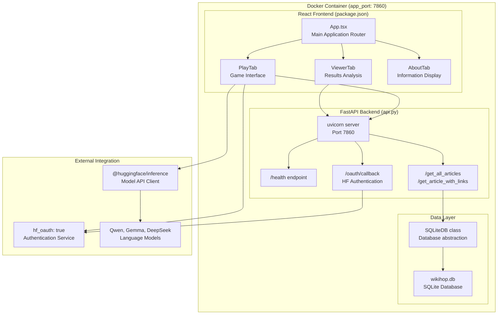
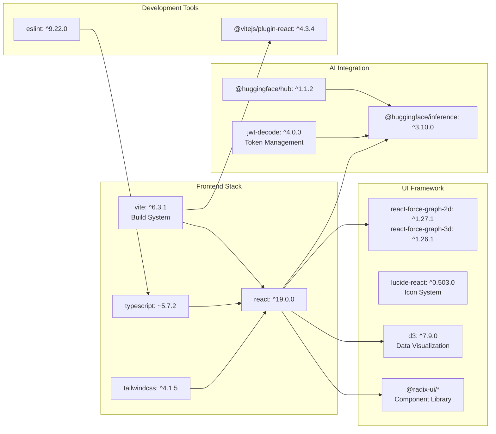

<!-- source: DeepWiki mcp.deepwiki.com · repo huggingface/wikirace-llms · page 1 Overview · fetched 2026-10-26 -->

# Overview

Relevant source files

The following files were used as context for generating this wiki page:

- [README.md](README.md)
- [package.json](package.json)

This document provides a comprehensive introduction to the WikiRacing LLMs repository, explaining its purpose, architecture, and key capabilities. The system enables competitive gameplay between humans and language models in Wikipedia navigation tasks, while providing research tools for evaluating LLM reasoning performance.

For deployment instructions, see [Getting Started](#2). For detailed technical architecture, see [System Architecture](#3). For information about the evaluation framework, see [Parallel Evaluation System](#7).

## Purpose and Scope

WikiRacing LLMs is a full-stack web application that combines competitive gaming with AI research capabilities. The system allows users to race against state-of-the-art language models (Qwen, Gemma, DeepSeek) in Wikipedia navigation challenges, while providing comprehensive tools for analyzing model reasoning traces and performance metrics.

The repository serves two primary audiences:
- **General users** who want to interact competitively with AI models through an intuitive web interface
- **Researchers** who need scalable evaluation tools for testing language models on reasoning tasks

Sources: [README.md:1-24](), [package.json:1-55]()

## Core Functionality

### Interactive WikiRacing Game

The application implements a Wikipedia navigation game where participants must find paths between articles using only hyperlinks. Players start at a source article and attempt to reach a target article through the shortest possible path of clicks.

The game supports two modes:
- **Human vs AI**: Direct competition between human players and language models
- **AI Analysis**: Observation mode for studying model reasoning patterns

### Model Performance Evaluation

The system includes parallel evaluation capabilities for testing multiple language models simultaneously across large datasets. This enables researchers to conduct systematic performance comparisons and analyze reasoning trace patterns at scale.

Sources: [README.md:14-23]()

## System Architecture Overview

### Application Component Mapping

Sources: [README.md:6-11](), [package.json:13-38]()

### Technology Stack Integration

Sources: [package.json:13-54]()

## Key Features

### Multi-Model AI Competition
The system supports integration with multiple language models through the Hugging Face Inference API, enabling direct performance comparisons across different model architectures and capabilities.

### Advanced Data Visualization  
Built using `d3` and `react-force-graph-2d`/`react-force-graph-3d`, the application provides sophisticated visualization of reasoning traces and navigation paths through force-directed graph layouts.

### Scalable Authentication
Implements Hugging Face OAuth with scope-based permissions (`inference-api`, `email`) for secure model access and user management.

### Containerized Deployment
Designed for deployment on Hugging Face Spaces using Docker containerization with automatic port configuration and OAuth integration.

Sources: [README.md:6-11](), [package.json:13-38]()

## Repository Structure

The codebase is organized into several key areas:

| Component | Purpose | Key Technologies |
|-----------|---------|------------------|
| Frontend Application | User interface and game logic | React 19, TypeScript, Tailwind CSS |
| Backend Services | API endpoints and data access | FastAPI, SQLite, Python |
| AI Integration | Model communication and inference | Hugging Face Inference API |
| Parallel Evaluation | Large-scale model testing | Custom evaluation framework |
| Deployment Infrastructure | Production deployment | Docker, Hugging Face Spaces |

For detailed information about each component:
- Frontend structure and components: [Frontend Application](#4)
- Backend API and database: [Backend Services](#5) 
- Model integration details: [AI Model Integration](#6)
- Evaluation system: [Parallel Evaluation System](#7)
- Production deployment: [Deployment and Production](#9)

Sources: [README.md:1-24](), [package.json:1-55]()

---

