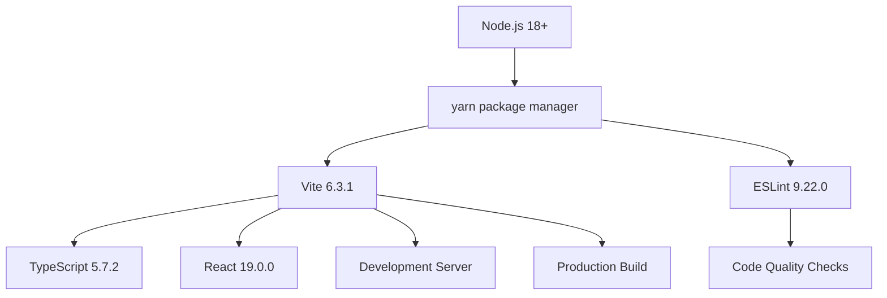
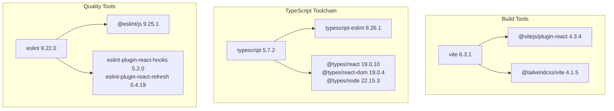
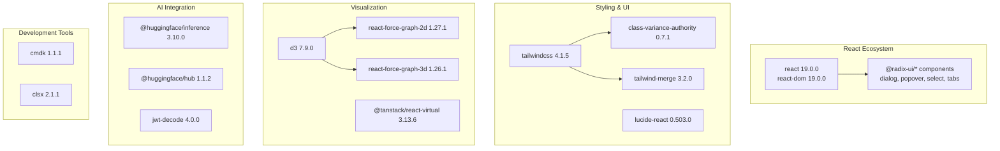
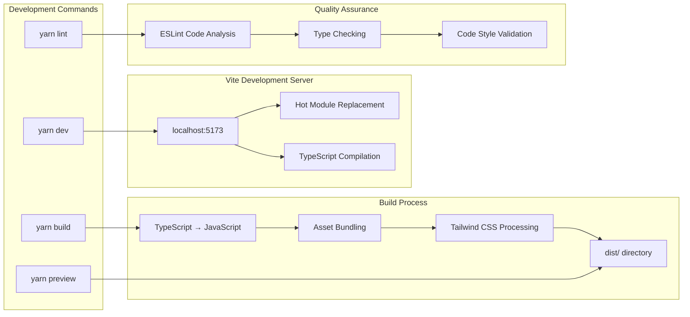
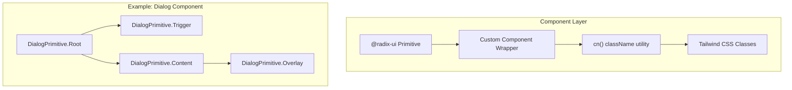

<!-- source: DeepWiki mcp.deepwiki.com · repo huggingface/wikirace-llms · page 10 Development Guide · fetched 2026-10-26 -->

# Development Guide

<details>
<summary>Relevant source files</summary>

The following files were used as context for generating this wiki page:

- [.gitignore](.gitignore)
- [package-lock.json](package-lock.json)
- [package.json](package.json)
- [src/components/ui/command.tsx](src/components/ui/command.tsx)
- [src/components/ui/dialog.tsx](src/components/ui/dialog.tsx)
- [src/components/ui/popover.tsx](src/components/ui/popover.tsx)
- [yarn.lock](yarn.lock)

</details>


This document provides comprehensive information for developers working on the WikiRacing LLMs codebase, covering build tools, dependencies, development workflow, and code organization. It focuses on the technical setup and processes needed to contribute to the project effectively.

For information about the overall system architecture, see [System Architecture](#3). For deployment specifics, see [Deployment and Production](#9).

## Development Environment Setup

The WikiRacing LLMs project is a modern React application built with TypeScript and Vite. The development environment requires Node.js and uses Yarn as the primary package manager.

### Prerequisites

The project requires Node.js 18+ and uses Yarn for dependency management. The build system is configured with Vite 6.3.1 and supports React 19.0.0 with TypeScript 5.7.2.

**Development Toolchain Flow**


Sources: [package.json:1-55](), [yarn.lock:1-100]()

### Package Scripts

The development workflow is managed through npm/yarn scripts defined in `package.json`:

| Script | Command | Purpose |
|--------|---------|---------|
| `dev` | `vite` | Start development server |
| `build` | `vite build` | Create production build |
| `deploy` | `yarn build && huggingface-cli upload --repo-type space --private HuggingFaceTB/Wikispeedia dist` | Build and deploy to Hugging Face Spaces |
| `lint` | `eslint .` | Run code linting |
| `preview` | `vite preview` | Preview production build locally |

Sources: [package.json:6-12]()

## Build System Architecture

The project uses Vite as the primary build tool, configured for React development with TypeScript support. The build system integrates multiple tools for development, testing, and production deployment.

**Build System Dependencies**


Sources: [package.json:40-54](), [yarn.lock:377-380]()

### TypeScript Configuration

The project uses TypeScript with strict type checking enabled. Type definitions are provided for React, Node.js, and all major dependencies through `@types/*` packages.

Sources: [package.json:42-44]()

## Dependencies Architecture

The application relies on several key dependency categories: UI framework, visualization libraries, AI integration, and development tools.

**Core Dependencies Structure**


Sources: [package.json:13-39](), [yarn.lock:422-450]()

### UI Component System

The project uses Radix UI primitives as the foundation for its component system, with Tailwind CSS for styling:

- **Dialog System**: `@radix-ui/react-dialog` for modal interactions
- **Form Controls**: `@radix-ui/react-select`, `@radix-ui/react-popover` for input components  
- **Navigation**: `@radix-ui/react-tabs` for tab-based navigation
- **Command Interface**: `cmdk` for command palette functionality

Sources: [package.json:16-23](), [src/components/ui/dialog.tsx:1-136](), [src/components/ui/popover.tsx:1-47](), [src/components/ui/command.tsx:1-176]()

### Visualization Dependencies

The application heavily relies on data visualization libraries for displaying game paths and model reasoning:

- **D3.js**: Core visualization library for data manipulation and SVG rendering
- **Force Graph Libraries**: `react-force-graph-2d` and `react-force-graph-3d` for network visualization
- **Virtual Scrolling**: `@tanstack/react-virtual` for efficient large list rendering

Sources: [package.json:29, 34-36]()

## Development Workflow

The development process follows a modern React development pattern with hot reloading, TypeScript compilation, and integrated linting.

**Development Process Flow**


Sources: [package.json:6-12]()

### Development Server

The Vite development server provides hot module replacement, TypeScript compilation, and integrated development tools. It typically runs on `localhost:5173` with automatic browser refresh on file changes.

### Code Quality Tools

ESLint is configured with React-specific rules and TypeScript integration:

- **Core ESLint**: `eslint 9.22.0` with `@eslint/js 9.25.1`
- **React Plugins**: `eslint-plugin-react-hooks` and `eslint-plugin-react-refresh`
- **TypeScript Integration**: `typescript-eslint 8.26.1` for type-aware linting

Sources: [package.json:41, 46-48, 52]()

## Code Organization

The codebase follows React best practices with TypeScript, organized around component-based architecture and clear separation of concerns.

### File Structure Patterns

Based on the component files provided, the project follows this organization:

```
src/
├── components/
│   └── ui/           # Reusable UI components
│       ├── dialog.tsx
│       ├── popover.tsx
│       └── command.tsx
├── lib/              # Utility functions
└── [other directories]
```

### Component Architecture

The UI components are built using a consistent pattern with Radix UI primitives:

**Component Design Pattern**


Sources: [src/components/ui/dialog.tsx:1-136](), [src/components/ui/popover.tsx:1-47]()

Each component follows this pattern:
1. Imports Radix UI primitives
2. Wraps primitives with custom styling logic
3. Uses `cn()` utility for conditional className composition
4. Applies Tailwind CSS classes with data-slot attributes for styling hooks

Sources: [src/components/ui/dialog.tsx:4-7](), [src/components/ui/popover.tsx:4-5]()

## Git Workflow

The project uses Git with specific ignore patterns defined in `.gitignore`:

### Ignored Files and Directories

- **Build Artifacts**: `dist/`, `dist-ssr/`, `node_modules/`
- **Environment Files**: `.env`, `*.local`
- **Development Tools**: `.vscode/*`, `__pycache__/`, `.venv/`
- **Data Files**: `wikihop.db`, `qwen3-final-results.json`
- **Temporary Files**: `tmp/`, `proctor_tmp/`

Sources: [.gitignore:1-34]()

## Deployment Integration

The project includes a direct deployment script that builds the application and uploads it to Hugging Face Spaces:

```bash
yarn build && huggingface-cli upload --repo-type space --private HuggingFaceTB/Wikispeedia dist
```

This command:
1. Builds the production application using Vite
2. Uses the Hugging Face CLI to upload the `dist/` directory
3. Deploys to the private `HuggingFaceTB/Wikispeedia` space

Sources: [package.json:9]()

The deployment process integrates with the containerized backend deployment described in [Deployment and Production](#9).