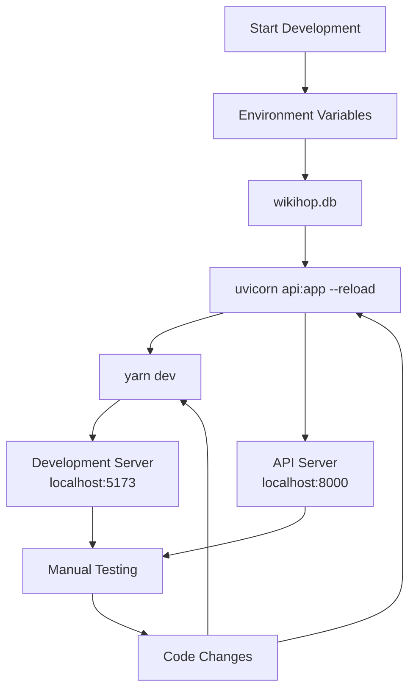
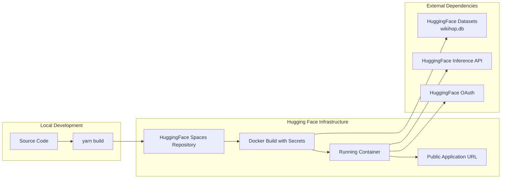
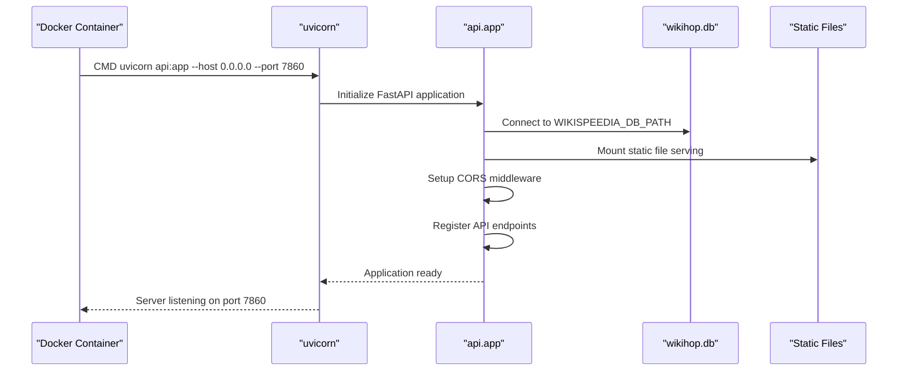

<!-- source: DeepWiki mcp.deepwiki.com · repo huggingface/wikirace-llms · page 2 Getting Started · fetched 2026-10-26 -->

# Getting Started

<details>
<summary>Relevant source files</summary>

The following files were used as context for generating this wiki page:

- [Dockerfile](Dockerfile)
- [package.json](package.json)
- [parallel_eval/README.md](parallel_eval/README.md)
- [requirements.txt](requirements.txt)

</details>


This document provides step-by-step instructions for setting up and running the WikiRacing LLMs application in both development and production environments. It covers local development setup, Docker containerization, and deployment to Hugging Face Spaces.

For information about the overall system architecture, see [System Architecture](#3). For details about the parallel evaluation system used for model testing, see [Parallel Evaluation System](#7).

## Prerequisites

Before setting up the application, ensure you have the following tools installed:

| Tool | Version | Purpose |
|------|---------|---------|
| Python | 3.9+ | Backend API server |
| Node.js | 22.x | Frontend build system |
| Yarn | Latest | Package management |
| Docker | Latest | Containerization (for production) |

### Required Environment Variables

The application requires several environment variables for proper operation:

| Variable | Purpose | Required For |
|----------|---------|--------------|
| `HUGGINGFACE_CLIENT_SECRET` | OAuth authentication | Production deployment |
| `HF_TOKEN` | Hugging Face API access | Database download, model inference |
| `VITE_ENV` | Build environment flag | Frontend compilation |
| `WIKISPEEDIA_DB_PATH` | Database file location | Backend API |

## Development Environment Setup

### Backend Setup

The backend uses FastAPI with SQLite for data persistence. Follow these steps to set up the Python environment:

```bash
# Install Python dependencies
pip install --upgrade pip
pip install -r requirements.txt
```

Download the WikiHop database from Hugging Face:

```bash
# Requires HF_TOKEN environment variable
curl -L https://huggingface.co/datasets/HuggingFaceTB/simplewiki-pruned-text-350k/resolve/main/wikihop.db \
  -H "Authorization: Bearer $HF_TOKEN" \
  -o wikihop.db
```

Set the database path environment variable:

```bash
export WIKISPEEDIA_DB_PATH=./wikihop.db
```

### Frontend Setup

The frontend is built with React 19 and Vite. Install and build the frontend:

```bash
# Install Node.js dependencies
yarn install

# Start development server
yarn dev

# Build for production
yarn build
```

### Development Workflow



**Development Setup Flow**

Sources: [package.json:6-11](), [requirements.txt:1-16](), [Dockerfile:56-58]()

## Production Deployment

### Docker Container Build

The application uses a multi-stage Docker build process that combines the Python backend and React frontend into a single container:

```mermaid
graph TB
    subgraph "Docker Build Process"
        BaseImage["python:3.9"]
        NodeSetup["Install Node.js 22.x<br/>apt-get install nodejs"]
        YarnInstall["npm install -g yarn"]
        UserSetup["useradd -m -u 1000 user"]
        
        PythonDeps["pip install -r requirements.txt"]
        CopySource["COPY --chown=user . $HOME/app"]
        
        EnvSecrets["Mount secrets:<br/>HUGGINGFACE_CLIENT_SECRET<br/>HF_TOKEN"]
        FrontendBuild["yarn install<br/>yarn build"]
        DatabaseDownload["curl wikihop.db from HuggingFace"]
        
        ServerStart["uvicorn api:app --host 0.0.0.0 --port 7860"]
    end
    
    BaseImage --> NodeSetup
    NodeSetup --> YarnInstall
    YarnInstall --> UserSetup
    UserSetup --> PythonDeps
    PythonDeps --> CopySource
    CopySource --> EnvSecrets
    EnvSecrets --> FrontendBuild
    FrontendBuild --> DatabaseDownload
    DatabaseDownload --> ServerStart
```



**Docker Build Pipeline**

### Build Commands

Build the Docker image with required secrets:

```bash
# Build with BuildKit for secret mounting
docker buildx build \
  --secret id=HUGGINGFACE_CLIENT_SECRET,src=.env \
  --secret id=HF_TOKEN,src=.env \
  -t wikispeedia .
```

Run the container:

```bash
docker run -p 7860:7860 wikispeedia
```

### Hugging Face Spaces Deployment

The application is designed for deployment on Hugging Face Spaces using the provided Dockerfile:



**Hugging Face Spaces Deployment Architecture**

Sources: [Dockerfile:1-67](), [package.json:9]()

## Application Startup Process

Once deployed, the application follows this startup sequence:

### Server Initialization

The FastAPI server starts with the following configuration:



**Application Startup Sequence**

### Key Startup Components

| Component | File Reference | Purpose |
|-----------|----------------|---------|
| `uvicorn` server | [Dockerfile:61]() | ASGI server hosting the application |
| `api.app` | FastAPI application | Main application entry point |
| `wikihop.db` | [Dockerfile:56-58]() | SQLite database with Wikipedia articles |
| Static files | Frontend build output | Compiled React application |

Sources: [Dockerfile:37-61]()

## Verification Steps

### Health Check Endpoints

Verify the application is running correctly:

| Endpoint | Purpose | Expected Response |
|----------|---------|-------------------|
| `/health` | Server status | `{"status": "healthy"}` |
| `/get_all_articles` | Database connectivity | List of article titles |
| `/<path>` | Static file serving | Frontend application |

### Local Development Verification

1. **Backend API**: Visit `http://localhost:8000/health`
2. **Frontend Development**: Visit `http://localhost:5173` (Vite dev server)
3. **Database Access**: Check that `/get_all_articles` returns article data

### Production Verification

1. **Container Health**: `docker ps` shows running container
2. **Port Binding**: Application accessible on port 7860
3. **OAuth Integration**: Hugging Face authentication flow works
4. **Model Access**: AI player functionality operates correctly

Sources: [Dockerfile:61](), [package.json:7]()

## Next Steps

After successful setup, you can:

- **Explore the game interface**: See [Game Interface](#4.2) for detailed gameplay documentation
- **View model results**: See [Results Viewer](#4.3) for analysis tools
- **Run parallel evaluations**: See [Parallel Evaluation System](#7) for large-scale model testing
- **Understand the architecture**: See [System Architecture](#3) for technical details

The application should now be fully functional with both human and AI player capabilities enabled.

---

