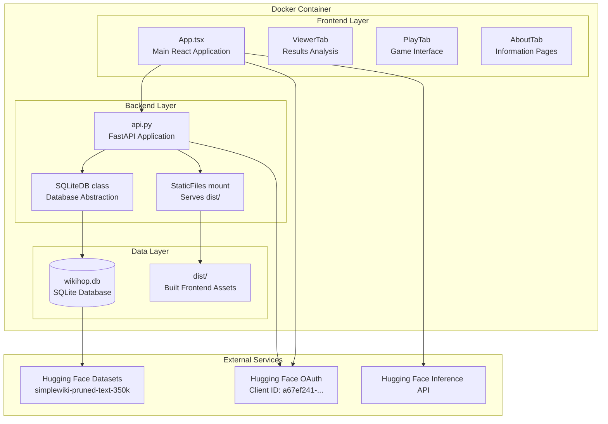
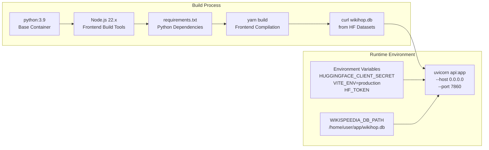
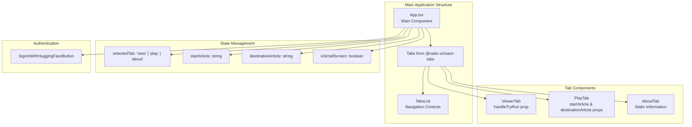
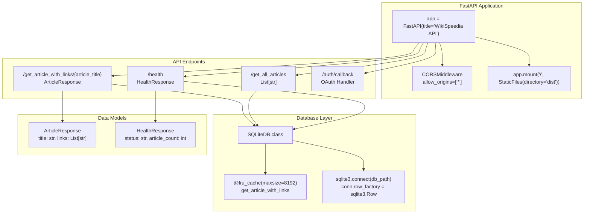
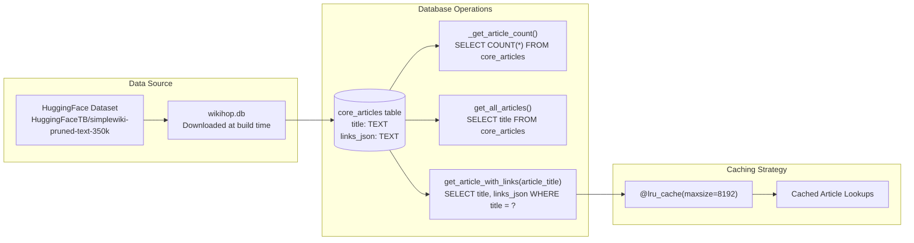
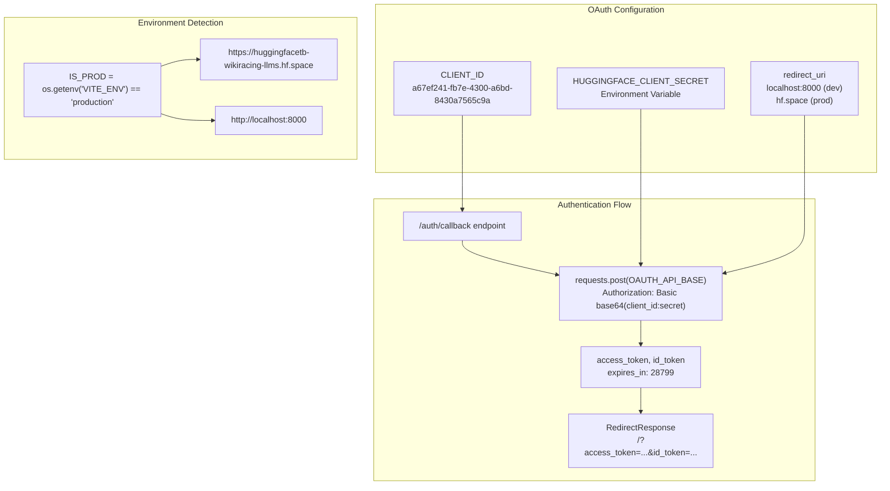

<!-- source: DeepWiki mcp.deepwiki.com · repo huggingface/wikirace-llms · page 3 System Architecture · fetched 2026-10-26 -->

# System Architecture

Relevant source files

The following files were used as context for generating this wiki page:

- [Dockerfile](Dockerfile)
- [api.py](api.py)
- [src/App.tsx](src/App.tsx)
- [yarn.lock](yarn.lock)

This document provides a comprehensive overview of the WikiRacing LLMs system architecture, covering the deployment infrastructure, application components, and their interactions. The system is designed as a full-stack web application that enables users to play WikiRacing games with AI language models and analyze their performance through interactive visualizations.

For detailed information about specific frontend components, see [Frontend Application](#4). For backend API implementation details, see [Backend Services](#5). For AI model integration specifics, see [AI Model Integration](#6).

## System Overview

The WikiRacing LLMs application is a containerized web application built with modern technologies to provide an interactive platform for testing language models on navigation tasks through Wikipedia-like article networks.

**Core System Architecture**

Sources: [Dockerfile:1-67](), [src/App.tsx:1-82](), [api.py:1-152]()

## Deployment Architecture

The application uses Docker containerization for consistent deployment across environments, with Hugging Face Spaces as the target production platform.

**Container Build and Runtime Process**

The Docker container follows a multi-stage approach where frontend assets are built during container creation, and the backend serves both API endpoints and static files.

Sources: [Dockerfile:1-67]()

## Frontend Application Architecture

The React application uses a tab-based interface with sophisticated visualization capabilities for analyzing model performance and game interactions.

**React Component Hierarchy and State Flow**

The application maintains a centralized state in the root `App` component and passes data down through props to specialized tab components.

Sources: [src/App.tsx:1-82](), [yarn.lock:1-2999]()

## Backend Services Architecture

The FastAPI backend provides a clean separation between API endpoints, database operations, and static file serving, with integrated OAuth authentication for Hugging Face services.

**Backend Service Architecture with Database Integration**

The `SQLiteDB` class provides cached access to article data, while FastAPI handles HTTP routing and response serialization through Pydantic models.

Sources: [api.py:1-152]()

## Database Schema and Access Patterns

The SQLite database uses a simple schema optimized for fast article and link retrieval with JSON serialization for link storage.

**Database Access Pattern with Performance Optimization**

The database uses LRU caching to optimize repeated article lookups, which is essential for the interactive nature of the WikiRacing game.

Sources: [api.py:40-75](), [Dockerfile:56-56]()

## Authentication and External Service Integration

The system integrates with Hugging Face services for both user authentication and AI model inference through OAuth 2.0 flow.

**Hugging Face OAuth Integration Flow**

The authentication system handles both development and production environments with different redirect URIs, and exchanges authorization codes for access tokens that enable AI model inference.

Sources: [api.py:99-144](), [api.py:26-29]()

## Technology Stack and Dependencies

The application leverages modern web technologies with specific focus on data visualization and AI model integration capabilities.

| Component | Technology | Key Libraries | Purpose |
|-----------|------------|---------------|---------|
| Frontend | React 19.0.0 | @radix-ui, d3@7.9.0, @huggingface/inference | UI components and data visualization |
| Build System | Vite 6.3.1 | @tailwindcss/vite, @vitejs/plugin-react | Development and build tooling |
| Backend | FastAPI | uvicorn, pydantic | API server and data validation |
| Database | SQLite3 | Built-in Python sqlite3 | Article and link storage |
| Visualization | D3.js + React | force-graph, @tanstack/react-virtual | Interactive network graphs |
| Authentication | OAuth 2.0 | Hugging Face OAuth endpoints | User authentication |
| Containerization | Docker | python:3.9, Node.js 22.x | Deployment packaging |

Sources: [yarn.lock:1-2999](), [api.py:1-14](), [Dockerfile:1-67]()

---

