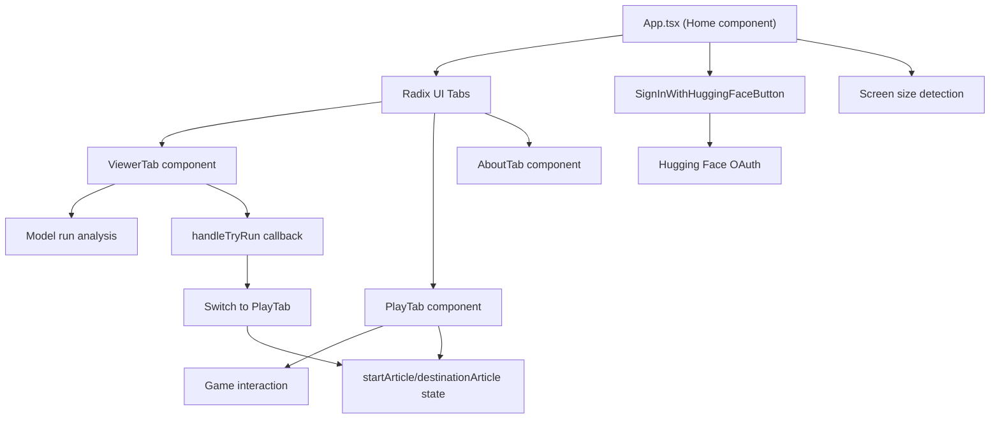
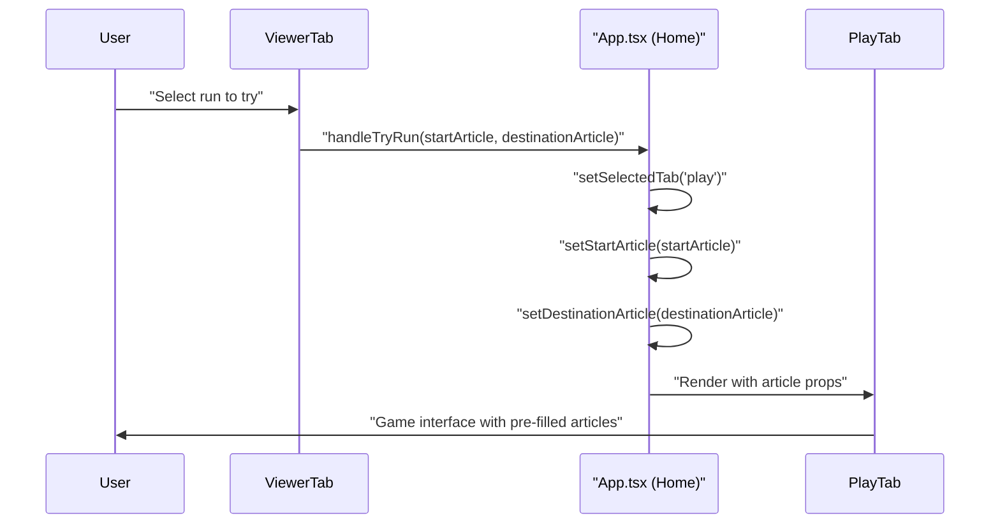
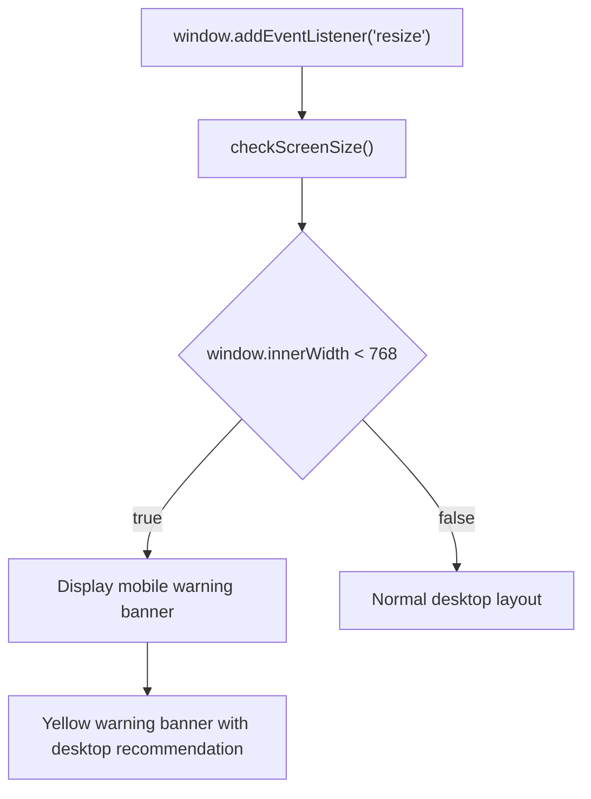

<!-- source: DeepWiki mcp.deepwiki.com · repo huggingface/wikirace-llms · page 4 Frontend Application · fetched 2026-10-26 -->

# Frontend Application

Relevant source files

The following files were used as context for generating this wiki page:

- [index.html](index.html)
- [src/App.tsx](src/App.tsx)
- [yarn.lock](yarn.lock)

This document covers the React-based frontend application that provides the user interface for the WikiRacing LLMs system. The frontend handles game interaction, results visualization, authentication, and model integration. For information about the backend API that serves this frontend, see [Backend Services](#5). For details about the AI model integration used within the frontend, see [AI Model Integration](#6).

## Application Architecture

The frontend is built as a modern React application using TypeScript and Vite as the build system. The main entry point is [src/App.tsx:1-82](), which implements a tabbed interface for different application modes.

### Main Application Structure

The core application structure centers around three primary interaction modes accessed through a tab interface:

Sources: [src/App.tsx:1-82](), [index.html:1-14]()

The application maintains several key state variables in the main `Home` component [src/App.tsx:10-13]():
- `selectedTab`: Controls which tab is currently active ("view" | "play" | "about")
- `startArticle`: The starting Wikipedia article for gameplay
- `destinationArticle`: The target Wikipedia article for gameplay
- `isSmallScreen`: Responsive design state for mobile detection

### Tab System Implementation

The tabbed interface uses Radix UI's tabs component [src/App.tsx:60-78]() and implements cross-tab communication through a callback system:

Sources: [src/App.tsx:30-35](), [src/App.tsx:67-77]()

The `handleTryRun` function [src/App.tsx:30-35]() enables users to transition from viewing existing model runs to attempting the same path themselves, maintaining context between the analysis and gameplay modes.

## Authentication System

The frontend integrates Hugging Face OAuth through the `SignInWithHuggingFaceButton` component [src/App.tsx:56](), positioned in the application header alongside navigation elements. This authentication system is required for:

- Access to Hugging Face Inference API for AI model interactions
- Secure model execution within the play interface
- User session management across application tabs

The authentication state affects functionality across multiple components, particularly in the AI-powered gameplay features.

Sources: [src/App.tsx:45-58]()

## Responsive Design

The application implements responsive design considerations with screen size detection [src/App.tsx:15-28]():

Sources: [src/App.tsx:15-44]()

Users on small screens (< 768px width) receive a prominent warning [src/App.tsx:39-44]() recommending desktop usage for optimal experience, reflecting the application's focus on complex data visualization and multi-panel interfaces.

## Technology Stack

The frontend leverages a modern React ecosystem with specialized libraries for visualization and UI components:

| Technology | Version | Purpose |
|------------|---------|---------|
| React | 19.0.0 | Core UI framework |
| TypeScript | 5.7.2 | Type safety and development tooling |
| Vite | 6.3.1 | Build system and development server |
| Tailwind CSS | 4.1.5 | Utility-first styling framework |
| Radix UI | Latest | Accessible component primitives |
| D3.js | 7.9.0 | Data visualization and force-directed graphs |
| @huggingface/inference | 3.10.0 | AI model integration |

Sources: [yarn.lock:1-50](), [yarn.lock:377-451](), [yarn.lock:1017-1120]()

### Key Dependencies

The application's specialized functionality relies on several key libraries:

- **Force Graph Visualization**: Uses `3d-force-graph@1.77.0` and `force-graph@1.49.5` for interactive network visualizations [yarn.lock:5-14](), [yarn.lock:2047-2067]()
- **UI Components**: Extensive use of Radix UI primitives including dialogs, tabs, tooltips, and form controls [yarn.lock:542-915]()
- **AI Integration**: Direct integration with Hugging Face services through `@huggingface/inference@3.10.0` [yarn.lock:429-436]()

## Development Configuration

The application entry point is defined in [index.html:1-14]() with the React application mounting to the `root` div and loading the main TypeScript module from [src/main.tsx](). The HTML document sets up basic metadata including the title "WikiRacing LLMs" and viewport configuration for responsive design.

The build system uses Vite with TypeScript support, enabling hot module replacement during development and optimized production builds. The modular architecture allows for efficient code splitting and lazy loading of complex visualization components.

Sources: [index.html:10-12](), [yarn.lock:1288-1298]()

---

