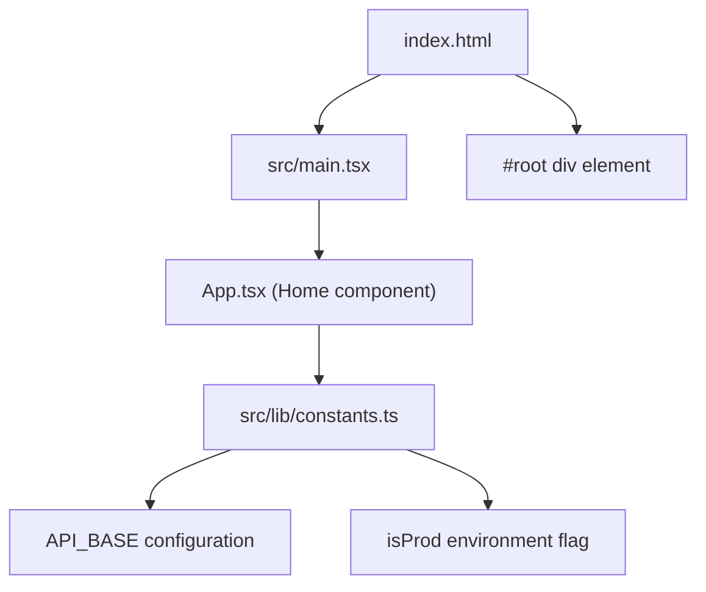
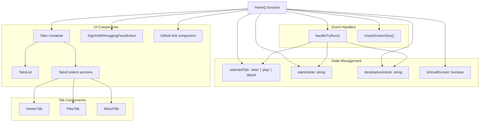
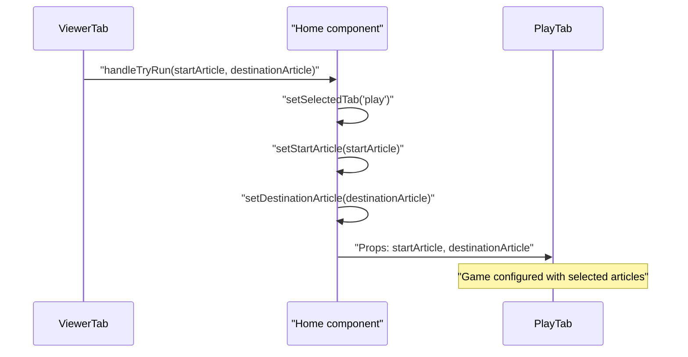

<!-- source: DeepWiki mcp.deepwiki.com · repo huggingface/wikirace-llms · page 4.1 Main Application Structure · fetched 2026-10-26 -->

# Main Application Structure

Relevant source files

The following files were used as context for generating this wiki page:

- [index.html](index.html)
- [src/App.tsx](src/App.tsx)
- [src/lib/constants.ts](src/lib/constants.ts)

## Purpose and Scope

This document covers the main application structure and entry points of the WikiRacing LLMs frontend application. It focuses on the root `App.tsx` component, the tab-based navigation system, and how the application bootstraps itself. For detailed information about individual tab functionalities, see [Game Interface](#4.2), [Results Viewer](#4.3), and [Information Pages](#4.7). For UI component details, see [UI Components Library](#4.6).

## Application Entry Point Flow

The application follows a standard React entry point pattern with environment-aware configuration:

**Application Bootstrap Sequence**

The application entry point is defined in [index.html:10-11]() which loads the main React module. The HTML structure is minimal, containing only a root div and the module script reference.

Environment configuration is handled through [src/lib/constants.ts:1-2](), which determines the `API_BASE` URL based on the `VITE_ENV` environment variable. In production, `API_BASE` is empty (allowing relative URLs), while in development it points to `http://localhost:8000`.

Sources: [index.html:1-14](), [src/lib/constants.ts:1-5]()

## Main App Component Architecture

The main application component is implemented as the `Home` function in `App.tsx`. Despite its name, this serves as the root application component:

**Component Structure**

The `Home` component manages four pieces of state defined in [src/App.tsx:10-13]():
- `selectedTab`: Controls which tab is currently active
- `startArticle` and `destinationArticle`: Store Wikipedia article titles for game configuration
- `isSmallScreen`: Tracks responsive breakpoint for mobile warning

The main UI layout consists of a header section [src/App.tsx:45-58]() containing the application title, GitHub link, and authentication button, followed by the tab system [src/App.tsx:60-78]().

Sources: [src/App.tsx:9-81]()

## Tab System Implementation

The application uses a three-tab interface implemented with Radix UI components:

| Tab Value | Component | Purpose |
|-----------|-----------|---------|
| `"view"` | `ViewerTab` | Display and analyze existing model runs |
| `"play"` | `PlayTab` | Interactive game interface for human/AI play |
| `"about"` | `AboutTab` | Information and documentation |

**Tab Navigation Logic**

The tab system is controlled by [src/App.tsx:60]() with the `Tabs` component that:
- Defaults to the "view" tab
- Updates `selectedTab` state via the `onValueChange` callback
- Maintains controlled state through the `value` prop

Each tab content is rendered conditionally using `TabsContent` components [src/App.tsx:67-77](), ensuring only the active tab's content is mounted.

Sources: [src/App.tsx:60-78]()

## Cross-Tab Communication

The application implements a communication mechanism between the ViewerTab and PlayTab through the `handleTryRun` function:

**Function Implementation**

The `handleTryRun` function [src/App.tsx:30-35]() serves as a bridge between tabs by:
1. Accepting `startArticle` and `destinationArticle` parameters from ViewerTab
2. Switching the active tab to "play"
3. Setting the article state that gets passed as props to PlayTab

This pattern enables users to select a specific model run in the ViewerTab and immediately replay it in the PlayTab with the same article configuration.

Sources: [src/App.tsx:30-35](), [src/App.tsx:68](), [src/App.tsx:72]()

## Responsive Design Implementation

The application includes responsive design considerations through screen size detection:

**Screen Size Monitoring**

The `checkScreenSize` function [src/App.tsx:16-18]() monitors the viewport width and sets `isSmallScreen` to `true` when the width is below 768 pixels. This monitoring is implemented with:

- Initial size check on component mount [src/App.tsx:21]()
- Window resize event listener [src/App.tsx:24]()
- Cleanup of event listener on unmount [src/App.tsx:27]()

**Mobile Warning System**

When `isSmallScreen` is true, a warning banner is displayed [src/App.tsx:39-44]() informing users that the application doesn't work well on small screens and recommending desktop usage.

Sources: [src/App.tsx:15-28](), [src/App.tsx:39-44]()

## Import Dependencies

The main application imports several key dependencies:

| Import | Source | Purpose |
|--------|--------|---------|
| `Tabs`, `TabsContent`, `TabsList`, `TabsTrigger` | `@/components/ui/tabs` | Tab navigation UI components |
| `ViewerTab` | `@/components/viewer-tab` | Results viewing interface |
| `PlayTab` | `@/components/play-tab` | Game interface |
| `AboutTab` | `@/components/about-tab` | Information content |
| `SignInWithHuggingFaceButton` | `@/components/sign-in-with-hf-button` | Authentication component |
| `Github` | `lucide-react` | GitHub icon component |
| `useState`, `useEffect` | `react` | React hooks for state and lifecycle |

Sources: [src/App.tsx:1-7]()

---

