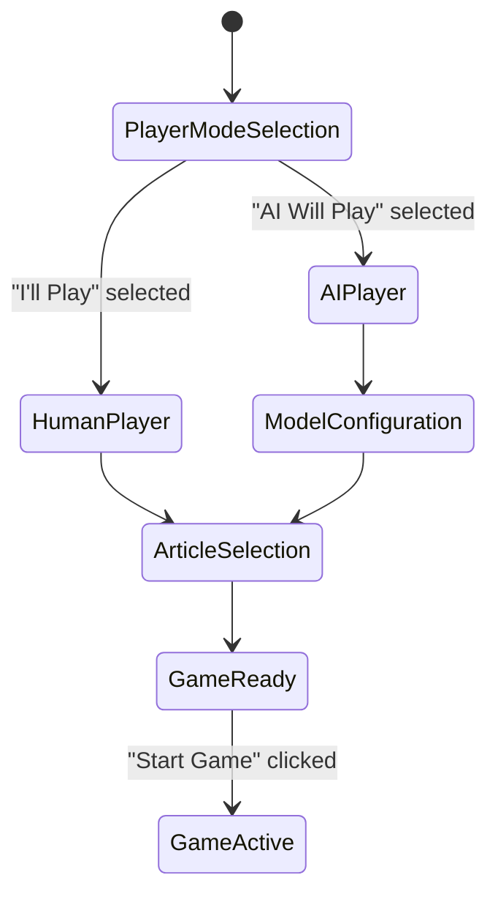
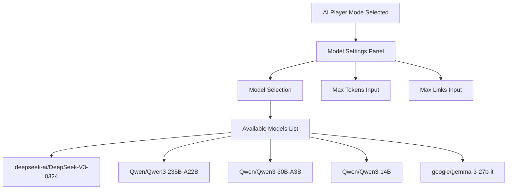
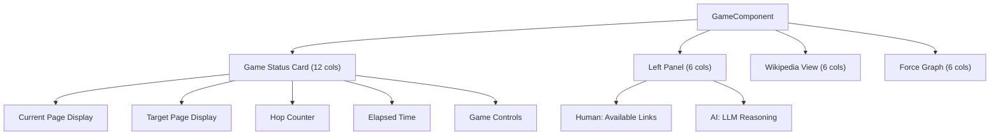
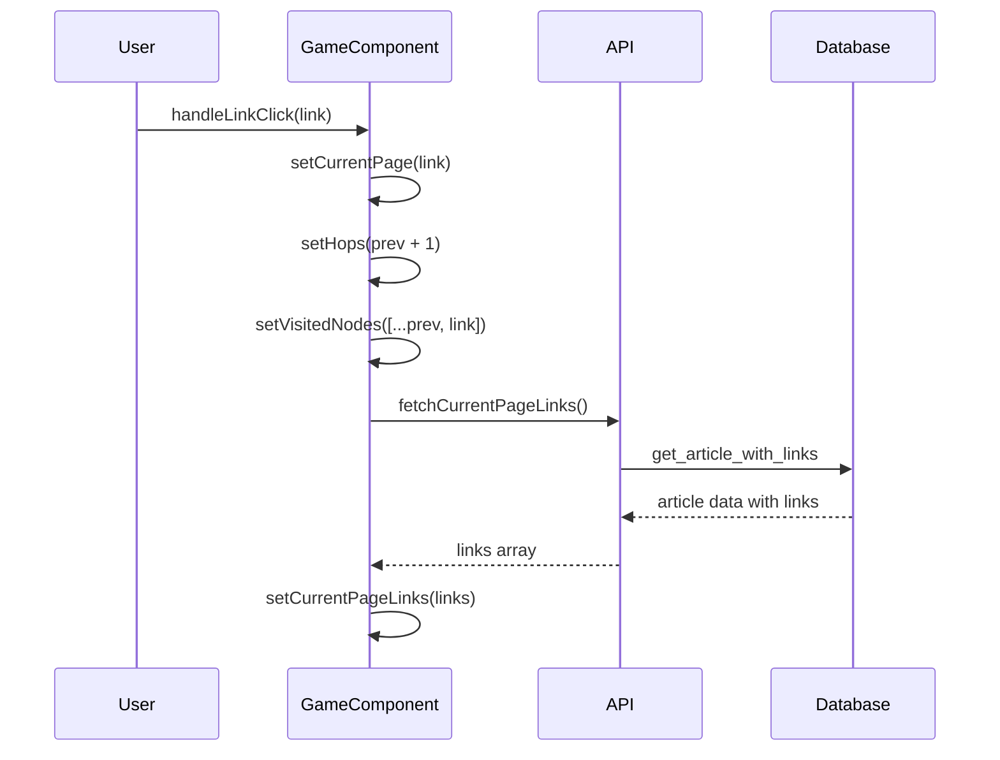
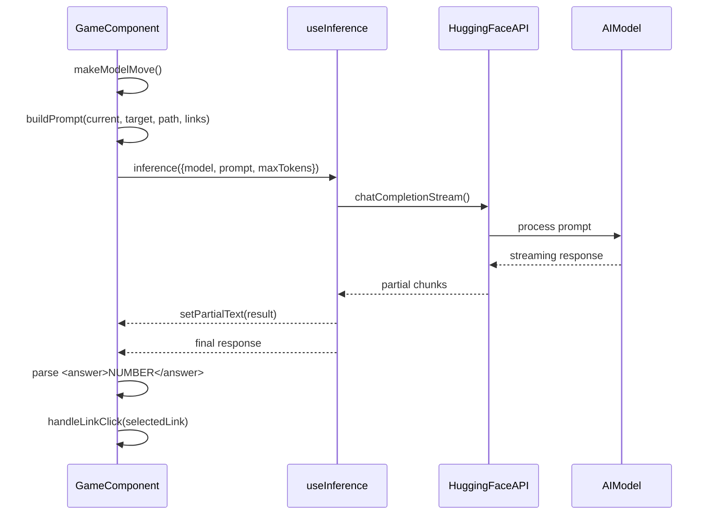
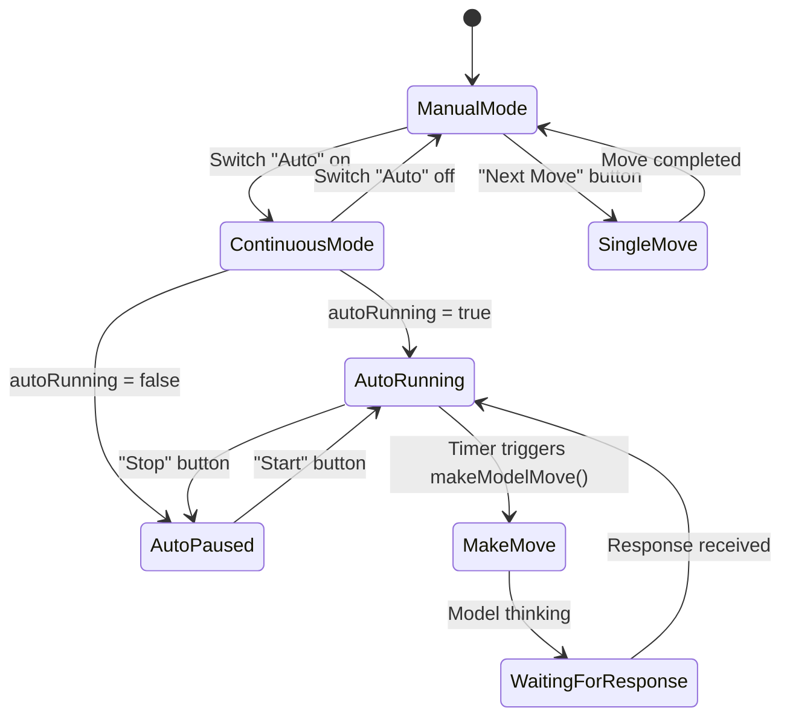
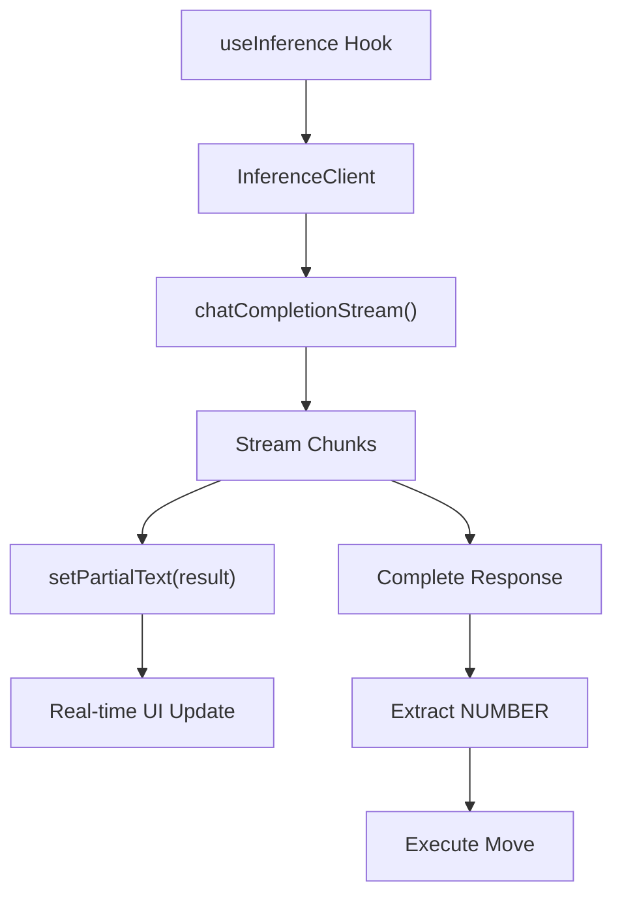

<!-- source: DeepWiki mcp.deepwiki.com · repo huggingface/wikirace-llms · page 4.2 Game Interface · fetched 2026-10-26 -->

# Game Interface

<details>
<summary>Relevant source files</summary>

The following files were used as context for generating this wiki page:

- [src/components/game-component.tsx](src/components/game-component.tsx)
- [src/components/play-tab.tsx](src/components/play-tab.tsx)
- [src/lib/inference.tsx](src/lib/inference.tsx)

</details>


This document covers the core game functionality and user interface components that enable interactive WikiRacing gameplay. The game interface allows users to either play WikiRacing themselves or configure and watch AI models attempt to navigate between Wikipedia articles.

For information about the data visualization of game results, see [Data Visualization](#4.4). For details about the authentication system required for AI gameplay, see [Authentication System](#4.5).

## Game Setup Interface

The game setup is handled by the `PlayTab` component, which provides configuration options before starting a game session. This interface allows users to select between human and AI player modes, configure game parameters, and choose start/target articles.

### Player Mode Selection

The interface offers two distinct player modes through a tabbed interface:



The player mode is managed through a `Tabs` component that sets the `player` state to either `"me"` or `"model"`.

**Sources:** [src/components/play-tab.tsx:38-160]()

### Article Selection System

Both start and target articles are selected using the `VirtualizedCombobox` component, which provides efficient searching through all available articles. The system includes random article selection functionality:

| Component | Purpose | Data Source |
|-----------|---------|-------------|
| `VirtualizedCombobox` | Article search and selection | `allArticles` state from `/get_all_articles` API |
| Random button | Quick article selection | `popularNodes` from `results/popular_nodes.json` |

**Sources:** [src/components/play-tab.tsx:163-210](), [src/components/play-tab.tsx:29](), [src/components/play-tab.tsx:112-118]()

### Model Configuration

When AI player mode is selected, additional configuration options become available:



The model configuration includes validation and tooltips explaining each parameter's impact on gameplay.

**Sources:** [src/components/play-tab.tsx:54-60](), [src/components/play-tab.tsx:212-311]()

## Active Game Interface

Once a game starts, the `GameComponent` takes over, providing the main gameplay interface. This component manages the active game state and provides different interfaces depending on the player mode.

### Game Layout Structure

The game interface uses a responsive grid layout with distinct panels:



The layout adapts based on the player mode, showing either clickable links for human players or AI reasoning traces for model players.

**Sources:** [src/components/game-component.tsx:372-813]()

### Game State Management

The `GameComponent` maintains several key state variables that track the game progression:

| State Variable | Type | Purpose |
|---------------|------|---------|
| `currentPage` | `string` | Currently viewed Wikipedia article |
| `currentPageLinks` | `string[]` | Available links from current page |
| `hops` | `number` | Number of moves taken |
| `timeElapsed` | `number` | Game duration in seconds |
| `visitedNodes` | `string[]` | Path taken through articles |
| `gameStatus` | `"playing" \| "won" \| "lost"` | Current game state |

**Sources:** [src/components/game-component.tsx:128-136]()

## Player Mode Implementations

### Human Player Mode

When `player === "me"`, the interface displays an "Available Links" panel with clickable buttons for each outbound link from the current article. Links are sorted alphabetically and displayed in a responsive grid:



**Sources:** [src/components/game-component.tsx:478-585](), [src/components/game-component.tsx:187-193](), [src/components/game-component.tsx:154-162]()

### AI Player Mode  

When `player === "model"`, the interface shows an "LLM Reasoning" panel that displays the conversation between the system and the AI model:



**Sources:** [src/components/game-component.tsx:218-298](), [src/components/game-component.tsx:78-105](), [src/lib/inference.tsx:92-153]()

## Game Controls and Automation

### Continuous Play System

For AI players, the interface provides continuous play functionality through the `continuousPlay` and `autoRunning` state variables:



The automation system includes safety checks to prevent moves during model inference or while links are loading.

**Sources:** [src/components/game-component.tsx:329-353](), [src/components/game-component.tsx:137-138](), [src/components/game-component.tsx:408-447]()

### Message System

The AI player interface maintains a conversation log using a `Message` type system:

```typescript
type Message = {
  role: "user" | "assistant" | "game" | "result" | "error";
  content: string;
  metadata?: {
    page?: string;
    links?: string[];
    status?: "playing" | "won" | "lost";
    path?: string[];
  };
};
```

This enables detailed tracking of the AI's reasoning process and game state changes.

**Sources:** [src/components/game-component.tsx:67-76](), [src/components/game-component.tsx:593-781]()

## Real-time Updates and Streaming

### Inference Streaming

The `useInference` hook provides real-time streaming of AI model responses using the Hugging Face Inference API:



The streaming system provides immediate feedback to users as the AI model generates its response.

**Sources:** [src/lib/inference.tsx:112-135](), [src/components/game-component.tsx:145-152]()

### Game State Synchronization

The interface maintains synchronization between multiple UI elements through React's effect system:

- Timer updates every second during active gameplay
- Link fetching occurs automatically when `currentPage` changes  
- Win/loss conditions are checked after each move
- Graph visualization updates with the current path

**Sources:** [src/components/game-component.tsx:168-186](), [src/components/game-component.tsx:164-166](), [src/components/game-component.tsx:178-185]()

---

