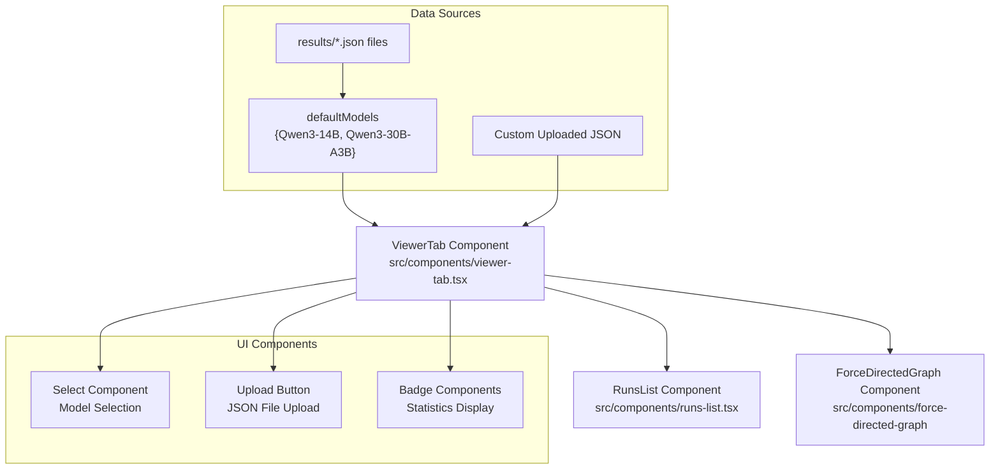
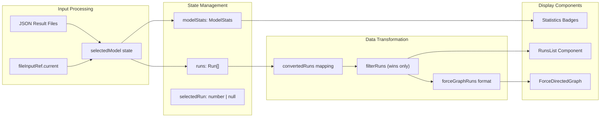
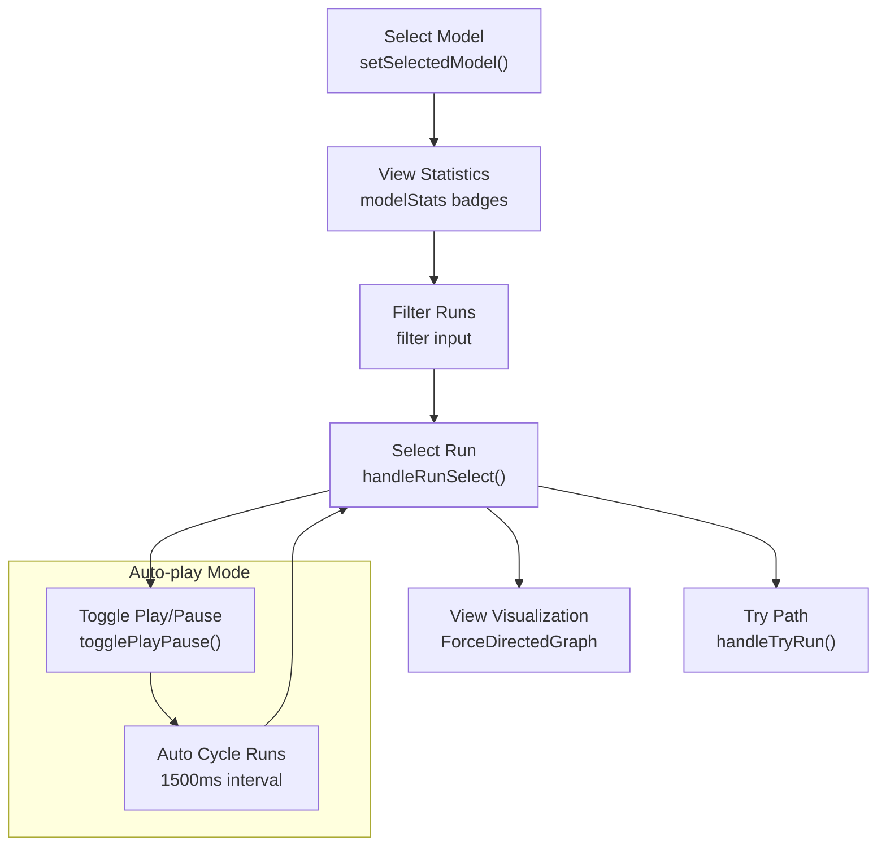

<!-- source: DeepWiki mcp.deepwiki.com · repo huggingface/wikirace-llms · page 4.3 Results Viewer · fetched 2026-10-26 -->

# Results Viewer

<details>
<summary>Relevant source files</summary>

The following files were used as context for generating this wiki page:

- [results/qwen3.json](results/qwen3.json)
- [src/components/runs-list.tsx](src/components/runs-list.tsx)
- [src/components/viewer-tab.tsx](src/components/viewer-tab.tsx)

</details>


The Results Viewer is the primary interface for analyzing and visualizing AI model performance data in WikiRacing LLMs. It provides comprehensive tools for examining model evaluation results, including statistical analysis, run filtering, and interactive visualization of reasoning traces. For information about the actual game interface where models play WikiRacing, see [Game Interface](#4.2). For details about the underlying data visualization components, see [Data Visualization](#4.4).

## Architecture Overview

The Results Viewer system consists of two main React components that work together to provide a comprehensive analysis interface for model evaluation data.

### Component Structure



Sources: [src/components/viewer-tab.tsx:1-266](), [src/components/runs-list.tsx:1-220]()

### Data Flow Architecture



Sources: [src/components/viewer-tab.tsx:59-130](), [src/components/viewer-tab.tsx:118-129]()

## Core Components

### ViewerTab Component

The `ViewerTab` component serves as the main container that orchestrates model result analysis and visualization.

**Key State Management:**
- `selectedRun`: Currently highlighted run for visualization
- `runs`: Processed array of model runs
- `selectedModel`: Currently selected model for analysis  
- `modelStats`: Calculated performance statistics
- `models`: Available model data including defaults and uploads

**Statistics Calculation:**
The component calculates comprehensive performance metrics including win percentage, average steps, standard deviation, median, minimum, and maximum step counts.

Sources: [src/components/viewer-tab.tsx:47-112]()

### RunsList Component

The `RunsList` component provides an interactive list of model runs with filtering and auto-play capabilities.

**Core Features:**
- **Filtering**: Text-based filtering by start or destination article using `filter` state
- **Auto-play**: Automatic cycling through runs via `isPlaying` state and `timerRef`
- **Selection**: Run selection with scroll-to-view behavior via `runItemsRef`
- **Try Path**: Integration with game interface via `onTryRun` callback

**Auto-play Implementation:**
```typescript
useEffect(() => {
  if (isPlaying) {
    timerRef.current = setInterval(() => {
      // Cycle through filtered runs every 1500ms
      const nextIndex = (selectedRunId + 1) % filteredRuns.length;
      onSelectRun(originalIndex);
    }, 1500);
  }
}, [isPlaying, selectedRunId, filteredRuns]);
```

Sources: [src/components/runs-list.tsx:23-74](), [src/components/runs-list.tsx:89-91]()

## Data Structures

### Run Interface

The core data structure representing a single model execution:

```typescript
interface Run {
  start_article: string;
  destination_article: string;
  steps: string[];
  result: string;
}
```

### ModelStats Interface

Performance metrics calculated for model analysis:

```typescript
interface ModelStats {
  winPercentage: number;
  avgSteps: number;
  stdDevSteps: number;
  totalRuns: number;
  wins: number;
  medianSteps: number;
  minSteps: number;
  maxSteps: number;
}
```

### JSON Result Format

Model evaluation results follow a structured format with metadata and step-by-step execution traces:

- **Model Configuration**: `model`, `api_base`, `max_links`, `max_tries`
- **Execution Metadata**: `num_trials`, `num_workers`, `max_steps`
- **Step Types**: `start`, `move`, `win`, `lose` with associated metadata

Sources: [src/components/viewer-tab.tsx:28-45](), [results/qwen3.json:1-50]()

## User Interactions

### Model Selection and Upload

Users can select from predefined models or upload custom evaluation results:

1. **Dropdown Selection**: Choose from `defaultModels` (Qwen3-14B, Qwen3-30B-A3B)
2. **JSON Upload**: Upload custom result files via `handleFileUpload` function
3. **Validation**: Uploaded files must contain valid `runs` array structure

### Run Analysis Workflow



Sources: [src/components/viewer-tab.tsx:114-116](), [src/components/runs-list.tsx:89-91](), [src/components/runs-list.tsx:192-206]()

## Integration Points

### Force Graph Integration

The Results Viewer transforms run data for the `ForceDirectedGraph` component:

```typescript
const forceGraphRuns = useMemo(() => {
  return filterRuns.map((run): ForceGraphRun => ({
    start_article: run.start_article,
    destination_article: run.destination_article,
    steps: run.steps.map(article => ({ type: "move", article }))
  }));
}, [filterRuns]);
```

### Game Interface Integration

The `handleTryRun` callback enables users to replay selected paths in the game interface, bridging analysis and interactive gameplay.

Sources: [src/components/viewer-tab.tsx:122-129](), [src/components/viewer-tab.tsx:47-50]()

## File Upload System

### Upload Validation

The file upload system validates JSON structure and integrates new models:

```typescript
const reader = new FileReader();
reader.onload = (e) => {
  try {
    const jsonData = JSON.parse(e.target?.result as string);
    
    // Validate structure
    if (!jsonData.runs || !Array.isArray(jsonData.runs)) {
      alert("Invalid JSON format. File must contain a 'runs' array.");
      return;
    }
    
    // Add to models with filename-based naming
    const modelName = `Custom: ${fileName}`;
    setModels(prev => ({ ...prev, [modelName]: jsonData }));
    setSelectedModel(modelName);
  } catch (error) {
    alert(`Error parsing JSON file: ${error.message}`);
  }
};
```

Sources: [src/components/viewer-tab.tsx:131-167]()

---

