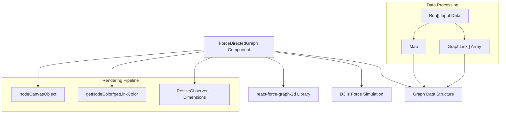
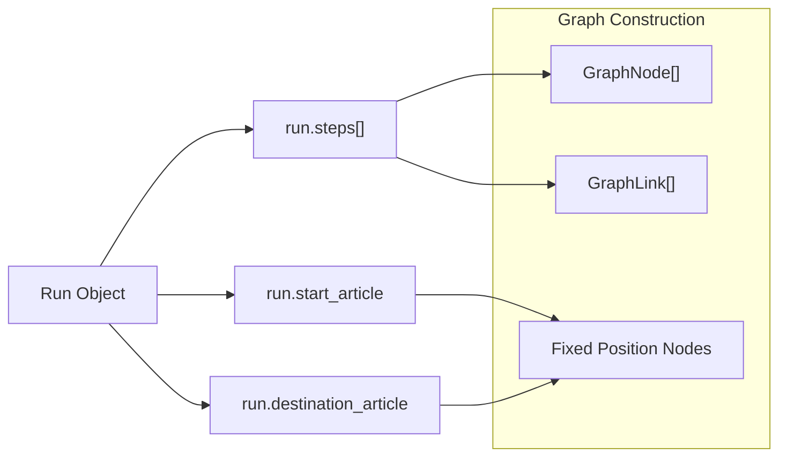
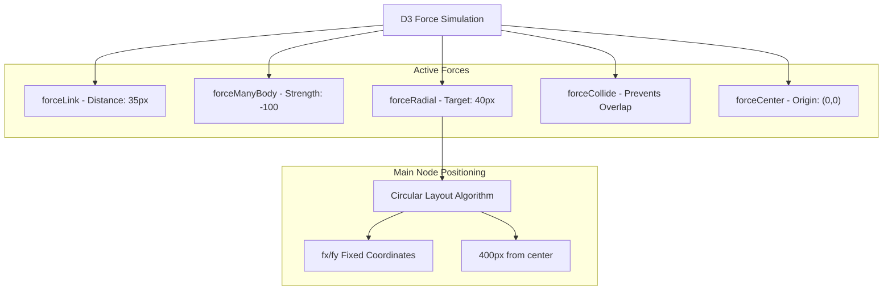
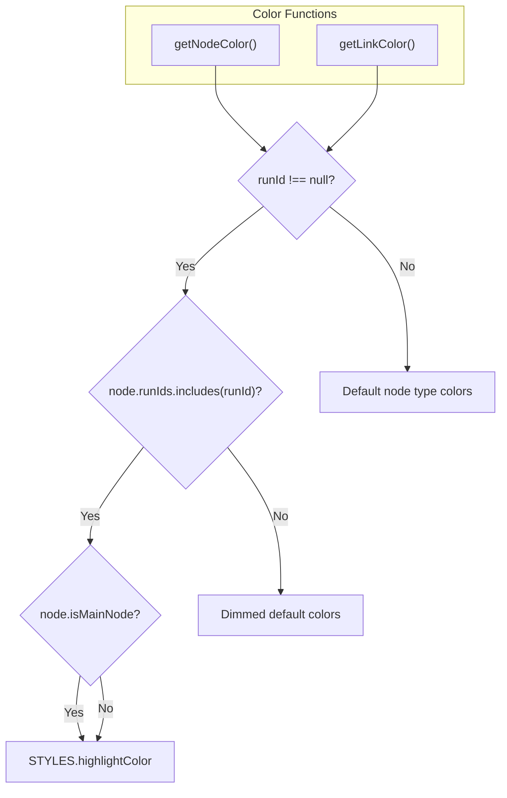
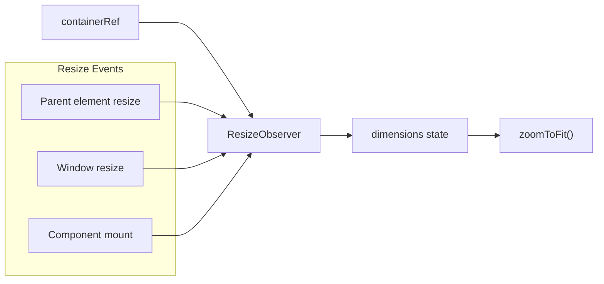
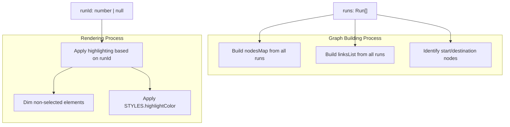

<!-- source: DeepWiki mcp.deepwiki.com · repo huggingface/wikirace-llms · page 4.4 Data Visualization · fetched 2026-10-26 -->

# Data Visualization

Relevant source files

The following files were used as context for generating this wiki page:

- [src/components/force-directed-graph.tsx](src/components/force-directed-graph.tsx)
- [yarn.lock](yarn.lock)

This document covers the force-directed graph visualization system used to display WikiRacing paths and reasoning traces. The visualization component renders interactive network graphs showing how AI models and human players navigate between Wikipedia articles during gameplay.

For information about the broader results viewing interface that hosts this visualization, see [Results Viewer](#4.3). For details about the underlying game data structures, see [Game Interface](#4.2).

## Component Architecture

The data visualization system is built around the `ForceDirectedGraph` component, which uses the react-force-graph-2d library and D3.js for physics-based graph layout and rendering.

### Core Component Structure

Sources: [src/components/force-directed-graph.tsx:1-346]()

### Integration with Run Data

The visualization processes `Run` objects from the reasoning trace system to build graph representations of navigation paths:

Sources: [src/components/force-directed-graph.tsx:104-170]()

## Data Structures

### GraphNode Interface

The `GraphNode` interface extends the base `NodeObject` from react-force-graph with additional metadata for run tracking and visual styling:

| Property | Type | Purpose |
|----------|------|---------|
| `id` | `string` | Article title identifier |
| `type` | `"fixed" \| "fluid"` | Node positioning behavior |
| `radius` | `number` | Visual node size |
| `runIds` | `number[]` | Which runs include this node |
| `isMainNode` | `boolean` | Start/destination article flag |
| `fx`, `fy` | `number` | Fixed position coordinates |

### GraphLink Interface

The `GraphLink` interface represents transitions between articles:

| Property | Type | Purpose |
|----------|------|---------|
| `source` | `string \| GraphNode` | Source article |
| `target` | `string \| GraphNode` | Target article |
| `runId` | `number` | Which run this link belongs to |

Sources: [src/components/force-directed-graph.tsx:30-46]()

## Force Simulation System

The component uses D3.js forces to create a physics-based layout that positions nodes naturally while maintaining readability.

### Force Configuration

The simulation applies multiple forces simultaneously:
- **Link force**: Maintains consistent distances between connected nodes
- **Charge force**: Creates repulsion between nodes to prevent clustering
- **Radial force**: Encourages nodes toward a central region
- **Collision force**: Prevents visual overlap with padding
- **Center force**: Keeps the overall graph centered

Main nodes (start and destination articles) are positioned in a fixed circular pattern around the origin using trigonometric calculations.

Sources: [src/components/force-directed-graph.tsx:172-216]()

## Rendering and Styling

### Visual Styling System

The component uses a predefined color scheme stored in the `STYLES` constant:

| Style Property | Color Code | Usage |
|----------------|------------|-------|
| `fixedNodeColor` | `#e63946` (Red) | Start/destination nodes |
| `fluidNodeColor` | `#457b9d` (Steel Blue) | Intermediate path nodes |
| `linkColor` | `#adb5bd` (Grey) | Default link connections |
| `highlightColor` | `#fca311` (Orange) | Selected run highlighting |
| `minNodeOpacity` | `0.3` | Dimmed nodes not in current run |
| `minLinkOpacity` | `0.15` | Dimmed links not in current run |

### Dynamic Color Logic

Sources: [src/components/force-directed-graph.tsx:14-23](), [src/components/force-directed-graph.tsx:237-266]()

### Custom Canvas Rendering

The component uses custom canvas rendering via the `nodeCanvasObject` function to provide enhanced visual features:

- **Opacity control**: Nodes fade when not part of the selected run
- **Dynamic labeling**: Labels appear for main nodes and highlighted paths
- **Stroke highlighting**: Selected run nodes get colored borders
- **Background labels**: Text labels have white backgrounds for readability

Sources: [src/components/force-directed-graph.tsx:286-334]()

## Interactive Features

### Responsive Layout Management

The visualization adapts to container size changes using a `ResizeObserver`:

### User Interactions

The graph supports standard force-graph interactions:
- **Node dragging**: `enableNodeDrag={true}`
- **Zoom and pan**: `enableZoomInteraction={true}`
- **Auto-fit**: Automatic zoom adjustment after simulation stabilization

Sources: [src/components/force-directed-graph.tsx:60-102](), [src/components/force-directed-graph.tsx:337-341]()

## Integration with Game Data

### Run Selection and Highlighting

The visualization responds to run selection through the `runId` prop, which determines which path is highlighted:

The component builds the complete graph from all runs but only highlights the selected run, allowing users to see the context of other possible paths while focusing on a specific navigation trace.

Sources: [src/components/force-directed-graph.tsx:104-170](), [src/components/force-directed-graph.tsx:237-271]()

---

