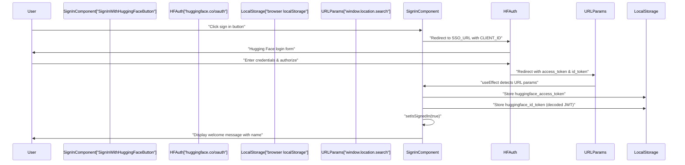
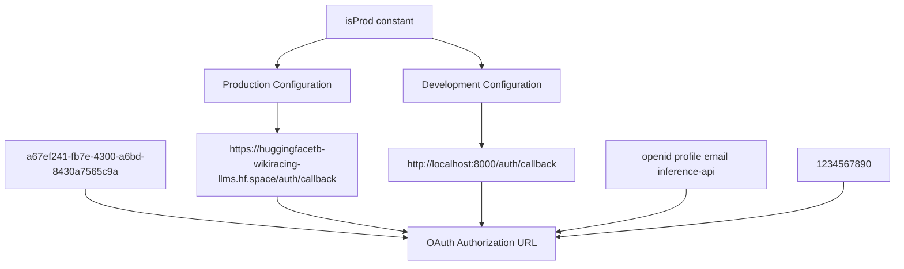
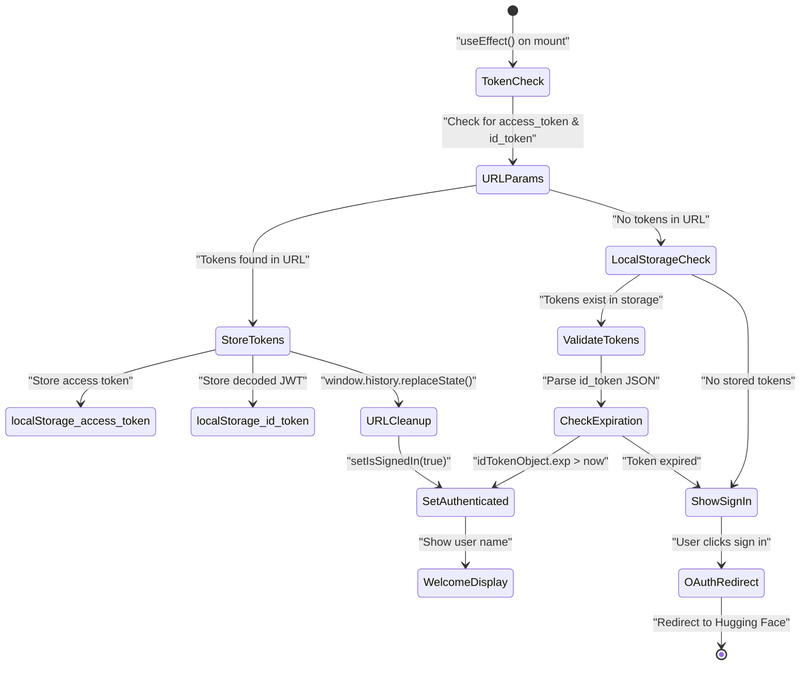

<!-- source: DeepWiki mcp.deepwiki.com · repo huggingface/wikirace-llms · page 4.5 Authentication System · fetched 2026-10-26 -->

# Authentication System

<details>
<summary>Relevant source files</summary>

The following files were used as context for generating this wiki page:

- [src/components/sign-in-with-hf-button.tsx](src/components/sign-in-with-hf-button.tsx)
- [src/lib/constants.ts](src/lib/constants.ts)

</details>


This document covers the Hugging Face OAuth integration that provides user authentication for the WikiRacing LLMs application. The authentication system enables users to securely access AI models through the Hugging Face Inference API and ensures proper authorization for model interactions.

For information about AI model integration and inference, see [AI Model Integration](#6). For backend API authentication patterns, see [REST API](#5.1).

## Purpose and Scope

The authentication system implements OAuth 2.0 authorization code flow with Hugging Face as the identity provider. It manages user sign-in, token storage, session validation, and provides the necessary credentials for accessing Hugging Face's inference APIs. The system operates entirely on the frontend using browser localStorage for token persistence.

## OAuth Flow Implementation

### Authorization Flow Diagram



Sources: [src/components/sign-in-with-hf-button.tsx:1-69]()

### Component State Management

The `SignInWithHuggingFaceButton` component manages three primary states:

| State | Purpose | Storage Location |
|-------|---------|------------------|
| `isSignedIn` | Tracks authentication status | Component state |
| `isLoading` | Shows loading indicator | Component state |
| `name` | User's display name from JWT | Component state |

The component implements automatic session restoration through the `useEffect` hook which checks for existing tokens on component mount.

Sources: [src/components/sign-in-with-hf-button.tsx:17-51]()

## OAuth Configuration

### Environment-Specific Settings



Sources: [src/components/sign-in-with-hf-button.tsx:6-13](), [src/lib/constants.ts:1-2]()

### OAuth Parameters

The system uses the following OAuth 2.0 parameters:

- **Client ID**: `a67ef241-fb7e-4300-a6bd-8430a7565c9a`
- **Scopes**: `openid profile email inference-api`
- **Response Type**: `code` (authorization code flow)
- **State**: `1234567890` (static CSRF protection)
- **Prompt**: `consent` (force consent screen)

The `inference-api` scope is critical as it provides access to Hugging Face's model inference capabilities.

Sources: [src/components/sign-in-with-hf-button.tsx:6-13]()

## Token Management

### Token Lifecycle



Sources: [src/components/sign-in-with-hf-button.tsx:22-51]()

### Token Storage Schema

The system stores two types of tokens in `localStorage`:

| Key | Value Type | Purpose |
|-----|------------|---------|
| `huggingface_access_token` | String | Bearer token for API requests |
| `huggingface_id_token` | JSON String | Decoded JWT containing user info |

The ID token is immediately decoded using `jwtDecode` and stored as a JSON string containing user profile information and expiration timestamp.

Sources: [src/components/sign-in-with-hf-button.tsx:33-34](), [src/components/sign-in-with-hf-button.tsx:4]()

## Component Integration

### Authentication UI States

The `SignInWithHuggingFaceButton` component renders different UI based on authentication state:

1. **Loading State**: Simple loading indicator
2. **Authenticated State**: Welcome message with user's name
3. **Unauthenticated State**: Hugging Face sign-in button with official branding

The component uses Hugging Face's official sign-in badge from their CDN for consistent branding.

Sources: [src/components/sign-in-with-hf-button.tsx:53-68]()

### Session Validation

Token validation occurs through JWT expiration checking:

```typescript
if (idTokenObject.exp > Date.now() / 1000) {
  setIsSignedIn(true);
  setName(idTokenObject.name);
}
```

The system compares the JWT's `exp` claim against the current Unix timestamp to determine token validity.

Sources: [src/components/sign-in-with-hf-button.tsx:43-47]()

## Security Considerations

### URL Parameter Handling

The system immediately cleans OAuth callback parameters from the URL after processing to prevent token exposure in browser history:

```typescript
window.history.replaceState({}, "", window.location.pathname);
```

This ensures sensitive tokens are not persisted in the browser's navigation history.

Sources: [src/components/sign-in-with-hf-button.tsx:31]()

### Token Scope Management

The `inference-api` scope specifically grants access to Hugging Face's model inference endpoints, which is essential for the AI gameplay features. The combination of `openid`, `profile`, and `email` scopes provides user identity information for personalization.

Sources: [src/components/sign-in-with-hf-button.tsx:11]()

---

