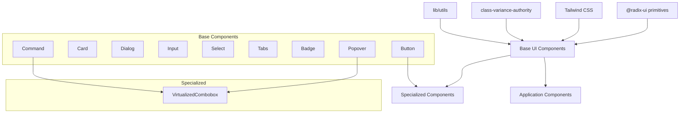
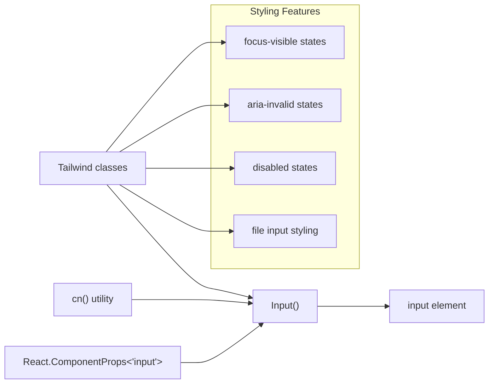
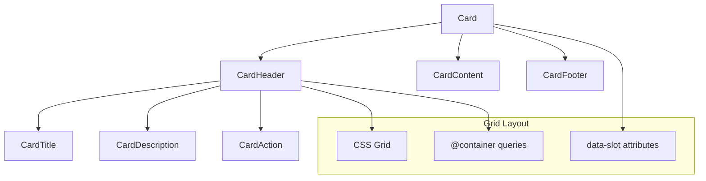
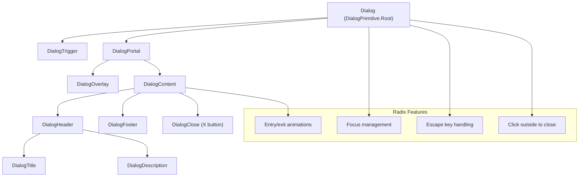
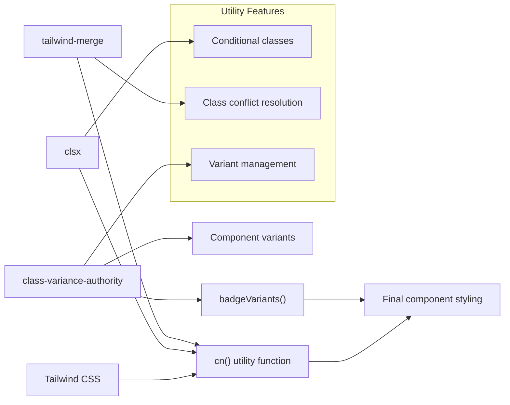
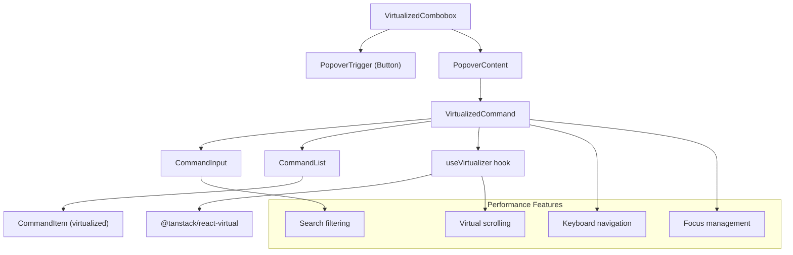
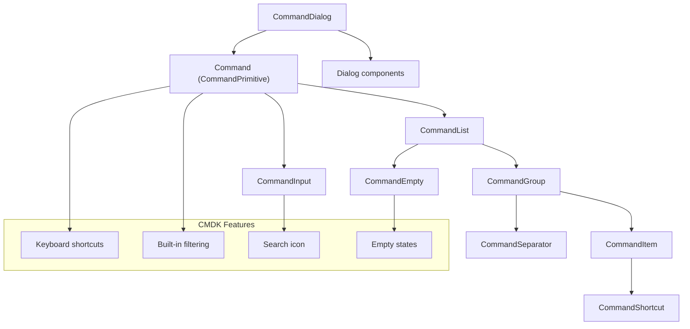
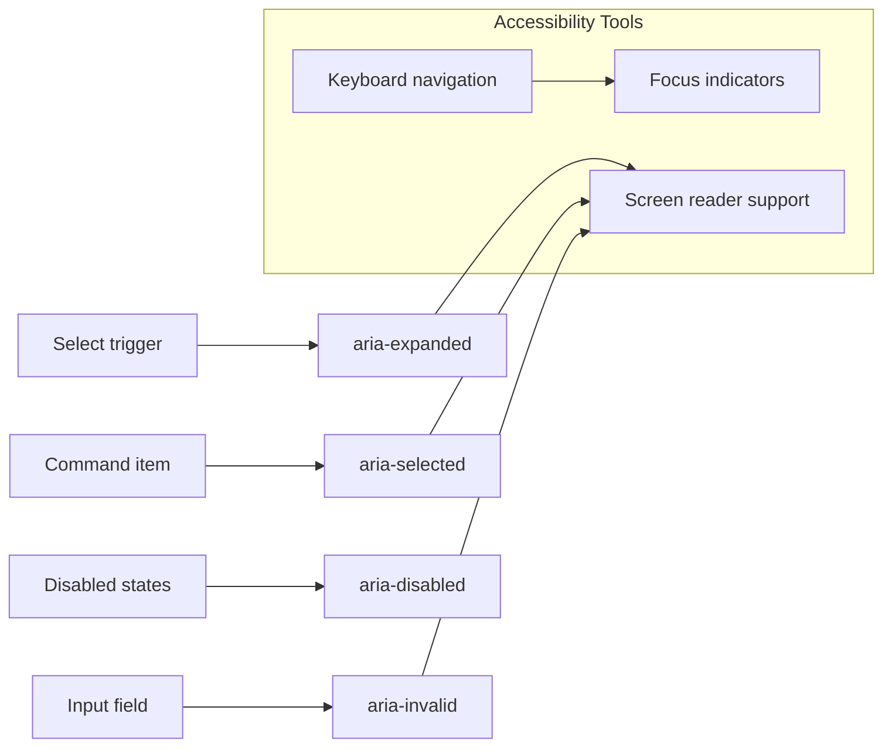

<!-- source: DeepWiki mcp.deepwiki.com · repo huggingface/wikirace-llms · page 4.6 UI Components Library · fetched 2026-10-26 -->

# UI Components Library

<details>
<summary>Relevant source files</summary>

The following files were used as context for generating this wiki page:

- [package-lock.json](package-lock.json)
- [src/components/ui/badge.tsx](src/components/ui/badge.tsx)
- [src/components/ui/card.tsx](src/components/ui/card.tsx)
- [src/components/ui/command.tsx](src/components/ui/command.tsx)
- [src/components/ui/dialog.tsx](src/components/ui/dialog.tsx)
- [src/components/ui/input.tsx](src/components/ui/input.tsx)
- [src/components/ui/popover.tsx](src/components/ui/popover.tsx)
- [src/components/ui/select.tsx](src/components/ui/select.tsx)
- [src/components/ui/tabs.tsx](src/components/ui/tabs.tsx)
- [src/components/ui/virtualized-combobox.tsx](src/components/ui/virtualized-combobox.tsx)

</details>


## Purpose and Scope

This document covers the reusable UI components library that forms the foundation of the WikiRacing LLMs frontend application. The library provides a comprehensive set of accessible, styled components built on top of Radix UI primitives and styled with Tailwind CSS. These components implement the application's design system and provide consistent user interface patterns throughout the application.

For information about how these components are used in specific application features, see [Game Interface](#4.2), [Results Viewer](#4.3), and [Authentication System](#4.5).

## Component Architecture Overview

The UI components library follows a layered architecture with Radix UI primitives as the foundation, custom styling and behavior layers, and specialized components for complex use cases.

**Component Hierarchy and Dependencies**



Sources: [package.json:10-33](), [src/components/ui/virtualized-combobox.tsx:1-18]()

## Component Categories

### Core Input Components

The library provides fundamental input components that handle user interaction and form data collection.

| Component | Purpose | Key Features |
|-----------|---------|--------------|
| `Input` | Text input fields | Focus states, validation styling, accessibility |
| `Select` | Dropdown selection | Keyboard navigation, portal rendering, scroll indicators |
| `VirtualizedCombobox` | Large dataset selection | Virtual scrolling, search, keyboard navigation |
| `Command` | Command palette interface | Keyboard shortcuts, filtering, grouping |

**Input Component Implementation**



Sources: [src/components/ui/input.tsx:5-19]()

### Layout and Container Components

These components provide structure and organization for content display.

**Card Component System**



Sources: [src/components/ui/card.tsx:5-82]()

### Dialog and Overlay Components

Modal and overlay components built on Radix UI primitives with consistent styling and behavior.

**Dialog Component Structure**



Sources: [src/components/ui/dialog.tsx:9-135]()

## Design System Foundations

### Styling Architecture

The components use a sophisticated styling system that combines multiple tools for maintainable and consistent design.

**Styling Tool Chain**



Sources: [src/components/ui/badge.tsx:7-26](), [package.json:21-22](), [package.json:32]()

### Data Slot System

All components implement a consistent `data-slot` attribute system for styling hooks and component identification.

| Component | Data Slot Value | Purpose |
|-----------|----------------|---------|
| `Badge` | `badge` | Badge component identification |
| `Card` | `card` | Main card container |
| `CardHeader` | `card-header` | Card header section |
| `Dialog` | `dialog` | Dialog root element |
| `Input` | `input` | Input field element |
| `Select` | `select` | Select root element |
| `Tabs` | `tabs` | Tabs container |

Sources: [src/components/ui/badge.tsx:39](), [src/components/ui/card.tsx:8](), [src/components/ui/dialog.tsx:12]()

## Advanced Component Features

### Virtualized Combobox

The `VirtualizedCombobox` component handles large datasets efficiently using virtual scrolling from `@tanstack/react-virtual`.

**VirtualizedCombobox Architecture**



Sources: [src/components/ui/virtualized-combobox.tsx:25-51](), [src/components/ui/virtualized-combobox.tsx:194-235]()

### Command Palette Components

The command system provides keyboard-driven interfaces with search and grouping capabilities.

**Command Component Hierarchy**



Sources: [src/components/ui/command.tsx:14-175]()

## Accessibility and User Experience

### Focus Management

All interactive components implement comprehensive focus management following WCAG guidelines.

**Focus Features Implementation**

| Component | Focus Features |
|-----------|---------------|
| `Dialog` | Focus trap, return focus on close |
| `Select` | Keyboard navigation, arrow keys |
| `VirtualizedCombobox` | Virtual focus management, scroll to index |
| `Command` | Search focus, item selection |
| `Tabs` | Tab key navigation, arrow key switching |

### ARIA Support

Components include proper ARIA attributes for screen reader compatibility.

**ARIA Implementation Patterns**



Sources: [src/components/ui/select.tsx:38](), [src/components/ui/input.tsx:13](), [src/components/ui/virtualized-combobox.tsx:211]()

## Performance Optimizations

### Virtual Scrolling

Large datasets are handled efficiently through virtual scrolling implementation.

**Virtual Scrolling Configuration**

```typescript
const virtualizer = useVirtualizer({
  count: filteredOptions.length,
  getScrollElement: () => parentRef.current,
  estimateSize: () => 35,
});
```

### Component Optimization Patterns

| Optimization | Implementation | Components |
|-------------|----------------|------------|
| Virtual scrolling | `@tanstack/react-virtual` | `VirtualizedCombobox` |
| Conditional rendering | React state management | `Command`, `Dialog` |
| CSS containment | Container queries | `Card` components |
| Portal rendering | Radix Portal | `Dialog`, `Select`, `Popover` |

Sources: [src/components/ui/virtualized-combobox.tsx:47-51](), [src/components/ui/card.tsx:23]()

---

