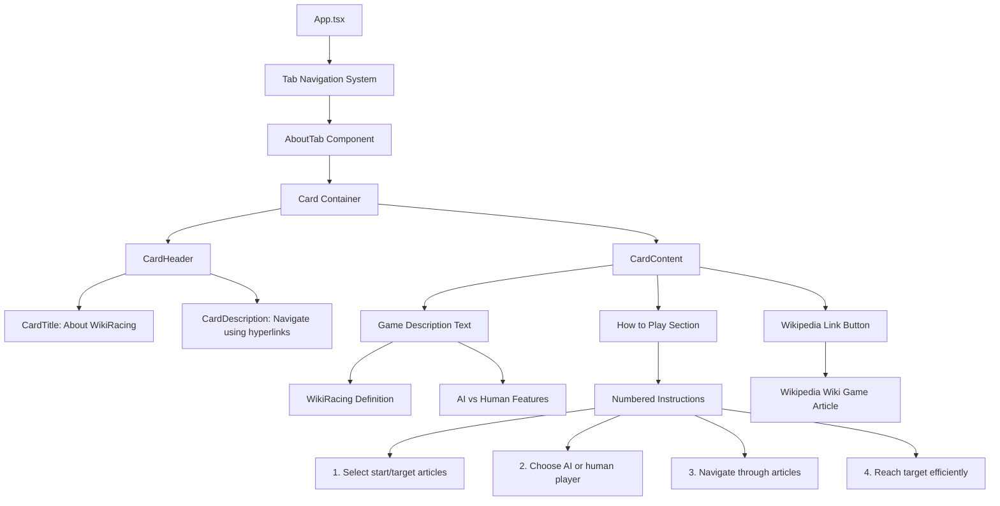
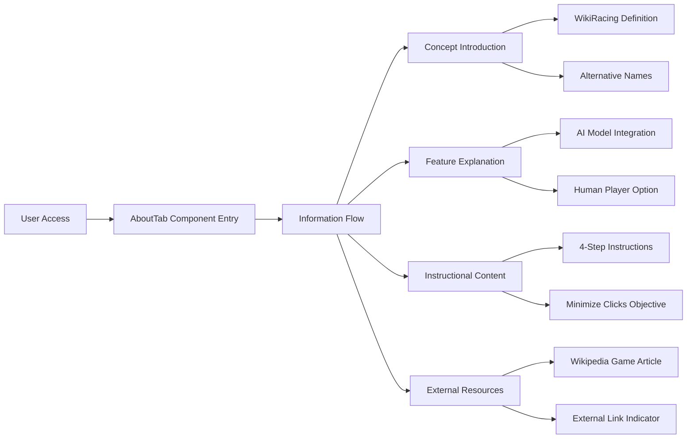
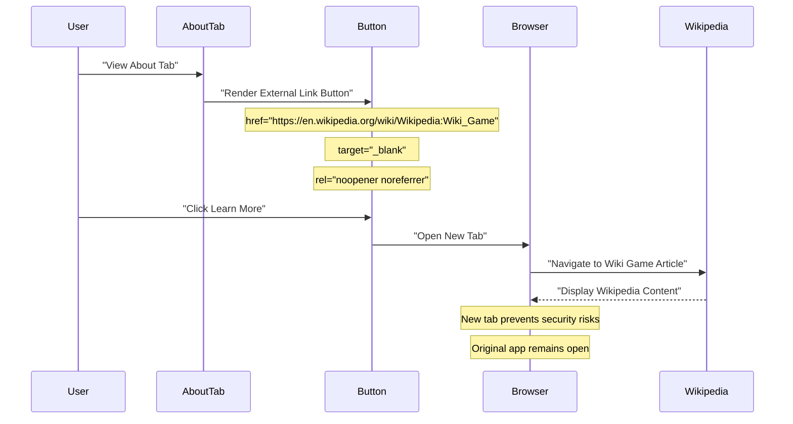
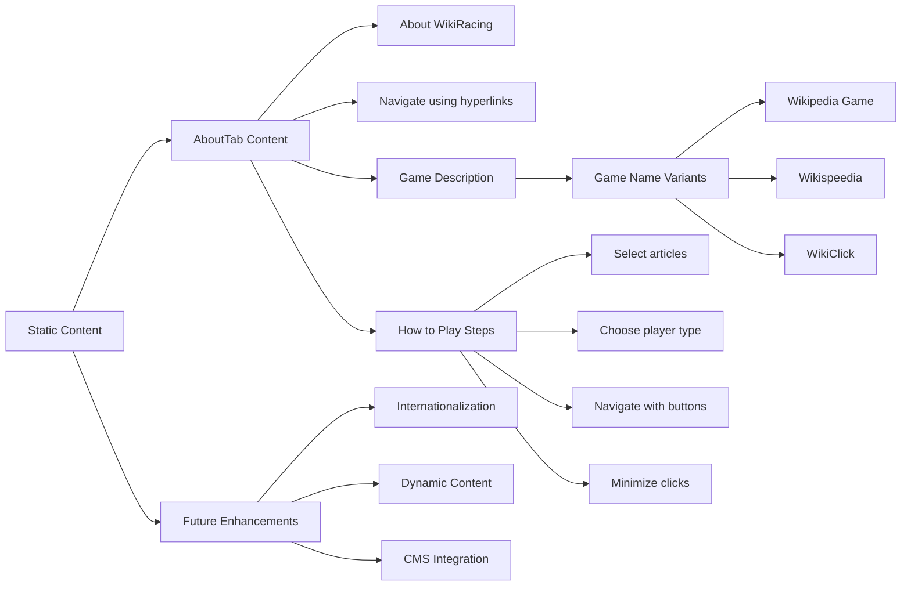

<!-- source: DeepWiki mcp.deepwiki.com · repo huggingface/wikirace-llms · page 4.7 Information Pages · fetched 2026-10-26 -->

# Information Pages

Relevant source files

The following files were used as context for generating this wiki page:

- [results/popular_nodes.json](results/popular_nodes.json)
- [src/components/about-tab.tsx](src/components/about-tab.tsx)

This document covers the static content and informational pages within the WikiRacing LLMs frontend application. These pages provide users with educational content about the game mechanics, rules, and background information. The primary information page is the About tab, which serves as the main educational interface for new users.

For information about interactive game components, see [Game Interface](#4.2). For details about the results analysis interface, see [Results Viewer](#4.3).

## About Tab Implementation

The main information page is implemented as the `AboutTab` component, which provides comprehensive information about WikiRacing gameplay and mechanics. This component serves as the primary educational resource within the application.

**Sources:** [src/components/about-tab.tsx:1-50]()

## Content Structure and Information Architecture

The `AboutTab` component follows a structured information hierarchy designed to progressively introduce users to the WikiRacing concept and gameplay mechanics.

| Section | Purpose | Implementation |
|---------|---------|----------------|
| Header | Game title and tagline | `CardTitle` and `CardDescription` |
| Game Description | Explain WikiRacing concept | Paragraph text with game variants |
| Implementation Features | Highlight AI capabilities | Text describing AI vs human gameplay |
| How to Play | Step-by-step instructions | Numbered list (`ol`) with gameplay steps |
| External Resources | Link to Wikipedia | Button with external link icon |

**Sources:** [src/components/about-tab.tsx:18-44]()

## UI Component Integration

The `AboutTab` component leverages the application's design system through integration with Radix UI components and custom styling.

```mermaid
graph TB
    AboutTab["AboutTab Component"] --> UIComponentLibrary["UI Component Library"]
    
    UIComponentLibrary --> CardComponents["Card Component Family"]
    CardComponents --> Card["@/components/ui/card"]
    CardComponents --> CardContent["CardContent"]
    CardComponents --> CardHeader["CardHeader"]
    CardComponents --> CardTitle["CardTitle"]
    CardComponents --> CardDescription["CardDescription"]
    
    UIComponentLibrary --> ButtonComponent["Button Component"]
    ButtonComponent --> Button["@/components/ui/button"]
    ButtonComponent --> VariantOutline["variant='outline'"]
    ButtonComponent --> GapStyling["className='gap-2'"]
    
    UIComponentLibrary --> IconLibrary["Icon Library"]
    IconLibrary --> LucideReact["lucide-react"]
    IconLibrary --> ExternalLinkIcon["ExternalLink icon"]
    IconLibrary --> IconSize["size={16}"]
    
    UIComponentLibrary --> TailwindCSS["Tailwind CSS Classes"]
    TailwindCSS --> SpaceY6["space-y-6"]
    TailwindCSS --> SpaceY4["space-y-4"]
    TailwindCSS --> TextLg["text-lg"]
    TailwindCSS --> FontSemibold["font-semibold"]
    TailwindCSS --> ListDecimal["list-decimal"]
    TailwindCSS --> PlaceholderLeft["pl-5"]
```

**Sources:** [src/components/about-tab.tsx:4-6](), [src/components/about-tab.tsx:39-43]()

## External Link Handling

The About tab includes proper external link handling with security considerations and user experience enhancements.

The external link implementation includes:
- `target="_blank"` for new tab opening
- `rel="noopener noreferrer"` for security protection
- `ExternalLink` icon for visual indication
- Accessible button styling with outline variant

**Sources:** [src/components/about-tab.tsx:40-42]()

## Content Management and Localization

The current implementation uses hard-coded English content within the component. The content structure supports future internationalization through React's component-based architecture.

**Sources:** [src/components/about-tab.tsx:20-36]()

---

