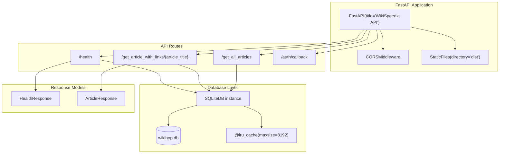
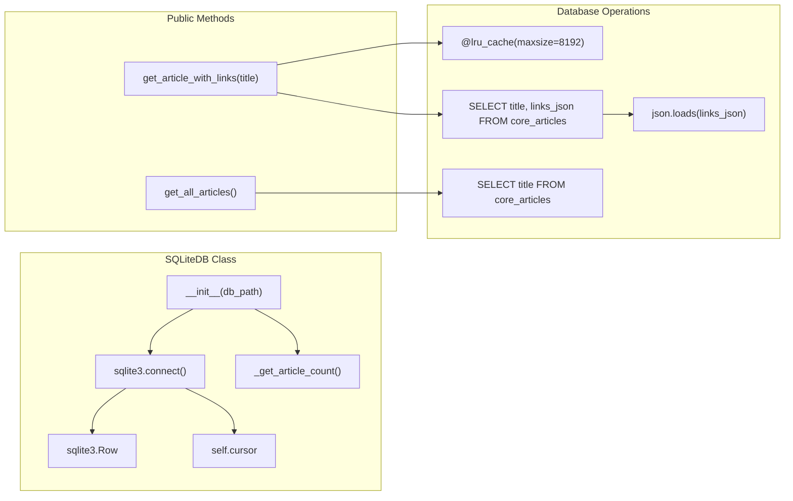
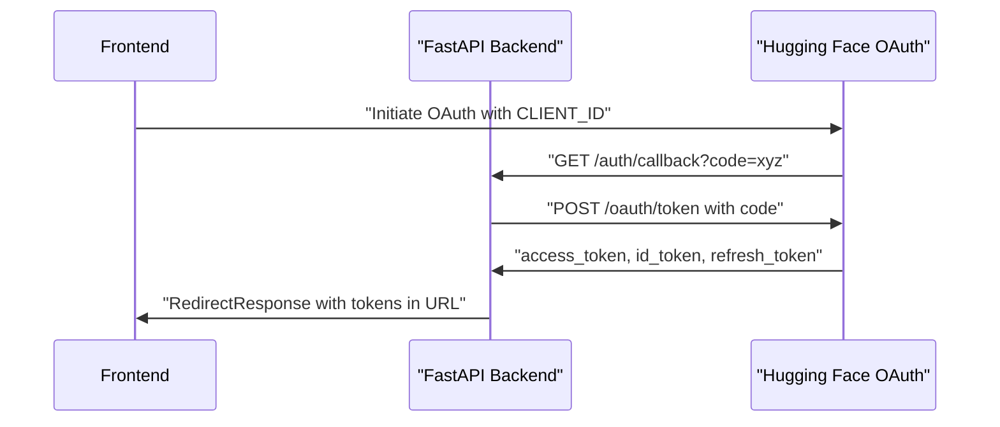

<!-- source: DeepWiki mcp.deepwiki.com · repo huggingface/wikirace-llms · page 5 Backend Services · fetched 2026-10-26 -->

# Backend Services

<details>
<summary>Relevant source files</summary>

The following files were used as context for generating this wiki page:

- [api.py](api.py)
- [requirements.txt](requirements.txt)

</details>


This document covers the FastAPI-based backend services that power the WikiRacing LLMs application. The backend provides REST API endpoints for article data retrieval, handles Hugging Face OAuth authentication, serves static frontend files, and manages database connections to the WikiHop dataset.

For detailed API endpoint documentation, see [REST API](#5.1). For database schema and data access patterns, see [Database Integration](#5.2). For AI model integration that uses these backend services, see [AI Model Integration](#6).

## FastAPI Application Architecture

The backend is built using FastAPI and structured around a single application instance with middleware, route handlers, and database integration. The application serves both API endpoints and static files for the React frontend.

### FastAPI Application Structure



Sources: [api.py:15-24](), [api.py:40-70](), [api.py:147]()

### CORS Configuration

The application is configured with permissive CORS settings to allow frontend access from any origin during development and production deployment.

| Setting | Value | Purpose |
|---------|-------|---------|
| `allow_origins` | `["*"]` | Permits requests from any domain |
| `allow_credentials` | `True` | Enables cookie-based authentication |
| `allow_methods` | `["*"]` | Allows all HTTP methods |
| `allow_headers` | `["*"]` | Permits all request headers |

Sources: [api.py:17-24]()

## Database Integration

The backend uses a custom `SQLiteDB` class to interact with the WikiHop dataset stored in SQLite format. The class provides caching and connection management for efficient article retrieval.

### SQLiteDB Class Architecture



Sources: [api.py:40-70]()

### Database Configuration

The database connection is initialized using an environment variable with a fallback path:

```python
db = SQLiteDB(
    os.getenv("WIKISPEEDIA_DB_PATH", "/Users/jts/daily/wikihop/db/data/wikihop.db")
)
```

The `SQLiteDB` class implements caching using `@lru_cache(maxsize=8192)` on the `get_article_with_links` method to improve performance for frequently accessed articles.

Sources: [api.py:73-75](), [api.py:54]()

## API Endpoints

The backend exposes four main REST endpoints for health monitoring, article retrieval, and authentication handling.

### Endpoint Overview

| Endpoint | Method | Response Model | Purpose |
|----------|--------|----------------|---------|
| `/health` | GET | `HealthResponse` | System health and article count |
| `/get_all_articles` | GET | `List[str]` | All article titles |
| `/get_article_with_links/{article_title}` | GET | `ArticleResponse` | Article with outbound links |
| `/auth/callback` | GET | Redirect | OAuth callback handler |

### Response Models

The API uses Pydantic models for type validation and serialization:

```python
class ArticleResponse(BaseModel):
    title: str
    links: List[str]

class HealthResponse(BaseModel):
    status: str
    article_count: int
```

Sources: [api.py:30-38]()

### Health Check Implementation

The health endpoint returns system status and database article count:

```python
@app.get("/health", response_model=HealthResponse)
async def health_check():
    return HealthResponse(status="healthy", article_count=db._article_count)
```

Sources: [api.py:78-81]()

## OAuth Authentication Flow

The backend handles Hugging Face OAuth authentication through a callback endpoint that exchanges authorization codes for access tokens.

### OAuth Implementation Flow



Sources: [api.py:99-143]()

### OAuth Configuration

The OAuth implementation uses environment-specific configuration:

| Variable | Development | Production |
|----------|-------------|------------|
| `CLIENT_ID` | `a67ef241-fb7e-4300-a6bd-8430a7565c9a` | Same |
| `redirect_uri` | `http://localhost:8000/auth/callback` | `https://huggingfacetb-wikiracing-llms.hf.space/auth/callback` |
| `CLIENT_SECRET` | From `HUGGINGFACE_CLIENT_SECRET` env var | Same |

The callback endpoint exchanges the authorization code for tokens and redirects the user back to the frontend with `access_token` and `id_token` as URL parameters.

Sources: [api.py:26-29](), [api.py:103](), [api.py:119-123](), [api.py:140]()

## Static File Serving

The FastAPI application serves the compiled React frontend through static file mounting:

```python
app.mount("/", StaticFiles(directory="dist", html=True), name="static")
```

This configuration serves all files from the `dist` directory (created by the Vite build process) and enables HTML file serving for client-side routing support.

Sources: [api.py:147]()

## Dependencies and Environment

The backend requires specific Python packages and environment configuration for proper operation.

### Required Dependencies

| Package | Version | Purpose |
|---------|---------|---------|
| `fastapi` | 0.115.12 | Web framework |
| `uvicorn` | 0.34.2 | ASGI server |
| `pydantic` | 2.11.4 | Data validation |
| `requests` | Latest | HTTP client for OAuth |
| `sqlite3` | Built-in | Database connectivity |

### Environment Variables

| Variable | Required | Purpose |
|----------|----------|---------|
| `HUGGINGFACE_CLIENT_SECRET` | Yes | OAuth client secret |
| `VITE_ENV` | No | Environment detection (`production`) |
| `WIKISPEEDIA_DB_PATH` | No | Custom database file path |

Sources: [requirements.txt:1-16](), [api.py:26-28](), [api.py:74]()

### Server Configuration

The application runs using uvicorn with the following configuration:

```python
if __name__ == "__main__":
    uvicorn.run(app, host="0.0.0.0", port=8000)
```

This configuration binds to all network interfaces on port 8000, making it suitable for both local development and containerized deployment.

Sources: [api.py:150-151]()

---

