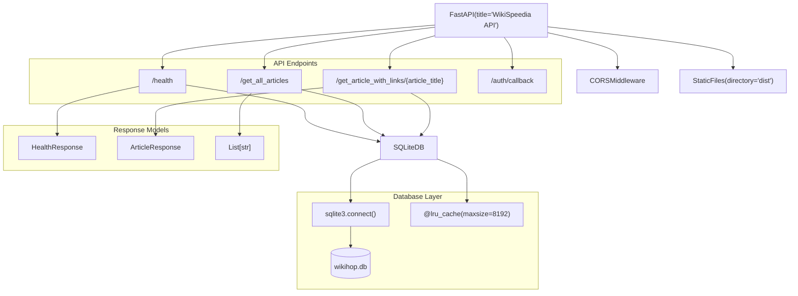
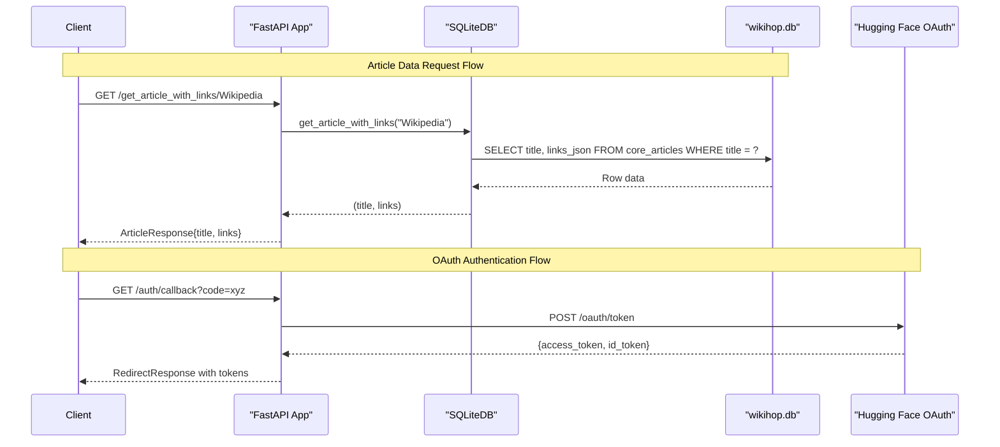
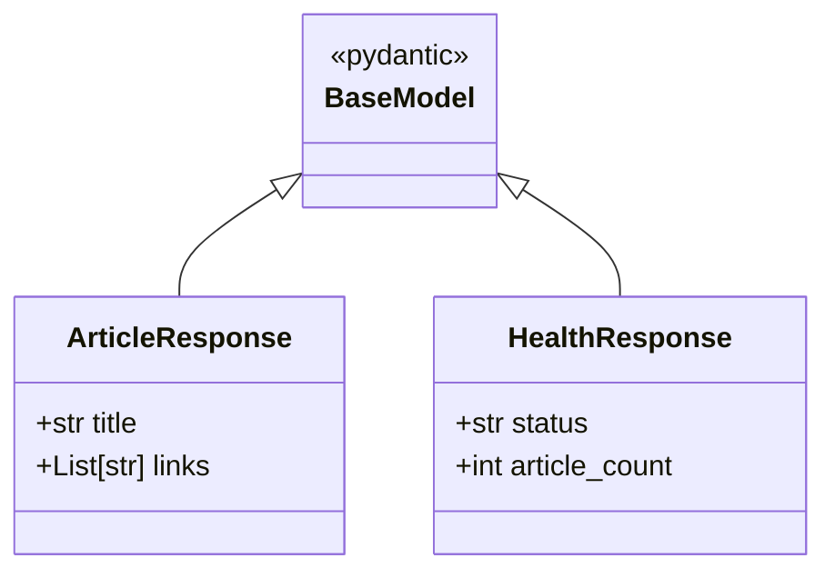
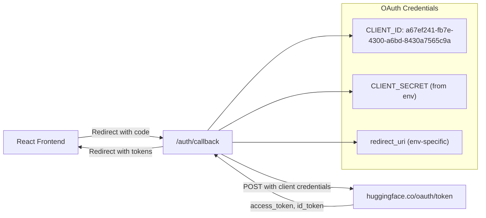

<!-- source: DeepWiki mcp.deepwiki.com · repo huggingface/wikirace-llms · page 5.1 REST API · fetched 2026-10-26 -->

# REST API

<details>
<summary>Relevant source files</summary>

The following files were used as context for generating this wiki page:

- [api.py](api.py)

</details>


## Purpose and Scope

This document covers the FastAPI-based REST API that serves as the backend for the WikiRacing LLMs application. The API provides endpoints for article data access, health monitoring, and OAuth authentication integration. The implementation handles CORS configuration, static file serving, and database connectivity through a custom SQLite wrapper.

For information about the database schema and WikiHop dataset structure, see [Database Integration](#5.2). For details about the AI model integration that consumes these API endpoints, see [AI Model Integration](#6).

## API Architecture

### FastAPI Application Structure



Sources: [api.py:15-151]()

### Request/Response Flow



Sources: [api.py:90-143]()

## API Endpoints

### Health Check Endpoint

| Method | Path | Response Model |
|--------|------|----------------|
| GET | `/health` | `HealthResponse` |

**Response Format:**
```json
{
  "status": "healthy",
  "article_count": 4592
}
```

The health check endpoint returns the database connection status and total article count from the `core_articles` table.

Sources: [api.py:78-81]()

### Article Data Endpoints

#### Get All Articles

| Method | Path | Response Model |
|--------|------|----------------|
| GET | `/get_all_articles` | `List[str]` |

Returns a list of all article titles available in the database.

**Response Format:**
```json
["Wikipedia", "Artificial_intelligence", "Machine_learning", ...]
```

Sources: [api.py:84-87]()

#### Get Article with Links

| Method | Path | Response Model |
|--------|------|----------------|
| GET | `/get_article_with_links/{article_title}` | `ArticleResponse` |

**Path Parameters:**
- `article_title` (string): The title of the Wikipedia article

**Response Format:**
```json
{
  "title": "Wikipedia",
  "links": ["Encyclopedia", "Internet", "Jimmy_Wales", ...]
}
```

**Error Responses:**
- `404 Not Found`: Article not found in database

Sources: [api.py:90-96]()

### Authentication Endpoint

#### OAuth Callback

| Method | Path | Purpose |
|--------|------|---------|
| GET | `/auth/callback` | Handle Hugging Face OAuth callback |

**Query Parameters:**
- `code` (string): Authorization code from Hugging Face OAuth flow

The endpoint exchanges the authorization code for access and ID tokens, then redirects to the frontend with tokens in the URL parameters.

**Redirect Format:**
```
/?access_token={access_token}&id_token={id_token}
```

Sources: [api.py:99-143]()

## Data Models

### Pydantic Response Models



Sources: [api.py:30-38]()

## Database Integration

### SQLiteDB Class

The `SQLiteDB` class provides a database abstraction layer with connection management and caching.

| Method | Purpose | Caching |
|--------|---------|---------|
| `__init__(db_path)` | Initialize database connection | N/A |
| `get_article_with_links(title)` | Fetch article and links | `@lru_cache(maxsize=8192)` |
| `get_all_articles()` | Fetch all article titles | No |
| `_get_article_count()` | Count total articles | No |

**Database Schema Usage:**
- Table: `core_articles`
- Columns: `title`, `links_json`
- JSON parsing: `json.loads(article["links_json"])`

Sources: [api.py:40-70]()

## Configuration and Middleware

### Environment Variables

| Variable | Purpose | Default |
|----------|---------|---------|
| `HUGGINGFACE_CLIENT_SECRET` | OAuth client secret | None |
| `VITE_ENV` | Environment mode | development |
| `WIKISPEEDIA_DB_PATH` | Database file path | `/Users/jts/daily/wikihop/db/data/wikihop.db` |

### CORS Configuration

The API uses permissive CORS settings for development:

```python
CORSMiddleware(
    allow_origins=["*"],
    allow_credentials=True,
    allow_methods=["*"],
    allow_headers=["*"]
)
```

Sources: [api.py:17-24](), [api.py:26-29](), [api.py:73-75]()

## Static File Serving

The FastAPI application serves the built React frontend through a static file mount:

```python
app.mount("/", StaticFiles(directory="dist", html=True), name="static")
```

This configuration serves the production build of the React application from the `dist` directory with HTML fallback for client-side routing.

Sources: [api.py:146-147]()

## OAuth Integration Details

### Hugging Face OAuth Flow



**Environment-Specific Redirect URIs:**
- Development: `http://localhost:8000/auth/callback`
- Production: `https://huggingfacetb-wikiracing-llms.hf.space/auth/callback`

Sources: [api.py:99-143]()

---

