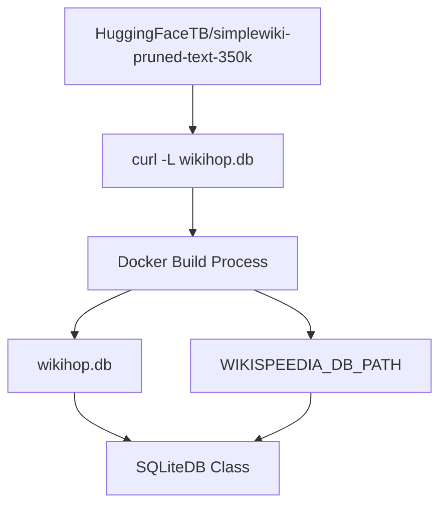
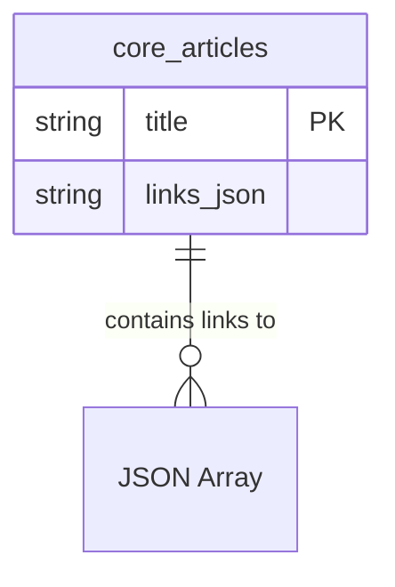
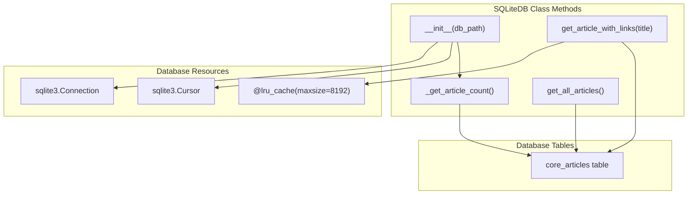
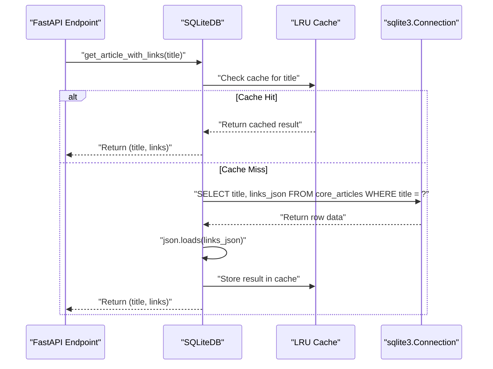
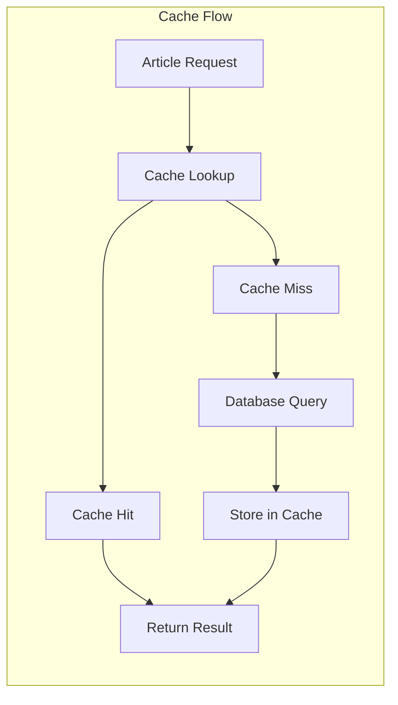

<!-- source: DeepWiki mcp.deepwiki.com · repo huggingface/wikirace-llms · page 5.2 Database Integration · fetched 2026-10-26 -->

# Database Integration

Relevant source files

The following files were used as context for generating this wiki page:

- [Dockerfile](Dockerfile)
- [api.py](api.py)

This document covers the SQLite database integration layer for the WikiRacing LLMs application, including the database schema, data access patterns, and the `SQLiteDB` class implementation. For information about the REST API endpoints that expose database functionality, see [REST API](#5.1). For details about the WikiHop dataset structure and content, see [Model Results and Data](#8).

## Overview

The WikiRacing LLMs system uses a SQLite database named `wikihop.db` that contains a curated subset of Wikipedia articles optimized for the WikiRacing game. The database stores article titles and their outbound links in a denormalized format for efficient retrieval during gameplay.

## Database Source and Deployment

The `wikihop.db` database is hosted on Hugging Face as part of the `HuggingFaceTB/simplewiki-pruned-text-350k` dataset. During Docker container build, the database is downloaded and configured for the application.

**Database Download Process**
The database is downloaded during container build using the Hugging Face token for authentication and stored at the path specified by the `WIKISPEEDIA_DB_PATH` environment variable.

Sources: [Dockerfile:52-58](), [api.py:73-75]()

## Database Schema

The database contains a single primary table `core_articles` with the following structure:

| Column | Type | Description |
|--------|------|-------------|
| `title` | TEXT | Wikipedia article title (primary identifier) |
| `links_json` | TEXT | JSON array of outbound link titles |

The schema is optimized for the WikiRacing use case where rapid lookup of article links is essential for pathfinding algorithms and gameplay.

**JSON Links Format**
The `links_json` column stores an array of article titles as strings, representing all valid outbound links from the current article that exist within the database.

Sources: [api.py:56-65]()

## SQLiteDB Class Implementation

The `SQLiteDB` class provides the database abstraction layer with connection management, caching, and core query operations.

**Key Implementation Details**

The class initializes with row factory configuration for dictionary-style access and maintains an internal article count for health checks.

**Connection Management**
- Uses `sqlite3.Row` factory for named column access
- Maintains persistent connection throughout application lifecycle
- Database path configurable via environment variable

Sources: [api.py:40-75]()

## Data Access Patterns

The application implements two primary data access patterns optimized for different use cases:

### Article Link Retrieval

The `get_article_with_links()` method is the core operation for gameplay, returning both article title and links for pathfinding operations.

### Article List Retrieval

The `get_all_articles()` method provides the complete article inventory for game initialization and article selection interfaces.

Sources: [api.py:54-69]()

## Caching Strategy

The database layer implements LRU (Least Recently Used) caching to optimize performance for frequently accessed articles during gameplay.

**Cache Configuration**
- Maximum size: 8,192 entries
- Applied to: `get_article_with_links()` method only
- Cache key: Article title string

**Cache Effectiveness**
The cache is particularly effective during:
- Repeated AI model evaluations on the same article sets
- User exploration of popular Wikipedia articles
- Breadth-first search algorithms that revisit nodes

Sources: [api.py:54]()

## Database Health Monitoring

The system provides database health monitoring through the `/health` endpoint, which reports connection status and article count.

**Health Check Implementation**
- Article count cached at initialization
- Used for monitoring database integrity
- Exposed via REST API for system monitoring

| Metric | Source | Purpose |
|--------|--------|---------|
| `article_count` | `SELECT COUNT(*) FROM core_articles` | Database integrity verification |
| `status` | Connection state | Service availability |

Sources: [api.py:50-52](), [api.py:78-81]()

## Error Handling

The database layer implements comprehensive error handling for common failure scenarios:

**Article Not Found**
When `get_article_with_links()` receives an invalid title, it returns `(None, [])` rather than raising an exception, allowing the calling code to handle missing articles gracefully.

**Database Connection Issues**
The `SQLiteDB` class assumes a persistent connection model suitable for the single-process FastAPI deployment architecture.

Sources: [api.py:61-62]()

---

