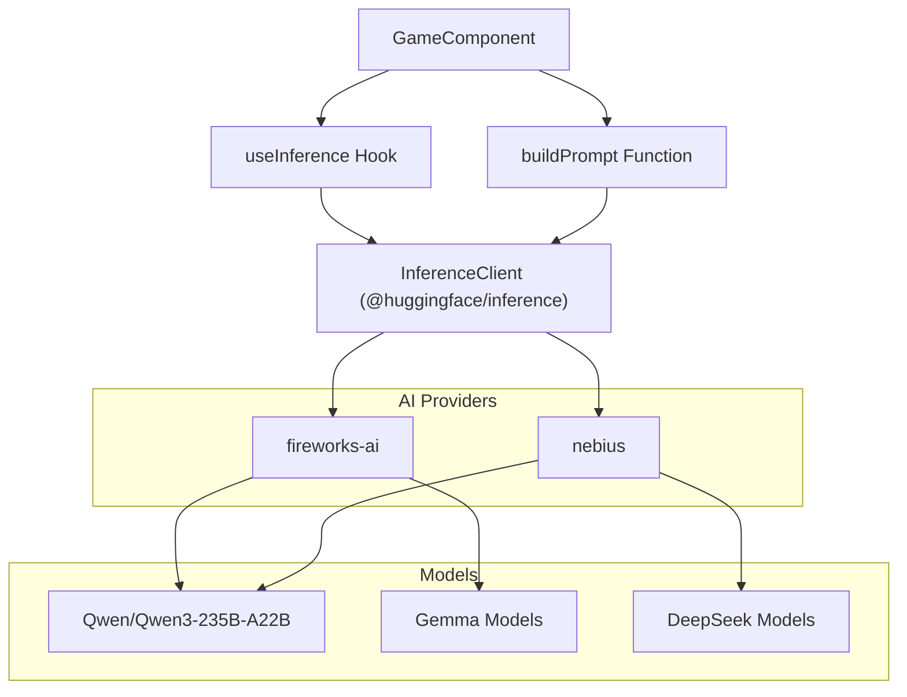
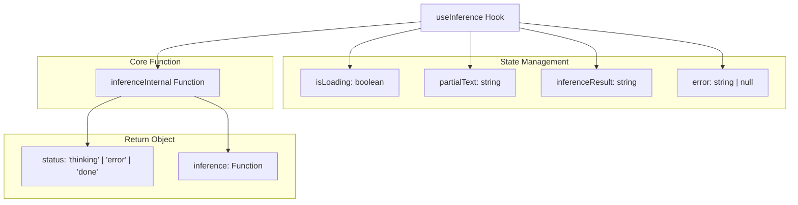
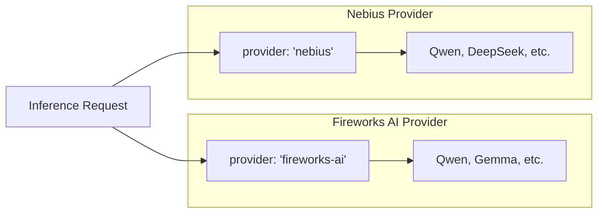
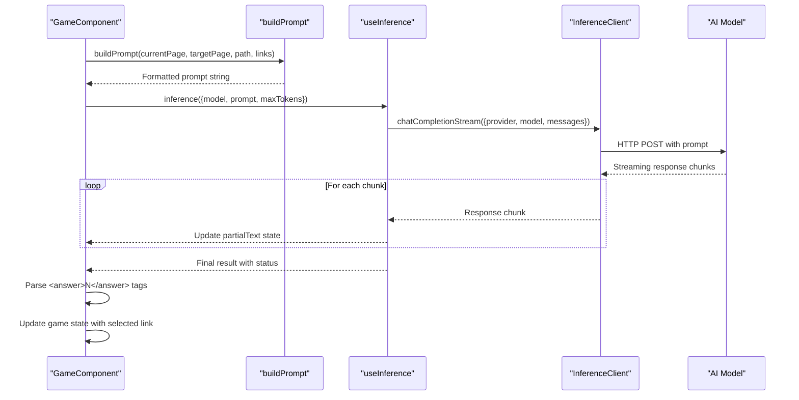
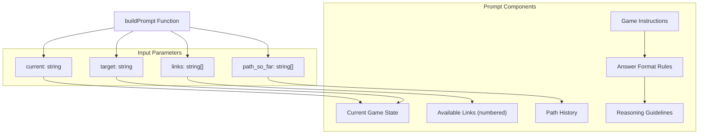
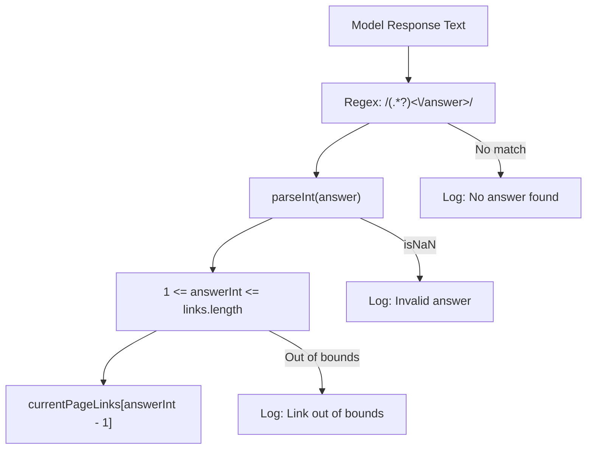
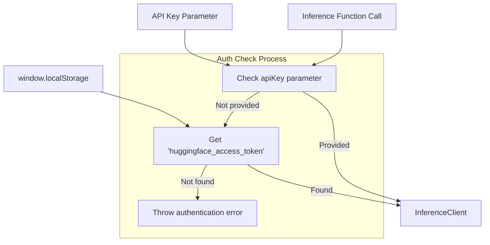
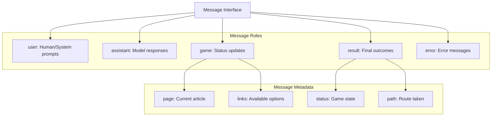

<!-- source: DeepWiki mcp.deepwiki.com · repo huggingface/wikirace-llms · page 6 AI Model Integration · fetched 2026-10-26 -->

# AI Model Integration

Relevant source files

The following files were used as context for generating this wiki page:

- [src/components/game-component.tsx](src/components/game-component.tsx)
- [src/lib/inference.tsx](src/lib/inference.tsx)

## Purpose and Scope

This document covers how the WikiRacing LLMs application integrates with language models to enable automated gameplay. The system provides a complete inference pipeline that allows AI models to play the WikiRacing game by analyzing Wikipedia article content, reasoning about optimal paths, and making navigation decisions.

For information about the game mechanics and user interface, see [Game Interface](#4.2). For details about the evaluation framework that tests models at scale, see [Parallel Evaluation System](#7).

## Architecture Overview

The AI model integration consists of three primary components: the inference client system, the game integration layer, and the prompt engineering pipeline. The system supports multiple AI providers and handles both streaming and non-streaming inference modes.

### Core Integration Architecture

Sources: [src/components/game-component.tsx:1-815](), [src/lib/inference.tsx:1-154]()

## Inference System Implementation

The inference system is built around the `useInference` hook and supporting functions that handle model communication, response streaming, and error management.

### useInference Hook Structure

The `useInference` hook provides a stateful interface for model interactions with the following key features:

| Feature | Description | Implementation |
|---------|-------------|----------------|
| Streaming Support | Real-time response updates | `chatCompletionStream` with async iteration |
| Error Handling | Comprehensive error management | Try-catch blocks with state updates |
| Loading States | Visual feedback during inference | `isLoading` state with derived `status` |
| Partial Results | Progressive text display | `partialText` updated per chunk |

Sources: [src/lib/inference.tsx:92-153]()

### Provider Configuration

The system supports multiple AI providers with different configurations:

The inference functions switch between providers based on configuration:
- **Fireworks AI**: Used in the standalone `inference` function [src/lib/inference.tsx:26-36]()
- **Nebius**: Used in the streaming `useInference` hook [src/lib/inference.tsx:112-122]()

Sources: [src/lib/inference.tsx:4-41](), [src/lib/inference.tsx:92-153]()

## Game Integration Flow

The AI model integration within the game follows a structured flow from user action to model response to game state update.

### Model Move Execution Pipeline

Sources: [src/components/game-component.tsx:218-298]()

### Prompt Construction

The `buildPrompt` function creates structured prompts that guide model behavior:

The prompt structure includes:
- **Game Context**: Current article, target article, and path history
- **Available Actions**: Numbered list of clickable links
- **Response Format**: Strict XML tag requirements `<answer>NUMBER</answer>`
- **Reasoning Instructions**: Guidance for strategic thinking

Sources: [src/components/game-component.tsx:78-105]()

## Response Processing and Validation

The system implements robust response parsing to extract model decisions and handle edge cases.

### Answer Extraction Logic

| Step | Process | Error Handling |
|------|---------|----------------|
| 1. Regex Matching | Extract `<answer>N</answer>` tags | Log error if no match found |
| 2. Integer Parsing | Convert extracted text to number | Log error if `isNaN(answerInt)` |
| 3. Bounds Checking | Validate against available links | Log error if out of bounds |
| 4. Link Selection | Map number to actual link text | Continue with valid selection |

Sources: [src/components/game-component.tsx:254-278]()

## Authentication and Configuration

The AI integration requires proper authentication and configuration management for accessing model APIs.

### Authentication Flow

The authentication system follows this hierarchy:
1. **Function Parameter**: Direct API key passed to inference functions
2. **Local Storage**: Fallback to stored Hugging Face access token
3. **Error State**: Throws error if no authentication available

Sources: [src/lib/inference.tsx:15-21](), [src/components/game-component.tsx:150-152]()

### Model Configuration Parameters

| Parameter | Type | Default | Purpose |
|-----------|------|---------|---------|
| `model` | `string` | `"Qwen/Qwen3-235B-A22B"` | Specifies which AI model to use |
| `maxTokens` | `number` | `512` | Limits response length |
| `apiKey` | `string` | `undefined` | Authentication token |
| `provider` | `string` | `"nebius"` | AI service provider |

Sources: [src/lib/inference.tsx:6-8](), [src/lib/inference.tsx:113-114]()

## Conversation and State Management

The game component maintains detailed conversation logs and manages the interaction state between human players, AI models, and the game system.

### Message Types and Structure

The conversation system tracks all interactions and provides rich context for debugging and analysis. Each message type serves a specific purpose in the game flow and user interface.

Sources: [src/components/game-component.tsx:67-76](), [src/components/game-component.tsx:310-312]()

---

