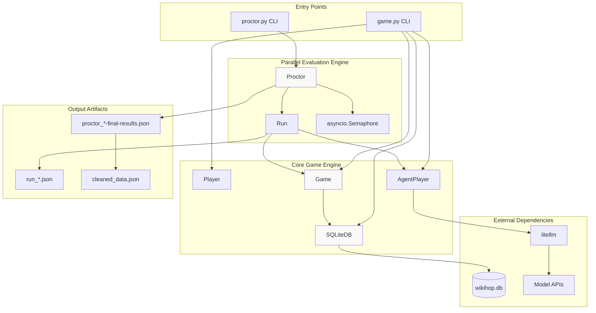
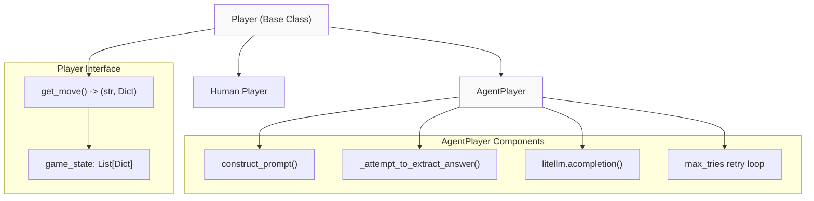
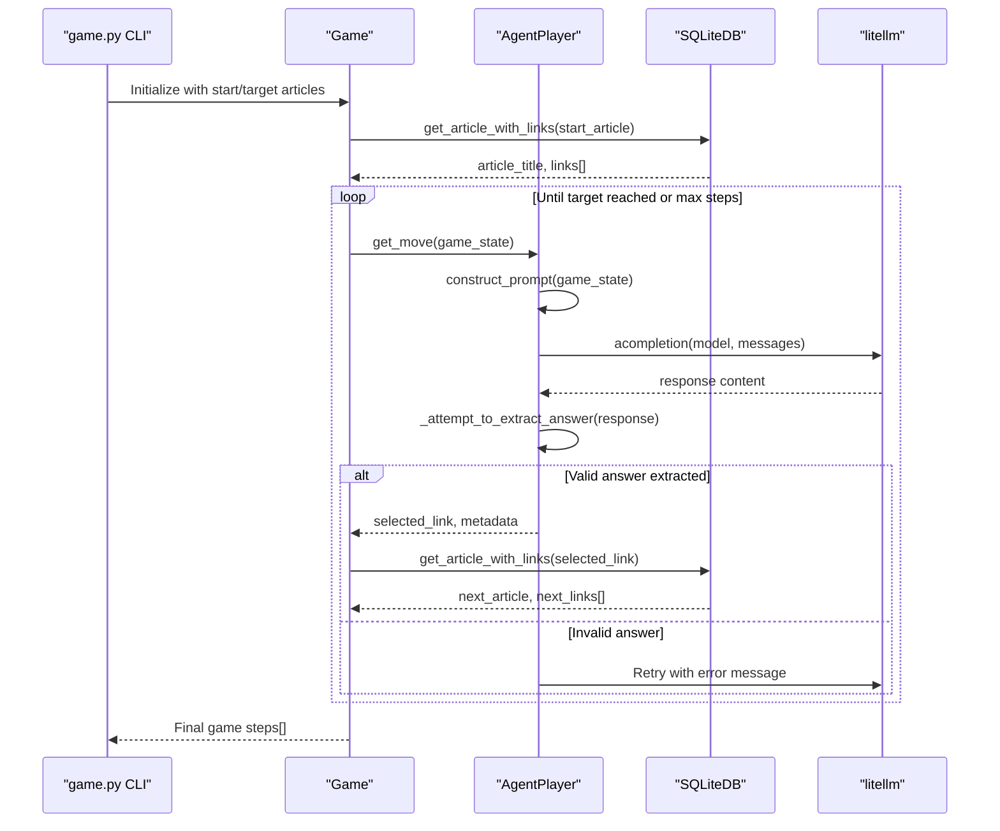
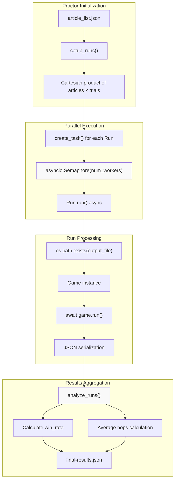

<!-- source: DeepWiki mcp.deepwiki.com · repo huggingface/wikirace-llms · page 7 Parallel Evaluation System · fetched 2026-10-26 -->

# Parallel Evaluation System

<details>
<summary>Relevant source files</summary>

The following files were used as context for generating this wiki page:

- [parallel_eval/README.md](parallel_eval/README.md)
- [parallel_eval/game.py](parallel_eval/game.py)
- [parallel_eval/proctor.py](parallel_eval/proctor.py)
- [parallel_eval/requirements.txt](parallel_eval/requirements.txt)

</details>


The Parallel Evaluation System provides a scalable framework for running large-scale automated evaluations of language models on the WikiRacing task. This system enables researchers to test multiple models across hundreds or thousands of game instances simultaneously, generating comprehensive performance data and reasoning traces for analysis.

For information about the core game mechanics used in evaluations, see [Game Logic](#7.1). For details about the evaluation framework components, see [Evaluation Framework](#7.2). For analyzing model results and data, see [Model Results and Data](#8).

## System Architecture

The parallel evaluation system is built around two main execution modes: single-game testing and large-scale parallel evaluation. The architecture separates game logic from evaluation orchestration, enabling both interactive testing and automated batch processing.



Sources: [parallel_eval/game.py:1-311](), [parallel_eval/proctor.py:1-234](), [parallel_eval/README.md:1-59]()

## Core Components

### Database Access Layer

The `SQLiteDB` class provides cached access to the WikiHop database, implementing an LRU cache for efficient article retrieval during parallel execution.

| Component | Purpose | Key Methods |
|-----------|---------|-------------|
| `SQLiteDB` | Database interface with caching | `get_article_with_links()`, `_get_article_count()` |
| `@lru_cache(maxsize=8192)` | Performance optimization | Caches frequent article lookups |

The database connection is established per-process, with each worker maintaining its own connection pool for thread safety during parallel execution.

Sources: [parallel_eval/game.py:9-35]()

### Player Implementation Hierarchy



The `AgentPlayer` class implements sophisticated prompt construction and response parsing, with built-in retry mechanisms for handling malformed model outputs.

Sources: [parallel_eval/game.py:37-165]()

### Game Orchestration

The `Game` class manages a single WikiRacing session, coordinating between the player, database, and game state tracking.

| Attribute | Type | Purpose |
|-----------|------|---------|
| `start_article` | `str` | Starting Wikipedia article |
| `target_article` | `str` | Destination article |
| `max_allowed_steps` | `int` | Step limit for the game |
| `steps` | `List[Dict]` | Complete game history |
| `player` | `Player` | Human or AI player instance |

The game loop continues until the target is reached, maximum steps are exceeded, or the player encounters an error condition.

Sources: [parallel_eval/game.py:166-249]()

## Execution Workflow

### Single Game Execution



Sources: [parallel_eval/game.py:188-248](), [parallel_eval/game.py:72-103]()

### Parallel Evaluation Execution

The `Proctor` class orchestrates large-scale evaluations using asyncio semaphores to control concurrency and prevent API rate limiting.



Sources: [parallel_eval/proctor.py:8-114](), [parallel_eval/proctor.py:115-180]()

## Configuration and Usage

### Command Line Interface

The system provides two main entry points with comprehensive configuration options:

**Single Game Testing:**
```bash
python game.py --agent --start 'Saint Lucia' --end 'Italy' --db wikihop.db --model gpt-4o --max-steps 20
```

**Parallel Evaluation:**
```bash
python proctor.py --model "hosted_vllm/Qwen/Qwen3-30B-A3B" --api-base "http://localhost:8000/v1" --workers 200
```

| Parameter | game.py | proctor.py | Purpose |
|-----------|---------|------------|---------|
| `--model` | ✓ | ✓ | LiteLLM model identifier |
| `--api-base` | ✓ | ✓ | Custom API endpoint URL |
| `--workers` | ✗ | ✓ | Parallel execution concurrency |
| `--trials` | ✗ | ✓ | Repetitions per article pair |
| `--max-steps` | ✓ | ✓ | Game step limit |
| `--max-tries` | ✓ | ✓ | Agent retry attempts |

Sources: [parallel_eval/game.py:252-273](), [parallel_eval/proctor.py:182-198]()

### Model Integration

The system supports any model compatible with LiteLLM, including:

- **OpenAI models**: `gpt-4o`, `gpt-3.5-turbo`
- **Hosted models**: `hosted_vllm/Qwen/Qwen3-30B-A3B`
- **Anthropic models**: `claude-3-sonnet`
- **Local models**: Via vLLM or other compatible servers

API keys are configured through environment variables (`OPENAI_API_KEY`, `ANTHROPIC_API_KEY`, etc.).

Sources: [parallel_eval/README.md:12-14](), [parallel_eval/requirements.txt:1-5]()

## Output and Analysis

### Individual Run Results

Each game execution produces a detailed JSON file containing the complete reasoning trace:

```json
{
  "model": "gpt-4o",
  "api_base": "https://api.openai.com/v1",
  "start_article": "Saint Lucia",
  "destination_article": "Italy", 
  "steps": [
    {
      "type": "start|move|win|lose",
      "article": "article_name",
      "links": ["link1", "link2"],
      "metadata": {
        "tries": 1,
        "conversation": [...]
      }
    }
  ],
  "result": "win|lose"
}
```

Sources: [parallel_eval/proctor.py:164-177]()

### Aggregated Evaluation Results

The `Proctor.analyze_runs()` method produces comprehensive statistics:

| Metric | Description | Calculation |
|--------|-------------|-------------|
| `win_rate` | Success percentage | `win_count / total_runs` |
| `average_hops` | Mean successful path length | `sum(hops) / successful_runs` |
| `hops_distribution` | Path length frequency | Array of successful game lengths |

### Data Processing Pipeline

For large-scale analysis, reasoning traces can be stripped to reduce file size:

```bash
jq '{article_list, num_trials, runs: [.runs[] | {model, result, steps: [.steps[] | {type, article, metadata: (.metadata | del(.conversation))}]}]}' input.json > cleaned.json
```

This removes the detailed conversation logs while preserving game progression data for visualization.

Sources: [parallel_eval/proctor.py:81-112](), [parallel_eval/README.md:31-59]()

---

