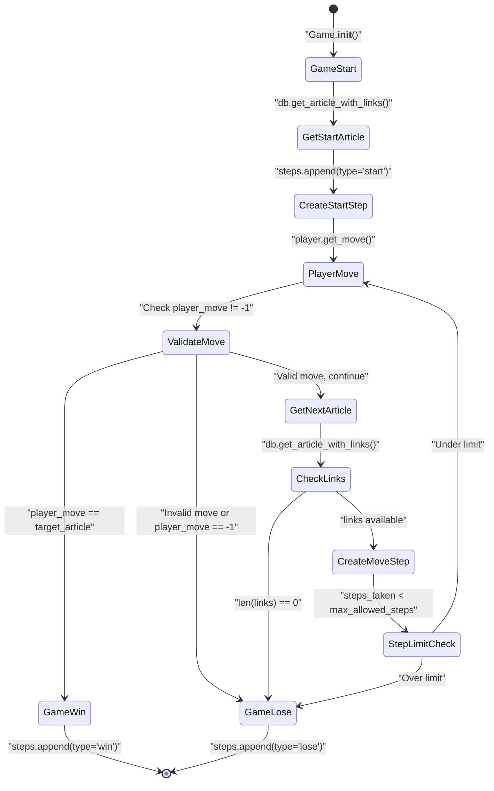
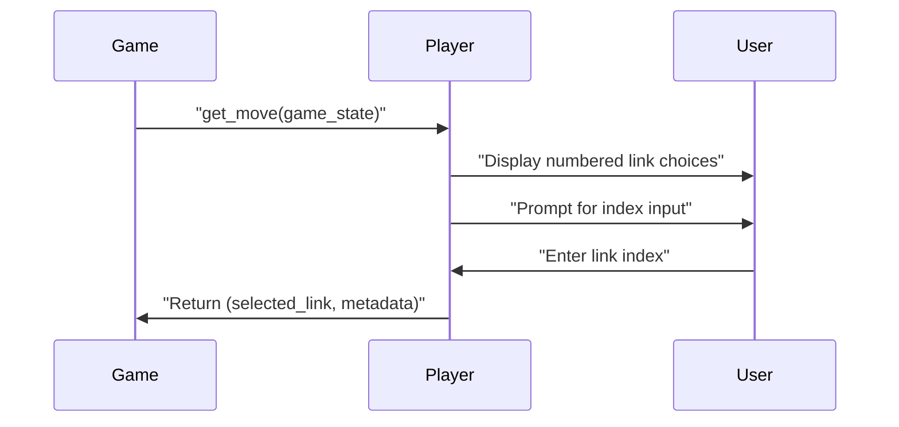
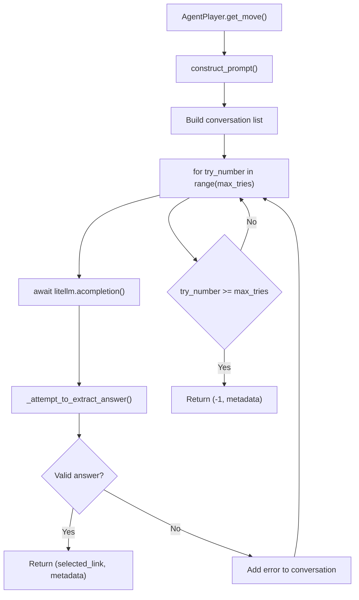
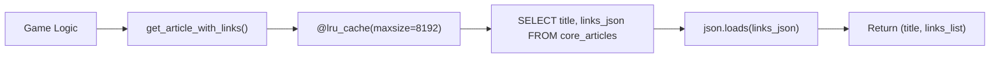

<!-- source: DeepWiki mcp.deepwiki.com · repo huggingface/wikirace-llms · page 7.1 Game Logic · fetched 2026-10-26 -->

# Game Logic

<details>
<summary>Relevant source files</summary>

The following files were used as context for generating this wiki page:

- [parallel_eval/game.py](parallel_eval/game.py)

</details>


This document covers the core game mechanics and player interaction system used in the parallel evaluation framework. The game logic implements a WikiRacing game where players (human or AI) navigate from a starting Wikipedia article to a target article by following links. For information about the broader evaluation framework that orchestrates these games, see [7.2](#7.2).

## Core Components

The game logic is built around four main classes that handle different aspects of the WikiRacing gameplay:

### Database Access Layer

The `SQLiteDB` class provides cached access to Wikipedia article data and links. It maintains a connection to the WikiHop database and uses LRU caching for performance optimization.

### Player System

Two player types are supported:
- `Player` - Interactive human player that prompts for input
- `AgentPlayer` - AI-powered player that uses language models to make decisions

### Game Orchestration

The `Game` class manages game state, enforces rules, and coordinates between players and the database to run complete WikiRacing sessions.

Sources: [parallel_eval/game.py:1-311]()

## Class Architecture

### Core Class Relationships

```mermaid
classDiagram
    class SQLiteDB {
        +db_path: str
        +conn: sqlite3.Connection
        +_article_count: int
        +get_article_with_links(title) Tuple[str, List[str]]
        +_get_article_count() int
    }
    
    class Player {
        +name: str
        +get_move(game_state) Tuple[str, Dict]
    }
    
    class AgentPlayer {
        +model: str
        +api_base: str
        +max_links: int
        +max_tries: int
        +target_article: str
        +seed: int
        +get_move(game_state) Tuple[str, Dict]
        +construct_prompt(game_state) str
        +_attempt_to_extract_answer(response, max) Tuple[int, str]
    }
    
    class Game {
        +start_article: str
        +target_article: str
        +db: SQLiteDB
        +max_allowed_steps: int
        +steps: List[Dict]
        +steps_taken: int
        +player: Player
        +run() List[Dict]
    }
    
    Player <|-- AgentPlayer
    Game --> SQLiteDB
    Game --> Player
    AgentPlayer --> "litellm" : uses
```

Sources: [parallel_eval/game.py:9-35](), [parallel_eval/game.py:37-50](), [parallel_eval/game.py:52-104](), [parallel_eval/game.py:166-187]()

## Game State Structure

### Game Step Format

Each step in the game is represented as a dictionary with standardized fields:

| Field | Type | Description |
|-------|------|-------------|
| `type` | str | Step type: "start", "move", "win", or "lose" |
| `article` | str | Current article title |
| `links` | List[str] | Available outbound links (if applicable) |
| `metadata` | Dict | Additional step-specific information |

### Game State Progression



Sources: [parallel_eval/game.py:188-248]()

## Player Types and Move Selection

### Human Player Interaction

The base `Player` class implements interactive gameplay where users select links by entering numeric indices:



Sources: [parallel_eval/game.py:37-50]()

### AI Agent Decision Process

The `AgentPlayer` uses language models to make strategic move decisions through a structured prompt-response cycle:



Sources: [parallel_eval/game.py:72-103](), [parallel_eval/game.py:105-136](), [parallel_eval/game.py:138-164]()

## Prompt Engineering for AI Players

### Prompt Structure

The AI agent receives a structured prompt containing:

- Current and target article titles
- Numbered list of available links
- Complete path taken so far
- Instructions for answer formatting using XML tags

### Answer Extraction

The system uses regex pattern matching to extract decisions from model responses:

| Pattern | Purpose |
|---------|---------|
| `<answer>(\d+)</answer>` | Extract link selection number |
| Multiple answer detection | Reject ambiguous responses |
| Range validation | Ensure selection is within available options |

Sources: [parallel_eval/game.py:105-136](), [parallel_eval/game.py:138-164]()

## Database Integration

### Article Retrieval

The `SQLiteDB` class provides optimized access to Wikipedia article data:



### Caching Strategy

- LRU cache with 8192 entry limit for frequently accessed articles
- JSON deserialization of link data on cache miss
- Row factory configuration for convenient field access

Sources: [parallel_eval/game.py:9-35]()

## Game Termination Conditions

The game can end in several ways:

| Condition | Step Type | Trigger |
|-----------|-----------|---------|
| Success | `"win"` | Player reaches target article |
| Step limit | `"lose"` | Exceeds `max_allowed_steps` |
| No links | `"lose"` | Current article has no outbound links |
| Invalid move | `"lose"` | Player returns -1 (AI failure) |
| Agent failure | `"lose"` | AI agent exceeds `max_tries` |

Sources: [parallel_eval/game.py:206-247]()

## Command Line Interface

The game logic supports both human and AI gameplay through command line arguments:

### Player Selection
- `--human`: Interactive human player mode
- `--agent`: AI agent player mode

### Game Configuration
- `--start`, `--end`: Article titles for start and target
- `--db`: Path to SQLite database file
- `--max-steps`: Maximum allowed game steps

### AI Agent Parameters
- `--model`: Language model identifier
- `--api-base`: API endpoint URL
- `--max-tries`: Retry limit for invalid responses
- `--seed`: Random seed for reproducibility

Sources: [parallel_eval/game.py:251-311]()

---

