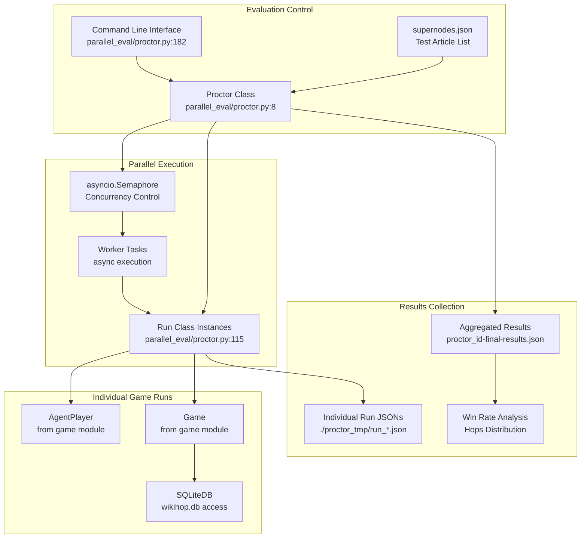
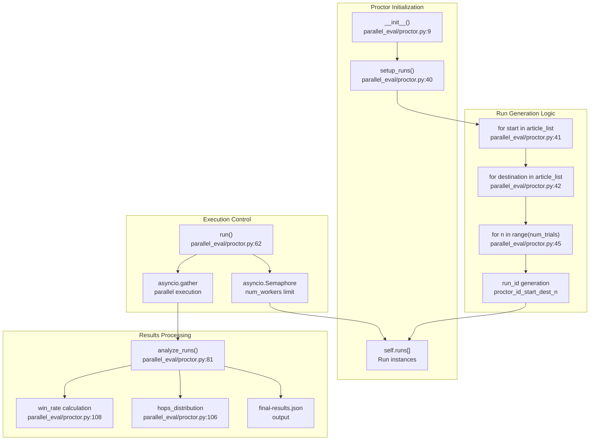
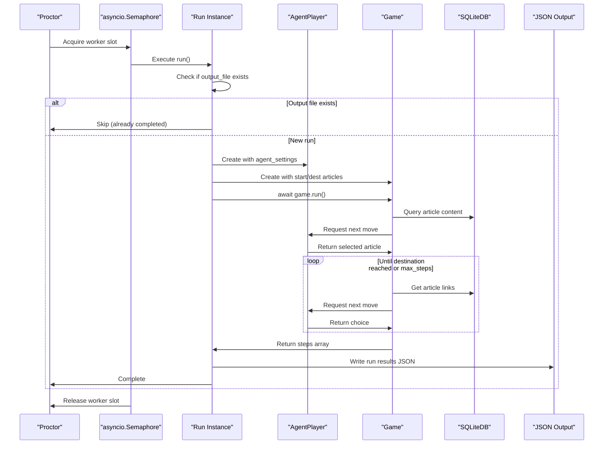

<!-- source: DeepWiki mcp.deepwiki.com · repo huggingface/wikirace-llms · page 7.2 Evaluation Framework · fetched 2026-10-26 -->

# Evaluation Framework

<details>
<summary>Relevant source files</summary>

The following files were used as context for generating this wiki page:

- [parallel_eval/proctor.py](parallel_eval/proctor.py)
- [parallel_eval/supernodes.json](parallel_eval/supernodes.json)

</details>


## Purpose and Scope

The evaluation framework provides a systematic approach for running large-scale automated evaluations of AI models on WikiRacing tasks. This system orchestrates parallel execution of hundreds or thousands of individual game runs to measure model performance across different article pairs and configurations.

The framework is centered around the `Proctor` class in [parallel_eval/proctor.py](), which manages concurrent evaluation runs and aggregates results. For information about the core game mechanics used within each evaluation run, see [Game Logic](#7.1). For details about AI model integration and agent behavior, see [AI Model Integration](#6).

## System Overview

The evaluation framework operates as a distributed testing harness that spawns multiple concurrent game instances, each testing an AI model's ability to navigate from one Wikipedia article to another.

### Evaluation Framework Architecture



*Sources: [parallel_eval/proctor.py:1-233](), [parallel_eval/supernodes.json:1-19]()*

## Proctor Architecture

The `Proctor` class serves as the central orchestrator for large-scale evaluations. It manages the creation of evaluation runs, controls concurrency, and aggregates results.

### Proctor Class Components



*Sources: [parallel_eval/proctor.py:8-113]()*

## Run Execution Process

Each individual evaluation is handled by a `Run` instance, which creates an `AgentPlayer` and executes a complete game from start to destination article.

### Individual Run Workflow



*Sources: [parallel_eval/proctor.py:140-180]()*

## Configuration Parameters

The evaluation framework accepts numerous configuration parameters to control model behavior, execution constraints, and output handling.

### Core Configuration Options

| Parameter | Type | Default | Description |
|-----------|------|---------|-------------|
| `model` | str | "gpt-4o" | Model identifier for agent |
| `api_base` | str | None | API base URL for hosted models |
| `workers` | int | 20 | Number of parallel workers |
| `trials` | int | 1 | Trials per start-destination pair |
| `max_steps` | int | 20 | Maximum steps per game |
| `max_links` | int | 200 | Maximum links per page for agent |
| `max_tries` | int | 3 | Maximum retries for agent |
| `db_path` | str | "wikihop.db" | Path to wikihop database |
| `output_dir` | str | "./proctor_tmp" | Directory for output files |
| `proctor_id` | str | "proctor_1" | Unique identifier for run |
| `seed` | int | 42 | Starting random seed |
| `article_list` | str | "supernodes.json" | Path to article list JSON |

*Sources: [parallel_eval/proctor.py:183-198]()*

### Agent Settings Structure

The `agent_settings` dictionary passed to each `Run` contains model-specific configuration:

```python
agent_settings = {
    "model": args.model,
    "api_base": args.api_base,
    "max_links": args.max_links,
    "max_tries": args.max_tries,
}
```

*Sources: [parallel_eval/proctor.py:213-218]()*

## Results Analysis

The framework automatically analyzes completed runs and generates comprehensive statistics about model performance.

### Results Data Structure

Each individual run produces a JSON file with the following structure [parallel_eval/proctor.py:164-177]():

```json
{
    "model": "gpt-4o",
    "api_base": null,
    "max_links": 200,
    "max_tries": 3,
    "start_article": "Soviet Union",
    "destination_article": "France",
    "steps": [...],
    "seed": 42,
    "result": "win"
}
```

### Aggregated Analytics

The `analyze_runs()` method [parallel_eval/proctor.py:81-112]() computes several key metrics:

- **Win Rate**: Percentage of successful navigations
- **Average Hops**: Mean number of steps for successful runs
- **Hops Distribution**: Array of step counts for all wins
- **Lose Rate**: Percentage of failed attempts

*Sources: [parallel_eval/proctor.py:81-112]()*

## Article Test Sets

The framework uses predefined sets of Wikipedia articles for consistent evaluation across different models and configurations.

### Supernodes Configuration

The default test set in `supernodes.json` contains 17 diverse Wikipedia articles:

| Article | Category |
|---------|----------|
| Soviet Union | Historical Entity |
| Frank Lloyd Wright | Person (Architect) |
| Major League Baseball | Sports Organization |
| R (programming language) | Technology |
| Hinduism | Religion |
| Singapore General Hospital | Institution |
| Nepenthes | Biology |
| Google AI | Technology Company |
| Freedom, Pennsylvania | Geographic Location |
| Iron Man 3 | Entertainment |
| Central Bank of Nigeria | Financial Institution |
| Pokémon | Entertainment Franchise |
| Nintendo | Technology Company |
| Bachelor of Arts | Academic Degree |
| Polynesian languages | Linguistics |
| France | Country |
| Jennifer Aniston | Person (Actor) |

*Sources: [parallel_eval/supernodes.json:1-19]()*

## Usage Examples

The evaluation framework is typically invoked from the command line with specific model and execution parameters.

### Basic Evaluation Command

```bash
python parallel_eval/proctor.py \
    --model "gpt-4o" \
    --workers 10 \
    --trials 3 \
    --max-steps 25 \
    --article-list "supernodes.json"
```

### Custom Model Evaluation

```bash
python parallel_eval/proctor.py \
    --model "custom-model" \
    --api-base "https://api.example.com/v1" \
    --workers 5 \
    --trials 1 \
    --max-links 100 \
    --output-dir "./custom_results" \
    --proctor-id "custom_eval_1"
```

*Sources: [parallel_eval/proctor.py:182-233]()*

---

