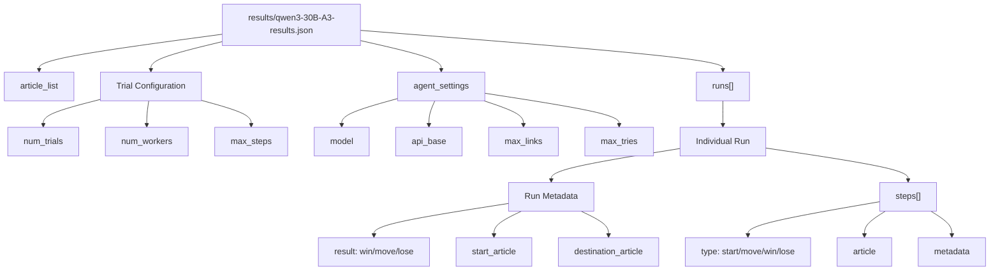
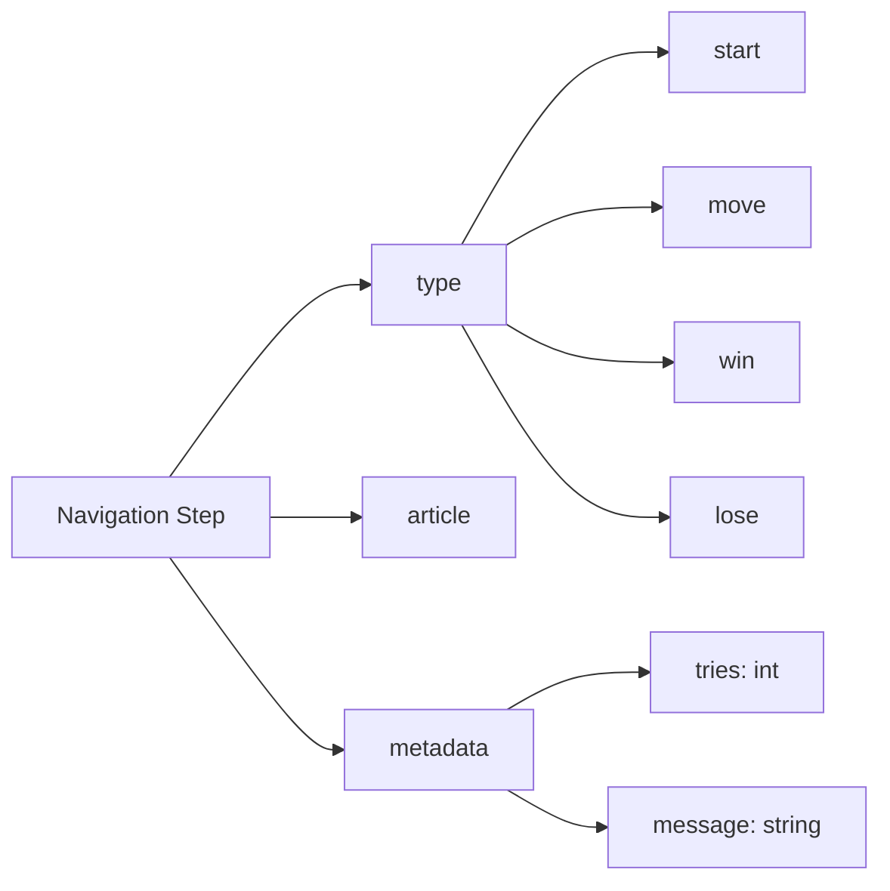
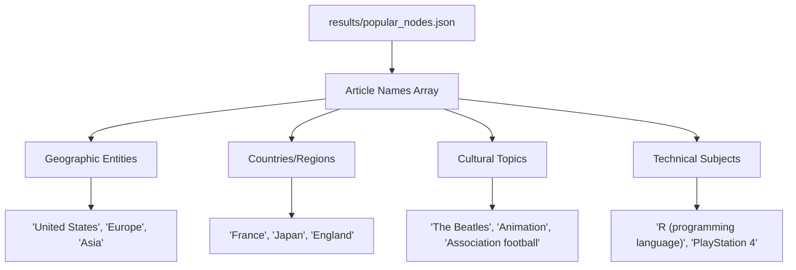
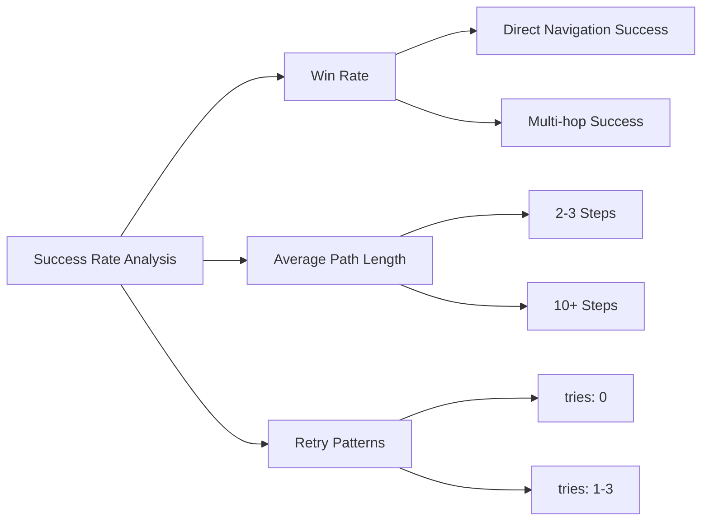
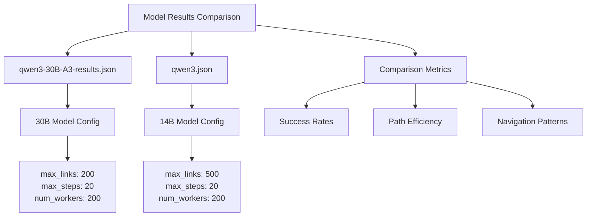
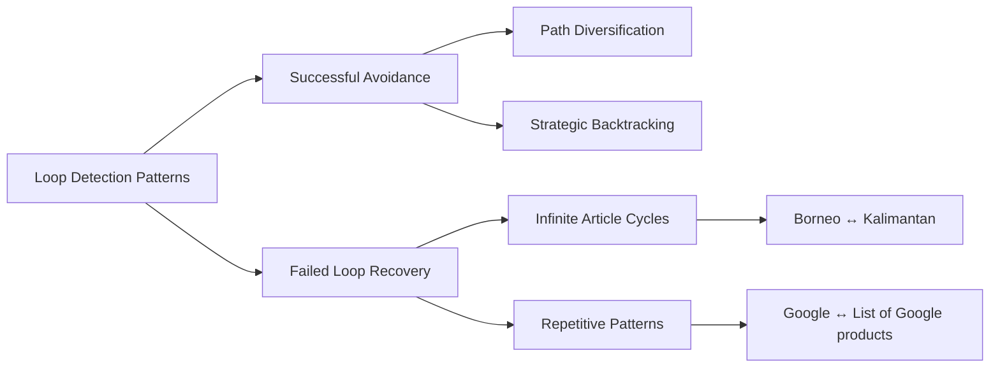
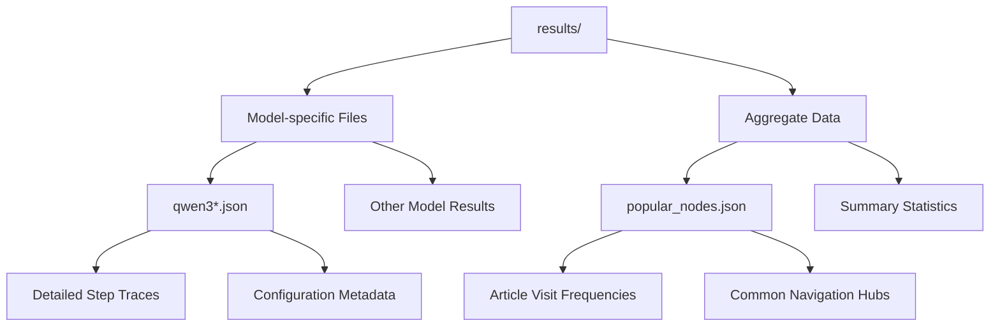

<!-- source: DeepWiki mcp.deepwiki.com · repo huggingface/wikirace-llms · page 8 Model Results and Data · fetched 2026-10-26 -->

# Model Results and Data

Relevant source files

The following files were used as context for generating this wiki page:

- [results/popular_nodes.json](results/popular_nodes.json)
- [results/qwen3-30B-A3-results.json](results/qwen3-30B-A3-results.json)
- [results/qwen3.json](results/qwen3.json)
- [src/components/about-tab.tsx](src/components/about-tab.tsx)

This document describes the structure, format, and analysis of model evaluation results in the WikiRacing LLMs system. It covers how evaluation data is collected, stored, and interpreted to assess model performance in Wikipedia navigation tasks.

For information about the evaluation framework that generates this data, see [Evaluation Framework](#7.2). For details about the game mechanics being evaluated, see [Game Logic](#7.1).

## Results Data Structure

The system stores evaluation results in JSON format with a standardized schema that captures both aggregate statistics and detailed step-by-step traces of model navigation behavior.

### Primary Results Schema

**Results File Structure**

Sources: [results/qwen3-30B-A3-results.json:1-50](), [results/qwen3.json:1-50]()

### Run Outcome Classification

The evaluation system classifies each navigation attempt into three categories:

| Result Type | Description | Example |
|-------------|-------------|---------|
| `"win"` | Successfully reached target article | Soviet Union → Frank Lloyd Wright in 3 steps |
| `"move"` | Reached maximum steps without success | Stuck in navigation loops |
| `"lose"` | Failed to find valid links after max retries | Model output parsing failures |

### Step Trace Format

Each navigation step is recorded with detailed metadata:

**Step Types and Metadata**

Sources: [results/qwen3-30B-A3-results.json:40-70](), [results/qwen3.json:43-69]()

## Popular Navigation Nodes

The system tracks frequently visited Wikipedia articles to identify common navigation hubs and patterns.

### Node Popularity Data

**Popular Node Categories**

The data reveals several categories of highly-trafficked articles:

- **Geographic hubs**: Major countries, continents, and regions
- **Cultural landmarks**: Famous bands, movies, sports
- **Technical topics**: Programming languages, software platforms
- **Institutional entities**: Universities, organizations, government bodies

Sources: [results/popular_nodes.json:1-10]()

## Performance Metrics Analysis

### Success Rate Patterns

**Key Performance Indicators**

From the evaluation data, several performance patterns emerge:

1. **Navigation Efficiency**: Successful runs typically complete in 2-10 steps
2. **Retry Behavior**: Models often succeed on first attempt (`tries: 0`) for direct paths
3. **Loop Detection**: Failed runs show repeated article transitions
4. **Target Specificity**: Some destinations (e.g., "France") are reached more reliably than others

Sources: [results/qwen3-30B-A3-results.json:36-107](), [results/qwen3.json:40-177]()

## Model Comparison Framework

### Multi-Model Evaluation Structure

**Configuration Differences**

The evaluation framework tests different model configurations to assess capability variations:

- **Model size impact**: 30B vs 14B parameter models
- **Link limit effects**: 200 vs 500 max links per page
- **Consistency across runs**: Multiple trials per article pair

Sources: [results/qwen3-30B-A3-results.json:21-29](), [results/qwen3.json:28-33]()

## Navigation Pattern Analysis

### Common Path Strategies

The traced navigation data reveals distinct strategic patterns:

| Strategy | Example Path | Characteristics |
|----------|--------------|-----------------|
| Geographic Bridging | Soviet Union → United States → Japan → Nintendo | Uses major countries as intermediate hubs |
| Topical Association | Soviet Union → State atheism → Vietnam → Hindu temple → Hinduism | Follows conceptual relationships |
| Institutional Routing | Soviet Union → University of Pennsylvania → Ivy League → Harvard → Academic degree | Leverages institutional connections |

### Loop Prevention Analysis

**Loop Mitigation Strategies**

Sources: [results/qwen3-30B-A3-results.json:565-687](), [results/qwen3.json:590-686]()

## Data Storage and Access Patterns

### File Organization Schema

**File Naming Conventions**

- Model results: `{model_name}-{config_suffix}-results.json`
- Aggregate data: `{data_type}_nodes.json`
- Configuration variants indicated by suffixes (e.g., `30B-A3`)

Sources: [results/qwen3-30B-A3-results.json:1](), [results/popular_nodes.json:1](), [results/qwen3.json:1]()

---

