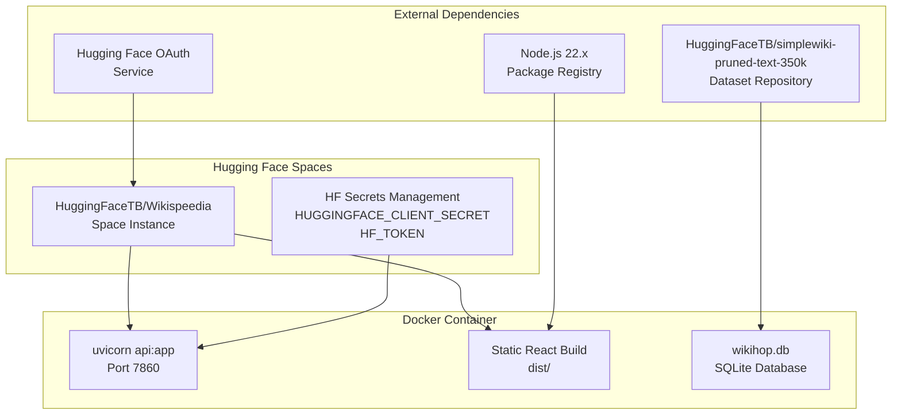
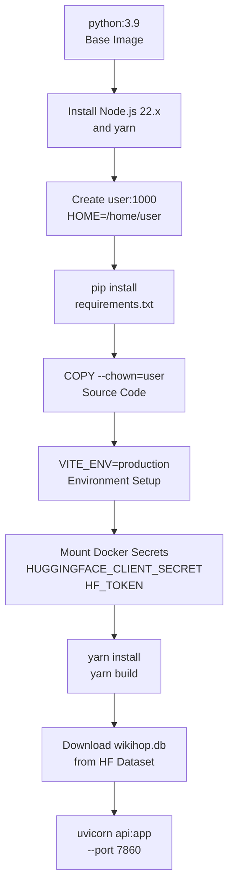
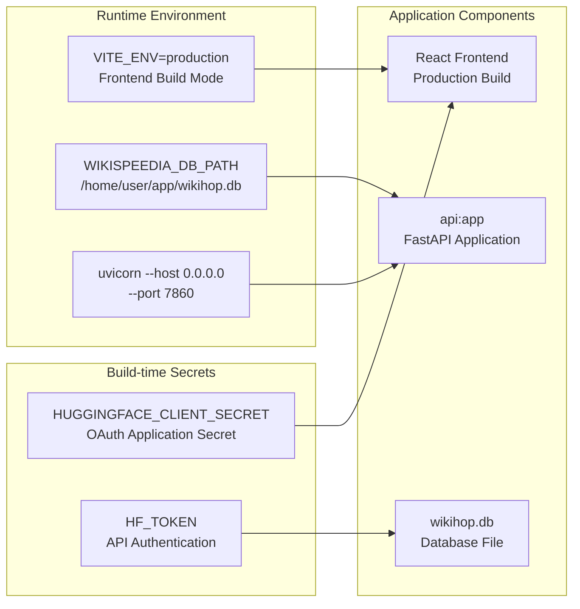
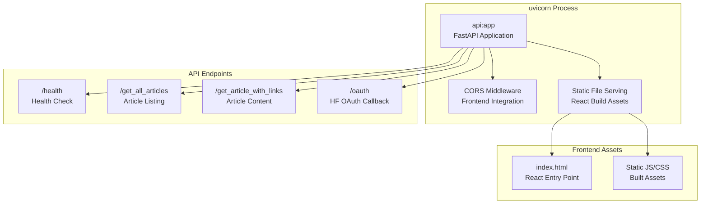

<!-- source: DeepWiki mcp.deepwiki.com · repo huggingface/wikirace-llms · page 9 Deployment and Production · fetched 2026-10-26 -->

# Deployment and Production

<details>
<summary>Relevant source files</summary>

The following files were used as context for generating this wiki page:

- [Dockerfile](Dockerfile)
- [README.md](README.md)

</details>


This document covers the deployment strategy, containerization, and production environment configuration for the WikiRacing LLMs application. It focuses on the Docker-based deployment to Hugging Face Spaces, including build processes, environment setup, and security considerations.

For information about local development setup, see [Getting Started](#2). For details about the backend API that runs in production, see [Backend Services](#5).

## Deployment Overview

The WikiRacing LLMs application is deployed as a containerized service on Hugging Face Spaces using a Docker-based architecture. The deployment combines a React frontend with a FastAPI backend in a single container, utilizing Hugging Face's infrastructure for hosting and authentication.

### Deployment Architecture



Sources: [Dockerfile:1-67](), [README.md:1-24]()

## Docker Containerization

The application uses a multi-stage Docker build process that combines Python backend dependencies with Node.js frontend build tools in a single container.

### Container Build Process



The build process follows these key steps:

| Build Stage | Command | Purpose |
|-------------|---------|---------|
| Base Setup | `FROM python:3.9` | Establish Python runtime |
| Node.js Install | `curl -fsSL https://deb.nodesource.com/setup_22.x` | Add frontend build tools |
| User Configuration | `useradd -m -u 1000 user` | Security isolation |
| Python Dependencies | `pip install -r requirements.txt` | Backend package installation |
| Frontend Build | `yarn install && yarn build` | React application compilation |
| Database Download | `curl -L https://huggingface.co/datasets/...` | Fetch WikiHop dataset |

Sources: [Dockerfile:1-45](), [Dockerfile:55-67]()

## Environment Configuration

The production environment requires specific configuration for Hugging Face integration and database access.

### Environment Variables



### Required Secrets

The deployment requires two critical secrets managed by Hugging Face Spaces:

- **`HUGGINGFACE_CLIENT_SECRET`**: OAuth application secret for user authentication
- **`HF_TOKEN`**: API token for downloading the WikiHop dataset during build

These secrets are mounted as Docker build secrets and written to the `.env` file during container build.

Sources: [Dockerfile:39-48](), [Dockerfile:52-58]()

## Hugging Face Spaces Integration

The application is configured specifically for deployment on Hugging Face Spaces with OAuth integration.

### Space Configuration

The space configuration is defined in the repository metadata:

| Setting | Value | Purpose |
|---------|-------|---------|
| `sdk` | `docker` | Container-based deployment |
| `app_port` | `7860` | Application listening port |
| `hf_oauth` | `true` | Enable OAuth integration |
| `hf_oauth_scopes` | `inference-api`, `email` | Required permissions |

### Database Provisioning

The WikiHop database is downloaded during the Docker build process using authenticated requests to the Hugging Face Hub:

```bash
curl -L https://huggingface.co/datasets/HuggingFaceTB/simplewiki-pruned-text-350k/resolve/main/wikihop.db \
  -H "Authorization: Bearer $(cat /run/secrets/HF_TOKEN)" \
  -o wikihop.db
```

The database path is configured via the `WIKISPEEDIA_DB_PATH` environment variable pointing to `/home/user/app/wikihop.db`.

Sources: [README.md:6-12](), [Dockerfile:52-58]()

## Production Runtime

The production environment runs a single `uvicorn` server process that serves both the FastAPI backend and static React frontend.

### Server Configuration



The server configuration uses these parameters:
- **Host**: `0.0.0.0` (all interfaces)
- **Port**: `7860` (Hugging Face Spaces standard)
- **Environment**: Production `.env` file
- **ASGI Server**: `uvicorn` with single process

Sources: [Dockerfile:61]()

## Security Considerations

The deployment implements several security measures for production use:

### User Isolation
- Runs under non-root user `user` with UID 1000
- Home directory isolation at `/home/user`
- Proper file ownership via `--chown=user`

### Secret Management
- Docker build secrets for sensitive credentials
- No hardcoded tokens in the container image
- Environment-based configuration

### Network Security
- Container listens only on specified port 7860
- CORS middleware for cross-origin request handling
- OAuth integration for user authentication

Sources: [Dockerfile:14-25](), [Dockerfile:39-48]()

## Build Verification

The build process includes verification steps to ensure proper configuration:

1. **Token Validation**: Verifies HF_TOKEN by calling `/api/whoami-v2`
2. **Database Download**: Confirms successful database file retrieval
3. **Frontend Build**: Ensures React application compiles correctly
4. **Dependency Installation**: Validates all Python and Node.js packages

These verification steps help catch configuration issues before deployment to production.

Sources: [Dockerfile:50-56]()

---

