# Page: Overview

# Overview

<details>
<summary>Relevant source files</summary>

The following files were used as context for generating this wiki page:

- [README.md](README.md)
- [package.json](package.json)

</details>


This document provides a comprehensive introduction to the WikiRacing LLMs repository, explaining its purpose, architecture, and key capabilities. The system enables competitive gameplay between humans and language models in Wikipedia navigation tasks, while providing research tools for evaluating LLM reasoning performance.

For deployment instructions, see [Getting Started](#2). For detailed technical architecture, see [System Architecture](#3). For information about the evaluation framework, see [Parallel Evaluation System](#7).

## Purpose and Scope

WikiRacing LLMs is a full-stack web application that combines competitive gaming with AI research capabilities. The system allows users to race against state-of-the-art language models (Qwen, Gemma, DeepSeek) in Wikipedia navigation challenges, while providing comprehensive tools for analyzing model reasoning traces and performance metrics.

The repository serves two primary audiences:
- **General users** who want to interact competitively with AI models through an intuitive web interface
- **Researchers** who need scalable evaluation tools for testing language models on reasoning tasks

Sources: [README.md:1-24](), [package.json:1-55]()

## Core Functionality

### Interactive WikiRacing Game

The application implements a Wikipedia navigation game where participants must find paths between articles using only hyperlinks. Players start at a source article and attempt to reach a target article through the shortest possible path of clicks.

The game supports two modes:
- **Human vs AI**: Direct competition between human players and language models
- **AI Analysis**: Observation mode for studying model reasoning patterns

### Model Performance Evaluation

The system includes parallel evaluation capabilities for testing multiple language models simultaneously across large datasets. This enables researchers to conduct systematic performance comparisons and analyze reasoning trace patterns at scale.

Sources: [README.md:14-23]()

## System Architecture Overview

### Application Component Mapping

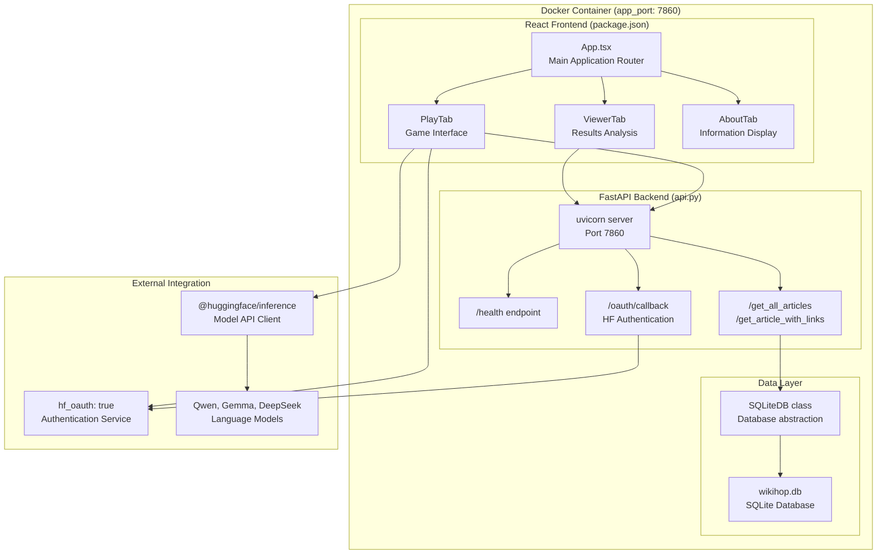

Sources: [README.md:6-11](), [package.json:13-38]()

### Technology Stack Integration

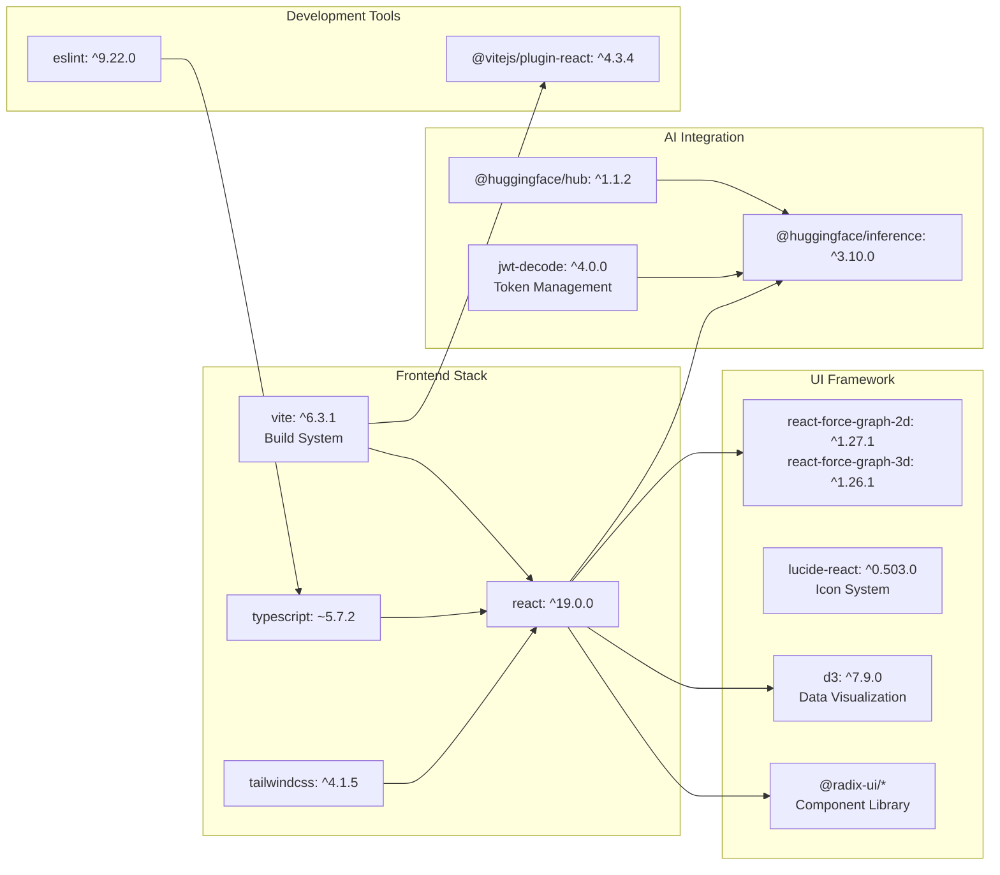

Sources: [package.json:13-54]()

## Key Features

### Multi-Model AI Competition
The system supports integration with multiple language models through the Hugging Face Inference API, enabling direct performance comparisons across different model architectures and capabilities.

### Advanced Data Visualization  
Built using `d3` and `react-force-graph-2d`/`react-force-graph-3d`, the application provides sophisticated visualization of reasoning traces and navigation paths through force-directed graph layouts.

### Scalable Authentication
Implements Hugging Face OAuth with scope-based permissions (`inference-api`, `email`) for secure model access and user management.

### Containerized Deployment
Designed for deployment on Hugging Face Spaces using Docker containerization with automatic port configuration and OAuth integration.

Sources: [README.md:6-11](), [package.json:13-38]()

## Repository Structure

The codebase is organized into several key areas:

| Component | Purpose | Key Technologies |
|-----------|---------|------------------|
| Frontend Application | User interface and game logic | React 19, TypeScript, Tailwind CSS |
| Backend Services | API endpoints and data access | FastAPI, SQLite, Python |
| AI Integration | Model communication and inference | Hugging Face Inference API |
| Parallel Evaluation | Large-scale model testing | Custom evaluation framework |
| Deployment Infrastructure | Production deployment | Docker, Hugging Face Spaces |

For detailed information about each component:
- Frontend structure and components: [Frontend Application](#4)
- Backend API and database: [Backend Services](#5) 
- Model integration details: [AI Model Integration](#6)
- Evaluation system: [Parallel Evaluation System](#7)
- Production deployment: [Deployment and Production](#9)

Sources: [README.md:1-24](), [package.json:1-55]()

---

# Page: Getting Started

# Getting Started

<details>
<summary>Relevant source files</summary>

The following files were used as context for generating this wiki page:

- [Dockerfile](Dockerfile)
- [package.json](package.json)
- [parallel_eval/README.md](parallel_eval/README.md)
- [requirements.txt](requirements.txt)

</details>


This document provides step-by-step instructions for setting up and running the WikiRacing LLMs application in both development and production environments. It covers local development setup, Docker containerization, and deployment to Hugging Face Spaces.

For information about the overall system architecture, see [System Architecture](#3). For details about the parallel evaluation system used for model testing, see [Parallel Evaluation System](#7).

## Prerequisites

Before setting up the application, ensure you have the following tools installed:

| Tool | Version | Purpose |
|------|---------|---------|
| Python | 3.9+ | Backend API server |
| Node.js | 22.x | Frontend build system |
| Yarn | Latest | Package management |
| Docker | Latest | Containerization (for production) |

### Required Environment Variables

The application requires several environment variables for proper operation:

| Variable | Purpose | Required For |
|----------|---------|--------------|
| `HUGGINGFACE_CLIENT_SECRET` | OAuth authentication | Production deployment |
| `HF_TOKEN` | Hugging Face API access | Database download, model inference |
| `VITE_ENV` | Build environment flag | Frontend compilation |
| `WIKISPEEDIA_DB_PATH` | Database file location | Backend API |

## Development Environment Setup

### Backend Setup

The backend uses FastAPI with SQLite for data persistence. Follow these steps to set up the Python environment:

```bash
# Install Python dependencies
pip install --upgrade pip
pip install -r requirements.txt
```

Download the WikiHop database from Hugging Face:

```bash
# Requires HF_TOKEN environment variable
curl -L https://huggingface.co/datasets/HuggingFaceTB/simplewiki-pruned-text-350k/resolve/main/wikihop.db \
  -H "Authorization: Bearer $HF_TOKEN" \
  -o wikihop.db
```

Set the database path environment variable:

```bash
export WIKISPEEDIA_DB_PATH=./wikihop.db
```

### Frontend Setup

The frontend is built with React 19 and Vite. Install and build the frontend:

```bash
# Install Node.js dependencies
yarn install

# Start development server
yarn dev

# Build for production
yarn build
```

### Development Workflow

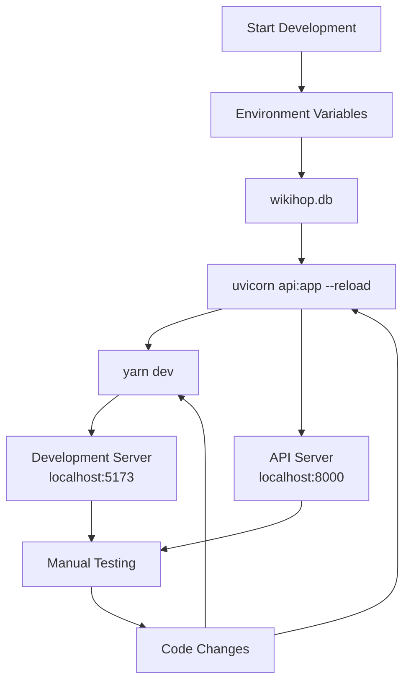

**Development Setup Flow**

Sources: [package.json:6-11](), [requirements.txt:1-16](), [Dockerfile:56-58]()

## Production Deployment

### Docker Container Build

The application uses a multi-stage Docker build process that combines the Python backend and React frontend into a single container:

```mermaid
graph TB
    subgraph "Docker Build Process"
        BaseImage["python:3.9"]
        NodeSetup["Install Node.js 22.x<br/>apt-get install nodejs"]
        YarnInstall["npm install -g yarn"]
        UserSetup["useradd -m -u 1000 user"]
        
        PythonDeps["pip install -r requirements.txt"]
        CopySource["COPY --chown=user . $HOME/app"]
        
        EnvSecrets["Mount secrets:<br/>HUGGINGFACE_CLIENT_SECRET<br/>HF_TOKEN"]
        FrontendBuild["yarn install<br/>yarn build"]
        DatabaseDownload["curl wikihop.db from HuggingFace"]
        
        ServerStart["uvicorn api:app --host 0.0.0.0 --port 7860"]
    end
    
    BaseImage --> NodeSetup
    NodeSetup --> YarnInstall
    YarnInstall --> UserSetup
    UserSetup --> PythonDeps
    PythonDeps --> CopySource
    CopySource --> EnvSecrets
    EnvSecrets --> FrontendBuild
    FrontendBuild --> DatabaseDownload
    DatabaseDownload --> ServerStart
```

**Docker Build Pipeline**

### Build Commands

Build the Docker image with required secrets:

```bash
# Build with BuildKit for secret mounting
docker buildx build \
  --secret id=HUGGINGFACE_CLIENT_SECRET,src=.env \
  --secret id=HF_TOKEN,src=.env \
  -t wikispeedia .
```

Run the container:

```bash
docker run -p 7860:7860 wikispeedia
```

### Hugging Face Spaces Deployment

The application is designed for deployment on Hugging Face Spaces using the provided Dockerfile:

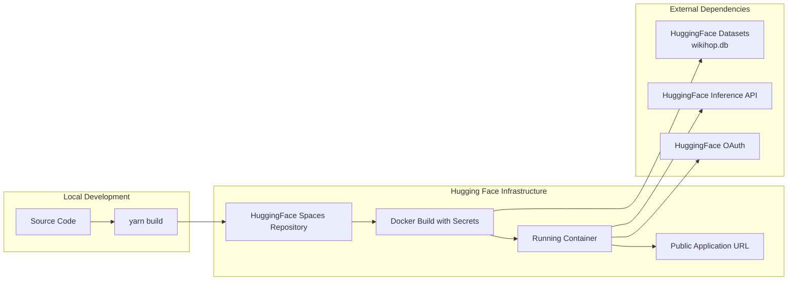

**Hugging Face Spaces Deployment Architecture**

Sources: [Dockerfile:1-67](), [package.json:9]()

## Application Startup Process

Once deployed, the application follows this startup sequence:

### Server Initialization

The FastAPI server starts with the following configuration:

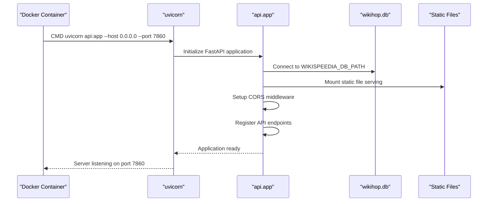

**Application Startup Sequence**

### Key Startup Components

| Component | File Reference | Purpose |
|-----------|----------------|---------|
| `uvicorn` server | [Dockerfile:61]() | ASGI server hosting the application |
| `api.app` | FastAPI application | Main application entry point |
| `wikihop.db` | [Dockerfile:56-58]() | SQLite database with Wikipedia articles |
| Static files | Frontend build output | Compiled React application |

Sources: [Dockerfile:37-61]()

## Verification Steps

### Health Check Endpoints

Verify the application is running correctly:

| Endpoint | Purpose | Expected Response |
|----------|---------|-------------------|
| `/health` | Server status | `{"status": "healthy"}` |
| `/get_all_articles` | Database connectivity | List of article titles |
| `/<path>` | Static file serving | Frontend application |

### Local Development Verification

1. **Backend API**: Visit `http://localhost:8000/health`
2. **Frontend Development**: Visit `http://localhost:5173` (Vite dev server)
3. **Database Access**: Check that `/get_all_articles` returns article data

### Production Verification

1. **Container Health**: `docker ps` shows running container
2. **Port Binding**: Application accessible on port 7860
3. **OAuth Integration**: Hugging Face authentication flow works
4. **Model Access**: AI player functionality operates correctly

Sources: [Dockerfile:61](), [package.json:7]()

## Next Steps

After successful setup, you can:

- **Explore the game interface**: See [Game Interface](#4.2) for detailed gameplay documentation
- **View model results**: See [Results Viewer](#4.3) for analysis tools
- **Run parallel evaluations**: See [Parallel Evaluation System](#7) for large-scale model testing
- **Understand the architecture**: See [System Architecture](#3) for technical details

The application should now be fully functional with both human and AI player capabilities enabled.

---

# Page: System Architecture

# System Architecture

<details>
<summary>Relevant source files</summary>

The following files were used as context for generating this wiki page:

- [Dockerfile](Dockerfile)
- [api.py](api.py)
- [src/App.tsx](src/App.tsx)
- [yarn.lock](yarn.lock)

</details>


This document provides a comprehensive overview of the WikiRacing LLMs system architecture, covering the deployment infrastructure, application components, and their interactions. The system is designed as a full-stack web application that enables users to play WikiRacing games with AI language models and analyze their performance through interactive visualizations.

For detailed information about specific frontend components, see [Frontend Application](#4). For backend API implementation details, see [Backend Services](#5). For AI model integration specifics, see [AI Model Integration](#6).

## System Overview

The WikiRacing LLMs application is a containerized web application built with modern technologies to provide an interactive platform for testing language models on navigation tasks through Wikipedia-like article networks.

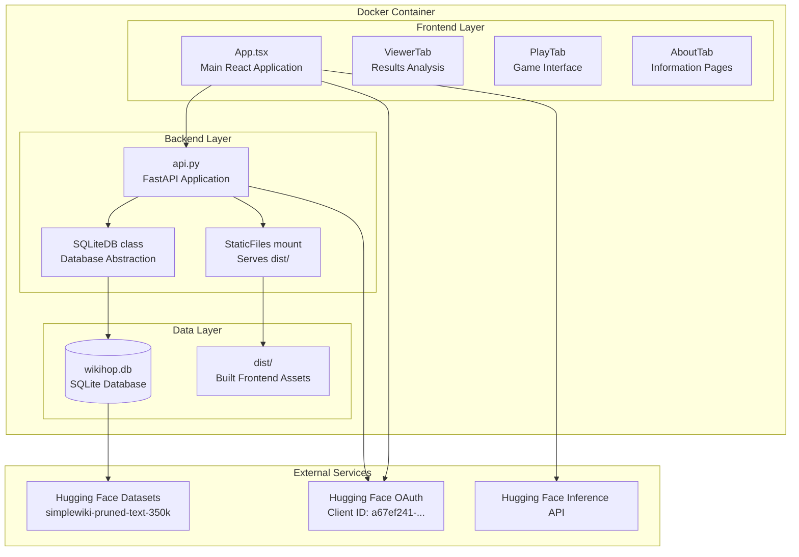

**Core System Architecture**

Sources: [Dockerfile:1-67](), [src/App.tsx:1-82](), [api.py:1-152]()

## Deployment Architecture

The application uses Docker containerization for consistent deployment across environments, with Hugging Face Spaces as the target production platform.

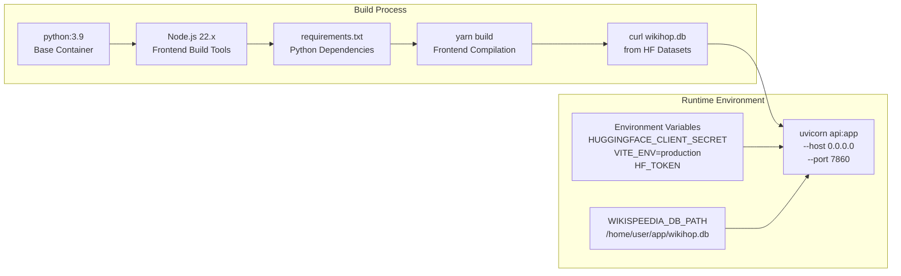

**Container Build and Runtime Process**

The Docker container follows a multi-stage approach where frontend assets are built during container creation, and the backend serves both API endpoints and static files.

Sources: [Dockerfile:1-67]()

## Frontend Application Architecture

The React application uses a tab-based interface with sophisticated visualization capabilities for analyzing model performance and game interactions.

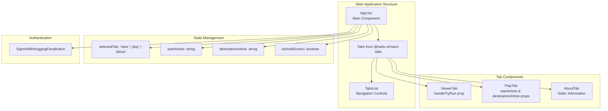

**React Component Hierarchy and State Flow**

The application maintains a centralized state in the root `App` component and passes data down through props to specialized tab components.

Sources: [src/App.tsx:1-82](), [yarn.lock:1-2999]()

## Backend Services Architecture

The FastAPI backend provides a clean separation between API endpoints, database operations, and static file serving, with integrated OAuth authentication for Hugging Face services.

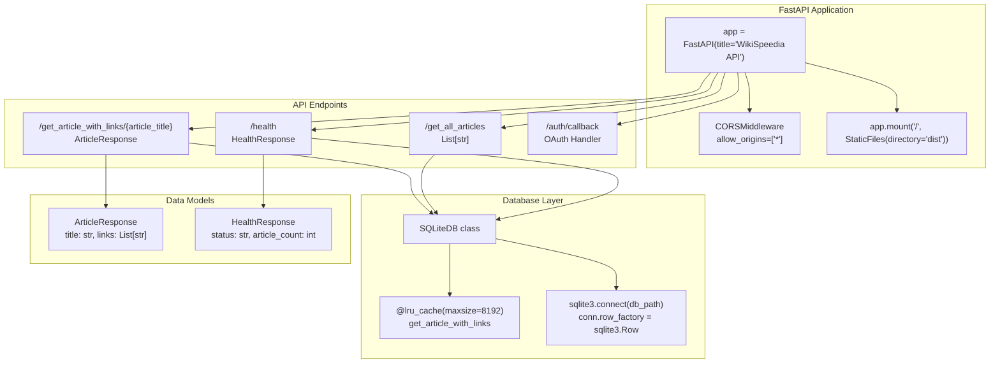

**Backend Service Architecture with Database Integration**

The `SQLiteDB` class provides cached access to article data, while FastAPI handles HTTP routing and response serialization through Pydantic models.

Sources: [api.py:1-152]()

## Database Schema and Access Patterns

The SQLite database uses a simple schema optimized for fast article and link retrieval with JSON serialization for link storage.

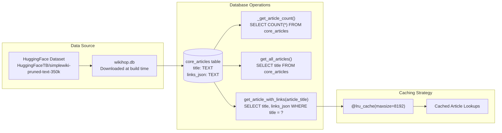

**Database Access Pattern with Performance Optimization**

The database uses LRU caching to optimize repeated article lookups, which is essential for the interactive nature of the WikiRacing game.

Sources: [api.py:40-75](), [Dockerfile:56-56]()

## Authentication and External Service Integration

The system integrates with Hugging Face services for both user authentication and AI model inference through OAuth 2.0 flow.

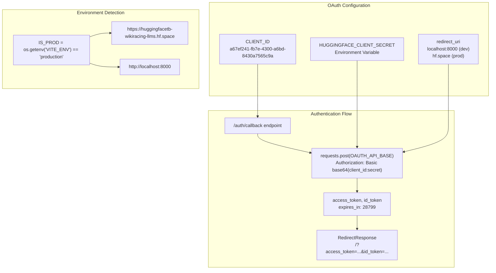

**Hugging Face OAuth Integration Flow**

The authentication system handles both development and production environments with different redirect URIs, and exchanges authorization codes for access tokens that enable AI model inference.

Sources: [api.py:99-144](), [api.py:26-29]()

## Technology Stack and Dependencies

The application leverages modern web technologies with specific focus on data visualization and AI model integration capabilities.

| Component | Technology | Key Libraries | Purpose |
|-----------|------------|---------------|---------|
| Frontend | React 19.0.0 | @radix-ui, d3@7.9.0, @huggingface/inference | UI components and data visualization |
| Build System | Vite 6.3.1 | @tailwindcss/vite, @vitejs/plugin-react | Development and build tooling |
| Backend | FastAPI | uvicorn, pydantic | API server and data validation |
| Database | SQLite3 | Built-in Python sqlite3 | Article and link storage |
| Visualization | D3.js + React | force-graph, @tanstack/react-virtual | Interactive network graphs |
| Authentication | OAuth 2.0 | Hugging Face OAuth endpoints | User authentication |
| Containerization | Docker | python:3.9, Node.js 22.x | Deployment packaging |

Sources: [yarn.lock:1-2999](), [api.py:1-14](), [Dockerfile:1-67]()

---

# Page: Frontend Application

# Frontend Application

<details>
<summary>Relevant source files</summary>

The following files were used as context for generating this wiki page:

- [index.html](index.html)
- [src/App.tsx](src/App.tsx)
- [yarn.lock](yarn.lock)

</details>


This document covers the React-based frontend application that provides the user interface for the WikiRacing LLMs system. The frontend handles game interaction, results visualization, authentication, and model integration. For information about the backend API that serves this frontend, see [Backend Services](#5). For details about the AI model integration used within the frontend, see [AI Model Integration](#6).

## Application Architecture

The frontend is built as a modern React application using TypeScript and Vite as the build system. The main entry point is [src/App.tsx:1-82](), which implements a tabbed interface for different application modes.

### Main Application Structure

The core application structure centers around three primary interaction modes accessed through a tab interface:

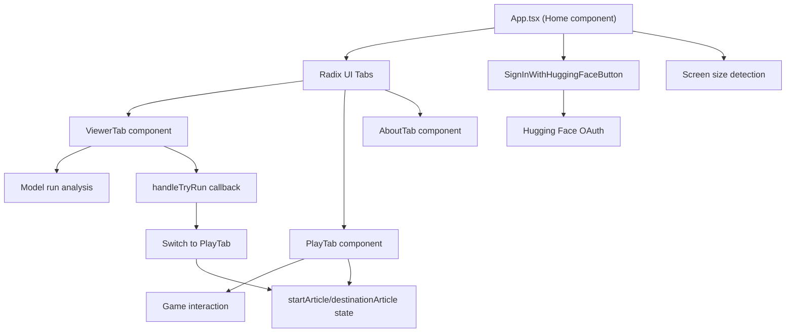

Sources: [src/App.tsx:1-82](), [index.html:1-14]()

The application maintains several key state variables in the main `Home` component [src/App.tsx:10-13]():
- `selectedTab`: Controls which tab is currently active ("view" | "play" | "about")
- `startArticle`: The starting Wikipedia article for gameplay
- `destinationArticle`: The target Wikipedia article for gameplay
- `isSmallScreen`: Responsive design state for mobile detection

### Tab System Implementation

The tabbed interface uses Radix UI's tabs component [src/App.tsx:60-78]() and implements cross-tab communication through a callback system:

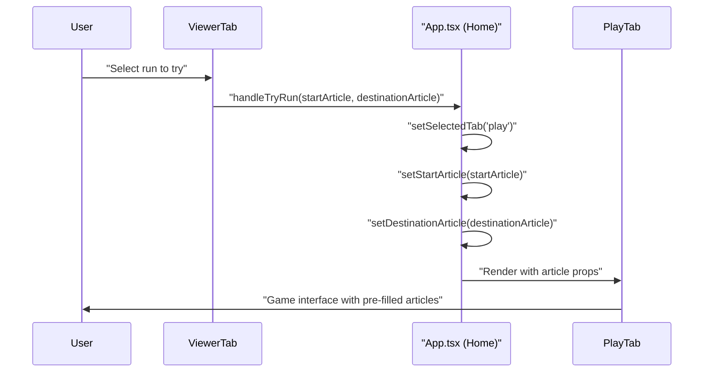

Sources: [src/App.tsx:30-35](), [src/App.tsx:67-77]()

The `handleTryRun` function [src/App.tsx:30-35]() enables users to transition from viewing existing model runs to attempting the same path themselves, maintaining context between the analysis and gameplay modes.

## Authentication System

The frontend integrates Hugging Face OAuth through the `SignInWithHuggingFaceButton` component [src/App.tsx:56](), positioned in the application header alongside navigation elements. This authentication system is required for:

- Access to Hugging Face Inference API for AI model interactions
- Secure model execution within the play interface
- User session management across application tabs

The authentication state affects functionality across multiple components, particularly in the AI-powered gameplay features.

Sources: [src/App.tsx:45-58]()

## Responsive Design

The application implements responsive design considerations with screen size detection [src/App.tsx:15-28]():

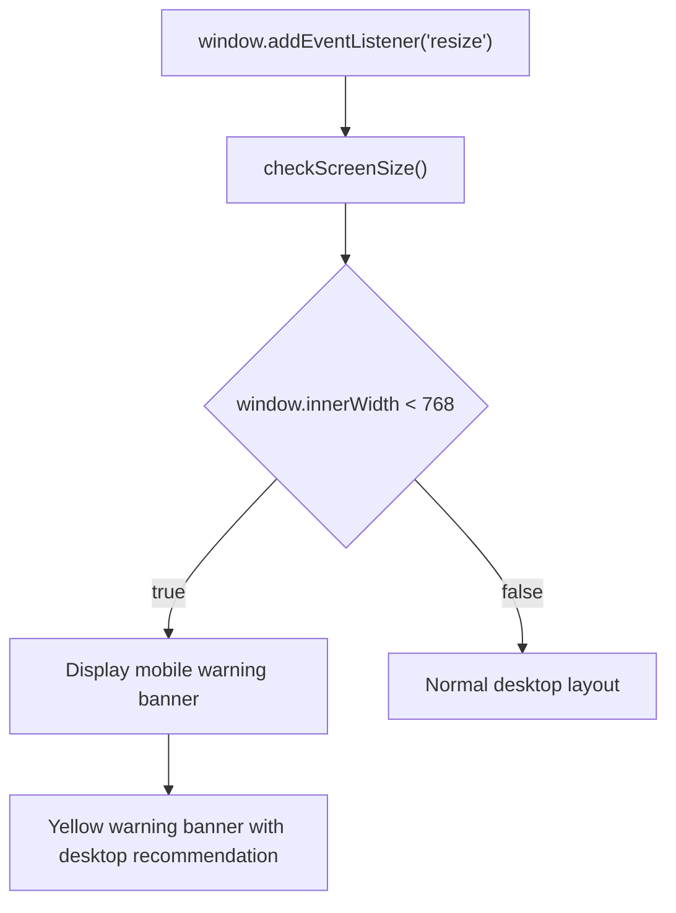

Sources: [src/App.tsx:15-44]()

Users on small screens (< 768px width) receive a prominent warning [src/App.tsx:39-44]() recommending desktop usage for optimal experience, reflecting the application's focus on complex data visualization and multi-panel interfaces.

## Technology Stack

The frontend leverages a modern React ecosystem with specialized libraries for visualization and UI components:

| Technology | Version | Purpose |
|------------|---------|---------|
| React | 19.0.0 | Core UI framework |
| TypeScript | 5.7.2 | Type safety and development tooling |
| Vite | 6.3.1 | Build system and development server |
| Tailwind CSS | 4.1.5 | Utility-first styling framework |
| Radix UI | Latest | Accessible component primitives |
| D3.js | 7.9.0 | Data visualization and force-directed graphs |
| @huggingface/inference | 3.10.0 | AI model integration |

Sources: [yarn.lock:1-50](), [yarn.lock:377-451](), [yarn.lock:1017-1120]()

### Key Dependencies

The application's specialized functionality relies on several key libraries:

- **Force Graph Visualization**: Uses `3d-force-graph@1.77.0` and `force-graph@1.49.5` for interactive network visualizations [yarn.lock:5-14](), [yarn.lock:2047-2067]()
- **UI Components**: Extensive use of Radix UI primitives including dialogs, tabs, tooltips, and form controls [yarn.lock:542-915]()
- **AI Integration**: Direct integration with Hugging Face services through `@huggingface/inference@3.10.0` [yarn.lock:429-436]()

## Development Configuration

The application entry point is defined in [index.html:1-14]() with the React application mounting to the `root` div and loading the main TypeScript module from [src/main.tsx](). The HTML document sets up basic metadata including the title "WikiRacing LLMs" and viewport configuration for responsive design.

The build system uses Vite with TypeScript support, enabling hot module replacement during development and optimized production builds. The modular architecture allows for efficient code splitting and lazy loading of complex visualization components.

Sources: [index.html:10-12](), [yarn.lock:1288-1298]()

---

# Page: Main Application Structure

# Main Application Structure

<details>
<summary>Relevant source files</summary>

The following files were used as context for generating this wiki page:

- [index.html](index.html)
- [src/App.tsx](src/App.tsx)
- [src/lib/constants.ts](src/lib/constants.ts)

</details>


## Purpose and Scope

This document covers the main application structure and entry points of the WikiRacing LLMs frontend application. It focuses on the root `App.tsx` component, the tab-based navigation system, and how the application bootstraps itself. For detailed information about individual tab functionalities, see [Game Interface](#4.2), [Results Viewer](#4.3), and [Information Pages](#4.7). For UI component details, see [UI Components Library](#4.6).

## Application Entry Point Flow

The application follows a standard React entry point pattern with environment-aware configuration:

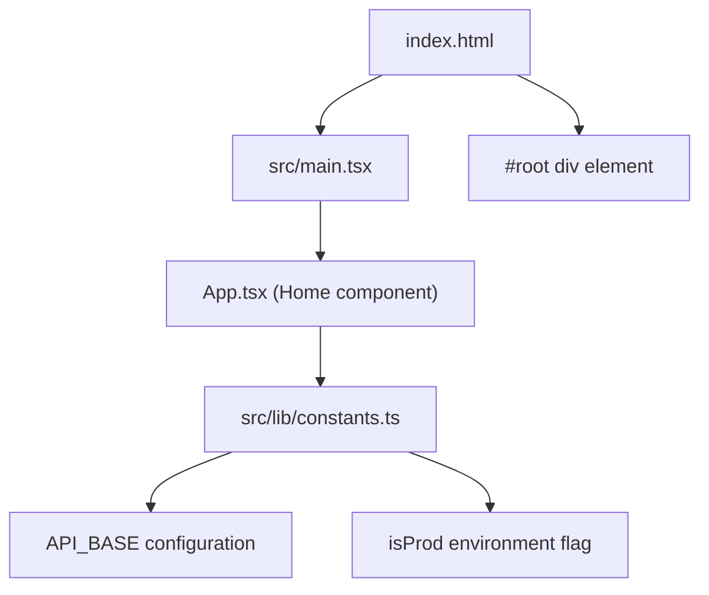

**Application Bootstrap Sequence**

The application entry point is defined in [index.html:10-11]() which loads the main React module. The HTML structure is minimal, containing only a root div and the module script reference.

Environment configuration is handled through [src/lib/constants.ts:1-2](), which determines the `API_BASE` URL based on the `VITE_ENV` environment variable. In production, `API_BASE` is empty (allowing relative URLs), while in development it points to `http://localhost:8000`.

Sources: [index.html:1-14](), [src/lib/constants.ts:1-5]()

## Main App Component Architecture

The main application component is implemented as the `Home` function in `App.tsx`. Despite its name, this serves as the root application component:

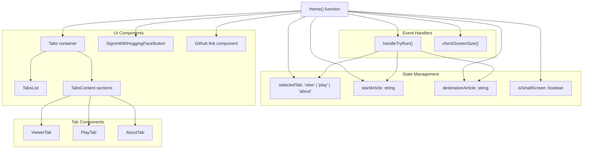

**Component Structure**

The `Home` component manages four pieces of state defined in [src/App.tsx:10-13]():
- `selectedTab`: Controls which tab is currently active
- `startArticle` and `destinationArticle`: Store Wikipedia article titles for game configuration
- `isSmallScreen`: Tracks responsive breakpoint for mobile warning

The main UI layout consists of a header section [src/App.tsx:45-58]() containing the application title, GitHub link, and authentication button, followed by the tab system [src/App.tsx:60-78]().

Sources: [src/App.tsx:9-81]()

## Tab System Implementation

The application uses a three-tab interface implemented with Radix UI components:

| Tab Value | Component | Purpose |
|-----------|-----------|---------|
| `"view"` | `ViewerTab` | Display and analyze existing model runs |
| `"play"` | `PlayTab` | Interactive game interface for human/AI play |
| `"about"` | `AboutTab` | Information and documentation |

**Tab Navigation Logic**

The tab system is controlled by [src/App.tsx:60]() with the `Tabs` component that:
- Defaults to the "view" tab
- Updates `selectedTab` state via the `onValueChange` callback
- Maintains controlled state through the `value` prop

Each tab content is rendered conditionally using `TabsContent` components [src/App.tsx:67-77](), ensuring only the active tab's content is mounted.

Sources: [src/App.tsx:60-78]()

## Cross-Tab Communication

The application implements a communication mechanism between the ViewerTab and PlayTab through the `handleTryRun` function:

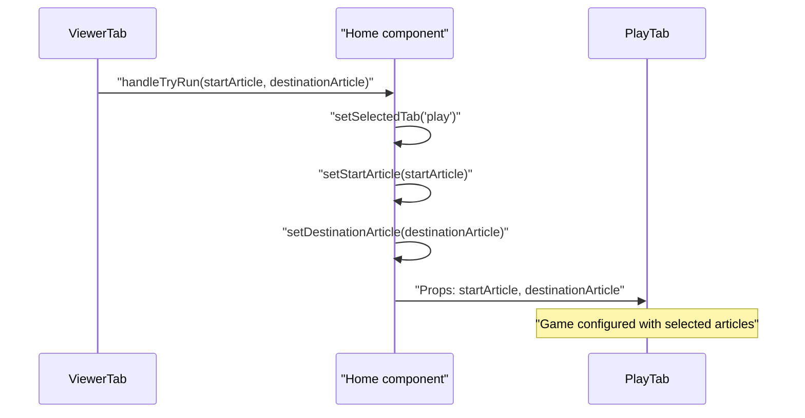

**Function Implementation**

The `handleTryRun` function [src/App.tsx:30-35]() serves as a bridge between tabs by:
1. Accepting `startArticle` and `destinationArticle` parameters from ViewerTab
2. Switching the active tab to "play"
3. Setting the article state that gets passed as props to PlayTab

This pattern enables users to select a specific model run in the ViewerTab and immediately replay it in the PlayTab with the same article configuration.

Sources: [src/App.tsx:30-35](), [src/App.tsx:68](), [src/App.tsx:72]()

## Responsive Design Implementation

The application includes responsive design considerations through screen size detection:

**Screen Size Monitoring**

The `checkScreenSize` function [src/App.tsx:16-18]() monitors the viewport width and sets `isSmallScreen` to `true` when the width is below 768 pixels. This monitoring is implemented with:

- Initial size check on component mount [src/App.tsx:21]()
- Window resize event listener [src/App.tsx:24]()
- Cleanup of event listener on unmount [src/App.tsx:27]()

**Mobile Warning System**

When `isSmallScreen` is true, a warning banner is displayed [src/App.tsx:39-44]() informing users that the application doesn't work well on small screens and recommending desktop usage.

Sources: [src/App.tsx:15-28](), [src/App.tsx:39-44]()

## Import Dependencies

The main application imports several key dependencies:

| Import | Source | Purpose |
|--------|--------|---------|
| `Tabs`, `TabsContent`, `TabsList`, `TabsTrigger` | `@/components/ui/tabs` | Tab navigation UI components |
| `ViewerTab` | `@/components/viewer-tab` | Results viewing interface |
| `PlayTab` | `@/components/play-tab` | Game interface |
| `AboutTab` | `@/components/about-tab` | Information content |
| `SignInWithHuggingFaceButton` | `@/components/sign-in-with-hf-button` | Authentication component |
| `Github` | `lucide-react` | GitHub icon component |
| `useState`, `useEffect` | `react` | React hooks for state and lifecycle |

Sources: [src/App.tsx:1-7]()

---

# Page: Game Interface

# Game Interface

<details>
<summary>Relevant source files</summary>

The following files were used as context for generating this wiki page:

- [src/components/game-component.tsx](src/components/game-component.tsx)
- [src/components/play-tab.tsx](src/components/play-tab.tsx)
- [src/lib/inference.tsx](src/lib/inference.tsx)

</details>


This document covers the core game functionality and user interface components that enable interactive WikiRacing gameplay. The game interface allows users to either play WikiRacing themselves or configure and watch AI models attempt to navigate between Wikipedia articles.

For information about the data visualization of game results, see [Data Visualization](#4.4). For details about the authentication system required for AI gameplay, see [Authentication System](#4.5).

## Game Setup Interface

The game setup is handled by the `PlayTab` component, which provides configuration options before starting a game session. This interface allows users to select between human and AI player modes, configure game parameters, and choose start/target articles.

### Player Mode Selection

The interface offers two distinct player modes through a tabbed interface:

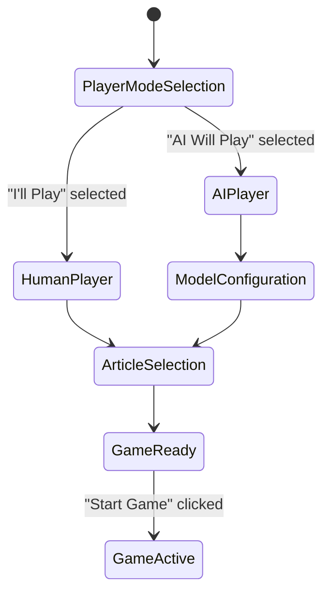

The player mode is managed through a `Tabs` component that sets the `player` state to either `"me"` or `"model"`.

**Sources:** [src/components/play-tab.tsx:38-160]()

### Article Selection System

Both start and target articles are selected using the `VirtualizedCombobox` component, which provides efficient searching through all available articles. The system includes random article selection functionality:

| Component | Purpose | Data Source |
|-----------|---------|-------------|
| `VirtualizedCombobox` | Article search and selection | `allArticles` state from `/get_all_articles` API |
| Random button | Quick article selection | `popularNodes` from `results/popular_nodes.json` |

**Sources:** [src/components/play-tab.tsx:163-210](), [src/components/play-tab.tsx:29](), [src/components/play-tab.tsx:112-118]()

### Model Configuration

When AI player mode is selected, additional configuration options become available:

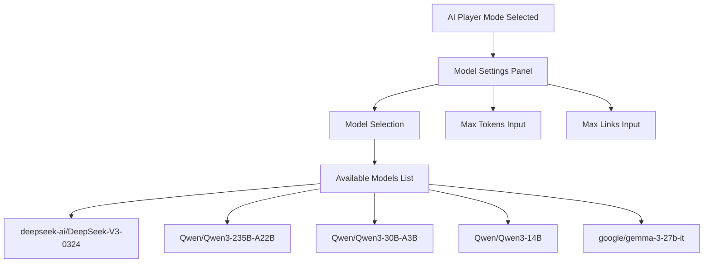

The model configuration includes validation and tooltips explaining each parameter's impact on gameplay.

**Sources:** [src/components/play-tab.tsx:54-60](), [src/components/play-tab.tsx:212-311]()

## Active Game Interface

Once a game starts, the `GameComponent` takes over, providing the main gameplay interface. This component manages the active game state and provides different interfaces depending on the player mode.

### Game Layout Structure

The game interface uses a responsive grid layout with distinct panels:

```mermaid
graph TB
    GameComponent["GameComponent"] --> StatusCard["Game Status Card (12 cols)"]
    GameComponent --> LeftPanel["Left Panel (6 cols)"]
    GameComponent --> RightTopPanel["Wikipedia View (6 cols)"]
    GameComponent --> RightBottomPanel["Force Graph (6 cols)"]
    
    LeftPanel --> HumanMode["Human: Available Links"]
    LeftPanel --> AIMode["AI: LLM Reasoning"]
    
    StatusCard --> CurrentPage["Current Page Display"]
    StatusCard --> TargetPage["Target Page Display"] 
    StatusCard --> HopCounter["Hop Counter"]
    StatusCard --> Timer["Elapsed Time"]
    StatusCard --> GameControls["Game Controls"]
```

The layout adapts based on the player mode, showing either clickable links for human players or AI reasoning traces for model players.

**Sources:** [src/components/game-component.tsx:372-813]()

### Game State Management

The `GameComponent` maintains several key state variables that track the game progression:

| State Variable | Type | Purpose |
|---------------|------|---------|
| `currentPage` | `string` | Currently viewed Wikipedia article |
| `currentPageLinks` | `string[]` | Available links from current page |
| `hops` | `number` | Number of moves taken |
| `timeElapsed` | `number` | Game duration in seconds |
| `visitedNodes` | `string[]` | Path taken through articles |
| `gameStatus` | `"playing" \| "won" \| "lost"` | Current game state |

**Sources:** [src/components/game-component.tsx:128-136]()

## Player Mode Implementations

### Human Player Mode

When `player === "me"`, the interface displays an "Available Links" panel with clickable buttons for each outbound link from the current article. Links are sorted alphabetically and displayed in a responsive grid:

```mermaid
sequenceDiagram
    participant User
    participant GameComponent
    participant API
    participant Database
    
    User->>GameComponent: handleLinkClick(link)
    GameComponent->>GameComponent: setCurrentPage(link)
    GameComponent->>GameComponent: setHops(prev + 1)
    GameComponent->>GameComponent: setVisitedNodes([...prev, link])
    GameComponent->>API: fetchCurrentPageLinks()
    API->>Database: get_article_with_links
    Database-->>API: article data with links
    API-->>GameComponent: links array
    GameComponent->>GameComponent: setCurrentPageLinks(links)
```

**Sources:** [src/components/game-component.tsx:478-585](), [src/components/game-component.tsx:187-193](), [src/components/game-component.tsx:154-162]()

### AI Player Mode  

When `player === "model"`, the interface shows an "LLM Reasoning" panel that displays the conversation between the system and the AI model:

```mermaid
sequenceDiagram
    participant GameComponent
    participant useInference
    participant HuggingFaceAPI
    participant AIModel
    
    GameComponent->>GameComponent: makeModelMove()
    GameComponent->>GameComponent: buildPrompt(current, target, path, links)
    GameComponent->>useInference: inference({model, prompt, maxTokens})
    useInference->>HuggingFaceAPI: chatCompletionStream()
    HuggingFaceAPI->>AIModel: process prompt
    AIModel-->>HuggingFaceAPI: streaming response
    HuggingFaceAPI-->>useInference: partial chunks
    useInference-->>GameComponent: setPartialText(result)
    useInference-->>GameComponent: final response
    GameComponent->>GameComponent: parse <answer>NUMBER</answer>
    GameComponent->>GameComponent: handleLinkClick(selectedLink)
```

**Sources:** [src/components/game-component.tsx:218-298](), [src/components/game-component.tsx:78-105](), [src/lib/inference.tsx:92-153]()

## Game Controls and Automation

### Continuous Play System

For AI players, the interface provides continuous play functionality through the `continuousPlay` and `autoRunning` state variables:

```mermaid
stateDiagram-v2
    [*] --> ManualMode
    ManualMode --> ContinuousMode: Switch "Auto" on
    ContinuousMode --> AutoRunning: autoRunning = true
    ContinuousMode --> AutoPaused: autoRunning = false
    
    AutoRunning --> MakeMove: Timer triggers makeModelMove()
    MakeMove --> WaitingForResponse: Model thinking
    WaitingForResponse --> AutoRunning: Response received
    
    AutoPaused --> AutoRunning: "Start" button
    AutoRunning --> AutoPaused: "Stop" button
    
    ContinuousMode --> ManualMode: Switch "Auto" off
    ManualMode --> SingleMove: "Next Move" button
    SingleMove --> ManualMode: Move completed
```

The automation system includes safety checks to prevent moves during model inference or while links are loading.

**Sources:** [src/components/game-component.tsx:329-353](), [src/components/game-component.tsx:137-138](), [src/components/game-component.tsx:408-447]()

### Message System

The AI player interface maintains a conversation log using a `Message` type system:

```typescript
type Message = {
  role: "user" | "assistant" | "game" | "result" | "error";
  content: string;
  metadata?: {
    page?: string;
    links?: string[];
    status?: "playing" | "won" | "lost";
    path?: string[];
  };
};
```

This enables detailed tracking of the AI's reasoning process and game state changes.

**Sources:** [src/components/game-component.tsx:67-76](), [src/components/game-component.tsx:593-781]()

## Real-time Updates and Streaming

### Inference Streaming

The `useInference` hook provides real-time streaming of AI model responses using the Hugging Face Inference API:

```mermaid
graph TD
    useInference["useInference Hook"] --> InferenceClient["InferenceClient"]
    InferenceClient --> ChatStream["chatCompletionStream()"]
    ChatStream --> StreamChunks["Stream Chunks"]
    StreamChunks --> PartialText["setPartialText(result)"]
    PartialText --> UIUpdate["Real-time UI Update"]
    
    StreamChunks --> FinalResult["Complete Response"]
    FinalResult --> ParseAnswer["Extract <answer>NUMBER</answer>"]
    ParseAnswer --> GameAction["Execute Move"]
```

The streaming system provides immediate feedback to users as the AI model generates its response.

**Sources:** [src/lib/inference.tsx:112-135](), [src/components/game-component.tsx:145-152]()

### Game State Synchronization

The interface maintains synchronization between multiple UI elements through React's effect system:

- Timer updates every second during active gameplay
- Link fetching occurs automatically when `currentPage` changes  
- Win/loss conditions are checked after each move
- Graph visualization updates with the current path

**Sources:** [src/components/game-component.tsx:168-186](), [src/components/game-component.tsx:164-166](), [src/components/game-component.tsx:178-185]()

---

# Page: Results Viewer

# Results Viewer

<details>
<summary>Relevant source files</summary>

The following files were used as context for generating this wiki page:

- [results/qwen3.json](results/qwen3.json)
- [src/components/runs-list.tsx](src/components/runs-list.tsx)
- [src/components/viewer-tab.tsx](src/components/viewer-tab.tsx)

</details>


The Results Viewer is the primary interface for analyzing and visualizing AI model performance data in WikiRacing LLMs. It provides comprehensive tools for examining model evaluation results, including statistical analysis, run filtering, and interactive visualization of reasoning traces. For information about the actual game interface where models play WikiRacing, see [Game Interface](#4.2). For details about the underlying data visualization components, see [Data Visualization](#4.4).

## Architecture Overview

The Results Viewer system consists of two main React components that work together to provide a comprehensive analysis interface for model evaluation data.

### Component Structure

```mermaid
graph TB
    ViewerTab["ViewerTab Component<br/>src/components/viewer-tab.tsx"]
    RunsList["RunsList Component<br/>src/components/runs-list.tsx"]
    ForceGraph["ForceDirectedGraph Component<br/>src/components/force-directed-graph"]
    
    subgraph "Data Sources"
        DefaultModels["defaultModels<br/>{Qwen3-14B, Qwen3-30B-A3B}"]
        UploadedJSON["Custom Uploaded JSON"]
        ResultsJSON["results/*.json files"]
    end
    
    subgraph "UI Components"
        ModelSelect["Select Component<br/>Model Selection"]
        UploadBtn["Upload Button<br/>JSON File Upload"]
        StatsBadges["Badge Components<br/>Statistics Display"]
    end
    
    ViewerTab --> RunsList
    ViewerTab --> ForceGraph
    ViewerTab --> ModelSelect
    ViewerTab --> UploadBtn
    ViewerTab --> StatsBadges
    
    DefaultModels --> ViewerTab
    UploadedJSON --> ViewerTab
    ResultsJSON --> DefaultModels
```

Sources: [src/components/viewer-tab.tsx:1-266](), [src/components/runs-list.tsx:1-220]()

### Data Flow Architecture

```mermaid
graph LR
    subgraph "Input Processing"
        JSONFile["JSON Result Files"]
        FileUpload["fileInputRef.current"]
        ModelSelect["selectedModel state"]
    end
    
    subgraph "State Management"
        RunsState["runs: Run[]"]
        StatsState["modelStats: ModelStats"]
        SelectedState["selectedRun: number | null"]
    end
    
    subgraph "Data Transformation"
        ConvertRuns["convertedRuns mapping"]
        FilterRuns["filterRuns (wins only)"]
        ForceGraphRuns["forceGraphRuns format"]
    end
    
    subgraph "Display Components"
        StatsDisplay["Statistics Badges"]
        RunsListComp["RunsList Component"]
        GraphComp["ForceDirectedGraph"]
    end
    
    JSONFile --> ModelSelect
    FileUpload --> ModelSelect
    ModelSelect --> RunsState
    ModelSelect --> StatsState
    
    RunsState --> ConvertRuns
    ConvertRuns --> FilterRuns
    FilterRuns --> ForceGraphRuns
    
    StatsState --> StatsDisplay
    FilterRuns --> RunsListComp
    ForceGraphRuns --> GraphComp
```

Sources: [src/components/viewer-tab.tsx:59-130](), [src/components/viewer-tab.tsx:118-129]()

## Core Components

### ViewerTab Component

The `ViewerTab` component serves as the main container that orchestrates model result analysis and visualization.

**Key State Management:**
- `selectedRun`: Currently highlighted run for visualization
- `runs`: Processed array of model runs
- `selectedModel`: Currently selected model for analysis  
- `modelStats`: Calculated performance statistics
- `models`: Available model data including defaults and uploads

**Statistics Calculation:**
The component calculates comprehensive performance metrics including win percentage, average steps, standard deviation, median, minimum, and maximum step counts.

Sources: [src/components/viewer-tab.tsx:47-112]()

### RunsList Component

The `RunsList` component provides an interactive list of model runs with filtering and auto-play capabilities.

**Core Features:**
- **Filtering**: Text-based filtering by start or destination article using `filter` state
- **Auto-play**: Automatic cycling through runs via `isPlaying` state and `timerRef`
- **Selection**: Run selection with scroll-to-view behavior via `runItemsRef`
- **Try Path**: Integration with game interface via `onTryRun` callback

**Auto-play Implementation:**
```typescript
useEffect(() => {
  if (isPlaying) {
    timerRef.current = setInterval(() => {
      // Cycle through filtered runs every 1500ms
      const nextIndex = (selectedRunId + 1) % filteredRuns.length;
      onSelectRun(originalIndex);
    }, 1500);
  }
}, [isPlaying, selectedRunId, filteredRuns]);
```

Sources: [src/components/runs-list.tsx:23-74](), [src/components/runs-list.tsx:89-91]()

## Data Structures

### Run Interface

The core data structure representing a single model execution:

```typescript
interface Run {
  start_article: string;
  destination_article: string;
  steps: string[];
  result: string;
}
```

### ModelStats Interface

Performance metrics calculated for model analysis:

```typescript
interface ModelStats {
  winPercentage: number;
  avgSteps: number;
  stdDevSteps: number;
  totalRuns: number;
  wins: number;
  medianSteps: number;
  minSteps: number;
  maxSteps: number;
}
```

### JSON Result Format

Model evaluation results follow a structured format with metadata and step-by-step execution traces:

- **Model Configuration**: `model`, `api_base`, `max_links`, `max_tries`
- **Execution Metadata**: `num_trials`, `num_workers`, `max_steps`
- **Step Types**: `start`, `move`, `win`, `lose` with associated metadata

Sources: [src/components/viewer-tab.tsx:28-45](), [results/qwen3.json:1-50]()

## User Interactions

### Model Selection and Upload

Users can select from predefined models or upload custom evaluation results:

1. **Dropdown Selection**: Choose from `defaultModels` (Qwen3-14B, Qwen3-30B-A3B)
2. **JSON Upload**: Upload custom result files via `handleFileUpload` function
3. **Validation**: Uploaded files must contain valid `runs` array structure

### Run Analysis Workflow

```mermaid
graph TD
    SelectModel["Select Model<br/>setSelectedModel()"]
    ViewStats["View Statistics<br/>modelStats badges"]
    FilterRuns["Filter Runs<br/>filter input"]
    SelectRun["Select Run<br/>handleRunSelect()"]
    ViewGraph["View Visualization<br/>ForceDirectedGraph"]
    TryPath["Try Path<br/>handleTryRun()"]
    
    SelectModel --> ViewStats
    ViewStats --> FilterRuns
    FilterRuns --> SelectRun
    SelectRun --> ViewGraph
    SelectRun --> TryPath
    
    subgraph "Auto-play Mode"
        TogglePlay["Toggle Play/Pause<br/>togglePlayPause()"]
        AutoCycle["Auto Cycle Runs<br/>1500ms interval"]
    end
    
    SelectRun --> TogglePlay
    TogglePlay --> AutoCycle
    AutoCycle --> SelectRun
```

Sources: [src/components/viewer-tab.tsx:114-116](), [src/components/runs-list.tsx:89-91](), [src/components/runs-list.tsx:192-206]()

## Integration Points

### Force Graph Integration

The Results Viewer transforms run data for the `ForceDirectedGraph` component:

```typescript
const forceGraphRuns = useMemo(() => {
  return filterRuns.map((run): ForceGraphRun => ({
    start_article: run.start_article,
    destination_article: run.destination_article,
    steps: run.steps.map(article => ({ type: "move", article }))
  }));
}, [filterRuns]);
```

### Game Interface Integration

The `handleTryRun` callback enables users to replay selected paths in the game interface, bridging analysis and interactive gameplay.

Sources: [src/components/viewer-tab.tsx:122-129](), [src/components/viewer-tab.tsx:47-50]()

## File Upload System

### Upload Validation

The file upload system validates JSON structure and integrates new models:

```typescript
const reader = new FileReader();
reader.onload = (e) => {
  try {
    const jsonData = JSON.parse(e.target?.result as string);
    
    // Validate structure
    if (!jsonData.runs || !Array.isArray(jsonData.runs)) {
      alert("Invalid JSON format. File must contain a 'runs' array.");
      return;
    }
    
    // Add to models with filename-based naming
    const modelName = `Custom: ${fileName}`;
    setModels(prev => ({ ...prev, [modelName]: jsonData }));
    setSelectedModel(modelName);
  } catch (error) {
    alert(`Error parsing JSON file: ${error.message}`);
  }
};
```

Sources: [src/components/viewer-tab.tsx:131-167]()

---

# Page: Data Visualization

# Data Visualization

<details>
<summary>Relevant source files</summary>

The following files were used as context for generating this wiki page:

- [src/components/force-directed-graph.tsx](src/components/force-directed-graph.tsx)
- [yarn.lock](yarn.lock)

</details>


This document covers the force-directed graph visualization system used to display WikiRacing paths and reasoning traces. The visualization component renders interactive network graphs showing how AI models and human players navigate between Wikipedia articles during gameplay.

For information about the broader results viewing interface that hosts this visualization, see [Results Viewer](#4.3). For details about the underlying game data structures, see [Game Interface](#4.2).

## Component Architecture

The data visualization system is built around the `ForceDirectedGraph` component, which uses the react-force-graph-2d library and D3.js for physics-based graph layout and rendering.

### Core Component Structure

```mermaid
graph TB
    ForceDirectedGraph["ForceDirectedGraph Component"]
    ForceGraph2D["react-force-graph-2d Library"]
    D3Forces["D3.js Force Simulation"]
    GraphData["Graph Data Structure"]
    
    ForceDirectedGraph --> ForceGraph2D
    ForceDirectedGraph --> D3Forces
    ForceDirectedGraph --> GraphData
    
    subgraph "Data Processing"
        RunsInput["Run[] Input Data"]
        NodesMap["Map<string, GraphNode>"]
        LinksList["GraphLink[] Array"]
    end
    
    subgraph "Rendering Pipeline"
        NodeCanvas["nodeCanvasObject"]
        ColorFunctions["getNodeColor/getLinkColor"]
        ResponsiveLayout["ResizeObserver + Dimensions"]
    end
    
    RunsInput --> NodesMap
    RunsInput --> LinksList
    NodesMap --> GraphData
    LinksList --> GraphData
    
    ForceDirectedGraph --> NodeCanvas
    ForceDirectedGraph --> ColorFunctions
    ForceDirectedGraph --> ResponsiveLayout
```

Sources: [src/components/force-directed-graph.tsx:1-346]()

### Integration with Run Data

The visualization processes `Run` objects from the reasoning trace system to build graph representations of navigation paths:

```mermaid
graph LR
    Run["Run Object"]
    Steps["run.steps[]"]
    StartArticle["run.start_article"]
    DestArticle["run.destination_article"]
    
    Run --> Steps
    Run --> StartArticle
    Run --> DestArticle
    
    subgraph "Graph Construction"
        GraphNodes["GraphNode[]"]
        GraphLinks["GraphLink[]"] 
        MainNodes["Fixed Position Nodes"]
    end
    
    Steps --> GraphNodes
    Steps --> GraphLinks
    StartArticle --> MainNodes
    DestArticle --> MainNodes
```

Sources: [src/components/force-directed-graph.tsx:104-170]()

## Data Structures

### GraphNode Interface

The `GraphNode` interface extends the base `NodeObject` from react-force-graph with additional metadata for run tracking and visual styling:

| Property | Type | Purpose |
|----------|------|---------|
| `id` | `string` | Article title identifier |
| `type` | `"fixed" \| "fluid"` | Node positioning behavior |
| `radius` | `number` | Visual node size |
| `runIds` | `number[]` | Which runs include this node |
| `isMainNode` | `boolean` | Start/destination article flag |
| `fx`, `fy` | `number` | Fixed position coordinates |

### GraphLink Interface

The `GraphLink` interface represents transitions between articles:

| Property | Type | Purpose |
|----------|------|---------|
| `source` | `string \| GraphNode` | Source article |
| `target` | `string \| GraphNode` | Target article |
| `runId` | `number` | Which run this link belongs to |

Sources: [src/components/force-directed-graph.tsx:30-46]()

## Force Simulation System

The component uses D3.js forces to create a physics-based layout that positions nodes naturally while maintaining readability.

### Force Configuration

```mermaid
graph TB
    ForceSimulation["D3 Force Simulation"]
    
    subgraph "Active Forces"
        LinkForce["forceLink - Distance: 35px"]
        ChargeForce["forceManyBody - Strength: -100"]
        RadialForce["forceRadial - Target: 40px"]
        CollideForce["forceCollide - Prevents Overlap"]
        CenterForce["forceCenter - Origin: (0,0)"]
    end
    
    ForceSimulation --> LinkForce
    ForceSimulation --> ChargeForce
    ForceSimulation --> RadialForce
    ForceSimulation --> CollideForce
    ForceSimulation --> CenterForce
    
    subgraph "Main Node Positioning"
        CircularLayout["Circular Layout Algorithm"]
        FixedPositions["fx/fy Fixed Coordinates"]
        RadiusCalc["400px from center"]
    end
    
    RadialForce --> CircularLayout
    CircularLayout --> FixedPositions
    CircularLayout --> RadiusCalc
```

The simulation applies multiple forces simultaneously:
- **Link force**: Maintains consistent distances between connected nodes
- **Charge force**: Creates repulsion between nodes to prevent clustering
- **Radial force**: Encourages nodes toward a central region
- **Collision force**: Prevents visual overlap with padding
- **Center force**: Keeps the overall graph centered

Main nodes (start and destination articles) are positioned in a fixed circular pattern around the origin using trigonometric calculations.

Sources: [src/components/force-directed-graph.tsx:172-216]()

## Rendering and Styling

### Visual Styling System

The component uses a predefined color scheme stored in the `STYLES` constant:

| Style Property | Color Code | Usage |
|----------------|------------|-------|
| `fixedNodeColor` | `#e63946` (Red) | Start/destination nodes |
| `fluidNodeColor` | `#457b9d` (Steel Blue) | Intermediate path nodes |
| `linkColor` | `#adb5bd` (Grey) | Default link connections |
| `highlightColor` | `#fca311` (Orange) | Selected run highlighting |
| `minNodeOpacity` | `0.3` | Dimmed nodes not in current run |
| `minLinkOpacity` | `0.15` | Dimmed links not in current run |

### Dynamic Color Logic

```mermaid
graph TD
    RunIdSelected{"runId !== null?"}
    NodeInRun{"node.runIds.includes(runId)?"}
    IsMainNode{"node.isMainNode?"}
    
    RunIdSelected -->|Yes| NodeInRun
    RunIdSelected -->|No| DefaultColors["Default node type colors"]
    
    NodeInRun -->|Yes| IsMainNode
    NodeInRun -->|No| DimmedColors["Dimmed default colors"]
    
    IsMainNode -->|Yes| HighlightColor["STYLES.highlightColor"]
    IsMainNode -->|No| HighlightColor
    
    subgraph "Color Functions"
        getNodeColor["getNodeColor()"]
        getLinkColor["getLinkColor()"]
    end
    
    getNodeColor --> RunIdSelected
    getLinkColor --> RunIdSelected
```

Sources: [src/components/force-directed-graph.tsx:14-23](), [src/components/force-directed-graph.tsx:237-266]()

### Custom Canvas Rendering

The component uses custom canvas rendering via the `nodeCanvasObject` function to provide enhanced visual features:

- **Opacity control**: Nodes fade when not part of the selected run
- **Dynamic labeling**: Labels appear for main nodes and highlighted paths
- **Stroke highlighting**: Selected run nodes get colored borders
- **Background labels**: Text labels have white backgrounds for readability

Sources: [src/components/force-directed-graph.tsx:286-334]()

## Interactive Features

### Responsive Layout Management

The visualization adapts to container size changes using a `ResizeObserver`:

```mermaid
graph LR
    ContainerRef["containerRef"]
    ResizeObserver["ResizeObserver"]
    DimensionsState["dimensions state"]
    ZoomToFit["zoomToFit()"]
    
    ContainerRef --> ResizeObserver
    ResizeObserver --> DimensionsState
    DimensionsState --> ZoomToFit
    
    subgraph "Resize Events"
        ParentResize["Parent element resize"]
        WindowResize["Window resize"]
        InitialLoad["Component mount"]
    end
    
    ParentResize --> ResizeObserver
    WindowResize --> ResizeObserver
    InitialLoad --> ResizeObserver
```

### User Interactions

The graph supports standard force-graph interactions:
- **Node dragging**: `enableNodeDrag={true}`
- **Zoom and pan**: `enableZoomInteraction={true}`
- **Auto-fit**: Automatic zoom adjustment after simulation stabilization

Sources: [src/components/force-directed-graph.tsx:60-102](), [src/components/force-directed-graph.tsx:337-341]()

## Integration with Game Data

### Run Selection and Highlighting

The visualization responds to run selection through the `runId` prop, which determines which path is highlighted:

```mermaid
graph TB
    RunsArray["runs: Run[]"]
    RunIdProp["runId: number | null"]
    
    subgraph "Graph Building Process"
        NodesMapConstruction["Build nodesMap from all runs"]
        LinksListConstruction["Build linksList from all runs"]
        MainNodesIdentification["Identify start/destination nodes"]
    end
    
    subgraph "Rendering Process"
        HighlightLogic["Apply highlighting based on runId"]
        OpacityControl["Dim non-selected elements"]
        ColorApplication["Apply STYLES.highlightColor"]
    end
    
    RunsArray --> NodesMapConstruction
    RunsArray --> LinksListConstruction
    RunsArray --> MainNodesIdentification
    
    RunIdProp --> HighlightLogic
    HighlightLogic --> OpacityControl
    HighlightLogic --> ColorApplication
```

The component builds the complete graph from all runs but only highlights the selected run, allowing users to see the context of other possible paths while focusing on a specific navigation trace.

Sources: [src/components/force-directed-graph.tsx:104-170](), [src/components/force-directed-graph.tsx:237-271]()

---

# Page: Authentication System

# Authentication System

<details>
<summary>Relevant source files</summary>

The following files were used as context for generating this wiki page:

- [src/components/sign-in-with-hf-button.tsx](src/components/sign-in-with-hf-button.tsx)
- [src/lib/constants.ts](src/lib/constants.ts)

</details>


This document covers the Hugging Face OAuth integration that provides user authentication for the WikiRacing LLMs application. The authentication system enables users to securely access AI models through the Hugging Face Inference API and ensures proper authorization for model interactions.

For information about AI model integration and inference, see [AI Model Integration](#6). For backend API authentication patterns, see [REST API](#5.1).

## Purpose and Scope

The authentication system implements OAuth 2.0 authorization code flow with Hugging Face as the identity provider. It manages user sign-in, token storage, session validation, and provides the necessary credentials for accessing Hugging Face's inference APIs. The system operates entirely on the frontend using browser localStorage for token persistence.

## OAuth Flow Implementation

### Authorization Flow Diagram

```mermaid
sequenceDiagram
    participant User
    participant SignInComponent["SignInWithHuggingFaceButton"]
    participant HFAuth["huggingface.co/oauth"]
    participant LocalStorage["browser localStorage"]
    participant URLParams["window.location.search"]

    User->>SignInComponent: "Click sign in button"
    SignInComponent->>HFAuth: "Redirect to SSO_URL with CLIENT_ID"
    HFAuth->>User: "Hugging Face login form"
    User->>HFAuth: "Enter credentials & authorize"
    HFAuth->>URLParams: "Redirect with access_token & id_token"
    URLParams->>SignInComponent: "useEffect detects URL params"
    SignInComponent->>LocalStorage: "Store huggingface_access_token"
    SignInComponent->>LocalStorage: "Store huggingface_id_token (decoded JWT)"
    SignInComponent->>SignInComponent: "setIsSignedIn(true)"
    SignInComponent->>User: "Display welcome message with name"
```

Sources: [src/components/sign-in-with-hf-button.tsx:1-69]()

### Component State Management

The `SignInWithHuggingFaceButton` component manages three primary states:

| State | Purpose | Storage Location |
|-------|---------|------------------|
| `isSignedIn` | Tracks authentication status | Component state |
| `isLoading` | Shows loading indicator | Component state |
| `name` | User's display name from JWT | Component state |

The component implements automatic session restoration through the `useEffect` hook which checks for existing tokens on component mount.

Sources: [src/components/sign-in-with-hf-button.tsx:17-51]()

## OAuth Configuration

### Environment-Specific Settings

```mermaid
graph TB
    isProd["isProd constant"] --> ProdConfig["Production Configuration"]
    isProd --> DevConfig["Development Configuration"]
    
    ProdConfig --> ProdRedirect["https://huggingfacetb-wikiracing-llms.hf.space/auth/callback"]
    DevConfig --> DevRedirect["http://localhost:8000/auth/callback"]
    
    CLIENT_ID["a67ef241-fb7e-4300-a6bd-8430a7565c9a"] --> SSO_URL["OAuth Authorization URL"]
    ProdRedirect --> SSO_URL
    DevRedirect --> SSO_URL
    SCOPE["openid profile email inference-api"] --> SSO_URL
    STATE["1234567890"] --> SSO_URL
```

Sources: [src/components/sign-in-with-hf-button.tsx:6-13](), [src/lib/constants.ts:1-2]()

### OAuth Parameters

The system uses the following OAuth 2.0 parameters:

- **Client ID**: `a67ef241-fb7e-4300-a6bd-8430a7565c9a`
- **Scopes**: `openid profile email inference-api`
- **Response Type**: `code` (authorization code flow)
- **State**: `1234567890` (static CSRF protection)
- **Prompt**: `consent` (force consent screen)

The `inference-api` scope is critical as it provides access to Hugging Face's model inference capabilities.

Sources: [src/components/sign-in-with-hf-button.tsx:6-13]()

## Token Management

### Token Lifecycle

```mermaid
stateDiagram-v2
    [*] --> TokenCheck: "useEffect() on mount"
    TokenCheck --> URLParams: "Check for access_token & id_token"
    URLParams --> StoreTokens: "Tokens found in URL"
    URLParams --> LocalStorageCheck: "No tokens in URL"
    
    StoreTokens --> localStorage_access_token: "Store access token"
    StoreTokens --> localStorage_id_token: "Store decoded JWT"
    StoreTokens --> URLCleanup: "window.history.replaceState()"
    URLCleanup --> SetAuthenticated: "setIsSignedIn(true)"
    
    LocalStorageCheck --> ValidateTokens: "Tokens exist in storage"
    LocalStorageCheck --> ShowSignIn: "No stored tokens"
    
    ValidateTokens --> CheckExpiration: "Parse id_token JSON"
    CheckExpiration --> SetAuthenticated: "idTokenObject.exp > now"
    CheckExpiration --> ShowSignIn: "Token expired"
    
    SetAuthenticated --> WelcomeDisplay: "Show user name"
    ShowSignIn --> OAuthRedirect: "User clicks sign in"
    OAuthRedirect --> [*]: "Redirect to Hugging Face"
```

Sources: [src/components/sign-in-with-hf-button.tsx:22-51]()

### Token Storage Schema

The system stores two types of tokens in `localStorage`:

| Key | Value Type | Purpose |
|-----|------------|---------|
| `huggingface_access_token` | String | Bearer token for API requests |
| `huggingface_id_token` | JSON String | Decoded JWT containing user info |

The ID token is immediately decoded using `jwtDecode` and stored as a JSON string containing user profile information and expiration timestamp.

Sources: [src/components/sign-in-with-hf-button.tsx:33-34](), [src/components/sign-in-with-hf-button.tsx:4]()

## Component Integration

### Authentication UI States

The `SignInWithHuggingFaceButton` component renders different UI based on authentication state:

1. **Loading State**: Simple loading indicator
2. **Authenticated State**: Welcome message with user's name
3. **Unauthenticated State**: Hugging Face sign-in button with official branding

The component uses Hugging Face's official sign-in badge from their CDN for consistent branding.

Sources: [src/components/sign-in-with-hf-button.tsx:53-68]()

### Session Validation

Token validation occurs through JWT expiration checking:

```typescript
if (idTokenObject.exp > Date.now() / 1000) {
  setIsSignedIn(true);
  setName(idTokenObject.name);
}
```

The system compares the JWT's `exp` claim against the current Unix timestamp to determine token validity.

Sources: [src/components/sign-in-with-hf-button.tsx:43-47]()

## Security Considerations

### URL Parameter Handling

The system immediately cleans OAuth callback parameters from the URL after processing to prevent token exposure in browser history:

```typescript
window.history.replaceState({}, "", window.location.pathname);
```

This ensures sensitive tokens are not persisted in the browser's navigation history.

Sources: [src/components/sign-in-with-hf-button.tsx:31]()

### Token Scope Management

The `inference-api` scope specifically grants access to Hugging Face's model inference endpoints, which is essential for the AI gameplay features. The combination of `openid`, `profile`, and `email` scopes provides user identity information for personalization.

Sources: [src/components/sign-in-with-hf-button.tsx:11]()

---

# Page: UI Components Library

# UI Components Library

<details>
<summary>Relevant source files</summary>

The following files were used as context for generating this wiki page:

- [package-lock.json](package-lock.json)
- [src/components/ui/badge.tsx](src/components/ui/badge.tsx)
- [src/components/ui/card.tsx](src/components/ui/card.tsx)
- [src/components/ui/command.tsx](src/components/ui/command.tsx)
- [src/components/ui/dialog.tsx](src/components/ui/dialog.tsx)
- [src/components/ui/input.tsx](src/components/ui/input.tsx)
- [src/components/ui/popover.tsx](src/components/ui/popover.tsx)
- [src/components/ui/select.tsx](src/components/ui/select.tsx)
- [src/components/ui/tabs.tsx](src/components/ui/tabs.tsx)
- [src/components/ui/virtualized-combobox.tsx](src/components/ui/virtualized-combobox.tsx)

</details>


## Purpose and Scope

This document covers the reusable UI components library that forms the foundation of the WikiRacing LLMs frontend application. The library provides a comprehensive set of accessible, styled components built on top of Radix UI primitives and styled with Tailwind CSS. These components implement the application's design system and provide consistent user interface patterns throughout the application.

For information about how these components are used in specific application features, see [Game Interface](#4.2), [Results Viewer](#4.3), and [Authentication System](#4.5).

## Component Architecture Overview

The UI components library follows a layered architecture with Radix UI primitives as the foundation, custom styling and behavior layers, and specialized components for complex use cases.

**Component Hierarchy and Dependencies**

```mermaid
graph TB
    RadixPrimitives["@radix-ui primitives"]
    TailwindCSS["Tailwind CSS"]
    CVA["class-variance-authority"]
    Utils["lib/utils"]
    
    BaseComponents["Base UI Components"]
    SpecializedComponents["Specialized Components"]
    ApplicationComponents["Application Components"]
    
    RadixPrimitives --> BaseComponents
    TailwindCSS --> BaseComponents
    CVA --> BaseComponents
    Utils --> BaseComponents
    
    BaseComponents --> SpecializedComponents
    BaseComponents --> ApplicationComponents
    
    subgraph "Base Components"
        Button["Button"]
        Card["Card"]
        Dialog["Dialog"]
        Input["Input"]
        Select["Select"]
        Tabs["Tabs"]
        Badge["Badge"]
        Popover["Popover"]
        Command["Command"]
    end
    
    subgraph "Specialized"
        VirtualizedCombobox["VirtualizedCombobox"]
    end
    
    Button --> SpecializedComponents
    Popover --> VirtualizedCombobox
    Command --> VirtualizedCombobox
```

Sources: [package.json:10-33](), [src/components/ui/virtualized-combobox.tsx:1-18]()

## Component Categories

### Core Input Components

The library provides fundamental input components that handle user interaction and form data collection.

| Component | Purpose | Key Features |
|-----------|---------|--------------|
| `Input` | Text input fields | Focus states, validation styling, accessibility |
| `Select` | Dropdown selection | Keyboard navigation, portal rendering, scroll indicators |
| `VirtualizedCombobox` | Large dataset selection | Virtual scrolling, search, keyboard navigation |
| `Command` | Command palette interface | Keyboard shortcuts, filtering, grouping |

**Input Component Implementation**

```mermaid
graph LR
    InputElement["input element"]
    InputProps["React.ComponentProps<'input'>"]
    CNUtility["cn() utility"]
    TailwindClasses["Tailwind classes"]
    
    InputProps --> InputFunction["Input()"]
    CNUtility --> InputFunction
    TailwindClasses --> InputFunction
    InputFunction --> InputElement
    
    subgraph "Styling Features"
        FocusStates["focus-visible states"]
        ValidationStates["aria-invalid states"]
        DisabledStates["disabled states"]
        FileInput["file input styling"]
    end
    
    TailwindClasses --> FocusStates
    TailwindClasses --> ValidationStates
    TailwindClasses --> DisabledStates
    TailwindClasses --> FileInput
```

Sources: [src/components/ui/input.tsx:5-19]()

### Layout and Container Components

These components provide structure and organization for content display.

**Card Component System**

```mermaid
graph TB
    Card["Card"]
    CardHeader["CardHeader"]
    CardTitle["CardTitle"]
    CardDescription["CardDescription"]
    CardAction["CardAction"]
    CardContent["CardContent"]
    CardFooter["CardFooter"]
    
    Card --> CardHeader
    Card --> CardContent
    Card --> CardFooter
    
    CardHeader --> CardTitle
    CardHeader --> CardDescription
    CardHeader --> CardAction
    
    subgraph "Grid Layout"
        GridSystem["CSS Grid"]
        ContainerQueries["@container queries"]
        DataSlots["data-slot attributes"]
    end
    
    CardHeader --> GridSystem
    CardHeader --> ContainerQueries
    Card --> DataSlots
```

Sources: [src/components/ui/card.tsx:5-82]()

### Dialog and Overlay Components

Modal and overlay components built on Radix UI primitives with consistent styling and behavior.

**Dialog Component Structure**

```mermaid
graph TB
    DialogRoot["Dialog (DialogPrimitive.Root)"]
    DialogTrigger["DialogTrigger"]
    DialogPortal["DialogPortal"]
    DialogOverlay["DialogOverlay"]
    DialogContent["DialogContent"]
    DialogHeader["DialogHeader"]
    DialogTitle["DialogTitle"]
    DialogDescription["DialogDescription"]
    DialogFooter["DialogFooter"]
    DialogClose["DialogClose (X button)"]
    
    DialogRoot --> DialogTrigger
    DialogRoot --> DialogPortal
    DialogPortal --> DialogOverlay
    DialogPortal --> DialogContent
    
    DialogContent --> DialogHeader
    DialogContent --> DialogFooter
    DialogContent --> DialogClose
    
    DialogHeader --> DialogTitle
    DialogHeader --> DialogDescription
    
    subgraph "Radix Features"
        FocusManagement["Focus management"]
        EscapeKey["Escape key handling"]
        ClickOutside["Click outside to close"]
        Animation["Entry/exit animations"]
    end
    
    DialogRoot --> FocusManagement
    DialogRoot --> EscapeKey
    DialogRoot --> ClickOutside
    DialogContent --> Animation
```

Sources: [src/components/ui/dialog.tsx:9-135]()

## Design System Foundations

### Styling Architecture

The components use a sophisticated styling system that combines multiple tools for maintainable and consistent design.

**Styling Tool Chain**

```mermaid
graph LR
    TailwindCSS["Tailwind CSS"]
    CVA["class-variance-authority"]
    CLSX["clsx"]
    TailwindMerge["tailwind-merge"]
    CNUtility["cn() utility function"]
    
    TailwindCSS --> CNUtility
    CLSX --> CNUtility
    TailwindMerge --> CNUtility
    
    CVA --> BadgeVariants["badgeVariants()"]
    CVA --> ComponentVariants["Component variants"]
    
    CNUtility --> ComponentStyling["Final component styling"]
    BadgeVariants --> ComponentStyling
    
    subgraph "Utility Features"
        ConditionalClasses["Conditional classes"]
        ClassConflictResolution["Class conflict resolution"]
        VariantManagement["Variant management"]
    end
    
    CLSX --> ConditionalClasses
    TailwindMerge --> ClassConflictResolution
    CVA --> VariantManagement
```

Sources: [src/components/ui/badge.tsx:7-26](), [package.json:21-22](), [package.json:32]()

### Data Slot System

All components implement a consistent `data-slot` attribute system for styling hooks and component identification.

| Component | Data Slot Value | Purpose |
|-----------|----------------|---------|
| `Badge` | `badge` | Badge component identification |
| `Card` | `card` | Main card container |
| `CardHeader` | `card-header` | Card header section |
| `Dialog` | `dialog` | Dialog root element |
| `Input` | `input` | Input field element |
| `Select` | `select` | Select root element |
| `Tabs` | `tabs` | Tabs container |

Sources: [src/components/ui/badge.tsx:39](), [src/components/ui/card.tsx:8](), [src/components/ui/dialog.tsx:12]()

## Advanced Component Features

### Virtualized Combobox

The `VirtualizedCombobox` component handles large datasets efficiently using virtual scrolling from `@tanstack/react-virtual`.

**VirtualizedCombobox Architecture**

```mermaid
graph TB
    VirtualizedCombobox["VirtualizedCombobox"]
    VirtualizedCommand["VirtualizedCommand"]
    useVirtualizer["useVirtualizer hook"]
    TanstackVirtual["@tanstack/react-virtual"]
    
    PopoverTrigger["PopoverTrigger (Button)"]
    PopoverContent["PopoverContent"]
    CommandInput["CommandInput"]
    CommandList["CommandList"]
    CommandItem["CommandItem (virtualized)"]
    
    VirtualizedCombobox --> PopoverTrigger
    VirtualizedCombobox --> PopoverContent
    PopoverContent --> VirtualizedCommand
    
    VirtualizedCommand --> CommandInput
    VirtualizedCommand --> CommandList
    CommandList --> CommandItem
    
    VirtualizedCommand --> useVirtualizer
    useVirtualizer --> TanstackVirtual
    
    subgraph "Performance Features"
        VirtualScrolling["Virtual scrolling"]
        KeyboardNavigation["Keyboard navigation"]
        SearchFiltering["Search filtering"]
        FocusManagement["Focus management"]
    end
    
    useVirtualizer --> VirtualScrolling
    VirtualizedCommand --> KeyboardNavigation
    CommandInput --> SearchFiltering
    VirtualizedCommand --> FocusManagement
```

Sources: [src/components/ui/virtualized-combobox.tsx:25-51](), [src/components/ui/virtualized-combobox.tsx:194-235]()

### Command Palette Components

The command system provides keyboard-driven interfaces with search and grouping capabilities.

**Command Component Hierarchy**

```mermaid
graph TB
    Command["Command (CommandPrimitive)"]
    CommandDialog["CommandDialog"]
    CommandInput["CommandInput"]
    CommandList["CommandList"]
    CommandEmpty["CommandEmpty"]
    CommandGroup["CommandGroup"]
    CommandItem["CommandItem"]
    CommandSeparator["CommandSeparator"]
    CommandShortcut["CommandShortcut"]
    
    Command --> CommandInput
    Command --> CommandList
    CommandList --> CommandEmpty
    CommandList --> CommandGroup
    CommandGroup --> CommandItem
    CommandGroup --> CommandSeparator
    CommandItem --> CommandShortcut
    
    CommandDialog --> Dialog["Dialog components"]
    CommandDialog --> Command
    
    subgraph "CMDK Features"
        KeyboardShortcuts["Keyboard shortcuts"]
        Filtering["Built-in filtering"]
        SearchIcon["Search icon"]
        EmptyStates["Empty states"]
    end
    
    Command --> KeyboardShortcuts
    Command --> Filtering
    CommandInput --> SearchIcon
    CommandEmpty --> EmptyStates
```

Sources: [src/components/ui/command.tsx:14-175]()

## Accessibility and User Experience

### Focus Management

All interactive components implement comprehensive focus management following WCAG guidelines.

**Focus Features Implementation**

| Component | Focus Features |
|-----------|---------------|
| `Dialog` | Focus trap, return focus on close |
| `Select` | Keyboard navigation, arrow keys |
| `VirtualizedCombobox` | Virtual focus management, scroll to index |
| `Command` | Search focus, item selection |
| `Tabs` | Tab key navigation, arrow key switching |

### ARIA Support

Components include proper ARIA attributes for screen reader compatibility.

**ARIA Implementation Patterns**

```mermaid
graph LR
    ARIAExpanded["aria-expanded"]
    ARIAInvalid["aria-invalid"]
    ARIASelected["aria-selected"]
    ARIADisabled["aria-disabled"]
    
    SelectTrigger["Select trigger"] --> ARIAExpanded
    InputField["Input field"] --> ARIAInvalid
    CommandItem["Command item"] --> ARIASelected
    DisabledStates["Disabled states"] --> ARIADisabled
    
    subgraph "Accessibility Tools"
        ScreenReaders["Screen reader support"]
        KeyboardNavigation["Keyboard navigation"]
        FocusIndicators["Focus indicators"]
    end
    
    ARIAExpanded --> ScreenReaders
    ARIASelected --> ScreenReaders
    ARIAInvalid --> ScreenReaders
    KeyboardNavigation --> FocusIndicators
```

Sources: [src/components/ui/select.tsx:38](), [src/components/ui/input.tsx:13](), [src/components/ui/virtualized-combobox.tsx:211]()

## Performance Optimizations

### Virtual Scrolling

Large datasets are handled efficiently through virtual scrolling implementation.

**Virtual Scrolling Configuration**

```typescript
const virtualizer = useVirtualizer({
  count: filteredOptions.length,
  getScrollElement: () => parentRef.current,
  estimateSize: () => 35,
});
```

### Component Optimization Patterns

| Optimization | Implementation | Components |
|-------------|----------------|------------|
| Virtual scrolling | `@tanstack/react-virtual` | `VirtualizedCombobox` |
| Conditional rendering | React state management | `Command`, `Dialog` |
| CSS containment | Container queries | `Card` components |
| Portal rendering | Radix Portal | `Dialog`, `Select`, `Popover` |

Sources: [src/components/ui/virtualized-combobox.tsx:47-51](), [src/components/ui/card.tsx:23]()

---

# Page: Information Pages

# Information Pages

<details>
<summary>Relevant source files</summary>

The following files were used as context for generating this wiki page:

- [results/popular_nodes.json](results/popular_nodes.json)
- [src/components/about-tab.tsx](src/components/about-tab.tsx)

</details>


This document covers the static content and informational pages within the WikiRacing LLMs frontend application. These pages provide users with educational content about the game mechanics, rules, and background information. The primary information page is the About tab, which serves as the main educational interface for new users.

For information about interactive game components, see [Game Interface](#4.2). For details about the results analysis interface, see [Results Viewer](#4.3).

## About Tab Implementation

The main information page is implemented as the `AboutTab` component, which provides comprehensive information about WikiRacing gameplay and mechanics. This component serves as the primary educational resource within the application.

```mermaid
graph TD
    App["App.tsx"] --> TabSystem["Tab Navigation System"]
    TabSystem --> AboutTab["AboutTab Component"]
    
    AboutTab --> Card["Card Container"]
    Card --> CardHeader["CardHeader"]
    Card --> CardContent["CardContent"]
    
    CardHeader --> CardTitle["CardTitle: About WikiRacing"]
    CardHeader --> CardDescription["CardDescription: Navigate using hyperlinks"]
    
    CardContent --> GameDescription["Game Description Text"]
    CardContent --> HowToPlay["How to Play Section"]
    CardContent --> ExternalLink["Wikipedia Link Button"]
    
    GameDescription --> WikiRacingExplanation["WikiRacing Definition"]
    GameDescription --> ImplementationDetails["AI vs Human Features"]
    
    HowToPlay --> OrderedList["Numbered Instructions"]
    OrderedList --> SelectArticles["1. Select start/target articles"]
    OrderedList --> ChoosePlayer["2. Choose AI or human player"]
    OrderedList --> Navigate["3. Navigate through articles"]
    OrderedList --> ReachTarget["4. Reach target efficiently"]
    
    ExternalLink --> WikipediaGame["Wikipedia Wiki Game Article"]
```

**Sources:** [src/components/about-tab.tsx:1-50]()

## Content Structure and Information Architecture

The `AboutTab` component follows a structured information hierarchy designed to progressively introduce users to the WikiRacing concept and gameplay mechanics.

| Section | Purpose | Implementation |
|---------|---------|----------------|
| Header | Game title and tagline | `CardTitle` and `CardDescription` |
| Game Description | Explain WikiRacing concept | Paragraph text with game variants |
| Implementation Features | Highlight AI capabilities | Text describing AI vs human gameplay |
| How to Play | Step-by-step instructions | Numbered list (`ol`) with gameplay steps |
| External Resources | Link to Wikipedia | Button with external link icon |

```mermaid
flowchart LR
    UserAccess["User Access"] --> AboutTabEntry["AboutTab Component Entry"]
    
    AboutTabEntry --> ContentFlow["Information Flow"]
    
    ContentFlow --> ConceptIntro["Concept Introduction"]
    ConceptIntro --> GameDefinition["WikiRacing Definition"]
    ConceptIntro --> GameVariants["Alternative Names"]
    
    ContentFlow --> FeatureExplanation["Feature Explanation"]
    FeatureExplanation --> AIIntegration["AI Model Integration"]
    FeatureExplanation --> HumanPlay["Human Player Option"]
    
    ContentFlow --> InstructionalContent["Instructional Content"]
    InstructionalContent --> GameplaySteps["4-Step Instructions"]
    InstructionalContent --> EfficiencyGoal["Minimize Clicks Objective"]
    
    ContentFlow --> ExternalResources["External Resources"]
    ExternalResources --> WikipediaReference["Wikipedia Game Article"]
    ExternalResources --> ExternalLinkIcon["External Link Indicator"]
```

**Sources:** [src/components/about-tab.tsx:18-44]()

## UI Component Integration

The `AboutTab` component leverages the application's design system through integration with Radix UI components and custom styling.

```mermaid
graph TB
    AboutTab["AboutTab Component"] --> UIComponentLibrary["UI Component Library"]
    
    UIComponentLibrary --> CardComponents["Card Component Family"]
    CardComponents --> Card["@/components/ui/card"]
    CardComponents --> CardContent["CardContent"]
    CardComponents --> CardHeader["CardHeader"]
    CardComponents --> CardTitle["CardTitle"]
    CardComponents --> CardDescription["CardDescription"]
    
    UIComponentLibrary --> ButtonComponent["Button Component"]
    ButtonComponent --> Button["@/components/ui/button"]
    ButtonComponent --> VariantOutline["variant='outline'"]
    ButtonComponent --> GapStyling["className='gap-2'"]
    
    UIComponentLibrary --> IconLibrary["Icon Library"]
    IconLibrary --> LucideReact["lucide-react"]
    IconLibrary --> ExternalLinkIcon["ExternalLink icon"]
    IconLibrary --> IconSize["size={16}"]
    
    UIComponentLibrary --> TailwindCSS["Tailwind CSS Classes"]
    TailwindCSS --> SpaceY6["space-y-6"]
    TailwindCSS --> SpaceY4["space-y-4"]
    TailwindCSS --> TextLg["text-lg"]
    TailwindCSS --> FontSemibold["font-semibold"]
    TailwindCSS --> ListDecimal["list-decimal"]
    TailwindCSS --> PlaceholderLeft["pl-5"]
```

**Sources:** [src/components/about-tab.tsx:4-6](), [src/components/about-tab.tsx:39-43]()

## External Link Handling

The About tab includes proper external link handling with security considerations and user experience enhancements.

```mermaid
sequenceDiagram
    participant User
    participant AboutTab
    participant Button
    participant Browser
    participant Wikipedia
    
    User->>AboutTab: "View About Tab"
    AboutTab->>Button: "Render External Link Button"
    Note over Button: href="https://en.wikipedia.org/wiki/Wikipedia:Wiki_Game"
    Note over Button: target="_blank"
    Note over Button: rel="noopener noreferrer"
    
    User->>Button: "Click Learn More"
    Button->>Browser: "Open New Tab"
    Browser->>Wikipedia: "Navigate to Wiki Game Article"
    Wikipedia-->>Browser: "Display Wikipedia Content"
    
    Note over Browser: New tab prevents security risks
    Note over Browser: Original app remains open
```

The external link implementation includes:
- `target="_blank"` for new tab opening
- `rel="noopener noreferrer"` for security protection
- `ExternalLink` icon for visual indication
- Accessible button styling with outline variant

**Sources:** [src/components/about-tab.tsx:40-42]()

## Content Management and Localization

The current implementation uses hard-coded English content within the component. The content structure supports future internationalization through React's component-based architecture.

```mermaid
graph LR
    ContentSource["Static Content"] --> AboutTabContent["AboutTab Content"]
    
    AboutTabContent --> GameTitle["About WikiRacing"]
    AboutTabContent --> TaglineText["Navigate using hyperlinks"]
    AboutTabContent --> DescriptionParagraphs["Game Description"]
    AboutTabContent --> InstructionsList["How to Play Steps"]
    
    DescriptionParagraphs --> WikiRacingVariants["Game Name Variants"]
    WikiRacingVariants --> WikipediaGame["Wikipedia Game"]
    WikiRacingVariants --> Wikispeedia["Wikispeedia"]
    WikiRacingVariants --> WikiClick["WikiClick"]
    
    InstructionsList --> Step1["Select articles"]
    InstructionsList --> Step2["Choose player type"]
    InstructionsList --> Step3["Navigate with buttons"]
    InstructionsList --> Step4["Minimize clicks"]
    
    ContentSource --> FutureEnhancements["Future Enhancements"]
    FutureEnhancements --> I18nSupport["Internationalization"]
    FutureEnhancements --> DynamicContent["Dynamic Content"]
    FutureEnhancements --> ContentManagement["CMS Integration"]
```

**Sources:** [src/components/about-tab.tsx:20-36]()

---

# Page: Backend Services

# Backend Services

<details>
<summary>Relevant source files</summary>

The following files were used as context for generating this wiki page:

- [api.py](api.py)
- [requirements.txt](requirements.txt)

</details>


This document covers the FastAPI-based backend services that power the WikiRacing LLMs application. The backend provides REST API endpoints for article data retrieval, handles Hugging Face OAuth authentication, serves static frontend files, and manages database connections to the WikiHop dataset.

For detailed API endpoint documentation, see [REST API](#5.1). For database schema and data access patterns, see [Database Integration](#5.2). For AI model integration that uses these backend services, see [AI Model Integration](#6).

## FastAPI Application Architecture

The backend is built using FastAPI and structured around a single application instance with middleware, route handlers, and database integration. The application serves both API endpoints and static files for the React frontend.

### FastAPI Application Structure

```mermaid
graph TB
    subgraph "FastAPI Application"
        app["FastAPI(title='WikiSpeedia API')"]
        cors["CORSMiddleware"]
        static["StaticFiles(directory='dist')"]
    end
    
    subgraph "Database Layer"
        db["SQLiteDB instance"]
        wikihop_db[("wikihop.db")]
        lru_cache["@lru_cache(maxsize=8192)"]
    end
    
    subgraph "API Routes"
        health["/health"]
        get_all["/get_all_articles"]
        get_article["/get_article_with_links/{article_title}"]
        auth_callback["/auth/callback"]
    end
    
    subgraph "Response Models"
        HealthResponse["HealthResponse"]
        ArticleResponse["ArticleResponse"]
    end
    
    app --> cors
    app --> static
    app --> health
    app --> get_all
    app --> get_article
    app --> auth_callback
    
    health --> HealthResponse
    get_article --> ArticleResponse
    
    get_all --> db
    get_article --> db
    health --> db
    
    db --> wikihop_db
    db --> lru_cache
```

Sources: [api.py:15-24](), [api.py:40-70](), [api.py:147]()

### CORS Configuration

The application is configured with permissive CORS settings to allow frontend access from any origin during development and production deployment.

| Setting | Value | Purpose |
|---------|-------|---------|
| `allow_origins` | `["*"]` | Permits requests from any domain |
| `allow_credentials` | `True` | Enables cookie-based authentication |
| `allow_methods` | `["*"]` | Allows all HTTP methods |
| `allow_headers` | `["*"]` | Permits all request headers |

Sources: [api.py:17-24]()

## Database Integration

The backend uses a custom `SQLiteDB` class to interact with the WikiHop dataset stored in SQLite format. The class provides caching and connection management for efficient article retrieval.

### SQLiteDB Class Architecture

```mermaid
graph LR
    subgraph "SQLiteDB Class"
        init["__init__(db_path)"]
        conn["sqlite3.connect()"]
        row_factory["sqlite3.Row"]
        cursor["self.cursor"]
        article_count["_get_article_count()"]
    end
    
    subgraph "Public Methods"
        get_article_with_links["get_article_with_links(title)"]
        get_all_articles["get_all_articles()"]
    end
    
    subgraph "Database Operations"
        lru_cache_decorator["@lru_cache(maxsize=8192)"]
        select_links["SELECT title, links_json FROM core_articles"]
        select_all["SELECT title FROM core_articles"]
        json_loads["json.loads(links_json)"]
    end
    
    init --> conn
    conn --> row_factory
    conn --> cursor
    init --> article_count
    
    get_article_with_links --> lru_cache_decorator
    get_article_with_links --> select_links
    select_links --> json_loads
    
    get_all_articles --> select_all
```

Sources: [api.py:40-70]()

### Database Configuration

The database connection is initialized using an environment variable with a fallback path:

```python
db = SQLiteDB(
    os.getenv("WIKISPEEDIA_DB_PATH", "/Users/jts/daily/wikihop/db/data/wikihop.db")
)
```

The `SQLiteDB` class implements caching using `@lru_cache(maxsize=8192)` on the `get_article_with_links` method to improve performance for frequently accessed articles.

Sources: [api.py:73-75](), [api.py:54]()

## API Endpoints

The backend exposes four main REST endpoints for health monitoring, article retrieval, and authentication handling.

### Endpoint Overview

| Endpoint | Method | Response Model | Purpose |
|----------|--------|----------------|---------|
| `/health` | GET | `HealthResponse` | System health and article count |
| `/get_all_articles` | GET | `List[str]` | All article titles |
| `/get_article_with_links/{article_title}` | GET | `ArticleResponse` | Article with outbound links |
| `/auth/callback` | GET | Redirect | OAuth callback handler |

### Response Models

The API uses Pydantic models for type validation and serialization:

```python
class ArticleResponse(BaseModel):
    title: str
    links: List[str]

class HealthResponse(BaseModel):
    status: str
    article_count: int
```

Sources: [api.py:30-38]()

### Health Check Implementation

The health endpoint returns system status and database article count:

```python
@app.get("/health", response_model=HealthResponse)
async def health_check():
    return HealthResponse(status="healthy", article_count=db._article_count)
```

Sources: [api.py:78-81]()

## OAuth Authentication Flow

The backend handles Hugging Face OAuth authentication through a callback endpoint that exchanges authorization codes for access tokens.

### OAuth Implementation Flow

```mermaid
sequenceDiagram
    participant Frontend
    participant Backend as "FastAPI Backend"
    participant HF as "Hugging Face OAuth"
    
    Frontend->>HF: "Initiate OAuth with CLIENT_ID"
    HF->>Backend: "GET /auth/callback?code=xyz"
    Backend->>HF: "POST /oauth/token with code"
    HF->>Backend: "access_token, id_token, refresh_token"
    Backend->>Frontend: "RedirectResponse with tokens in URL"
```

Sources: [api.py:99-143]()

### OAuth Configuration

The OAuth implementation uses environment-specific configuration:

| Variable | Development | Production |
|----------|-------------|------------|
| `CLIENT_ID` | `a67ef241-fb7e-4300-a6bd-8430a7565c9a` | Same |
| `redirect_uri` | `http://localhost:8000/auth/callback` | `https://huggingfacetb-wikiracing-llms.hf.space/auth/callback` |
| `CLIENT_SECRET` | From `HUGGINGFACE_CLIENT_SECRET` env var | Same |

The callback endpoint exchanges the authorization code for tokens and redirects the user back to the frontend with `access_token` and `id_token` as URL parameters.

Sources: [api.py:26-29](), [api.py:103](), [api.py:119-123](), [api.py:140]()

## Static File Serving

The FastAPI application serves the compiled React frontend through static file mounting:

```python
app.mount("/", StaticFiles(directory="dist", html=True), name="static")
```

This configuration serves all files from the `dist` directory (created by the Vite build process) and enables HTML file serving for client-side routing support.

Sources: [api.py:147]()

## Dependencies and Environment

The backend requires specific Python packages and environment configuration for proper operation.

### Required Dependencies

| Package | Version | Purpose |
|---------|---------|---------|
| `fastapi` | 0.115.12 | Web framework |
| `uvicorn` | 0.34.2 | ASGI server |
| `pydantic` | 2.11.4 | Data validation |
| `requests` | Latest | HTTP client for OAuth |
| `sqlite3` | Built-in | Database connectivity |

### Environment Variables

| Variable | Required | Purpose |
|----------|----------|---------|
| `HUGGINGFACE_CLIENT_SECRET` | Yes | OAuth client secret |
| `VITE_ENV` | No | Environment detection (`production`) |
| `WIKISPEEDIA_DB_PATH` | No | Custom database file path |

Sources: [requirements.txt:1-16](), [api.py:26-28](), [api.py:74]()

### Server Configuration

The application runs using uvicorn with the following configuration:

```python
if __name__ == "__main__":
    uvicorn.run(app, host="0.0.0.0", port=8000)
```

This configuration binds to all network interfaces on port 8000, making it suitable for both local development and containerized deployment.

Sources: [api.py:150-151]()

---

# Page: REST API

# REST API

<details>
<summary>Relevant source files</summary>

The following files were used as context for generating this wiki page:

- [api.py](api.py)

</details>


## Purpose and Scope

This document covers the FastAPI-based REST API that serves as the backend for the WikiRacing LLMs application. The API provides endpoints for article data access, health monitoring, and OAuth authentication integration. The implementation handles CORS configuration, static file serving, and database connectivity through a custom SQLite wrapper.

For information about the database schema and WikiHop dataset structure, see [Database Integration](#5.2). For details about the AI model integration that consumes these API endpoints, see [AI Model Integration](#6).

## API Architecture

### FastAPI Application Structure

```mermaid
graph TB
    FastAPIApp["FastAPI(title='WikiSpeedia API')"]
    CORSMiddleware["CORSMiddleware"]
    StaticFiles["StaticFiles(directory='dist')"]
    SQLiteDB["SQLiteDB"]
    
    subgraph "API Endpoints"
        HealthEndpoint["/health"]
        ArticlesEndpoint["/get_all_articles"] 
        ArticleLinksEndpoint["/get_article_with_links/{article_title}"]
        AuthCallbackEndpoint["/auth/callback"]
    end
    
    subgraph "Response Models"
        HealthResponse["HealthResponse"]
        ArticleResponse["ArticleResponse"]
        ListStr["List[str]"]
    end
    
    subgraph "Database Layer"
        SQLiteConnection["sqlite3.connect()"]
        LRUCache["@lru_cache(maxsize=8192)"]
        WikihopDB[("wikihop.db")]
    end
    
    FastAPIApp --> CORSMiddleware
    FastAPIApp --> StaticFiles
    FastAPIApp --> HealthEndpoint
    FastAPIApp --> ArticlesEndpoint
    FastAPIApp --> ArticleLinksEndpoint
    FastAPIApp --> AuthCallbackEndpoint
    
    HealthEndpoint --> HealthResponse
    ArticlesEndpoint --> ListStr
    ArticleLinksEndpoint --> ArticleResponse
    
    HealthEndpoint --> SQLiteDB
    ArticlesEndpoint --> SQLiteDB
    ArticleLinksEndpoint --> SQLiteDB
    
    SQLiteDB --> LRUCache
    SQLiteDB --> SQLiteConnection
    SQLiteConnection --> WikihopDB
```

Sources: [api.py:15-151]()

### Request/Response Flow

```mermaid
sequenceDiagram
    participant Client
    participant FastAPI as "FastAPI App"
    participant SQLiteDB as "SQLiteDB"
    participant Database as "wikihop.db"
    participant HuggingFace as "Hugging Face OAuth"
    
    Note over Client,Database: Article Data Request Flow
    Client->>FastAPI: GET /get_article_with_links/Wikipedia
    FastAPI->>SQLiteDB: get_article_with_links("Wikipedia")
    SQLiteDB->>Database: SELECT title, links_json FROM core_articles WHERE title = ?
    Database-->>SQLiteDB: Row data
    SQLiteDB-->>FastAPI: (title, links)
    FastAPI-->>Client: ArticleResponse{title, links}
    
    Note over Client,HuggingFace: OAuth Authentication Flow
    Client->>FastAPI: GET /auth/callback?code=xyz
    FastAPI->>HuggingFace: POST /oauth/token
    HuggingFace-->>FastAPI: {access_token, id_token}
    FastAPI-->>Client: RedirectResponse with tokens
```

Sources: [api.py:90-143]()

## API Endpoints

### Health Check Endpoint

| Method | Path | Response Model |
|--------|------|----------------|
| GET | `/health` | `HealthResponse` |

**Response Format:**
```json
{
  "status": "healthy",
  "article_count": 4592
}
```

The health check endpoint returns the database connection status and total article count from the `core_articles` table.

Sources: [api.py:78-81]()

### Article Data Endpoints

#### Get All Articles

| Method | Path | Response Model |
|--------|------|----------------|
| GET | `/get_all_articles` | `List[str]` |

Returns a list of all article titles available in the database.

**Response Format:**
```json
["Wikipedia", "Artificial_intelligence", "Machine_learning", ...]
```

Sources: [api.py:84-87]()

#### Get Article with Links

| Method | Path | Response Model |
|--------|------|----------------|
| GET | `/get_article_with_links/{article_title}` | `ArticleResponse` |

**Path Parameters:**
- `article_title` (string): The title of the Wikipedia article

**Response Format:**
```json
{
  "title": "Wikipedia",
  "links": ["Encyclopedia", "Internet", "Jimmy_Wales", ...]
}
```

**Error Responses:**
- `404 Not Found`: Article not found in database

Sources: [api.py:90-96]()

### Authentication Endpoint

#### OAuth Callback

| Method | Path | Purpose |
|--------|------|---------|
| GET | `/auth/callback` | Handle Hugging Face OAuth callback |

**Query Parameters:**
- `code` (string): Authorization code from Hugging Face OAuth flow

The endpoint exchanges the authorization code for access and ID tokens, then redirects to the frontend with tokens in the URL parameters.

**Redirect Format:**
```
/?access_token={access_token}&id_token={id_token}
```

Sources: [api.py:99-143]()

## Data Models

### Pydantic Response Models

```mermaid
classDiagram
    class ArticleResponse {
        +str title
        +List[str] links
    }
    
    class HealthResponse {
        +str status
        +int article_count
    }
    
    class BaseModel {
        <<pydantic>>
    }
    
    BaseModel <|-- ArticleResponse
    BaseModel <|-- HealthResponse
```

Sources: [api.py:30-38]()

## Database Integration

### SQLiteDB Class

The `SQLiteDB` class provides a database abstraction layer with connection management and caching.

| Method | Purpose | Caching |
|--------|---------|---------|
| `__init__(db_path)` | Initialize database connection | N/A |
| `get_article_with_links(title)` | Fetch article and links | `@lru_cache(maxsize=8192)` |
| `get_all_articles()` | Fetch all article titles | No |
| `_get_article_count()` | Count total articles | No |

**Database Schema Usage:**
- Table: `core_articles`
- Columns: `title`, `links_json`
- JSON parsing: `json.loads(article["links_json"])`

Sources: [api.py:40-70]()

## Configuration and Middleware

### Environment Variables

| Variable | Purpose | Default |
|----------|---------|---------|
| `HUGGINGFACE_CLIENT_SECRET` | OAuth client secret | None |
| `VITE_ENV` | Environment mode | development |
| `WIKISPEEDIA_DB_PATH` | Database file path | `/Users/jts/daily/wikihop/db/data/wikihop.db` |

### CORS Configuration

The API uses permissive CORS settings for development:

```python
CORSMiddleware(
    allow_origins=["*"],
    allow_credentials=True,
    allow_methods=["*"],
    allow_headers=["*"]
)
```

Sources: [api.py:17-24](), [api.py:26-29](), [api.py:73-75]()

## Static File Serving

The FastAPI application serves the built React frontend through a static file mount:

```python
app.mount("/", StaticFiles(directory="dist", html=True), name="static")
```

This configuration serves the production build of the React application from the `dist` directory with HTML fallback for client-side routing.

Sources: [api.py:146-147]()

## OAuth Integration Details

### Hugging Face OAuth Flow

```mermaid
graph LR
    Frontend["React Frontend"] 
    AuthCallback["/auth/callback"]
    HFOAuth["huggingface.co/oauth/token"]
    
    Frontend -->|"Redirect with code"| AuthCallback
    AuthCallback -->|"POST with client credentials"| HFOAuth
    HFOAuth -->|"access_token, id_token"| AuthCallback
    AuthCallback -->|"Redirect with tokens"| Frontend
    
    subgraph "OAuth Credentials"
        ClientID["CLIENT_ID: a67ef241-fb7e-4300-a6bd-8430a7565c9a"]
        ClientSecret["CLIENT_SECRET (from env)"]
        RedirectURI["redirect_uri (env-specific)"]
    end
    
    AuthCallback --> ClientID
    AuthCallback --> ClientSecret
    AuthCallback --> RedirectURI
```

**Environment-Specific Redirect URIs:**
- Development: `http://localhost:8000/auth/callback`
- Production: `https://huggingfacetb-wikiracing-llms.hf.space/auth/callback`

Sources: [api.py:99-143]()

---

# Page: Database Integration

# Database Integration

<details>
<summary>Relevant source files</summary>

The following files were used as context for generating this wiki page:

- [Dockerfile](Dockerfile)
- [api.py](api.py)

</details>


This document covers the SQLite database integration layer for the WikiRacing LLMs application, including the database schema, data access patterns, and the `SQLiteDB` class implementation. For information about the REST API endpoints that expose database functionality, see [REST API](#5.1). For details about the WikiHop dataset structure and content, see [Model Results and Data](#8).

## Overview

The WikiRacing LLMs system uses a SQLite database named `wikihop.db` that contains a curated subset of Wikipedia articles optimized for the WikiRacing game. The database stores article titles and their outbound links in a denormalized format for efficient retrieval during gameplay.

## Database Source and Deployment

The `wikihop.db` database is hosted on Hugging Face as part of the `HuggingFaceTB/simplewiki-pruned-text-350k` dataset. During Docker container build, the database is downloaded and configured for the application.

```mermaid
graph TB
    HFDataset["HuggingFaceTB/simplewiki-pruned-text-350k"]
    Download["curl -L wikihop.db"]
    DockerBuild["Docker Build Process"]
    LocalDB["wikihop.db"]
    EnvVar["WIKISPEEDIA_DB_PATH"]
    SQLiteDBClass["SQLiteDB Class"]
    
    HFDataset --> Download
    Download --> DockerBuild
    DockerBuild --> LocalDB
    DockerBuild --> EnvVar
    LocalDB --> SQLiteDBClass
    EnvVar --> SQLiteDBClass
```

**Database Download Process**
The database is downloaded during container build using the Hugging Face token for authentication and stored at the path specified by the `WIKISPEEDIA_DB_PATH` environment variable.

Sources: [Dockerfile:52-58](), [api.py:73-75]()

## Database Schema

The database contains a single primary table `core_articles` with the following structure:

| Column | Type | Description |
|--------|------|-------------|
| `title` | TEXT | Wikipedia article title (primary identifier) |
| `links_json` | TEXT | JSON array of outbound link titles |

The schema is optimized for the WikiRacing use case where rapid lookup of article links is essential for pathfinding algorithms and gameplay.

```mermaid
erDiagram
    core_articles {
        string title PK
        string links_json
    }
    
    core_articles ||--o{ "JSON Array" : "contains links to"
```

**JSON Links Format**
The `links_json` column stores an array of article titles as strings, representing all valid outbound links from the current article that exist within the database.

Sources: [api.py:56-65]()

## SQLiteDB Class Implementation

The `SQLiteDB` class provides the database abstraction layer with connection management, caching, and core query operations.

```mermaid
graph TB
    subgraph "SQLiteDB Class Methods"
        Constructor["__init__(db_path)"]
        GetCount["_get_article_count()"]
        GetLinks["get_article_with_links(title)"]
        GetAll["get_all_articles()"]
    end
    
    subgraph "Database Resources"
        Connection["sqlite3.Connection"]
        Cursor["sqlite3.Cursor"]
        LRUCache["@lru_cache(maxsize=8192)"]
    end
    
    subgraph "Database Tables"
        CoreArticles["core_articles table"]
    end
    
    Constructor --> Connection
    Constructor --> Cursor
    Constructor --> GetCount
    GetLinks --> LRUCache
    GetLinks --> CoreArticles
    GetAll --> CoreArticles
    GetCount --> CoreArticles
```

**Key Implementation Details**

The class initializes with row factory configuration for dictionary-style access and maintains an internal article count for health checks.

**Connection Management**
- Uses `sqlite3.Row` factory for named column access
- Maintains persistent connection throughout application lifecycle
- Database path configurable via environment variable

Sources: [api.py:40-75]()

## Data Access Patterns

The application implements two primary data access patterns optimized for different use cases:

### Article Link Retrieval

The `get_article_with_links()` method is the core operation for gameplay, returning both article title and links for pathfinding operations.

```mermaid
sequenceDiagram
    participant API as "FastAPI Endpoint"
    participant DB as "SQLiteDB"
    participant Cache as "LRU Cache"
    participant SQLite as "sqlite3.Connection"
    
    API->>DB: "get_article_with_links(title)"
    DB->>Cache: "Check cache for title"
    
    alt Cache Hit
        Cache-->>DB: "Return cached result"
        DB-->>API: "Return (title, links)"
    else Cache Miss
        DB->>SQLite: "SELECT title, links_json FROM core_articles WHERE title = ?"
        SQLite-->>DB: "Return row data"
        DB->>DB: "json.loads(links_json)"
        DB->>Cache: "Store result in cache"
        DB-->>API: "Return (title, links)"
    end
```

### Article List Retrieval

The `get_all_articles()` method provides the complete article inventory for game initialization and article selection interfaces.

Sources: [api.py:54-69]()

## Caching Strategy

The database layer implements LRU (Least Recently Used) caching to optimize performance for frequently accessed articles during gameplay.

**Cache Configuration**
- Maximum size: 8,192 entries
- Applied to: `get_article_with_links()` method only
- Cache key: Article title string

**Cache Effectiveness**
The cache is particularly effective during:
- Repeated AI model evaluations on the same article sets
- User exploration of popular Wikipedia articles
- Breadth-first search algorithms that revisit nodes

```mermaid
graph LR
    subgraph "Cache Flow"
        Request["Article Request"]
        CacheCheck["Cache Lookup"]
        CacheHit["Cache Hit"]
        CacheMiss["Cache Miss"]
        DBQuery["Database Query"]
        CacheStore["Store in Cache"]
        Response["Return Result"]
    end
    
    Request --> CacheCheck
    CacheCheck --> CacheHit
    CacheCheck --> CacheMiss
    CacheHit --> Response
    CacheMiss --> DBQuery
    DBQuery --> CacheStore
    CacheStore --> Response
```

Sources: [api.py:54]()

## Database Health Monitoring

The system provides database health monitoring through the `/health` endpoint, which reports connection status and article count.

**Health Check Implementation**
- Article count cached at initialization
- Used for monitoring database integrity
- Exposed via REST API for system monitoring

| Metric | Source | Purpose |
|--------|--------|---------|
| `article_count` | `SELECT COUNT(*) FROM core_articles` | Database integrity verification |
| `status` | Connection state | Service availability |

Sources: [api.py:50-52](), [api.py:78-81]()

## Error Handling

The database layer implements comprehensive error handling for common failure scenarios:

**Article Not Found**
When `get_article_with_links()` receives an invalid title, it returns `(None, [])` rather than raising an exception, allowing the calling code to handle missing articles gracefully.

**Database Connection Issues**
The `SQLiteDB` class assumes a persistent connection model suitable for the single-process FastAPI deployment architecture.

Sources: [api.py:61-62]()

---

# Page: AI Model Integration

# AI Model Integration

<details>
<summary>Relevant source files</summary>

The following files were used as context for generating this wiki page:

- [src/components/game-component.tsx](src/components/game-component.tsx)
- [src/lib/inference.tsx](src/lib/inference.tsx)

</details>


## Purpose and Scope

This document covers how the WikiRacing LLMs application integrates with language models to enable automated gameplay. The system provides a complete inference pipeline that allows AI models to play the WikiRacing game by analyzing Wikipedia article content, reasoning about optimal paths, and making navigation decisions.

For information about the game mechanics and user interface, see [Game Interface](#4.2). For details about the evaluation framework that tests models at scale, see [Parallel Evaluation System](#7).

## Architecture Overview

The AI model integration consists of three primary components: the inference client system, the game integration layer, and the prompt engineering pipeline. The system supports multiple AI providers and handles both streaming and non-streaming inference modes.

### Core Integration Architecture

```mermaid
graph TB
    GameComponent["GameComponent"]
    useInference["useInference Hook"]
    InferenceClient["InferenceClient (@huggingface/inference)"]
    buildPrompt["buildPrompt Function"]
    
    subgraph "AI Providers"
        FireworksAI["fireworks-ai"]
        Nebius["nebius"]
    end
    
    subgraph "Models"
        QwenModel["Qwen/Qwen3-235B-A22B"]
        GemmaModel["Gemma Models"]
        DeepSeekModel["DeepSeek Models"]
    end
    
    GameComponent --> useInference
    GameComponent --> buildPrompt
    useInference --> InferenceClient
    buildPrompt --> InferenceClient
    
    InferenceClient --> FireworksAI
    InferenceClient --> Nebius
    
    FireworksAI --> QwenModel
    FireworksAI --> GemmaModel
    Nebius --> QwenModel
    Nebius --> DeepSeekModel
```

Sources: [src/components/game-component.tsx:1-815](), [src/lib/inference.tsx:1-154]()

## Inference System Implementation

The inference system is built around the `useInference` hook and supporting functions that handle model communication, response streaming, and error management.

### useInference Hook Structure

```mermaid
graph TB
    useInference["useInference Hook"]
    
    subgraph "State Management"
        isLoading["isLoading: boolean"]
        partialText["partialText: string"]
        inferenceResult["inferenceResult: string"]
        error["error: string | null"]
    end
    
    subgraph "Core Function"
        inferenceInternal["inferenceInternal Function"]
    end
    
    subgraph "Return Object"
        status["status: 'thinking' | 'error' | 'done'"]
        inference["inference: Function"]
    end
    
    useInference --> isLoading
    useInference --> partialText
    useInference --> inferenceResult
    useInference --> error
    useInference --> inferenceInternal
    
    inferenceInternal --> status
    inferenceInternal --> inference
```

The `useInference` hook provides a stateful interface for model interactions with the following key features:

| Feature | Description | Implementation |
|---------|-------------|----------------|
| Streaming Support | Real-time response updates | `chatCompletionStream` with async iteration |
| Error Handling | Comprehensive error management | Try-catch blocks with state updates |
| Loading States | Visual feedback during inference | `isLoading` state with derived `status` |
| Partial Results | Progressive text display | `partialText` updated per chunk |

Sources: [src/lib/inference.tsx:92-153]()

### Provider Configuration

The system supports multiple AI providers with different configurations:

```mermaid
graph LR
    InferenceRequest["Inference Request"]
    
    subgraph "Fireworks AI Provider"
        FireworksConfig["provider: 'fireworks-ai'"]
        FireworksModels["Qwen, Gemma, etc."]
    end
    
    subgraph "Nebius Provider"
        NebiusConfig["provider: 'nebius'"]
        NebiusModels["Qwen, DeepSeek, etc."]
    end
    
    InferenceRequest --> FireworksConfig
    InferenceRequest --> NebiusConfig
    
    FireworksConfig --> FireworksModels
    NebiusConfig --> NebiusModels
```

The inference functions switch between providers based on configuration:
- **Fireworks AI**: Used in the standalone `inference` function [src/lib/inference.tsx:26-36]()
- **Nebius**: Used in the streaming `useInference` hook [src/lib/inference.tsx:112-122]()

Sources: [src/lib/inference.tsx:4-41](), [src/lib/inference.tsx:92-153]()

## Game Integration Flow

The AI model integration within the game follows a structured flow from user action to model response to game state update.

### Model Move Execution Pipeline

```mermaid
sequenceDiagram
    participant GC as "GameComponent"
    participant BP as "buildPrompt"
    participant UI as "useInference"
    participant IC as "InferenceClient"
    participant Model as "AI Model"
    
    GC->>BP: buildPrompt(currentPage, targetPage, path, links)
    BP-->>GC: Formatted prompt string
    
    GC->>UI: inference({model, prompt, maxTokens})
    UI->>IC: chatCompletionStream({provider, model, messages})
    
    IC->>Model: HTTP POST with prompt
    Model-->>IC: Streaming response chunks
    
    loop For each chunk
        IC-->>UI: Response chunk
        UI-->>GC: Update partialText state
    end
    
    UI-->>GC: Final result with status
    GC->>GC: Parse <answer>N</answer> tags
    GC->>GC: Update game state with selected link
```

Sources: [src/components/game-component.tsx:218-298]()

### Prompt Construction

The `buildPrompt` function creates structured prompts that guide model behavior:

```mermaid
graph TB
    buildPrompt["buildPrompt Function"]
    
    subgraph "Input Parameters"
        current["current: string"]
        target["target: string"] 
        pathSoFar["path_so_far: string[]"]
        links["links: string[]"]
    end
    
    subgraph "Prompt Components"
        instructions["Game Instructions"]
        answerFormat["Answer Format Rules"]
        currentState["Current Game State"]
        availableLinks["Available Links (numbered)"]
        pathHistory["Path History"]
        reasoning["Reasoning Guidelines"]
    end
    
    buildPrompt --> current
    buildPrompt --> target
    buildPrompt --> pathSoFar
    buildPrompt --> links
    
    current --> currentState
    target --> currentState
    pathSoFar --> pathHistory
    links --> availableLinks
    
    instructions --> answerFormat
    answerFormat --> reasoning
```

The prompt structure includes:
- **Game Context**: Current article, target article, and path history
- **Available Actions**: Numbered list of clickable links
- **Response Format**: Strict XML tag requirements `<answer>NUMBER</answer>`
- **Reasoning Instructions**: Guidance for strategic thinking

Sources: [src/components/game-component.tsx:78-105]()

## Response Processing and Validation

The system implements robust response parsing to extract model decisions and handle edge cases.

### Answer Extraction Logic

| Step | Process | Error Handling |
|------|---------|----------------|
| 1. Regex Matching | Extract `<answer>N</answer>` tags | Log error if no match found |
| 2. Integer Parsing | Convert extracted text to number | Log error if `isNaN(answerInt)` |
| 3. Bounds Checking | Validate against available links | Log error if out of bounds |
| 4. Link Selection | Map number to actual link text | Continue with valid selection |

```mermaid
graph TB
    modelResponse["Model Response Text"]
    regexMatch["Regex: /<answer>(.*?)<\/answer>/"]
    intParsing["parseInt(answer)"]
    boundsCheck["1 <= answerInt <= links.length"]
    linkSelection["currentPageLinks[answerInt - 1]"]
    
    modelResponse --> regexMatch
    regexMatch --> intParsing
    intParsing --> boundsCheck
    boundsCheck --> linkSelection
    
    regexMatch -->|"No match"| errorNoAnswer["Log: No answer found"]
    intParsing -->|"isNaN"| errorInvalid["Log: Invalid answer"]
    boundsCheck -->|"Out of bounds"| errorBounds["Log: Link out of bounds"]
```

Sources: [src/components/game-component.tsx:254-278]()

## Authentication and Configuration

The AI integration requires proper authentication and configuration management for accessing model APIs.

### Authentication Flow

```mermaid
graph TB
    localStorage["window.localStorage"]
    apiKey["API Key Parameter"]
    inferenceCall["Inference Function Call"]
    
    subgraph "Auth Check Process"
        checkParam["Check apiKey parameter"]
        checkStorage["Get 'huggingface_access_token'"]
        throwError["Throw authentication error"]
    end
    
    inferenceCall --> checkParam
    checkParam -->|"Not provided"| checkStorage
    checkParam -->|"Provided"| InferenceClient
    checkStorage -->|"Found"| InferenceClient
    checkStorage -->|"Not found"| throwError
    
    localStorage --> checkStorage
    apiKey --> checkParam
```

The authentication system follows this hierarchy:
1. **Function Parameter**: Direct API key passed to inference functions
2. **Local Storage**: Fallback to stored Hugging Face access token
3. **Error State**: Throws error if no authentication available

Sources: [src/lib/inference.tsx:15-21](), [src/components/game-component.tsx:150-152]()

### Model Configuration Parameters

| Parameter | Type | Default | Purpose |
|-----------|------|---------|---------|
| `model` | `string` | `"Qwen/Qwen3-235B-A22B"` | Specifies which AI model to use |
| `maxTokens` | `number` | `512` | Limits response length |
| `apiKey` | `string` | `undefined` | Authentication token |
| `provider` | `string` | `"nebius"` | AI service provider |

Sources: [src/lib/inference.tsx:6-8](), [src/lib/inference.tsx:113-114]()

## Conversation and State Management

The game component maintains detailed conversation logs and manages the interaction state between human players, AI models, and the game system.

### Message Types and Structure

```mermaid
graph TB
    Message["Message Interface"]
    
    subgraph "Message Roles"
        user["user: Human/System prompts"]
        assistant["assistant: Model responses"]
        game["game: Status updates"]
        result["result: Final outcomes"]
        error["error: Error messages"]
    end
    
    subgraph "Message Metadata"
        page["page: Current article"]
        links["links: Available options"]
        status["status: Game state"]
        path["path: Route taken"]
    end
    
    Message --> user
    Message --> assistant
    Message --> game
    Message --> result
    Message --> error
    
    game --> page
    game --> links
    result --> status
    result --> path
```

The conversation system tracks all interactions and provides rich context for debugging and analysis. Each message type serves a specific purpose in the game flow and user interface.

Sources: [src/components/game-component.tsx:67-76](), [src/components/game-component.tsx:310-312]()

---

# Page: Parallel Evaluation System

# Parallel Evaluation System

<details>
<summary>Relevant source files</summary>

The following files were used as context for generating this wiki page:

- [parallel_eval/README.md](parallel_eval/README.md)
- [parallel_eval/game.py](parallel_eval/game.py)
- [parallel_eval/proctor.py](parallel_eval/proctor.py)
- [parallel_eval/requirements.txt](parallel_eval/requirements.txt)

</details>


The Parallel Evaluation System provides a scalable framework for running large-scale automated evaluations of language models on the WikiRacing task. This system enables researchers to test multiple models across hundreds or thousands of game instances simultaneously, generating comprehensive performance data and reasoning traces for analysis.

For information about the core game mechanics used in evaluations, see [Game Logic](#7.1). For details about the evaluation framework components, see [Evaluation Framework](#7.2). For analyzing model results and data, see [Model Results and Data](#8).

## System Architecture

The parallel evaluation system is built around two main execution modes: single-game testing and large-scale parallel evaluation. The architecture separates game logic from evaluation orchestration, enabling both interactive testing and automated batch processing.

```mermaid
graph TB
    subgraph "Entry Points"
        GameCLI["game.py CLI"]
        ProctorCLI["proctor.py CLI"]
    end
    
    subgraph "Core Game Engine"
        SQLiteDB["SQLiteDB"]
        Player["Player"]
        AgentPlayer["AgentPlayer"]
        Game["Game"]
    end
    
    subgraph "Parallel Evaluation Engine"
        Proctor["Proctor"]
        Run["Run"]
        AsyncSemaphore["asyncio.Semaphore"]
    end
    
    subgraph "External Dependencies"
        LiteLLM["litellm"]
        WikiHopDB[("wikihop.db")]
        ModelAPIs["Model APIs"]
    end
    
    subgraph "Output Artifacts"
        RunJSON["run_*.json"]
        FinalResults["proctor_*-final-results.json"]
        CleanedData["cleaned_data.json"]
    end
    
    GameCLI --> SQLiteDB
    GameCLI --> Player
    GameCLI --> AgentPlayer
    GameCLI --> Game
    
    ProctorCLI --> Proctor
    Proctor --> Run
    Run --> Game
    Run --> AgentPlayer
    
    Game --> SQLiteDB
    AgentPlayer --> LiteLLM
    SQLiteDB --> WikiHopDB
    LiteLLM --> ModelAPIs
    
    Proctor --> AsyncSemaphore
    Run --> RunJSON
    Proctor --> FinalResults
    FinalResults --> CleanedData
    
    style SQLiteDB fill:#f9f9f9
    style Proctor fill:#f9f9f9
    style Game fill:#f9f9f9
```

Sources: [parallel_eval/game.py:1-311](), [parallel_eval/proctor.py:1-234](), [parallel_eval/README.md:1-59]()

## Core Components

### Database Access Layer

The `SQLiteDB` class provides cached access to the WikiHop database, implementing an LRU cache for efficient article retrieval during parallel execution.

| Component | Purpose | Key Methods |
|-----------|---------|-------------|
| `SQLiteDB` | Database interface with caching | `get_article_with_links()`, `_get_article_count()` |
| `@lru_cache(maxsize=8192)` | Performance optimization | Caches frequent article lookups |

The database connection is established per-process, with each worker maintaining its own connection pool for thread safety during parallel execution.

Sources: [parallel_eval/game.py:9-35]()

### Player Implementation Hierarchy

```mermaid
graph TB
    Player["Player (Base Class)"]
    AgentPlayer["AgentPlayer"]
    HumanPlayer["Human Player"]
    
    Player --> AgentPlayer
    Player --> HumanPlayer
    
    subgraph "AgentPlayer Components"
        ConstructPrompt["construct_prompt()"]
        ExtractAnswer["_attempt_to_extract_answer()"]
        LiteLLMCall["litellm.acompletion()"]
        RetryLogic["max_tries retry loop"]
    end
    
    subgraph "Player Interface"
        GetMove["get_move() -> (str, Dict)"]
        GameState["game_state: List[Dict]"]
    end
    
    AgentPlayer --> ConstructPrompt
    AgentPlayer --> ExtractAnswer
    AgentPlayer --> LiteLLMCall
    AgentPlayer --> RetryLogic
    
    Player --> GetMove
    GetMove --> GameState
    
    style AgentPlayer fill:#f9f9f9
    style Player fill:#f9f9f9
```

The `AgentPlayer` class implements sophisticated prompt construction and response parsing, with built-in retry mechanisms for handling malformed model outputs.

Sources: [parallel_eval/game.py:37-165]()

### Game Orchestration

The `Game` class manages a single WikiRacing session, coordinating between the player, database, and game state tracking.

| Attribute | Type | Purpose |
|-----------|------|---------|
| `start_article` | `str` | Starting Wikipedia article |
| `target_article` | `str` | Destination article |
| `max_allowed_steps` | `int` | Step limit for the game |
| `steps` | `List[Dict]` | Complete game history |
| `player` | `Player` | Human or AI player instance |

The game loop continues until the target is reached, maximum steps are exceeded, or the player encounters an error condition.

Sources: [parallel_eval/game.py:166-249]()

## Execution Workflow

### Single Game Execution

```mermaid
sequenceDiagram
    participant CLI as "game.py CLI"
    participant Game as "Game"
    participant Player as "AgentPlayer"
    participant DB as "SQLiteDB"
    participant LLM as "litellm"
    
    CLI->>Game: Initialize with start/target articles
    Game->>DB: get_article_with_links(start_article)
    DB-->>Game: article_title, links[]
    
    loop Until target reached or max steps
        Game->>Player: get_move(game_state)
        Player->>Player: construct_prompt(game_state)
        Player->>LLM: acompletion(model, messages)
        LLM-->>Player: response content
        Player->>Player: _attempt_to_extract_answer(response)
        alt Valid answer extracted
            Player-->>Game: selected_link, metadata
            Game->>DB: get_article_with_links(selected_link)
            DB-->>Game: next_article, next_links[]
        else Invalid answer
            Player->>LLM: Retry with error message
        end
    end
    
    Game-->>CLI: Final game steps[]
```

Sources: [parallel_eval/game.py:188-248](), [parallel_eval/game.py:72-103]()

### Parallel Evaluation Execution

The `Proctor` class orchestrates large-scale evaluations using asyncio semaphores to control concurrency and prevent API rate limiting.

```mermaid
graph TB
    subgraph "Proctor Initialization"
        ArticleList["article_list.json"]
        SetupRuns["setup_runs()"]
        RunMatrix["Cartesian product of articles × trials"]
    end
    
    subgraph "Parallel Execution"
        Semaphore["asyncio.Semaphore(num_workers)"]
        TaskCreation["create_task() for each Run"]
        RunExecution["Run.run() async"]
    end
    
    subgraph "Run Processing"
        CheckExists["os.path.exists(output_file)"]
        GameInstance["Game instance"]
        StepsExecution["await game.run()"]
        JSONOutput["JSON serialization"]
    end
    
    subgraph "Results Aggregation"
        AnalyzeRuns["analyze_runs()"]
        WinRate["Calculate win_rate"]
        HopsDistribution["Average hops calculation"]
        FinalJSON["final-results.json"]
    end
    
    ArticleList --> SetupRuns
    SetupRuns --> RunMatrix
    RunMatrix --> TaskCreation
    TaskCreation --> Semaphore
    Semaphore --> RunExecution
    
    RunExecution --> CheckExists
    CheckExists --> GameInstance
    GameInstance --> StepsExecution
    StepsExecution --> JSONOutput
    
    JSONOutput --> AnalyzeRuns
    AnalyzeRuns --> WinRate
    AnalyzeRuns --> HopsDistribution
    WinRate --> FinalJSON
    HopsDistribution --> FinalJSON
    
    style Semaphore fill:#f9f9f9
    style AnalyzeRuns fill:#f9f9f9
```

Sources: [parallel_eval/proctor.py:8-114](), [parallel_eval/proctor.py:115-180]()

## Configuration and Usage

### Command Line Interface

The system provides two main entry points with comprehensive configuration options:

**Single Game Testing:**
```bash
python game.py --agent --start 'Saint Lucia' --end 'Italy' --db wikihop.db --model gpt-4o --max-steps 20
```

**Parallel Evaluation:**
```bash
python proctor.py --model "hosted_vllm/Qwen/Qwen3-30B-A3B" --api-base "http://localhost:8000/v1" --workers 200
```

| Parameter | game.py | proctor.py | Purpose |
|-----------|---------|------------|---------|
| `--model` | ✓ | ✓ | LiteLLM model identifier |
| `--api-base` | ✓ | ✓ | Custom API endpoint URL |
| `--workers` | ✗ | ✓ | Parallel execution concurrency |
| `--trials` | ✗ | ✓ | Repetitions per article pair |
| `--max-steps` | ✓ | ✓ | Game step limit |
| `--max-tries` | ✓ | ✓ | Agent retry attempts |

Sources: [parallel_eval/game.py:252-273](), [parallel_eval/proctor.py:182-198]()

### Model Integration

The system supports any model compatible with LiteLLM, including:

- **OpenAI models**: `gpt-4o`, `gpt-3.5-turbo`
- **Hosted models**: `hosted_vllm/Qwen/Qwen3-30B-A3B`
- **Anthropic models**: `claude-3-sonnet`
- **Local models**: Via vLLM or other compatible servers

API keys are configured through environment variables (`OPENAI_API_KEY`, `ANTHROPIC_API_KEY`, etc.).

Sources: [parallel_eval/README.md:12-14](), [parallel_eval/requirements.txt:1-5]()

## Output and Analysis

### Individual Run Results

Each game execution produces a detailed JSON file containing the complete reasoning trace:

```json
{
  "model": "gpt-4o",
  "api_base": "https://api.openai.com/v1",
  "start_article": "Saint Lucia",
  "destination_article": "Italy", 
  "steps": [
    {
      "type": "start|move|win|lose",
      "article": "article_name",
      "links": ["link1", "link2"],
      "metadata": {
        "tries": 1,
        "conversation": [...]
      }
    }
  ],
  "result": "win|lose"
}
```

Sources: [parallel_eval/proctor.py:164-177]()

### Aggregated Evaluation Results

The `Proctor.analyze_runs()` method produces comprehensive statistics:

| Metric | Description | Calculation |
|--------|-------------|-------------|
| `win_rate` | Success percentage | `win_count / total_runs` |
| `average_hops` | Mean successful path length | `sum(hops) / successful_runs` |
| `hops_distribution` | Path length frequency | Array of successful game lengths |

### Data Processing Pipeline

For large-scale analysis, reasoning traces can be stripped to reduce file size:

```bash
jq '{article_list, num_trials, runs: [.runs[] | {model, result, steps: [.steps[] | {type, article, metadata: (.metadata | del(.conversation))}]}]}' input.json > cleaned.json
```

This removes the detailed conversation logs while preserving game progression data for visualization.

Sources: [parallel_eval/proctor.py:81-112](), [parallel_eval/README.md:31-59]()

---

# Page: Game Logic

# Game Logic

<details>
<summary>Relevant source files</summary>

The following files were used as context for generating this wiki page:

- [parallel_eval/game.py](parallel_eval/game.py)

</details>


This document covers the core game mechanics and player interaction system used in the parallel evaluation framework. The game logic implements a WikiRacing game where players (human or AI) navigate from a starting Wikipedia article to a target article by following links. For information about the broader evaluation framework that orchestrates these games, see [7.2](#7.2).

## Core Components

The game logic is built around four main classes that handle different aspects of the WikiRacing gameplay:

### Database Access Layer

The `SQLiteDB` class provides cached access to Wikipedia article data and links. It maintains a connection to the WikiHop database and uses LRU caching for performance optimization.

### Player System

Two player types are supported:
- `Player` - Interactive human player that prompts for input
- `AgentPlayer` - AI-powered player that uses language models to make decisions

### Game Orchestration

The `Game` class manages game state, enforces rules, and coordinates between players and the database to run complete WikiRacing sessions.

Sources: [parallel_eval/game.py:1-311]()

## Class Architecture

### Core Class Relationships

```mermaid
classDiagram
    class SQLiteDB {
        +db_path: str
        +conn: sqlite3.Connection
        +_article_count: int
        +get_article_with_links(title) Tuple[str, List[str]]
        +_get_article_count() int
    }
    
    class Player {
        +name: str
        +get_move(game_state) Tuple[str, Dict]
    }
    
    class AgentPlayer {
        +model: str
        +api_base: str
        +max_links: int
        +max_tries: int
        +target_article: str
        +seed: int
        +get_move(game_state) Tuple[str, Dict]
        +construct_prompt(game_state) str
        +_attempt_to_extract_answer(response, max) Tuple[int, str]
    }
    
    class Game {
        +start_article: str
        +target_article: str
        +db: SQLiteDB
        +max_allowed_steps: int
        +steps: List[Dict]
        +steps_taken: int
        +player: Player
        +run() List[Dict]
    }
    
    Player <|-- AgentPlayer
    Game --> SQLiteDB
    Game --> Player
    AgentPlayer --> "litellm" : uses
```

Sources: [parallel_eval/game.py:9-35](), [parallel_eval/game.py:37-50](), [parallel_eval/game.py:52-104](), [parallel_eval/game.py:166-187]()

## Game State Structure

### Game Step Format

Each step in the game is represented as a dictionary with standardized fields:

| Field | Type | Description |
|-------|------|-------------|
| `type` | str | Step type: "start", "move", "win", or "lose" |
| `article` | str | Current article title |
| `links` | List[str] | Available outbound links (if applicable) |
| `metadata` | Dict | Additional step-specific information |

### Game State Progression

```mermaid
stateDiagram-v2
    [*] --> GameStart : "Game.__init__()"
    GameStart --> GetStartArticle : "db.get_article_with_links()"
    GetStartArticle --> CreateStartStep : "steps.append(type='start')"
    
    CreateStartStep --> PlayerMove : "player.get_move()"
    PlayerMove --> ValidateMove : "Check player_move != -1"
    
    ValidateMove --> GameWin : "player_move == target_article"
    ValidateMove --> GetNextArticle : "Valid move, continue"
    ValidateMove --> GameLose : "Invalid move or player_move == -1"
    
    GetNextArticle --> CheckLinks : "db.get_article_with_links()"
    CheckLinks --> GameLose : "len(links) == 0"
    CheckLinks --> CreateMoveStep : "links available"
    
    CreateMoveStep --> StepLimitCheck : "steps_taken < max_allowed_steps"
    StepLimitCheck --> PlayerMove : "Under limit"
    StepLimitCheck --> GameLose : "Over limit"
    
    GameWin --> [*] : "steps.append(type='win')"
    GameLose --> [*] : "steps.append(type='lose')"
```

Sources: [parallel_eval/game.py:188-248]()

## Player Types and Move Selection

### Human Player Interaction

The base `Player` class implements interactive gameplay where users select links by entering numeric indices:

```mermaid
sequenceDiagram
    participant Game
    participant Player
    participant User
    
    Game->>Player: "get_move(game_state)"
    Player->>User: "Display numbered link choices"
    Player->>User: "Prompt for index input"
    User->>Player: "Enter link index"
    Player->>Game: "Return (selected_link, metadata)"
```

Sources: [parallel_eval/game.py:37-50]()

### AI Agent Decision Process

The `AgentPlayer` uses language models to make strategic move decisions through a structured prompt-response cycle:

```mermaid
flowchart TD
    StartMove["AgentPlayer.get_move()"] --> ConstructPrompt["construct_prompt()"]
    ConstructPrompt --> BuildConversation["Build conversation list"]
    BuildConversation --> TryLoop["for try_number in range(max_tries)"]
    
    TryLoop --> LiteLLMCall["await litellm.acompletion()"]
    LiteLLMCall --> ExtractAnswer["_attempt_to_extract_answer()"]
    
    ExtractAnswer --> ValidAnswer{"Valid answer?"}
    ValidAnswer -->|Yes| ReturnMove["Return (selected_link, metadata)"]
    ValidAnswer -->|No| AddErrorMessage["Add error to conversation"]
    AddErrorMessage --> TryLoop
    
    TryLoop --> MaxTriesReached{"try_number >= max_tries"}
    MaxTriesReached -->|Yes| ReturnFailure["Return (-1, metadata)"]
    MaxTriesReached -->|No| TryLoop
```

Sources: [parallel_eval/game.py:72-103](), [parallel_eval/game.py:105-136](), [parallel_eval/game.py:138-164]()

## Prompt Engineering for AI Players

### Prompt Structure

The AI agent receives a structured prompt containing:

- Current and target article titles
- Numbered list of available links
- Complete path taken so far
- Instructions for answer formatting using XML tags

### Answer Extraction

The system uses regex pattern matching to extract decisions from model responses:

| Pattern | Purpose |
|---------|---------|
| `<answer>(\d+)</answer>` | Extract link selection number |
| Multiple answer detection | Reject ambiguous responses |
| Range validation | Ensure selection is within available options |

Sources: [parallel_eval/game.py:105-136](), [parallel_eval/game.py:138-164]()

## Database Integration

### Article Retrieval

The `SQLiteDB` class provides optimized access to Wikipedia article data:

```mermaid
graph LR
    GameLogic["Game Logic"] --> GetArticle["get_article_with_links()"]
    GetArticle --> LRUCache["@lru_cache(maxsize=8192)"]
    LRUCache --> SQLiteQuery["SELECT title, links_json FROM core_articles"]
    SQLiteQuery --> JSONParse["json.loads(links_json)"]
    JSONParse --> ReturnData["Return (title, links_list)"]
```

### Caching Strategy

- LRU cache with 8192 entry limit for frequently accessed articles
- JSON deserialization of link data on cache miss
- Row factory configuration for convenient field access

Sources: [parallel_eval/game.py:9-35]()

## Game Termination Conditions

The game can end in several ways:

| Condition | Step Type | Trigger |
|-----------|-----------|---------|
| Success | `"win"` | Player reaches target article |
| Step limit | `"lose"` | Exceeds `max_allowed_steps` |
| No links | `"lose"` | Current article has no outbound links |
| Invalid move | `"lose"` | Player returns -1 (AI failure) |
| Agent failure | `"lose"` | AI agent exceeds `max_tries` |

Sources: [parallel_eval/game.py:206-247]()

## Command Line Interface

The game logic supports both human and AI gameplay through command line arguments:

### Player Selection
- `--human`: Interactive human player mode
- `--agent`: AI agent player mode

### Game Configuration
- `--start`, `--end`: Article titles for start and target
- `--db`: Path to SQLite database file
- `--max-steps`: Maximum allowed game steps

### AI Agent Parameters
- `--model`: Language model identifier
- `--api-base`: API endpoint URL
- `--max-tries`: Retry limit for invalid responses
- `--seed`: Random seed for reproducibility

Sources: [parallel_eval/game.py:251-311]()

---

# Page: Evaluation Framework

# Evaluation Framework

<details>
<summary>Relevant source files</summary>

The following files were used as context for generating this wiki page:

- [parallel_eval/proctor.py](parallel_eval/proctor.py)
- [parallel_eval/supernodes.json](parallel_eval/supernodes.json)

</details>


## Purpose and Scope

The evaluation framework provides a systematic approach for running large-scale automated evaluations of AI models on WikiRacing tasks. This system orchestrates parallel execution of hundreds or thousands of individual game runs to measure model performance across different article pairs and configurations.

The framework is centered around the `Proctor` class in [parallel_eval/proctor.py](), which manages concurrent evaluation runs and aggregates results. For information about the core game mechanics used within each evaluation run, see [Game Logic](#7.1). For details about AI model integration and agent behavior, see [AI Model Integration](#6).

## System Overview

The evaluation framework operates as a distributed testing harness that spawns multiple concurrent game instances, each testing an AI model's ability to navigate from one Wikipedia article to another.

### Evaluation Framework Architecture

```mermaid
graph TB
    subgraph "Evaluation Control"
        Proctor["Proctor Class<br/>parallel_eval/proctor.py:8"]
        CLI["Command Line Interface<br/>parallel_eval/proctor.py:182"]
        ArticleList["supernodes.json<br/>Test Article List"]
    end
    
    subgraph "Parallel Execution"
        Semaphore["asyncio.Semaphore<br/>Concurrency Control"]
        RunInstances["Run Class Instances<br/>parallel_eval/proctor.py:115"]
        Workers["Worker Tasks<br/>async execution"]
    end
    
    subgraph "Individual Game Runs"
        AgentPlayer["AgentPlayer<br/>from game module"]
        Game["Game<br/>from game module"]
        SQLiteDB["SQLiteDB<br/>wikihop.db access"]
    end
    
    subgraph "Results Collection"
        RunOutputs["Individual Run JSONs<br/>./proctor_tmp/run_*.json"]
        FinalResults["Aggregated Results<br/>proctor_id-final-results.json"]
        Analytics["Win Rate Analysis<br/>Hops Distribution"]
    end
    
    CLI --> Proctor
    ArticleList --> Proctor
    Proctor --> Semaphore
    Proctor --> RunInstances
    Semaphore --> Workers
    Workers --> RunInstances
    
    RunInstances --> AgentPlayer
    RunInstances --> Game
    Game --> SQLiteDB
    
    RunInstances --> RunOutputs
    Proctor --> FinalResults
    FinalResults --> Analytics
```

*Sources: [parallel_eval/proctor.py:1-233](), [parallel_eval/supernodes.json:1-19]()*

## Proctor Architecture

The `Proctor` class serves as the central orchestrator for large-scale evaluations. It manages the creation of evaluation runs, controls concurrency, and aggregates results.

### Proctor Class Components

```mermaid
graph TD
    subgraph "Proctor Initialization"
        ProctorInit["__init__()<br/>parallel_eval/proctor.py:9"]
        SetupRuns["setup_runs()<br/>parallel_eval/proctor.py:40"]
        RunsArray["self.runs[]<br/>Run instances"]
    end
    
    subgraph "Execution Control"
        ProctorRun["run()<br/>parallel_eval/proctor.py:62"]
        SemaphoreControl["asyncio.Semaphore<br/>num_workers limit"]
        TaskGathering["asyncio.gather<br/>parallel execution"]
    end
    
    subgraph "Run Generation Logic"
        ArticleLoop["for start in article_list<br/>parallel_eval/proctor.py:41"]
        DestLoop["for destination in article_list<br/>parallel_eval/proctor.py:42"]
        TrialLoop["for n in range(num_trials)<br/>parallel_eval/proctor.py:45"]
        RunID["run_id generation<br/>proctor_id_start_dest_n"]
    end
    
    subgraph "Results Processing"
        AnalyzeRuns["analyze_runs()<br/>parallel_eval/proctor.py:81"]
        WinRateCalc["win_rate calculation<br/>parallel_eval/proctor.py:108"]
        HopsDistribution["hops_distribution<br/>parallel_eval/proctor.py:106"]
        FinalJSON["final-results.json<br/>output"]
    end
    
    ProctorInit --> SetupRuns
    SetupRuns --> ArticleLoop
    ArticleLoop --> DestLoop
    DestLoop --> TrialLoop
    TrialLoop --> RunID
    RunID --> RunsArray
    
    ProctorRun --> SemaphoreControl
    ProctorRun --> TaskGathering
    SemaphoreControl --> RunsArray
    
    TaskGathering --> AnalyzeRuns
    AnalyzeRuns --> WinRateCalc
    AnalyzeRuns --> HopsDistribution
    AnalyzeRuns --> FinalJSON
```

*Sources: [parallel_eval/proctor.py:8-113]()*

## Run Execution Process

Each individual evaluation is handled by a `Run` instance, which creates an `AgentPlayer` and executes a complete game from start to destination article.

### Individual Run Workflow

```mermaid
sequenceDiagram
    participant Proctor as "Proctor"
    participant Semaphore as "asyncio.Semaphore"
    participant Run as "Run Instance"
    participant AgentPlayer as "AgentPlayer"
    participant Game as "Game"
    participant DB as "SQLiteDB"
    participant Output as "JSON Output"
    
    Proctor->>Semaphore: Acquire worker slot
    Semaphore->>Run: Execute run()
    
    Run->>Run: Check if output_file exists
    alt Output file exists
        Run->>Proctor: Skip (already completed)
    else New run
        Run->>AgentPlayer: Create with agent_settings
        Run->>Game: Create with start/dest articles
        Run->>Game: await game.run()
        
        Game->>DB: Query article content
        Game->>AgentPlayer: Request next move
        AgentPlayer->>Game: Return selected article
        
        loop Until destination reached or max_steps
            Game->>DB: Get article links
            Game->>AgentPlayer: Request next move
            AgentPlayer->>Game: Return choice
        end
        
        Game->>Run: Return steps array
        Run->>Output: Write run results JSON
        Run->>Proctor: Complete
    end
    
    Semaphore->>Proctor: Release worker slot
```

*Sources: [parallel_eval/proctor.py:140-180]()*

## Configuration Parameters

The evaluation framework accepts numerous configuration parameters to control model behavior, execution constraints, and output handling.

### Core Configuration Options

| Parameter | Type | Default | Description |
|-----------|------|---------|-------------|
| `model` | str | "gpt-4o" | Model identifier for agent |
| `api_base` | str | None | API base URL for hosted models |
| `workers` | int | 20 | Number of parallel workers |
| `trials` | int | 1 | Trials per start-destination pair |
| `max_steps` | int | 20 | Maximum steps per game |
| `max_links` | int | 200 | Maximum links per page for agent |
| `max_tries` | int | 3 | Maximum retries for agent |
| `db_path` | str | "wikihop.db" | Path to wikihop database |
| `output_dir` | str | "./proctor_tmp" | Directory for output files |
| `proctor_id` | str | "proctor_1" | Unique identifier for run |
| `seed` | int | 42 | Starting random seed |
| `article_list` | str | "supernodes.json" | Path to article list JSON |

*Sources: [parallel_eval/proctor.py:183-198]()*

### Agent Settings Structure

The `agent_settings` dictionary passed to each `Run` contains model-specific configuration:

```python
agent_settings = {
    "model": args.model,
    "api_base": args.api_base,
    "max_links": args.max_links,
    "max_tries": args.max_tries,
}
```

*Sources: [parallel_eval/proctor.py:213-218]()*

## Results Analysis

The framework automatically analyzes completed runs and generates comprehensive statistics about model performance.

### Results Data Structure

Each individual run produces a JSON file with the following structure [parallel_eval/proctor.py:164-177]():

```json
{
    "model": "gpt-4o",
    "api_base": null,
    "max_links": 200,
    "max_tries": 3,
    "start_article": "Soviet Union",
    "destination_article": "France",
    "steps": [...],
    "seed": 42,
    "result": "win"
}
```

### Aggregated Analytics

The `analyze_runs()` method [parallel_eval/proctor.py:81-112]() computes several key metrics:

- **Win Rate**: Percentage of successful navigations
- **Average Hops**: Mean number of steps for successful runs
- **Hops Distribution**: Array of step counts for all wins
- **Lose Rate**: Percentage of failed attempts

*Sources: [parallel_eval/proctor.py:81-112]()*

## Article Test Sets

The framework uses predefined sets of Wikipedia articles for consistent evaluation across different models and configurations.

### Supernodes Configuration

The default test set in `supernodes.json` contains 17 diverse Wikipedia articles:

| Article | Category |
|---------|----------|
| Soviet Union | Historical Entity |
| Frank Lloyd Wright | Person (Architect) |
| Major League Baseball | Sports Organization |
| R (programming language) | Technology |
| Hinduism | Religion |
| Singapore General Hospital | Institution |
| Nepenthes | Biology |
| Google AI | Technology Company |
| Freedom, Pennsylvania | Geographic Location |
| Iron Man 3 | Entertainment |
| Central Bank of Nigeria | Financial Institution |
| Pokémon | Entertainment Franchise |
| Nintendo | Technology Company |
| Bachelor of Arts | Academic Degree |
| Polynesian languages | Linguistics |
| France | Country |
| Jennifer Aniston | Person (Actor) |

*Sources: [parallel_eval/supernodes.json:1-19]()*

## Usage Examples

The evaluation framework is typically invoked from the command line with specific model and execution parameters.

### Basic Evaluation Command

```bash
python parallel_eval/proctor.py \
    --model "gpt-4o" \
    --workers 10 \
    --trials 3 \
    --max-steps 25 \
    --article-list "supernodes.json"
```

### Custom Model Evaluation

```bash
python parallel_eval/proctor.py \
    --model "custom-model" \
    --api-base "https://api.example.com/v1" \
    --workers 5 \
    --trials 1 \
    --max-links 100 \
    --output-dir "./custom_results" \
    --proctor-id "custom_eval_1"
```

*Sources: [parallel_eval/proctor.py:182-233]()*

---

# Page: Model Results and Data

# Model Results and Data

<details>
<summary>Relevant source files</summary>

The following files were used as context for generating this wiki page:

- [results/popular_nodes.json](results/popular_nodes.json)
- [results/qwen3-30B-A3-results.json](results/qwen3-30B-A3-results.json)
- [results/qwen3.json](results/qwen3.json)
- [src/components/about-tab.tsx](src/components/about-tab.tsx)

</details>


This document describes the structure, format, and analysis of model evaluation results in the WikiRacing LLMs system. It covers how evaluation data is collected, stored, and interpreted to assess model performance in Wikipedia navigation tasks.

For information about the evaluation framework that generates this data, see [Evaluation Framework](#7.2). For details about the game mechanics being evaluated, see [Game Logic](#7.1).

## Results Data Structure

The system stores evaluation results in JSON format with a standardized schema that captures both aggregate statistics and detailed step-by-step traces of model navigation behavior.

### Primary Results Schema

```mermaid
graph TB
    ResultsFile["results/qwen3-30B-A3-results.json"]
    ArticleList["article_list"]
    TrialConfig["Trial Configuration"]
    AgentSettings["agent_settings"]
    RunsArray["runs[]"]
    
    ResultsFile --> ArticleList
    ResultsFile --> TrialConfig
    ResultsFile --> AgentSettings
    ResultsFile --> RunsArray
    
    TrialConfig --> NumTrials["num_trials"]
    TrialConfig --> NumWorkers["num_workers"] 
    TrialConfig --> MaxSteps["max_steps"]
    
    AgentSettings --> ModelName["model"]
    AgentSettings --> ApiBase["api_base"]
    AgentSettings --> MaxLinks["max_links"]
    AgentSettings --> MaxTries["max_tries"]
    
    RunsArray --> IndividualRun["Individual Run"]
    IndividualRun --> RunMetadata["Run Metadata"]
    IndividualRun --> StepsArray["steps[]"]
    
    RunMetadata --> Result["result: win/move/lose"]
    RunMetadata --> StartArticle["start_article"]
    RunMetadata --> DestArticle["destination_article"]
    
    StepsArray --> StepType["type: start/move/win/lose"]
    StepsArray --> StepArticle["article"]
    StepsArray --> StepMetadata["metadata"]
```

**Results File Structure**

Sources: [results/qwen3-30B-A3-results.json:1-50](), [results/qwen3.json:1-50]()

### Run Outcome Classification

The evaluation system classifies each navigation attempt into three categories:

| Result Type | Description | Example |
|-------------|-------------|---------|
| `"win"` | Successfully reached target article | Soviet Union → Frank Lloyd Wright in 3 steps |
| `"move"` | Reached maximum steps without success | Stuck in navigation loops |
| `"lose"` | Failed to find valid links after max retries | Model output parsing failures |

### Step Trace Format

Each navigation step is recorded with detailed metadata:

```mermaid
graph LR
    Step["Navigation Step"]
    Step --> Type["type"]
    Step --> Article["article"]
    Step --> Metadata["metadata"]
    
    Type --> Start["start"]
    Type --> Move["move"] 
    Type --> Win["win"]
    Type --> Lose["lose"]
    
    Metadata --> Tries["tries: int"]
    Metadata --> Message["message: string"]
```

**Step Types and Metadata**

Sources: [results/qwen3-30B-A3-results.json:40-70](), [results/qwen3.json:43-69]()

## Popular Navigation Nodes

The system tracks frequently visited Wikipedia articles to identify common navigation hubs and patterns.

### Node Popularity Data

```mermaid
graph TB
    PopularNodes["results/popular_nodes.json"]
    PopularNodes --> NodeArray["Article Names Array"]
    
    NodeArray --> Geographic["Geographic Entities"]
    NodeArray --> Countries["Countries/Regions"]
    NodeArray --> Cultural["Cultural Topics"]
    NodeArray --> Technical["Technical Subjects"]
    
    Geographic --> Examples1["'United States', 'Europe', 'Asia'"]
    Countries --> Examples2["'France', 'Japan', 'England'"]
    Cultural --> Examples3["'The Beatles', 'Animation', 'Association football'"]
    Technical --> Examples4["'R (programming language)', 'PlayStation 4'"]
```

**Popular Node Categories**

The data reveals several categories of highly-trafficked articles:

- **Geographic hubs**: Major countries, continents, and regions
- **Cultural landmarks**: Famous bands, movies, sports
- **Technical topics**: Programming languages, software platforms
- **Institutional entities**: Universities, organizations, government bodies

Sources: [results/popular_nodes.json:1-10]()

## Performance Metrics Analysis

### Success Rate Patterns

```mermaid
graph LR
    SuccessMetrics["Success Rate Analysis"]
    SuccessMetrics --> WinRate["Win Rate"]
    SuccessMetrics --> PathLength["Average Path Length"]
    SuccessMetrics --> RetryPattern["Retry Patterns"]
    
    WinRate --> DirectPaths["Direct Navigation Success"]
    WinRate --> IndirectPaths["Multi-hop Success"]
    
    PathLength --> OptimalPaths["2-3 Steps"]
    PathLength --> LongPaths["10+ Steps"]
    
    RetryPattern --> FirstTry["tries: 0"]
    RetryPattern --> MultipleRetries["tries: 1-3"]
```

**Key Performance Indicators**

From the evaluation data, several performance patterns emerge:

1. **Navigation Efficiency**: Successful runs typically complete in 2-10 steps
2. **Retry Behavior**: Models often succeed on first attempt (`tries: 0`) for direct paths
3. **Loop Detection**: Failed runs show repeated article transitions
4. **Target Specificity**: Some destinations (e.g., "France") are reached more reliably than others

Sources: [results/qwen3-30B-A3-results.json:36-107](), [results/qwen3.json:40-177]()

## Model Comparison Framework

### Multi-Model Evaluation Structure

```mermaid
graph TB
    ModelResults["Model Results Comparison"]
    ModelResults --> Qwen30B["qwen3-30B-A3-results.json"]
    ModelResults --> Qwen14B["qwen3.json"]
    
    Qwen30B --> Config30B["30B Model Config"]
    Qwen14B --> Config14B["14B Model Config"]
    
    Config30B --> Settings30B["max_links: 200<br/>max_steps: 20<br/>num_workers: 200"]
    Config14B --> Settings14B["max_links: 500<br/>max_steps: 20<br/>num_workers: 200"]
    
    ModelResults --> ComparisonMetrics["Comparison Metrics"]
    ComparisonMetrics --> SuccessRates["Success Rates"]
    ComparisonMetrics --> PathEfficiency["Path Efficiency"] 
    ComparisonMetrics --> NavigationPatterns["Navigation Patterns"]
```

**Configuration Differences**

The evaluation framework tests different model configurations to assess capability variations:

- **Model size impact**: 30B vs 14B parameter models
- **Link limit effects**: 200 vs 500 max links per page
- **Consistency across runs**: Multiple trials per article pair

Sources: [results/qwen3-30B-A3-results.json:21-29](), [results/qwen3.json:28-33]()

## Navigation Pattern Analysis

### Common Path Strategies

The traced navigation data reveals distinct strategic patterns:

| Strategy | Example Path | Characteristics |
|----------|--------------|-----------------|
| Geographic Bridging | Soviet Union → United States → Japan → Nintendo | Uses major countries as intermediate hubs |
| Topical Association | Soviet Union → State atheism → Vietnam → Hindu temple → Hinduism | Follows conceptual relationships |
| Institutional Routing | Soviet Union → University of Pennsylvania → Ivy League → Harvard → Academic degree | Leverages institutional connections |

### Loop Prevention Analysis

```mermaid
graph LR
    LoopDetection["Loop Detection Patterns"]
    LoopDetection --> SuccessfulAvoidance["Successful Avoidance"]
    LoopDetection --> FailedAttempts["Failed Loop Recovery"]
    
    SuccessfulAvoidance --> DiversePath["Path Diversification"]
    SuccessfulAvoidance --> BacktrackStrategy["Strategic Backtracking"]
    
    FailedAttempts --> InfiniteLoops["Infinite Article Cycles"]
    FailedAttempts --> StuckPatterns["Repetitive Patterns"]
    
    InfiniteLoops --> Example1["Borneo ↔ Kalimantan"]
    StuckPatterns --> Example2["Google ↔ List of Google products"]
```

**Loop Mitigation Strategies**

Sources: [results/qwen3-30B-A3-results.json:565-687](), [results/qwen3.json:590-686]()

## Data Storage and Access Patterns

### File Organization Schema

```mermaid
graph TB
    ResultsDir["results/"]
    ResultsDir --> ModelFiles["Model-specific Files"]
    ResultsDir --> AggregateData["Aggregate Data"]
    
    ModelFiles --> QwenResults["qwen3*.json"]
    ModelFiles --> OtherModels["Other Model Results"]
    
    AggregateData --> PopularNodes["popular_nodes.json"]
    AggregateData --> SummaryStats["Summary Statistics"]
    
    QwenResults --> DetailedTraces["Detailed Step Traces"]
    QwenResults --> ConfigMetadata["Configuration Metadata"]
    
    PopularNodes --> FrequencyData["Article Visit Frequencies"]
    PopularNodes --> NavigationHubs["Common Navigation Hubs"]
```

**File Naming Conventions**

- Model results: `{model_name}-{config_suffix}-results.json`
- Aggregate data: `{data_type}_nodes.json`
- Configuration variants indicated by suffixes (e.g., `30B-A3`)

Sources: [results/qwen3-30B-A3-results.json:1](), [results/popular_nodes.json:1](), [results/qwen3.json:1]()

---

# Page: Deployment and Production

# Deployment and Production

<details>
<summary>Relevant source files</summary>

The following files were used as context for generating this wiki page:

- [Dockerfile](Dockerfile)
- [README.md](README.md)

</details>


This document covers the deployment strategy, containerization, and production environment configuration for the WikiRacing LLMs application. It focuses on the Docker-based deployment to Hugging Face Spaces, including build processes, environment setup, and security considerations.

For information about local development setup, see [Getting Started](#2). For details about the backend API that runs in production, see [Backend Services](#5).

## Deployment Overview

The WikiRacing LLMs application is deployed as a containerized service on Hugging Face Spaces using a Docker-based architecture. The deployment combines a React frontend with a FastAPI backend in a single container, utilizing Hugging Face's infrastructure for hosting and authentication.

### Deployment Architecture

```mermaid
graph TB
    subgraph "Hugging Face Spaces"
        Space["HuggingFaceTB/Wikispeedia<br/>Space Instance"]
        Secrets["HF Secrets Management<br/>HUGGINGFACE_CLIENT_SECRET<br/>HF_TOKEN"]
    end
    
    subgraph "Docker Container"
        UvicornServer["uvicorn api:app<br/>Port 7860"]
        StaticFiles["Static React Build<br/>dist/"]
        Database["wikihop.db<br/>SQLite Database"]
    end
    
    subgraph "External Dependencies"
        HFDataset["HuggingFaceTB/simplewiki-pruned-text-350k<br/>Dataset Repository"]
        HFOAuth["Hugging Face OAuth<br/>Service"]
        NodeRegistry["Node.js 22.x<br/>Package Registry"]
    end
    
    Space --> UvicornServer
    Secrets --> UvicornServer
    Space --> StaticFiles
    
    HFDataset --> Database
    HFOAuth --> Space
    NodeRegistry --> StaticFiles
```

Sources: [Dockerfile:1-67](), [README.md:1-24]()

## Docker Containerization

The application uses a multi-stage Docker build process that combines Python backend dependencies with Node.js frontend build tools in a single container.

### Container Build Process

```mermaid
graph TD
    BaseImage["python:3.9<br/>Base Image"]
    NodeInstall["Install Node.js 22.x<br/>and yarn"]
    UserSetup["Create user:1000<br/>HOME=/home/user"]
    PythonDeps["pip install<br/>requirements.txt"]
    CopySource["COPY --chown=user<br/>Source Code"]
    EnvSetup["VITE_ENV=production<br/>Environment Setup"]
    Secrets["Mount Docker Secrets<br/>HUGGINGFACE_CLIENT_SECRET<br/>HF_TOKEN"]
    FrontendBuild["yarn install<br/>yarn build"]
    DatabaseDownload["Download wikihop.db<br/>from HF Dataset"]
    ServerStart["uvicorn api:app<br/>--port 7860"]
    
    BaseImage --> NodeInstall
    NodeInstall --> UserSetup
    UserSetup --> PythonDeps
    PythonDeps --> CopySource
    CopySource --> EnvSetup
    EnvSetup --> Secrets
    Secrets --> FrontendBuild
    FrontendBuild --> DatabaseDownload
    DatabaseDownload --> ServerStart
```

The build process follows these key steps:

| Build Stage | Command | Purpose |
|-------------|---------|---------|
| Base Setup | `FROM python:3.9` | Establish Python runtime |
| Node.js Install | `curl -fsSL https://deb.nodesource.com/setup_22.x` | Add frontend build tools |
| User Configuration | `useradd -m -u 1000 user` | Security isolation |
| Python Dependencies | `pip install -r requirements.txt` | Backend package installation |
| Frontend Build | `yarn install && yarn build` | React application compilation |
| Database Download | `curl -L https://huggingface.co/datasets/...` | Fetch WikiHop dataset |

Sources: [Dockerfile:1-45](), [Dockerfile:55-67]()

## Environment Configuration

The production environment requires specific configuration for Hugging Face integration and database access.

### Environment Variables

```mermaid
graph LR
    subgraph "Build-time Secrets"
        HFClientSecret["HUGGINGFACE_CLIENT_SECRET<br/>OAuth Application Secret"]
        HFToken["HF_TOKEN<br/>API Authentication"]
    end
    
    subgraph "Runtime Environment"
        ViteEnv["VITE_ENV=production<br/>Frontend Build Mode"]
        WikiDBPath["WIKISPEEDIA_DB_PATH<br/>/home/user/app/wikihop.db"]
        ServerHost["uvicorn --host 0.0.0.0<br/>--port 7860"]
    end
    
    subgraph "Application Components"
        ReactApp["React Frontend<br/>Production Build"]
        FastAPIApp["api:app<br/>FastAPI Application"]
        SQLiteDB["wikihop.db<br/>Database File"]
    end
    
    HFClientSecret --> ReactApp
    ViteEnv --> ReactApp
    WikiDBPath --> FastAPIApp
    HFToken --> SQLiteDB
    ServerHost --> FastAPIApp
```

### Required Secrets

The deployment requires two critical secrets managed by Hugging Face Spaces:

- **`HUGGINGFACE_CLIENT_SECRET`**: OAuth application secret for user authentication
- **`HF_TOKEN`**: API token for downloading the WikiHop dataset during build

These secrets are mounted as Docker build secrets and written to the `.env` file during container build.

Sources: [Dockerfile:39-48](), [Dockerfile:52-58]()

## Hugging Face Spaces Integration

The application is configured specifically for deployment on Hugging Face Spaces with OAuth integration.

### Space Configuration

The space configuration is defined in the repository metadata:

| Setting | Value | Purpose |
|---------|-------|---------|
| `sdk` | `docker` | Container-based deployment |
| `app_port` | `7860` | Application listening port |
| `hf_oauth` | `true` | Enable OAuth integration |
| `hf_oauth_scopes` | `inference-api`, `email` | Required permissions |

### Database Provisioning

The WikiHop database is downloaded during the Docker build process using authenticated requests to the Hugging Face Hub:

```bash
curl -L https://huggingface.co/datasets/HuggingFaceTB/simplewiki-pruned-text-350k/resolve/main/wikihop.db \
  -H "Authorization: Bearer $(cat /run/secrets/HF_TOKEN)" \
  -o wikihop.db
```

The database path is configured via the `WIKISPEEDIA_DB_PATH` environment variable pointing to `/home/user/app/wikihop.db`.

Sources: [README.md:6-12](), [Dockerfile:52-58]()

## Production Runtime

The production environment runs a single `uvicorn` server process that serves both the FastAPI backend and static React frontend.

### Server Configuration

```mermaid
graph TB
    subgraph "uvicorn Process"
        FastAPI["api:app<br/>FastAPI Application"]
        CORS["CORS Middleware<br/>Frontend Integration"]
        StaticServe["Static File Serving<br/>React Build Assets"]
    end
    
    subgraph "API Endpoints"
        Health["/health<br/>Health Check"]
        Articles["/get_all_articles<br/>Article Listing"]
        ArticleLinks["/get_article_with_links<br/>Article Content"]
        OAuth["/oauth<br/>HF OAuth Callback"]
    end
    
    subgraph "Frontend Assets"
        IndexHTML["index.html<br/>React Entry Point"]
        JSBundle["Static JS/CSS<br/>Built Assets"]
    end
    
    FastAPI --> CORS
    FastAPI --> StaticServe
    FastAPI --> Health
    FastAPI --> Articles
    FastAPI --> ArticleLinks
    FastAPI --> OAuth
    
    StaticServe --> IndexHTML
    StaticServe --> JSBundle
```

The server configuration uses these parameters:
- **Host**: `0.0.0.0` (all interfaces)
- **Port**: `7860` (Hugging Face Spaces standard)
- **Environment**: Production `.env` file
- **ASGI Server**: `uvicorn` with single process

Sources: [Dockerfile:61]()

## Security Considerations

The deployment implements several security measures for production use:

### User Isolation
- Runs under non-root user `user` with UID 1000
- Home directory isolation at `/home/user`
- Proper file ownership via `--chown=user`

### Secret Management
- Docker build secrets for sensitive credentials
- No hardcoded tokens in the container image
- Environment-based configuration

### Network Security
- Container listens only on specified port 7860
- CORS middleware for cross-origin request handling
- OAuth integration for user authentication

Sources: [Dockerfile:14-25](), [Dockerfile:39-48]()

## Build Verification

The build process includes verification steps to ensure proper configuration:

1. **Token Validation**: Verifies HF_TOKEN by calling `/api/whoami-v2`
2. **Database Download**: Confirms successful database file retrieval
3. **Frontend Build**: Ensures React application compiles correctly
4. **Dependency Installation**: Validates all Python and Node.js packages

These verification steps help catch configuration issues before deployment to production.

Sources: [Dockerfile:50-56]()

---

# Page: Development Guide

# Development Guide

<details>
<summary>Relevant source files</summary>

The following files were used as context for generating this wiki page:

- [.gitignore](.gitignore)
- [package-lock.json](package-lock.json)
- [package.json](package.json)
- [src/components/ui/command.tsx](src/components/ui/command.tsx)
- [src/components/ui/dialog.tsx](src/components/ui/dialog.tsx)
- [src/components/ui/popover.tsx](src/components/ui/popover.tsx)
- [yarn.lock](yarn.lock)

</details>


This document provides comprehensive information for developers working on the WikiRacing LLMs codebase, covering build tools, dependencies, development workflow, and code organization. It focuses on the technical setup and processes needed to contribute to the project effectively.

For information about the overall system architecture, see [System Architecture](#3). For deployment specifics, see [Deployment and Production](#9).

## Development Environment Setup

The WikiRacing LLMs project is a modern React application built with TypeScript and Vite. The development environment requires Node.js and uses Yarn as the primary package manager.

### Prerequisites

The project requires Node.js 18+ and uses Yarn for dependency management. The build system is configured with Vite 6.3.1 and supports React 19.0.0 with TypeScript 5.7.2.

**Development Toolchain Flow**
```mermaid
graph TD
    NodeJS["Node.js 18+"]
    Yarn["yarn package manager"]
    Vite["Vite 6.3.1"]
    TypeScript["TypeScript 5.7.2"]
    React["React 19.0.0"]
    ESLint["ESLint 9.22.0"]
    
    NodeJS --> Yarn
    Yarn --> Vite
    Vite --> TypeScript
    Vite --> React
    Yarn --> ESLint
    
    Vite --> DevServer["Development Server"]
    Vite --> BuildProcess["Production Build"]
    ESLint --> CodeQuality["Code Quality Checks"]
```

Sources: [package.json:1-55](), [yarn.lock:1-100]()

### Package Scripts

The development workflow is managed through npm/yarn scripts defined in `package.json`:

| Script | Command | Purpose |
|--------|---------|---------|
| `dev` | `vite` | Start development server |
| `build` | `vite build` | Create production build |
| `deploy` | `yarn build && huggingface-cli upload --repo-type space --private HuggingFaceTB/Wikispeedia dist` | Build and deploy to Hugging Face Spaces |
| `lint` | `eslint .` | Run code linting |
| `preview` | `vite preview` | Preview production build locally |

Sources: [package.json:6-12]()

## Build System Architecture

The project uses Vite as the primary build tool, configured for React development with TypeScript support. The build system integrates multiple tools for development, testing, and production deployment.

**Build System Dependencies**
```mermaid
graph TB
    subgraph "Build Tools"
        ViteBuild["@vitejs/plugin-react 4.3.4"]
        ViteCore["vite 6.3.1"]
        TailwindVite["@tailwindcss/vite 4.1.5"]
    end
    
    subgraph "TypeScript Toolchain"
        TSCore["typescript 5.7.2"]
        TSESLint["typescript-eslint 8.26.1"]
        TSTypes["@types/react 19.0.10<br/>@types/react-dom 19.0.4<br/>@types/node 22.15.3"]
    end
    
    subgraph "Quality Tools"
        ESLintCore["eslint 9.22.0"]
        ESLintJS["@eslint/js 9.25.1"]
        ESLintReact["eslint-plugin-react-hooks 5.2.0<br/>eslint-plugin-react-refresh 0.4.19"]
    end
    
    ViteCore --> ViteBuild
    ViteCore --> TailwindVite
    TSCore --> TSESLint
    TSCore --> TSTypes
    ESLintCore --> ESLintJS
    ESLintCore --> ESLintReact
```

Sources: [package.json:40-54](), [yarn.lock:377-380]()

### TypeScript Configuration

The project uses TypeScript with strict type checking enabled. Type definitions are provided for React, Node.js, and all major dependencies through `@types/*` packages.

Sources: [package.json:42-44]()

## Dependencies Architecture

The application relies on several key dependency categories: UI framework, visualization libraries, AI integration, and development tools.

**Core Dependencies Structure**
```mermaid
graph TB
    subgraph "React Ecosystem"
        ReactCore["react 19.0.0<br/>react-dom 19.0.0"]
        RadixUI["@radix-ui/* components<br/>dialog, popover, select, tabs"]
    end
    
    subgraph "Styling & UI"
        TailwindCSS["tailwindcss 4.1.5"]
        CVA["class-variance-authority 0.7.1"]
        LucideIcons["lucide-react 0.503.0"]
        TailwindMerge["tailwind-merge 3.2.0"]
    end
    
    subgraph "Visualization"
        D3["d3 7.9.0"]
        ForceGraph2D["react-force-graph-2d 1.27.1"]
        ForceGraph3D["react-force-graph-3d 1.26.1"]
        ReactVirtual["@tanstack/react-virtual 3.13.6"]
    end
    
    subgraph "AI Integration"
        HFInference["@huggingface/inference 3.10.0"]
        HFHub["@huggingface/hub 1.1.2"]
        JWTDecode["jwt-decode 4.0.0"]
    end
    
    subgraph "Development Tools"
        CMDK["cmdk 1.1.1"]
        CLSX["clsx 2.1.1"]
    end
    
    ReactCore --> RadixUI
    TailwindCSS --> CVA
    TailwindCSS --> TailwindMerge
    D3 --> ForceGraph2D
    D3 --> ForceGraph3D
```

Sources: [package.json:13-39](), [yarn.lock:422-450]()

### UI Component System

The project uses Radix UI primitives as the foundation for its component system, with Tailwind CSS for styling:

- **Dialog System**: `@radix-ui/react-dialog` for modal interactions
- **Form Controls**: `@radix-ui/react-select`, `@radix-ui/react-popover` for input components  
- **Navigation**: `@radix-ui/react-tabs` for tab-based navigation
- **Command Interface**: `cmdk` for command palette functionality

Sources: [package.json:16-23](), [src/components/ui/dialog.tsx:1-136](), [src/components/ui/popover.tsx:1-47](), [src/components/ui/command.tsx:1-176]()

### Visualization Dependencies

The application heavily relies on data visualization libraries for displaying game paths and model reasoning:

- **D3.js**: Core visualization library for data manipulation and SVG rendering
- **Force Graph Libraries**: `react-force-graph-2d` and `react-force-graph-3d` for network visualization
- **Virtual Scrolling**: `@tanstack/react-virtual` for efficient large list rendering

Sources: [package.json:29, 34-36]()

## Development Workflow

The development process follows a modern React development pattern with hot reloading, TypeScript compilation, and integrated linting.

**Development Process Flow**
```mermaid
graph LR
    subgraph "Development Commands"
        YarnDev["yarn dev"]
        YarnBuild["yarn build"]
        YarnLint["yarn lint"]
        YarnPreview["yarn preview"]
    end
    
    subgraph "Vite Development Server"
        DevServer["localhost:5173"]
        HotReload["Hot Module Replacement"]
        TypeCheck["TypeScript Compilation"]
    end
    
    subgraph "Build Process"
        TSCompile["TypeScript → JavaScript"]
        AssetBundle["Asset Bundling"]
        TailwindBuild["Tailwind CSS Processing"]
        DistOutput["dist/ directory"]
    end
    
    subgraph "Quality Assurance"
        ESLintCheck["ESLint Code Analysis"]
        TypeValidation["Type Checking"]
        CodeFormatting["Code Style Validation"]
    end
    
    YarnDev --> DevServer
    DevServer --> HotReload
    DevServer --> TypeCheck
    
    YarnBuild --> TSCompile
    TSCompile --> AssetBundle
    AssetBundle --> TailwindBuild
    TailwindBuild --> DistOutput
    
    YarnLint --> ESLintCheck
    ESLintCheck --> TypeValidation
    TypeValidation --> CodeFormatting
    
    YarnPreview --> DistOutput
```

Sources: [package.json:6-12]()

### Development Server

The Vite development server provides hot module replacement, TypeScript compilation, and integrated development tools. It typically runs on `localhost:5173` with automatic browser refresh on file changes.

### Code Quality Tools

ESLint is configured with React-specific rules and TypeScript integration:

- **Core ESLint**: `eslint 9.22.0` with `@eslint/js 9.25.1`
- **React Plugins**: `eslint-plugin-react-hooks` and `eslint-plugin-react-refresh`
- **TypeScript Integration**: `typescript-eslint 8.26.1` for type-aware linting

Sources: [package.json:41, 46-48, 52]()

## Code Organization

The codebase follows React best practices with TypeScript, organized around component-based architecture and clear separation of concerns.

### File Structure Patterns

Based on the component files provided, the project follows this organization:

```
src/
├── components/
│   └── ui/           # Reusable UI components
│       ├── dialog.tsx
│       ├── popover.tsx
│       └── command.tsx
├── lib/              # Utility functions
└── [other directories]
```

### Component Architecture

The UI components are built using a consistent pattern with Radix UI primitives:

**Component Design Pattern**
```mermaid
graph TB
    subgraph "Component Layer"
        RadixPrimitive["@radix-ui Primitive"]
        ComponentWrapper["Custom Component Wrapper"]
        UtilityFunctions["cn() className utility"]
        TailwindClasses["Tailwind CSS Classes"]
    end
    
    subgraph "Example: Dialog Component"
        DialogRoot["DialogPrimitive.Root"]
        DialogTrigger["DialogPrimitive.Trigger"]
        DialogContent["DialogPrimitive.Content"]
        DialogOverlay["DialogPrimitive.Overlay"]
    end
    
    RadixPrimitive --> ComponentWrapper
    ComponentWrapper --> UtilityFunctions
    UtilityFunctions --> TailwindClasses
    
    DialogRoot --> DialogTrigger
    DialogRoot --> DialogContent
    DialogContent --> DialogOverlay
```

Sources: [src/components/ui/dialog.tsx:1-136](), [src/components/ui/popover.tsx:1-47]()

Each component follows this pattern:
1. Imports Radix UI primitives
2. Wraps primitives with custom styling logic
3. Uses `cn()` utility for conditional className composition
4. Applies Tailwind CSS classes with data-slot attributes for styling hooks

Sources: [src/components/ui/dialog.tsx:4-7](), [src/components/ui/popover.tsx:4-5]()

## Git Workflow

The project uses Git with specific ignore patterns defined in `.gitignore`:

### Ignored Files and Directories

- **Build Artifacts**: `dist/`, `dist-ssr/`, `node_modules/`
- **Environment Files**: `.env`, `*.local`
- **Development Tools**: `.vscode/*`, `__pycache__/`, `.venv/`
- **Data Files**: `wikihop.db`, `qwen3-final-results.json`
- **Temporary Files**: `tmp/`, `proctor_tmp/`

Sources: [.gitignore:1-34]()

## Deployment Integration

The project includes a direct deployment script that builds the application and uploads it to Hugging Face Spaces:

```bash
yarn build && huggingface-cli upload --repo-type space --private HuggingFaceTB/Wikispeedia dist
```

This command:
1. Builds the production application using Vite
2. Uses the Hugging Face CLI to upload the `dist/` directory
3. Deploys to the private `HuggingFaceTB/Wikispeedia` space

Sources: [package.json:9]()

The deployment process integrates with the containerized backend deployment described in [Deployment and Production](#9).