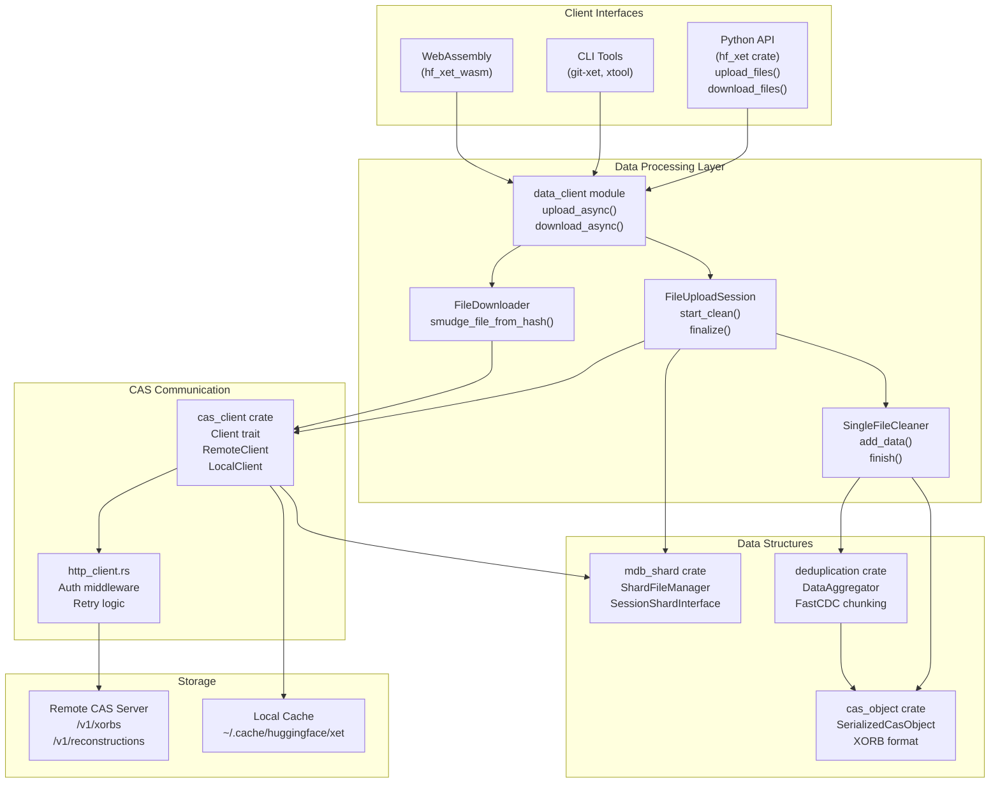
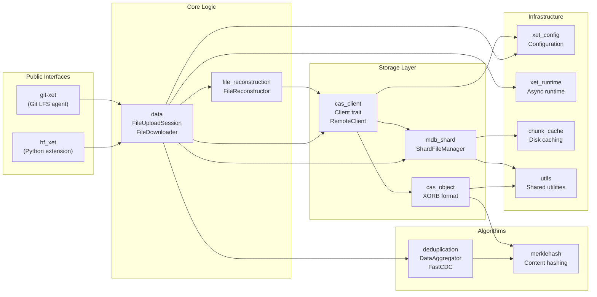
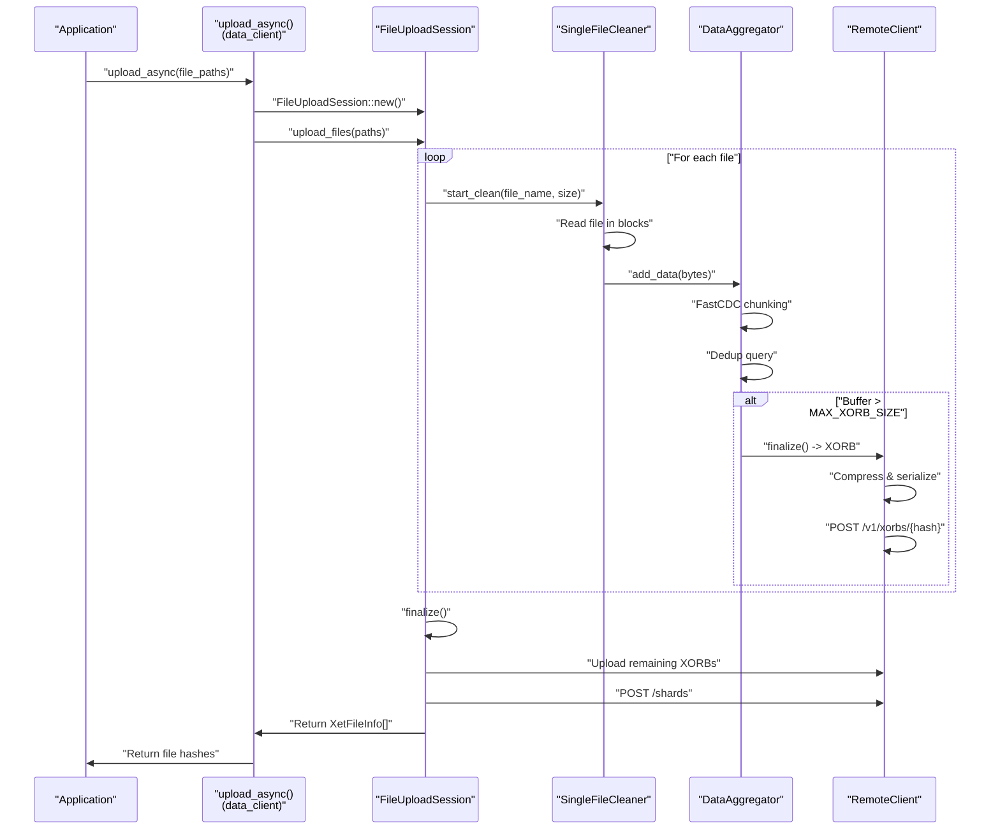
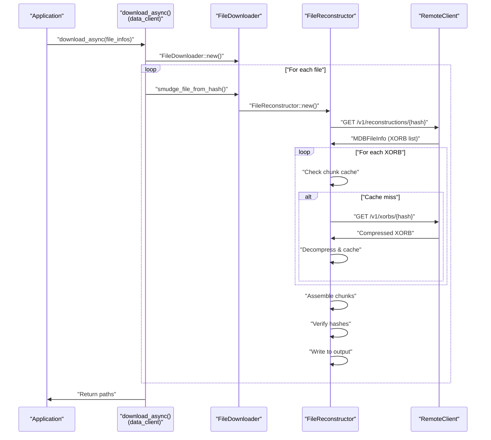
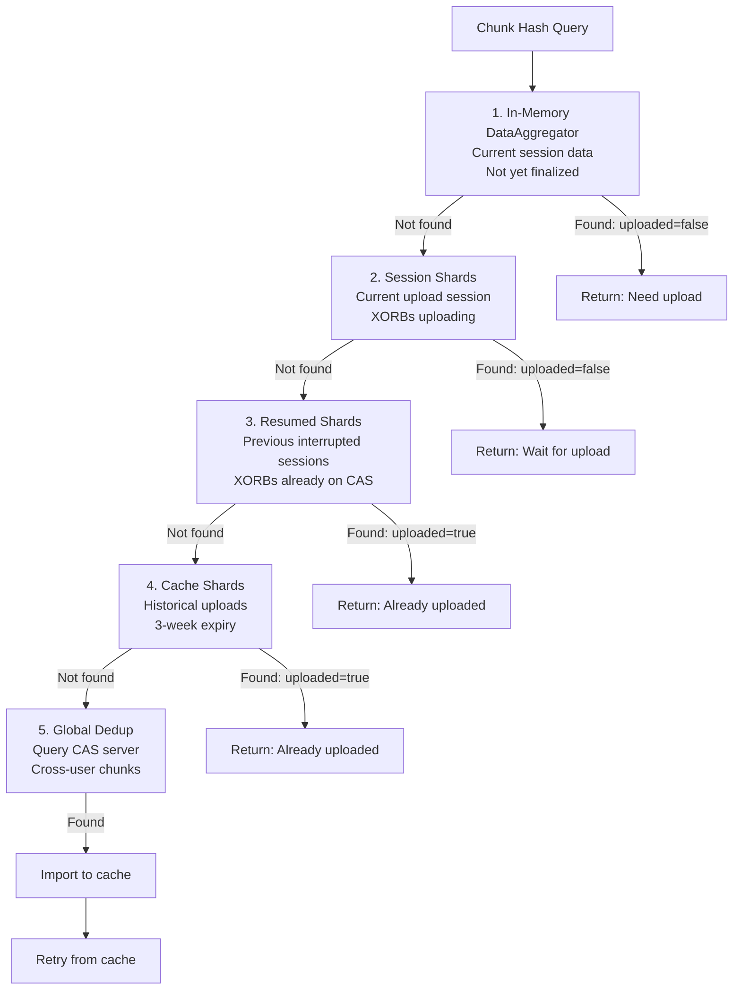

<!-- source: DeepWiki mcp.deepwiki.com · repo huggingface/xet-core · page 1 Overview · fetched 2026-10-26 -->

# Overview

<details>
<summary>Relevant source files</summary>

The following files were used as context for generating this wiki page:

- [Cargo.lock](Cargo.lock)
- [Cargo.toml](Cargo.toml)
- [cas_client/Cargo.toml](cas_client/Cargo.toml)
- [cas_client/src/error.rs](cas_client/src/error.rs)
- [cas_client/src/http_client.rs](cas_client/src/http_client.rs)
- [cas_client/src/remote_client.rs](cas_client/src/remote_client.rs)
- [cas_client/src/retry_wrapper.rs](cas_client/src/retry_wrapper.rs)
- [data/Cargo.toml](data/Cargo.toml)
- [data/src/bin/example.rs](data/src/bin/example.rs)
- [data/src/data_client.rs](data/src/data_client.rs)
- [data/src/file_upload_session.rs](data/src/file_upload_session.rs)
- [data/src/lib.rs](data/src/lib.rs)
- [data/tests/test_clean_smudge.rs](data/tests/test_clean_smudge.rs)
- [hf_xet/Cargo.lock](hf_xet/Cargo.lock)
- [hf_xet/Cargo.toml](hf_xet/Cargo.toml)
- [hf_xet/src/lib.rs](hf_xet/src/lib.rs)

</details>


The `xet-core` repository implements a content-addressable storage (CAS) system designed for efficient file deduplication and transfer operations at scale. The system enables applications to upload and download files with automatic deduplication across files and users, reducing storage costs and transfer bandwidth.

This document provides a high-level overview of the system architecture, core concepts, and main components. For detailed information about specific subsystems, see:
- Upload/download workflows: [Upload Workflow](#5.1) and [Download Workflow](#5.2)
- Deduplication architecture: [Deduplication Architecture](#2.3)
- Python integration: [Python Integration](#4.2)
- Configuration options: [Configuration and Constants](#3.7)

## System Purpose

The xet-core system provides:

1. **Content-addressable storage** with automatic deduplication at the chunk level using FastCDC (content-defined chunking)
2. **Multiple client interfaces**: Python extension (`hf_xet`), command-line tools (`git-xet`, `xtool`), and WebAssembly modules
3. **Efficient data transfer** through compressed binary objects (XORBs) and metadata shards (MDB shards)
4. **Local caching** to minimize redundant downloads and support offline operation
5. **Cross-user deduplication** to maximize storage efficiency in production deployments

**Sources**: [data/src/data_client.rs:1-390](), [hf_xet/Cargo.toml:1-78](), [hf_xet/src/lib.rs:1-346]()

## Core Concepts

### XORBs (Extended Object Blocks)

XORBs are the fundamental storage unit for file content in the system. Each XORB:
- Contains multiple content-defined chunks compressed together
- Has a maximum size controlled by `MAX_XORB_BYTES` and `MAX_XORB_CHUNKS`
- Uses LZ4 or byte grouping compression schemes
- Is identified by a content hash for deduplication

**Sources**: [data/src/file_upload_session.rs:374-388](), [Diagram 2: Upload Data Flow Architecture]()

### MDB Shards

MDB (Merkle Database) shards store metadata about file reconstructions:
- Map file hashes to lists of XORB hashes and byte ranges
- Enable efficient querying for which chunks belong to which files
- Support local caching and session management
- Organized in three tiers: session shards, cache shards, and resumed shards

**Sources**: [data/src/configurations.rs:62-68](), [Diagram 4: Deduplication and Caching Architecture]()

### Content-Defined Chunking

Files are split into variable-size chunks using the FastCDC algorithm:
- Produces content-defined boundaries that remain stable across file edits
- Target chunk size controlled by `TARGET_CHUNK_SIZE` constant
- Chunks are hashed using BLAKE3 for content addressing
- Enables deduplication of common data segments across different files

**Sources**: [Diagram 2: Upload Data Flow Architecture](), [data/src/file_upload_session.rs:189-219]()

## System Architecture

### High-Level Component Structure



**Sources**: [Diagram 1: Overall System Architecture](), [data/src/data_client.rs:1-96](), [hf_xet/src/lib.rs:40-125](), [data/src/file_upload_session.rs:40-71](), [data/src/file_downloader.rs:17-59]()

### Module Dependencies

The system is organized into distinct Rust crates with clear dependency relationships:



**Sources**: [Diagram 5: Module Dependency and Crate Structure](), [hf_xet/Cargo.toml:12-20](), [data/src/file_upload_session.rs:1-22](), [data/src/file_downloader.rs:1-15]()

## Primary Interfaces

### Python API (hf_xet)

The Python extension provides the primary interface for applications:

| Function | Purpose | Location |
|----------|---------|----------|
| `upload_files()` | Upload files from disk paths | [hf_xet/src/lib.rs:84-125]() |
| `upload_bytes()` | Upload in-memory byte arrays | [hf_xet/src/lib.rs:42-80]() |
| `download_files()` | Download files using XetFileInfo | [hf_xet/src/lib.rs:129-168]() |

The Python API wraps the core data client functions and handles:
- Token refresh callbacks for authentication
- Progress update callbacks for tracking
- Async/sync bridge using `async_run()`

**Example usage pattern**:
```python
import hf_xet

# Upload files
file_infos = hf_xet.upload_files(
    ["path/to/file1.txt", "path/to/file2.txt"],
    endpoint="https://cas.example.com",
    token_info=("token", expiry_timestamp),
    token_refresher=refresh_callback,
    progress_updater=progress_callback
)

# Download files
paths = hf_xet.download_files(
    [PyXetDownloadInfo(dest_path, hash, size)],
    endpoint="https://cas.example.com",
    token_info=("token", expiry_timestamp)
)
```

**Sources**: [hf_xet/src/lib.rs:40-168](), [data/src/data_client.rs:98-240]()

### Command-Line Tools

The system provides command-line interfaces for:
- **git-xet**: Custom Git LFS transfer agent for seamless Git integration
- **xtool**: Standalone tool for file deduplication and migration
- **example binary**: Demonstrates clean/smudge operations

**Sources**: [data/src/bin/example.rs:1-157](), [Diagram 1: Overall System Architecture]()

## Data Flow Patterns

### Upload Flow



**Sources**: [Diagram 2: Upload Data Flow Architecture](), [data/src/data_client.rs:143-199](), [data/src/file_upload_session.rs:149-248]()

### Download Flow



**Sources**: [Diagram 3: Download and Reconstruction Flow](), [data/src/data_client.rs:202-240](), [data/src/file_downloader.rs:33-58]()

## Configuration and Initialization

The system uses a configuration hierarchy to control behavior:

| Configuration Component | Purpose | Source |
|------------------------|---------|--------|
| `TranslatorConfig` | Main configuration container | [data/src/configurations.rs:76-82]() |
| `DataConfig` | Endpoint, compression, auth settings | [data/src/configurations.rs:18-25]() |
| `ShardConfig` | Shard cache and session directories | [data/src/configurations.rs:63-68]() |
| `xet_config()` | Global runtime constants | [data/src/data_client.rs:18]() |

**Default configuration initialization**:

The `default_config()` function in [data/src/data_client.rs:30-96]() sets up:
1. Cache directory resolution (`HF_XET_CACHE` or `HF_HOME` environment variables)
2. Endpoint tagging for cache separation
3. Authentication configuration with token refresh support
4. Session and staging directories

**Sources**: [data/src/data_client.rs:30-96](), [data/src/configurations.rs:76-163]()

## Deduplication Strategy

The system implements a five-tier deduplication hierarchy:



This hierarchy maximizes deduplication opportunities while ensuring correctness:
- **Tier 1-2**: Session-local deduplication (highest priority)
- **Tier 3-4**: Local cache deduplication (fast, no network)
- **Tier 5**: Global deduplication (requires network query)

The `uploaded` flag in dedup results allows the system to distinguish between data that needs uploading versus data already persisted, preventing duplicate uploads.

**Sources**: [Diagram 4: Deduplication and Caching Architecture](), [data/src/file_upload_session.rs:60-71]()

## Production Deployment

In production environments, the system operates as a client-server architecture:

| Component | Location | Purpose |
|-----------|----------|---------|
| **Client Libraries** | User machines | Python extension, Git binary, WASM module |
| **Local Cache** | `~/.cache/huggingface/xet` | Chunk and shard caching (3-week expiry) |
| **CAS Server** | Remote infrastructure | XORB and shard storage, dedup queries |
| **CDN** | Edge locations | Accelerated downloads via presigned URLs |

**Authentication flow**:
1. Client receives Hugging Face JWT token with expiration
2. Token included in Authorization header for all requests
3. Automatic token refresh via callback when near expiration
4. Server validates token and applies rate limits/quotas

**Sources**: [Diagram 6: Production Deployment Architecture](), [data/src/data_client.rs:49-50](), [hf_xet/src/lib.rs:51-52]()

## Key Design Patterns

### Async Runtime

The system uses Tokio for async operations with:
- Global semaphores to limit concurrent file ingestion and downloads
- Task spawning for parallel XORB uploads
- Async/await throughout the stack

**Key concurrency controls**:
- `CONCURRENT_FILE_INGESTION_LIMITER`: Controls parallel file processing during upload
- `CONCURRENT_FILE_DOWNLOAD_LIMITER`: Controls parallel file downloads
- Per-client upload permits for rate limiting

**Sources**: [data/src/file_upload_session.rs:35-38](), [data/src/data_client.rs:25-28]()

### Progress Tracking

The system provides detailed progress updates through:
- `TrackingProgressUpdater` trait for byte-level tracking
- `AggregatingProgressUpdater` for batched updates to reduce overhead
- `CompletionTracker` for file-XORB dependency tracking
- Separate tracking for total bytes vs transfer bytes (deduplication visibility)

**Sources**: [data/src/file_upload_session.rs:55-71](), [hf_xet/src/lib.rs:51-52]()

### Session Management

Upload operations use session-based coordination:
- Each `FileUploadSession` has a unique session ID (ULID)
- Session state includes in-progress XORBs, shard metadata, and dedup cache
- Checkpoint support allows interrupted sessions to resume
- Finalization ensures atomic upload completion

**Sources**: [data/src/file_upload_session.rs:40-147](), [data/src/file_upload_session.rs:445-500]()

---

This overview establishes the foundation for understanding xet-core. For detailed information about specific subsystems, workflows, and implementation details, refer to the subsequent pages in this wiki.

---

