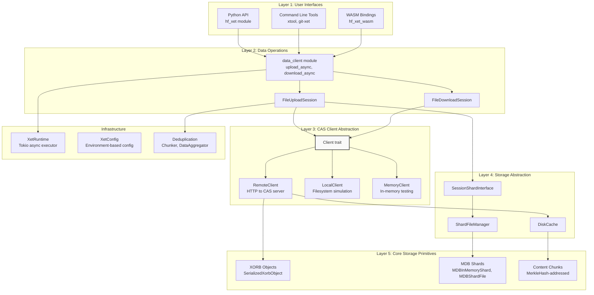
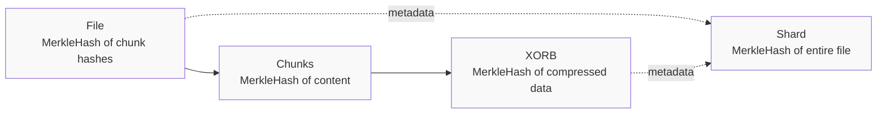
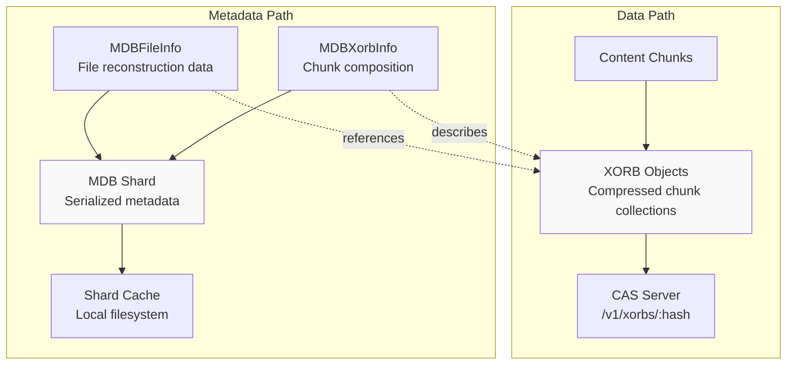
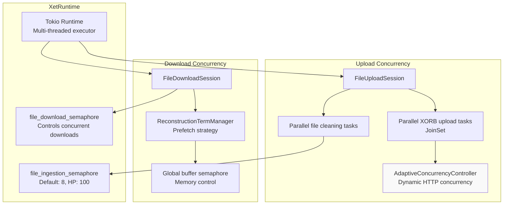
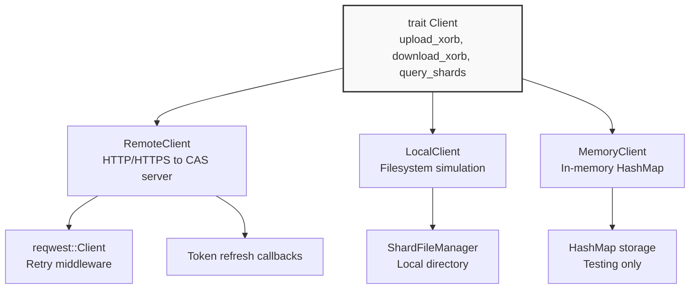
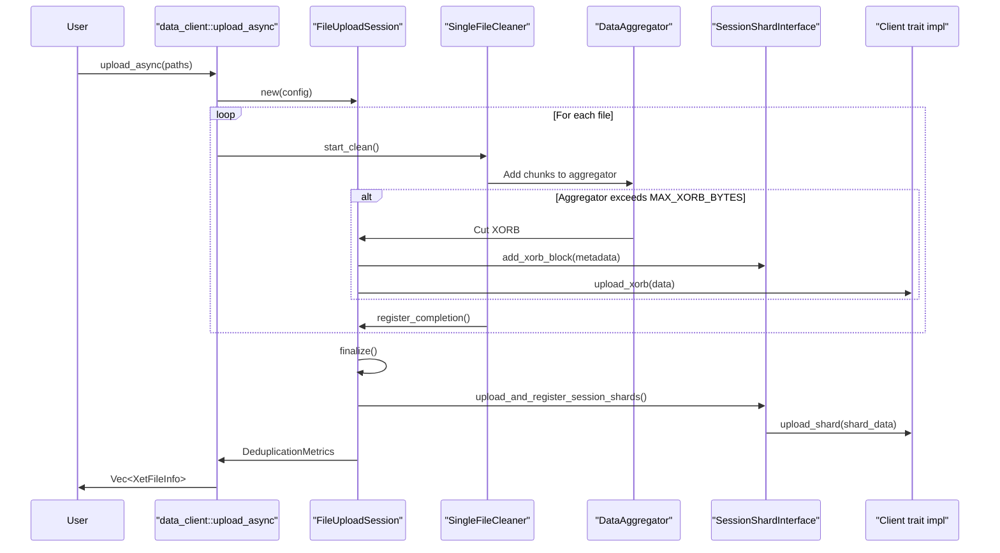
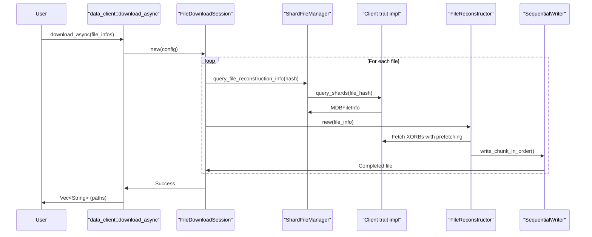
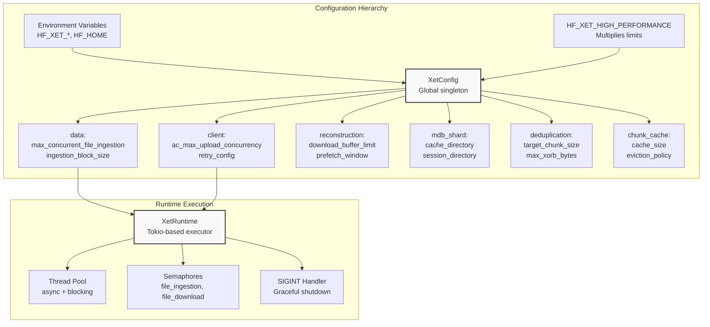
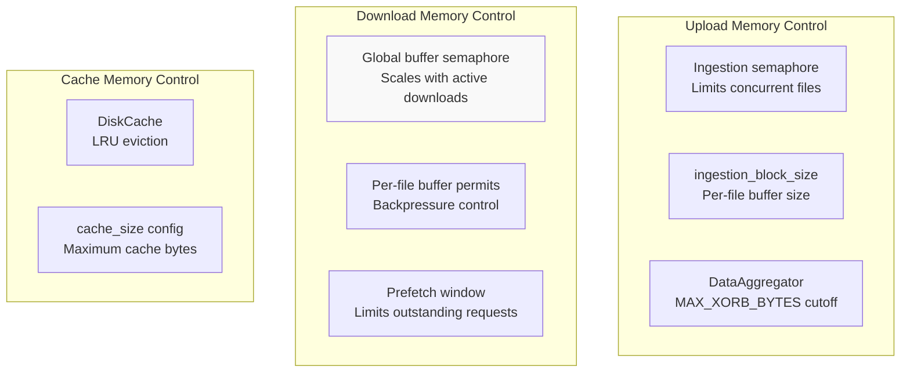

<!-- source: DeepWiki mcp.deepwiki.com · repo huggingface/xet-core · page 2 Architecture · fetched 2026-10-26 -->

# Architecture

<details>
<summary>Relevant source files</summary>

The following files were used as context for generating this wiki page:

- [data/src/bin/example.rs](data/src/bin/example.rs)
- [data/src/data_client.rs](data/src/data_client.rs)
- [data/src/file_upload_session.rs](data/src/file_upload_session.rs)
- [data/src/lib.rs](data/src/lib.rs)
- [data/tests/test_clean_smudge.rs](data/tests/test_clean_smudge.rs)
- [mdb_shard/Cargo.toml](mdb_shard/Cargo.toml)
- [mdb_shard/src/file_structs.rs](mdb_shard/src/file_structs.rs)
- [mdb_shard/src/lib.rs](mdb_shard/src/lib.rs)
- [mdb_shard/src/set_operations.rs](mdb_shard/src/set_operations.rs)
- [mdb_shard/src/shard_format.rs](mdb_shard/src/shard_format.rs)
- [mdb_shard/src/shard_in_memory.rs](mdb_shard/src/shard_in_memory.rs)
- [mdb_shard/src/streaming_shard.rs](mdb_shard/src/streaming_shard.rs)
- [utils/src/async_read.rs](utils/src/async_read.rs)

</details>


This document describes the high-level architectural patterns and design principles of xet-core. It provides an overview of the major subsystems, their relationships, and the foundational design decisions that shape the codebase.

For details on the content-addressable storage format (XORBs, shards, chunks), see [Content-Addressable Storage Design](#2.1). For information about upload and download flows, see [Data Flow and Processing](#2.2). For the deduplication system, see [Deduplication Architecture](#2.3).

## Layered Architecture

xet-core follows a strict layered architecture where each layer has a well-defined responsibility and interacts only with adjacent layers.



**Sources:** [data/src/data_client.rs:1-410](), [data/src/file_upload_session.rs:1-648](), [data/src/file_download_session.rs]()

### Layer Responsibilities

| Layer | Components | Responsibility |
|-------|------------|----------------|
| **User Interfaces** | Python API, CLI tools, WASM | Present user-facing APIs, handle authentication, convert to internal types |
| **Data Operations** | `FileUploadSession`, `FileDownloadSession`, `data_client` | Orchestrate multi-file operations, manage sessions, coordinate progress tracking |
| **CAS Client** | `RemoteClient`, `LocalClient`, `MemoryClient` | Abstract storage backend, handle HTTP/network operations, implement retry logic |
| **Storage Abstraction** | `ShardFileManager`, `SessionShardInterface`, `DiskCache` | Manage metadata and caching, provide query interfaces, coordinate shard lifecycle |
| **Storage Primitives** | XORB, MDB Shard, Chunk | Define on-disk formats, implement serialization, provide reconstruction data |

**Sources:** [data/src/lib.rs:1-25](), [mdb_shard/src/lib.rs:1-29]()

## Key Architectural Principles

### 1. Content-Addressable Everything

All data is identified by its content hash (`MerkleHash`). This applies at multiple levels:



- **Files** are identified by the aggregated hash of their constituent chunk hashes (computed via `merklehash::file_hash`)
- **Chunks** are identified by the hash of their decompressed content
- **XORBs** are identified by the hash of their compressed payload
- **Shards** are identified by the hash of the entire shard file

This enables:
- Automatic deduplication at the chunk level
- Verification of data integrity at every level
- Location-independent addressing

**Sources:** [data/src/data_client.rs:312-364](), [mdb_shard/src/file_structs.rs:1-634]()

### 2. Separation of Data and Metadata

The architecture strictly separates data storage from metadata storage:



- **Data objects (XORBs)** contain only compressed chunks
- **Metadata objects (Shards)** contain reconstruction information, lookup tables, and statistics
- This separation allows efficient queries without downloading data

**Sources:** [mdb_shard/src/shard_format.rs:1-800](), [mdb_shard/src/file_structs.rs:349-471]()

### 3. Asynchronous and Concurrent Design

All I/O operations use async/await with Tokio for efficient concurrency:



Key concurrency mechanisms:
- **Semaphores** limit resource usage (`file_ingestion_semaphore`, buffer limits)
- **AdaptiveConcurrencyController** adjusts HTTP parallelism based on RTT and success rates
- **JoinSet** manages parallel upload tasks
- **Spawn blocking** offloads CPU-intensive work (compression, hashing)

**Sources:** [data/src/file_upload_session.rs:165-235](), [xet_runtime/src/lib.rs](), [cas_client/src/adaptive_concurrency.rs]()

### 4. Pluggable Storage Backends

The `Client` trait abstracts the storage backend, enabling multiple implementations:



The abstraction enables:
- **Production**: `RemoteClient` with HTTP retry and authentication
- **Local testing**: `LocalClient` using filesystem paths prefixed with `local://`
- **Unit tests**: `MemoryClient` for fast in-memory operations

**Sources:** [cas_client/src/interface.rs](), [cas_client/src/remote_client.rs](), [cas_client/src/local_client.rs]()

## Component Interaction Patterns

### Upload Session Lifecycle



**Sources:** [data/src/data_client.rs:140-197](), [data/src/file_upload_session.rs:143-245](), [data/src/file_upload_session.rs:450-505]()

### Download Session Lifecycle



**Sources:** [data/src/data_client.rs:199-257](), [file_reconstruction/src/lib.rs]()

## Configuration and Runtime Management

Configuration follows a hierarchical model with environment variable overrides:



**High-Performance Mode** multiplies concurrency limits:
- File ingestion: 8 → 100
- Upload concurrency: 32 → 124
- Download buffer: 4GB → 64GB

**Sources:** [xet_runtime/src/config.rs](), [xet_runtime/src/runtime.rs](), [data/src/configurations.rs]()

## Error Handling and Resilience

The architecture implements multiple layers of error handling:

| Layer | Mechanism | Implementation |
|-------|-----------|----------------|
| **HTTP** | Exponential backoff retry | `RetryClientMiddleware` in `cas_client` |
| **Network** | Adaptive concurrency | `AdaptiveConcurrencyController` adjusts based on failures |
| **Data** | Content verification | All objects verified against `MerkleHash` |
| **Session** | Transactional upload | XORBs uploaded before shards; atomic shard registration |
| **Cache** | LRU eviction | `DiskCache` with configurable size limits |
| **Runtime** | SIGINT handling | Graceful task cancellation via `check_sigint_shutdown()` |

**Sources:** [cas_client/src/retry_client.rs](), [cas_client/src/adaptive_concurrency.rs](), [chunk_cache/src/lib.rs]()

## Storage Format Versioning

Shards include versioned headers and footers to support backward compatibility:

```rust
// From shard_format.rs
const MDB_SHARD_HEADER_VERSION: u64 = 2;
const MDB_SHARD_FOOTER_VERSION: u64 = 1;
const MDB_SHARD_HEADER_TAG: [u8; 32] = [
    b'H', b'F', b'R', b'e', b'p', b'o', ...
];
```

- **Header** contains magic number and version
- **Footer** contains offsets and metadata
- Version checks prevent incompatible format usage

**Sources:** [mdb_shard/src/shard_format.rs:36-100]()

## Memory Management

Memory usage is controlled through several mechanisms:



- **Upload**: Limited by file concurrency × block size × 2 (double buffering)
- **Download**: Dynamically scaled buffer semaphore prevents runaway memory
- **Cache**: LRU eviction maintains configured size limit

**Sources:** [data/src/file_upload_session.rs:194-216](), [file_reconstruction/src/buffer_manager.rs](), [chunk_cache/src/disk_cache.rs]()

---

