<!-- source: DeepWiki mcp.deepwiki.com · repo huggingface/xet-core · page 2.1 Content-Addressable Storage Design · fetched 2026-10-26 -->

# Content-Addressable Storage Design

<details>
<summary>Relevant source files</summary>

The following files were used as context for generating this wiki page:

- [chunk_cache/Cargo.toml](chunk_cache/Cargo.toml)
- [chunk_cache/src/disk.rs](chunk_cache/src/disk.rs)
- [chunk_cache/src/disk/cache_item.rs](chunk_cache/src/disk/cache_item.rs)
- [chunk_cache/src/disk/test_utils.rs](chunk_cache/src/disk/test_utils.rs)
- [chunk_cache/src/lib.rs](chunk_cache/src/lib.rs)
- [data/src/configurations.rs](data/src/configurations.rs)
- [mdb_shard/Cargo.toml](mdb_shard/Cargo.toml)
- [mdb_shard/src/file_structs.rs](mdb_shard/src/file_structs.rs)
- [mdb_shard/src/lib.rs](mdb_shard/src/lib.rs)
- [mdb_shard/src/set_operations.rs](mdb_shard/src/set_operations.rs)
- [mdb_shard/src/shard_format.rs](mdb_shard/src/shard_format.rs)
- [mdb_shard/src/shard_in_memory.rs](mdb_shard/src/shard_in_memory.rs)
- [mdb_shard/src/streaming_shard.rs](mdb_shard/src/streaming_shard.rs)
- [utils/src/async_read.rs](utils/src/async_read.rs)

</details>


## Purpose and Scope

This document describes the content-addressable storage (CAS) architecture at the core of xet-core. It explains how data is chunked, compressed, addressed by cryptographic hashes, and stored in XORB (XET Object Repository Block) containers. This page focuses on the storage format and addressing scheme. For details on the upload/download workflows that use this storage system, see [Data Flow and Processing](#2.2). For the deduplication mechanisms that leverage content addressing, see [Deduplication Architecture](#2.3).

## Content Addressing Fundamentals

The xet-core system uses content-addressable storage, where data is identified and retrieved by its cryptographic hash rather than by location. This design enables automatic deduplication: identical content always produces the same hash, allowing the system to detect and eliminate redundant storage.

### Hash-Based Addressing Model

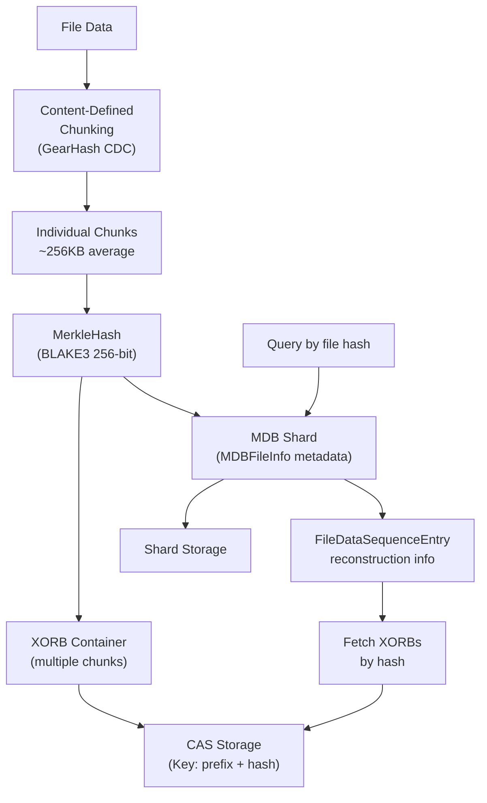

**Content Addressing Flow**

Sources: [mdb_shard/src/file_structs.rs:1-50](), [deduplication/](https://github.com/huggingface/xet-core/tree/main/deduplication)

The system uses `MerkleHash` as the addressing primitive, a 256-bit BLAKE3 hash. Each chunk is identified by its `MerkleHash`, computed over the chunk's raw bytes. The architecture consists of three layers:

- **Chunk Layer**: Content-defined chunks (via GearHash) addressed by `MerkleHash`
- **XORB Layer**: Compressed chunk collections addressed by their own `MerkleHash`  
- **Shard Layer**: Metadata linking file hashes to XORB reconstruction information

This multi-layer design enables:
- **Global deduplication**: Identical chunks produce identical hashes across all users and files
- **Integrity verification**: Each layer's hash serves as a checksum to detect corruption
- **Efficient lookups**: Hashes provide uniform distribution for indexing
- **Metadata separation**: File reconstruction metadata stored separately from chunk data

Sources: [mdb_shard/src/file_structs.rs:27-50](), [cas_types/src/lib.rs](https://github.com/huggingface/xet-core/tree/main/cas_types/src/lib.rs)

## XORB (XET Object Repository Block) Format

XORBs are the fundamental storage containers in the CAS system. A XORB aggregates multiple compressed chunks into a single serialized blob, optimizing for bulk transfer and storage efficiency.

### XORB Structure Overview

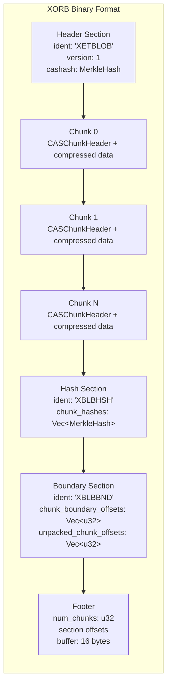

**XORB Binary Layout**

Sources: [cas_object/src/cas_object_format.rs:280-357]()

### XORB Metadata Structure

The `CasObjectInfoV1` structure defines the XORB metadata, which is serialized at the end of the XORB blob:

| Section | Fields | Description |
|---------|--------|-------------|
| **Header** | `ident: [u8; 7]`<br/>`version: u8`<br/>`cashash: MerkleHash` | Magic bytes "XETBLOB", format version (1), XORB hash |
| **Hash Section** | `ident_hash_section: [u8; 7]`<br/>`hashes_version: u8`<br/>`num_chunks: u32`<br/>`chunk_hashes: Vec<MerkleHash>` | Magic bytes "XBLBHSH", list of chunk hashes |
| **Boundary Section** | `ident_boundary_section: [u8; 7]`<br/>`boundaries_version: u8`<br/>`num_chunks: u32`<br/>`chunk_boundary_offsets: Vec<u32>`<br/>`unpacked_chunk_offsets: Vec<u32>` | Magic bytes "XBLBBND", chunk boundaries in compressed and uncompressed space |
| **Footer** | `num_chunks: u32`<br/>`hashes_section_offset_from_end: u32`<br/>`boundary_section_offset_from_end: u32`<br/>`_buffer: [u8; 16]` | Fixed-size footer for seeking to sections |

Sources: [cas_object/src/cas_object_format.rs:281-357]()

The footer is positioned at a fixed offset from the end of the XORB, enabling efficient metadata parsing without reading the entire blob. The offset fields allow seeking directly to the hash and boundary sections.

### XORB Serialization and Deserialization

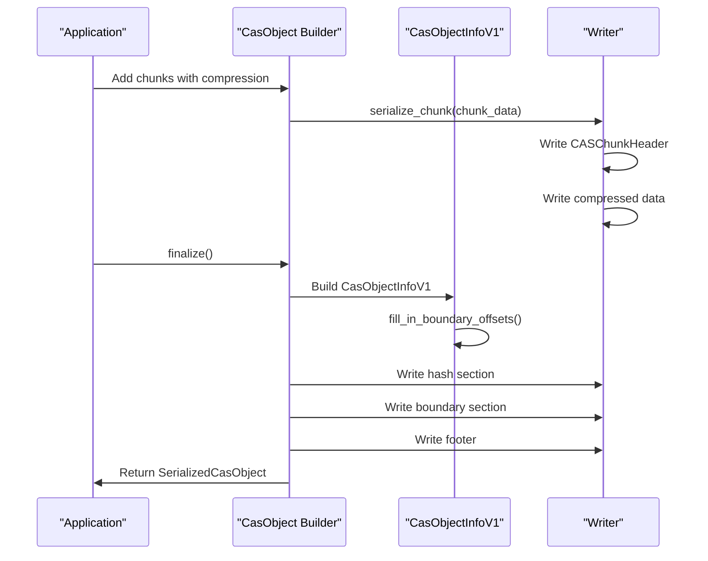

**XORB Build Process**

Sources: [cas_object/src/cas_object_format.rs:399-479](), [cas_object/src/lib.rs:1-11]()

Key implementation details:

- **Serialization**: `CasObjectInfoV1::serialize()` writes the metadata sections in order [cas_object/src/cas_object_format.rs:402-479]()
- **Deserialization**: `CasObjectInfoV1::deserialize()` reads from the footer backwards [cas_object/src/cas_object_format.rs:484-602]()
- **Partial deserialization**: `deserialize_only_boundaries_section()` reads just boundaries for range queries [cas_object/src/cas_object_format.rs:607-673]()
- **Async support**: `deserialize_async()` provides non-blocking deserialization [cas_object/src/cas_object_format.rs:789-804]()

Sources: [cas_object/src/cas_object_format.rs:399-804]()

## Chunk Format and Compression

Each chunk within a XORB is independently compressed and prefixed with a header describing the compression scheme and sizes.

### Chunk Header Structure

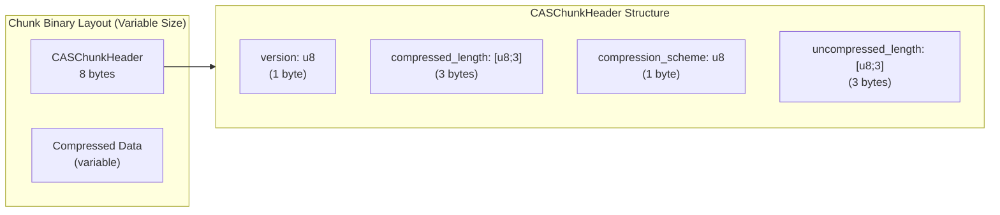

**Chunk Format Layout**

Sources: [cas_object/src/cas_chunk_format.rs:13-23]()

The `CASChunkHeader` is an 8-byte packed structure:

```rust
#[repr(C, packed)]
pub struct CASChunkHeader {
    pub version: u8,              // 1 byte
    compressed_length: [u8; 3],   // 3 bytes (24-bit, max 16MB)
    compression_scheme: u8,       // 1 byte
    uncompressed_length: [u8; 3], // 3 bytes (24-bit, max 16MB)
}
```

Sources: [cas_object/src/cas_chunk_format.rs:16-23]()

The use of 3-byte length fields limits individual chunks to 16MB (2^24 bytes), which is sufficient given typical chunk sizes of 8KB-256KB from FastCDC.

### Compression Schemes

The system supports three compression schemes, enumerated by `CompressionScheme`:

| Scheme | Value | Description | Use Case |
|--------|-------|-------------|----------|
| `None` | 0 | No compression | Already compressed data, small chunks |
| `LZ4` | 1 | LZ4 frame compression | General-purpose compression |
| `ByteGrouping4LZ4` | 2 | Byte grouping + LZ4 | Floating-point tensor data |

Sources: [xorb_object/src/compression_scheme.rs](https://github.com/huggingface/xet-core/tree/main/xorb_object/src/compression_scheme.rs)

**ByteGrouping4LZ4** is a specialized scheme that exploits the byte-level patterns in floating-point data:

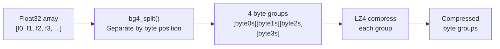

**ByteGrouping4LZ4 Compression Flow**

Sources: [xorb_object/src/compression_scheme.rs](https://github.com/huggingface/xet-core/tree/main/xorb_object/src/compression_scheme.rs)

This scheme achieves better compression on floating-point data (f16, bf16, f32, f64) because grouping by byte position increases locality of similar byte values, improving LZ4's compression ratio.

### Compression Selection

The system automatically selects the compression scheme using a KL-divergence heuristic:

```rust
pub fn choose_from_data(data: &[u8]) -> Self {
    let mut bg4_predictor = BG4Predictor::default();
    bg4_predictor.add_data(0, data);
    
    if bg4_predictor.bg4_recommended() {
        CompressionScheme::ByteGrouping4LZ4
    } else {
        CompressionScheme::LZ4
    }
}
```

Sources: [cas_object/src/compression_scheme.rs:89-99]()

The `BG4Predictor` analyzes the bit-count distribution of the data to determine if byte grouping would be beneficial. This is particularly effective for machine learning model weights stored as tensors.

Sources: [cas_object/src/byte_grouping/]()

## Hash-Based Storage Keys

The CAS system uses a `Key` structure to uniquely identify and retrieve XORBs:

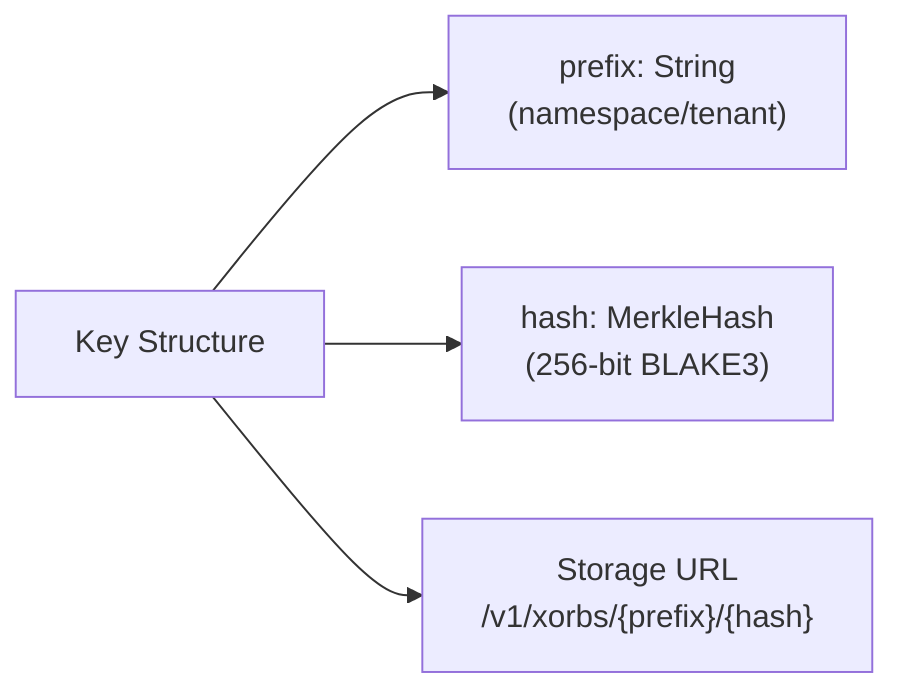

**Key Structure and URL Mapping**

Sources: [cas_types/src/lib.rs](https://github.com/huggingface/xet-core/tree/main/cas_types/src/lib.rs)

The `prefix` field provides multi-tenancy, allowing different users or organizations to maintain separate namespaces while sharing the same CAS infrastructure. The default prefix is `"default"`.

Sources: [cas_client/src/remote_client.rs:30-31]()

## Client-Server Architecture

The CAS system follows a client-server model with the `RemoteClient` implementing the `Client` trait for network operations.

### Client Trait Interface

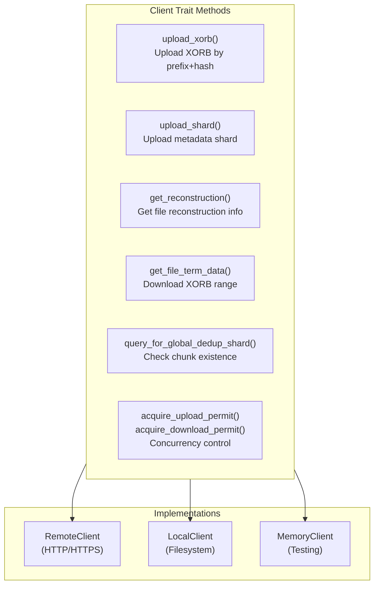

**Client Trait Architecture**

Sources: [cas_client/src/interface.rs](https://github.com/huggingface/xet-core/tree/main/cas_client/src/interface.rs), [cas_client/src/remote_client.rs:39-46]()

### RemoteClient Structure

The `RemoteClient` maintains connection state and configuration:

```rust
pub struct RemoteClient {
    endpoint: String,
    dry_run: bool,
    http_client: Arc<ClientWithMiddleware>,
    authenticated_http_client: Arc<ClientWithMiddleware>,
    upload_concurrency_controller: Arc<AdaptiveConcurrencyController>,
    download_concurrency_controller: Arc<AdaptiveConcurrencyController>,
}
```

Sources: [cas_client/src/remote_client.rs:39-46]()

Key components:
- **Two HTTP clients**: One authenticated (for CAS operations) and one unauthenticated (for presigned URLs)
- **Concurrency controllers**: Adaptive rate limiting for uploads and downloads
- **Endpoint**: Base URL for the CAS server (default: `http://localhost:8080`)

Sources: [cas_client/src/remote_client.rs:48-66]()

### CAS API Endpoints

| Endpoint | Method | Purpose | Request Body | Response |
|----------|--------|---------|--------------|----------|
| `/v1/xorbs/{key}` | POST | Upload XORB | XORB binary data | `UploadXorbResponse` |
| `/shards` | POST | Upload metadata shard | Shard binary data | `UploadShardResponse` |
| `/v1/reconstructions/{file_id}` | GET | Get file reconstruction info | - | `QueryReconstructionResponse` |
| `/v1/chunks/{key}` | GET | Check chunk existence | - | Shard bytes or 404 |

Sources: [cas_client/src/remote_client.rs:73-120](), [cas_client/src/remote_client.rs:365-413](), [cas_client/src/remote_client.rs:415-524](), [cas_client/src/remote_client.rs:170-216]()

### Upload Operation Flow

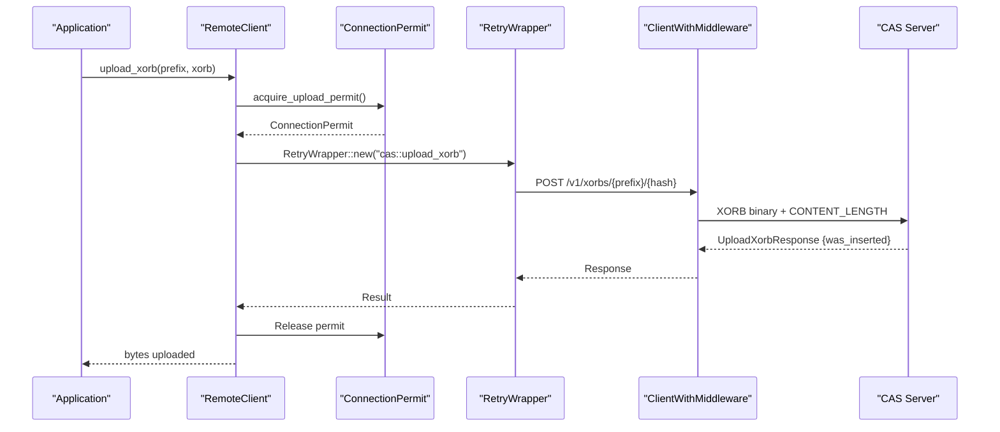

**XORB Upload Sequence**

Sources: [cas_client/src/remote_client.rs:415-524]()

The upload process includes:
1. **Permit acquisition**: Throttles concurrent uploads via `AdaptiveConcurrencyController`
2. **Retry logic**: `RetryWrapper` handles transient failures with exponential backoff
3. **Progress tracking**: Optional `CompletionTracker` for UI updates
4. **Deduplication check**: Server returns `was_inserted: false` if XORB already exists

Sources: [cas_client/src/remote_client.rs:419-524]()

### Download Operation Flow

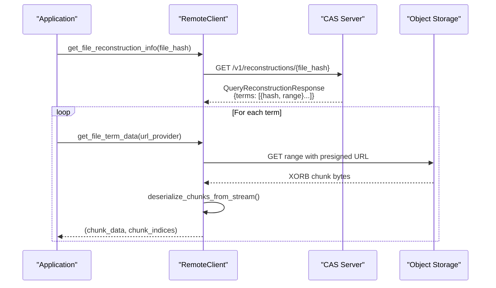

**File Download Sequence**

Sources: [cas_client/src/remote_client.rs:314-351](), [cas_client/src/remote_client.rs:257-312]()

Key features:
- **Presigned URLs**: Downloads use S3 presigned URLs for CDN acceleration
- **URL refresh**: Automatically refreshes expired presigned URLs on 403 responses
- **Streaming decompression**: Chunks are decompressed as they stream in
- **Async deserialization**: Uses `deserialize_chunks_from_stream()` for efficient memory usage

Sources: [cas_client/src/remote_client.rs:257-312](), [cas_object/src/cas_chunk_format/deserialize_async.rs:87-110]()

## Storage Operations Implementation

### Serialization Path

The path from raw chunks to stored XORB:

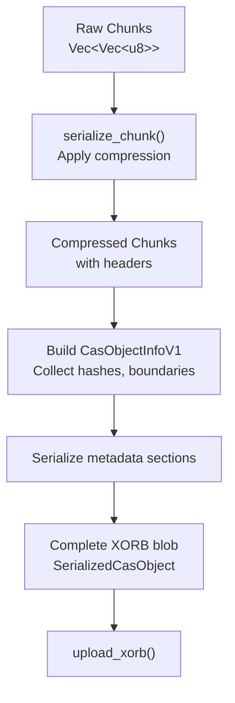

**Serialization Flow**

Sources: [cas_object/src/cas_chunk_format.rs:114-135](), [cas_object/src/cas_object_format.rs:402-479]()

### Deserialization Path

The path from stored XORB to reconstructed file:

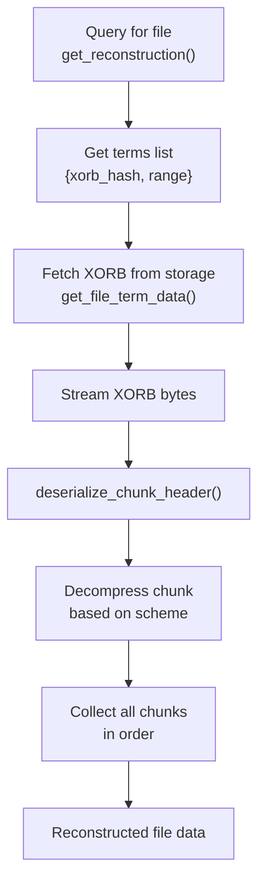

**Deserialization Flow**

Sources: [cas_client/src/remote_client.rs:257-312](), [cas_object/src/cas_chunk_format/deserialize_async.rs:79-110]()

### Error Handling

The CAS client defines specific error types for different failure modes:

| Error Type | Description | Example |
|------------|-------------|---------|
| `CasObjectError` | XORB format errors | Invalid header, corrupted chunk |
| `FileNotFound(MerkleHash)` | File hash not in CAS | Requested file doesn't exist |
| `XORBNotFound(MerkleHash)` | XORB hash not in CAS | Missing XORB during reconstruction |
| `ReqwestError` | Network errors | Timeout, connection refused |
| `PresignedUrlExpirationError` | URL expired during download | Retry with fresh URL |

Sources: [cas_client/src/error.rs:12-65](), [cas_object/src/error.rs:6-35]()

The system distinguishes between retriable errors (network failures, expired URLs) and permanent errors (format corruption, missing data) to guide retry logic.

Sources: [cas_client/src/retry_wrapper.rs](https://github.com/huggingface/xet-core/tree/main/cas_client/src/retry_wrapper.rs)

## Design Rationale

### Footer-at-End Design

Placing metadata at the end of the XORB enables:
- **Streaming writes**: Chunks can be written sequentially without knowing total count upfront
- **Efficient metadata reads**: Fixed footer size allows seeking directly to metadata
- **Append-only writes**: Natural for streaming scenarios

Sources: [cas_object/src/cas_object_format.rs:607-673]()

### Separate Hash and Boundary Sections

The split metadata design allows:
- **Partial reads**: Download only boundaries for range queries without full hash list
- **Extensibility**: New sections can be added without breaking compatibility
- **Validation**: Each section has its own identifier for corruption detection

Sources: [cas_object/src/cas_object_format.rs:280-357]()

### Content-Defined Chunking

Using FastCDC (content-defined chunking) instead of fixed-size chunks:
- **Better deduplication**: Chunk boundaries adapt to content, surviving insertions/deletions
- **Consistent chunk identity**: Same content produces same chunks regardless of file offset

Sources: [deduplication/](https://github.com/huggingface/xet-core/tree/main/deduplication)

### Variable Compression

Supporting multiple compression schemes:
- **Flexibility**: Different data types benefit from different compression
- **Performance**: Skip compression for already-compressed data
- **Optimization**: Specialized schemes (ByteGrouping4LZ4) for specific workloads

Sources: [cas_object/src/compression_scheme.rs:19-100]()

---

