<!-- source: DeepWiki mcp.deepwiki.com · repo huggingface/xet-core · page 2.2 Data Flow and Processing · fetched 2026-10-26 -->

# Data Flow and Processing

<details>
<summary>Relevant source files</summary>

The following files were used as context for generating this wiki page:

- [cas_client/src/adaptive_concurrency/controller.rs](cas_client/src/adaptive_concurrency/controller.rs)
- [cas_client/src/interface.rs](cas_client/src/interface.rs)
- [cas_client/src/lib.rs](cas_client/src/lib.rs)
- [data/src/bin/example.rs](data/src/bin/example.rs)
- [data/src/data_client.rs](data/src/data_client.rs)
- [data/src/file_download_session.rs](data/src/file_download_session.rs)
- [data/src/file_upload_session.rs](data/src/file_upload_session.rs)
- [data/src/lib.rs](data/src/lib.rs)
- [data/src/shard_interface.rs](data/src/shard_interface.rs)
- [data/src/test_utils.rs](data/src/test_utils.rs)
- [data/tests/test_clean_smudge.rs](data/tests/test_clean_smudge.rs)
- [data/tests/test_session_resume.rs](data/tests/test_session_resume.rs)
- [file_reconstruction/Cargo.toml](file_reconstruction/Cargo.toml)
- [file_reconstruction/src/data_writer/data_writer.rs](file_reconstruction/src/data_writer/data_writer.rs)
- [file_reconstruction/src/data_writer/sequential_writer.rs](file_reconstruction/src/data_writer/sequential_writer.rs)
- [file_reconstruction/src/error.rs](file_reconstruction/src/error.rs)
- [file_reconstruction/src/file_reconstructor.rs](file_reconstruction/src/file_reconstructor.rs)
- [hf_xet_wasm/src/wasm_file_upload_session.rs](hf_xet_wasm/src/wasm_file_upload_session.rs)
- [xet_config/src/groups/reconstruction.rs](xet_config/src/groups/reconstruction.rs)

</details>


This page describes how data flows through xet-core during file upload and download operations, including session management, data processing pipelines, and coordination between components. For details on content-addressable storage structure, see [Content-Addressable Storage Design](#2.1). For deduplication mechanics, see [Deduplication Architecture](#2.3). For step-by-step workflows, see [Upload Workflow](#5.1) and [Download Workflow](#5.2).

## Session-Based Processing Model

xet-core organizes all file operations around **sessions** that manage the lifecycle of uploads and downloads. Sessions handle resource allocation, progress tracking, concurrency control, and transactional completion semantics.

### Upload Sessions

The `FileUploadSession` ([data/src/file_upload_session.rs:40-537]()) serves as the central coordinator for upload operations. A session is atomic: either all files are successfully uploaded with their metadata, or the session fails as a unit.

**Session Lifecycle:**

```mermaid
stateDiagram-v2
    [*] --> Created: FileUploadSession::new()
    Created --> Processing: upload_files() / start_clean()
    Processing --> Processing: add_data() on multiple files
    Processing --> Checkpointed: checkpoint() [optional]
    Checkpointed --> Processing: continue processing
    Processing --> Finalizing: finalize()
    Finalizing --> XorbUpload: process_aggregated_data_as_xorb()
    XorbUpload --> ShardUpload: upload_and_register_session_shards()
    ShardUpload --> Completed: session complete
    Completed --> [*]
    
    Processing --> Failed: error in any file
    Finalizing --> Failed: upload failure
    Failed --> [*]
```

**Key State Components:**

| Component | Type | Purpose |
|-----------|------|---------|
| `client` | `Arc<dyn Client>` | CAS communication |
| `shard_interface` | `SessionShardInterface` | Metadata management |
| `current_session_data` | `Mutex<DataAggregator>` | Cross-file dedup accumulator |
| `completion_tracker` | `Arc<CompletionTracker>` | Progress coordination |
| `xorb_upload_tasks` | `Mutex<JoinSet<Result<()>>>` | Concurrent XORB uploads |
| `deduplication_metrics` | `Mutex<DeduplicationMetrics>` | Upload statistics |

Sources: [data/src/file_upload_session.rs:40-66](), [data/src/file_upload_session.rs:83-141]()

### Download Sessions

The `FileDownloadSession` ([data/src/file_download_session.rs:27-220]()) manages download operations with simpler state since downloads are idempotent and don't require transactional coordination.

**Session Lifecycle:**

```mermaid
stateDiagram-v2
    [*] --> Created: FileDownloadSession::new()
    Created --> Active: download_file() / download_stream()
    Active --> Reconstructing: FileReconstructor::run()
    Reconstructing --> QueryPhase: query reconstruction info
    QueryPhase --> FetchPhase: fetch XORBs and chunks
    FetchPhase --> WritePhase: write data sequentially
    WritePhase --> Complete: file written
    Complete --> Active: download next file
    Active --> Finalized: finalize()
    Finalized --> [*]
    
    Active --> Failed: reconstruction error
    Failed --> [*]
```

**Key State Components:**

| Component | Type | Purpose |
|-----------|------|---------|
| `client` | `Arc<dyn Client>` | CAS query and fetch |
| `progress_tracker` | `Option<Arc<DownloadProgressTracker>>` | Session-wide progress |
| `progress_aggregator` | `Option<Arc<AggregatingProgressUpdater>>` | Batched updates |

Sources: [data/src/file_download_session.rs:27-31](), [data/src/file_download_session.rs:33-54]()

## Upload Data Flow

### Entry Points and Configuration

Upload operations begin through one of several entry points in `data_client.rs`:

- `upload_async()`: Upload files from disk ([data/src/data_client.rs:140-197]())
- `upload_bytes_async()`: Upload in-memory byte arrays ([data/src/data_client.rs:96-127]())
- `hash_files_async()`: Compute hashes without uploading ([data/src/data_client.rs:391-410]())

Each creates a `TranslatorConfig` via `default_config()` ([data/src/data_client.rs:27-93]()) which sets up:
- CAS endpoint (server URL or `local://` path)
- Authentication configuration
- Cache directories (endpoint-tagged for isolation)
- Staging directories for temporary session data

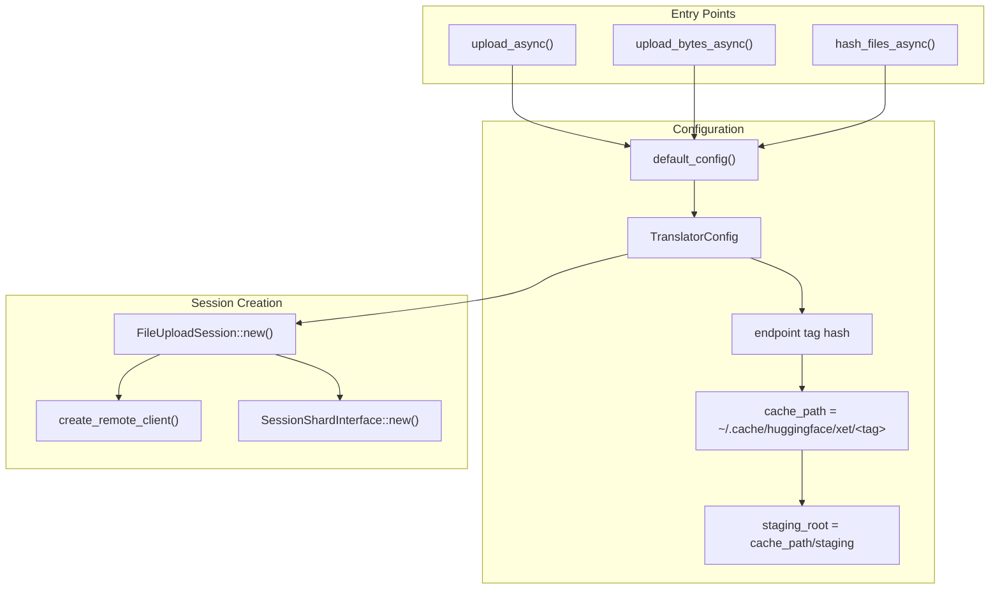

Sources: [data/src/data_client.rs:27-93](), [data/src/data_client.rs:140-197](), [data/src/file_upload_session.rs:83-141]()

### File Processing Pipeline

Individual files flow through `SingleFileCleaner` ([data/src/file_cleaner.rs]()) which orchestrates chunking, deduplication, and aggregation:

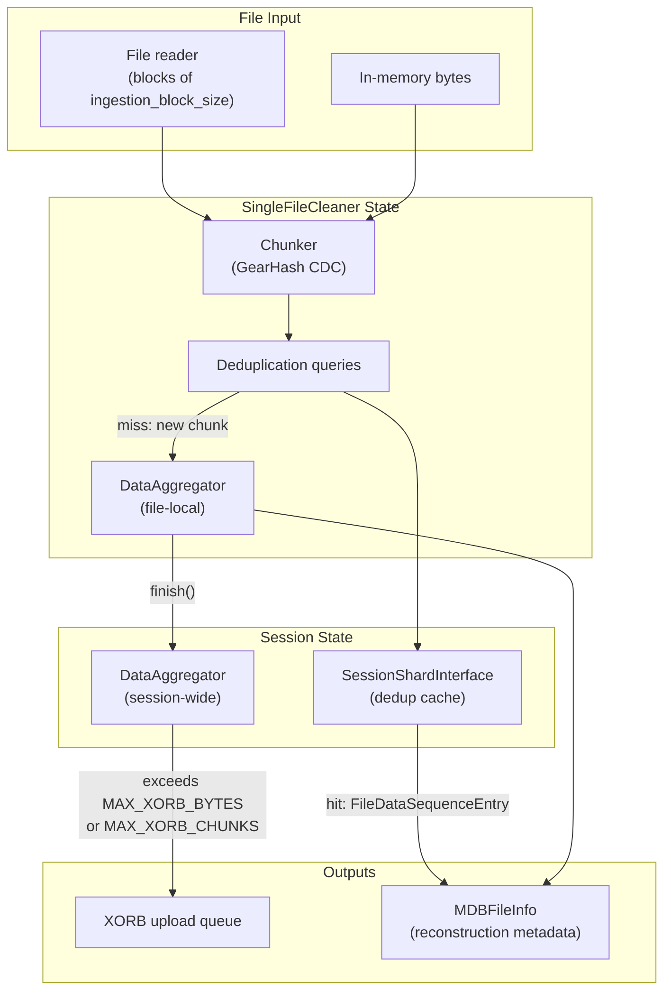

Sources: [data/src/file_cleaner.rs](), [data/src/file_upload_session.rs:184-217]()

**Processing Steps:**

1. **Chunking**: `Chunker::next_block_bytes()` performs content-defined chunking using GearHash ([data/src/file_cleaner.rs:91-101]())
   - Reads file in blocks of `ingestion_block_size` (default 8MB)
   - Produces variable-sized chunks (~256KB average)
   - Each chunk gets a MerkleHash address

2. **Deduplication Query**: For each chunk hash, query the shard interface ([data/src/file_cleaner.rs:103-139]())
   - Check `SessionShardInterface::chunk_hash_dedup_query()` ([data/src/shard_interface.rs:154-180]())
   - Order: resumed session → current session → cache shards → global query
   - On hit: return `FileDataSequenceEntry` pointing to existing XORB
   - On miss: add chunk to local `DataAggregator`

3. **Local Aggregation**: New chunks accumulate in file's `DataAggregator` ([data/src/file_cleaner.rs:68-69]())
   - Tracks chunk data, hashes, and offsets
   - Maintains file reconstruction metadata

4. **Completion**: On `finish()` ([data/src/file_cleaner.rs:142-178]()):
   - Merges local aggregator into session-wide aggregator
   - Updates deduplication metrics
   - Registers file reconstruction info

Sources: [data/src/file_cleaner.rs:50-178](), [data/src/shard_interface.rs:154-180]()

### Data Aggregation and XORB Creation

The session-wide `DataAggregator` ([data/src/file_upload_session.rs:55]()) accumulates chunks across multiple files to maximize deduplication:

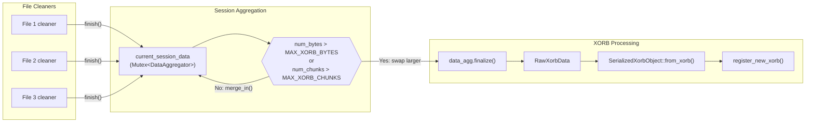

**XORB Cutting Logic** ([data/src/file_upload_session.rs:368-410]()):

When `register_single_file_clean_completion()` is called:
1. Lock `current_session_data`
2. Check if combined size exceeds `MAX_XORB_BYTES` (64MB) or `MAX_XORB_CHUNKS` (8192)
3. If yes:
   - Swap to make larger aggregator the one to finalize
   - Call `process_aggregated_data_as_xorb()` outside lock
4. If no: merge file's data into session aggregator

**XORB Upload** ([data/src/file_upload_session.rs:274-365]()):

1. `register_new_xorb()` checks if XORB already queued (deduplication at XORB level)
2. Register XORB with `CompletionTracker` for progress tracking
3. Register file-to-XORB dependencies
4. Add XORB metadata to `SessionShardInterface`
5. Serialize XORB on compute thread with compression
6. Acquire upload permit from `AdaptiveConcurrencyController`
7. Spawn async upload task with progress callback
8. Task uploads to CAS and marks completion

Sources: [data/src/file_upload_session.rs:274-365](), [data/src/file_upload_session.rs:368-410](), [data/src/file_upload_session.rs:412-442]()

### Session Finalization

The `finalize()` method ([data/src/file_upload_session.rs:450-505]()) completes the upload:

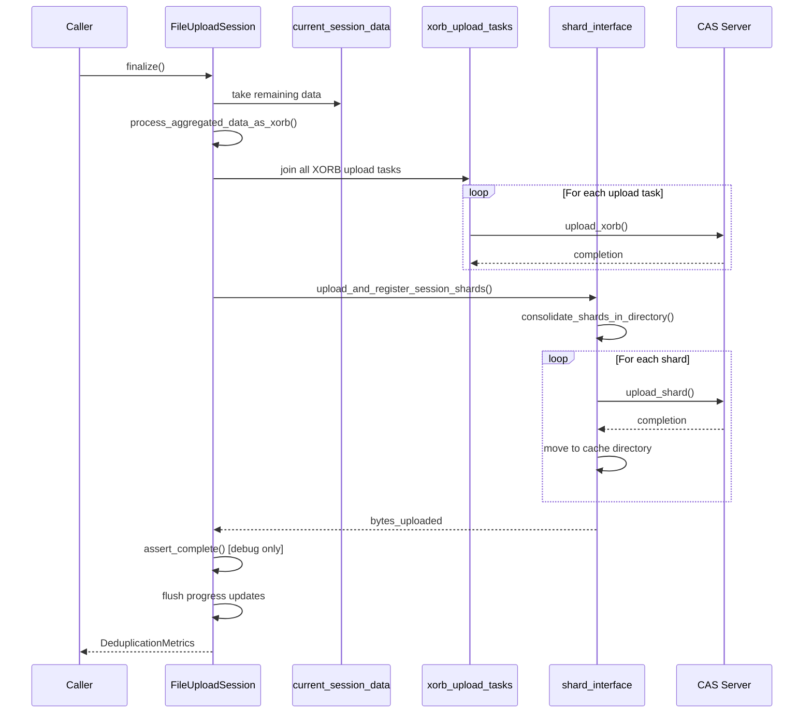

**Steps:**

1. **Final XORB**: Cut remaining aggregated data to XORB
2. **Wait for XORBs**: Join all `xorb_upload_tasks` to ensure completion
3. **Consolidate Shards**: Merge session shards into optimal size
4. **Upload Shards**: Upload each shard with concurrency control
5. **Move to Cache**: Export uploaded shards to cache directory with expiration
6. **Cleanup**: Remove obsolete staged shards from previous incomplete sessions
7. **Assertions**: Verify all uploads complete and progress tracking consistent
8. **Finalize Progress**: Flush aggregated progress updates

Sources: [data/src/file_upload_session.rs:450-505](), [data/src/shard_interface.rs:232-312]()

## Download Data Flow

### Session Initialization and Query

Download begins by setting up a `FileDownloadSession` and querying for reconstruction metadata:

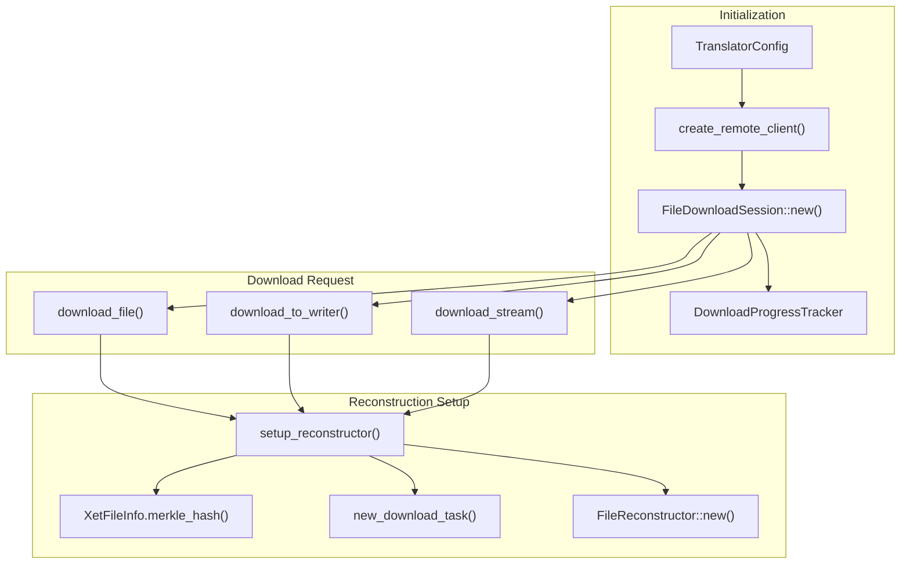

Sources: [data/src/file_download_session.rs:33-54](), [data/src/file_download_session.rs:78-85](), [data/src/file_download_session.rs:187-219]()

### Reconstruction Pipeline

The `FileReconstructor` ([file_reconstruction/src/file_reconstructor.rs:26-355]()) coordinates the entire download process:

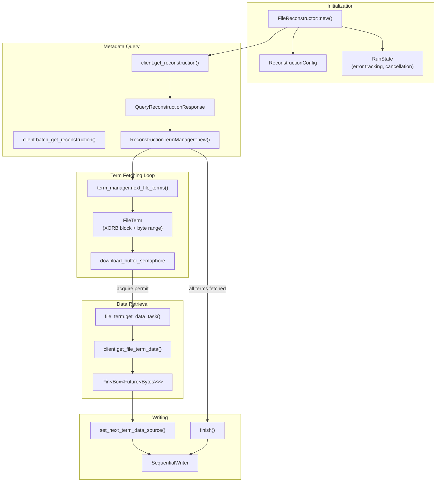

Sources: [file_reconstruction/src/file_reconstructor.rs:105-183](), [file_reconstruction/src/file_reconstructor.rs:184-354]()

### Reconstruction Term Management

`ReconstructionTermManager` ([file_reconstruction/src/reconstruction_terms.rs]()) handles intelligent prefetching and batching:

**Prefetch Strategy:**

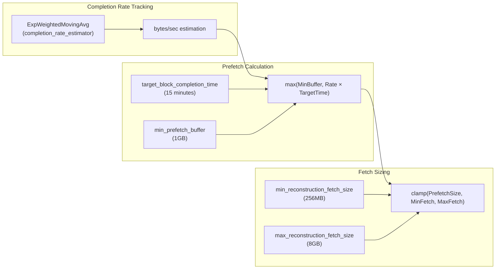

**Query Batching:**

Multiple file terms are fetched in a single HTTP request when possible ([file_reconstruction/src/reconstruction_terms.rs]):
1. Collect up to `min_reconstruction_fetch_size` worth of terms
2. If terms come from different reconstruction blocks, use `batch_get_reconstruction()`
3. Otherwise, request single block with appropriate byte range
4. Returns `Vec<FileTerm>` for parallel processing

Sources: [file_reconstruction/src/reconstruction_terms.rs](), [xet_config/src/groups/reconstruction.rs:1-83]()

### Buffer Management and Backpressure

Memory usage is controlled via dynamic buffer sizing:

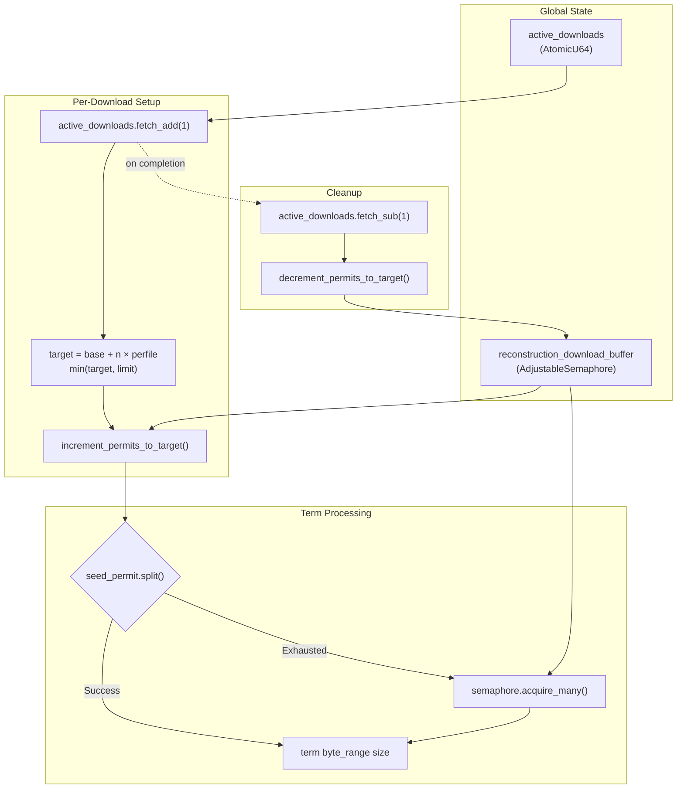

**Buffer Scaling Formula:**
- Base: `download_buffer_size` (2GB default)
- Per-file: `download_buffer_perfile_size` (512MB default)
- Limit: `download_buffer_limit` (8GB default)
- Target: `min(base + n × perfile, limit)` where n = active downloads

**Seed Permit Optimization:**
When a download starts, it gets a "virtual permit" that allows immediate processing without queuing. This permit is split as terms are processed until exhausted, then the download falls back to the shared semaphore queue.

Sources: [file_reconstruction/src/file_reconstructor.rs:211-244](), [file_reconstruction/src/file_reconstructor.rs:286-306]()

### Sequential Writing

`SequentialWriter` ([file_reconstruction/src/data_writer/sequential_writer.rs:220-407]()) ensures in-order writes despite out-of-order term completion:

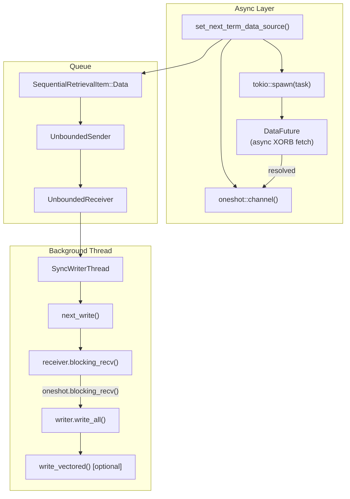

**Key Features:**

1. **Async-to-Sync Bridge**: Spawns tasks for async futures, uses oneshot channels to bridge to blocking thread
2. **Sequential Guarantee**: Validates byte ranges are sequential in `set_next_term_data_source()` ([file_reconstruction/src/data_writer/sequential_writer.rs:239-282]())
3. **Vectorized I/O**: When enabled, batches multiple pending writes into single `write_vectored()` call ([file_reconstruction/src/data_writer/sequential_writer.rs:145-207]())
4. **Buffer Release**: Drops `AdjustableSemaphorePermit` after write completes, freeing memory for next term

**Vectorized Write Batching:**
- Accumulates up to `WRITEV_MAX_SLICE` (24) pending writes
- Builds `Vec<IoSlice>` from `Bytes` buffers
- Calls `write_vectored()` for efficient batched writes
- Handles partial writes by slicing Bytes and retrying

Sources: [file_reconstruction/src/data_writer/sequential_writer.rs:220-407](), [file_reconstruction/src/data_writer/sequential_writer.rs:145-207]()

## Session Management Details

### Upload Session State Transitions

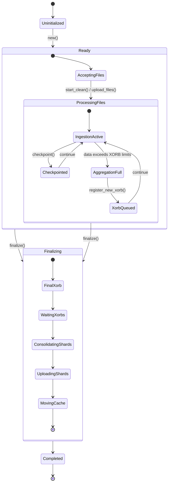

**State Tracking:**
- `xorb_upload_tasks`: Active XORB uploads (checked on completion)
- `current_session_data`: Accumulated chunks (locked, merged on file completion)
- `shard_interface`: Metadata (flushed periodically and on finalize)
- `completion_tracker`: Progress (file/XORB dependency graph)

Sources: [data/src/file_upload_session.rs:40-537](), [data/src/file_upload_session.rs:450-505]()

### Download Session State Transitions

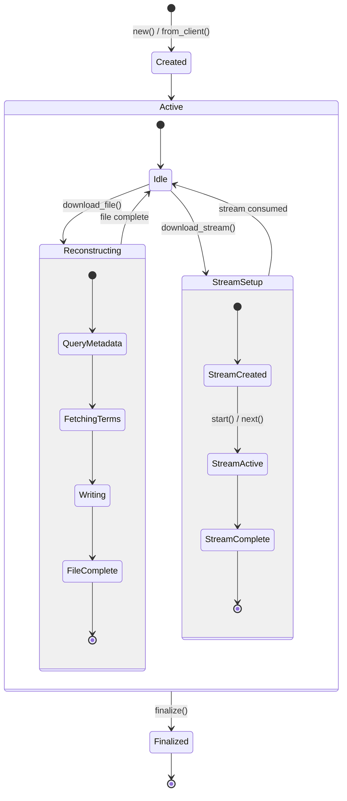

**State Characteristics:**
- Stateless per-file: Each download is independent
- Progress-only state: `progress_tracker` accumulates across files
- No transaction: Downloads can be retried without cleanup

Sources: [data/src/file_download_session.rs:33-181]()

### Concurrency Control

Both upload and download sessions use concurrency limiters:

**Upload Concurrency:**

| Semaphore | Default | Controls |
|-----------|---------|----------|
| `file_ingestion_semaphore` | 8 | Parallel file reading/chunking |
| `upload_concurrency` | 32 (adaptive) | Concurrent XORB/shard uploads |

**Download Concurrency:**

| Semaphore | Default | Controls |
|-----------|---------|----------|
| `file_download_semaphore` | 4 | Parallel file reconstructions |
| `download_concurrency` | 32 (adaptive) | Concurrent XORB fetches |
| `reconstruction_download_buffer` | Dynamic | Memory usage |

The `AdaptiveConcurrencyController` ([cas_client/src/adaptive_concurrency/controller.rs:214-568]()) dynamically adjusts upload/download concurrency based on:
- RTT prediction (online linear regression)
- Success ratio (exponentially weighted moving average)
- Network conditions (bandwidth estimation)

Sources: [xet_config/src/groups/data.rs](), [xet_config/src/groups/client.rs](), [cas_client/src/adaptive_concurrency/controller.rs:214-568]()

### Progress Tracking Integration

Progress flows through multiple layers:

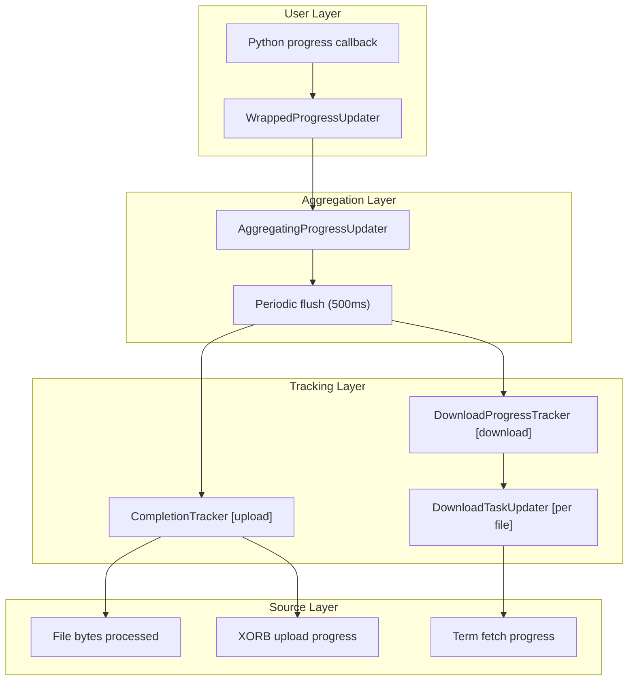

**Upload Progress:**
- `CompletionTracker` maintains file→XORB dependency graph
- Reports completion only when all XORB dependencies uploaded
- Batches updates via `AggregatingProgressUpdater`

**Download Progress:**
- `DownloadTaskUpdater` per file/range
- Reports bytes as written (not fetched)
- Aggregated at session level via `DownloadProgressTracker`

Sources: [progress_tracking/src/upload_tracking.rs](), [progress_tracking/src/download_tracking.rs](), [progress_tracking/src/aggregator.rs]()

## Data Processing Stages

### Chunking Stage

Input data flows through `Chunker` ([deduplication/src/chunker.rs]()) which implements GearHash content-defined chunking:

**Chunk Production:**
1. Input: `Bytes` block from file reader
2. Process: Scan for gear hash boundaries (rolling hash = 0 mod 2^N)
3. Output: Variable-sized chunks with MerkleHash addresses

**Configuration:**
- `TARGET_CHUNK_SIZE`: 256KB (average)
- `MIN_CHUNK_SIZE`: 64KB
- `MAX_CHUNK_SIZE`: 1MB

Sources: [deduplication/src/chunker.rs](), [deduplication/src/constants.rs]()

### Deduplication Stage

Chunks are queried against multiple sources in priority order:

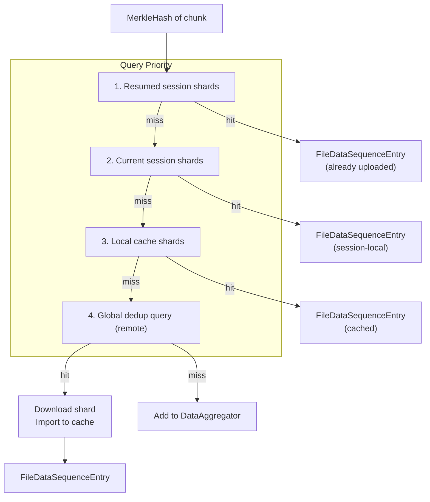

Sources: [data/src/shard_interface.rs:154-180](), [data/src/file_cleaner.rs:103-139]()

### Aggregation Stage

`DataAggregator` ([deduplication/src/data_aggregator.rs]()) accumulates new chunks with metadata:

**Accumulation:**
```rust
// Simplified structure
struct DataAggregator {
    data: Vec<(MerkleHash, Bytes)>,  // Chunk hash and data
    file_info: HashMap<FileId, Vec<FileDataSequenceEntry>>,  // Reconstruction metadata
}
```

**Operations:**
- `add_chunk()`: Append new chunk data
- `merge_in()`: Combine another aggregator
- `finalize()`: Convert to `RawXorbData` and file infos

Sources: [deduplication/src/data_aggregator.rs]()

### Reconstruction Stage

Reverse process for downloads:

1. **Query**: `get_file_reconstruction_info()` → `MDBFileInfo`
2. **Term Extraction**: Parse file's sequence of `FileDataSequenceEntry` records
3. **XORB Fetching**: Download XORBs containing needed chunks
4. **Decompression**: Decompress XORB data (zstd or lz4)
5. **Assembly**: Extract chunk ranges and write in file order

Sources: [file_reconstruction/src/file_reconstructor.rs:184-354](), [file_reconstruction/src/reconstruction_terms.rs]()

---

