<!-- source: DeepWiki mcp.deepwiki.com · repo huggingface/xet-core · page 2.3 Deduplication Architecture · fetched 2026-10-26 -->

# Deduplication Architecture

<details>
<summary>Relevant source files</summary>

The following files were used as context for generating this wiki page:

- [cas_client/src/interface.rs](cas_client/src/interface.rs)
- [cas_client/src/lib.rs](cas_client/src/lib.rs)
- [data/src/bin/example.rs](data/src/bin/example.rs)
- [data/src/data_client.rs](data/src/data_client.rs)
- [data/src/file_upload_session.rs](data/src/file_upload_session.rs)
- [data/src/lib.rs](data/src/lib.rs)
- [data/src/shard_interface.rs](data/src/shard_interface.rs)
- [data/tests/test_clean_smudge.rs](data/tests/test_clean_smudge.rs)
- [hf_xet_wasm/src/wasm_file_upload_session.rs](hf_xet_wasm/src/wasm_file_upload_session.rs)
- [mdb_shard/src/session_directory.rs](mdb_shard/src/session_directory.rs)
- [mdb_shard/src/shard_benchmark.rs](mdb_shard/src/shard_benchmark.rs)
- [mdb_shard/src/shard_file_handle.rs](mdb_shard/src/shard_file_handle.rs)
- [mdb_shard/src/shard_file_manager.rs](mdb_shard/src/shard_file_manager.rs)
- [mdb_shard/src/utils.rs](mdb_shard/src/utils.rs)

</details>


## Purpose and Scope

This document describes the deduplication architecture in xet-core, explaining how duplicate data is eliminated during file uploads. It covers content-defined chunking using GearHash, MerkleHash-based content addressing, and the multi-tier deduplication query system that avoids redundant uploads.

For information about the upload workflow that uses this deduplication system, see [Upload Workflow](#5.1). For details on XORB storage format, see [CAS Object Format (XORB)](#3.4). For shard-based metadata storage, see [Shard Management System](#3.5).

---

## Overview

The deduplication system eliminates redundant data storage by:
1. **Chunking**: Breaking files into variable-sized chunks using content-defined chunking (CDC)
2. **Addressing**: Computing content-based MerkleHash identifiers for each chunk
3. **Querying**: Checking if chunks already exist before uploading
4. **Aggregating**: Grouping new chunks across multiple files into compressed XORBs

This approach enables global deduplication across all files in a repository and across different upload sessions.

**Key Components**

| Component | Location | Purpose |
|-----------|----------|---------|
| `Chunker` | `deduplication` crate | Performs content-defined chunking using GearHash |
| `DataAggregator` | `deduplication` crate | Accumulates chunks and cuts XORBs |
| `SessionShardInterface` | [data/src/shard_interface.rs]() | Orchestrates deduplication queries |
| `ShardFileManager` | [mdb_shard/src/shard_file_manager.rs]() | Provides chunk lookup for dedup queries |
| `SingleFileCleaner` | [data/src/file_cleaner.rs]() | Processes individual files with dedup |

Sources: [data/src/data_client.rs:1-410](), [data/src/file_upload_session.rs:1-648](), [mdb_shard/src/shard_file_manager.rs:1-564]()

---

## Content-Defined Chunking (CDC)

### Chunking Process

The system uses **GearHash**, a rolling hash algorithm, to identify chunk boundaries based on content rather than fixed byte offsets. This ensures that identical data sequences produce identical chunks even when embedded at different file positions.

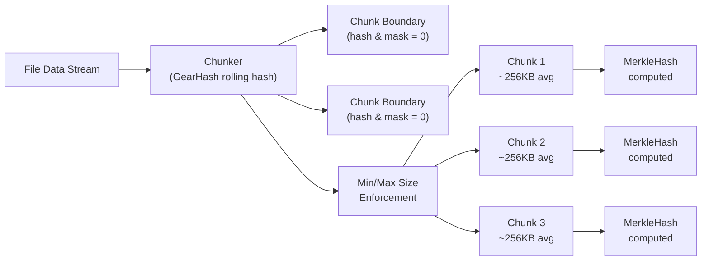

**Chunking in Code**

The `Chunker` is invoked during file upload processing:

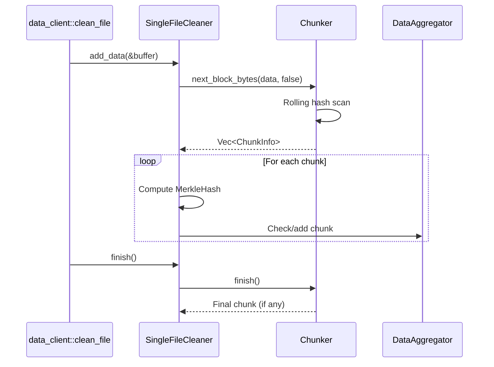

The chunker maintains state across multiple `add_data()` calls, ensuring correct boundary detection regardless of read buffer sizes. When the file completes, `chunker.finish()` is called to emit any remaining data as the final chunk.

Sources: [data/src/data_client.rs:333-364](), [data/src/file_upload_session.rs:184-217]()

### Chunk Size Parameters

The chunking algorithm uses configurable parameters (defined in `deduplication::constants`):

| Parameter | Default | Purpose |
|-----------|---------|---------|
| `TARGET_CHUNK_SIZE` | ~256 KB | Average chunk size target |
| `MIN_CHUNK_SIZE` | 16 KB | Minimum chunk boundary |
| `MAX_CHUNK_SIZE` | 1 MB | Maximum chunk boundary |

These parameters balance deduplication effectiveness (smaller chunks = better dedup) against metadata overhead and compression efficiency (larger chunks = less overhead).

Sources: [data/tests/test_clean_smudge.rs:1-11]()

---

## MerkleHash Addressing

### Content-Based Addressing

Each chunk is identified by its **MerkleHash**—a cryptographic hash of its content. This content-addressing scheme provides:
- **Deduplication**: Identical content produces identical hashes
- **Integrity**: Hash mismatches detect corruption
- **Immutability**: Content cannot change without changing its hash

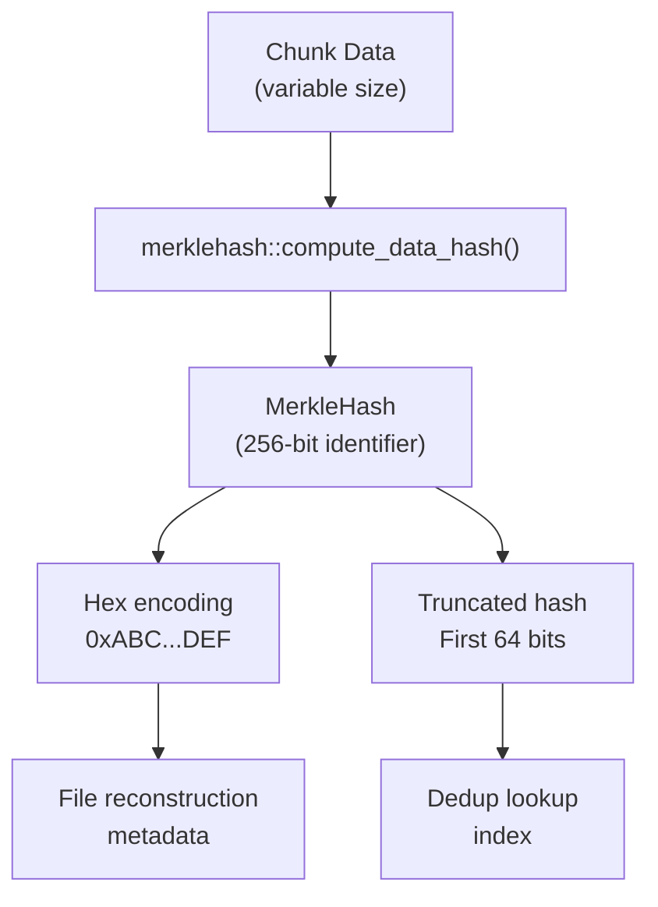

The `MerkleHash` type is a 256-bit hash used throughout the system:
- Full hash stored in file reconstruction metadata
- Truncated 64-bit hash used for dedup lookup indices
- Hex encoding used in filenames and external references

Sources: [mdb_shard/src/utils.rs:30-33](), [data/src/data_client.rs:338-363]()

### Hash Aggregation

File-level hashes are computed from chunk hashes:

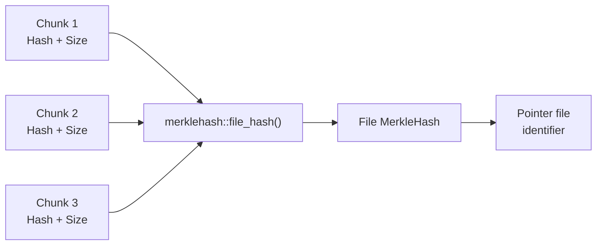

The `merklehash::file_hash()` function aggregates chunk hashes and sizes to produce a deterministic file-level hash. This enables file-level deduplication and verification without re-chunking.

Sources: [data/src/data_client.rs:362-363]()

---

## Deduplication Query System

### Multi-Tier Query Architecture

The deduplication system performs queries across multiple tiers to determine if chunks need uploading:

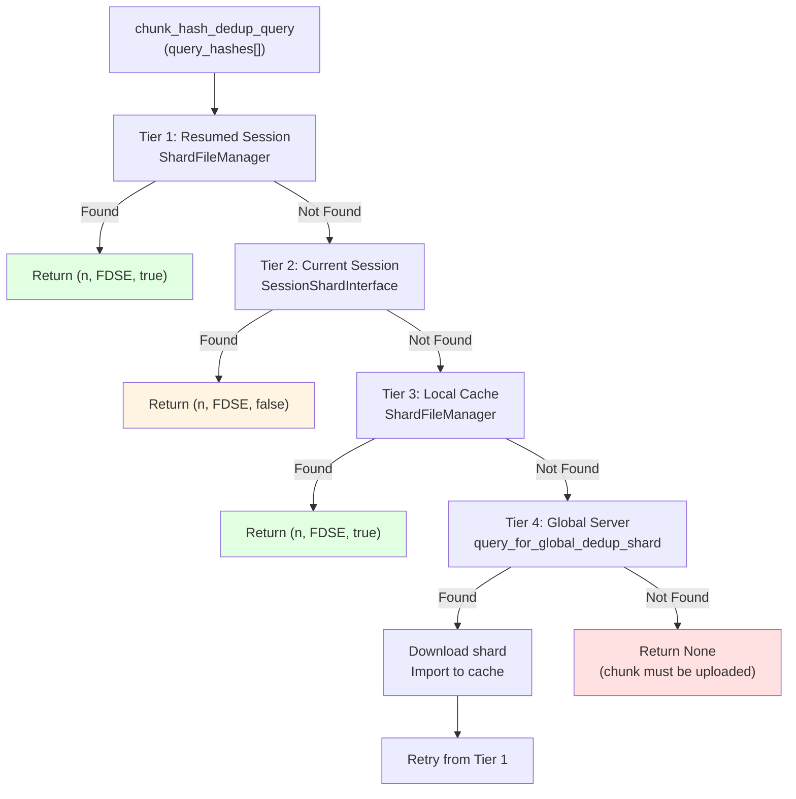

**Return Value Semantics**

The query returns `Option<(usize, FileDataSequenceEntry, bool)>`:
- `usize`: Number of consecutive chunks matched
- `FileDataSequenceEntry`: XORB location and chunk range
- `bool`: Whether the XORB is already uploaded (`true`) or session-local (`false`)

This information allows the upload process to:
1. Skip uploading duplicate chunks
2. Reference existing XORBs in file reconstruction metadata
3. Track dependencies between files and XORBs for completion tracking

Sources: [data/src/shard_interface.rs:154-180](), [mdb_shard/src/shard_file_manager.rs:410-446]()

### Query Implementation

**SessionShardInterface Query Flow**

[data/src/shard_interface.rs:154-180]()

```
async fn chunk_hash_dedup_query(
    &self,
    query_hashes: &[MerkleHash],
) -> Result<Option<(usize, FileDataSequenceEntry, bool)>>
```

The query checks three local sources before attempting a remote query:

1. **Resumed Session**: Previously staged XORBs from interrupted uploads
2. **Current Session**: XORBs queued for upload in this session
3. **Cache**: XORBs successfully uploaded in previous sessions

**ShardFileManager Chunk Lookup**

[mdb_shard/src/shard_file_manager.rs:410-446]()

```
async fn chunk_hash_dedup_query(
    &self,
    query_hashes: &[MerkleHash],
) -> Result<Option<(usize, FileDataSequenceEntry)>>
```

The shard file manager maintains an in-memory index:

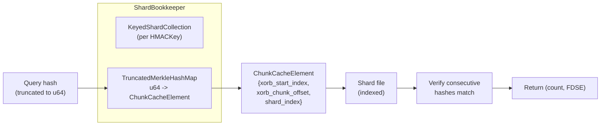

The truncated hash lookup is a performance optimization—truncating to 64 bits reduces memory usage while maintaining negligible collision probability for dedup purposes.

Sources: [mdb_shard/src/shard_file_manager.rs:28-73](), [mdb_shard/src/shard_file_manager.rs:252-332]()

### Global Deduplication

When local queries fail, the system can query a global dedup server:

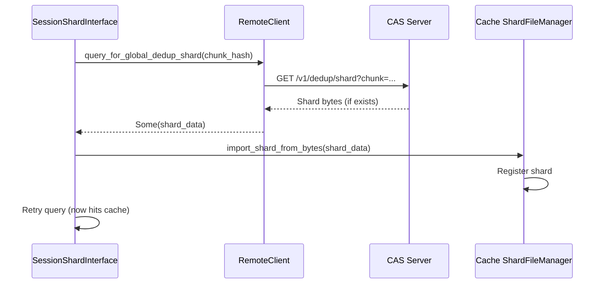

The server returns a complete shard containing the queried chunk's XORB metadata. This shard is imported into the local cache, making subsequent queries for related chunks faster.

Sources: [data/src/shard_interface.rs:135-151]()

---

## Data Aggregation and XORB Formation

### DataAggregator Role

The `DataAggregator` collects chunks across multiple files before cutting XORBs. This cross-file aggregation maximizes deduplication opportunities and compression efficiency.

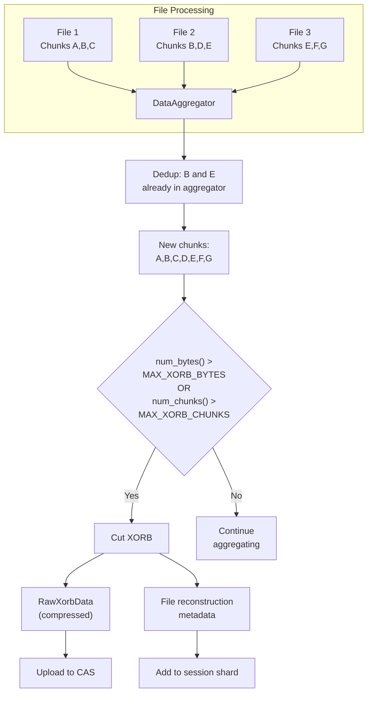

**Aggregation Logic**

[data/src/file_upload_session.rs:368-410]()

When a file completes processing:

```
async fn register_single_file_clean_completion(
    &self,
    mut file_data: DataAggregator,
    dedup_metrics: &DeduplicationMetrics,
) -> Result<()>
```

The session checks if adding the file's data would exceed XORB size limits:
- `MAX_XORB_BYTES`: 64 MB maximum uncompressed size
- `MAX_XORB_CHUNKS`: 8192 chunks maximum

If limits would be exceeded, the larger aggregator (session or file) is cut into a XORB and uploaded.

Sources: [data/src/file_upload_session.rs:368-410]()

### XORB Cutting Strategy

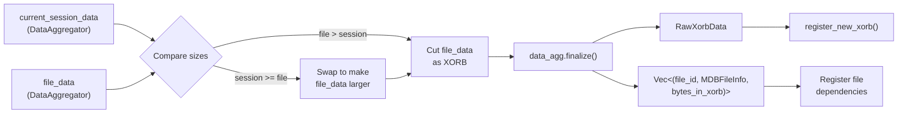

This strategy ensures:
1. XORBs are cut at reasonable sizes for compression/transmission
2. The session aggregator continues accumulating data
3. Files can share XORBs when uploaded concurrently

Sources: [data/src/file_upload_session.rs:374-396](), [data/src/file_upload_session.rs:412-442]()

---

## Deduplication Metrics

The system tracks deduplication effectiveness through `DeduplicationMetrics`:

| Metric | Description |
|--------|-------------|
| `new_bytes` | Bytes uploaded as new data |
| `deduped_bytes` | Bytes skipped due to deduplication |
| `defrag_prevented_dedup_bytes` | Bytes that couldn't be deduped due to fragmentation |
| `new_chunks` | Number of new chunks created |
| `deduped_chunks` | Number of chunks deduplicated |
| `defrag_prevented_dedup_chunks` | Chunks that couldn't be deduped |

These metrics are aggregated at both file and session levels and recorded in tracing spans for observability.

Sources: [data/src/data_client.rs:130-196](), [data/src/file_upload_session.rs:218-228]()

---

## Integration with Upload Pipeline

### Complete Upload Flow with Deduplication

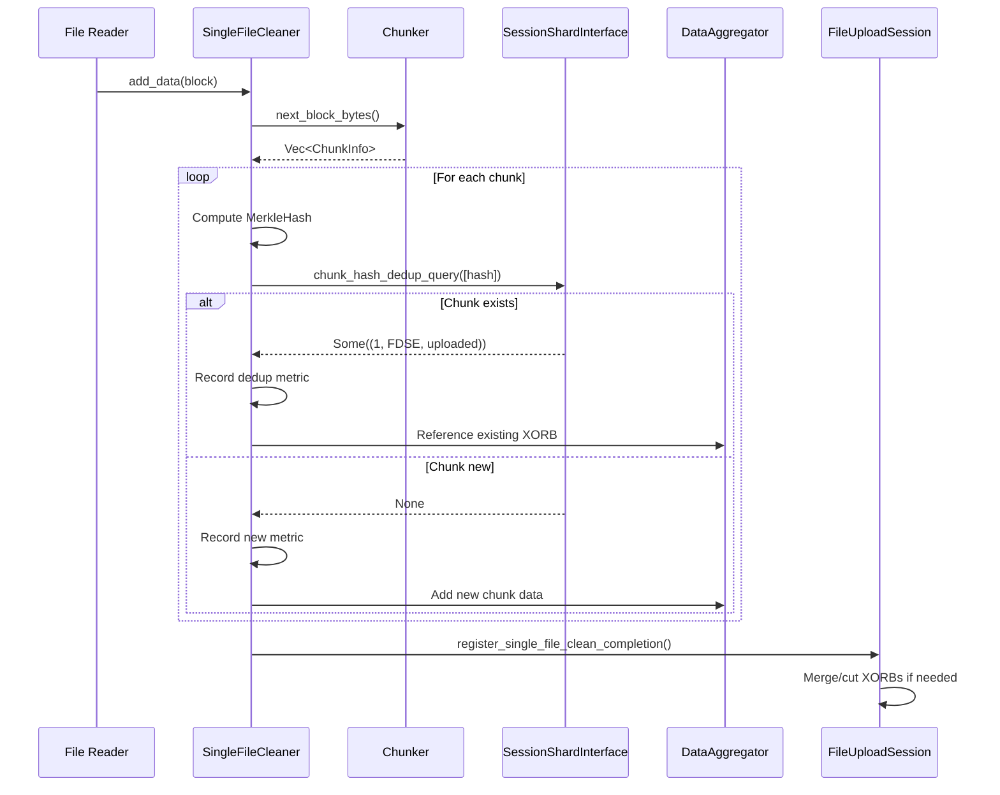

**File Processing Entry Point**

[data/src/file_upload_session.rs:143-245]()

```
pub async fn upload_files(
    self: &Arc<Self>,
    files_sha256_and_tracking_ids: impl IntoIterator<Item = (impl AsRef<Path>, Option<Sha256>, Ulid)> + Send,
) -> Result<Vec<XetFileInfo>>
```

Each file is processed concurrently (up to `max_concurrent_file_ingestion` limit), with deduplication queries performed during chunk processing. The session aggregator collects all new data and cuts XORBs as needed.

Sources: [data/src/file_upload_session.rs:143-245](), [data/src/data_client.rs:140-197]()

### Hash-Only Mode

For verification without upload, the system supports hash-only computation:

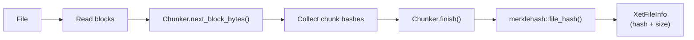

[data/src/data_client.rs:333-410]()

```
pub async fn hash_files_async(file_paths: Vec<String>) -> Result<Vec<XetFileInfo>>
```

This mode performs the same chunking and hashing but skips dedup queries and uploads. It's used for:
- Verifying downloaded files
- Checking if files need uploading
- Generating cache keys

Sources: [data/src/data_client.rs:333-410]()

---

## Summary

The deduplication architecture achieves efficient storage through:

1. **Content-Defined Chunking**: GearHash produces identical chunks for identical content regardless of position
2. **Content Addressing**: MerkleHash provides cryptographic identification and verification
3. **Multi-Tier Queries**: Local and global lookups minimize redundant data transfer
4. **Cross-File Aggregation**: DataAggregator maximizes XORB compression and dedup opportunities

This design enables global deduplication across repositories and sessions while maintaining reasonable upload performance through local caching and efficient lookup indices.

Sources: All files referenced throughout this document

---

