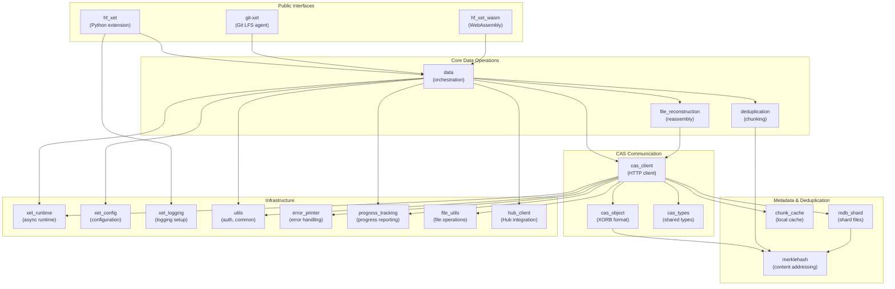
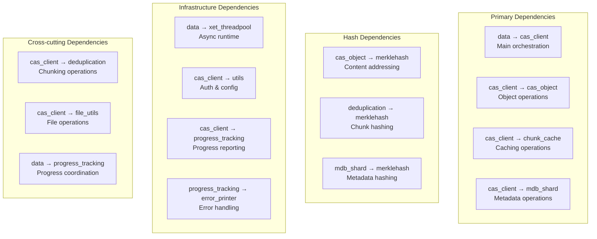

<!-- source: DeepWiki mcp.deepwiki.com · repo huggingface/xet-core · page 3 Core Components · fetched 2026-10-26 -->

# Core Components

Relevant source files

The following files were used as context for generating this wiki page:

- [cas_client/src/error.rs](cas_client/src/error.rs)
- [cas_client/src/http_client.rs](cas_client/src/http_client.rs)
- [cas_client/src/remote_client.rs](cas_client/src/remote_client.rs)
- [cas_client/src/retry_wrapper.rs](cas_client/src/retry_wrapper.rs)
- [data/src/bin/example.rs](data/src/bin/example.rs)
- [data/src/data_client.rs](data/src/data_client.rs)
- [data/src/file_upload_session.rs](data/src/file_upload_session.rs)
- [data/src/lib.rs](data/src/lib.rs)
- [data/tests/test_clean_smudge.rs](data/tests/test_clean_smudge.rs)
- [hf_xet/Cargo.lock](hf_xet/Cargo.lock)
- [hf_xet/Cargo.toml](hf_xet/Cargo.toml)
- [hf_xet/src/lib.rs](hf_xet/src/lib.rs)

This document provides an overview of the major Rust crates that comprise the xet-core system. These crates are organized into distinct layers that handle public interfaces, core data operations, CAS communication, metadata management, and supporting infrastructure.

The system follows a modular architecture where each crate has specific responsibilities and communicates through well-defined interfaces. Understanding these components and their relationships is essential for working with the codebase.

For detailed information about specific subsystems, see:
- [Python API (hf_xet)](#3.1) - Python extension module
- [Data Client and Sessions](#3.2) - Upload/download orchestration
- [CAS Client System](#3.3) - Content-addressable storage client
- [CAS Object Format (XORB)](#3.4) - Binary format for chunks
- [Shard Management System](#3.5) - Metadata and deduplication
- [Chunk Caching](#3.6) - Local disk cache
- [Configuration and Constants](#3.7) - System configuration

## Workspace Structure

The xet-core repository is organized as a Cargo workspace with 22 member crates. The workspace uses a shared resolver (version 2) and defines common dependencies that are reused across crates.

**Workspace Member Crates**

**Sources:** [Cargo.toml:1-24]()

## Crate Dependency Overview

The workspace defines common dependencies that are shared across multiple crates, ensuring version consistency and reducing duplication. Key shared dependencies include:

| Category | Dependencies | Usage |
|----------|--------------|-------|
| **Async Runtime** | `tokio`, `async-trait`, `futures` | Async operations and concurrency |
| **HTTP** | `reqwest`, `reqwest-middleware`, `hyper` | Network communication |
| **Serialization** | `serde`, `serde_json`, `bincode` | Data serialization/deserialization |
| **Hashing** | `blake3`, `sha2` | Content hashing and addressing |
| **Compression** | `lz4_flex` | Data compression in XORBs |
| **CLI** | `clap` | Command-line argument parsing |
| **Error Handling** | `anyhow`, `thiserror` | Error types and propagation |
| **Configuration** | `chrono`, `dirs` | Time handling and path resolution |

**Sources:** [Cargo.toml:37-120]()

## Public Interface Crates

These crates provide the external interfaces for interacting with xet-core:

### hf_xet
The `hf_xet` crate is a Python extension module built with PyO3 that exposes the core functionality to Python applications. It provides the primary interface for Hugging Face Hub integration.

**Crate type:** `cdylib` (Python shared library)  
**Key exports:**
- `upload_files()`: Upload files from disk paths
- `upload_bytes()`: Upload in-memory file contents
- `download_files()`: Download files to disk
- `PyXetUploadInfo`, `PyXetDownloadInfo`: Return types for Python

**Dependencies:** `data`, `cas_client`, `xet_config`, `xet_logging`, `xet_runtime`, `progress_tracking`

**Sources:** [hf_xet/Cargo.toml:1-11](), [hf_xet/src/lib.rs:41-168]()

### git_xet (git-xet)
The `git_xet` crate provides a Git LFS custom transfer agent that integrates xet-core with Git workflows. This crate is excluded from the main workspace to allow independent versioning.

**Crate type:** Binary  
**Key functionality:**
- Git LFS protocol implementation
- Integration with Git LFS smudge/clean filters
- Batch transfer operations

**Sources:** [Cargo.toml:25]()

### hf_xet_wasm
The `hf_xet_wasm` crate compiles xet-core to WebAssembly for browser-based usage. This enables file uploads and downloads directly from web applications.

**Crate type:** WebAssembly module  
**Key considerations:**
- Limited to WASM-compatible dependencies
- No multi-threading support
- Uses browser-based HTTP client

**Sources:** [Cargo.toml:25]()

## Core Data Processing Crates

These crates handle the primary business logic for file operations:

### data
The `data` crate orchestrates file upload and download operations, coordinating between all other system components. It implements the high-level data client API and provides command-line tools.

**Key modules:**
- `data_client`: Public API with `upload_async()`, `download_async()`, `upload_bytes_async()`
- Session management for upload and download operations
- Binaries: `x` (example), `xtool` (migration tool)

**Dependencies:** 
- Primary: `cas_client`, `cas_object`, `deduplication`, `file_reconstruction`, `mdb_shard`
- Infrastructure: `xet_runtime`, `progress_tracking`, `utils`

**Sources:** [data/Cargo.toml:1-16](), [data/Cargo.toml:29-60]()

### deduplication
The `deduplication` crate implements content-defined chunking algorithms and manages the deduplication workflow.

**Key functionality:**
- FastCDC (Content-Defined Chunking) implementation using `gearhash`
- Chunk boundary detection
- Integration with `mdb_shard` for deduplication queries
- Coordination with `merklehash` for content addressing

**Dependencies:** `merklehash`, `mdb_shard`, `progress_tracking`

**Sources:** [Cargo.toml:11]()

### file_reconstruction
The `file_reconstruction` crate handles reassembling files from chunks stored in the CAS system.

**Key functionality:**
- Retrieves chunks from `cas_client` based on reconstruction metadata
- Assembles chunks in correct order to reconstruct files
- Verifies integrity using hashes from `merklehash`

**Dependencies:** `cas_client`, `cas_types`, `merklehash`, `xet_config`, `xet_runtime`

**Sources:** [Cargo.toml:13]()

## CAS Communication Crates

These crates handle all communication with the Content-Addressable Storage system:

### cas_client
The `cas_client` crate is the central component for CAS operations, providing HTTP-based communication with remote CAS servers and local filesystem-based storage for development/testing.

**Key modules:**
- `Client` trait: Unified interface for CAS operations
- `RemoteClient`: HTTP-based CAS communication using `reqwest`
- `LocalClient`: Filesystem-based CAS for development
- `http_client`: HTTP client setup with authentication and retry middleware
- `retry_wrapper`: Sophisticated retry logic with exponential backoff
- `adaptive_concurrency`: Connection pooling and rate limiting

**Key functions:**
- `upload_xorb()`: Upload compressed chunk bundles
- `get_reconstruction_info()`: Query metadata for file reconstruction
- `exists()`: Check if chunks exist in CAS

**Dependencies:**
- Core: `cas_object`, `cas_types`, `mdb_shard`, `merklehash`
- HTTP: `reqwest`, `reqwest-middleware`, `reqwest-retry`, `hyper`
- Infrastructure: `xet_runtime`, `utils`, `progress_tracking`

**Features:** 
- `rustls-tls` (default): Rust-based TLS implementation
- `native-tls`: System TLS libraries
- `native-tls-vendored`: Statically linked OpenSSL

**Sources:** [cas_client/Cargo.toml:1-78](), [cas_client/src/http_client.rs:1-239](), [cas_client/src/retry_wrapper.rs:1-50]()

### cas_object
The `cas_object` crate defines the XORB (eXchangeable Object Representation Bundle) binary format for storing and transmitting chunks.

**Key components:**
- XORB serialization/deserialization
- Compression schemes: LZ4, ByteGrouping4LZ4
- Chunk header format and validation
- Integration with `merklehash` for content addressing

**Dependencies:** `merklehash`, `deduplication`, `blake3`, `lz4_flex`, `mdb_shard`

**Sources:** [Cargo.toml:6]()

### cas_types
The `cas_types` crate provides shared type definitions used across the CAS system.

**Key types:**
- Request/response types for CAS APIs
- Header constants: `REQUEST_ID_HEADER`, `SESSION_ID_HEADER`
- Error types for CAS operations
- Serialization formats

**Dependencies:** `merklehash`, `serde`, `thiserror`

**Sources:** [Cargo.toml:7]()

### hub_client
The `hub_client` crate provides integration with Hugging Face Hub services, enabling authentication and Hub-specific operations.

**Key functionality:**
- Hub authentication flow
- Integration with `cas_client` for Hub-based CAS
- Hub-specific metadata queries

**Dependencies:** `cas_client`, `reqwest`, `reqwest-middleware`

**Sources:** [Cargo.toml:16]()

## Metadata & Deduplication Crates

These crates manage metadata storage and enable efficient deduplication:

### mdb_shard
The `mdb_shard` crate implements a shard-based metadata storage system that tracks which chunks belong to which files and enables efficient deduplication queries.

**Key components:**
- `MDBShardFile`: Persistent shard file format
- `ShardFileManager`: Manages shard lifecycle (loading, registration, consolidation)
- `SessionShardInterface`: In-memory shard management for active sessions
- `MDBFileInfo`: File reconstruction metadata (which XORBs and chunks needed)
- `MDBCASInfo`: XORB content metadata

**Shard types:**
- Session shards: Current upload session data
- Resumed shards: Previous session data already on CAS
- Cache shards: Historical data for deduplication (3-week expiry)

**Dependencies:** `merklehash`, `cas_object`

**Sources:** [Cargo.toml:17]()

### merklehash
The `merklehash` crate provides content-addressable hashing primitives used throughout the system.

**Key functionality:**
- Merkle hash computation using BLAKE3
- Content addressing for chunks and files
- Hash-based integrity verification
- Used by: `cas_object`, `deduplication`, `mdb_shard`, `chunk_cache`

**Sources:** [Cargo.toml:18]()

### chunk_cache
The `chunk_cache` crate implements a disk-based cache for frequently accessed chunks, reducing redundant CAS queries.

**Key components:**
- `ChunkCache` trait: Abstract interface
- `DiskCache`: Concrete implementation using filesystem
- Cache eviction policies
- Cache metadata tracking (hits, misses)

**Storage location:** `~/.cache/huggingface/xet/` (configurable)

**Dependencies:** `merklehash`, `cas_types`, `utils`

**Sources:** [Cargo.toml:8]()

## Infrastructure Crates

These crates provide cross-cutting infrastructure used throughout the system:

### xet_runtime
The `xet_runtime` crate manages the async runtime and provides concurrency primitives for the entire system.

**Key functionality:**
- Tokio runtime management and initialization
- Thread pool configuration
- Signal handling (SIGINT/SIGTERM) for graceful shutdown
- Python GIL (Global Interpreter Lock) management for `hf_xet`
- Reqwest client pooling and reuse
- File handle limit management

**Used by:** All crates that perform async operations

**Sources:** [Cargo.toml:22]()

### xet_config
The `xet_config` crate provides system configuration management, loading settings from environment variables, config files, and defaults.

**Key components:**
- `TranslatorConfig`: Main configuration structure
- Client configuration: timeouts, connection limits, retry parameters
- Adaptive concurrency parameters
- Cache settings
- Feature flags

**Configuration sources:** Environment variables, TOML config files, hardcoded defaults

**Features:**
- `no-default-cache`: Disables disk cache by default (used by `hf_xet`)

**Sources:** [Cargo.toml:9](), [hf_xet/Cargo.toml:18]()

### xet_logging
The `xet_logging` crate sets up logging infrastructure using `tracing` and `tracing-subscriber`.

**Key functionality:**
- Log level configuration
- Log format setup (plain text, JSON)
- Log output destinations (stderr, files)
- Integration with `console-subscriber` for tokio-console debugging

**Features:**
- `tokio-console`: Enables tokio-console integration for async debugging

**Sources:** [Cargo.toml:21]()

### utils
The `utils` crate provides common utilities used across the system.

**Key modules:**
- `auth`: Authentication configuration and token management
  - `AuthConfig`: Auth settings
  - `TokenProvider`: Token refresh logic
- Common helper functions
- Shared constants

**Features:**
- `elevated_information_level`: More verbose logging for debugging

**Sources:** [Cargo.toml:20]()

### progress_tracking
The `progress_tracking` crate provides progress reporting abstractions used throughout upload and download operations.

**Key traits:**
- `TrackingProgressUpdater`: Reports progress updates
- `ItemProgressUpdater`: Per-item progress tracking

**Used by:** `data`, `cas_client`, and exposed through `hf_xet` for Python callbacks

**Sources:** [Cargo.toml:19]()

### error_printer
The `error_printer` crate provides utilities for standardized error logging and formatting.

**Key traits:**
- `ErrorPrinter`: Extensions for logging errors at different levels
- `OptionPrinter`: Extensions for logging `Option` values

**Used by:** All crates for consistent error reporting

**Sources:** [Cargo.toml:12]()

### file_utils
The `file_utils` crate provides file system utilities and cross-platform file operations.

**Key functionality:**
- File manipulation helpers
- Temporary file management
- Platform-specific file operations
- File permissions and metadata

**Sources:** [Cargo.toml:14]()

## Component Dependencies and Communication

The following diagram shows the key dependency relationships and communication patterns between components:

**Sources:** [cas_client/Cargo.toml:8-19](), [data/Cargo.toml:18-29]()

## Inter-Component Communication Patterns

The system uses several key communication patterns between components:

| Pattern | Components | Purpose |
|---------|------------|---------|
| **Client Traits** | `cas_client` → `cas_object`, `chunk_cache` | Unified interface for CAS operations |
| **Progress Callbacks** | `progress_tracking` ← All components | Centralized progress reporting |
| **Hash-based Addressing** | `merklehash` ← `cas_object`, `deduplication`, `mdb_shard` | Content addressing throughout system |
| **Async Coordination** | `xet_threadpool` ← `data`, `cas_client` | Concurrent operation management |
| **Error Propagation** | `error_printer` ← `progress_tracking` ← All components | Centralized error handling |
| **Shard Queries** | `mdb_shard` ← `cas_client`, `data` | Metadata and deduplication lookup |

The components are designed to work together through well-defined interfaces, enabling modularity while maintaining system cohesion. The `data` crate serves as the primary orchestrator, coordinating between the CAS layer (`cas_client`, `cas_object`), the metadata layer (`mdb_shard`), and the infrastructure layer (`xet_threadpool`, `utils`, `progress_tracking`).

**Sources:** [cas_client/Cargo.toml:8-19](), [data/Cargo.toml:18-29](), [Cargo.toml:4-19]()

---

