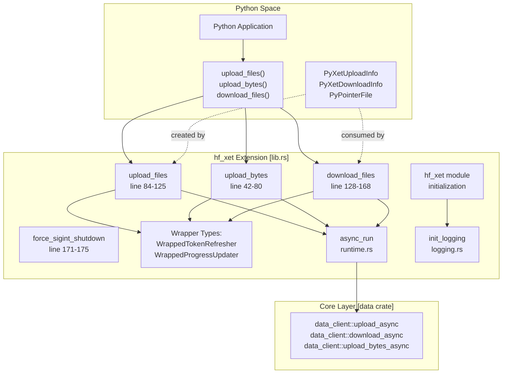
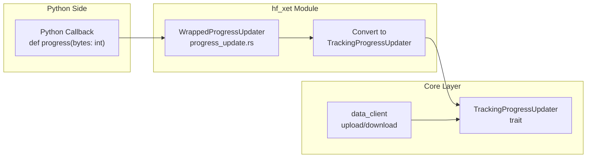
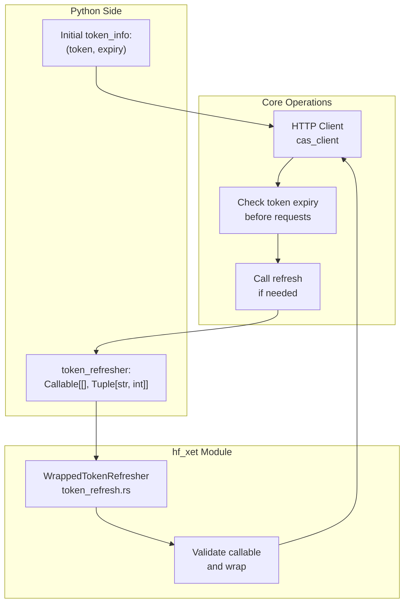
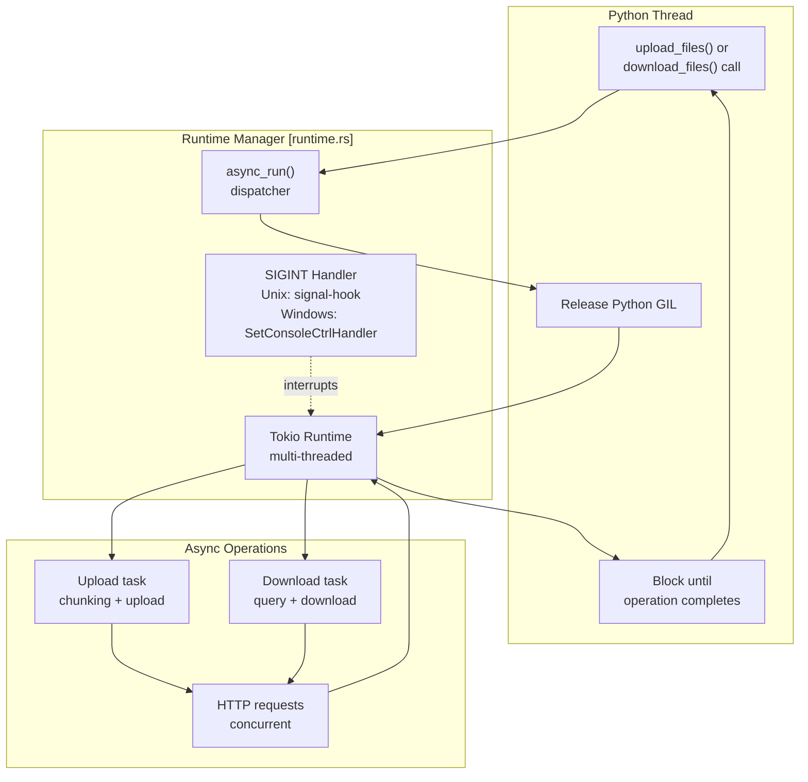
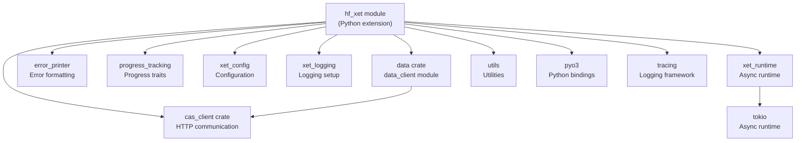

<!-- source: DeepWiki mcp.deepwiki.com · repo huggingface/xet-core · page 3.1 Python API (hf_xet) · fetched 2026-10-26 -->

# Python API (hf_xet)

<details>
<summary>Relevant source files</summary>

The following files were used as context for generating this wiki page:

- [hf_xet/Cargo.lock](hf_xet/Cargo.lock)
- [hf_xet/Cargo.toml](hf_xet/Cargo.toml)
- [hf_xet/src/lib.rs](hf_xet/src/lib.rs)
- [hf_xet/src/runtime.rs](hf_xet/src/runtime.rs)
- [utils/src/singleflight.rs](utils/src/singleflight.rs)

</details>


## Overview

The `hf_xet` Python module is a PyO3-based extension that provides Python bindings to the Rust-based content-addressable storage system. It exposes high-level functions for uploading and downloading files with built-in deduplication, progress tracking, and authentication token management.

This module serves as the primary programmatic interface for Python applications. For command-line usage, see [Command Line Tools](#4.1). For details on the underlying data processing, see [Data Client and Sessions](#3.2).

**Sources:** [hf_xet/src/lib.rs:1-346](), [hf_xet/Cargo.toml:1-78]()

## Module Architecture



**Sources:** [hf_xet/src/lib.rs:304-345](), [hf_xet/src/lib.rs:1-5]()

## Public Functions

### upload_files

Uploads files from filesystem paths to the CAS server.

```python
def upload_files(
    file_paths: List[str],
    endpoint: Optional[str],
    token_info: Optional[Tuple[str, int]],
    token_refresher: Optional[Callable[[], Tuple[str, int]]],
    progress_updater: Optional[Callable[[int], None]],
    _repo_type: Optional[str]
) -> List[PyXetUploadInfo]
```

**Parameters:**
- `file_paths`: List of filesystem paths to upload
- `endpoint`: Optional CAS endpoint URL override
- `token_info`: Optional tuple of (auth_token, expiry_timestamp_seconds)
- `token_refresher`: Optional callback to refresh authentication token
- `progress_updater`: Optional callback receiving byte progress updates
- `_repo_type`: Reserved parameter (unused)

**Returns:** List of `PyXetUploadInfo` objects containing hash and file size for each uploaded file.

**Implementation Details:**
- Wraps `data_client::upload_async` from the data crate [hf_xet/src/lib.rs:108-124]()
- Generates a random call ID for logging and debugging [hf_xet/src/lib.rs:98]()
- Executes asynchronously via `async_run` [hf_xet/src/lib.rs:100]()
- User agent is set to `hf_xet/<version>` [hf_xet/src/lib.rs:26]()

**Sources:** [hf_xet/src/lib.rs:83-125](), [hf_xet/src/lib.rs:26]()

### upload_bytes

Uploads in-memory byte arrays to the CAS server without touching the filesystem.

```python
def upload_bytes(
    file_contents: List[bytes],
    endpoint: Optional[str],
    token_info: Optional[Tuple[str, int]],
    token_refresher: Optional[Callable[[], Tuple[str, int]]],
    progress_updater: Optional[Callable[[int], None]],
    _repo_type: Optional[str]
) -> List[PyXetUploadInfo]
```

**Parameters:** Same as `upload_files`, except `file_contents` is a list of byte arrays instead of file paths.

**Returns:** List of `PyXetUploadInfo` objects.

**Implementation Details:**
- Wraps `data_client::upload_bytes_async` [hf_xet/src/lib.rs:62-74]()
- Useful for streaming uploads or when file data is already in memory
- Follows the same chunking and deduplication pipeline as file uploads

**Sources:** [hf_xet/src/lib.rs:41-80]()

### download_files

Downloads files from the CAS server to filesystem paths.

```python
def download_files(
    files: List[PyXetDownloadInfo],
    endpoint: Optional[str],
    token_info: Optional[Tuple[str, int]],
    token_refresher: Optional[Callable[[], Tuple[str, int]]],
    progress_updater: Optional[List[Callable[[int], None]]]
) -> List[str]
```

**Parameters:**
- `files`: List of `PyXetDownloadInfo` objects specifying what to download
- `endpoint`: Optional CAS endpoint URL override
- `token_info`: Authentication token and expiry
- `token_refresher`: Optional callback to refresh token
- `progress_updater`: Optional list of callbacks, one per file, for progress tracking

**Returns:** List of destination paths where files were written.

**Implementation Details:**
- Converts `PyXetDownloadInfo` to internal `(XetFileInfo, DestinationPath)` tuples [hf_xet/src/lib.rs:137]()
- Wraps `data_client::download_async` [hf_xet/src/lib.rs:153-162]()
- Supports per-file progress tracking via callback list [hf_xet/src/lib.rs:177-184]()

**Sources:** [hf_xet/src/lib.rs:128-168](), [hf_xet/src/lib.rs:177-184](), [hf_xet/src/lib.rs:298-302]()

### force_sigint_shutdown

Forces a SIGINT-style shutdown of the runtime, typically used to interrupt long-running operations.

```python
def force_sigint_shutdown() -> None
```

**Behavior:** Triggers the runtime's signal handler and raises `KeyboardInterrupt` [hf_xet/src/lib.rs:171-175]().

**Sources:** [hf_xet/src/lib.rs:170-175]()

## Data Classes

### PyXetUploadInfo

Returned by upload functions to represent successfully uploaded data.

**Attributes:**
| Attribute | Type | Description |
|-----------|------|-------------|
| `hash` | `str` | Content hash of the uploaded file |
| `file_size` | `u64` | Size of the file in bytes |
| `filesize` | `u64` | Legacy getter (deprecated) |

**Implementation:**
- Defined as a PyO3 `pyclass` [hf_xet/src/lib.rs:256-285]()
- Implements `__str__` and `__repr__` for debugging [hf_xet/src/lib.rs:272-277]()
- Converted from internal `XetFileInfo` struct [hf_xet/src/lib.rs:289-296]()

**Sources:** [hf_xet/src/lib.rs:256-285](), [hf_xet/src/lib.rs:289-296]()

### PyXetDownloadInfo

Input to `download_files` specifying what file to download and where to save it.

**Attributes:**
| Attribute | Type | Description |
|-----------|------|-------------|
| `destination_path` | `str` | Where to write the downloaded file |
| `hash` | `str` | Content hash to download |
| `file_size` | `u64` | Expected size of the file |

**Constructor:**
```python
PyXetDownloadInfo(destination_path: str, hash: str, file_size: int)
```

**Implementation:**
- Defined as a `pyclass(subclass)` to allow Python subclassing [hf_xet/src/lib.rs:187]()
- Converted to internal `(XetFileInfo, DestinationPath)` tuple [hf_xet/src/lib.rs:298-302]()
- Supports both read and write for `destination_path` [hf_xet/src/lib.rs:191]()

**Sources:** [hf_xet/src/lib.rs:187-216](), [hf_xet/src/lib.rs:298-302]()

### PyPointerFile (Legacy)

A backward-compatible subclass of `PyXetDownloadInfo` for older versions of `huggingface_hub`.

**Attributes:**
| Attribute | Type | Description |
|-----------|------|-------------|
| `path` | `str` | Alias for `destination_path` |
| `hash` | `str` | Inherited from parent |
| `filesize` | `u64` | Alias for `file_size` |

**Note:** This class is deprecated and scheduled for removal in the next major version [hf_xet/src/lib.rs:218-219]().

**Sources:** [hf_xet/src/lib.rs:218-254]()

## Progress Tracking System



The progress tracking system allows Python code to receive real-time updates during upload and download operations.

**Key Components:**

1. **WrappedProgressUpdater** [hf_xet/src/lib.rs:24](): Wraps a Python callback function to implement the `TrackingProgressUpdater` trait from the progress_tracking crate.

2. **Callback Conversion** [hf_xet/src/lib.rs:52](), [hf_xet/src/lib.rs:94](): Python callbacks are wrapped in `Arc` for thread-safe sharing across async tasks.

3. **Per-File Progress** [hf_xet/src/lib.rs:177-184](): `download_files` accepts a list of progress callbacks, one for each file being downloaded.

**Update Types:**
- `PyItemProgressUpdate`: Progress for individual files
- `PyTotalProgressUpdate`: Aggregate progress across all operations

These classes are registered with the module [hf_xet/src/lib.rs:314-315]().

**Sources:** [hf_xet/src/lib.rs:52](), [hf_xet/src/lib.rs:94](), [hf_xet/src/lib.rs:139](), [hf_xet/src/lib.rs:177-184](), [hf_xet/src/lib.rs:314-315]()

## Token Management

The module supports automatic authentication token refresh for long-running operations.



**Token Format:**
- Tuple of `(token_string, expiry_timestamp_seconds)`
- `expiry_timestamp_seconds` is a Unix timestamp (seconds since epoch)

**Refresh Mechanism:**
1. Python provides initial `token_info` and optional `token_refresher` callback
2. Callback is wrapped in `WrappedTokenRefresher` [hf_xet/src/lib.rs:51](), [hf_xet/src/lib.rs:93]()
3. Core HTTP client automatically calls refresh before token expires
4. New token returned by callback replaces the expired one

**Error Handling:** If the refresh callback raises an exception or returns invalid data, the operation fails with a `PyRuntimeError` [hf_xet/src/lib.rs:32-38]().

**Sources:** [hf_xet/src/lib.rs:51](), [hf_xet/src/lib.rs:93](), [hf_xet/src/lib.rs:138]()

## Async Runtime Integration

The module bridges synchronous Python calls to asynchronous Rust operations using a custom runtime manager.



**Key Components:**

1. **async_run Function** [hf_xet/src/lib.rs:18](): Dispatches async operations to the runtime
   - Releases Python GIL during execution
   - Blocks until async operation completes
   - Re-acquires GIL to return results

2. **Error Conversion** [hf_xet/src/lib.rs:32-38](): Maps `DataProcessingError` to `PyRuntimeError` with debug or release formatting

3. **Signal Handling**:
   - Unix: Uses `signal-hook` crate [hf_xet/Cargo.toml:41]()
   - Windows: Uses Win32 API console control handler [hf_xet/Cargo.toml:44-45]()

4. **Shutdown Mechanism** [hf_xet/src/lib.rs:171-175](): `force_sigint_shutdown()` triggers clean shutdown and raises `KeyboardInterrupt`

**Sources:** [hf_xet/src/lib.rs:18](), [hf_xet/src/lib.rs:32-38](), [hf_xet/src/lib.rs:100](), [hf_xet/src/lib.rs:55](), [hf_xet/src/lib.rs:145](), [hf_xet/Cargo.toml:40-45]()

## Module Initialization

The module performs several initialization steps when first imported:

| Step | Function | Purpose |
|------|----------|---------|
| 1 | Register functions | `upload_files`, `upload_bytes`, `download_files`, `force_sigint_shutdown` [hf_xet/src/lib.rs:307-310]() |
| 2 | Register classes | `PyXetUploadInfo`, `PyXetDownloadInfo`, `PyPointerFile`, progress types [hf_xet/src/lib.rs:311-320]() |
| 3 | Initialize logging | `init_logging(py)` [hf_xet/src/lib.rs:323]() |
| 4 | Raise file limits | `raise_nofile_soft_to_hard()` [hf_xet/src/lib.rs:326]() |
| 5 | Profiler setup | Optional, only when `profiling` feature enabled [hf_xet/src/lib.rs:328-342]() |

**Logging Configuration:**
- Default log level is elevated for the `hf_xet` module [hf_xet/Cargo.toml:48]()
- Uses `tracing` framework internally
- See logging initialization in [hf_xet/src/logging.rs]()

**File Handle Limits:**
- Automatically raises the soft limit to the hard limit on Unix systems
- Prevents "too many open files" errors during large uploads/downloads
- Implemented in `xet_runtime::file_handle_limits` module

**Sources:** [hf_xet/src/lib.rs:304-345](), [hf_xet/Cargo.toml:48]()

## Build Configuration

The module is built as a `cdylib` (C dynamic library) for Python to load [hf_xet/Cargo.toml:10]().

**Key Build Features:**

| Feature | Purpose | Default |
|---------|---------|---------|
| `no-default-cache` | Disables default disk cache location | ✓ |
| `elevated_information_level` | Increases log verbosity | ✓ |
| `native-tls` | Uses system native TLS | ✗ |
| `native-tls-vendored` | Bundles TLS implementation | ✗ |
| `profiling` | Enables CPU profiling with pprof | ✗ |
| `tokio-console` | Enables tokio async debugging | ✗ |

**PyO3 Configuration:**
- Extension module mode for Python import [hf_xet/Cargo.toml:32]()
- ABI3 compatibility with Python 3.7+ [hf_xet/Cargo.toml:33]()
- Auto-initialize Python interpreter [hf_xet/Cargo.toml:34]()

**Release Optimizations:**
- Size optimization (`opt-level = "s"`) [hf_xet/Cargo.toml:58]()
- Link-time optimization enabled [hf_xet/Cargo.toml:59]()
- Single codegen unit for better optimization [hf_xet/Cargo.toml:60]()

**Sources:** [hf_xet/Cargo.toml:8-78]()

## Dependencies



**Internal Dependencies:**
- `data`: Core upload/download orchestration [hf_xet/Cargo.toml:14]()
- `cas_client`: HTTP client for CAS server [hf_xet/Cargo.toml:13]()
- `xet_runtime`: Async runtime management [hf_xet/Cargo.toml:20]()
- `progress_tracking`: Progress callback traits [hf_xet/Cargo.toml:16]()
- `xet_config`: Configuration system [hf_xet/Cargo.toml:18]()
- `xet_logging`: Logging initialization [hf_xet/Cargo.toml:19]()
- `error_printer`: Error formatting [hf_xet/Cargo.toml:15]()
- `utils`: Shared utilities [hf_xet/Cargo.toml:17]()

**External Dependencies:**
- `pyo3`: Python-Rust FFI framework [hf_xet/Cargo.toml:31-35]()
- `async-trait`: Async trait support [hf_xet/Cargo.toml:22]()
- `chrono`: Date/time handling [hf_xet/Cargo.toml:23]()
- `itertools`: Iterator utilities [hf_xet/Cargo.toml:24]()
- `tracing`: Structured logging [hf_xet/Cargo.toml:37]()

**Platform-Specific:**
- Unix: `signal-hook` for signal handling [hf_xet/Cargo.toml:41]()
- Windows: `winapi` for console control [hf_xet/Cargo.toml:45]()

**Sources:** [hf_xet/Cargo.toml:12-45]()

---

