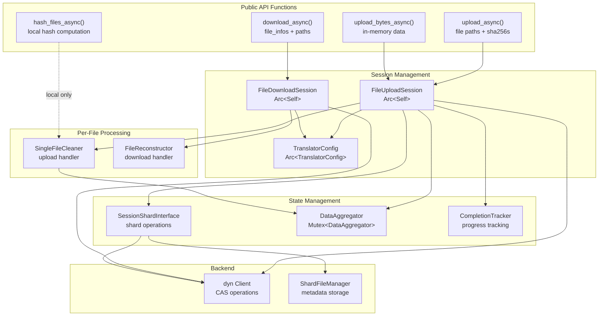
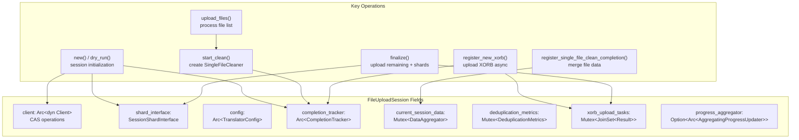
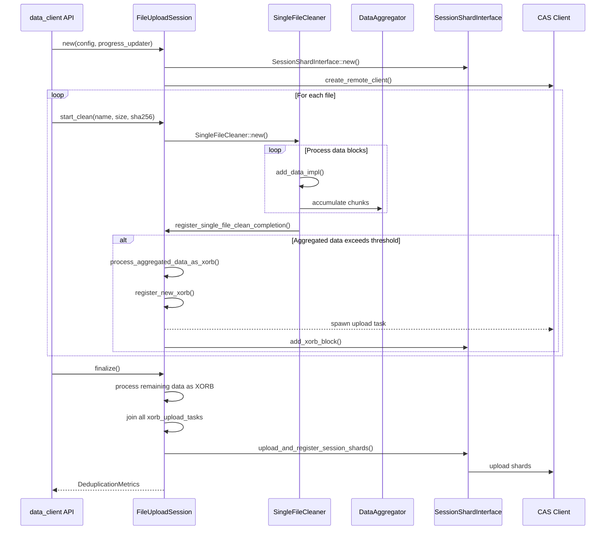
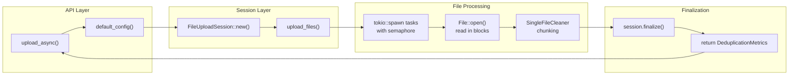
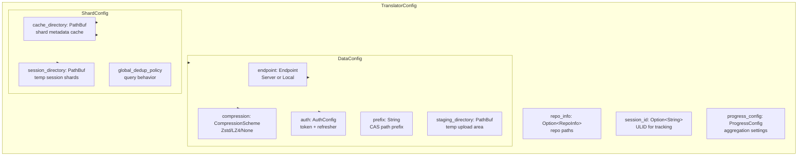
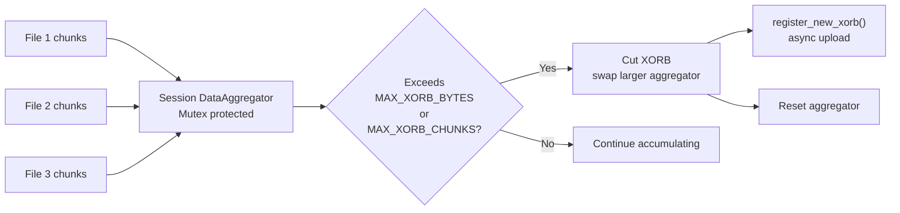
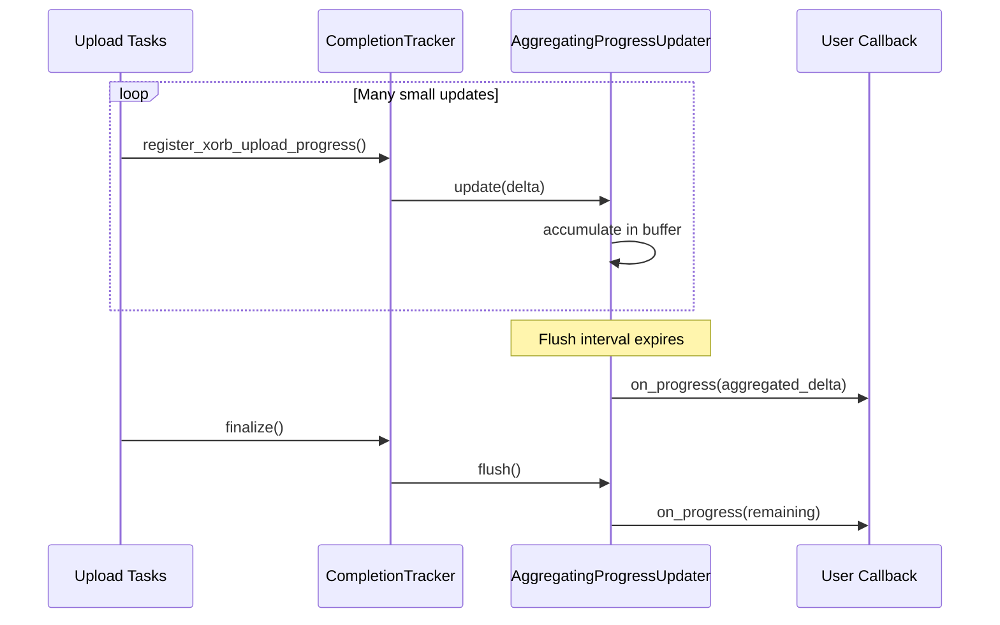

<!-- source: DeepWiki mcp.deepwiki.com · repo huggingface/xet-core · page 3.2 Data Client and Sessions · fetched 2026-10-26 -->

# Data Client and Sessions

<details>
<summary>Relevant source files</summary>

The following files were used as context for generating this wiki page:

- [cas_client/src/interface.rs](cas_client/src/interface.rs)
- [cas_client/src/lib.rs](cas_client/src/lib.rs)
- [data/src/bin/example.rs](data/src/bin/example.rs)
- [data/src/data_client.rs](data/src/data_client.rs)
- [data/src/file_upload_session.rs](data/src/file_upload_session.rs)
- [data/src/lib.rs](data/src/lib.rs)
- [data/src/shard_interface.rs](data/src/shard_interface.rs)
- [data/tests/test_clean_smudge.rs](data/tests/test_clean_smudge.rs)
- [hf_xet_wasm/src/wasm_file_upload_session.rs](hf_xet_wasm/src/wasm_file_upload_session.rs)

</details>


## Purpose and Scope

The Data Client and Sessions module provides the core orchestration layer for file upload and download operations in xet-core. It manages the lifecycle of file processing sessions, coordinates chunking and deduplication during uploads, and handles reconstruction during downloads. This module sits between the user-facing APIs (see [Python API](#3.1)) and the lower-level CAS client system (see [CAS Client System](#3.3)).

The main components documented here are:
- `data_client` module - Public API functions for upload, download, and hashing operations
- `FileUploadSession` - Manages state and coordination for file upload sessions
- `FileDownloadSession` - Manages state and coordination for file download sessions  
- Session configuration and lifecycle management

For details on the actual deduplication algorithms, see [Deduplication Architecture](#2.3). For details on file reconstruction, see [File Reconstruction](#5.3).

## Component Architecture

The data client layer provides a session-based abstraction over the underlying storage system. Each upload or download operation creates a session that maintains state throughout the operation and ensures atomic success or failure.



**Sources:** [data/src/data_client.rs:1-629](), [data/src/file_upload_session.rs:1-648](), [data/src/lib.rs:1-25]()

## FileUploadSession

### Structure and Responsibilities

`FileUploadSession` is the core coordinator for file upload operations. It maintains session-wide state, manages concurrent file processing, and ensures all XORBs and shards are properly uploaded before finalization.



**Sources:** [data/src/file_upload_session.rs:34-141]()

The session is designed to be shared across multiple concurrent file processing tasks via `Arc<FileUploadSession>`. Each file gets its own `SingleFileCleaner` handle, but all cleaners coordinate through the shared session state.

### Session Lifecycle



**Sources:** [data/src/file_upload_session.rs:68-141](), [data/src/file_upload_session.rs:143-245](), [data/src/file_upload_session.rs:450-536]()

### Key Methods

#### Session Initialization

The `new()` and `dry_run()` methods initialize a session with the given configuration. The constructor sets up:

- CAS client for remote operations
- `SessionShardInterface` for metadata management
- `CompletionTracker` for progress tracking
- Optional `AggregatingProgressUpdater` for batched progress updates

[data/src/file_upload_session.rs:68-141]()

#### File Processing Entry Points

**`upload_files()`** - Processes multiple files concurrently:
- Reads file metadata and registers each file with the completion tracker
- Spawns a task per file with semaphore-controlled concurrency
- Each task reads the file in blocks and feeds data to a `SingleFileCleaner`
- Collects results and returns `Vec<XetFileInfo>`

[data/src/file_upload_session.rs:143-245]()

**`start_clean()`** - Creates a new `SingleFileCleaner` for a single file or byte stream:
- Registers the file with the completion tracker
- Returns a cleaner handle for streaming data via `add_data()`

[data/src/file_upload_session.rs:256-270]()

#### XORB Management

**`register_new_xorb()`** - Uploads a new XORB asynchronously:
- Checks if the XORB is already being uploaded (deduplication across files)
- Serializes the XORB with compression
- Spawns an async task to upload to CAS
- Registers XORB metadata with `SessionShardInterface`
- Tracks progress via callbacks

[data/src/file_upload_session.rs:274-365]()

**`register_single_file_clean_completion()`** - Called when a file's chunking is complete:
- Merges the file's `DataAggregator` into the session-wide aggregator
- If combined data exceeds `MAX_XORB_BYTES` or `MAX_XORB_CHUNKS`, cuts a new XORB
- Swaps aggregators to cut the larger one, minimizing fragmentation

[data/src/file_upload_session.rs:368-410]()

#### Finalization

**`finalize()`** - Completes the upload session:
1. Processes remaining aggregated data as a final XORB
2. Waits for all XORB upload tasks to complete
3. Calls `SessionShardInterface::upload_and_register_session_shards()`
4. Returns `DeduplicationMetrics` with bytes uploaded, deduplicated, etc.

Debug builds also verify that:
- All upload parts are complete (`completion_tracker.assert_complete()`)
- All progress updates were correctly reported (`progress_verifier.assert_complete()`)

[data/src/file_upload_session.rs:450-536]()

**Sources:** [data/src/file_upload_session.rs:34-537]()

## FileDownloadSession

`FileDownloadSession` manages the download and reconstruction of files from the CAS. While the full implementation is in `file_download_session.rs` (not provided), the key responsibilities include:

- Querying shards for file reconstruction information
- Fetching required XORBs from CAS
- Using the chunk cache to avoid redundant downloads
- Managing concurrent downloads with buffer limits
- Writing reconstructed data to disk or streams

The session is created with a `TranslatorConfig` and optional progress updater, then provides methods like:
- `download_file()` - Downloads a file to a specified path
- `download_file_with_updater()` - Downloads with per-file progress tracking
- `download_to_stream()` - Reconstructs to an async write stream

For detailed download workflow, see [Download Workflow](#5.2) and [File Reconstruction](#5.3).

**Sources:** [data/src/data_client.rs:199-257](), [data/src/lib.rs:19]()

## Data Client API

The `data_client` module provides the public API functions that user-facing interfaces call. These functions handle configuration setup, session creation, and result aggregation.

### API Functions Overview

| Function | Purpose | Key Parameters | Returns |
|----------|---------|----------------|---------|
| `upload_async()` | Upload files from disk | `file_paths`, `sha256s`, endpoint, auth | `Vec<XetFileInfo>` |
| `upload_bytes_async()` | Upload in-memory data | `file_contents`, endpoint, auth | `Vec<XetFileInfo>` |
| `download_async()` | Download files to disk | `file_infos`, output paths, endpoint, auth | `Vec<String>` (paths) |
| `hash_files_async()` | Compute hashes locally | `file_paths` | `Vec<XetFileInfo>` |

**Sources:** [data/src/data_client.rs:95-410]()

### Upload Flow



**`upload_async()`** orchestrates file uploads:
1. Creates a `TranslatorConfig` via `default_config()`
2. Initializes a `FileUploadSession` with optional progress updater
3. Parses optional SHA256 hints for each file
4. Calls `upload_files()` with file paths, SHA256s, and tracking IDs
5. Finalizes the session, which uploads remaining XORBs and all shards
6. Records deduplication metrics to the tracing span
7. Returns file hashes and sizes as `Vec<XetFileInfo>`

[data/src/data_client.rs:130-197]()

**`upload_bytes_async()`** is similar but for in-memory data:
1. Creates session and semaphore for concurrency control
2. Creates `clean_bytes` futures for each byte vector
3. Runs futures with `run_constrained_with_semaphore()` for parallelism
4. Finalizes and returns results

[data/src/data_client.rs:95-127]()

**Sources:** [data/src/data_client.rs:95-197]()

### Download Flow

**`download_async()`** orchestrates file downloads:
1. Validates that progress updaters (if provided) match the number of files
2. Creates a shared `FileDownloadSession` 
3. Spawns a tokio task for each file download
4. Each task acquires a download semaphore permit
5. Calls `session.download_file()` or `session.download_file_with_updater()`
6. Collects and returns all output paths

[data/src/data_client.rs:199-257]()

### Local Hashing

**`hash_files_async()`** computes file hashes without uploading:
- Useful for verifying downloaded files or checking if upload is needed
- Uses the same chunking algorithm as uploads (`Chunker`)
- Processes files in parallel with semaphore control
- Calls `hash_single_file()` which reads files in blocks and computes chunk hashes
- Returns `Vec<XetFileInfo>` with file hashes and sizes

The hash computation uses:
- `Chunker::next_block_bytes()` for content-defined chunking
- `Chunker::finish()` to flush remaining data
- `merklehash::file_hash()` to aggregate chunk hashes into file hash

[data/src/data_client.rs:333-410]()

**Sources:** [data/src/data_client.rs:333-410]()

## Configuration and Setup

### TranslatorConfig Structure

`TranslatorConfig` (defined in `configurations` module) contains all settings needed for a session:



**Sources:** [data/src/data_client.rs:27-93]()

### default_config() Function

The `default_config()` function creates a standard configuration:

1. **Local endpoint handling**: If endpoint starts with `"local://"`, creates a `LocalClient` configuration pointing to a filesystem directory
2. **Cache path setup**: Derives cache directory from environment variables:
   - `HF_XET_CACHE` (highest priority)
   - `HF_HOME` (fallback)
   - `~/.cache/huggingface/xet` (default)
3. **Endpoint fingerprinting**: Creates a unique subdirectory per endpoint using:
   - First 16 alphanumeric characters of endpoint
   - 16 characters of MerkleHash of full endpoint
   - Example: `http___localhost_-dGVzdF9lbmRwb2lu`
4. **Directory structure**:
   - `{cache_root}/{endpoint_tag}/shard-cache/` - Cached shard metadata
   - `{cache_root}/{endpoint_tag}/staging/shard-session/` - Temporary session shards
5. **Session ID**: Generates a new ULID for tracking
6. **Authentication**: Wraps token and refresher in `AuthConfig`

[data/src/data_client.rs:27-93]()

**Sources:** [data/src/data_client.rs:27-93]()

## Per-File Processing

### SingleFileCleaner

Each file being uploaded gets its own `SingleFileCleaner` instance. The cleaner:
- Maintains a per-file `DataAggregator`
- Receives data blocks via `add_data()` or `add_data_impl()`
- Performs chunking and deduplication
- Tracks file-level progress
- Calls back to the session on completion

The cleaner is created by `FileUploadSession::start_clean()` and handed to the caller, who streams data into it before calling `finish()`.

**Sources:** [data/src/file_upload_session.rs:256-270](), [data/src/file_cleaner.rs]() (referenced but not provided)

### File Reading and Chunking

The `upload_files()` method demonstrates the typical file processing pattern:

```rust
// Open file
let mut reader = File::open(&file_path)?;
let file_size = reader.metadata()?.len();

// Create cleaner
let mut cleaner = SingleFileCleaner::new(Some(file_name), file_id, sha256, session);

// Read in blocks
while bytes_read < file_size {
    let n_bytes_read = min(INGESTION_BLOCK_SIZE, bytes_left);
    let mut buffer = Vec::with_capacity(n_bytes_read);
    reader.read_exact(&mut buffer)?;
    cleaner.add_data_impl(Bytes::from(buffer)).await?;
}

// Finish and get result
let (xfi, metrics) = cleaner.finish().await?;
```

The block size is controlled by `xet_config().data.ingestion_block_size`, typically 8MB. Reading in blocks allows:
- Bounded memory usage
- Progress tracking
- Cancellation on errors

[data/src/file_upload_session.rs:168-234]()

**Sources:** [data/src/file_upload_session.rs:143-245]()

## Session State Management

### DataAggregator and XORB Cutting

The `current_session_data: Mutex<DataAggregator>` field accumulates chunks across multiple files. When thresholds are exceeded, a XORB is cut:



The algorithm in `register_single_file_clean_completion()`:
1. Lock the session aggregator
2. Check if combined size exceeds thresholds
3. If yes, swap so the larger aggregator becomes the file's aggregator
4. Process the file's (now larger) aggregator as a XORB
5. Session aggregator is now the smaller one

This strategy minimizes fragmentation by cutting larger XORBs.

[data/src/file_upload_session.rs:368-410]()

**Sources:** [data/src/file_upload_session.rs:368-442]()

### CompletionTracker

The `CompletionTracker` maintains a dependency graph between files and XORBs:
- Each file depends on one or more XORBs
- XORB uploads report progress incrementally
- File completion is tracked when all its XORBs are uploaded
- Provides atomic progress updates to the user

The tracker enables:
- Accurate overall progress percentage
- Per-file progress tracking
- Backpressure when XORBs upload slowly
- Verification that all parts uploaded successfully

[data/src/file_upload_session.rs:42-65]()

**Sources:** [data/src/file_upload_session.rs:34-65]()

### Async Upload Tasks

XORB uploads happen asynchronously in a `JoinSet`:

```rust
self.xorb_upload_tasks.lock().await.spawn(
    async move {
        let n_bytes = session.client.upload_xorb(...).await?;
        session.completion_tracker.register_xorb_upload_completion(xorb_hash).await;
        Ok(())
    }
    .instrument(info_span!("upload_xorb_task"))
);
```

This allows:
- Multiple XORBs uploading in parallel
- Files continuing to chunk while uploads proceed
- Bounded concurrency via `acquire_upload_permit()`
- Progress callbacks during transfer

On finalization, all tasks in `xorb_upload_tasks` are joined before shard upload begins.

[data/src/file_upload_session.rs:343-363]()

**Sources:** [data/src/file_upload_session.rs:274-365](), [data/src/file_upload_session.rs:450-465]()

## SessionShardInterface Integration

The `SessionShardInterface` manages shard operations during the upload session:

### Deduplication Queries

During chunking, the interface is queried for existing chunks:
- `chunk_hash_dedup_query()` checks session shards, resumed shards, and cache
- Returns matching chunk sequences and their XORBs
- `query_dedup_shard_by_chunk()` fetches global dedup shards from server

### Metadata Registration

As files are processed, metadata is added:
- `add_xorb_block()` - Registers XORB metadata (which chunks it contains)
- `add_file_reconstruction_info()` - Registers file metadata (which XORBs it needs)
- Data is accumulated in `MDBInMemoryShard` structures

### Shard Flushing and Upload

On finalization:
1. `upload_and_register_session_shards()` is called
2. All in-memory shards are flushed to disk
3. Shards are consolidated and merged to target size
4. Each shard is uploaded to CAS in parallel
5. Successfully uploaded shards are moved to cache directory
6. Old staged shards are cleaned up

[data/src/shard_interface.rs:232-311]()

**Sources:** [data/src/shard_interface.rs:26-312]()

## Progress Tracking

### AggregatingProgressUpdater

When `config.progress_config.aggregate` is true and a flush interval is configured, progress updates are batched:



Benefits:
- Reduces callback overhead for high-frequency updates
- Provides smoother progress bars
- Configurable interval via `xet_config().data.progress_update_interval`
- Speed estimation over configurable window

[data/src/file_upload_session.rs:94-111]()

**Sources:** [data/src/file_upload_session.rs:94-111]()

### Debug Verification

In debug builds, a `ProgressUpdaterVerificationWrapper` wraps the actual updater:
- Records all progress updates
- Tracks expected vs. actual progress
- Asserts correctness on finalization
- Helps catch progress tracking bugs during development

[data/src/file_upload_session.rs:113-121](), [data/src/file_upload_session.rs:486-493]()

**Sources:** [data/src/file_upload_session.rs:113-121](), [data/src/file_upload_session.rs:486-493]()

## Testing and Examples

### Example Usage

The `data/src/bin/example.rs` demonstrates basic usage:

**Cleaning (uploading):**
```rust
let translator = FileUploadSession::new(config, None).await?;
let mut handle = translator.start_clean(None, size, None, Ulid::new()).await;

loop {
    let bytes = reader.read(&mut read_buf)?;
    if bytes == 0 { break; }
    handle.add_data(&read_buf[0..bytes]).await?;
}

let (file_info, _) = handle.finish().await?;
translator.finalize().await?;
```

**Smudging (downloading):**
```rust
let xet_file: XetFileInfo = serde_json::from_str(&input)?;
let session = FileDownloadSession::new(config, None).await?;
session.download_file(&xet_file, &output_path, Ulid::new()).await?;
```

[data/src/bin/example.rs:74-146]()

### Test Infrastructure

The `test_clean_smudge.rs` tests demonstrate round-trip verification:
1. Create random files in source directory
2. Dehydrate (upload) via `FileUploadSession`
3. Hydrate (download) via `FileDownloadSession`
4. Verify downloaded files match originals

Tests cover:
- Empty files
- Small files (single chunk)
- Large files (multiple XORBs)
- Multiple files with common data (deduplication)
- Identical files (extreme deduplication)
- Sequential vs. concurrent processing

[data/tests/test_clean_smudge.rs:13-166]()

**Sources:** [data/src/bin/example.rs:1-147](), [data/tests/test_clean_smudge.rs:1-167]()

## WASM Variant

The WASM build includes a simplified `FileUploadSession` in `hf_xet_wasm`:

Key differences:
- No `CompletionTracker` (simpler progress model)
- No background aggregation of progress
- Simpler XORB uploader with fixed concurrency
- All shards kept in memory, uploaded as single blob
- No shard caching or resumption

The core structure and flow remain similar, but WASM constraints require:
- No file system access for caching
- No fork-safe runtime considerations
- Simpler concurrency primitives

[hf_xet_wasm/src/wasm_file_upload_session.rs:1-182]()

**Sources:** [hf_xet_wasm/src/wasm_file_upload_session.rs:1-182]()

## Summary

The Data Client and Sessions module provides:

1. **Session abstraction** - `FileUploadSession` and `FileDownloadSession` manage state for atomic operations
2. **Public API** - `upload_async()`, `download_async()`, etc. orchestrate sessions
3. **Concurrency control** - Semaphores limit parallel file processing and network operations
4. **Progress tracking** - `CompletionTracker` and optional aggregation provide accurate updates
5. **Configuration** - `TranslatorConfig` and `default_config()` handle setup with sensible defaults
6. **State management** - `DataAggregator` accumulates chunks, automatic XORB cutting at thresholds
7. **Integration** - `SessionShardInterface` bridges to shard system, CAS client handles network

The design enables efficient batch uploads with cross-file deduplication while maintaining per-file granularity for progress tracking and error handling.

---

