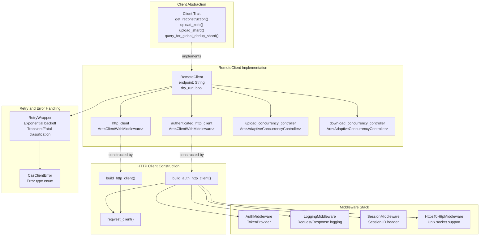
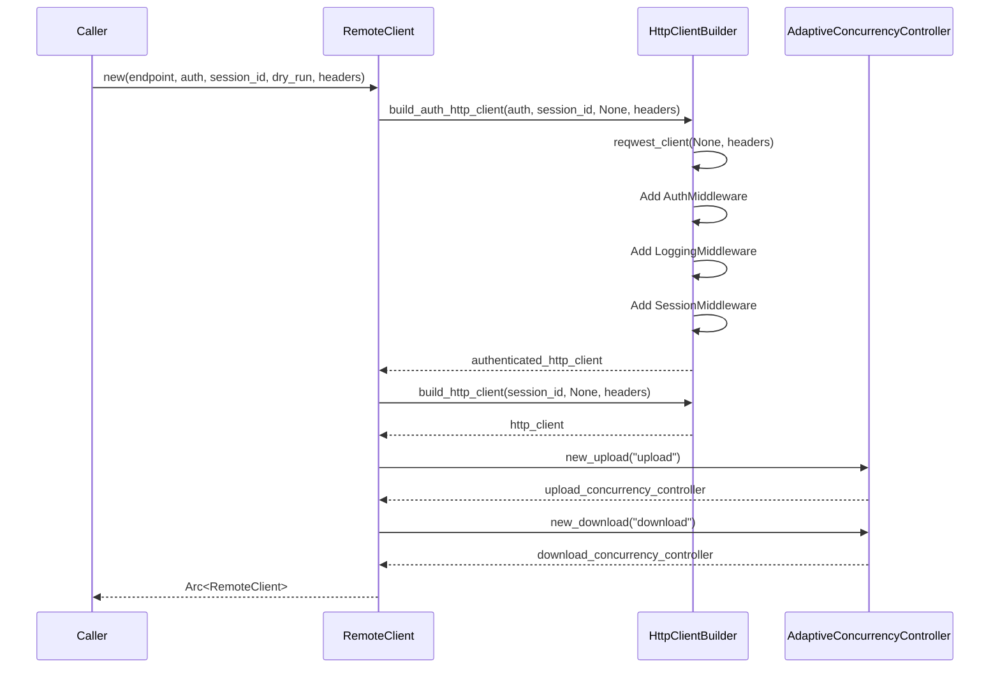
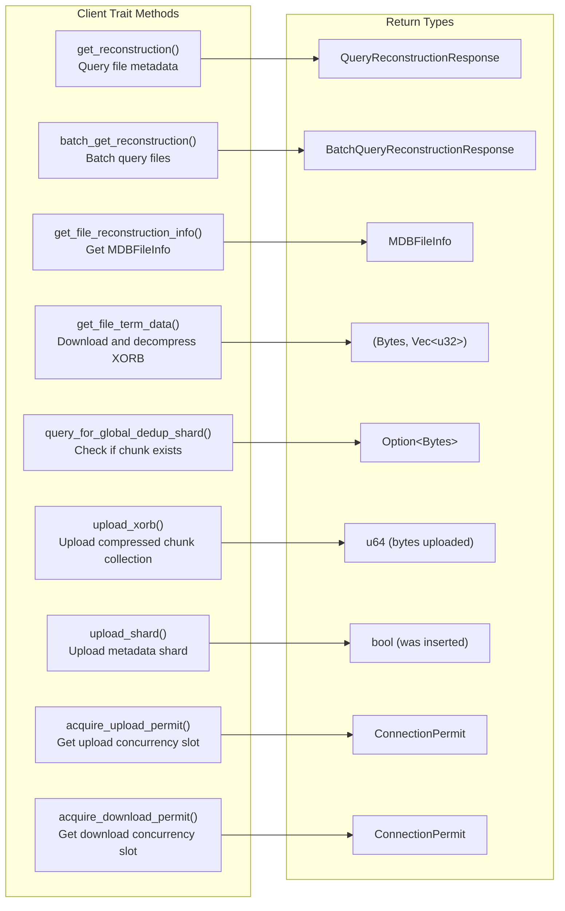
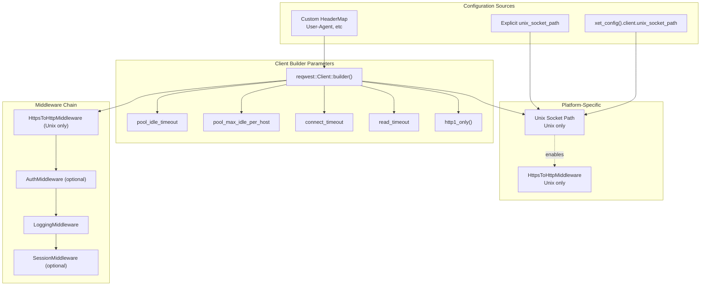
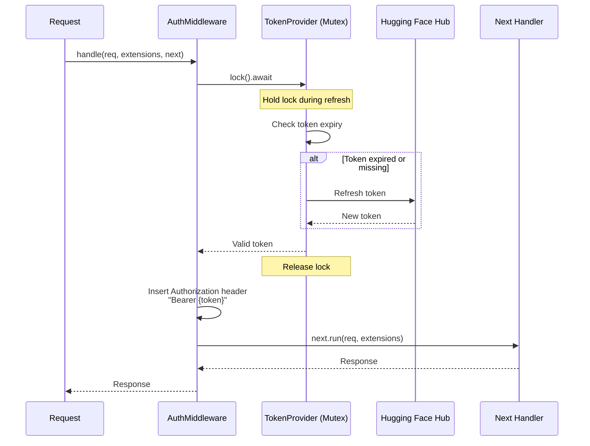
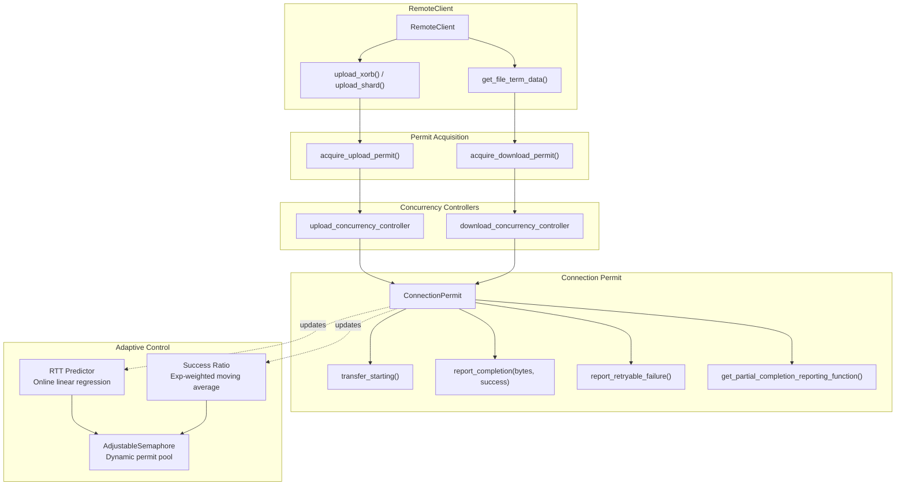
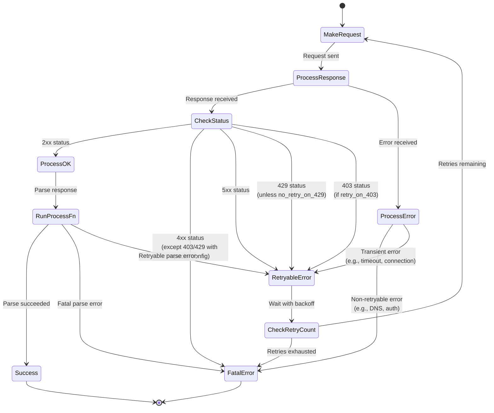
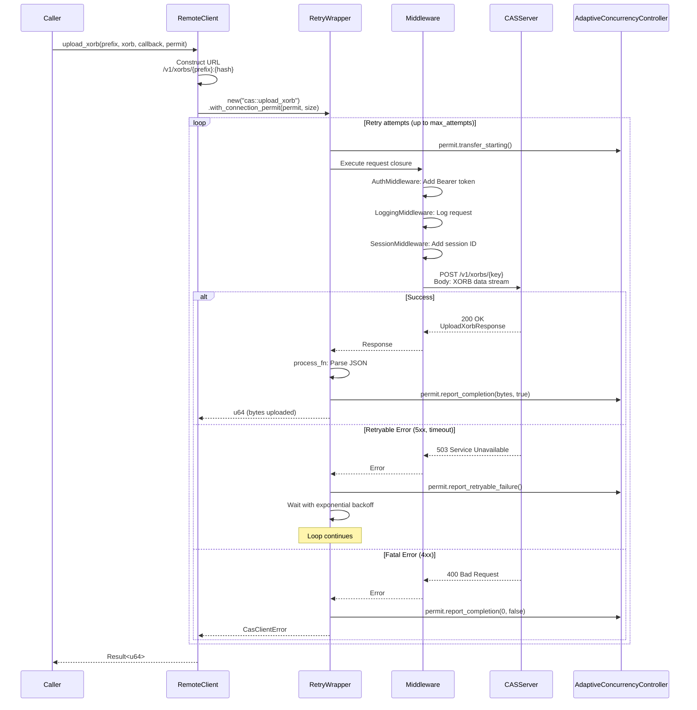
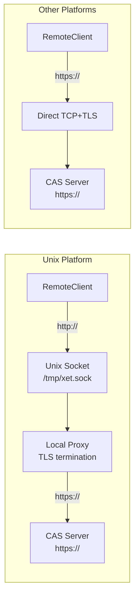
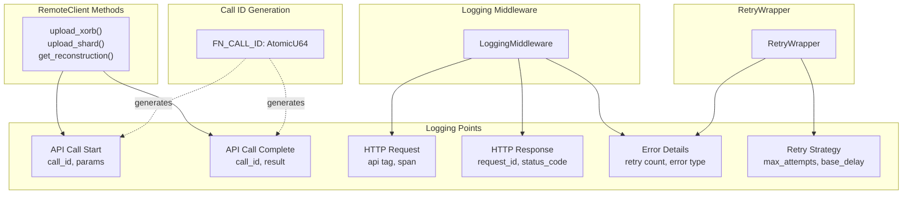

<!-- source: DeepWiki mcp.deepwiki.com · repo huggingface/xet-core · page 3.3 CAS Client System · fetched 2026-10-26 -->

# CAS Client System

Relevant source files

The following files were used as context for generating this wiki page:

- [cas_client/src/error.rs](cas_client/src/error.rs)
- [cas_client/src/http_client.rs](cas_client/src/http_client.rs)
- [cas_client/src/remote_client.rs](cas_client/src/remote_client.rs)
- [cas_client/src/retry_wrapper.rs](cas_client/src/retry_wrapper.rs)

## Purpose and Scope

The CAS Client System provides the abstraction layer for communicating with Content-Addressable Storage (CAS) backends. This system handles all network operations including XORB uploads, shard uploads, reconstruction queries, and chunk deduplication queries. It manages HTTP client construction, authentication, retry logic, concurrency control, and error handling.

This page provides an overview of the CAS client architecture and its core components. For detailed information about HTTP client construction and retry mechanisms, see [HTTP Client and Retry Logic](#3.3.1). For specific RemoteClient operations and their implementation, see [Remote Client Operations](#3.3.2).

## Architecture Overview

The CAS Client System is organized around a trait-based abstraction that allows multiple backend implementations. The primary implementation is `RemoteClient`, which communicates with a remote CAS server over HTTP/HTTPS. Alternative implementations (not detailed in the provided files) include `LocalClient` for filesystem-based testing and `MemoryClient` for in-memory testing.

**Diagram: CAS Client System Architecture**

The `Client` trait defines the interface for all CAS operations. `RemoteClient` is the primary implementation that communicates with a remote HTTP endpoint. It maintains two HTTP clients: one with authentication for CAS API calls and one without authentication for direct S3 operations. Each has its own `AdaptiveConcurrencyController` to manage upload and download parallelism independently.

Sources: [cas_client/src/remote_client.rs:40-47](), [cas_client/src/http_client.rs:128-150]()

## RemoteClient Structure

The `RemoteClient` struct encapsulates all state needed to communicate with a remote CAS server:

| Field | Type | Purpose |
|-------|------|---------|
| `endpoint` | `String` | Base URL of the CAS server (e.g., `http://localhost:8080`) |
| `dry_run` | `bool` | If true, skip actual uploads (testing mode) |
| `http_client` | `Arc<ClientWithMiddleware>` | Unauthenticated client for S3 operations |
| `authenticated_http_client` | `Arc<ClientWithMiddleware>` | Authenticated client for CAS API calls |
| `upload_concurrency_controller` | `Arc<AdaptiveConcurrencyController>` | Manages upload parallelism |
| `download_concurrency_controller` | `Arc<AdaptiveConcurrencyController>` | Manages download parallelism |

The client is constructed using either `RemoteClient::new()` or `RemoteClient::new_with_socket()`. Both methods create HTTP clients with the appropriate middleware stack and initialize concurrency controllers:

**Diagram: RemoteClient Construction Flow**

The constructor returns an `Arc<RemoteClient>` because the client is meant to be shared across multiple concurrent operations. The two HTTP clients serve different purposes: `authenticated_http_client` is used for CAS API endpoints that require authentication, while `http_client` is used for presigned S3 URLs where authentication is embedded in the URL.

Sources: [cas_client/src/remote_client.rs:93-110](), [cas_client/src/http_client.rs:128-159]()

## Client Trait Interface

The `Client` trait defines the contract that all CAS backend implementations must fulfill. It uses conditional async trait attributes to support both native and WASM targets:

**Diagram: Client Trait Method Overview**

The trait is declared with platform-specific async trait attributes:
- On non-WASM targets: `#[async_trait::async_trait]` (requires `Send` bounds)
- On WASM targets: `#[async_trait::async_trait(?Send)]` (relaxes `Send` requirement)

This pattern appears throughout the CAS client codebase to maintain WASM compatibility while preserving optimal behavior on native platforms.

Sources: [cas_client/src/remote_client.rs:211-212]()

## HTTP Client Configuration

The HTTP client construction is centralized in the `http_client` module, which provides several configuration options:

**Diagram: HTTP Client Configuration Flow**

The `reqwest_client()` function creates the underlying HTTP client with configuration from `xet_config().client`. On Unix platforms, if a Unix socket path is provided (either explicitly or via configuration), the client is configured to use that socket for all connections. The `HttpsToHttpMiddleware` rewrites `https://` URLs to `http://` when using Unix sockets, allowing a local proxy to handle TLS termination.

The client is cached in the `XetRuntime` by a tag (either the socket path or "tcp") to avoid recreating clients unnecessarily. This is important for connection pooling efficiency.

Sources: [cas_client/src/http_client.rs:56-109](), [cas_client/src/http_client.rs:19-39]()

## Authentication Middleware

The `AuthMiddleware` handles token management and refresh for authenticated CAS requests. It wraps a `TokenProvider` in a `Mutex` to ensure thread-safe token refresh:

**Diagram: AuthMiddleware Token Refresh Flow**

The middleware acquires a lock on the `TokenProvider` for each request. In the common case, the token is still valid and the lock is held only briefly to read the token from memory. However, when the token has expired (typically every 15 minutes), the lock is held while making a network call to refresh the token. This blocks other concurrent requests from the same client, which is acceptable since they would fail without a valid token anyway.

Sources: [cas_client/src/http_client.rs:207-259]()

## Concurrency Management

Each `RemoteClient` maintains two `AdaptiveConcurrencyController` instances—one for uploads and one for downloads. Operations must acquire a `ConnectionPermit` before proceeding:

**Diagram: Concurrency Control Architecture**

The `ConnectionPermit` serves dual purposes:
1. **Concurrency Limiting**: Ensures the number of concurrent operations stays within bounds
2. **Metrics Collection**: Tracks transfer timing, bytes transferred, and success/failure for adaptive adjustment

The permit must be passed to `RetryWrapper` via `.with_connection_permit()` so that retry logic can properly report progress and handle failures. The permit's `get_partial_completion_reporting_function()` can be attached to `StreamProgressReporter` to report partial progress during large transfers.

Sources: [cas_client/src/remote_client.rs:298-300](), [cas_client/src/remote_client.rs:442-444](), [cas_client/src/retry_wrapper.rs:77-83]()

## Error Handling

The `CasClientError` enum provides comprehensive error classification for all failure modes in the CAS client system:

| Error Variant | Description | Typical Cause |
|---------------|-------------|---------------|
| `XorbObjectError` | XORB serialization/deserialization failure | Corrupted XORB data, decompression failure |
| `ConfigurationError` | Invalid client configuration | Missing required config, invalid endpoint URL |
| `InvalidRange` | Byte range request error | Malformed range header, out-of-bounds range |
| `FileNotFound(MerkleHash)` | File reconstruction data not found | Hash not in CAS, file never uploaded |
| `IOError` | Filesystem or stream I/O error | Disk full, permission denied, broken pipe |
| `MDBShardError` | Shard parsing or query error | Corrupted shard, invalid lookup table |
| `ReqwestError(Error, String)` | HTTP request failure | Network timeout, DNS failure, connection refused |
| `ReqwestMiddlewareError` | Middleware processing failure | Authentication failure, middleware crash |
| `XORBNotFound(MerkleHash)` | XORB not present in CAS | Hash not uploaded, storage backend issue |
| `PresignedUrlExpirationError` | S3 presigned URL expired | URL TTL exceeded, clock skew |

The error type implements `Clone` via a `Cloned` variant that captures a string representation, allowing errors to be shared across async boundaries. The `.status()` method extracts HTTP status codes from network errors, enabling retry logic to distinguish between client errors (4xx) and server errors (5xx).

Sources: [cas_client/src/error.rs:12-104]()

## Retry Strategy

The `RetryWrapper` provides sophisticated retry logic with exponential backoff and configurable behavior:

**Diagram: Retry Logic State Machine**

The wrapper uses `tokio_retry::RetryIf` with an exponential backoff strategy. Key configuration options:

- **Base Delay**: Starting delay between retries (from config)
- **Max Attempts**: Total number of attempts including initial (from config)
- **No Retry on 429**: Disables retry for rate limit errors (via `.with_429_no_retry()`)
- **Retry on 403**: Enables retry for forbidden errors (via `.with_retry_on_403()`, useful for presigned URL expiration)

The wrapper integrates with `ConnectionPermit` to report partial progress during retries, ensuring the concurrency controller receives accurate metrics even when transfers fail and retry.

Sources: [cas_client/src/retry_wrapper.rs:29-455]()

## Request Lifecycle

A complete CAS request goes through multiple layers of processing:

**Diagram: Complete Request Lifecycle for upload_xorb()**

The lifecycle demonstrates several key patterns:

1. **URL Construction**: RemoteClient formats the endpoint URL with the appropriate path and parameters
2. **Retry Wrapper Setup**: The wrapper is configured with the API tag (for logging) and connection permit
3. **Middleware Chain**: Each middleware modifies the request (auth, logging, session tracking)
4. **Response Processing**: The process function (JSON parsing, decompression, etc.) is executed on successful responses
5. **Permit Reporting**: The connection permit receives progress updates at each stage, feeding the adaptive concurrency controller

This same pattern applies to all CAS operations: uploads, downloads, and queries.

Sources: [cas_client/src/remote_client.rs:500-590](), [cas_client/src/retry_wrapper.rs:202-326]()

## Platform-Specific Considerations

The CAS client system includes several platform-specific adaptations:

### Unix Socket Support

On Unix platforms, the client can route traffic through a Unix domain socket instead of TCP. This is useful for proxying requests through a local daemon:

**Diagram: Unix Socket vs. Direct TCP Connection**

The Unix socket path can be specified via:
1. Explicit parameter to `RemoteClient::new_with_socket()`
2. Configuration: `xet_config().client.unix_socket_path`
3. Environment variable: `HF_XET_CLIENT_UNIX_SOCKET_PATH`

When using Unix sockets, the `HttpsToHttpMiddleware` rewrites HTTPS URLs to HTTP, allowing the local proxy to parse plain HTTP and upgrade to HTTPS when forwarding to the actual CAS server.

Sources: [cas_client/src/http_client.rs:19-39](), [cas_client/src/http_client.rs:56-109]()

### WASM Target

The WASM target has several limitations and adaptations:

- **No Unix Sockets**: Socket path parameters are ignored
- **No Send Bounds**: Async traits use `#[async_trait(?Send)]`
- **Simplified Error Detection**: `is_connect()` check is always false in WASM
- **No Progress Reporting**: XORB uploads skip progress callbacks

The `upload_xorb()` method has a separate WASM implementation that bypasses streaming and progress reporting:

Sources: [cas_client/src/remote_client.rs:592-618](), [cas_client/src/retry_wrapper.rs:395-399]()

## Logging and Observability

The CAS client system provides extensive logging through the `tracing` crate:

**Diagram: Logging Infrastructure**

Each API call is assigned a unique `call_id` using an atomic counter. This ID is logged at both the start and completion of the call, making it easy to trace individual operations through the logs. The `REQUEST_ID_HEADER` from the server response is also logged, allowing correlation with server-side logs.

The `#[instrument]` macro is used on key methods to automatically create tracing spans with relevant context (file hash, size, etc.). Structured logging with `event!` and `info!` provides machine-parseable logs for analysis.

Sources: [cas_client/src/remote_client.rs:36-38](), [cas_client/src/remote_client.rs:451-494](), [cas_client/src/http_client.rs:178-203]()

---

