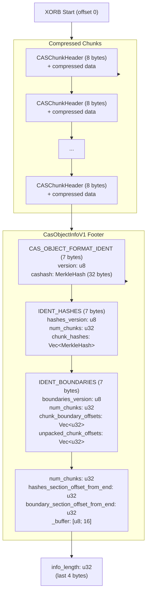
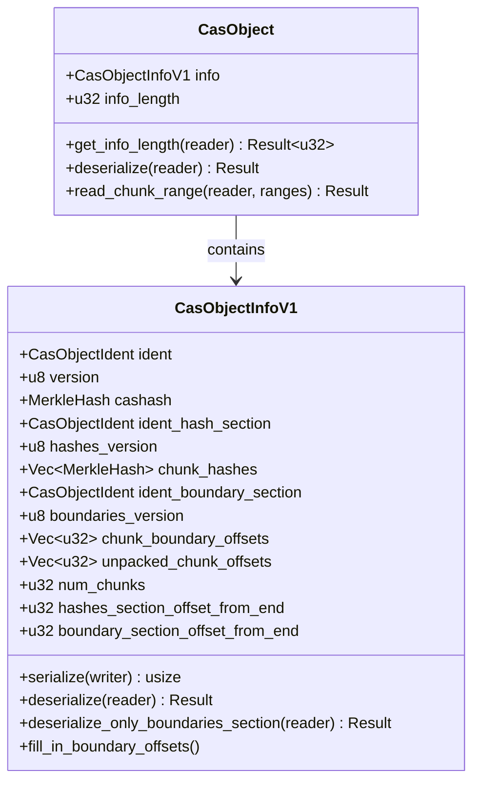
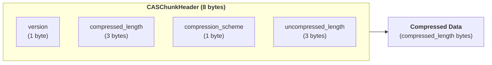
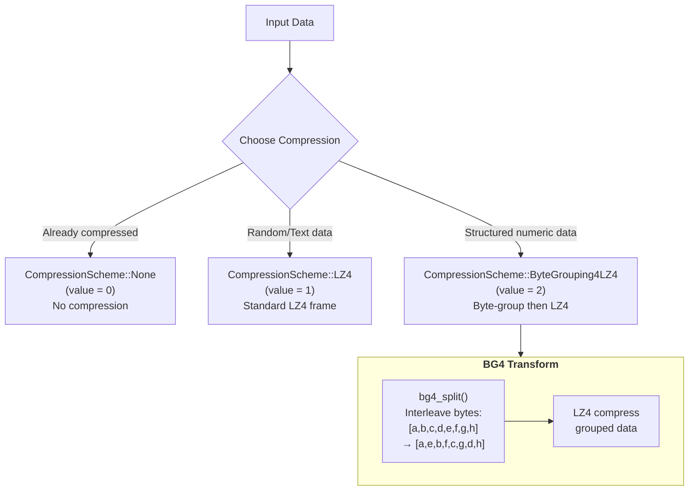
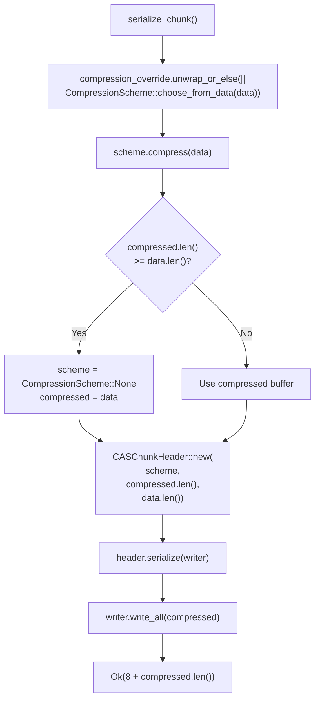
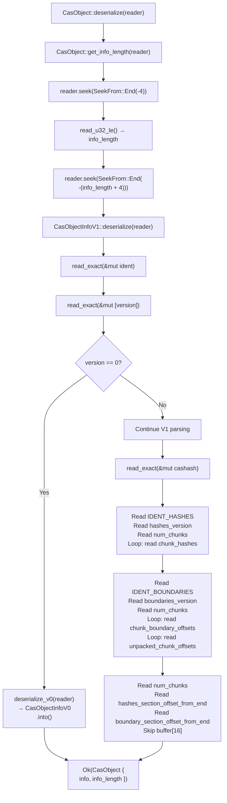
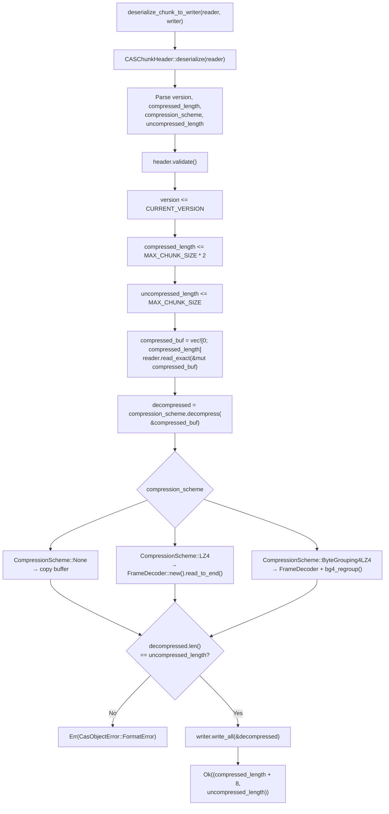
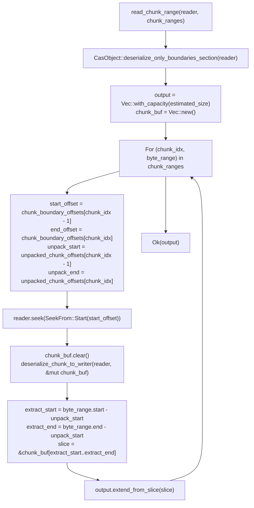
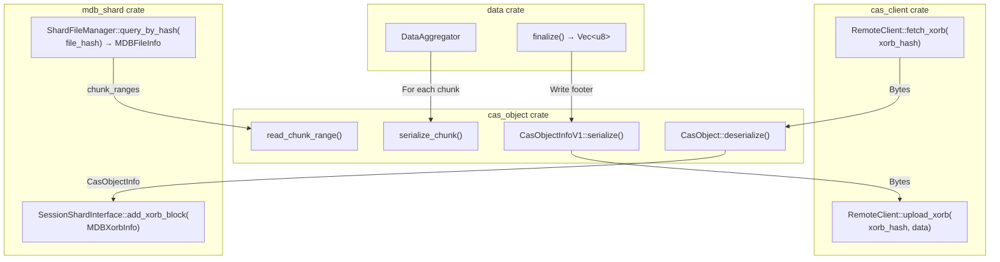

<!-- source: DeepWiki mcp.deepwiki.com · repo huggingface/xet-core · page 3.4 CAS Object Format (XORB) · fetched 2026-10-26 -->

# CAS Object Format (XORB)

<details>
<summary>Relevant source files</summary>

The following files were used as context for generating this wiki page:

- [utils/src/async_read.rs](utils/src/async_read.rs)

</details>


This document describes the binary format of CAS Objects (XORBs), the fundamental storage unit for deduplicated chunks in the xet-core system. A XORB is a compressed container that stores multiple content-addressable chunks with metadata for efficient reconstruction and range queries.

For information about how XORBs are created and uploaded during file processing, see [Upload Workflow](#5.1). For details on the CAS client that manages XORB network operations, see [CAS Client System](#3.3).

---

## Overview

A XORB is a binary blob that aggregates multiple content-defined chunks from potentially different files. Each XORB contains:

1. **Compressed chunk data** with per-chunk `CASChunkHeader` structs
2. **`CasObjectInfo` footer** with hash lists and boundary offsets
3. **Format version identifiers** for backward compatibility

Design characteristics:
- **Compression**: Chunks compressed using `CompressionScheme` enum (None, LZ4, ByteGrouping4LZ4)
- **Range queries**: `unpacked_chunk_offsets` enable partial decompression
- **Verification**: `chunk_hashes` array validates decompressed data
- **Extensibility**: Section-based footer (Calf, Ankle, Foot, Toes) allows format evolution

**Sources:** [cas_object/src/cas_object_format.rs:1-950]()

---

## Physical Layout

The XORB binary format follows this structure:



**Key characteristics:**
- **Footer-first reading**: The last 4 bytes contain `info_length`, enabling readers to seek backward and read the entire footer
- **Section-based footer**: V1 format divides the footer into independently identifiable sections
- **Variable-length arrays**: Chunk hashes and boundaries scale with `num_chunks`
- **Redundant counters**: `num_chunks` appears in multiple sections for validation

**Sources:** [cas_object/src/cas_object_format.rs:882-914](), [cas_object/src/cas_object_format.rs:406-478]()

---

## Format Versions

### Version 0 (Deprecated)

The original XORB format with a simpler footer structure:

| Field | Type | Size | Description |
|-------|------|------|-------------|
| `ident` | `[u8; 7]` | 7 bytes | Magic bytes: `XETBLOB` |
| `version` | `u8` | 1 byte | Always 0 |
| `cashash` | `MerkleHash` | 32 bytes | Hash of entire XORB |
| `num_chunks` | `u32` | 4 bytes | Number of chunks |
| `chunk_boundary_offsets` | `Vec<u32>` | Variable | Compressed boundary offsets |
| `chunk_hashes` | `Vec<MerkleHash>` | Variable | Per-chunk hashes |
| `_buffer` | `[u8; 16]` | 16 bytes | Reserved for future use |

**Limitations:**
- Missing `unpacked_chunk_offsets`, preventing efficient range queries on uncompressed data
- Single-block footer structure less extensible

**Sources:** [cas_object/src/cas_object_format.rs:49-96]()

### Version 1 (Current)

Enhanced format with multi-section footer for better extensibility:

```mermaid
graph LR
    subgraph CalfSection["<b>Calf Section</b>"]
        CI["CAS_OBJECT_FORMAT_IDENT<br/>Version<br/>CAS Hash"]
    end
    
    subgraph AnkleSection["<b>Ankle (Hashes)</b>"]
        HI["IDENT_HASHES<br/>Version"]
        HC["Num Chunks"]
        HL["Chunk Hash List"]
    end
    
    subgraph FootSection["<b>Foot (Boundaries)</b>"]
        BI["IDENT_BOUNDARIES<br/>Version"]
        BC["Num Chunks"]
        BO["Chunk Boundaries"]
        UO["Unpacked Offsets"]
    end
    
    subgraph ToesSection["<b>Toes (Fixed)</b>"]
        NC["Num Chunks"]
        HO["Hash Offset"]
        BO2["Boundary Offset"]
        Buf["Buffer[16]"]
    end
    
    CalfSection --> AnkleSection
    AnkleSection --> FootSection
    FootSection --> ToesSection
```



**Additions in V1:**
- `unpacked_chunk_offsets`: Enables range queries on uncompressed data without decompression
- Section identifiers: `XBLBHSH` (hashes) and `XBLBBND` (boundaries) for independent parsing
- Offset fields: `hashes_section_offset_from_end` and `boundary_section_offset_from_end` for direct section access

**Backward compatibility:** V1 readers can deserialize V0 XORBs, converting them internally using `CasObjectInfoV1::from_v0()`.

**Sources:** [cas_object/src/cas_object_format.rs:280-384](), [cas_object/src/cas_object_format.rs:806-827]()

---

## CasObjectInfo Structure

The `CasObjectInfoV1` struct represents the XORB footer metadata:



**Key methods:**

- **`deserialize<R: Read + Seek>(reader)`**: Reads the footer by seeking to the end, reading `info_length`, then seeking back to read the full footer [cas_object/src/cas_object_format.rs:935-949]()

- **`deserialize_only_boundaries_section<R: Read + Seek>(reader)`**: Optimized method that reads only the boundary section, skipping hash data for faster initialization during range queries [cas_object/src/cas_object_format.rs:607-673]()

- **`fill_in_boundary_offsets()`**: Computes the offset fields based on current footer size [cas_object/src/cas_object_format.rs:859-875]()

**Boundary offset semantics:**
- `chunk_boundary_offsets[i]` is the **end** position of chunk `i` in compressed layout
- Chunk `i` spans bytes `[chunk_boundary_offsets[i-1], chunk_boundary_offsets[i])`
- First chunk starts at offset 0
- `unpacked_chunk_offsets[i]` is the **end** position of chunk `i` in uncompressed layout

**Sources:** [cas_object/src/cas_object_format.rs:280-384](), [cas_object/src/cas_object_format.rs:386-880]()

---

## Chunk Format

Each chunk stored in a XORB has a header followed by compressed data:



**CASChunkHeader structure:**

| Field | Type | Size | Range | Description |
|-------|------|------|-------|-------------|
| `version` | `u8` | 1 byte | 0 | Header format version |
| `compressed_length` | `[u8; 3]` | 3 bytes | 0 - 16,777,215 | Compressed data size |
| `compression_scheme` | `u8` | 1 byte | 0-2 | Compression method used |
| `uncompressed_length` | `[u8; 3]` | 3 bytes | 0 - 16,777,215 | Original data size (max 16MB) |

**Why 3-byte lengths?**
- Saves 2 bytes per chunk compared to `u32`
- Maximum chunk size enforced at 16MB (`MAX_CHUNK_SIZE`)
- With ~1000 chunks per XORB, saves ~2KB per XORB

**Header validation:**
- `version` must be ≤ `CURRENT_VERSION` (0)
- `compressed_length` must be ≤ `MAX_CHUNK_SIZE * 2`
- `uncompressed_length` must be ≤ `MAX_CHUNK_SIZE`
- `compression_scheme` must be valid enum value (0-2)

**Sources:** [cas_object/src/cas_chunk_format.rs:13-91]()

---

## Compression Schemes

The `CompressionScheme` enum defines three compression methods:



### CompressionScheme::None (0)

No compression applied. Used when:
- Compression would increase size (checked during serialization)
- Data is already compressed
- Explicit override requested

### CompressionScheme::LZ4 (1)

Standard LZ4 frame compression. Good for:
- Text and code files
- Random binary data
- General-purpose compression

**Implementation:** Uses `lz4_flex::frame::{FrameEncoder, FrameDecoder}` [cas_object/src/compression_scheme.rs:102-117]()

### CompressionScheme::ByteGrouping4LZ4 (2)

Specialized compression for structured numeric data:

1. **Byte grouping** (`bg4_split`): Interleaves bytes from 4-byte-aligned positions:
   - Original: `[a₀, b₀, c₀, d₀, a₁, b₁, c₁, d₁, ...]`
   - Grouped: `[a₀, a₁, ..., b₀, b₁, ..., c₀, c₁, ..., d₀, d₁, ...]`

2. **LZ4 compression**: Compress the grouped data

3. **Benefit**: Similar bytes (e.g., sign bits, exponents in floats) are adjacent, improving compression ratio

**Effectiveness for different data types:**

| Data Type | Typical Improvement |
|-----------|---------------------|
| `f32` (4-byte floats) | 8-15% better |
| `bf16` (bfloat16) | 18-37% better |
| `i32` / `u32` integers | 0-10% better |
| Random bytes | No improvement |

**Automatic selection:** `CompressionScheme::choose_from_data()` uses KL-divergence heuristic on byte distributions to predict whether BG4 will help [cas_object/src/compression_scheme.rs:89-99]()

**Sources:** [cas_object/src/compression_scheme.rs:19-100](), [cas_object/src/compression_scheme.rs:119-161]()

---

## Serialization Workflow

### Chunk Serialization

Function signature: `serialize_chunk<W: Write>(data: &[u8], writer: &mut W, compression_override: Option<CompressionScheme>) -> Result<usize, CasObjectError>`



Anti-expansion protection at [cas_object/src/cas_chunk_format.rs:125-129]()

**Sources:** [cas_object/src/cas_chunk_format.rs:114-135]()

### XORB Serialization

Function signature: `CasObjectInfoV1::serialize<W: Write>(&self, writer: &mut W) -> Result<usize, CasObjectError>`

```mermaid
sequenceDiagram
    participant Caller
    participant Serialize as "CasObjectInfoV1::serialize()"
    participant Writer as "W: Write"
    
    Note over Serialize: Calf Section
    Serialize->>Writer: write_all(&self.ident)
    Serialize->>Writer: write_all(&[self.version])
    Serialize->>Writer: write_all(self.cashash.as_bytes())
    
    Note over Serialize: Ankle Section
    Serialize->>Writer: write_all(&self.ident_hash_section)
    Serialize->>Writer: write_all(&[self.hashes_version])
    Serialize->>Writer: write_u32_le(self.num_chunks)
    loop self.chunk_hashes.iter()
        Serialize->>Writer: write_all(hash.as_bytes())
    end
    
    Note over Serialize: Foot Section
    Serialize->>Writer: write_all(&self.ident_boundary_section)
    Serialize->>Writer: write_all(&[self.boundaries_version])
    Serialize->>Writer: write_u32_le(self.num_chunks)
    loop self.chunk_boundary_offsets
        Serialize->>Writer: write_u32_le(offset)
    end
    loop self.unpacked_chunk_offsets
        Serialize->>Writer: write_u32_le(offset)
    end
    
    Note over Serialize: Toes Section
    Serialize->>Writer: write_u32_le(self.num_chunks)
    Serialize->>Writer: write_u32_le(self.hashes_section_offset_from_end)
    Serialize->>Writer: write_u32_le(self.boundary_section_offset_from_end)
    Serialize->>Writer: write_all(&[0u8; 16])
    
    Serialize->>Caller: Ok(bytes_written)
```

Validation assertions at [cas_object/src/cas_object_format.rs:406-410]()

**Sources:** [cas_object/src/cas_object_format.rs:402-479]()

---

## Deserialization Workflow

### Footer Deserialization

Function signature: `CasObject::deserialize<R: Read + Seek>(reader: &mut R) -> Result<CasObject, CasObjectError>`



Optimized variant: `deserialize_only_boundaries_section()` skips hash section at [cas_object/src/cas_object_format.rs:607-673]()

**Sources:** [cas_object/src/cas_object_format.rs:484-602](), [cas_object/src/cas_object_format.rs:935-949]()

### Chunk Deserialization

Function signature: `deserialize_chunk_to_writer<R: Read, W: Write>(reader: &mut R, writer: &mut W) -> Result<(usize, usize), CasObjectError>`



Async variant: `deserialize_chunk_to_writer_async()` at [cas_object/src/cas_chunk_format/deserialize_async.rs:18-38]()

**Sources:** [cas_object/src/cas_chunk_format.rs:159-177](), [cas_object/src/cas_chunk_format/deserialize_async.rs:1-111]()

---

## Range Queries and Reconstruction

Function signature: `CasObject::read_chunk_range<R: Read + Seek>(reader: &mut R, chunk_ranges: &[(usize, Range<usize>)]) -> Result<Vec<u8>, CasObjectError>`



Usage example:
```rust
// chunk_ranges: vec![(2, 0..1024), (3, 512..2048)]
// Reads bytes 0..1024 from chunk 2 and bytes 512..2048 from chunk 3
let data = CasObject::read_chunk_range(&mut reader, &chunk_ranges)?;
```

Only decompresses chunks in `chunk_ranges`, not entire XORB.

**Sources:** [cas_object/src/cas_object_format.rs:1019-1115]()

---

## Format Constants and Identifiers

```rust
// Magic byte sequences
const CAS_OBJECT_FORMAT_IDENT: [u8; 7] = [b'X', b'E', b'T', b'B', b'L', b'O', b'B'];
const CAS_OBJECT_FORMAT_IDENT_HASHES: [u8; 7] = [b'X', b'B', b'L', b'B', b'H', b'S', b'H'];
const CAS_OBJECT_FORMAT_IDENT_BOUNDARIES: [u8; 7] = [b'X', b'B', b'L', b'B', b'B', b'N', b'D'];

// Versions
const CAS_OBJECT_FORMAT_VERSION_V0: u8 = 0;  // Deprecated
const CAS_OBJECT_FORMAT_VERSION: u8 = 1;     // Current
const CAS_OBJECT_FORMAT_HASHES_VERSION: u8 = 0;
const CAS_OBJECT_FORMAT_BOUNDARIES_VERSION: u8 = 1;

// Sizes
const CAS_OBJECT_INFO_DEFAULT_LENGTH: u32 = 92;  // V1 footer base size
const CAS_CHUNK_HEADER_LENGTH: usize = 8;        // Chunk header size
```

**Identifier purpose:** Each section has a unique identifier to:
- Detect format errors early (reading garbage data)
- Enable section-level parsing in future tools
- Distinguish between different format versions

**Sources:** [cas_object/src/cas_object_format.rs:24-36](), [cas_object/src/cas_chunk_format.rs:13-14]()

---

## Error Handling

The `CasObjectError` enum defines error categories:

| Error | Description | When It Occurs |
|-------|-------------|----------------|
| `FormatError` | Invalid XORB structure | Wrong identifier, version mismatch, corrupted footer |
| `InvalidRange` | Bad range query | Chunk index out of bounds |
| `HashMismatch` | Verification failure | Decompressed chunk hash ≠ expected |
| `InternalIOError` | I/O failure | Read/write/seek errors |
| `CompressionError` | Compression failure | LZ4 decode error |
| `ChunkHeaderParseErrorFooterIdent` | Chunk header reads as footer | Indicates corruption or misalignment |

**Validation trait:** The `Validate<T>` trait provides `.ok_for_format_error()` to convert `FormatError` into `Ok(None)`, useful for skipping invalid XORBs during bulk processing [cas_object/src/error.rs:48-63]()

**Sources:** [cas_object/src/error.rs:1-64]()

---

## Integration with System Components



### Upload Flow

| Step | Component | Method | Output |
|------|-----------|--------|--------|
| 1 | `DataAggregator` | `.add_chunk()` | Accumulates chunks in memory |
| 2 | `DataAggregator` | `.finalize()` | Calls `serialize_chunk()` per chunk |
| 3 | `CasObjectInfoV1` | `.serialize()` | Writes footer to buffer |
| 4 | `RemoteClient` | `.upload_xorb()` | POSTs to `/v1/xorbs/:hash` |
| 5 | `SessionShardInterface` | `.add_xorb_block()` | Stores `MDBXorbInfo` |

### Download Flow

| Step | Component | Method | Input |
|------|-----------|--------|-------|
| 1 | `ShardFileManager` | `.query_by_hash()` | `file_hash` → `MDBFileInfo` |
| 2 | `MDBFileInfo` | `.reconstruction_terms` | List of `(xorb_hash, chunk_ranges)` |
| 3 | `RemoteClient` | `.fetch_xorb()` | GETs `/v1/xorbs/:hash` |
| 4 | `CasObject` | `.deserialize_only_boundaries_section()` | Reads footer metadata |
| 5 | `CasObject` | `.read_chunk_range()` | Decompresses specified chunks |

**Sources:** [cas_object/Cargo.toml:17-21]()

---

## Performance Considerations

**Memory allocation:**
- `prealloc_num_chunks()` limits pre-allocation to prevent OOM attacks from malicious `num_chunks` values [cas_object/src/cas_object_format.rs:40-47]()
- Typical XORB has ~1000 chunks, pre-allocates for ~1125 chunks (9/8 ratio)

**Compression ratios:**
- LZ4 on random data: ~1.0x (no compression benefit)
- LZ4 on text: 2-4x compression
- BG4+LZ4 on f32 arrays: 2-6x compression
- BG4+LZ4 on bf16 arrays: 3-8x compression

**Range query optimization:**
- `deserialize_only_boundaries_section()` reduces deserialization time by 50-70% for range queries
- Avoids reading the hash section (~32KB per 1000 chunks)

**Async operations:**
- All deserialization methods have `async` variants for non-blocking I/O
- Streams can be processed chunk-by-chunk without buffering entire XORB

**Sources:** [cas_object/src/cas_object_format.rs:40-47](), [cas_object/src/compression_scheme.rs:164-266]()

---

