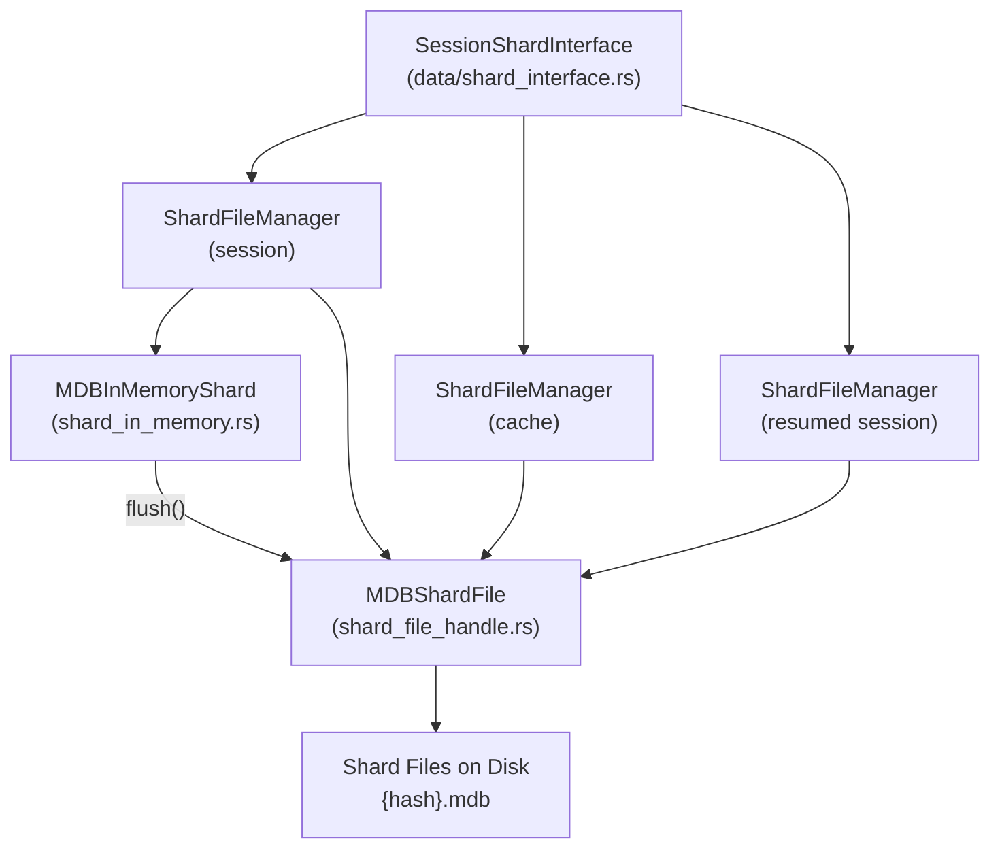
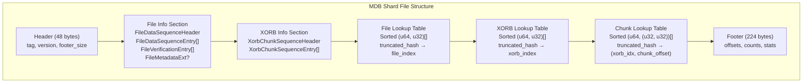
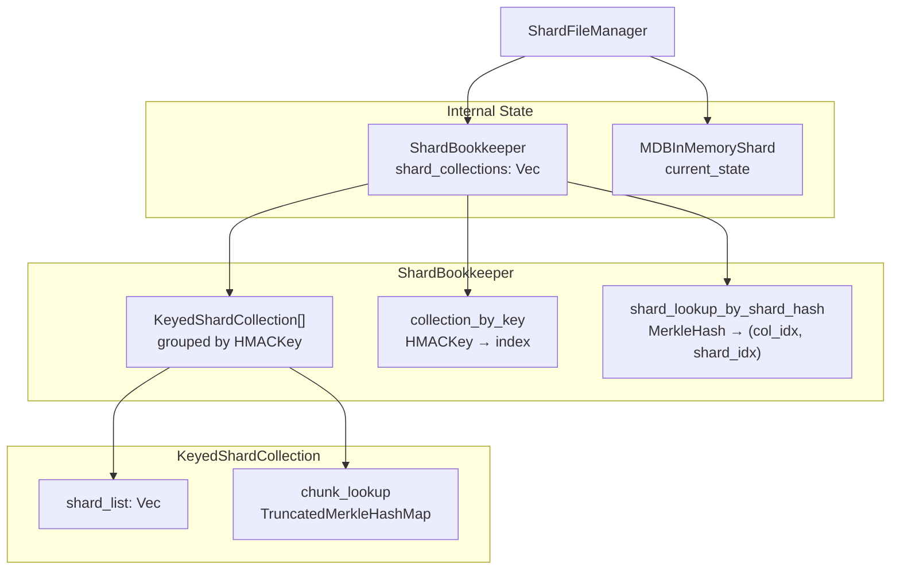
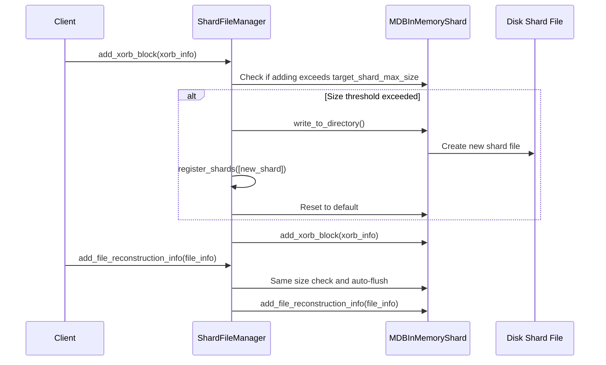
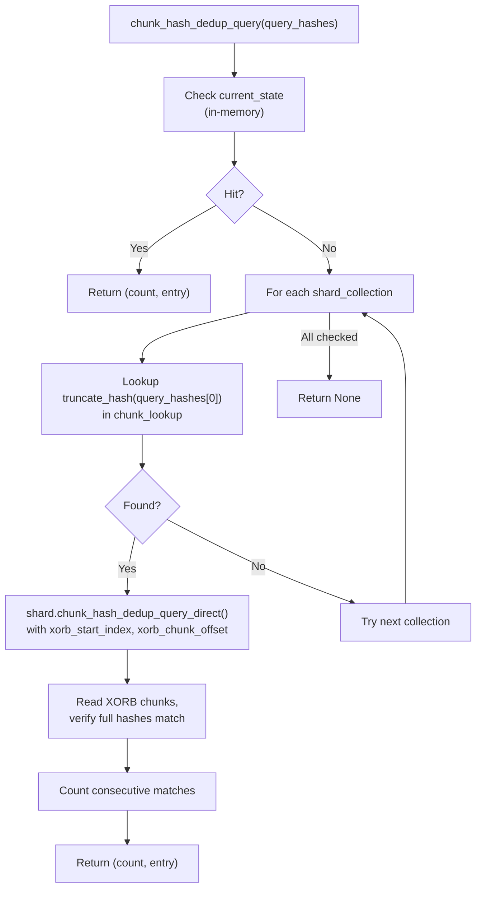
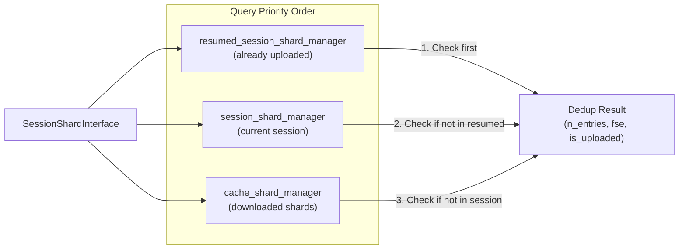
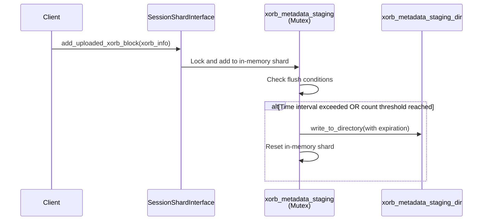
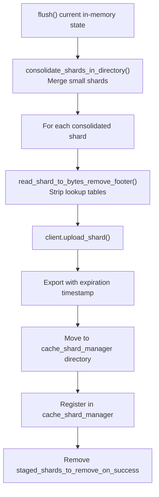
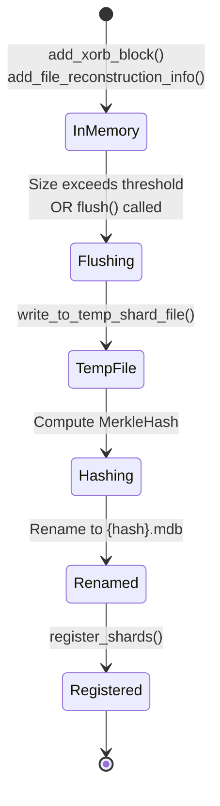

<!-- source: DeepWiki mcp.deepwiki.com · repo huggingface/xet-core · page 3.5 Shard Management System · fetched 2026-10-26 -->

# Shard Management System

<details>
<summary>Relevant source files</summary>

The following files were used as context for generating this wiki page:

- [cas_client/src/interface.rs](cas_client/src/interface.rs)
- [cas_client/src/lib.rs](cas_client/src/lib.rs)
- [data/src/shard_interface.rs](data/src/shard_interface.rs)
- [hf_xet_wasm/src/wasm_file_upload_session.rs](hf_xet_wasm/src/wasm_file_upload_session.rs)
- [mdb_shard/Cargo.toml](mdb_shard/Cargo.toml)
- [mdb_shard/src/file_structs.rs](mdb_shard/src/file_structs.rs)
- [mdb_shard/src/lib.rs](mdb_shard/src/lib.rs)
- [mdb_shard/src/session_directory.rs](mdb_shard/src/session_directory.rs)
- [mdb_shard/src/set_operations.rs](mdb_shard/src/set_operations.rs)
- [mdb_shard/src/shard_benchmark.rs](mdb_shard/src/shard_benchmark.rs)
- [mdb_shard/src/shard_file_handle.rs](mdb_shard/src/shard_file_handle.rs)
- [mdb_shard/src/shard_file_manager.rs](mdb_shard/src/shard_file_manager.rs)
- [mdb_shard/src/shard_format.rs](mdb_shard/src/shard_format.rs)
- [mdb_shard/src/shard_in_memory.rs](mdb_shard/src/shard_in_memory.rs)
- [mdb_shard/src/streaming_shard.rs](mdb_shard/src/streaming_shard.rs)
- [mdb_shard/src/utils.rs](mdb_shard/src/utils.rs)

</details>


The Shard Management System manages MDB (MerkleDB) shard files that store metadata for content-addressable storage. Shards contain lookup tables and reconstruction information that enable file deduplication and retrieval. The system handles shard creation during upload sessions, caching for fast deduplication queries, consolidation of small shards, and expiration of cached shards.

For the binary format specification of XORBs referenced by shards, see [CAS Object Format (XORB)](#3.4). For session-level coordination of shard uploads, see [Session Shard Interface](#3.5.1). For the actual file reconstruction process that uses shard metadata, see [File Reconstruction](#5.3).

## Architecture Overview

The shard management system operates at multiple levels: individual shard files, collections of shards managed together, and session-specific shard operations.

### Component Hierarchy



**Sources:** [data/src/shard_interface.rs:26-50](), [mdb_shard/src/shard_file_manager.rs:75-81](), [mdb_shard/src/shard_in_memory.rs:21-27]()

The system uses three types of shard managers during an upload session:

| Manager Type | Purpose | Location | Expiration |
|--------------|---------|----------|------------|
| **Session Manager** | Accumulates new metadata during upload | Temporary session directory | None (deleted after upload) |
| **Cache Manager** | Stores downloaded shards for dedup queries | `~/.cache/huggingface/xet` | 30 days default |
| **Resumed Session Manager** | Holds metadata from previous failed upload attempts | Session directory | None (merged into current session) |

**Sources:** [data/src/shard_interface.rs:26-50](), [xet_runtime/src/config.rs]()

## MDB Shard Binary Format

Shards are binary files with the extension `.mdb` and filename `{MerkleHash}.mdb`. Each shard contains multiple sections with lookup tables for efficient queries.

### Shard File Structure



**Sources:** [mdb_shard/src/shard_format.rs:227-283](), [mdb_shard/src/shard_format.rs:58-101](), [mdb_shard/src/shard_format.rs:103-225]()

### Key Structures

#### MDBShardFileHeader

Fixed-size header at file start:

| Field | Type | Purpose |
|-------|------|---------|
| `tag` | `[u8; 32]` | Magic number for file identification |
| `version` | `u64` | Format version (currently 2) |
| `footer_size` | `u64` | Size of footer in bytes |

**Sources:** [mdb_shard/src/shard_format.rs:58-101]()

#### MDBShardFileFooter

Located at end of file, contains all section offsets and metadata:

| Field | Type | Purpose |
|-------|------|---------|
| `file_info_offset` | `u64` | Byte offset to file info section |
| `xorb_info_offset` | `u64` | Byte offset to XORB info section |
| `file_lookup_offset` | `u64` | Byte offset to file lookup table |
| `xorb_lookup_offset` | `u64` | Byte offset to XORB lookup table |
| `chunk_lookup_offset` | `u64` | Byte offset to chunk lookup table |
| `chunk_hash_hmac_key` | `HMACKey` | Optional HMAC key for chunk hashes |
| `shard_creation_timestamp` | `u64` | Creation time (seconds since epoch) |
| `shard_key_expiry` | `u64` | Expiration time (seconds since epoch) |
| `materialized_bytes` | `u64` | Total uncompressed file bytes |
| `stored_bytes` | `u64` | Total compressed XORB bytes |

**Sources:** [mdb_shard/src/shard_format.rs:103-225]()

### Hash Truncation

All lookup tables use truncated hashes (first 8 bytes) to reduce size. The `truncate_hash()` function extracts the first `u64`:

```rust
pub fn truncate_hash(hash: &MerkleHash) -> u64 {
    hash.deref()[0]
}
```

This creates collisions that are resolved by checking the full hash after lookup. Up to 8 collisions are handled per truncated hash.

**Sources:** [mdb_shard/src/utils.rs:31-33](), [mdb_shard/src/shard_format.rs:478-499]()

## ShardFileManager

`ShardFileManager` is the primary interface for shard operations. It maintains both in-memory state and registered on-disk shards.

### Core Components



**Sources:** [mdb_shard/src/shard_file_manager.rs:75-81](), [mdb_shard/src/shard_file_manager.rs:53-73](), [mdb_shard/src/shard_file_manager.rs:35-49]()

### Construction and Initialization

`ShardFileManager` can be created in two modes:

```rust
// Session directory - for upload sessions
let session_sfm = ShardFileManager::new_in_session_directory(
    session_dir,
    scan_directory
).await?;

// Cache directory - for local shard cache with LRU eviction
let cache_sfm = ShardFileManager::new_in_cache_directory(
    cache_dir
).await?;
```

Cache instances are stored in a global cache keyed by directory path to avoid duplicate loading.

**Sources:** [mdb_shard/src/shard_file_manager.rs:102-119](), [mdb_shard/src/shard_file_manager.rs:121-169]()

### Adding Metadata

During an upload session, metadata is accumulated in the in-memory shard:



**Sources:** [mdb_shard/src/shard_file_manager.rs:448-493](), [mdb_shard/src/shard_file_manager.rs:495-499]()

The manager automatically cuts new shards when the in-memory size exceeds `target_shard_max_size` (configurable via `xet_config().mdb_shard.max_target_size`).

### Shard Registration

Shards are registered to make them queryable:

```rust
pub async fn register_shards(&self, new_shards: &[Arc<MDBShardFile>]) -> Result<()>
```

Registration process:

1. **Sort by timestamp** - Newest shards first for LRU behavior
2. **Skip duplicates** - Check `shard_lookup_by_shard_hash` 
3. **Load chunk hashes** - Background task reads all truncated hashes
4. **Group by HMAC key** - Shards with same key go in same collection
5. **Update chunk lookup** - Insert into `TruncatedMerkleHashMap` (limited by `chunk_index_table_max_size`)

**Sources:** [mdb_shard/src/shard_file_manager.rs:221-340]()

### Deduplication Queries

The primary query operation is `chunk_hash_dedup_query()`:

```rust
pub async fn chunk_hash_dedup_query(
    &self,
    query_hashes: &[MerkleHash],
) -> Result<Option<(usize, FileDataSequenceEntry)>>
```

This checks if a sequence of chunk hashes exists in registered XORBs, returning the number of matched chunks and a `FileDataSequenceEntry` describing the XORB and chunk range.

**Query Flow:**



**Sources:** [mdb_shard/src/shard_file_manager.rs:410-446](), [mdb_shard/src/shard_format.rs:674-732]()

The query uses a two-level strategy:
1. **Truncated hash lookup** - Fast lookup in `chunk_lookup` using first 8 bytes
2. **Full hash verification** - Read actual XORB chunks and verify full 256-bit hashes

This allows the lookup table to be ~10x smaller while handling hash collisions correctly.

### File Reconstruction Queries

To reconstruct a file, query by file hash:

```rust
pub async fn get_file_reconstruction_info(
    &self,
    file_hash: &MerkleHash,
) -> Result<Option<(MDBFileInfo, Option<MerkleHash>)>>
```

Returns `MDBFileInfo` containing a sequence of `FileDataSequenceEntry` that specify which XORB chunks to fetch.

**Sources:** [mdb_shard/src/shard_file_manager.rs:369-403]()

## Session Shard Interface

`SessionShardInterface` coordinates shard operations during an upload session. It manages three separate `ShardFileManager` instances and handles session resumption.

### Manager Coordination



**Sources:** [data/src/shard_interface.rs:26-50](), [data/src/shard_interface.rs:154-180]()

### Session Resumption

On initialization, `SessionShardInterface` merges shards from previous incomplete uploads:

```rust
let shard_merge_jh = merge_shards_background(
    &xorb_metadata_staging_dir,  // Previous session shards
    &session_dir,                 // Current session dir
    target_max_size,
    true  // skip_on_error
);
```

Merged shards are loaded into `resumed_session_shard_manager` and marked with `is_uploaded=true` for deduplication queries. Original staging shards are added to `staged_shards_to_remove_on_success` for cleanup after successful upload.

**Sources:** [data/src/shard_interface.rs:72-119]()

### Deduplication with Remote Queries

When local dedup fails, `SessionShardInterface` can query the remote server:

```rust
pub async fn query_dedup_shard_by_chunk(&self, chunk_hash: &MerkleHash) -> Result<bool>
```

If the server has a shard containing the chunk, it's downloaded and imported into the cache manager:

```rust
self.cache_shard_manager.import_shard_from_bytes(&new_shard).await?;
```

This enables deduplication against the global repository state.

**Sources:** [data/src/shard_interface.rs:135-151]()

### XORB Metadata Staging

To support session resumption, XORB metadata is periodically flushed to disk:



Flush triggers:
- **Time interval**: `session_xorb_metadata_flush_interval` (default from config)
- **Count threshold**: `session_xorb_metadata_flush_max_count` (default from config)

**Sources:** [data/src/shard_interface.rs:189-215]()

### Shard Upload and Finalization

After all XORBs are uploaded, session shards are consolidated and uploaded:

```rust
pub async fn upload_and_register_session_shards(&self) -> Result<u64>
```

**Upload Process:**



**Sources:** [data/src/shard_interface.rs:232-311](), [data/src/shard_interface.rs:314-332]()

The uploaded shards exclude footer and lookup tables since the server reconstructs them from the data sections. The `footer_size` field is set to 0 before upload.

## Shard File Lifecycle

### Creation Flow



**Sources:** [mdb_shard/src/shard_in_memory.rs:247-267](), [mdb_shard/src/shard_file_manager.rs:503-526]()

### Consolidation

Small shards are merged to improve query performance:

```rust
pub fn consolidate_shards_in_directory(
    session_directory: impl AsRef<Path>,
    target_max_size: u64,
    skip_on_error: bool,
) -> Result<Vec<Arc<MDBShardFile>>>
```

**Merge Algorithm:**

1. **Load all shards** from directory
2. **Sort by modification time** (oldest first for LRU)
3. **Accumulate** shards until combined size approaches `target_max_size`
4. **Union operation** - Merge file info and XORB info sections
5. **Write merged shard** 
6. **Delete source shards**

The union operation (`shard_set_union()`) efficiently merges sorted lookup tables without loading entire contents into memory.

**Sources:** [mdb_shard/src/session_directory.rs:21-40](), [mdb_shard/src/session_directory.rs:56-151](), [mdb_shard/src/set_operations.rs:376-384]()

### Cache Management

Cache shards have expiration timestamps and are pruned by size and time:

```rust
pub fn load_managed_directory(
    path: impl AsRef<Path>,
    skip_on_error: bool,
    load_expired: bool,
    prune_expired: bool,
    prune_dir_storage_to_size: u64,
) -> Result<Vec<Arc<Self>>>
```

**Pruning Logic:**

| Condition | Action |
|-----------|--------|
| `shard_key_expiry + buffer < current_time` | Delete if `prune_expired=true` |
| `total_size > prune_dir_storage_to_size` | Delete oldest shards (by `shard_creation_timestamp`) |

Oldest shards are identified using a min-heap on creation timestamp.

**Sources:** [mdb_shard/src/shard_file_handle.rs:190-248](), [mdb_shard/src/shard_file_handle.rs:250-263]()

## Shard File Handle

`MDBShardFile` represents a single shard on disk with parsed metadata. It provides efficient query operations without loading the full file.

### Structure

| Field | Type | Purpose |
|-------|------|---------|
| `shard_hash` | `MerkleHash` | Content hash of shard file |
| `path` | `PathBuf` | Filesystem path |
| `shard` | `MDBShardInfo` | Parsed header and footer |
| `last_modified_time` | `SystemTime` | For LRU tracking |

Instances are cached in `MDB_SHARD_FILE_CACHE` (global `HashMap<PathBuf, Arc<MDBShardFile>>`) to avoid redundant loading.

**Sources:** [mdb_shard/src/shard_file_handle.rs:23-65]()

### Query Operations

All queries use `BufReader` for efficient disk access:

```rust
pub fn get_file_reconstruction_info(&self, file_hash: &MerkleHash) 
    -> Result<Option<MDBFileInfo>>
{
    let Some(mut reader) = self.get_reader_if_present()? else {
        return Ok(None);
    };
    self.shard.get_file_reconstruction_info(&mut reader, file_hash)
}
```

The `get_reader_if_present()` method returns `None` if the file was deleted (e.g., during cache eviction), allowing graceful degradation.

**Sources:** [mdb_shard/src/shard_file_handle.rs:358-386](), [mdb_shard/src/shard_file_handle.rs:365-377]()

### Export Operations

Shards can be exported with modifications:

**Add Expiration:**
```rust
pub fn export_with_expiration(
    &self,
    target_directory: impl AsRef<Path>,
    shard_valid_for: Duration,
) -> Result<Arc<Self>>
```

Copies the shard with an updated `shard_key_expiry` timestamp in the footer.

**Apply HMAC Key:**
```rust
pub fn export_as_keyed_shard(
    &self,
    target_directory: impl AsRef<Path>,
    hmac_key: HMACKey,
    key_valid_for: Duration,
    include_file_info: bool,
    include_xorb_lookup_table: bool,
    include_chunk_lookup_table: bool,
) -> Result<Arc<Self>>
```

Creates a new shard with chunk hashes protected by HMAC. This is used for sharing deduplication information with limited access to chunk content.

**Sources:** [mdb_shard/src/shard_file_handle.rs:103-136](), [mdb_shard/src/shard_file_handle.rs:324-351]()

## Performance Characteristics

### Query Performance

| Operation | Time Complexity | Notes |
|-----------|----------------|-------|
| `chunk_hash_dedup_query()` | O(log n + m) | Binary search on truncated hash + sequential match of m chunks |
| `get_file_reconstruction_info()` | O(log n) | Binary search on file lookup table |
| Shard registration | O(n log n) | Sort chunk hashes for lookup table |

Where:
- n = number of entries in lookup table
- m = number of consecutive matching chunks

**Sources:** [mdb_shard/src/shard_format.rs:674-732](), [mdb_shard/src/interpolation_search.rs]()

### Memory Usage

The chunk lookup index is capped at `chunk_index_table_max_size` (default from config). Beyond this limit, new chunks are not indexed, and deduplication falls back to remote queries.

```rust
let update_chunk_lookup = 
    sbkp_lg.total_indexed_chunks < xet_config().mdb_shard.chunk_index_table_max_size;
```

Each indexed chunk uses:
- 8 bytes (truncated hash key)
- 8 bytes (`ChunkCacheElement`: `u32 xorb_start_index`, `u16 xorb_chunk_offset`, `u16 shard_index`)

**Sources:** [mdb_shard/src/shard_file_manager.rs:271-322](), [mdb_shard/src/shard_file_manager.rs:28-33]()

### Disk I/O Optimization

Shards use `BufReader` with 2048-byte buffer for sequential reads. Lookup table queries use `seek()` to jump directly to relevant sections, minimizing unnecessary I/O.

**Sources:** [mdb_shard/src/shard_file_handle.rs:358-360]()

---

