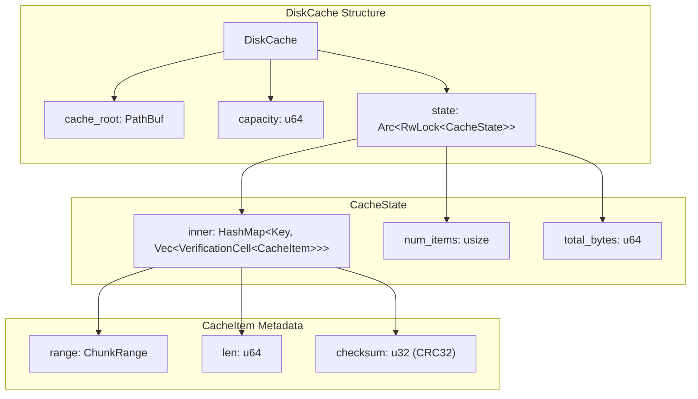
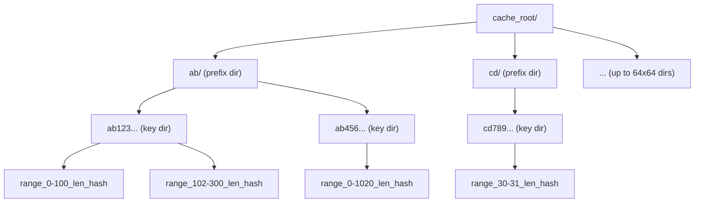
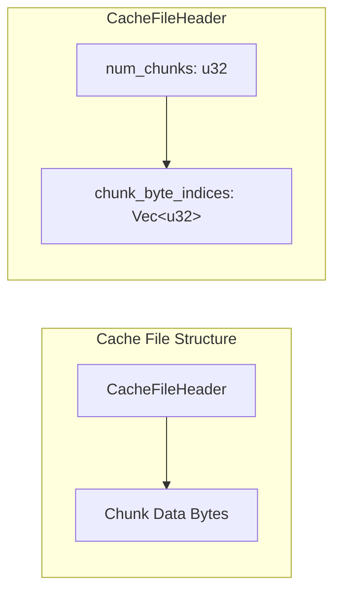
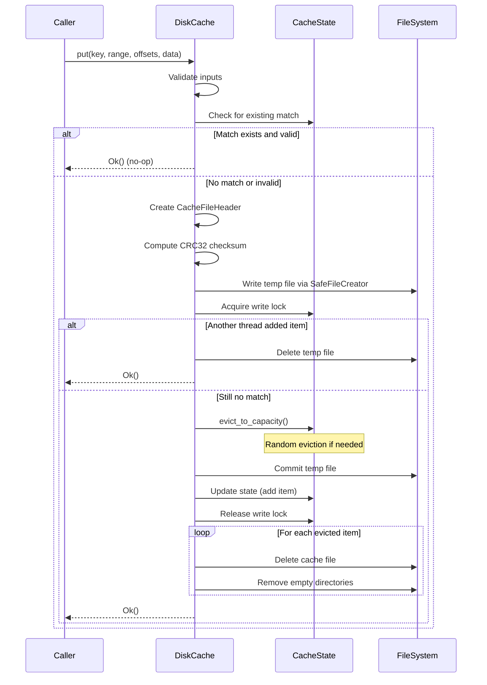
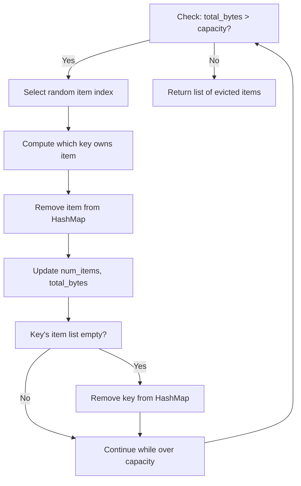
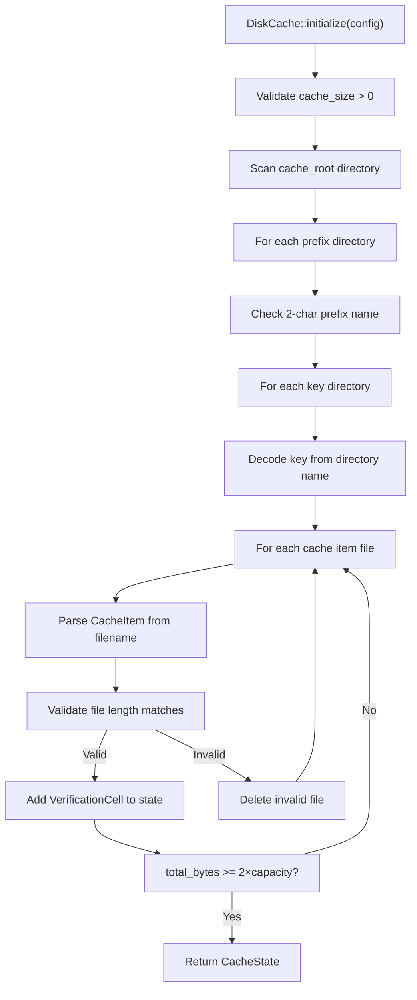
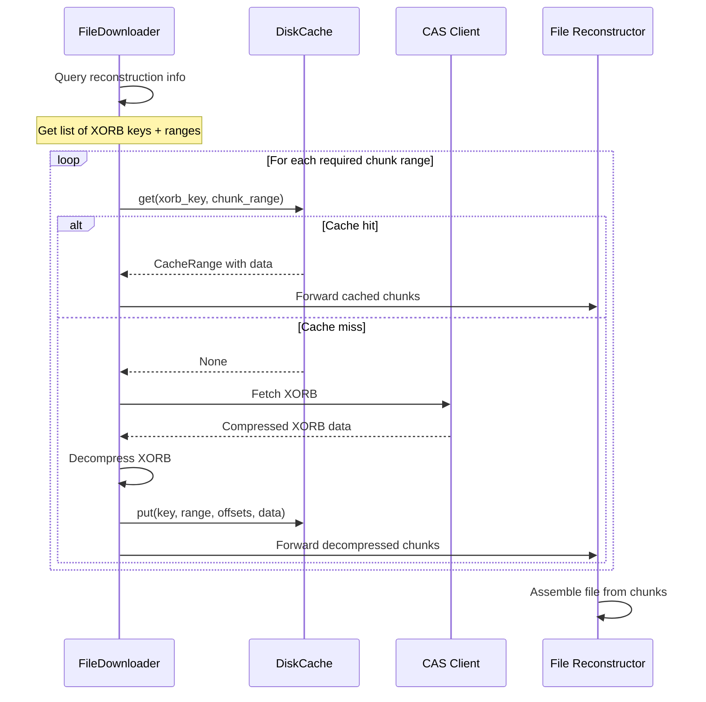

<!-- source: DeepWiki mcp.deepwiki.com · repo huggingface/xet-core · page 3.6 Chunk Caching · fetched 2026-10-26 -->

# Chunk Caching

<details>
<summary>Relevant source files</summary>

The following files were used as context for generating this wiki page:

- [cas_client/src/adaptive_concurrency/controller.rs](cas_client/src/adaptive_concurrency/controller.rs)
- [chunk_cache/Cargo.toml](chunk_cache/Cargo.toml)
- [chunk_cache/src/disk.rs](chunk_cache/src/disk.rs)
- [chunk_cache/src/disk/cache_item.rs](chunk_cache/src/disk/cache_item.rs)
- [chunk_cache/src/disk/test_utils.rs](chunk_cache/src/disk/test_utils.rs)
- [chunk_cache/src/lib.rs](chunk_cache/src/lib.rs)
- [data/src/configurations.rs](data/src/configurations.rs)
- [data/src/file_download_session.rs](data/src/file_download_session.rs)
- [data/src/test_utils.rs](data/src/test_utils.rs)
- [data/tests/test_session_resume.rs](data/tests/test_session_resume.rs)
- [file_reconstruction/Cargo.toml](file_reconstruction/Cargo.toml)
- [file_reconstruction/src/data_writer/data_writer.rs](file_reconstruction/src/data_writer/data_writer.rs)
- [file_reconstruction/src/data_writer/sequential_writer.rs](file_reconstruction/src/data_writer/sequential_writer.rs)
- [file_reconstruction/src/error.rs](file_reconstruction/src/error.rs)
- [file_reconstruction/src/file_reconstructor.rs](file_reconstruction/src/file_reconstructor.rs)
- [xet_config/src/groups/reconstruction.rs](xet_config/src/groups/reconstruction.rs)

</details>


The chunk cache provides local disk-based storage for frequently accessed chunk data from XORBs (compressed data blocks). This enables efficient reuse of previously downloaded data across multiple download sessions, reducing bandwidth usage and improving performance when accessing the same or overlapping file content.

For information about the XORB format that stores the compressed chunks, see [CAS Object Format](#3.4). For details on how chunks are retrieved during downloads, see [Download Workflow](#5.2).

---

## Purpose and Role

The chunk cache sits between the CAS client and file reconstruction logic, intercepting chunk requests to check for locally cached data before fetching from remote storage. During download operations, when XORBs are fetched and decompressed, the resulting chunk data is stored in the cache for future reuse. This architecture enables:

- **Cross-session persistence**: Cached chunks remain available across multiple program executions
- **Partial content reuse**: Different files sharing identical chunks benefit from cached data
- **Bandwidth optimization**: Repeated access to the same content requires only a single download

**Sources:** [chunk_cache/src/lib.rs:29-36]()

---

## ChunkCache Trait

The `ChunkCache` trait defines the interface for cache implementations:

```rust
pub trait ChunkCache: Sync + Send {
    async fn get(&self, key: &Key, range: &ChunkRange) 
        -> Result<Option<CacheRange>, ChunkCacheError>;
    
    async fn put(&self, key: &Key, range: &ChunkRange, 
        chunk_byte_indices: &[u32], data: &[u8]) 
        -> Result<(), ChunkCacheError>;
}
```

### CacheRange Structure

The `CacheRange` type returned by `get()` contains:

| Field | Type | Description |
|-------|------|-------------|
| `offsets` | `Vec<u32>` | Byte offsets for each chunk boundary (length = num_chunks + 1) |
| `data` | `Vec<u8>` | Raw chunk data bytes |
| `range` | `ChunkRange` | The chunk index range [start, end) |

The `offsets` vector always starts with `0` and ends with `data.len()`, providing byte boundaries for each chunk in the range. For example, for chunks [2, 5) with offsets `[0, 2000, 4000, 6000]`, chunk 2 occupies bytes [0, 2000), chunk 3 occupies [2000, 4000), and chunk 4 occupies [4000, 6000).

**Sources:** [chunk_cache/src/lib.rs:16-27](), [chunk_cache/src/lib.rs:38-72]()

---

## DiskCache Implementation

The primary implementation is `DiskCache`, which persists cache data to the filesystem:



### Key Components

**DiskCache**: The main cache implementation that manages both in-memory state and on-disk storage.

**CacheState**: Thread-safe in-memory index tracking all cached items, their locations, and verification status. Protected by `RwLock` for concurrent access.

**VerificationCell**: Wrapper around `CacheItem` that tracks whether the cache file's checksum has been verified, avoiding redundant CRC32 computations.

**CacheItem**: Metadata for a single cached range, including the chunk range, file length, and CRC32 checksum for integrity verification.

**Sources:** [chunk_cache/src/disk.rs:36-50](), [chunk_cache/src/disk.rs:129-135](), [chunk_cache/src/disk/cache_item.rs:16-20](), [chunk_cache/src/disk/cache_item.rs:98-107]()

---

## Storage Layout

The cache uses a hierarchical directory structure for efficient organization:



### Directory Hierarchy

**Level 1: Prefix Directories** - The first 2 characters of the base64-encoded key serve as prefix directory names, limiting the maximum to 4,096 directories (64 × 64).

**Level 2: Key Directories** - Each key (CAS hash + prefix) has its own directory named using base64 encoding of the concatenated `[hash_bytes, prefix_bytes]`.

**Level 3: Cache Item Files** - Individual files representing cached chunk ranges, with filenames encoding the `CacheItem` metadata.

### File Naming Convention

Cache item filenames are base64-encoded binary representations containing:

```
BASE64_encode([range.start, range.end, file_len, crc32_checksum])
             (4 bytes)    (4 bytes)  (8 bytes) (4 bytes)
```

**Sources:** [chunk_cache/src/disk.rs:186-207](), [chunk_cache/src/disk.rs:774-794](), [chunk_cache/src/disk/cache_item.rs:133-141]()

---

## Cache File Format

Each cache file contains a header followed by raw chunk data:



### CacheFileHeader Format

The header serializes as:

| Offset | Field | Type | Description |
|--------|-------|------|-------------|
| 0 | `num_chunks` | `u32` | Number of chunks in the range |
| 4 | `chunk_byte_indices[0]` | `u32` | Always 0 (start of first chunk) |
| 8 | `chunk_byte_indices[1]` | `u32` | Byte offset where chunk 1 ends |
| ... | ... | ... | ... |
| 4 + 4×n | `chunk_byte_indices[n]` | `u32` | Total data length |

Following the header, the raw chunk data bytes are stored contiguously. The combination of header length + data length equals the `len` field in the `CacheItem` metadata.

**Sources:** [chunk_cache/src/disk/cache_file_header.rs:1-80]() (referenced but not provided in files, inferred from usage)

---

## Cache Operations

### Get Operation Flow

```mermaid
sequenceDiagram
    participant Caller
    participant DiskCache
    participant CacheState
    participant FileSystem
    
    Caller->>DiskCache: get(key, range)
    DiskCache->>CacheState: find_match(key, range)
    
    alt Cache miss
        CacheState-->>DiskCache: None
        DiskCache-->>Caller: Ok(None)
    else Cache hit
        CacheState-->>DiskCache: VerificationCell&lt;CacheItem&gt;
        DiskCache->>FileSystem: Open cache file
        
        alt File not found
            FileSystem-->>DiskCache: NotFound error
            DiskCache->>CacheState: remove_item()
            Note over DiskCache: Retry from start
        else File exists
            alt Needs verification
                DiskCache->>FileSystem: Compute CRC32
                alt Checksum mismatch
                    DiskCache->>CacheState: remove_item()
                    Note over DiskCache: Retry from start
                else Checksum valid
                    DiskCache->>DiskCache: Mark as verified
                end
            end
            
            DiskCache->>FileSystem: Read header + data
            DiskCache->>DiskCache: Extract requested range
            DiskCache-->>Caller: Ok(Some(CacheRange))
        end
    end
```

The `get()` operation implements a retry loop that handles inconsistencies between in-memory state and disk state, automatically removing corrupted or missing items.

### Put Operation Flow



**Key Features:**
- **Atomic writes**: Uses `SafeFileCreator` to write to a temporary file, then atomically rename
- **Race condition handling**: Checks for duplicate inserts after acquiring the write lock
- **Deferred cleanup**: Eviction deletion happens after releasing the lock to minimize contention

**Sources:** [chunk_cache/src/disk.rs:313-361](), [chunk_cache/src/disk.rs:363-453]()

---

## Eviction Policy

The cache implements a **random eviction** policy when capacity limits are exceeded:



### Eviction Algorithm

The `evict_to_capacity()` method:

1. **Random selection**: Chooses a random item index from the total item count
2. **Key traversal**: Iterates through keys to find which one owns the selected index
3. **Removal**: Removes the item using `swap_remove` for O(1) performance
4. **State update**: Decrements `num_items` and `total_bytes`
5. **Iteration**: Repeats until `total_bytes <= target_capacity`

The evicted items are returned as a list of `(Key, CacheItem)` tuples for later filesystem deletion outside the lock.

**Sources:** [chunk_cache/src/disk.rs:64-101](), [chunk_cache/src/disk.rs:103-126]()

---

## Cache Initialization

The `initialize()` method scans the cache directory to rebuild in-memory state:



### Initialization Behavior

- **Early termination**: Stops loading once `total_bytes >= 2 × capacity` to handle oversized caches
- **Validation**: Removes files with incorrect lengths or unparseable names
- **Unverified state**: All loaded items are marked as unverified, requiring CRC32 check on first access
- **Missing directories**: Treats missing cache root as an empty cache (no error)

**Sources:** [chunk_cache/src/disk.rs:208-223](), [chunk_cache/src/disk.rs:225-311]()

---

## Configuration

The chunk cache is configured through `CacheConfig`:

```rust
pub struct CacheConfig {
    pub cache_directory: PathBuf,
    pub cache_size: u64,
}
```

### Configuration Parameters

| Parameter | Type | Description | Default |
|-----------|------|-------------|---------|
| `cache_directory` | `PathBuf` | Root directory for cache storage | `/tmp` |
| `cache_size` | `u64` | Maximum cache capacity in bytes | 10 GB (or 0 if `no-default-cache` feature) |

### Environment Variable

The cache size can be configured via the `HF_XET_CHUNK_CACHE_SIZE_BYTES` environment variable, which overrides the default capacity.

### Feature Flags

The `no-default-cache` feature flag sets the default capacity to 0 bytes, effectively disabling the cache unless explicitly configured. This is useful for environments where local disk caching is undesirable.

**Sources:** [chunk_cache/src/lib.rs:74-87](), [xet_config/src/groups/chunk_cache.rs:1-12]()

---

## Cache Manager

The `get_cache()` function provides a global singleton access point:

```rust
pub fn get_cache() -> Arc<DiskCache>
```

This function initializes the `DiskCache` once based on the global configuration from `xet_config()` and returns a shared reference. All components in the system use this function to access the same cache instance.

**Sources:** [chunk_cache/src/cache_manager.rs:1-40]() (referenced but not provided, inferred from usage)

---

## Integration with Download Flow

During file downloads, the chunk cache is queried before fetching XORBs from remote storage:



This integration pattern ensures that chunks are automatically cached for future reuse while maintaining transparency to the download logic.

**Sources:** Architecture diagrams (Diagram 3), [chunk_cache/src/lib.rs:29-36]()

---

