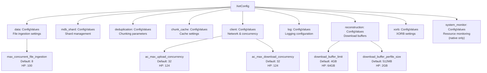
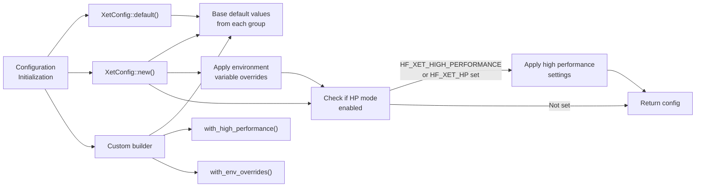
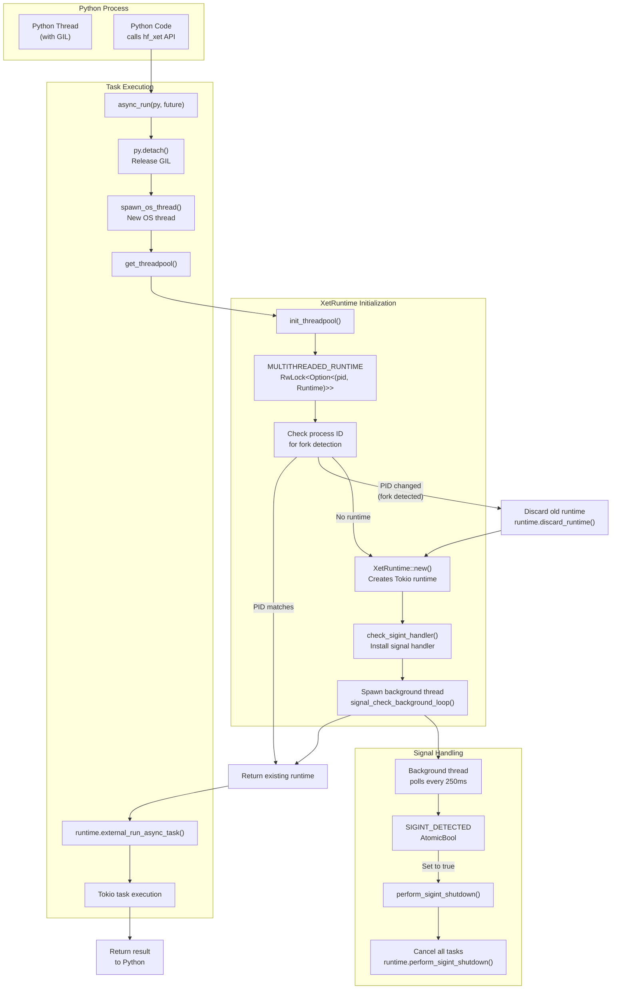
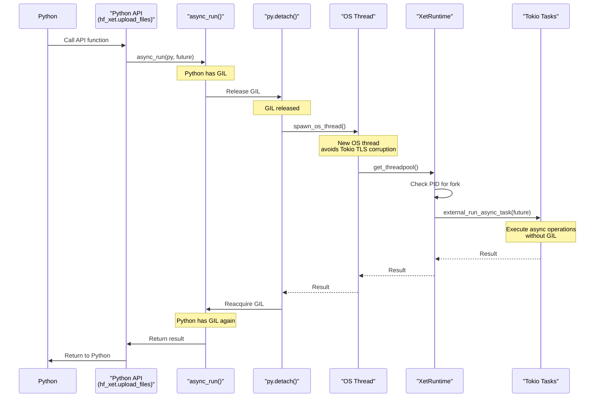
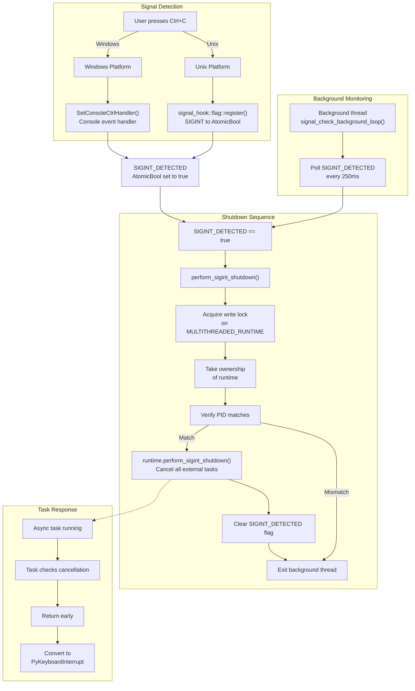
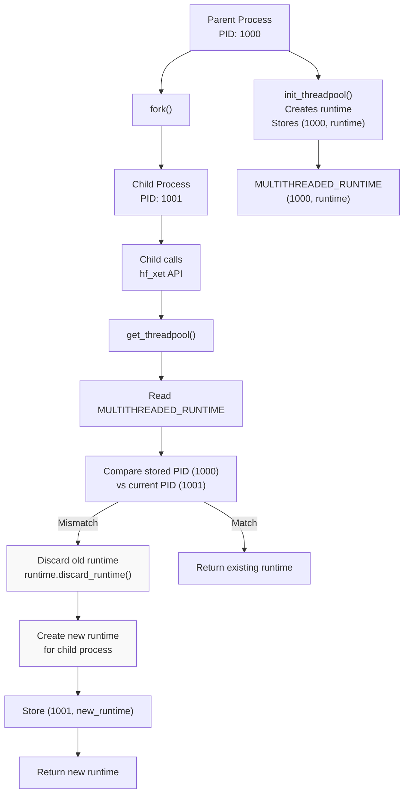

<!-- source: DeepWiki mcp.deepwiki.com · repo huggingface/xet-core · page 3.7 Configuration and Runtime · fetched 2026-10-26 -->

# Configuration and Runtime

<details>
<summary>Relevant source files</summary>

The following files were used as context for generating this wiki page:

- [hf_xet/src/runtime.rs](hf_xet/src/runtime.rs)
- [hf_xet_thin_wasm/Cargo.lock](hf_xet_thin_wasm/Cargo.lock)
- [hf_xet_wasm/Cargo.lock](hf_xet_wasm/Cargo.lock)
- [utils/Cargo.toml](utils/Cargo.toml)
- [utils/src/guards.rs](utils/src/guards.rs)
- [utils/src/lib.rs](utils/src/lib.rs)
- [utils/src/singleflight.rs](utils/src/singleflight.rs)
- [xet_config/src/xet_config.rs](xet_config/src/xet_config.rs)

</details>


This page documents the configuration system (`XetConfig`) and the async runtime infrastructure (`XetRuntime`) that provide foundational services for all operations in xet-core. These components manage system-wide settings, async task execution, thread pooling, signal handling, and Python integration.

For information about concurrency control and adaptive semaphores, see [Remote Client Operations](#3.3.2). For buffer management during downloads, see [File Reconstruction](#5.3).

---

## Overview

The configuration and runtime system consists of two main components:

1. **XetConfig**: A hierarchical configuration structure with environment variable overrides and a high-performance mode
2. **XetRuntime**: A Tokio-based async runtime with special handling for Python GIL release, SIGINT detection, and fork detection

These systems work together to provide a consistent execution environment across different use cases (Python API, CLI tools, WASM).

---

## XetConfig Structure

The `XetConfig` struct organizes all system configuration into logical groups. Each group corresponds to a major subsystem.



**Key Configuration Groups:**

| Group | Purpose | Key Settings |
|-------|---------|-------------|
| `data` | Controls file upload/download concurrency | `max_concurrent_file_ingestion` |
| `client` | HTTP client and adaptive concurrency | `ac_max_upload_concurrency`, `ac_initial_upload_concurrency` |
| `reconstruction` | Download buffer management | `download_buffer_limit`, `min_reconstruction_fetch_size` |
| `mdb_shard` | MDB shard behavior | Shard size limits, consolidation thresholds |
| `deduplication` | Chunking algorithm parameters | GearHash window sizes |
| `chunk_cache` | Disk cache configuration | Cache size, eviction policies |
| `xorb` | XORB creation thresholds | `MAX_XORB_BYTES`, `MAX_XORB_CHUNKS` |

**Sources:** [xet_config/src/xet_config.rs:1-83]()

---

## Configuration Initialization

The configuration system supports three initialization modes:



### Environment Variable Pattern

All configuration fields can be overridden using environment variables following the pattern:
```
HF_XET_{GROUP_NAME}_{FIELD_NAME}
```

Examples:
- `HF_XET_DATA_MAX_CONCURRENT_FILE_INGESTION=50`
- `HF_XET_CLIENT_AC_MAX_UPLOAD_CONCURRENCY=64`
- `HF_XET_RECONSTRUCTION_DOWNLOAD_BUFFER_LIMIT=8gb`

The configuration system automatically parses environment variables during initialization via `with_env_overrides()`.

**Sources:** [xet_config/src/xet_config.rs:34-50](), [utils/src/configuration_utils.rs]()

---

## High Performance Mode

High performance mode dramatically increases concurrency limits and buffer sizes for maximum throughput. It is enabled by setting either:
- `HF_XET_HIGH_PERFORMANCE=1`
- `HF_XET_HP=1`

### High Performance Settings

| Configuration | Default | High Performance | Change |
|--------------|---------|------------------|--------|
| `max_concurrent_file_ingestion` | 8 | 100 | +12.5× |
| `ac_max_upload_concurrency` | 32 | 124 | +3.9× |
| `ac_max_download_concurrency` | 32 | 124 | +3.9× |
| `ac_min_upload_concurrency` | 1 | 4 | +4× |
| `ac_min_download_concurrency` | 1 | 4 | +4× |
| `ac_initial_upload_concurrency` | 4 | 16 | +4× |
| `ac_initial_download_concurrency` | 4 | 16 | +4× |
| `min_reconstruction_fetch_size` | 64MB | 1GB | +16× |
| `max_reconstruction_fetch_size` | 1GB | 16GB | +16× |
| `download_buffer_size` | 1GB | 16GB | +16× |
| `download_buffer_perfile_size` | 512MB | 2GB | +4× |
| `download_buffer_limit` | 4GB | 64GB | +16× |

High performance mode is automatically applied by `XetConfig::new()` if the environment variables are detected. It can also be manually applied using `config.with_high_performance()`.

**Sources:** [xet_config/src/xet_config.rs:52-82]()

---

## XetRuntime Architecture

The `XetRuntime` provides a Tokio-based async execution environment with special handling for Python integration, signal handling, and fork detection.



### Key Runtime Components

**Global State:**
- `MULTITHREADED_RUNTIME`: Thread-safe storage for the runtime, keyed by process ID
- `SIGINT_DETECTED`: Atomic flag indicating SIGINT signal received
- `SIGINT_HANDLER_INSTALL_PID`: Tracks which process installed the signal handler

**Thread Safety:**
- Uses `RwLock` for runtime access (read-many, write-once pattern)
- Process ID checked on every access to detect fork
- Runtime is "poisoned" and discarded after fork-exec

**Sources:** [hf_xet/src/runtime.rs:1-250]()

---

## Python Integration

The async bridge between Python and Rust requires careful GIL management and thread-local storage handling.



### async_run Implementation

The `async_run` function is the bridge from synchronous Python code to async Rust code:

1. **GIL Release**: Uses `py.detach()` to release Python's Global Interpreter Lock
2. **OS Thread Spawn**: Creates a new OS thread (not Tokio thread) to avoid TLS corruption after fork
3. **Runtime Retrieval**: Gets or initializes the global `XetRuntime`
4. **Task Execution**: Runs the async task on the Tokio runtime
5. **GIL Reacquisition**: Automatically reacquires GIL when returning to Python
6. **Error Handling**: Converts Rust errors to Python exceptions

### Why OS Threads?

Tokio uses thread-local storage (TLS) for task scheduling. After a fork-exec, this TLS becomes invalid. By spawning a new OS thread for each external call, we ensure clean TLS state.

**Sources:** [hf_xet/src/runtime.rs:215-249]()

---

## SIGINT Handling

The system implements graceful shutdown on Ctrl+C (SIGINT) by detecting the signal, cancelling in-flight tasks, and cleaning up resources.



### Platform-Specific Handlers

**Unix (Linux, macOS):**
- Uses `signal_hook` crate for async-safe signal handling
- Registers SIGINT handler that sets `SIGINT_DETECTED` atomic flag
- Allows Python's signal handler to also receive SIGINT

**Windows:**
- Uses Windows Console API `SetConsoleCtrlHandler`
- Custom handler that sets `SIGINT_DETECTED` flag
- Always returns `FALSE` to allow Python handler to run

### Background Monitoring Thread

A dedicated non-Tokio thread polls the `SIGINT_DETECTED` flag every 250ms. When set:
1. Calls `perform_sigint_shutdown()` to cancel tasks
2. Clears the flag for next invocation
3. Exits the monitoring thread

This approach ensures SIGINT handling works even when Python is blocking on I/O or long-running operations.

### Error Translation

When tasks return errors during SIGINT shutdown, `async_run` converts them to `PyKeyboardInterrupt` instead of reporting internal errors. This provides a clean Python experience.

**Sources:** [hf_xet/src/runtime.rs:19-139](), [hf_xet/src/runtime.rs:211-249]()

---

## Fork Detection

Python's multiprocessing module uses fork-exec, which invalidates Tokio runtime state. The system detects this and reinitializes.



### Fork Detection Logic

1. **PID Storage**: Runtime is stored with process ID in `MULTITHREADED_RUNTIME`
2. **PID Check**: Every access checks current PID against stored PID
3. **Mismatch Handling**: If PID changed (fork detected):
   - Call `runtime.discard_runtime()` to mark old runtime as invalid
   - Create fresh runtime for child process
   - Reinstall SIGINT handler
4. **Memory Safety**: Old runtime is leaked but resources freed on process exit

### Why Discard Instead of Cleanup?

Tokio's runtime cannot be safely stopped from a different process. The old runtime's threads and resources belong to the parent process. The child process simply abandons them (via leak) and creates a clean new runtime.

**Sources:** [hf_xet/src/runtime.rs:142-209]()

---

## Utility Guards

The system provides RAII guards for temporary environment changes, useful for testing and scoped configuration modifications.

### EnvVarGuard

Temporarily sets an environment variable and restores the previous value on drop.

```rust
// Example usage
let _guard = EnvVarGuard::set("HF_XET_DATA_MAX_CONCURRENT_FILE_INGESTION", "50");
// Variable is set to "50" within this scope
// Automatically restored on drop
```

### CwdGuard

Temporarily changes current working directory and restores on drop.

```rust
let _guard = CwdGuard::set(Path::new("/tmp"))?;
// Working directory is /tmp within this scope
// Automatically restored on drop
```

### ClosureGuard

Executes a closure when dropped, ensuring cleanup logic runs even on early returns or panics.

```rust
let _guard = ClosureGuard::new(|| {
    println!("Cleanup code runs here");
});
// Closure executes when _guard is dropped
```

These guards use RAII (Resource Acquisition Is Initialization) patterns to ensure cleanup happens reliably, even in the presence of panics or early returns.

**Sources:** [utils/src/guards.rs:1-253]()

---

## Configuration Usage Patterns

### Basic Initialization

```rust
// Default configuration with environment overrides and auto HP detection
let config = XetConfig::new();
```

### Custom Configuration

```rust
// Start with defaults
let config = XetConfig::default()
    // Apply environment variables
    .with_env_overrides()
    // Force high performance mode
    .with_high_performance();
    
// Or manually customize
let mut config = XetConfig::default();
config.client.ac_max_upload_concurrency = 64;
config.reconstruction.download_buffer_limit = ByteSize::from("8gb");
```

### Per-Module Access

Configuration is typically passed to modules that need it:

```rust
// Example from CAS client
let client = RemoteClient::new(
    config.client.clone(),
    endpoint_url,
    token_refresher,
)?;

// Example from reconstruction
let reconstructor = FileReconstructor::new(
    config.reconstruction.clone(),
    shard_manager,
)?;
```

**Sources:** [xet_config/src/xet_config.rs:20-83]()

---

## Runtime Usage Patterns

### External Task Execution (from Python)

```rust
// In Python API bindings
pub fn upload_files(
    py: Python,
    // ... other params
) -> PyResult<Vec<PyXetUploadInfo>> {
    async_run(py, async move {
        // Async Rust code here, GIL released
        let result = data_client::upload_async(...).await?;
        Ok(result)
    })
}
```

### Internal Task Spawning

```rust
// Within async Rust code
let runtime = XetRuntime::new()?;
let result = runtime.external_run_async_task(async {
    // Async operations
    Ok(data)
}).await?;
```

### Singleflight Pattern (for deduplication)

The `Group` type from `utils::singleflight` uses the runtime for executing and deduplicating concurrent requests:

```rust
let group: Arc<Group<DataType, ErrorType>> = Arc::new(Group::new());

// Multiple concurrent calls with same key
let (result, is_owner) = group.work("unique_key", async {
    // Expensive operation only runs once
    Ok(compute_expensive_value())
}).await;
```

**Sources:** [hf_xet/src/runtime.rs:215-249](), [utils/src/singleflight.rs:219-244]()

---

## Thread Pool Configuration

The runtime creates a Tokio thread pool with the following characteristics:

- **Thread Count**: Auto-detected based on CPU cores (Tokio default)
- **Scheduler**: Multi-threaded work-stealing scheduler
- **Task Limits**: No hard limit on spawned tasks (memory-bound)
- **External Executor Tracking**: Counts external tasks for graceful shutdown

The runtime tracks "external executors" - tasks spawned via `external_run_async_task()`. During SIGINT shutdown, it waits for these to complete or cancels them after a timeout.

**Sources:** [xet_runtime crate](https://github.com/huggingface/xet-core/tree/main/xet_runtime)

---

## Summary

The Configuration and Runtime system provides:

1. **Hierarchical Configuration** (`XetConfig`) with environment variable overrides
2. **High Performance Mode** for maximum throughput scenarios
3. **Async Runtime** (`XetRuntime`) with Tokio-based task execution
4. **Python Integration** via GIL-aware async bridge
5. **SIGINT Handling** for graceful shutdown
6. **Fork Detection** to prevent runtime corruption
7. **RAII Guards** for scoped environment changes

These components form the foundation for all operations in xet-core, ensuring consistent behavior across different execution environments and handling edge cases like signal interruption and process forking.

---

