<!-- source: DeepWiki mcp.deepwiki.com · repo huggingface/xet-core · page 3.8 WASM Support · fetched 2026-10-26 -->

# WASM Support

<details>
<summary>Relevant source files</summary>

The following files were used as context for generating this wiki page:

- [hf_xet_thin_wasm/Cargo.lock](hf_xet_thin_wasm/Cargo.lock)
- [hf_xet_wasm/Cargo.lock](hf_xet_wasm/Cargo.lock)
- [utils/Cargo.toml](utils/Cargo.toml)
- [utils/src/guards.rs](utils/src/guards.rs)
- [utils/src/lib.rs](utils/src/lib.rs)
- [xet_config/src/xet_config.rs](xet_config/src/xet_config.rs)

</details>


This document describes the WebAssembly (WASM) compilation support in xet-core, including build targets, conditional compilation strategies, platform-specific limitations, and browser integration mechanisms. WASM support enables the core deduplication and content-addressable storage functionality to run in browser environments.

For information about the runtime execution infrastructure, see [Configuration and Runtime](#3.7). For Python API integration patterns, see [Python API (hf_xet)](#3.1).

## WASM Build Targets

The codebase maintains two distinct WASM build targets with different feature sets and dependency profiles:

### Full WASM Package (hf_xet_wasm)

The `hf_xet_wasm` package provides complete functionality for browser environments, including HTTP client operations, deduplication, and shard management.

```mermaid
graph TB
    subgraph "hf_xet_wasm Package"
        Main["hf_xet_wasm crate"]
        CasClient["cas_client<br/>HTTP/CAS operations"]
        Dedup["deduplication<br/>GearHash chunking"]
        MdbShard["mdb_shard<br/>Metadata storage"]
        XorbObject["xorb_object<br/>XORB handling"]
        ProgressTracking["progress_tracking"]
    end
    
    subgraph "WASM Runtime Dependencies"
        WasmBindgen["wasm-bindgen<br/>JS interop layer"]
        WasmBindgenFutures["wasm-bindgen-futures<br/>Promise integration"]
        JsSys["js-sys<br/>JavaScript types"]
        WebSys["web-sys<br/>Browser APIs"]
        TokioWasm["tokio_with_wasm<br/>Async runtime"]
        WasmThread["wasm_thread<br/>Threading support"]
    end
    
    subgraph "Browser Environment"
        ConsoleLog["console_log<br/>Logging to console"]
        ConsolePanic["console_error_panic_hook<br/>Better panics"]
        WebTime["web-time<br/>Time APIs"]
    end
    
    Main --> CasClient
    Main --> Dedup
    Main --> MdbShard
    Main --> XorbObject
    Main --> ProgressTracking
    
    Main --> WasmBindgen
    Main --> WasmBindgenFutures
    Main --> JsSys
    Main --> WebSys
    Main --> TokioWasm
    Main --> WasmThread
    Main --> ConsoleLog
    Main --> ConsolePanic
    Main --> WebTime
```

**Sources:** [hf_xet_wasm/Cargo.lock:1108-1140]()

### Thin WASM Package (hf_xet_thin_wasm)

The `hf_xet_thin_wasm` package provides a minimal build with reduced functionality, targeting scenarios where binary size is critical.

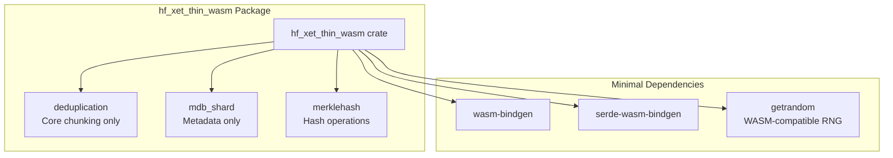

**Sources:** [hf_xet_thin_wasm/Cargo.lock:694-704]()

| Package | Size Priority | Network I/O | Full Dedup | Progress Tracking |
|---------|--------------|-------------|------------|-------------------|
| `hf_xet_wasm` | Standard | Yes (reqwest) | Yes | Yes |
| `hf_xet_thin_wasm` | Minimal | No | Yes | No |

## Conditional Compilation Strategy

The codebase uses Rust's conditional compilation features extensively to exclude non-WASM-compatible code from browser builds.

### Target Family Detection

All platform-specific code uses the `target_family = "wasm"` cfg attribute:

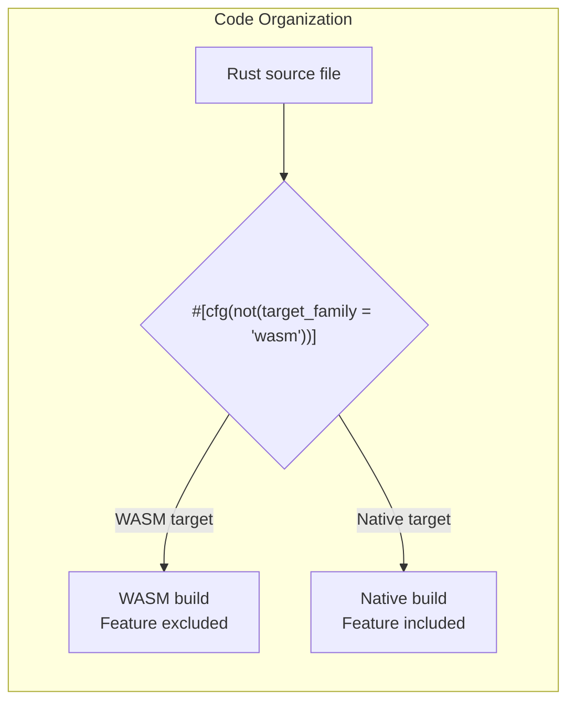

**Sources:** [utils/src/lib.rs:9-53]()

### Excluded Modules by Category

The following table summarizes modules conditionally excluded from WASM builds:

| Module Category | Module Name | Reason for Exclusion |
|----------------|-------------|---------------------|
| System monitoring | `system_monitor` | No access to system APIs |
| Concurrency | `limited_joinset` | Depends on OS threads |
| Synchronization | `singleflight` | Requires native threading |
| File system | `pipe` | No pipe support in browser |
| File paths | `file_paths`, `TemplatedPathBuf` | No native filesystem |
| Guards | `EnvVarGuard`, `CwdGuard`, `ClosureGuard` | No environment/cwd access |

**Sources:** [utils/src/lib.rs:9-53]()

### Configuration System Adaptations

The `XetConfig` system adapts its structure for WASM targets:

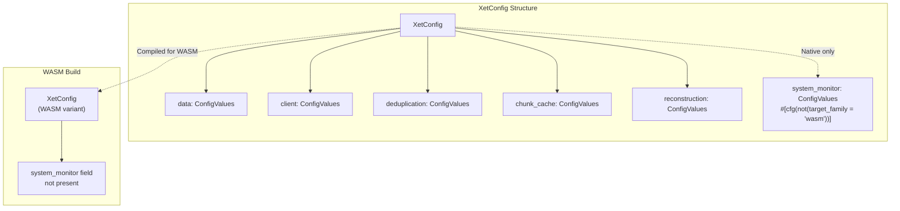

**Sources:** [xet_config/src/xet_config.rs:1-82]()

In WASM builds, the `system_monitor` configuration group and its initialization code are completely excluded:

- Configuration struct field excluded: [xet_config/src/xet_config.rs:16-17]()
- Environment override application excluded: [xet_config/src/xet_config.rs:47-48]()

## Platform Limitations in WASM

WASM builds impose several platform-specific limitations that affect system capabilities.

### Missing System Access

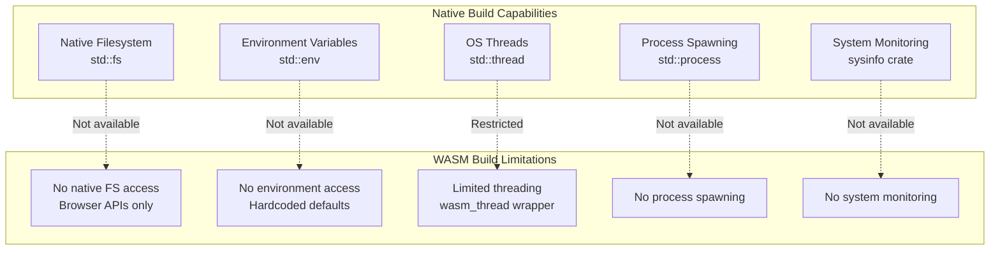

**Sources:** [utils/src/lib.rs:9-53](), [utils/Cargo.toml:40-52]()

### Dependency Substitutions

Several dependencies are replaced or excluded in WASM builds:

| Native Dependency | WASM Replacement | Purpose |
|------------------|------------------|---------|
| `sysinfo` | Excluded | System resource monitoring not needed |
| `tokio` (full) | `tokio_with_wasm` | WASM-compatible async runtime |
| `std::time` | `web-time` | Browser-compatible time APIs |
| `shellexpand` | Excluded | No shell environment |
| `rand` (OS RNG) | `getrandom` (wasm32) | Browser crypto.getRandomValues |

**Sources:** [utils/Cargo.toml:40-52](), [hf_xet_wasm/Cargo.lock:1119-1140]()

### Guard Utilities Unavailable

The guard utilities that manage environment state are excluded entirely from WASM builds:

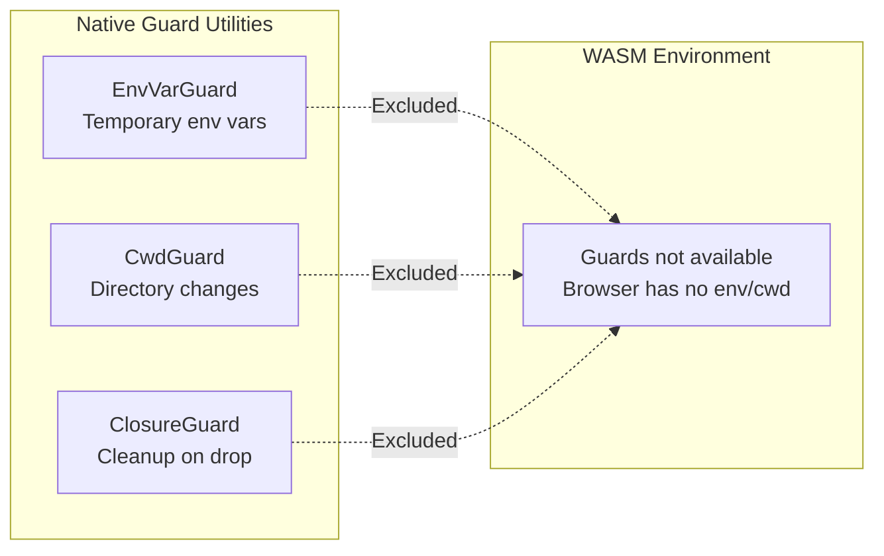

**Sources:** [utils/src/lib.rs:30-34](), [utils/src/guards.rs:1-253]()

These guards rely on POSIX-like system capabilities (environment variables, working directory) that do not exist in the browser sandbox.

## WASM-Specific Dependencies

### Browser Integration Layer

The WASM build includes a comprehensive browser integration layer through `wasm-bindgen` and related crates:

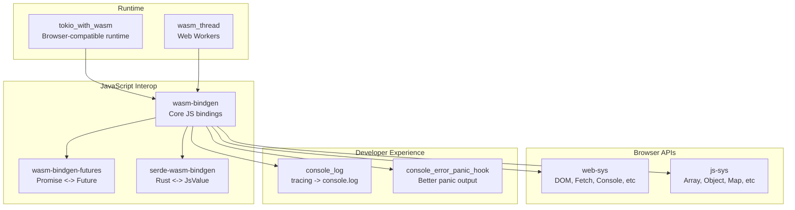

**Sources:** [hf_xet_wasm/Cargo.lock:1108-1140]()

### Key WASM Dependencies

| Crate | Version | Purpose |
|-------|---------|---------|
| `wasm-bindgen` | 0.3.77 | Core FFI layer between Rust and JavaScript |
| `wasm-bindgen-futures` | 0.4.x | Convert JavaScript Promises to Rust Futures |
| `wasm-bindgen-test` | 0.3.x | Test runner for browser environment |
| `web-sys` | 0.3.77 | Typed bindings to Web APIs (Fetch, Console, etc) |
| `js-sys` | 0.3.77 | Bindings to JavaScript built-in objects |
| `serde-wasm-bindgen` | 0.6.5 | Efficient Serde serialization to JsValue |
| `console_log` | 1.0.0 | Route tracing logs to browser console |
| `console_error_panic_hook` | 0.1.7 | Human-readable panic messages |
| `tokio_with_wasm` | (custom) | Tokio fork with WASM support |
| `wasm_thread` | (custom) | Web Workers abstraction |

**Sources:** [hf_xet_wasm/Cargo.lock:459-477](), [hf_xet_wasm/Cargo.lock:1133-1137]()

### Random Number Generation

The WASM build uses `getrandom` configured for WASM, which maps to the browser's `crypto.getRandomValues()`:

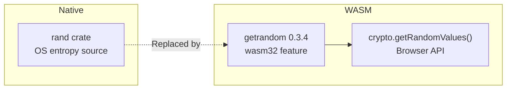

**Sources:** [hf_xet_wasm/Cargo.lock:1119](), [hf_xet_thin_wasm/Cargo.lock:698]()

## Runtime and Async Execution

### Tokio WASM Adaptation

The WASM build uses a specialized Tokio fork (`tokio_with_wasm`) that adapts the async runtime for browser environments:

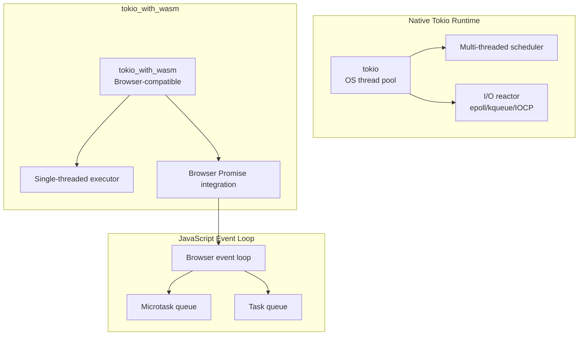

**Sources:** [hf_xet_wasm/Cargo.lock:1131]()

The key differences in WASM runtime:
- **No OS threads**: Uses single-threaded executor integrated with browser event loop
- **No blocking I/O**: All I/O operations must be async and use browser APIs
- **Promise integration**: Rust Futures map to JavaScript Promises via `wasm-bindgen-futures`

### Threading with Web Workers

For scenarios requiring parallelism, the WASM build can use `wasm_thread` to spawn Web Workers:

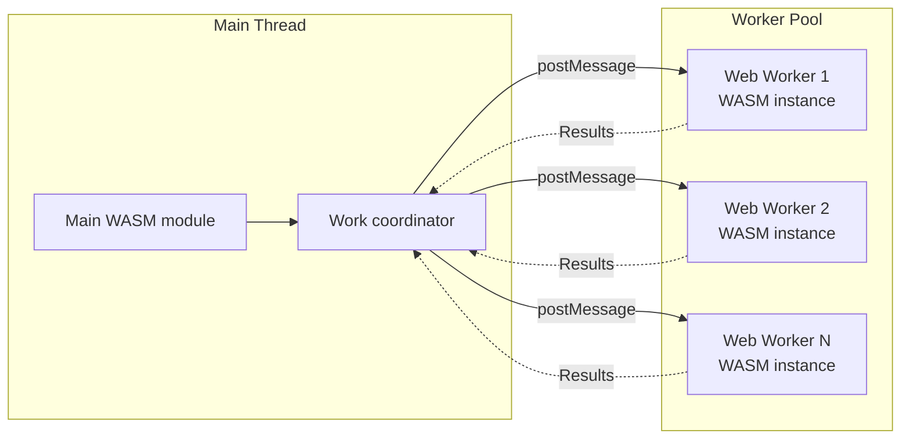

**Sources:** [hf_xet_wasm/Cargo.lock:1137]()

Each Web Worker runs an independent WASM instance with its own memory, requiring explicit message passing for communication.

## Browser Compatibility Considerations

### Compilation Target

The WASM packages compile to the `wasm32-unknown-unknown` target:

```
rustc --target wasm32-unknown-unknown
```

This target produces standalone WASM modules without requiring any system-specific imports beyond the JavaScript environment.

### API Surface Restrictions

When running in browsers, xet-core functionality is limited to operations compatible with Web APIs:

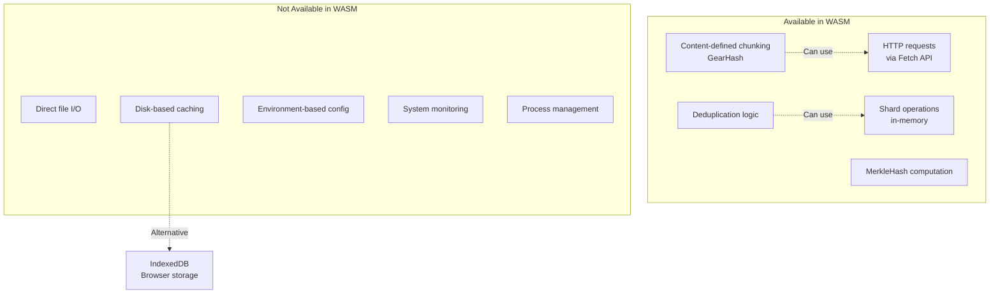

**Sources:** [utils/src/lib.rs:1-56](), [xet_config/src/xet_config.rs:1-83]()

### Testing in Browser Environment

The `wasm-bindgen-test` crate enables running tests directly in browser or Node.js environments:

```
wasm-pack test --headless --chrome
```

This test runner:
1. Compiles tests to WASM
2. Generates JavaScript test harness
3. Loads WASM module in browser
4. Executes tests and reports results

**Sources:** [hf_xet_wasm/Cargo.lock:1136]()

---

