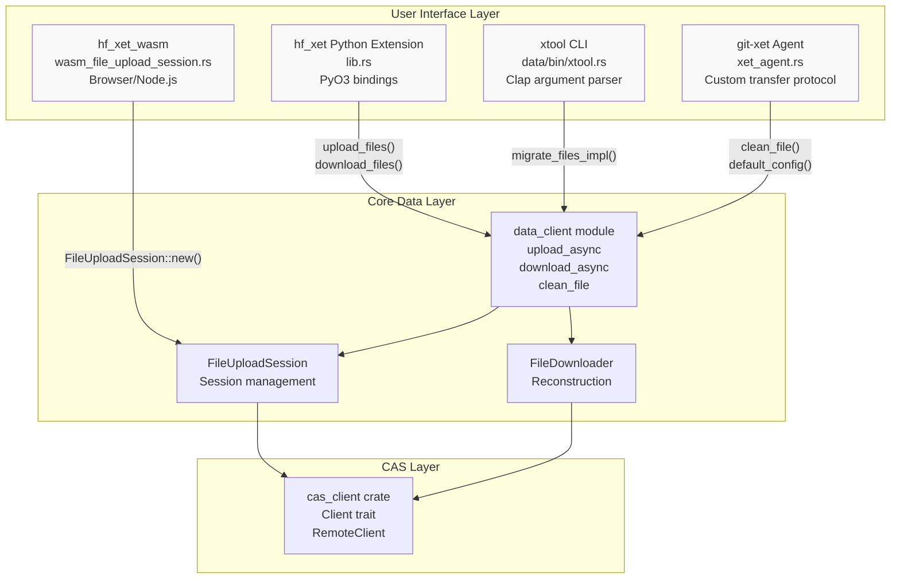
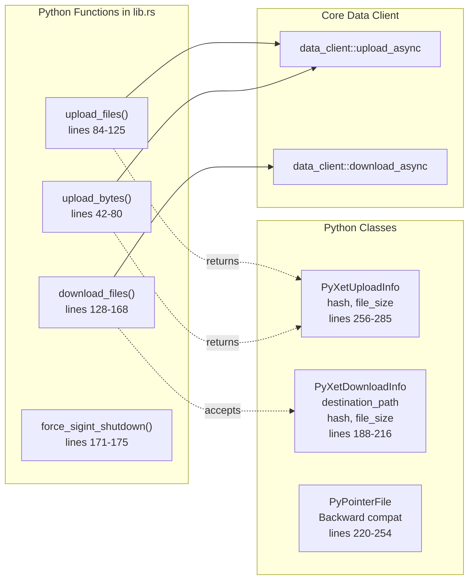
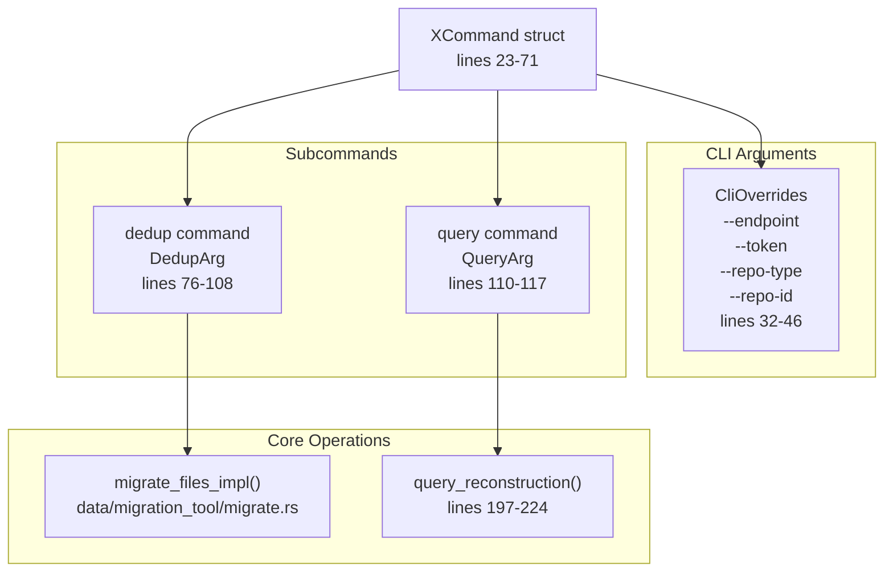
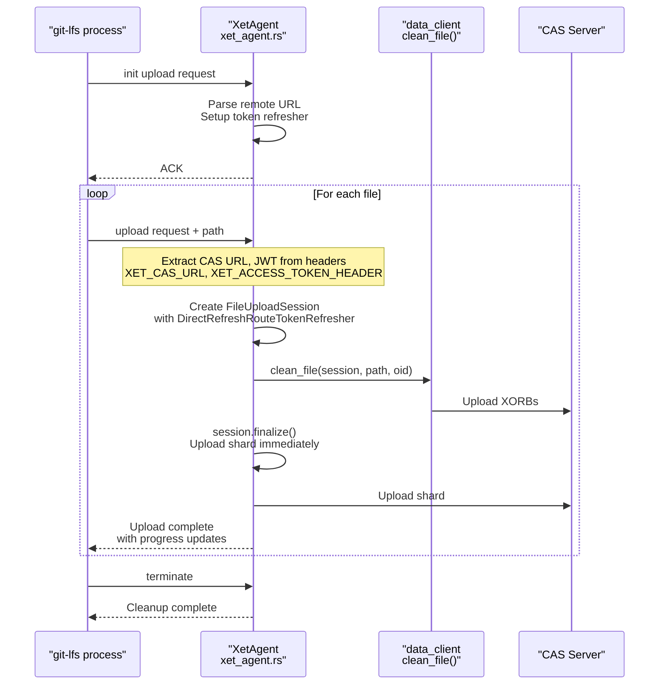
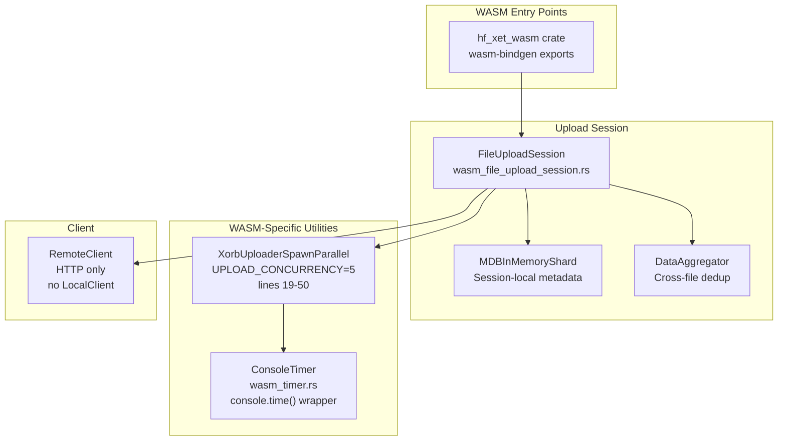
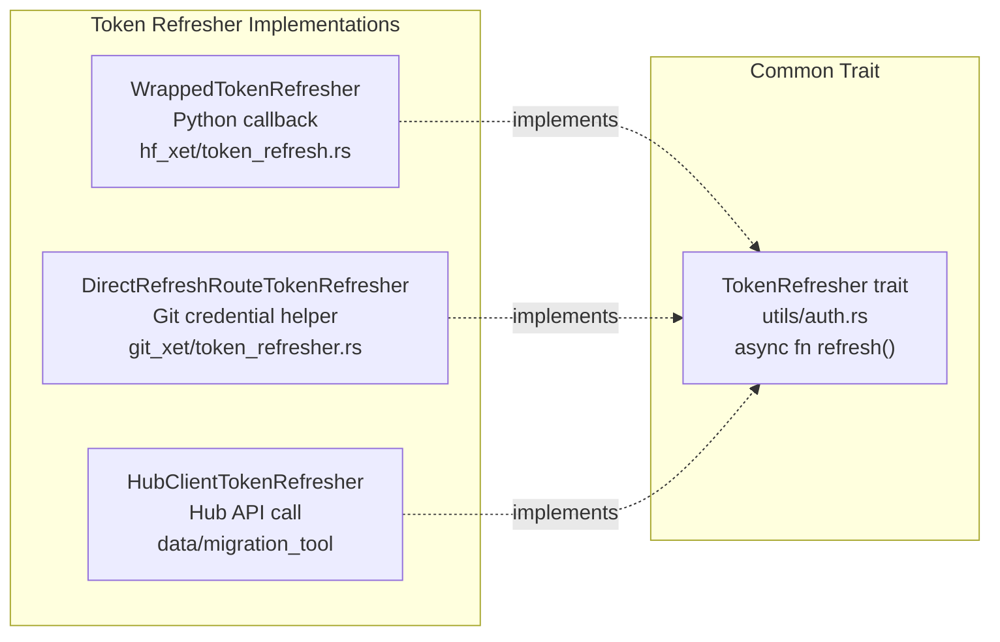
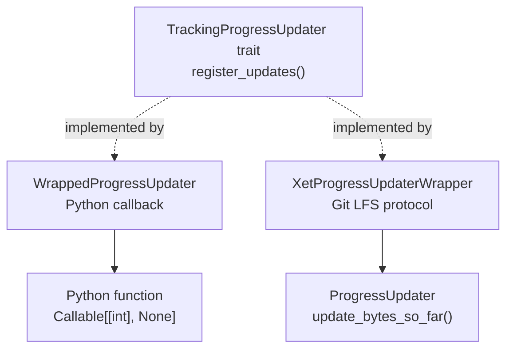

<!-- source: DeepWiki mcp.deepwiki.com · repo huggingface/xet-core · page 4 User Interfaces · fetched 2026-10-26 -->

# User Interfaces

<details>
<summary>Relevant source files</summary>

The following files were used as context for generating this wiki page:

- [data/src/bin/xtool.rs](data/src/bin/xtool.rs)
- [data/src/migration_tool/migrate.rs](data/src/migration_tool/migrate.rs)
- [data/src/remote_client_interface.rs](data/src/remote_client_interface.rs)
- [git_xet/src/app/xet_agent.rs](git_xet/src/app/xet_agent.rs)
- [hf_xet/Cargo.lock](hf_xet/Cargo.lock)
- [hf_xet/Cargo.toml](hf_xet/Cargo.toml)
- [hf_xet/src/lib.rs](hf_xet/src/lib.rs)

</details>


The xet-core system provides three distinct interfaces for interacting with the content-addressable storage system: a Python extension module, command-line tools, and a WebAssembly module. Each interface targets different deployment environments and use cases while sharing the same underlying data processing core. This page provides an overview of these interfaces and their architectural relationships.

For detailed information about specific interfaces, see:
- Command-line tools and utilities: [Command Line Tools](#4.1)
- Python SDK integration and API reference: [Python Integration](#4.2)
- Git LFS custom transfer agent: [Git LFS Integration](#4.3)

---

## Interface Architecture

The system implements a layered architecture where all user-facing interfaces depend on the same core data processing layer, ensuring consistent behavior across deployment targets.

**User Interface Layer Architecture**



Sources: [hf_xet/src/lib.rs:1-346](), [data/src/bin/xtool.rs:1-233](), [git_xet/src/app/xet_agent.rs:1-177](), [hf_xet_wasm/src/wasm_file_upload_session.rs:1-174]()

---

## Interface Comparison

Each interface is optimized for its target environment and provides different deployment characteristics:

| Feature | Python Extension | CLI Tools | Git LFS Agent | WebAssembly |
|---------|-----------------|-----------|---------------|-------------|
| **Primary File** | `hf_xet/src/lib.rs` | `data/src/bin/xtool.rs` | `git_xet/src/app/xet_agent.rs` | `hf_xet_wasm/src/lib.rs` |
| **Build Target** | `cdylib` (shared library) | Native binary | Native binary | `wasm32-unknown-unknown` |
| **Binding Layer** | PyO3 | Clap CLI parser | Git LFS protocol | wasm-bindgen |
| **Runtime** | Python 3.7+ | Standalone | Git subprocess | Browser/Node.js |
| **Concurrency Model** | Tokio async + Python GIL | Tokio multi-threaded | Tokio async | Single-threaded |
| **Local Caching** | Disk cache (disabled by default) | Disk cache (enabled) | Disk cache (enabled) | No disk cache |
| **Progress Updates** | Python callback | Console output | Git LFS protocol | JavaScript callback |
| **Authentication** | Token + refresh callback | HF_TOKEN env var | Git credential helper | Token passed explicitly |

Sources: [hf_xet/Cargo.toml:1-78](), [hf_xet/src/lib.rs:1-346](), [data/src/bin/xtool.rs:1-233](), [git_xet/src/app/xet_agent.rs:1-177]()

---

## Python Extension (hf_xet)

The `hf_xet` Python extension is built with PyO3 and exposes a high-level API for file upload and download operations. It is the primary interface for integration with the Hugging Face Hub Python SDK.

**Core Python API Functions**



The Python extension handles:
- **Async Runtime Management**: Bridges Python's event loop with Tokio's async runtime ([hf_xet/src/lib.rs:100-124]())
- **Token Refresh Integration**: Wraps Python callbacks for JWT token refresh ([hf_xet/src/lib.rs:51](), [hf_xet/src/lib.rs:93]())
- **Progress Callbacks**: Converts Python progress functions to Rust trait implementations ([hf_xet/src/lib.rs:177-184]())
- **Signal Handling**: Intercepts SIGINT to enable graceful shutdown ([hf_xet/src/lib.rs:171-175]())

The extension is compiled as a `cdylib` with Python 3.7+ ABI compatibility using the `abi3-py37` feature ([hf_xet/Cargo.toml:33-34]()).

Sources: [hf_xet/src/lib.rs:1-346](), [hf_xet/Cargo.toml:1-78]()

---

## Command Line Tools

The `xtool` binary provides a command-line interface for file deduplication analysis and migration operations. It is primarily used for batch processing and testing deduplication behavior.

**xtool Command Structure**



Key features:
- **Dry-run Mode**: Analyze deduplication without uploading data ([data/src/bin/xtool.rs:106-107]())
- **Recursive Directory Walking**: Process entire directory trees ([data/src/bin/xtool.rs:87-88](), [data/src/bin/xtool.rs:169-191]())
- **Sequential Processing**: Control concurrency for temporal analysis ([data/src/bin/xtool.rs:92-93]())
- **Compression Control**: Override compression scheme for testing ([data/src/bin/xtool.rs:98-104]())
- **JSON Output**: Export file reconstruction metadata ([data/src/bin/xtool.rs:95-97](), [data/src/bin/xtool.rs:138-146]())

The tool authenticates using environment variables `HF_ENDPOINT` and `HF_TOKEN` and constructs a `HubClient` for CAS operations ([data/src/bin/xtool.rs:50-67]()).

Sources: [data/src/bin/xtool.rs:1-233](), [data/src/migration_tool/migrate.rs:1-122]()

---

## Git LFS Integration

The `git-xet` binary implements a Git LFS custom transfer agent that enables transparent integration with Git workflows. It communicates with `git-lfs` via a line-delimited JSON protocol over stdin/stdout.

**Git LFS Transfer Agent Flow**



The agent implements the `TransferAgent` trait with key methods:
- **`init_upload()`**: Parses Git remote URL and initializes repository context ([git_xet/src/app/xet_agent.rs:34-61]())
- **`upload_one()`**: Processes a single file upload with progress reporting ([git_xet/src/app/xet_agent.rs:70-152]())
- **Immediate Shard Upload**: Unlike batch processing, uploads shards after each file to prevent data loss from SIGKILL ([git_xet/src/app/xet_agent.rs:138-149]())

The agent extracts authentication and configuration from Git LFS action headers:
- `XET_SESSION_ID`: Session identifier for correlation ([git_xet/src/app/xet_agent.rs:80]())
- `XET_CAS_URL`: CAS server endpoint ([git_xet/src/app/xet_agent.rs:106-111]())
- `XET_ACCESS_TOKEN_HEADER`: JWT token ([git_xet/src/app/xet_agent.rs:112-117]())
- `XET_TOKEN_EXPIRATION_HEADER`: Token expiry timestamp ([git_xet/src/app/xet_agent.rs:118-124]())

Token refresh is handled by `DirectRefreshRouteTokenRefresher`, which uses Git's credential helper system ([git_xet/src/app/xet_agent.rs:82-89]()).

Sources: [git_xet/src/app/xet_agent.rs:1-177](), [data/src/data_client.rs]()

---

## WebAssembly Interface

The `hf_xet_wasm` crate compiles to WebAssembly for browser and Node.js environments. It provides a simplified upload-only API with different architectural constraints.

**WASM-Specific Implementation**



Key WASM-specific characteristics:
- **No Disk Cache**: Browser environments lack filesystem access ([hf_xet_wasm/src/wasm_file_upload_session.rs:1-174]())
- **Fixed Concurrency**: Hardcoded to 5 parallel uploads ([hf_xet_wasm/src/wasm_file_upload_session.rs:19]())
- **Remote Client Only**: No `LocalClient` or `MemoryClient` support ([data/src/remote_client_interface.rs:27-38]())
- **Single-Threaded**: WASM lacks thread support, uses async I/O exclusively
- **In-Memory Shards**: Uses `MDBInMemoryShard` instead of disk-backed shards ([hf_xet_wasm/src/wasm_file_upload_session.rs:8](), [hf_xet_wasm/src/wasm_file_upload_session.rs:32]())

The WASM build uses conditional compilation to exclude unsupported features:

```rust
#[cfg(not(target_family = "wasm"))]
{
    Ok(cas_client::LocalClient::new(path).await?)
}
#[cfg(target_family = "wasm")]
unimplemented!("Local file system access is not supported in WASM builds")
```

Sources: [hf_xet_wasm/src/wasm_file_upload_session.rs:1-174](), [data/src/remote_client_interface.rs:1-41]()

---

## Common Design Patterns

All interfaces share common architectural patterns that ensure consistency:

### Configuration Initialization

Each interface constructs a `TranslatorConfig` using the `default_config()` helper:

| Interface | Configuration Location | Key Parameters |
|-----------|----------------------|----------------|
| Python | [hf_xet/src/lib.rs:108-116]() | `endpoint`, `token_info`, `token_refresher` |
| CLI | [data/src/bin/xtool.rs:74-80]() | `cas_url`, `compression`, `jwt_info` |
| Git LFS | [git_xet/src/app/xet_agent.rs:126-129]() | `cas_url`, `token_info`, `session_id` |
| WASM | [hf_xet_wasm/src/wasm_file_upload_session.rs:40-58]() | `config.data_config` fields |

### Token Refresh Mechanism

All interfaces support token refresh to handle long-running operations:



Sources: [hf_xet/src/lib.rs:51](), [git_xet/src/app/xet_agent.rs:82-89](), [data/src/migration_tool/migrate.rs:68-71]()

### Progress Reporting

All interfaces implement `TrackingProgressUpdater` for consistent progress tracking:



Sources: [hf_xet/src/lib.rs:177-184](), [git_xet/src/app/xet_agent.rs:167-176]()

### User Agent Strings

Each interface identifies itself with a specific user agent for telemetry:

- Python: `"hf_xet/1.2.1"` ([hf_xet/src/lib.rs:26]())
- CLI: `"xtool/[version]"` ([data/src/bin/xtool.rs:21]())
- Git LFS: `"git-xet/[version]"` ([git_xet/src/app/xet_agent.rs:16]())

These user agents are passed to the CAS client for request attribution ([hf_xet/src/lib.rs:68](), [data/src/bin/xtool.rs:64](), [git_xet/src/app/xet_agent.rs:86]()).

Sources: [hf_xet/src/lib.rs:26](), [data/src/bin/xtool.rs:21](), [git_xet/src/app/xet_agent.rs:16]()

---

