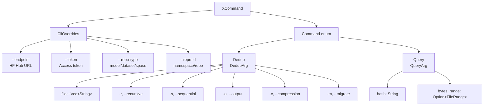
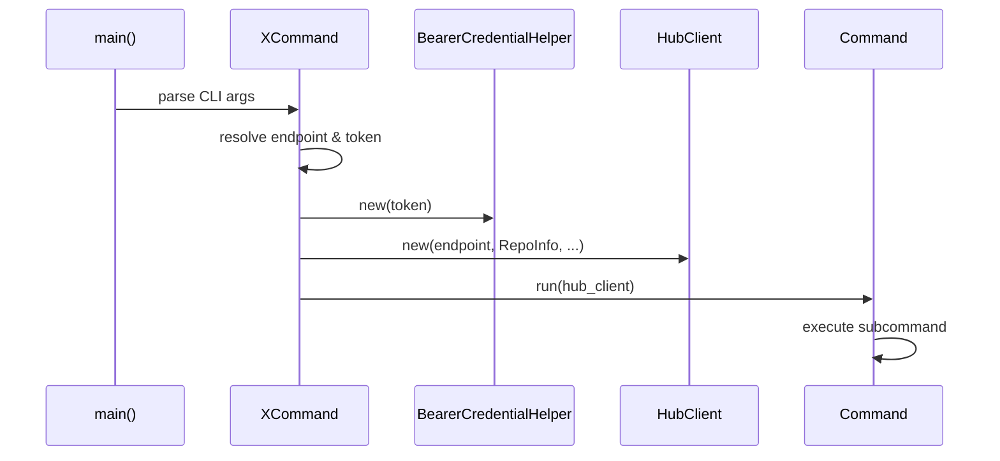
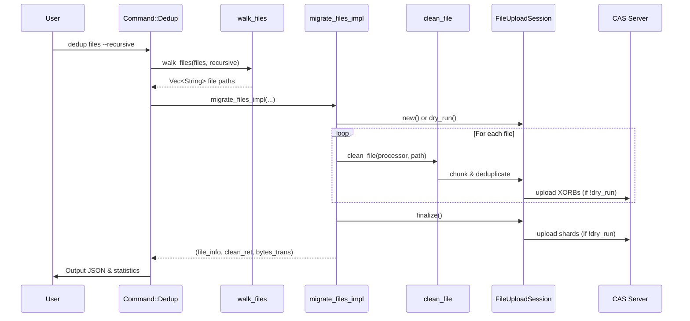
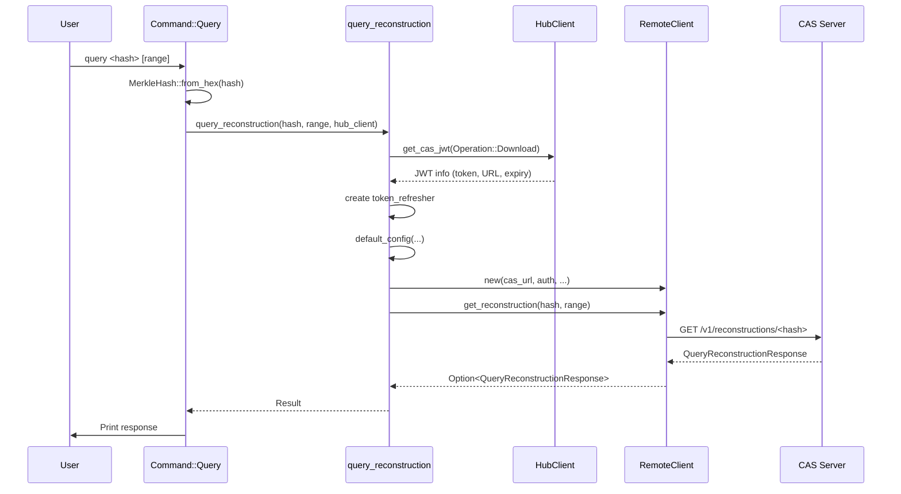
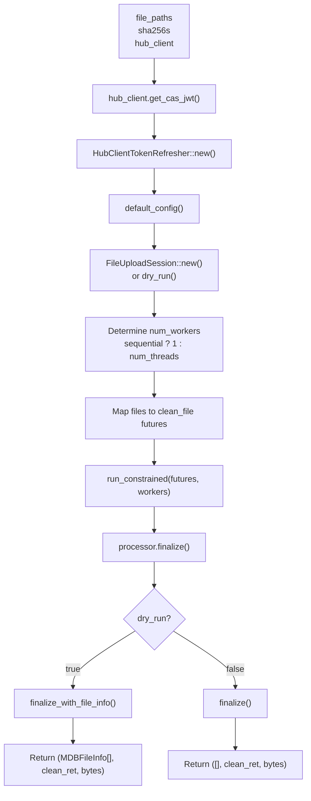
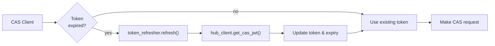
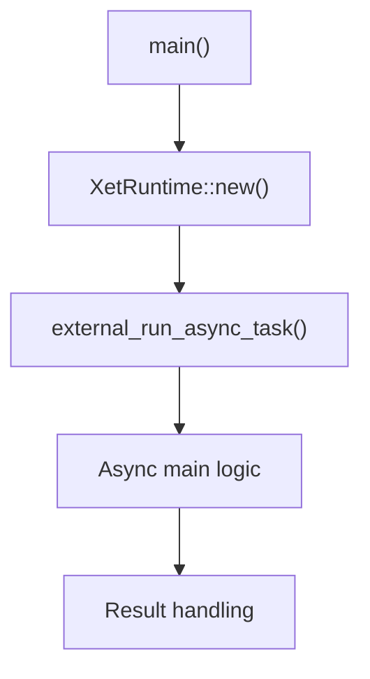

<!-- source: DeepWiki mcp.deepwiki.com · repo huggingface/xet-core · page 4.1 Command Line Tools · fetched 2026-10-26 -->

# Command Line Tools

<details>
<summary>Relevant source files</summary>

The following files were used as context for generating this wiki page:

- [data/src/bin/xtool.rs](data/src/bin/xtool.rs)
- [data/src/migration_tool/migrate.rs](data/src/migration_tool/migrate.rs)
- [data/src/remote_client_interface.rs](data/src/remote_client_interface.rs)
- [git_xet/src/app/xet_agent.rs](git_xet/src/app/xet_agent.rs)

</details>


The xet-core repository provides the `xtool` command-line utility for file migration, deduplication analysis, and CAS queries with Hugging Face Hub integration. This tool serves as both a demonstration of the system's capabilities and a production-ready utility for batch file operations.

For information about the Python API integration, see [Python API (hf_xet)](#3.1). For Git LFS integration with the `git-xet` transfer agent, see [Git LFS Integration](#4.2). For details about the underlying file processing workflows, see [File Processing Workflows](#5).

## Overview

The `xtool` binary provides two primary operations:

- **Dedup command**: Analyzes files for deduplication opportunities and optionally migrates them to CAS storage
- **Query command**: Retrieves reconstruction information for files by their Merkle hash

The tool utilizes the same underlying [Data Client and Sessions](#3.2) and [CAS Client System](#3.3) components that power the Python API and Git integration.

*Sources: [data/src/bin/xtool.rs:1-232]()*

## XTool Command Structure

The `xtool` binary is structured around two main components: global overrides for Hub configuration and subcommands for specific operations.

### CLI Argument Structure



**CLI Argument Mapping to Code Entities**

The `CliOverrides` struct [data/src/bin/xtool.rs:32-46]() provides Hub authentication configuration:

| Field | Type | Environment Variable | Description |
|-------|------|---------------------|-------------|
| `endpoint` | `Option<String>` | `HF_ENDPOINT` | Hub endpoint URL (defaults to https://huggingface.co) |
| `token` | `Option<String>` | `HF_TOKEN` | Hub access token |
| `repo_type` | `String` | - | Repository type: "model", "dataset", or "space" |
| `repo_id` | `String` | - | Repository identifier in format "namespace/repo" |

*Sources: [data/src/bin/xtool.rs:23-46]()*

### Authentication and Hub Client Setup

The tool establishes a Hub connection using the provided credentials:



The authentication flow [data/src/bin/xtool.rs:48-70]() creates a `BearerCredentialHelper` and initializes a `HubClient` with the repository information. The command is then executed with the authenticated client.

*Sources: [data/src/bin/xtool.rs:48-70]()*

## Dedup Command

The `dedup` subcommand analyzes files for deduplication opportunities and optionally migrates them to CAS storage.

### Dedup Command Arguments

The `DedupArg` struct [data/src/bin/xtool.rs:81-108]() defines the command parameters:

| Argument | Type | Description |
|----------|------|-------------|
| `files` | `Vec<String>` | Input files or directories to process |
| `--recursive` / `-r` | `bool` | Recursively process directories |
| `--sequential` / `-s` | `bool` | Process files sequentially (default: parallel) |
| `--output` / `-o` | `Option<PathBuf>` | JSON output file for reconstruction info |
| `--compression` / `-c` | `Option<u8>` | Compression scheme: 0=none, 1=LZ4, 2=byte-groups+LZ4 |
| `--migrate` / `-m` | `bool` | Actually upload to CAS (default: dry-run) |

*Sources: [data/src/bin/xtool.rs:81-108]()*

### Dedup Execution Flow



**File Discovery**

The `walk_files` function [data/src/bin/xtool.rs:169-191]() discovers files to process:
- In recursive mode, uses `WalkDir` to traverse directories
- Filters out Git special files (`.git`, `.gitignore`, `.gitattributes`)
- Returns a flat list of file paths

**Migration Invocation**

The command invokes `migrate_files_impl` [data/src/bin/xtool.rs:126-135]() with the discovered files:
- Creates a `FileUploadSession` (dry-run or actual)
- Processes files in parallel or sequentially based on `--sequential` flag
- Returns file info, clean results, and total bytes transmitted

**Output**

For dry-run mode (default), the command outputs:
- JSON-formatted reconstruction info to file or stdout [data/src/bin/xtool.rs:138-145]()
- Statistics showing original size vs deduplicated size per file [data/src/bin/xtool.rs:148-151]()
- Total bytes that would be transmitted [data/src/bin/xtool.rs:153]()

*Sources: [data/src/bin/xtool.rs:122-156](), [data/src/bin/xtool.rs:169-191]()*

## Query Command

The `query` subcommand retrieves reconstruction information for a file from CAS using its Merkle hash.

### Query Command Arguments

The `QueryArg` struct [data/src/bin/xtool.rs:110-117]() defines the query parameters:

| Argument | Type | Description |
|----------|------|-------------|
| `hash` | `String` | Merkle hash (xet-hash) of the file in hexadecimal |
| `bytes_range` | `Option<FileRange>` | Optional byte range to query (format: "start-end") |

### Query Execution Flow



**JWT Authentication Setup**

The query operation [data/src/bin/xtool.rs:197-224]() performs the following setup:
1. Obtains CAS JWT from Hub [data/src/bin/xtool.rs:203]()
2. Creates a `HubClientTokenRefresher` for token refresh [data/src/bin/xtool.rs:204-207]()
3. Builds configuration using `default_config` [data/src/bin/xtool.rs:209-215]()
4. Initializes `RemoteClient` with JWT authentication [data/src/bin/xtool.rs:217-218]()

**Reconstruction Query**

The `RemoteClient::get_reconstruction` method queries the CAS endpoint [data/src/bin/xtool.rs:220-223](), returning an `Option<QueryReconstructionResponse>` that contains:
- List of XORB hashes needed to reconstruct the file
- Byte ranges within each XORB
- File metadata

*Sources: [data/src/bin/xtool.rs:157-164](), [data/src/bin/xtool.rs:197-224]()*

## Migration Implementation

The `migrate_files_impl` function in [data/src/migration_tool/migrate.rs:56-121]() provides the core migration logic used by the dedup command.

### Migration Workflow



**JWT Authentication and Token Refresh**

The migration process begins by obtaining CAS access credentials [data/src/migration_tool/migrate.rs:66-67]():

1. Calls `hub_client.get_cas_jwt(Operation::Upload)` to get JWT token
2. Creates `HubClientTokenRefresher` [data/src/migration_tool/migrate.rs:68-71]() to handle token expiration
3. Builds `TranslatorConfig` using `default_config` [data/src/migration_tool/migrate.rs:74-80]()

**Session Creation and Processing Mode**

The function creates a `FileUploadSession` based on the `dry_run` flag [data/src/migration_tool/migrate.rs:88-92]():
- `FileUploadSession::dry_run()` - does not upload to CAS, returns detailed file info
- `FileUploadSession::new()` - performs actual uploads to CAS

**Parallel Processing**

Files are processed concurrently using `run_constrained` [data/src/migration_tool/migrate.rs:112]():
- Determines worker count: 1 for sequential, otherwise uses thread pool size [data/src/migration_tool/migrate.rs:83-87]()
- Creates futures for each file calling `clean_file` [data/src/migration_tool/migrate.rs:104-111]()
- Each future returns `(XetFileInfo, new_bytes)` tuple

**Finalization and Results**

The session is finalized differently based on mode [data/src/migration_tool/migrate.rs:114-120]():
- Dry-run: calls `finalize_with_file_info()` returning `MDBFileInfo` array
- Actual: calls `finalize()` uploading shards to CAS

The return type `MigrationInfo` is defined as [data/src/migration_tool/migrate.rs:54]():
```
type MigrationInfo = (Vec<MDBFileInfo>, Vec<(XetFileInfo, u64)>, u64)
```
Containing file reconstruction info, clean results, and total bytes uploaded.

*Sources: [data/src/migration_tool/migrate.rs:54-121]()*

### Token Refresher Pattern

The `HubClientTokenRefresher` [data/src/migration_tool/migrate.rs:68-71]() enables long-running operations:



The refresher implements the `TokenRefresher` trait, allowing the CAS client to automatically refresh expired JWT tokens by calling back to the Hub. This pattern is also used in the Git LFS integration.

*Sources: [data/src/migration_tool/migrate.rs:68-71](), [git_xet/src/app/xet_agent.rs:82-89]()*

## Runtime Management

Both CLI tools use the `XetRuntime` for async task execution:



The example binary uses a singleton pattern with `OnceLock` [data/src/bin/example.rs:60-65](), while xtool creates a runtime instance directly [data/src/bin/xtool.rs:225-226]().

*Sources: [data/src/bin/example.rs:60-72](), [data/src/bin/xtool.rs:223-229]()*

---

